# KAMBÁ — Documento Mestre
## Plataforma AI-first de comércio conversacional para Angola

> Documento consolidado da biblioteca de exploração.
> Gerado por `docs/compilar-mestre.sh` — NÃO EDITAR À MÃO.
> Fonte de verdade = ficheiros individuais em `docs/exploracao/`.
> Excluído: 09 (arquitetura v1, desatualizada). Ver também `docs/tecnica/` (conjunto formal).
> 👉 Não sabes por onde começar? Lê a PARTE 13 (big picture) e volta ao início.

## Índice

- **PARTE 01** — Modelo de negócios: os 10 negócios adaptados a Angola (AI-first)
- **PARTE 02** — Enquadramento em plataforma (agência → plataforma → marketplace)
- **PARTE 03** — Modelo Google: atenção gratuita, intenção paga
- **PARTE 04** — Pontos cegos, ronda 1 (stress-test)
- **PARTE 05** — Estratégia: loja no WhatsApp + fluxo dual (número plataforma e/ou PME)
- **PARTE 06** — Expansões da plataforma (5 camadas)
- **PARTE 07** — Pontos cegos, ronda 2 (stress-test + 8 validações)
- **PARTE 08** — Arquitetura técnica v2 (o produto) — exploratória
- **PARTE 10** — Arquitetura de plataforma holística (a visão) — exploratória
- **PARTE 11** — Desenho detalhado de engenharia (o como) — exploratória
- **PARTE 12** — Diagramas C4 e fluxogramas (o visual)
- **PARTE 13** — Big picture do ecossistema (core · verticais · integrações · governação)
- **PARTE 14** — Tese mínima e plano de validação (escopo do Piloto)

---


<!-- ============================================================ -->
# 📘 PARTE 01 — modelo-negocios-angola-ai-first

# Renda Invisível → Angola: 10 negócios modelados com princípio AI-First

Adaptação das ideias do vídeo "Renda Invisível" (@manual.da.riqueza93) para o mercado angolano,
com o princípio **AI-First**: a inteligência artificial executa o trabalho operacional (atendimento,
cadastro, cotação, edição, relatórios) e o humano vende, relaciona-se e controla a qualidade.

---

## 1. O contexto angolano (porquê agora)

- **~37 milhões de habitantes**, ~14,6 milhões de utilizadores de internet (2024) — penetração ainda
  baixa, o que significa mercado verde e pouca concorrência digital.
- **Pagamentos digitais em explosão**: o Multicaixa Express movimentou ~19,7 biliões Kz em 2025
  (+56%), com ~2,5 milhões de utilizadores ativos e 62% das operações da rede. KWiK, PayPay África e
  Unitel Money completam o ecossistema. QR Code já é comum em TPAs.
- **E-commerce doméstico ainda nascente** (0–5% de quota online): BayQi, Otchitanda, Roque Online,
  O Soba/Soba Store, Tupuca+ (delivery + lojas), Kubinga (transporte). Correio não é fiável →
  entregas por motoboy/courier local.
- **Setor informal pesa ~33%+ da economia** (zungueiras, quiosques, cantinas, boutiques de bairro).
  A "loja" destes vendedores é o **WhatsApp e o Instagram**, não um site.
- **IA entrou na agenda nacional**: Angotic, Go4AI (Angola Cables), programas de incubação.
  Quase nenhuma PME usa IA hoje — quem chegar primeiro vira referência.

### Regras de ouro do mercado angolano

1. **WhatsApp-first**: todo negócio abaixo vende e atende no WhatsApp Business. Site é secundário.
2. **Pagamento**: Multicaixa Express, referência Multicaixa, KWiK/PayPay; dinheiro na entrega para
   clientes novos (confiança).
3. **Preço em Kwanzas com pacotes fechados** (escopo claro + cancelamento simples).
4. **Logística**: parcerias com Kubinga/Tupuca/motoboys; nunca depender dos correios.
5. **Português angolano** nos textos (não PT-BR nem PT-PT puro).

---

## 2. O stack AI-First comum (custo ~50–150 USD/mês)

| Função | Ferramentas sugeridas |
|---|---|
| Agente de atendimento WhatsApp | Chatwoot/Wati/Twilio + GPT-4o/Claude (API), ou builders nacionais |
| Geração de texto (descrições, propostas) | GPT-4o, Claude, Gemini |
| Imagem de produto (fundo, melhoria, mockups) | Photoroom, Flair.ai, remove.bg, Magnific |
| OCR/documentos | GPT-4o Vision, Google Document AI, Tesseract |
| Automação de fluxos | Make, n8n (self-hosted, barato), Zapier |
| Voz/transcrição | Whisper API (áudio→texto para notas de voz de clientes) |
| Planilhas/relatórios | Google Sheets + Apps Script + IA |
| Pagamentos | Multicaixa Express, KWiK, PayPay, referência EMIS |

Princípio operacional: **o agente de IA faz 80–90% do trabalho; o humano faz a venda, a prova
social e o controlo de qualidade.** Margem típica de 70–90% em serviços digitais.

---

## 3. Os 10 negócios modelados

### Nº 1 — Agente de fornecedores (sourcing) com IA

**Versão angolana:** PMEs angolanas compram caro porque não sabem comparar fornecedores (mercado do
30, Kikolo, São Paulo; China via 1688/Alibaba; Dubai; África do Sul; Portugal). Você é o "departamento
de compras" terceirizado.

**AI-First:** agente de IA pesquisa e normaliza cotações (foto de talão, PDF, mensagem WhatsApp →
tabela comparativa), traduz chinês/inglês, rascunha mensagens de negociação e calcula custo total
(produto + frete + desalfandegamento) em Kz.

**Modelo de receita:** mensalidade de 80.000–250.000 Kz por empresa (2–4 cotações/mês) + comissão de
2–5% sobre importações fechadas.
**Meta do vídeo adaptada:** 10 empresas × 150.000 Kz = **1,5 milhão Kz/mês**.

### Nº 2 — Digitalização de arquivos com IA

**Versão angolana:** clínicas, advogados, contabilistas, imobiliárias e repartições acumulam anos de
papel. Você digitaliza e entrega uma estrutura de pastas pesquisável (Drive/servidor local).

**AI-First:** scanner de mesa + OCR com IA que classifica automaticamente (facturas, contratos,
processos de clientes), extrai campos (nomes, datas, valores) e gera índice pesquisável. Um humano
só confere amostras.

**Modelo de receita:** por caixa (300–500 páginas) a 25.000–60.000 Kz, ou pacote mensal para
empresas que geram papel continuamente.

### Nº 3 — Central de orçamentos expresso

**Versão angolana:** quem pede orçamento (construção, eventos, material de escritório, catering)
espera dias por resposta. Você devolve orçamento comparado **no mesmo dia**.

**AI-First:** base de preços viva alimentada por IA (extrai preços de mensagens, PDFs e sites),
gerador automático de proposta formatada com logo do cliente, alerta de variação de preço do câmbio
(USD→Kz afeta importados).

**Modelo de receita:** assinatura para empresas (100.000–300.000 Kz/mês) ou taxa por orçamento
entregue (5.000–20.000 Kz).

### Nº 4 — Cadastro de produtos em marketplaces e catálogos WhatsApp

**Versão angolana:** milhares de lojas têm presença incompleta na BayQi, Roque Online, Tupuca+ e —
sobretudo — **catálogo do WhatsApp Business desatualizado ou inexistente**. Catálogo incompleto = venda
perdida.

**AI-First:** foto do produto (telemóvel) → IA gera título, descrição em PT-AO, categoria, palavras-
chave e imagem com fundo limpo; publicação em lote. Sem copiar nem inventar especificações — IA
pergunta o que falta ao lojista.

**Modelo de receita:** pacotes fechados — 10 / 30 / 100 produtos (ex.: 15.000 / 35.000 / 90.000 Kz)
+ manutenção mensal do catálogo (20.000–50.000 Kz). Catálogo vivo = trabalho recorrente.

### Nº 5 — Fotografia de produtos AI-First (sem estúdio)

**Versão angolana:** vendedores de Instagram/WhatsApp (roupa, cosméticos, comida, móveis) precisam de
fotos boas mas não pagam estúdio tradicional. Você fotografa com telemóvel e a IA faz o resto.

**AI-First:** Photoroom/Flair para fundos infinitos, correção de luz, mockups de cenário (mesa de
restaurante, vitrine), geração de variações para redes sociais. Entrega em 24h.

**Modelo de receita:** Standard 10 fotos / Premium 25 fotos / pacote "menu digital" para restaurantes
(15.000–80.000 Kz por pacote). Recorrência: coleções novas a cada estação.

### Nº 6 — Central de secretaria virtual (atendimento) com agentes de IA

**Versão angolana:** clínicas, salões, advogados, escolas privadas e oficinas perdem clientes porque
ninguém responde ao WhatsApp a tempo. Você vende "rececionista digital + humana".

**AI-First:** agente de IA no WhatsApp Business responde em segundos (preços, morada, horários),
**marca e remarca consultas na agenda**, envia lembretes (reduz faltas) e escala para humano quando
o caso é sensível. Você supervisiona vários clientes de uma só vez.

**Modelo de receita:** mensalidade por empresa de 60.000–200.000 Kz conforme volume. Com IA, um
operador atende 15–30 clientes — é aqui que a margem escala.

### Nº 7 — Venda online por consignação (curadoria com dados)

**Versão angolana:** vender produtos de boutiques, zungueiras organizadas e pequenos importadores
**sem comprar estoque**: comissão só quando vende. Canal: Instagram + WhatsApp + BayQi/Tupuca+.

**AI-First:** IA analisa o que vende (engajamento, perguntas, conversões por categoria) e diz **o que
aceitar em consignação**; gera anúncios e responde interessados automaticamente; painel de vendas
transparente para o dono do produto (confiança = mais consignação).

**Modelo de receita:** comissão de 15–30% por venda. Meta: aprender 3–5 categorias vencedoras
(eletrónica, moda feminina, cosméticos, utilidades domésticas) e especializar.

### Nº 8 — Gestão de redes sociais B2B com IA (o "serviço recorrente" do vídeo)

**Versão angolana:** restaurantes, clínicas, imobiliárias e lojas sabem que precisam postar, mas não
têm tempo nem equipa. Você é o departamento de marketing deles.

**AI-First:** calendário de conteúdo gerado por IA (textos em PT-AO, legendas, hashtags locais),
artes com templates + IA, vídeos curtos com avatar/voz IA, relatório mensal automático. Humano aprova
e ajusta identidade.

**Modelo de receita:** pacotes de 80.000–250.000 Kz/mês por empresa (8–20 posts + stories +
respostas). **10 empresas × 150.000 Kz = 1,5 milhão Kz/mês** com 1 pessoa + stack de IA.

### Nº 9 — Clube de materiais digitais por assinatura (PT-AO)

**Versão angolana:** em vez de vender um ficheiro solto, uma **coleção que recebe material novo todo
mês**, por segmento:

- **Estudantes/professores**: resumos, exames resolvidos, fichas (currículo angolano).
- **Vendedores de WhatsApp**: templates de mensagem, catálogos prontos, artes de promoção.
- **Profissionais**: CVs, cartas de apresentação, planilhas de gestão, atas e contratos-modelo.

**AI-First:** IA produz e atualiza o acervo (com revisão humana), personaliza por nicho e monta
pacotes; entrega automática por WhatsApp/Telegram após pagamento Multicaixa Express.

**Modelo de receita:** 2.500–5.000 Kz/mês por assinante. Referência do vídeo adaptada:
**1.000 assinantes × 3.000 Kz = 3 milhões Kz/mês**.

### Nº 10 — Back-office B2B por assinatura (a "empresa de serviços invisíveis")

**Versão angolana:** pacote combinado para PMEs: atendimento WhatsApp (Nº 6) + relatórios + cobranças
+ organização de ficheiros. Você vende "tranquilidade administrativa" recorrente.

**AI-First:** agentes encadeados (n8n/Make): pedido do cliente → confirmação → lembrete de pagamento
(referência/MCX) → recibo → relatório semanal ao dono. Cancelamento simples e escopo claro, como o
vídeo prega.

**Modelo de receita:** 100.000–300.000 Kz/mês por empresa; 10–20 clientes sustentam uma operação
de 2–3 pessoas + IA.

---

## 4. Comparativo rápido

| Nº | Negócio | Investimento inicial | Ticket mensal típico | Escalabilidade com IA |
|---|---|---|---|---|
| 1 | Agente de fornecedores | Quase zero | 80–250 mil Kz/empresa | Alta |
| 2 | Digitalização de arquivos | Scanner (~150–400 USD) | 25–60 mil Kz/caixa | Alta |
| 3 | Central de orçamentos | Quase zero | 100–300 mil Kz/empresa | Alta |
| 4 | Cadastro em marketplaces | Zero | 20–50 mil Kz manutenção | Muito alta |
| 5 | Foto de produtos AI | Telemóvel + apps | 15–80 mil Kz/pacote | Alta |
| 6 | Secretaria virtual | Stack de IA | 60–200 mil Kz/empresa | Muito alta |
| 7 | Consignação online | Zero | 15–30% comissão | Alta |
| 8 | Gestão de redes B2B | Stack de IA | 80–250 mil Kz/empresa | Muito alta |
| 9 | Clube digital | Zero | 2,5–5 mil Kz/assinante | Muito alta |
| 10 | Back-office B2B | Stack de IA | 100–300 mil Kz/empresa | Muito alta |

---

## 5. Plano de 90 dias (genérico para qualquer um dos 10)

1. **Semanas 1–2 — Escolher e montar a oferta**: 1 negócio, 1 nicho (ex.: clínicas dentárias em
   Luanda), pacote fechado com escopo e cancelamento simples. Montar o stack de IA e um catálogo de
   demonstração (trabalho de amostra feito com IA).
2. **Semanas 3–4 — Primeiros 3 clientes**: lista de 50 empresas no WhatsApp/Instagram, mensagem
   personalizada (o vídeo insiste nisto), demonstração gratuita de 7 dias. Pagamento por Multicaixa
   Express.
3. **Mês 2 — Padronizar**: transformar tudo em processo (templates, prompts, fluxos n8n). Medir
   tempo por cliente — a IA deve reduzir 70%+ do trabalho.
4. **Mês 3 — Escalar**: subir preço, contratar 1 assistente para controlo de qualidade, pedir
   indicações e publicar casos de sucesso. Ciclo do vídeo: **vender de novo + melhorar + reinvestir**.

---

## Fontes

- EMIS / Rede Multicaixa 2025: [angolaexpert.com](https://www.angolaexpert.com/multicaixa-express-sistema-pagamentos-angola/), [istoenoticia.info](https://www.istoenoticia.info/emis-movimenta-atraves-da-rede-multicaixa-mais-de-69-bilioes-kwanzas-em-2025/), [polibosnews.com](https://polibosnews.com/emis-limite-transferencias-express-2025/)
- E-commerce Angola: [trade.gov](https://www.trade.gov/country-commercial-guides/angola-ecommerce), [ecdb.com](https://ecdb.com/resources/sample-data/market/ao/all), [aicep Portugal Global](https://portugalglobal.pt/livraria-digital/resources/perfil-de-mercado-e-commerce/angola/)
- Setor informal e PMEs: [UNCTAD — Revisão da estratégia de empreendedorismo de Angola](https://unctad.org/system/files/official-document/tcsdiaeinf2024d1_pt.pdf)
- IA em Angola: [LUSO AI](https://lusoai.com/noticias-ia/inteligencia-artificial-em-angola-estrategia-iniciativas-e-oportunidades/), [Go4AI — Angola Cables](https://redepme.com/2026/06/15/angola-cables-lanca-go4ai-para-acelerar-adocao-da-inteligencia-artificial/)
- Comércio via WhatsApp em Luanda: [MzansiBot](https://mzansibot.com/blog/comercio-informal-luanda-whatsapp-ia)


---


<!-- ============================================================ -->
# 📘 PARTE 02 — enquadramento-plataforma-angola

# Da "Renda Invisível" à Plataforma: enquadramento AI-First para Angola

Continuação de `01-modelo-negocios-angola-ai-first.md`. A pergunta: em vez de 10 negócios
isolados, como enquadrar tudo isto como **uma plataforma**?

---

## 1. A tese central

Os 10 negócios do vídeo parecem diferentes, mas partilham **a mesma infraestrutura e o mesmo cliente**:

- Mesmo cliente: a PME angolana (loja, clínica, restaurante, zungueira formalizada, importador)
- Mesmo canal: WhatsApp Business
- Mesmo motor: agentes de IA (atendimento, texto, imagem, OCR, orçamentos)
- Mesma cobrança: Multicaixa Express / KWiK / referência
- Mesma dor: "não tenho tempo nem equipa para o digital"

Logo, o enquadramento natural não é "10 serviços" — é **um sistema operacional de negócio para a
PME angolana, WhatsApp-native, movido a agentes de IA**.

> Posicionamento: **"O sócio digital do pequeno negócio angolano"** — a PME fala com um número de
> WhatsApp e a plataforma resolve: atende clientes, cadastra produtos, faz orçamentos, trata das
> redes sociais, digitaliza documentos e cobra.

Nomes de trabalho (verificar disponibilidade): *Sócio Digital*, *Kambá AI* ("kambá" = amigo em
Kimbundu), *Mukanda* (escritório/registo), *Dikanza*.

---

## 2. Os três modelos de plataforma possíveis

### Modelo A — Agência-como-software (productized services)
Você vende assinatura de serviços; por trás, IA + operadores humanos entregam.
- **Prós:** começa hoje, zero produto de software, valida tudo
- **Contras:** escala limitada por operadores; margem ~70%, não 95%
- **É o ponto de partida, não o destino.**

### Modelo B — Plataforma modular de agentes (SaaS AI-First)
Cada negócio do vídeo vira um **módulo** que a PME ativa num painel (ou por WhatsApp):

| Módulo | Vem do negócio Nº |
|---|---|
| Rececionista AI (atendimento + agenda) | 6 |
| Catálogo AI (cadastro de produtos + fotos) | 4, 5 |
| Orçamentos AI | 3 |
| Social AI (redes sociais + relatórios) | 8 |
| Arquivo AI (digitalização/OCR) | 2 |
| Compras AI (fornecedores) | 1 |
| Cobranças AI (referências MCX, lembretes) | 10 |

- **Prós:** margem de software, escala infinita, dados acumulam
- **Contras:** exige construir produto; PME angolana tem baixa literacia digital → self-service puro falha
- **Solução:** *self-service assistido* — a ativação é feita pela equipa, o cliente só fala no WhatsApp

### Modelo C — Marketplace de dois lados
Demanda = PMEs. Oferta = freelancers/operadores angolanos que entregam usando as ferramentas de IA
da plataforma (fotógrafos com Photoroom, assistentes com o agente de IA, digitadores com OCR).
A plataforma cobra SaaS + comissão (10–20%).
- **Prós:** efeito de rede, cria emprego (narrativa forte para Angola), escala sem contratar
- **Contras:** galinha-e-ovo, controlo de qualidade
- **É a fase 3.**

### Recomendação: A → B → C (wedge → platform → marketplace)

```
Fase 1 (0–6 meses)   Agência-como-software: 1 módulo, entrega manual+IA, 20-50 clientes
Fase 2 (6–18 meses)  Plataforma modular: transformar o que foi validado em produto
Fase 3 (18+ meses)   Marketplace: abrir a operadores terceiros com as suas ferramentas
```

---

## 3. A cunha (wedge): por onde entrar

Critérios: dor diária, pagamento recorrente fácil de justificar, gera dados, baixa fricção.

**Cunha recomendada: Rececionista AI (módulo 6) para clínicas, salões e oficinas de Luanda.**

- Dor diária e visível: WhatsApp sem resposta = cliente perdido hoje
- ROI óbvio: "recuperámos 12 marcações este mês" = mensalidade paga
- Uso diário → hábito → *sticky*
- Cada conversa treina o contexto do negócio → base para vender os outros módulos
- Cross-sell natural: quem tem atendimento AI quer catálogo (Nº 4), redes sociais (Nº 8) e
  cobranças (Nº 10)

Métrica de land-and-expand: **módulos por cliente** (meta: 1,0 → 2,5 em 12 meses). O ARPU cresce
sem custo de aquisição novo.

---

## 4. Arquitetura da plataforma (5 camadas)

```
┌─────────────────────────────────────────────────┐
│ 5. MÓDULOS   Rececionista · Catálogo · Orçamentos│
│              Social · Arquivo · Compras · Cobrança│
├─────────────────────────────────────────────────┤
│ 4. AGENTES   Orquestrador (roteia intenções)     │
│              + agentes especialistas por módulo  │
│              LLMs: GPT-4o / Claude / Gemini      │
├─────────────────────────────────────────────────┤
│ 3. DADOS     Perfil do negócio · histórico       │
│              base de preços/fornecedores (moat)  │
│              memória por cliente (RAG)           │
├─────────────────────────────────────────────────┤
│ 2. PAGAMENTOS Multicaixa Express · referência    │
│              KWiK · PayPay · reconciliação auto  │
├─────────────────────────────────────────────────┤
│ 1. CANAL     WhatsApp Business API (primário)    │
│              Instagram DM · painel web (secundário)│
└─────────────────────────────────────────────────┘
```

Decisões-chave:
- **WhatsApp como interface principal** — não obrigar a PME a aprender um dashboard novo;
  o painel web existe para quem quiser, não como requisito
- **Orquestrador de intenções**: uma mensagem "quanto custa o corte?" vai para o Rececionista;
  "cadastra estes 20 produtos" vai para o Catálogo — o cliente não precisa saber que há módulos
- **n8n/Make como espinha dorsal** na fase 1; código próprio só quando os fluxos estabilizarem
- **Human-in-the-loop configurável**: mensagens sensíveis (reclamação, negociação, saúde) escalam
  para humano

---

## 5. O fosso competitivo (moat)

1. **Dados proprietários angolanos**: base viva de preços e fornecedores (mercado do 30, Kikolo,
   importadores) + o que vende em cada categoria/bairro — ninguém tem isto estruturado
2. **Contexto acumulado por PME**: histórico de clientes, preços, agenda — trocar de plataforma
   custa caro (switching cost)
3. **PT-AO + realidade local**: câmbio USD→Kz, pagamento na entrega, sotaques e gíria em mensagens
   de voz (Whisper + fine-tuning), feriados e sazonalidade angolana
4. **Integração EMIS/pagamentos**: reconciliação automática de referências é chata de construir —
   quem tiver feito, tem vantagem
5. **Marca de confiança**: num mercado com receio de fraude, ser "o sócio digital que já atende
   500 negócios" é defensável

---

## 6. Modelo de receita da plataforma

| Linha | Preço indicativo | Notas |
|---|---|---|
| Plano Base (1 módulo) | 25.000–60.000 Kz/mês | entrada, preço "multicaixa-friendly" |
| Plano Negócio (3 módulos) | 90.000–150.000 Kz/mês | sweet spot |
| Plano Pro (todos + prioridade humana) | 200.000–350.000 Kz/mês | clínicas, imobiliárias |
| Transações | 1–3% sobre cobranças processadas | quando o módulo Cobranças escalar |
| Marketplace (fase 3) | 10–20% comissão | sobre trabalho de operadores |
| Setup/onboarding | 30.000–80.000 Kz uma vez | filtra curiosos, paga a ativação |

Conta de guarda-chuva: 100 PMEs × 90.000 Kz = **9 milhões Kz/mês** de receita recorrente,
com stack de IA de algumas centenas de dólares + equipa enxuta de supervisão.

---

## 7. Riscos e mitigações

| Risco | Mitigação |
|---|---|
| Dependência da API do WhatsApp (Meta) | Multi-canal desde cedo (Instagram, app própria na fase 3); cumprir políticas à risca |
| Baixa literacia digital da PME | Ativação assistida; interface = conversa; prova com demonstração de 7 dias |
| Confiança/pagamento | Dinheiro na entrega no B2C; contratos simples, cancelamento fácil no B2B |
| Custo de dados/internet do cliente | Tudo acontece no WhatsApp que ele já usa; zero app pesada |
| Concorrência copia os agentes | O moat é dados + contexto + integrações, não o prompt |
| Cambial (Kz desvaloriza) | Indexar planos a custos em USD; rever preços trimestralmente |

---

## 8. Roadmap executável

**Mês 0–2 — Fundação**: escolher nicho (clínicas/salões), montar Rececionista AI em n8n + WhatsApp
API, ativar 5 pilotos a preço reduzido, medir marcações recuperadas.

**Mês 3–6 — Prova**: 20–30 clientes pagantes, padronizar onboarding (checklist + templates +
prompts), contratar 1 supervisor humano. Publicar casos com números.

**Mês 7–12 — Plataforma**: transformar fluxos validados em produto (painel mínimo + orquestrador),
lançar módulos Catálogo e Cobranças como cross-sell. Meta: 60–100 PMEs, módulos/cliente > 1,5.

**Mês 13–24 — Marketplace**: abrir para operadores terceiros (formação + certificação "operador AI"),
comissão sobre entregas, expandir para Benguela e Huíla.

---

## 9. Como comunicar a plataforma (narrativa)

Não vender "IA" — vender **resultado**:
- ❌ "Agentes de IA para PMEs" 
- ✅ "Nunca mais perca um cliente por não responder ao WhatsApp"
- ✅ "A sua loja no catálogo em 48 horas"
- ✅ "O seu sócio digital: atende, vende e cobra — por menos que um salário de rececionista"

A IA fica nos bastidores, como no vídeo original: a renda é invisível porque o trabalho também é.


---


<!-- ============================================================ -->
# 📘 PARTE 03 — modelo-plataforma-google-angola

# Modelo de Plataforma estilo Google para Angola: atenção gratuita, intenção paga

Continuação de `01-modelo-negocios-angola-ai-first.md` e `02-enquadramento-plataforma-angola.md`.
Objetivo: adaptar o modelo Google (utilizadores grátis + anunciantes pagos + ecossistema fechado)
à plataforma angolana AI-First, com base em pesquisa de referências globais e africanas.

---

## 1. O modelo Google, traduzido

| Pilar Google | Adaptação angolana |
|---|---|
| Utilizadores grátis (Search, Gmail, Maps, YouTube) → atenção | **Assistente de consumo gratuito no WhatsApp**: o angolano pergunta "onde compro X mais barato no Kilamba?", "marca consulta no dentista", "quanto custa Y em Luanda" — e a plataforma responde de graça, 24/7 |
| Anunciantes pagos (Google Ads) → monetizam a intenção | **PMEs, importadores, marcas e distribuidores pagam** para serem a resposta: destaque nas recomendações, leads qualificados, transações e módulos premium |
| Ecossistema fechado (Android, login Google) → dados + retenção | **WhatsApp + pagamentos (Multicaixa Express/KWiK) + base de catálogos e preços** — quanto mais se usa, mais a plataforma sabe o que se compra, a que preço e onde |

A diferença fundamental: **o "motor de busca" de Angola não é uma caixa de pesquisa — é uma
conversa de WhatsApp.** A economia informal angolana já funciona por mensagem ("tens?", "quanto
é?", "manda a referência"). A plataforma não cria um comportamento novo; organiza o que já existe.

---

## 2. Os três lados da plataforma

### Lado 1 — Consumidores (GRATUITO, a base de atenção)

Produto: **assistente pessoal de consumo no WhatsApp** (nomes de trabalho: *Kambá*, *Soba*, *Waza*).
- "Onde tem farmácia aberta agora perto do Viana?" → resposta com opções, preços e contacto
- "Compara o preço de um frigorífico no Kikolo vs. lojas online" → tabela comparada
- "Marca-me corte de cabelo sábado no Talatona" → agendamento direto na agenda da barbearia
- "Quanto está o câmbio / a conta de luz / o bilhete" → utilidades diárias

Porque é grátis: cada pergunta é um **dado de intenção de compra real** — o equivalente angolano
à query do Google. Ninguém no país tem este mapa: o que se procura, onde, a que preço, e o que
fecha em venda.

O assistente vive num **único número oficial da plataforma** e tem dois modos: **handoff**
(envia o cliente para o WhatsApp da loja, que fecha a venda) ou **venda assistida** (fecha o
pedido em nome da PME na própria conversa, com o pagamento a liquidar diretamente na conta dela).
O consumidor escolhe o canal — número da plataforma **e/ou** número da PME; a plataforma
transaciona nos dois.

### Lado 2 — PMEs (FREEMIUM, a base de oferta)

- **Grátis**: ficha no diretório, catálogo básico (até N produtos), rececionista AI com limite de
  conversas/mês, aparecer nas respostas orgânicas do assistente **e vender sob o número da
  plataforma** (modo "light", sem número próprio na API — rampa de entrada para o modo completo)
- **Pago (módulos do documento anterior)**: rececionista ilimitado, catálogo pro, orçamentos AI,
  redes sociais, cobranças, relatórios
- **Pago (visibilidade)**: destaque patrocinado nas recomendações, prioridade na categoria/bairro

O freemium resolve o problema da literacia digital: entrar custa zero e a equipa ativa tudo;
a PME só fala no WhatsApp.

### Lado 3 — Anunciantes e marcas (PAGO, o motor de receita de escala)

- **Importadores e distribuidores** (os "fornecedores" do negócio Nº 1): pagam para que os seus
  produtos sejam recomendados quando o consumidor compara preços
- **Marcas de consumo** (cervejarias, telecoms, bancos, seguradoras): campanhas conversacionais
  segmentadas por intenção real — não por perfil demográfico como no Facebook
- **Bancos e fintechs**: ofertas contextuais (conta, crédito, seguro) no momento da compra

Formato nativo: a recomendação patrocinada **dentro da conversa**, sempre marcada como tal
(transparência) e sempre com opt-in do utilizador (exigência das políticas do WhatsApp).

---

## 3. O que a pesquisa mostrou (referências e avisos)

### ⚠️ Aviso 1 — Atenção sem monetização morre: o caso Ayoba
A super-app da MTN chegou a **35 milhões de utilizadores ativos/mês** e foi
[encerrada em março de 2026](https://techcabal.com/2026/03/24/mtn-begins-shutdown-of-ayoba-as-it-shifts-to-unified-digital-platform/).
A MTN redirecionou o foco para fintech — que processou **$500 mil milhões em transações** com
crescimento de 24,9%, enquanto os serviços digitais cresceram só 15%
([Tech Insider](https://techinsider.africa/mtn-to-shut-down-ayoba-as-it-reassesses-its-super-app-ambitions/)).

**Lição:** em África, audiência grande não paga contas — o mercado publicitário digital africano
vale ~$3,8 mil milhões (2025) e Angola é uma fatia pequena
([Yahoo/Research&Markets](https://finance.yahoo.com/news/africa-digital-ad-spend-business-090100920.html)).
**A monetização tem de nascer ancorada em transações e leads, não em display ads.** A publicidade
pura é a fase final, não a inicial.

### ⚠️ Aviso 2 — Não construir uma app nova: o caso M-Pesa
O M-Pesa [cedeu o domínio das mensagens ao WhatsApp](https://blog.mondato.com/from-mobile-money-powerhouse-to-super-app-the-case-of-m-pesa/),
que é usado por 97% dos internautas no Quénia (e domina igualmente em Angola).

**Lição:** o ecossistema constrói-se **sobre** o WhatsApp, não contra ele. Zero downloads.

### ✅ Prova 1 — Retail media funciona em África: o caso Jumia
A Jumia lançou anúncios (Mirakl Ads) em 9 países africanos em 2 meses:
[**+28% de receita publicitária, +12% de GMV dos vendedores, ROAS médio 9:1**](https://www.mirakl.com/content/customer-stories/jumia/).
Vendedores pagam por visibilidade **quando ela converte em venda mensurável**.

**Lição:** o nosso "destaque patrocinado" deve ser vendido com prova de conversão (leads e vendas
registadas pela própria plataforma) — é retail media conversacional.

### ✅ Prova 2 — WeChat monetiza em camadas
O WeChat cobra [anúncios aos comerciantes + comissão sobre transações via WeChat Pay + tempo de
permanência no ecossistema](https://www.ad-hoc-news.de/boerse/news/ueberblick/the-wechat-app-mini-programs-tencent-bets-on-deeper-daily-integration/69803052).

**Lição:** a sequência correta é pagamentos/transações primeiro, publicidade depois — e os dois
juntos compõem o fosso.

### ✅ Prova 3 — A Meta já validou o funil conversacional
Anúncios click-to-WhatsApp geram
[$1,5–10 mil milhões/ano à Meta, a crescer ~80% ao ano](https://www.sendwo.com/blog/rise-of-conversational-commerce-on-whatsapp/);
200M+ de negócios usam WhatsApp Business mensalmente.

**Lição:** a Meta monetiza o **topo** do funil (o clique); a nossa plataforma é a **camada de
conversão** (a conversa, o orçamento, a marcação, a cobrança). Somos complementares à Meta, não
concorrentes — e podemos até comprar click-to-WhatsApp ads para crescer.

---

## 4. As cinco linhas de receita (na ordem certa)

| # | Linha | Quando | Preço indicativo |
|---|---|---|---|
| 1 | **Assinaturas premium das PMEs** (módulos) | Desde o dia 1 — financia tudo | 25.000–350.000 Kz/mês |
| 2 | **Leads qualificados (CPL)** — consumidor pediu, PME recebe o contacto quente | Com ~1.000 consumidores ativos | 500–5.000 Kz/lead por categoria |
| 3 | **Comissão sobre transações** — marcações, pedidos e cobranças processadas (MCX/referência) | Com módulo Cobranças ativo | 1–3% por transação |
| 4 | **Destaque patrocinado** — prioridade nas recomendações da categoria/bairro | Com ~10.000 consumidores ativos | leilão mensal por categoria/bairro, ex. 20.000–200.000 Kz |
| 5 | **Campanhas de marcas** — distribuidores, bancos, telecoms | Escala (50.000+ utilizadores) | pacotes de campanha conversacional |

Repare-se: as linhas 1–3 são o **modelo da agência-como-software** (já desenhado); as linhas 4–5
são o **modelo Google** propriamente dito. A primeira financia a construção da segunda. Este é o
erro que a Ayoba cometeu ao contrário: tentou escala antes de receita.

---

## 5. O flywheel (a "máquina Google" adaptada)

```
Assistente grátis atrai consumidores
        ↓
Perguntas geram dados de intenção (o que, onde, a que preço)
        ↓
PMEs querem estar no diretório para serem recomendadas (grátis → freemium)
        ↓
Mais oferta = respostas melhores = mais consumidores
        ↓
PMEs pagam por módulos (1) e leads (2); transações geram comissão (3)
        ↓
Dados de conversão provam ROI → leilão de destaque (4) e marcas (5)
        ↓
Receita financia melhor IA + mais categorias + mais cidades
```

O fosso composto: **dados de intenção + preços reais + contexto das PMEs + integração EMIS** —
cada volta do ciclo torna a plataforma mais difícil de copiar.

---

## 6. O que muda face ao enquadramento anterior

| Antes (plataforma B2B) | Agora (modelo Google) |
|---|---|
| Cliente = PME | Cliente pagante = PME/marca; utilizador = consumidor |
| Receita só de assinatura | 5 linhas de receita em fases |
| Crescimento por vendas diretas | Crescimento por utilidade gratuita (produto) |
| Dados são subproduto | Dados de intenção são o ativo central |
| Concorrente: agências e ERPs | Concorrente real: o "perguntar ao conhecido no WhatsApp" |

A cunha mantém-se: o **Rececionista AI** para clínicas/salões continua a ser o ponto de entrada
B2B — mas agora cada marcação feita por ele é também um **consumidor dentro do ecossistema**,
sem custo de aquisição. O B2B paga a construção do B2C.

---

## 7. Métricas norte do modelo

1. **Perguntas de consumidores/semana** (atenção) — a "query volume" da plataforma
2. **Taxa de resposta útil** (qualidade da IA) — % de perguntas resolvidas sem humano
3. **Leads entregues → vendas fechadas** (prova de ROI para cobrar)
4. **Módulos por PME** (expansão B2B)
5. **% de conversas que terminam em transação** (caminho para a linha 3)

---

## 8. Riscos específicos do modelo de atenção

| Risco | Mitigação |
|---|---|
| Política do WhatsApp proíbe spam/ads não solicitados | Assistente é opt-in; patrocínio só dentro de conversas iniciadas pelo utilizador e marcado como "patrocinado" |
| Confiança: "a recomendação é paga?" | Transparência radical: rótulo claro + sempre mostrar alternativa orgânica; credibilidade é o ativo |
| Lei de Proteção de Dados de Angola (Lei n.º 22/11) | Consentimento explícito, dados anonimizados para segmentação, DPO desde cedo |
| Mercado de ads angolano pequeno | Linhas 4–5 só depois de escala; receita inicial vem de assinaturas/leads/transações |
| Custo de aquisição de consumidores | Crescer dentro das PMEs (cada cliente do Rececionista vira utilizador) + conteúdo viral de utilidade ("pergunta ao Kambá") |

---

## 9. Roadmap revisto (modelo Google em 3 atos)

**Ato 1 (0–6 meses) — Receita primeiro**: Rececionista AI + Catálogo AI para 20–50 PMEs pagantes
em Luanda. Em paralelo, ligar o assistente de consumo gratuito **só para os catálogos destas PMEs**
(perguntas de preço/disponibilidade/marcação). Primeiros dados de intenção.

**Ato 2 (6–18 meses) — Atenção organizada**: abrir o assistente ao público por categoria e bairro;
lançar CPL (linha 2) e comissão de transações (linha 3); diretório freemium atrai centenas de PMEs
sem custo de vendas.

**Ato 3 (18+ meses) — Monetização de atenção**: leilão de destaque patrocinado por categoria/bairro
(linha 4); primeiras campanhas de marcas/distribuidores (linha 5); expansão para Benguela/Huíla;
marketplace de operadores (fase C do enquadramento anterior).

---

## Fontes

- Encerramento da Ayoba: [TechCabal](https://techcabal.com/2026/03/24/mtn-begins-shutdown-of-ayoba-as-it-shifts-to-unified-digital-platform/), [Tech Insider](https://techinsider.africa/mtn-to-shut-down-ayoba-as-it-reassesses-its-super-app-ambitions/), 35M MAU: [Technology Times](https://technologytimes.ng/ayoba-mtn-super-app-reaches-35-million-users/)
- M-Pesa vs WhatsApp: [Mondato](https://blog.mondato.com/from-mobile-money-powerhouse-to-super-app-the-case-of-m-pesa/)
- Ad spend digital em África: [Yahoo Finance/Research and Markets](https://finance.yahoo.com/news/africa-digital-ad-spend-business-090100920.html)
- Jumia + Mirakl Ads: [Mirakl](https://www.mirakl.com/content/customer-stories/jumia/)
- Modelo WeChat: [ad-hoc-news](https://www.ad-hoc-news.de/boerse/news/ueberblick/the-wechat-app-mini-programs-tencent-bets-on-deeper-daily-integration/69803052), [FourWeekMBA](https://fourweekmba.com/how-does-wechat-make-money/)
- Click-to-WhatsApp e comércio conversacional: [Sendwo](https://www.sendwo.com/blog/rise-of-conversational-commerce-on-whatsapp/), [egrow](https://www.egrow.com/en/blog/whatsapp-commerce-statistics-2026-the-numbers-every-e-commerce-owner-should-know)
- Dados Angola: ver `01-modelo-negocios-angola-ai-first.md` (EMIS, UNCTAD, trade.gov)


---


<!-- ============================================================ -->
# 📘 PARTE 04 — pontos-cegos-plataforma

# Pontos cegos da visão de plataforma (advogado do diabo)

Continuação de `03-modelo-plataforma-google-angola.md`. Stress-test honesto ao que foi desenhado,
ordenado do mais estrutural ao mais operacional.

---

## 1. O problema do índice — o maior de todos

**O Google indexou uma web que já existia. Nós temos de criar a web.**

Não existe camada de dados estruturados sobre o comércio angolano: sem sites, sem fichas de
negócio, sem preços online, sem horários, sem stock. Quando o consumidor perguntar "onde compro um
frigorífico mais barato no Kikolo?", o assistente só responde bem se alguém tiver **criado e
mantido** essa informação. A IA não inventa o índice — ela apenas o consulta.

Consequência prática: a parte mais cara da plataforma não é a tecnologia, é a **digitalização
física** — equipas de rua nos mercados (30, Kikolo, São Paulo, Asa Branca), loja a loja, como a
Jumia fez com redes de agentes e o Google fez com o Street View. Não orçamentámos isto em lado
nenhum.

**Pergunta de validação:** quanto custa criar e manter fresca 1 ficha de negócio em Luanda?

## 2. A frescura dos dados

Mesmo com o índice criado: preços em Angola mudam com o câmbio (às vezes semanalmente), o stock é
volátil, o vendedor informal não atualiza catálogo nenhum. **Uma resposta desatualizada destrói a
confiança mais depressa do que uma ausência de resposta.** É preciso um mecanismo de frescura:
a PME atualiza porque recebe leads (incentivo), o assistente pergunta ativamente ("ainda tem?"),
parcerias com distribuidores para preços de referência. Sem isto, o produto degrada-se sozinho.

## 3. A economia unitária do lado gratuito

O custo marginal de uma pesquisa no Google é ~zero. O nosso não:
- WhatsApp Business API **cobra por conversa** (mensagens de serviço iniciadas pelo negócio têm tarifa)
- Cada mensagem gasta **inferência de LLM** (e nota de voz gasta Whisper + LLM)

Ou seja: **o assistente gratuito tem custo real e crescente por utilizador.** Se escalar antes da
monetização, escala prejuízo — o pecado da Ayoba, mas na versão custo variável. É preciso modelar
o custo por utilizador ativo/mês em Kz e desenhar tetos (mensagens grátis/mês, categorias pagas).

## 4. A Meta é concorrente, não só parceira

Dois movimentos da dona da plataforma:
- **Meta AI dentro do WhatsApp**, grátis e por defeito — porque haveria o angolano de falar com o
  nosso assistente em vez do da Meta? Resposta: só se tivermos os **dados locais estruturados** que
  a Meta não tem (preços reais, stock, quem está aberto agora). O que reforça o ponto 1: o índice
  não é um detalhe, é a defesa existencial.
- **WhatsApp Business já traz grátis** catálogo, respostas rápidas e mensagens automáticas — e vai
  ganhar cada vez mais IA nativa para PMEs. O nosso wedge (Rececionista AI) pode ser comoditizado
  de graça pelo próprio WhatsApp.

Defesa real: aquilo que a Meta nunca fará para Angola — integração EMIS/referências, agenda com
confirmação, facturação AGT, preços de mercado locais, operação humana de back-office.

## 5. O comportamento real do consumidor angolano

A "busca" angolana é **social**: pergunta-se no grupo de WhatsApp do bairro, nos status, ao
vizinho, ao taxista. Confia-se na recomendação de uma pessoa conhecida. O nosso concorrente real
não é o Google nem a Meta — **é a tia do grupo**. Um bot desconhecido a recomendar onde gastar
30.000 Kz exige um salto de confiança que subestimámos. Hipóteses de ataque: entrar como utilidade
*dentro* de comunidades existentes (grupos, associações de bairro, igrejas, empresas) em vez de
assistente isolado; prova social antes de escala.

## 6. Fraude e a armadilha do patrocínio

- Angola tem histórico de burlas online → listagens falsas, perfis fantasma e esquemas vão tentar
  usar a plataforma. **Custo de moderação e verificação não está orçamentado** (KYC de negócios,
  verificação presencial das fichas — outra vez equipas de rua).
- O patrocínio só funciona como o Google se a camada orgânica for genuinamente útil. Com índice
  fraco (ponto 1), "destaque patrocinado" torna-se pay-to-play visível → destrói credibilidade.
  A transparência que defendemos é necessária mas não suficiente.

## 7. Assumimos rails de pagamento que não controlamos

Tratámos "integração Multicaixa Express / reconciliação automática" como detalhe técnico. Não é:
- A EMIS não tem API aberta self-service para startups; acesso é **negociação institucional**
- Cobrar comissão sobre transações pode exigir enquadramento junto do **BNA** (intermediação de
  pagamentos)
- KWiK/PayPay têm os seus próprios interesses e podem querer ser eles a plataforma

A linha de receita 3 (comissão sobre transações) depende de **parceria**, não de código. E
parcerias em Angola levam trimestres, não sprints.

## 8. O go-to-market angolano é de relações, não de produto

O Google cresceu com distribution deals (default search em browsers). O equivalente angolano:
- **Telecoms** (Unitel/Movicel): zero-rating do assistente, bundles, USSD fallback
- **Bancos** (BFA, BAI, BIC): programas PME, canais de app, co-marketing
- **Estado**: INAPEM, PRODEL, agenda de formalização da economia informal — pode ser canal e até
  financiador
- **Associações** de comerciantes e mercados organizados

Num mercado de relações, **um contrato de parceria vale mais do que dez features**. Isto devia
estar no centro da estratégia e está na periferia.

## 9. Endereços e logística: a camada que falta para fechar transações

"Atrás do mercado, perto da bomba" não é endereçável. Sem georreferenciação e sem logística
fiável, a conversa converte mas a entrega falha — e a falha é atribuída à plataforma. Opções:
parceria com Kubinga/Tupuca desde cedo, ou módulo próprio de localização (o "Google Maps do bairro"
é, ele próprio, um produto com valor).

## 10. Voz e línguas

O utilizador informal comunica por **notas de voz** e mistura português com Kimbundu/Umbundu.
Os LLMs atuais lidam bem com PT; com línguas nacionais, mal. Se a interface falhar na voz, perdemos
exatamente o segmento que mais precisa da plataforma. Isto é testável em uma semana e devia ser
testado **antes** de qualquer desenvolvimento.

## 11. Regulatório: o risco esquecido e a oportunidade esquecida

- Risco: Lei n.º 22/11 (proteção de dados), regras BNA se tocarmos pagamentos, publicidade
  conversacional sem enquadramento claro.
- **Oportunidade ignorada:** a AGT está a impor **facturação electrónica às PMEs**. Um módulo
  "Factura AI" (emite factura certificada a partir de uma mensagem de WhatsApp) pode ser um wedge
  **melhor que o Rececionista**: dor regulamentar, obrigatória, com prazo — as PMEs pagam para
  cumprir, não para experimentar. Nenhum dos três documentos aproveitou isto.

## 12. Capital e cadência

O modelo de 3 atos precisa de subsídio cruzado (o B2B financia o B2C) durante 18+ meses. Não
respondemos: com que capital se chega ao Ato 3? Bootstrapping puro torna o Ato 2 lento demais
(a frescura dos dados exige equipa de rua desde cedo). Investimento anjo em Angola existe mas é
escasso; a tese precisa de um **plano de financiamento explícito**, nem que seja "receita de
serviços cobre 2 pessoas de rua + stack".

## 13. Mortalidade da base de clientes

PMEs angolanas têm taxa de mortalidade alta. Se 30% dos clientes B2B fecham por ano, o churn não é
objeção de produto — é demografia. O modelo de receita tem de assumir substituição constante da
base, o que reforça a necessidade do diretório freemium como funil permanente de novos clientes.

---

## O que fazer com isto: as 6 validações antes de mais estratégia

1. **Teste de receita:** 20 PMEs pagam pelo Rececionista ou Factura AI? (4 semanas, porta a porta)
2. **Teste de custo:** custo real por conversa (API WhatsApp + LLM + voz) em Kz → teto do gratuito
3. **Teste do índice:** digitalizar 1 mercado (ex.: 100 lojas) e medir custo por ficha + custo de
   manutenção mensal
4. **Teste Meta AI:** o que o Meta AI já responde bem sobre Luanda hoje? Onde é que falha? (esse
   gap é o nosso território)
5. **Teste de voz:** notas de voz PT-AO + Kimbundu → taxa de acerto do pipeline
6. **Mapa de parcerias:** primeira reunião com EMIS/KWiK, um banco e INAPEM — medir tempo real de
   acesso

Se estas 6 validações correrem bem, os três documentos anteriores mantêm-se. Se correrem mal,
o ponto de entrada muda (provavelmente para Factura AI + parcerias), mas a tese de plataforma
sobrevive.


---


<!-- ============================================================ -->
# 📘 PARTE 05 — estrategia-loja-no-whatsapp

# Estratégia de digitalização distribuída: cada PME vende no seu próprio WhatsApp

Resposta ao maior ponto cego (`04-pontos-cegos-plataforma.md`, nº 1 e 2): em vez de digitalizarmos
os mercados com equipas pagas, **a digitalização acontece como subproduto da PME usar a plataforma
para vender**. O incentivo é dela, o custo é dela, os dados são da plataforma.

---

## 1. A inversão de lógica

| Modelo anterior (digitalização centralizada) | Modelo distribuído (loja no WhatsApp) |
|---|---|
| Equipas de rua pagas recolhem dados loja a loja | A PME cadastra os seus produtos porque isso é a **sua montra** |
| Dados envelhecem; ninguém tem incentivo em atualizar | A PME mantém preço/stock fresco porque **dados errados = cliente dela perdido** |
| Custo cresce linearmente com a cobertura | Custo marginal ~zero por nova PME |
| Índice primeiro, receita depois | **Receita primeiro; o índice é o escape do processo de venda** |

É o modelo do **Shopify**: cada comerciante constrói a sua loja para si; a plataforma agrega
depois (a Shop app do Shopify é exatamente o índice federado de todas as lojas). É também o
**Google Business Profile**: o negócio mantém a ficha atualizada de graça porque dela vêm clientes.
E o **Meesho** na Índia provou que o comércio distribuído via WhatsApp escala em mercados emergentes.

## 2. O produto: "Loja no WhatsApp" por PME

Cada PME recebe, no **seu próprio número de WhatsApp Business**:

1. **Catálogo AI** (módulo 4): foto do telemóvel → IA cria título, descrição PT-AO, categoria,
   fundo limpo. 10 minutos para montar a loja.
2. **Vendedor AI** (módulo 6 evoluído): responde "tens?", "quanto é?", "onde fica?" com base no
   catálogo real, tira pedidos, emite **referência Multicaixa/QR da plataforma**.
3. **Painel mínimo** (ou só mensagens): "atualiza o preço do X", "o Y acabou" — a PME gere a loja
   por mensagem, sem app nova.
4. **Entrega**: coordenação com motoboy/Kubinga/Tupuca.

O consumidor final fala com o WhatsApp **do vendedor que já conhece** — não com um bot
desconhecido. Isto resolve em simultâneo o ponto cego 5 (confiança: o concorrente era "a tia do
grupo") e o risco de política da Meta (a conversa acontece no número da PME, opt-in natural).

## 3. Como as lojas viram o índice

Cada catálogo criado alimenta, em segundo plano, o **índice federado da plataforma**:

```
PME A (boutique, Maianga)  ─┐
PME B (eletrónica, Kikolo) ─┼── normalização por IA ──► ÍNDICE: produto · preço ·
PME C (farmácia, Talatona) ─┘   (mesma língua,         zona · stock · horário
                                 mesmas categorias)         │
                                                            ▼
                                        Número da PLATAFORMA: responde, faz
                                        handoff p/ a PME (B1) ou fecha
                                        a venda em nome dela (B2)
```

A normalização é o trabalho crítico da IA: cada PME escreve à sua maneira ("ténis", "sapatilha",
"niker 42 azul") e o índice precisa de categorias e atributos consistentes para ser pesquisável.

## 4. Dois pontos de entrada, um só motor: número da PLATAFORMA e/ou número da PME

O consumidor pode chegar por dois canais — e a plataforma serve os dois com a mesma espinha:

**Fluxo A — número da PME (loja no WhatsApp).** O cliente fala com o vendedor que já conhece; o
Vendedor AI da loja responde, tira o pedido e emite a referência. Confiança máxima, plataforma
invisível.

**Fluxo B — número da PLATAFORMA.** O cliente fala com um único número oficial da plataforma:
- Pergunta → o assistente consulta o índice federado e responde com 2–3 opções reais (preço, zona,
  distância)
- **B1 — handoff**: "quer falar com a loja? É este número" → a conversa continua no WhatsApp da
  PME (anatomia Google: pesquisa → clique → site do comerciante)
- **B2 — venda assistida**: o assistente **fecha o pedido em nome da PME** na própria conversa:
  pedido com ID único, referência de pagamento que liquida **diretamente na conta da PME**,
  entrega coordenada. A PME só recebe "pedido #1234 pago, entregar amanhã"

O Fluxo B2 é mais do que conveniência — resolve três problemas estruturais:
- **Cold-start**: o número da plataforma vende desde o dia 1, antes de qualquer PME ter migrado o
  próprio número para a API; o catálogo delas vende por procuração
- **PME "light"**: vendedores que não querem/não conseguem verificação Meta própria vendem à
  mesma — ficam sob o guarda-chuva do número da plataforma, sem número próprio na API
- **Atribuição total**: no B2 a plataforma controla pedido + pagamento → CPL, comissão e reviews
  ficam perfeitamente auditáveis; no B1 a atribuição vem do ID de pedido emitido no handoff

E mantém o **patrocínio nativo e transparente**: o "destaque" aparece nas 2–3 opções sugeridas,
marcado como patrocinado, dentro de uma conversa que o consumidor iniciou.

## 5. O que esta estratégia resolve dos pontos cegos

| Ponto cego | Como a loja no WhatsApp o ataca |
|---|---|
| 1. Custo de criar o índice | A PME cria o seu pedaço, por incentivo próprio |
| 2. Frescura dos dados | Dados errados custam vendas à própria PME; o assistente ainda confirma ("ainda tem?") |
| 5. Confiança no bot | Fluxo A: o consumidor fala com o vendedor conhecido; Fluxo B: reputação verificada e selo substituem a confiança pessoal |
| Meta AI concorrente | A Meta não tem as lojas federadas nem o checkout EMIS |
| Política do WhatsApp | Conversa comercial no número da PME **ou** no número oficial da plataforma; ambos opt-in puro |
| 12. Capital | Receita B2B desde o dia 1 financia o índice em vez de equipas de rua |

## 6. O que NÃO resolve (nova lista de atenção)

1. **Cold-start por zona/categoria**: o assistente só é útil no bairro X quando houver densidade de
   lojas lá → crescer por "clusters" (1 mercado/bairro de cada vez), não por cidade inteira
2. **Qualidade dos dados na origem**: a PME cadastra mal, esquece, abandona → a IA tem de
   estruturar input imperfeito e o sistema tem de "chatear" a PME para atualizar (gamificação:
   "lojas atualizadas esta semana aparecem primeiro")
3. **As equipas de rua não desaparecem — mudam de função**: de recolhedoras de dados passam a
   **rede de agentes de ativação** (onboard da PME, primeira foto, formação de 30 minutos), pagas
   **à comissão** por PME ativa e faturante, não por salário
4. **Comissão sobre transação continua dependente de EMIS/BNA** — a referência de pagamento da
   plataforma resolve a auditoria, mas não a parceria institucional
5. **Risco de bypass**: PME e consumidor conhecem-se e cortam a plataforma → mitigado se o valor
   contínuo for real (Vendedor AI, referências, relatórios, destaque no assistente)

## 7. O novo funil de crescimento (loop de dois lados)

```
Ativar PMEs num cluster (agentes à comissão)
      → lojas no WhatsApp vendem mais (prova)
        → vizinhos do mercado querem também (boca-a-boca no cluster)
          → índice do cluster fica denso
            → assistente de consumo lançado SÓ nesse cluster
              → consumidores trazem mais vendas às PMEs
                → case study para o cluster seguinte
```

Densidade antes de escala: **10 clusters completos valem mais que 1.000 lojas dispersas**,
porque o assistente só converte onde tem cobertura real.

## 8. Sequência de execução revista

1. **Semanas 1–4**: construir "Loja no WhatsApp" mínima (catálogo AI + Vendedor AI + referência
   de pagamento) e ativar 10 PMEs piloto num único mercado/bairro, à mão
2. **Mês 2–3**: provar que as PMEs vendem mais (antes/depois); recrutar 2–3 agentes à comissão;
   chegar a 50–100 lojas no cluster
3. **Mês 4**: ligar o assistente de consumo apenas nesse cluster e medir leads → vendas via IDs
   de pedido
4. **Mês 5+**: replicar o playbook cluster a cluster; introduzir CPL e destaque patrocinado quando
   o assistente tiver volume

O modelo Google mantém-se como destino — mas a porta de entrada deixa de ser "digitalizar o
mercado" e passa a ser **"pôr cada PME a vender melhor no seu próprio WhatsApp e ficar com o
mapa"**.


---


<!-- ============================================================ -->
# 📘 PARTE 06 — expansao-plataforma

# Expansões da plataforma seguindo o conceito "Loja no WhatsApp"

Critério de inclusão: a expansão tem de seguir a mesma lógica do conceito — **a PME digitaliza-se
por incentivo próprio, o índice federado agrega, a IA opera, a confiança permanece local** —
e tem de reforçar o flywheel em vez de dispersar. Organizado por camadas, com prioridade.

---

## Camada 1 — Confiança (sem ela, nada converte)

### 1.1 Reputação verificada — "o Google Reviews de Angola"
Cada pedido fecha com ID único → **só quem comprou pode avaliar**. As avaliações alimentam o
ranking do assistente (a nossa versão do PageRank: relevância + preço + reputação + proximidade).
Sem isto, o consumidor volta para "a tia do grupo". Prioridade: **ALTA** (barato de construir,
impacto direto na conversão).

### 1.2 Selo de negócio verificado (KYC de PME)
Verificação presencial pelo agente de ativação → selo ✔ na loja e no assistente. Com o tempo,
isto torna-se um **registo informal de negócios** — ativo valioso para o Estado (INAPEM, agenda de
formalização) e pré-requisito para crédito (ver 3.1). Prioridade: **ALTA**.

### 1.3 Garantia de transação (escrow leve)
Para compras acima de X Kz: o dinheiro fica retido até confirmação de entrega (via referência da
plataforma). Resolve o medo de burla nos dois sentidos. Prioridade: MÉDIA (depende de parceria
EMIS/fintech).

## Camada 2 — Transação (fechar a venda sem sair do WhatsApp)

### 2.1 Serviços, não só produtos
Canalizadores, eletricistas, técnicos de AC, costureiras, professores particulares: cada um tem a
sua "loja" (serviços, preços-base, agenda). O assistente responde "preciso de canalizador no
Viana amanhã" com handoff + marcação. O setor informal angolano é mais serviços do que retalho.
Prioridade: **ALTA** (mesma infraestrutura, novo mercado).

### 2.2 Logística federada
O mesmo conceito distribuído aplicado à entrega: **motoboys cadastram-se como "lojas de entrega"**
(zona, preço/km, disponibilidade). Quando um pedido fecha, o sistema oferece o estafeta mais
próximo; entrega rastreada pelo mesmo ID do pedido. Alternativa/complemento à parceria Kubinga/
Tupuca — e resolve o ponto cego 9 (endereços) porque o estafeta local conhece "atrás do mercado".
Prioridade: **ALTA**.

### 2.3 "Quero comprar" — procura invertida
O consumidor publica o que procura ("portátil i5 até 350 mil, Cazenga") e as lojas da zona
**recebem o pedido e respondem com oferta**. É o módulo Orçamentos virado para o consumidor —
funciona mesmo com índice incompleto, porque vai buscar a resposta em tempo real às PMEs em vez de
depender de dados estáticos. Prioridade: **ALTA** (contorna o cold-start do índice).

## Camada 3 — Dinheiro (onde a margem grande vive)

### 3.1 Kambá Score — crédito para PMEs
As vendas que passam pelas referências da plataforma geram histórico → **score de crédito da PME**,
vendido a bancos/fintechs como originação de crédito (comissão por empréstimo). É o playbook
Ant Financial/M-Pesa: dados de transação → inclusão financeira. Prioridade: MÉDIA-ALTA (fase 2,
mas define o destino; começar a guardar dados desde já).

### 3.2 Diáspora — "compra para a família"
Angolano em Portugal/Brasil/África do Sul paga **em euros/reais** um produto ou serviço; a família
em Luanda recebe ou levanta na loja. Remessas convertidas em comércio com comissão + câmbio —
receita em moeda forte, única linha que não sofre com a desvalorização do Kz. Prioridade:
MÉDIA-ALTA (exige parceiro de pagamentos internacionais — Remitly/Unitel Money tipo).

### 3.3 Compras agrupadas entre PMEs
O índice sabe que 12 lojas do mesmo cluster compram o mesmo produto → **compra conjunta ao
distribuidor com desconto**, a plataforma cobra taxa de intermediação. É o módulo "agente de
fornecedores" industrializado. Prioridade: MÉDIA.

### 3.4 Factura AI (AGT)
Emissão de factura certificada a partir de uma mensagem ("factura 45 mil à Empresa X, NIF...").
Dor regulamentar obrigatória — porta de entrada B2B alternativa ou complementar à loja.
Prioridade: **ALTA** (validação nº 1 do plano anterior).

## Camada 4 — Crescimento (como os dois lados chegam)

### 4.1 Vitrine web pública por loja (SEO)
Cada loja ganha automaticamente uma página web simples (loja.kamba.ao/nome) indexável **pelo
próprio Google** — usamos o motor de busca global como canal de aquisição gratuito para o comércio
angolano que não tem site. Quem pesquisa "boutique Maianga vestidos" no Google cai na nossa
plataforma e é conduzido ao WhatsApp da loja. Prioridade: **ALTA** (barato, compõe com o tempo).

### 4.2 Revendedores digitais (modelo Meesho)
Qualquer pessoa (estudante, zungueira, doméstica) pode revender o catálogo de lojas verificadas
nos seus grupos, com link/ID próprio e **comissão automática por venda** liquidada via referência.
A oferta ganha força de vendas distribuída sem a PME gastar nada adiantado. Prioridade: MÉDIA
(fase 2; precisa de liquidação de comissões fiável).

### 4.3 Academia Kambá
Micro-formação por mensagens de voz: "como fotografar produto com o telemóvel", "como responder
rápido e fechar". Melhora a qualidade da base (ponto cego: dados na origem) e é funil de
onboarding. Prioridade: MÉDIA.

### 4.4 Assistente dentro de grupos existentes
Em vez de esperar que o consumidor fale com um número desconhecido, o assistente entra **nos
grupos de bairro** (com permissão do admin): responde quando alguém pergunta "alguém sabe onde
há...". Distribuição social nativa, respeitando o comportamento real. Prioridade: MÉDIA (testar
cedo — pode ser o hack de aquisição B2C).

## Camada 5 — Dados (o ativo que ninguém mais tem)

### 5.1 Sinal de procura para as PMEs
Relatório mensal: "no teu bairro, 40 pessoas procuraram X e ninguém tinha" → a PME sabe o que
meter em stock. **Vender procura insatisfeita** é único e defensável. Prioridade: MÉDIA-ALTA.

### 5.2 Índice de preços de Angola ("inflação de bairro")
Preços reais, atualizados, por produto/zona → produto de inteligência para marcas, bancos,
governo, ONGs (que hoje não têm dados do informal). Prioridade: MÉDIA (fase 3; B2G/B2B data).

### 5.3 API aberta (mini-apps, estilo WeChat)
Bancos, telcos e apps de entrega consultam o índice mediante taxa. A plataforma vira
infraestrutura. Prioridade: BAIXA (fase 3).

---

## O que NÃO considerar (disciplina de âmbito)

- **Carteira própria / moeda da plataforma** — regulação BNA pesada; ficar nos rails EMIS/KWiK
- **App própria** — a lição M-Pesa/Ayoba; WhatsApp é a interface
- **Display ads genéricos** — mercado pequeno; só destaque patrocinado com prova de conversão
- **Geografia antes da densidade** — clusters completos > cobertura dispersa

## Mapa de prioridades

| Agora (fase piloto) | Fase 2 (com clusters ativos) | Fase 3 (escala) |
|---|---|---|
| Reputação verificada | Logística federada | Kambá Score (crédito) |
| Selo de verificação | Revendedores digitais | Diáspora |
| Serviços (além de produtos) | Compras agrupadas | Índice de preços B2B/B2G |
| "Quero comprar" (procura invertida) | Assistente em grupos | API aberta |
| Factura AI | Academia Kambá | |
| Vitrine web (SEO) | Sinal de procura | |


---


<!-- ============================================================ -->
# 📘 PARTE 07 — pontos-cegos-2

# Pontos cegos — ronda 2 (sobre o modelo "Loja no WhatsApp")

Segunda stress-test, desta vez sobre `05-estrategia-loja-no-whatsapp.md` e `06-expansao-plataforma.md`.
Ordenado por gravidade. A ronda 1 está em `04-pontos-cegos-plataforma.md`.

---

## 1. A opacidade de preços é cultural, não um defeito de dados

Assumimos que a PME mantém preços públicos e frescos porque "dados errados = venda perdida".
Mas no comércio informal angolano **o preço é opaco por desígnio**: "quanto é?" → *"manda inbox"*.
O preço é arma de negociação — varia por cliente, por dia, por câmbio, por cara. Um preço baixo
publicado serve de isco e depois sobe na conversa.

Consequência: a promessa central do assistente ("compara preços") **choca com a cultura de
venda**. Ajustes possíveis: comparar **disponibilidade, zona e reputação** em vez de preço fechado;
preços como "a partir de"; ou focar o assistente em categorias de preço mais estável (serviços,
restauração, farmácia formal). Mas temos de escolher — a versão atual do produto ignora isto.

## 2. O paradoxo da "renda invisível"

O vídeo original chamava-se *renda invisível* — e o comércio informal angolano **valoriza
exatamente a invisibilidade**: sem registos, sem rasto fiscal, longe da AGT. A nossa plataforma
faz o contrário: referências com ID, histórico de vendas, Factura AI, score de crédito.

Para a PME formal(izável) isto é valor. Para o vendedor informal, **é uma ameaça** — e ele é
exatamente o segmento que imaginámos a digitalizar mercados. Há uma escolha de segmento por fazer:
- **Segmento A**: PMEs formais e em formalização (querem Factura AI, selo, crédito) → adotam
- **Segmento B**: informal que quer continuar invisível → nunca adotará ferramentas que deixam
  rasto; só aceita se o valor (vendas) for imediato e o rasto ficar opaco para terceiros

Misturar os dois no mesmo pitch é erro. E a agenda de formalização do Estado (parceria INAPEM)
pode assustar o segmento B se for comunicada cedo demais.

## 3. O problema técnico do "seu próprio número"

A promessa "a loja funciona no número da própria PME" esconde uma restrição real: o número de
WhatsApp Business da PME vive na **app do telemóvel do dono**; os agentes de IA correm na **API
cloud (WhatsApp Business Platform)**. Historicamente não coexistiam; a Meta tem vindo a abrir
mecanismos de coexistência/ligação, mas com limitações e requisitos (conta Business verificada,
BSP parceiro). Opções:
- Migrar o número para a API via BSP (Twilio, 360dialog, etc.) — muda a experiência do dono
- Número novo da plataforma com reencaminhamento — quebra a promessa do "número conhecido"
- Coexistência oficial da Meta — validar **antes** de prometer o fluxo

Se isto falhar, o conceito "Vendedor AI no número da PME" precisa de redesenho. É testável numa
semana e está no caminho crítico.

**Atualização (fluxo dual):** o risco foi mitigado por dois lados — a coexistência oficial já está
disponível e Angola é elegível (ver `08-arquitetura-tecnica-v2.md` §2.1); e o Fluxo B permite que uma
PME "light" venda sob o número da plataforma **sem migrar o seu número**, fazendo este ponto
deixar de ser bloqueante.

## 4. Aquisição de consumidores continua fraca: somos Shopify ou Google?

A loja no WhatsApp resolve o lado da oferta — mas quem traz **consumidores novos** ao assistente?
A PME promove a *sua* loja, não a plataforma. Risco real: construirmos excelente tooling B2B e o
assistente/índice nunca descolar — foi o que aconteceu ao Shopify (negócio gigante em SaaS; a Shop
app de consumo é marginal).

Duas leituras honestas:
- **Aceitar B2B-first**: a receita vem de assinaturas, transações e serviços à PME; o assistente
  é experiência barata nos clusters, não pilar
- **Ou desenhar aquisição B2C a sério**: vitrine web com SEO (já prevista), assistente em grupos
  de bairro, campanhas click-to-WhatsApp pagas com retorno via CPL

O que não podemos é assumir o flywheel B2C como garantido. O modelo "Google" depende dele; o
modelo "Shopify" não — e paga as contas mais cedo.

## 5. A fraude do comprovativo falso

Em Angola é endémico o envio de **comprovativos de transferência falsificados** (screenshot
editado). Qualquer fluxo que aceite "manda o comprovativo" como prova de pagamento será abusado
em escala. Regra arquitetural: **o pagamento só conta se for confirmado server-side** (referência
EMIS/KWiK reconciliada pela plataforma, nunca imagem). Isto reforça a dependência da parceria
EMIS — não é opcional, é o núcleo anti-fraude.

## 6. Unit economics por transação ainda não existe

Já flaggámos o custo do lado gratuito, mas falta o número que decide tudo:

```
Comissão média por pedido (ex.: 2% de 25.000 Kz) ........ 500 Kz
Custo IA por conversa (LLM + Whisper + retries) ......... 80–200 Kz
Custo API WhatsApp por conversa ......................... 30–80 Kz
Custo agente de ativação amortizado ..................... ?
Custo fraude/disputas amortizado ........................ ?
```

Com tickets baixos, a margem por transação pode ser fina ou negativa → o modelo precisa de
**categorias de ticket alto** (eletrónica, serviços, saúde privada) ou de receita de assinatura a
carregar o peso. Modelar antes de escalar.

## 7. O "quero comprar" pode morrer por silêncio

A procura invertida depende de as PMEs **responderem** aos pedidos. Marketplace que envia pedidos
e recebe silêncio treina o consumidor a desistir. É preciso: ranking por taxa/velocidade de
resposta, SLA visível ("3 lojas respondem em média em 12 min"), penalização de lojas mudas e —
no início — um humano da equipa a garantir resposta enquanto a densidade é baixa (concierge).

## 8. A rede de agentes é um negócio operacional em si

Agentes à comissão trazem: fraude (cadastrar PMEs-fantasma para ganhar comissão), qualidade
irregular de onboarding, churn de agentes, necessidade de supervisão, materiais, metas. M-Pesa e
Jumia gastaram fortunas a gerir redes de agentes. Subestimámos: **a camada de gestão de agentes é
produto + pessoas + auditoria**, não uma linha de comissão.

## 9. Logística federada = responsabilidade federada

Se o motoboy cadastrado rouba a mercadoria, danifica-a ou sofre acidente, o consumidor culpa a
**plataforma**, não o estafeta. E COD (pagamento na entrega) com estafetas é vetor clássico de
fraude. Antes de federar entregas: verificação + caução/seguro dos estafetas, limites de valor por
entrega, e fluxo de disputa definido. O mesmo para disputas consumidor↔PME: a plataforma será
arrastada para mediar — desenhar o fluxo desde o piloto.

## 10. Propriedade dos dados conversacionais

Indexar conversas comerciais levanta dois riscos:
- **ToS da Meta**: extrair/espelhar conteúdo de conversas do WhatsApp pode violar os termos
- **Lei n.º 22/11**: dados de consumidores exigem consentimento e finalidade clara

Arquitetura limpa: **os dados nascem na nossa base** (catálogo, preços, pedidos entram via
ferramentas da plataforma) e o WhatsApp é apenas o canal de exibição. Nunca o inverso. Isto tem
de estar no desenho desde o primeiro dia — refatorar depois é quase impossível.

## 11. Categorias sensíveis: farmácia e saúde

O exemplo que temos usado ("farmácia aberta agora") é das piores categorias para começar: IA a
responder sobre medicamentos = responsabilidade sobre saúde + regulação do setor farmacêutico.
Regra: começar por categorias onde uma resposta errada custa pouco (moda, eletrónica, serviços,
restauração) e deixar saúde/finanças para quando houver guardrails e parceiros formais.

## 12. Talento e operação local

Quem mantém agentes de IA, integrações EMIS e pipelines de dados **em Luanda**? O talento existe
mas é escasso e disputado por bancos/telecoms. Opções: equipa remota mista, formação interna
(Academia Kambá pode ter via técnica), ou stack deliberadamente simples (n8n + APIs geridas) para
reduzir dependência de engenharia sénior.

## 13. Risco cambial nos custos

Receita em Kz, custos críticos em USD (LLMs, BSP do WhatsApp, infra). Com desvalorização, a
margem comprime sozinha. Mitigações: preços revistos trimestralmente, modelos mais baratos para
intenções simples (nem tudo precisa de GPT-4o), e a linha diáspora como hedge natural.

## 14. O maior de todos: ainda não há nenhum cliente pagante

Temos 6 documentos de estratégia e zero validação de receita. O risco dominante já não é
estratégico — é **paralisia analítica**. Cada nova ronda de "o que está a escapar" tem retorno
decrescente; a informação que falta já não está em pesquisa, está **no mercado**. As 6 validações
do plano anterior continuam por executar e valem mais do que qualquer documento novo.

---

## Atualização à lista de validações (ronda 1 + ronda 2)

1. 20 PMEs **formais/em formalização** pagam pela Loja no WhatsApp ou Factura AI? (segmento A)
2. Viabilidade técnica: coexistência app do dono ↔ API cloud no mesmo número (ou alternativa)
3. Custo real por conversa (LLM + Whisper + API) vs. comissão por ticket médio → unit economics
4. Teste Meta AI + teste de voz PT-AO/Kimbundu
5. Digitalização de 1 cluster via agentes à comissão (medir custo real + fraude de agentes)
6. Reuniões EMIS/KWiK + 1 banco + INAPEM (tempo real de acesso + requisitos anti-fraude server-side)
7. **Novo:** teste de opacidade de preços — 30 PMEs aceitam publicar preço? Se não, o assistente
   compara o quê?
8. **Novo:** fluxo de disputa piloto (1 caso real mediado pela equipa) antes de federar logística


---


<!-- ============================================================ -->
# 📘 PARTE 08 — arquitetura-tecnica-v2

# Arquitetura técnica v2 — plataforma AI-first de comércio conversacional (Angola)

**Substitui `09-arquitetura-tecnica-v1-DESATUALIZADO.md` (v1).** Baseada em pesquisa técnica profunda (4 frentes:
messaging, IA, comércio/pagamentos/geo, infra/compliance) com fontes primárias verificadas em
out/2026. Cada decisão indica alternativas rejeitadas e porquê. Contexto de negócio:
`05-estrategia-loja-no-whatsapp.md`.

> 📐 **Escopo deste documento:** a arquitetura **do produto** (loja no WhatsApp + canais duais).
> Para a visão holística da **plataforma** (todas as primitivas, módulos do enquadramento e
> expansões), ver `10-arquitetura-plataforma-holistica.md`.

---

## 0. Princípios arquiteturais

1. **O core conversacional é código nosso** (licenças MIT/Apache apenas) — Dify e n8n proíbem
   multi-tenant SaaS nos tiers gratuitos; AutoGen está morto (Microsoft, out/2025)
2. **Oficial por defeito, não-oficial nunca como base** — um número banido é a morte da loja da PME
3. **Preço/stock nunca passam pelo LLM como texto** — vêm de tool calls com validação de citação
4. **Os dados nascem na nossa base; o WhatsApp é renderização**
5. **APIs de LLM até muito longe** — self-host de LLM só paga acima de ~0,5–1M msgs/mês
6. **Dinheiro assenta diretamente na conta de cada PME** — nunca fundos da plataforma (BNA)

---

## 1. Contexto do sistema

```
CLIENTE ──WhatsApp──┬─► número da PLATAFORMA (WABA própria: assistente, venda
                    │    assistida, guarda-chuva de PMEs "light")
                    └─► número da PME (Cloud API + COEXISTÊNCIA: app do dono continua viva)
                            │
                     Meta webhook → API Gateway (Node/TS)
                     roteamento por phone_number_id → persona:
                     assistente da plataforma | vendedor da PME X
                            │
              ┌─────────────┴──────────────┐
              ▼                            ▼
     ORQUESTRADOR IA              CHATWOOT (self-host, MIT)
     (LangGraph, nosso)           consola humano-in-the-loop
              │                   (Agent Bot API gratuita)
   ┌──────────┼───────────┐               ▲
   ▼          ▼           ▼               │ handoff
 Vendedor  Pedidos     Catálogo ──────────┘
   │          │           │
   └────► MEDUSA v2 (produtos/encomendas/stock/reservas)
              │
   ÍNDICE FEDERADO (pgvector + pg_trgm, nosso) → serve o número da plataforma
              │
   PAGAMENTOS: ProxyPay (referências + MCX Express) → liquidação direta no banco da PME
   GEO: pin WhatsApp + Plus Codes + Nominatim self-host
   OBSERVABILIDADE: LiteLLM + Langfuse (self-host)
```

---

## 2. Camada WhatsApp (decisões com números)

### 2.1 Canal oficial: Cloud API direto + Coexistência

**Coexistência mudou o jogo e elimina o ponto cego 3 da ronda 2**: desde ~nov/2025, o mesmo número
funciona na app do dono E na Cloud API em simultâneo, com sync bidirecional e migração de 6 meses
de histórico. **Angola (+244) é elegível** (excluídos: Nigéria e África do Sul). Requisitos: app
Business ≥ v2.24.17, número com ~7+ dias de atividade, portfólio Meta Business, embedded signup.
Limite: 20 msgs/seg — mais que suficiente por loja.
([referência técnica](https://github.com/bellopushon/whatsapp-cloud-api/blob/main/skills/whatsapp-cloud-api/references/COEXISTENCE.md),
[países](https://help.tawk.to/article/connecting-whatsapp-to-tawkto-with-whatsapp-coexistence))

### 2.1a Dois canais de entrada: número da plataforma E/OU número da PME

O fluxo não é só "número da PME": a plataforma opera **dois tipos de número em simultâneo**:

| Canal | WABA | Persona do orquestrador | Quem fecha a venda |
|---|---|---|---|
| **Número da PME** | 1 WABA por PME (coexistência) | Vendedor AI da loja X | A própria loja (Fluxo A) |
| **Número da plataforma** | 1 WABA da plataforma (verificada, escala tiers) | Assistente de consumo | Handoff para a PME (B1) **ou venda assistida em nome dela** (B2) |

Regras de roteamento: todo webhook entra com `phone_number_id` → resolve **persona + tenant**
antes de tocar no LangGraph. No número da plataforma, o pedido carrega `origem=plataforma` +
`business_id` da PME fulfileira → a liquidação continua **direta na conta da PME** (ProxyPay)
e a plataforma regista a comissão. Reviews por `order_id` funcionam igual nos dois canais.

**PME "light"**: vendedor sem verificação Meta própria vende sob o número da plataforma — o
catálogo dele aparece nas respostas do assistente e o pedido chega-lhe por notificação. É o
caminho de cold-start: o número da plataforma vende desde o dia 1, antes de qualquer migração
de números de PMEs, e é também a rampa de entrada para o Fluxo A (quando a PME estiver pronta,
migra o seu número com coexistência e leva os clientes dela).

Risco concentrado: o número da plataforma agrega tráfego de todas as categorias → o **screening
de categorias proibidas** (§2.7) é ainda mais crítico aqui, e a WABA da plataforma precisa de
verificação empresarial cedo (tiers de mensagem e quality rating protegem o ativo mais valioso).

### 2.2 Custos oficiais (confirmado)

Angola fatura em **"Rest of Africa"**: marketing $0,0225 · utility $0,0040 · auth $0,0040 ·
**serviço (resposta na janela 24h) = grátis** · utility dentro da janela = grátis
([rate cards](https://zernio.com/blog/whatsapp-business-api-pricing)).
→ **Vender por conversa custa ~$0 na API oficial.** Só pagamos pushes iniciados pelo negócio
(confirmações fora de janela, lembretes). ⚠️ Verificar rate card +244 no WhatsApp Manager.

### 2.3 Direto vs BSP

| Opção | Custo | Veredito |
|---|---|---|
| **Cloud API direto** (como Tech Provider) | $0 markup; nós implementamos embedded signup | **MVP e crescimento** |
| 360dialog Partner | €250–1.000/mês + €15–49/número, markup zero | Alternativa a partir de ~100 números se a gestão Meta pesar |
| Twilio | +$0,005/msg em ambas as direções | Rejeitado — taxa por mensagem mata bots de volume |
| WATI/Zoko | SaaS para utilizador final | Rejeitado — não é infraestrutura |

### 2.4 Gateways não-oficiais (análise honesta)

Baileys (11k★), whatsmeow (7,5k★, base do mautrix), Evolution API (9,8k★, v2.3.7), WAHA (7,5k★).
Todos emulam o protocolo multi-device: o número fica no telemóvel do dono, $0/mensagem.
**Mas**: violam ToS; estudos de 2025-2026 reportam **deteção típica em 2–8 semanas** sob
automação e bans permanentes ([Kraya](https://blog.kraya-ai.com/whatsapp-automation-ban-risk)).
Uma loja cuja venda depende do número **não pode ter o número banido** — e a reputação da
plataforma morre junto. Veredito: **prototipagem interna apenas**, nunca como via de produção de
clientes. A coexistência oficial entrega o mesmo benefício (número do dono vivo) sem risco.

### 2.5 Chatwoot self-hosted — a consola humano-in-the-loop

v4.18 (37,6k★, core MIT). Docker: Rails + Sidekiq + Postgres + Redis; produção em 4 cores/8–16GB.
- **WhatsApp Cloud API nativo** (inbox por número) + Twilio/360dialog
- **Agent Bot API gratuita**: o nosso orquestrador LangGraph regista-se como bot, recebe
  `message_created`, responde e faz handoff mudando o estado da conversa → humano.
  **Não precisamos do Captain** (enterprise, $99/agente/mês)
- Multi-tenant: **1 conta Chatwoot por PME** (contactos partilham-se dentro da conta); provisionar
  contas/inboxes via **Platform API** (o embedded signup multi-tenant está em aberto:
  [issue #13426](https://github.com/chatwoot/chatwoot/issues/13426))
- SLA/SAML são enterprise — vivemos sem no MVP

### 2.6 Typebot (FSL-1.1→Apache, seguro para uso interno/comercial)

Integração nativa com Cloud API. Papel: **fluxos determinísticos** — onboarding da PME, captura
de morada/pin, confirmação de encomenda — complementando a conversa livre do LLM.

### 2.7 Notas operacionais

- **Tiers de mensagem**: 250 conversas iniciadas/24h sem verificação → 2.000 com verificação.
  Lojas PME vivem bem; o número do assistente de consumo precisa de verificação empresarial
- **OBA (blue tick)** é irrealista para PMEs (exige notoriedade editorial) — não prometer
- **Quality rating**: um SME a vender categoria proibida (tabaco, saúde, gambling) degrada o
  rating do portfólio → **screening de categoria no onboarding** é compliance técnica, não burocracia
- Typing indicators disponíveis na Cloud API (2025) — usar para o agente parecer vivo

---

## 3. Camada de IA (o core que é nosso)

### 3.1 Orquestrador: LangGraph (MIT, Python)

Grafo de estados explícito: classificador de intenção → agentes especialistas →
`interrupt()` para handoff humano no Chatwoot; checkpointer Postgres (conversas resumíveis).
Rejeitados: **Dify** (licença proíbe multi-tenant), **n8n** (idem; só automações internas de
back-office), **AutoGen** (descontinuado), **CrewAI** (demasiado emergente para citar preços),
**Rasa Pro** (~$35k/ano — o padrão CALM replica-se em LangGraph por $0).

### 3.2 Modelos (via LiteLLM desde o dia 1)

| Papel | Modelo | Custo/1M tok (in/out) |
|---|---|---|
| Roteamento de intenção | GPT-4.1-nano ou Gemini Flash-Lite | $0,10 / $0,40 |
| Conversa de venda | **GPT-4.1-mini** | $0,40 / $1,60 |
| Fallback | Gemini 2.5 Flash-Lite | $0,10 / $0,40 |
| Visão (Catálogo AI) | GPT-4o / 4.1 | $2,50 / $10 (só na ingestão) |

Custo real por mensagem de venda: **$0,0003–0,0011** — o LLM não é problema de orçamento.
LiteLLM (MIT): chaves virtuais por tenant, budgets e spend tracking por PME (= ledger de custos
para o pricing), fallbacks automáticos. Self-host (Qwen3-14B/32B em vLLM) só para residência de
dados ou >0,5–1M msgs/mês; Sabiá-3 (Maritaca) como opção PT a avaliar.

### 3.3 Voz

- **STT: Groq whisper-large-v3-turbo** — $0,04/hora, ~200× tempo real (nota de 30s em <1s).
  Fallback: OpenAI gpt-4o-mini-transcribe ($0,003/min)
- **Kimbundu/Umbundu: não existe STT de produção** em nenhum provider → o pipeline deteta
  baixa confiança e escala para humano. Longo prazo: recolher 50–100h anotadas = moat de verdade
- **TTS no MVP: desligado** (resposta em texto). Depois: gpt-4o-mini-tts (~$0,015/min) ou
  Kokoro-82M (Apache-2.0, self-host). **Nunca XTTS v2** (CPML não-comercial, Coqui faliu)
- Orçamento de latência: nota de voz → resposta em **4–12s**; reação "🎧 a ouvir…" imediata

### 3.4 RAG do catálogo — sem alucinação de preço

- **pgvector + pg_trgm + FTS português no Postgres** (zero infra nova até ~1M produtos).
  Meilisearch entra se a tolerância a typos ("niker"→Nike) se provar insuficiente; Qdrant só >1M vectores
- Embeddings: text-embedding-3-small ($0,02/1M tok; 1.000 SKUs ≈ $0,002). Estrada aberta para
  multilingual-e5-large/BGE-M3 self-host
- **Preço e stock NUNCA entram no embedding nem no prompt**: o agente chama
  `get_price_stock(sku)` → resposta validada por regex pós-geração que confere cada número citado
  contra o output da tool; mismatch → regenera ou escala. Retrieval fraco → "não sei" + handoff
- Normalização PT-AO: dicionário de sinónimos por tenant + global (ténis/sapatilha, telemóvel/
  celular), tabela de marcas canónicas alimentada pelas queries sem resultado

### 3.5 Guardrails pragmáticos (~200 linhas, não framework)

Filtro de entrada (classificador nano anti-injeção) · tools read-only com escopo `tenant_id` ·
pagamentos/reembolsos sempre com aprovação humana · filtro de saída · rate-limit por utilizador.
(LLM Guard foi arquivado em jul/2026; NeMo Guardrails fica para fase de crescimento.)

### 3.6 Observabilidade: Langfuse self-host (core MIT)

Traces por conversa, custo por tenant (LiteLLM→Langfuse), **dataset golden de 100–300 conversas
PT-AO reais** (typos, code-switch, regateio) → LLM-as-judge com rubrica PT (preço correto [check
duro contra tool log], produto certo, registo, recusas) → **gate de deploy**. Sem isto, cada
mudança de prompt é um tiro no escuro.

---

## 4. Core de comércio: Medusa v2 + Mercur (não construir à mão)

Decisão-chave da v2: **o schema custom de encomendas da v1 está rejeitado.** Adotar
**Medusa v2** (MIT, Node/TS, Postgres) como núcleo headless de produtos/encomendas/stock +
**Mercur** (MIT, módulos de marketplace sobre Medusa v2) para isolamento por vendedor.

Porquê:
- **Reserva de inventário** nativa — crítico: o cliente paga a referência Multicaixa **horas ou
  dias depois** de encomendar; o stock tem de ficar reservado 24–72h e ser libertado na expiração.
  Reconstruir isto à mão são 20–30 dias + bugs de cauda longa
- Máquina de estados de encomenda + eventos (order placed → payment captured → fulfillment) que
  mapeia diretamente para as notificações WhatsApp
- Mesma stack (Node/TS + Postgres); o admin Medusa serve a nossa equipa de ops; a PME nunca o vê
  (fala por WhatsApp)

Mitigação de risco: Mercur é jovem (~1,6k★) → spike de 3–5 dias; fallback = Medusa puro + link
`merchant_id` com filtros por linha (~5 dias extra). Estimativa total: 10–15 dias de integração.
O **índice federado de pesquisa (pgvector) continua nosso** — Medusa é o sistema de registo,
o índice é o sistema de descoberta.

---

## 5. Pagamentos (o caminho real em Angola)

Facto de mercado: **ninguém integra a EMIS diretamente** — Tupuca/Roque/BayQi usam referências +
MCX Express via facilitador/banco. EMIS GPO direto exige certificação + inspeção de segurança
(1–3 meses). O caminho:

| Fase | Mecanismo | Prazo |
|---|---|---|
| **0 (semana 0–2)** | Cada PME cobra nos seus rails atuais (referência da sua entidade, MCX Express, KWiK); comprovativo no chat; confirmação humana | 0–3 dias |
| **Contratos (semana 1!)** | Pedir ao banco: entidade + TPA-virtual/GPO com facilitador. Lead time 2–6 semanas — **é o caminho crítico** | iniciar já |
| **1 (semanas 3–8)** | **ProxyPay**: API de referências (`custom_fields.order_id` ecoa na reconciliação; callback push com HMAC-SHA256) + OPG (MCX Express push ao telemóvel) + **Charges** (QR/deeplink `mcxwallet://` enviado no chat) | 2–4 dias refs + 3–6 dias OPG |
| 1 (paralelo) | Pedir cotação à **AppyPay** (certificada EMIS; sem taxa de adesão nem mensalidade; inclui Unitel Money) | comparar |
| 2 | **PayPay África**: única via documentada para **KWiK QR** programático + payouts IBAN (para agentes/motoboys). Envelope RSA-1024 — 5–10 dias | se KWiK/payouts forem prioridade |
| 2 | Vigiar **BitPay.ao** (DX estilo Stripe; sandbox já utilizável; aguarda certificação EMIS) | quando certificar |

Regras duras: estado de pagamento muda **só** por callback assinado (HMAC), idempotente — nunca
por comprovativo/imagem (fraude endémica). **Liquidação direta na conta de cada PME** (cada PME
com a sua entidade/TPA-virtual sob a nossa relação de facilitador) — plataforma a reter fundos de
clientes = problema regulatório BNA.

---

## 6. Geo e entregas

- **Fonte da verdade = pin de localização do WhatsApp** (lat/lng) + texto de referência
  ("atrás do mercado do 30, portão azul") + **Plus Code** (Apache-2.0, offline, grátis, pesquisável
  no Google Maps) derivado localmente
- **Nominatim self-host** (extracto Angola: 2–4 vCPU/8GB, importação em minutos; ODbL) para
  reverse-geocode → bairro/município (zonas de entrega e preço). Nunca a instância pública (1 req/s)
- Motoboy recebe no WhatsApp: link `maps.google.com/?q=lat,lng` + plus code + referência. Zero app
- Fase 2: **Valhalla** (MIT, costing nativo de mota) para ETAs e dispatch. what3words: rejeitado
  (proprietário, $9,99/1k conversões, sem tração em Angola)

---

## 7. Infraestrutura e compliance

### 7.1 Hosting

| Camada | MVP | Escala |
|---|---|---|
| App/API | **Azure Joanesburgo (52ms medido para Luanda)** ou AWS Cape Town (af-south-1; atenção egress $0,154/GB) | Primário em **Luanda** (Raxio AO1 / Paratus DC2 / Angola Cables Cloud — quote-based, faturação em Kz) |
| DB | Postgres gerido na mesma região | Primário Luanda + réplica async AngoNAP Fortaleza (63ms via SACS) |
| Edge | **Cloudflare (PoP Luanda)** — WAF, TLS, rate-limit | + load balancing multi-origem |
| GPU | Nenhuma (APIs) | Só se economics obrigarem; em JNB/Lisboa, fora do caminho crítico |

Latência dos webhooks Meta é dominada pela infra da Meta — a escolha de região é decisão de
**compliance e parceria**, não de latência.

### 7.2 Compliance (Lei 22/11 + Meta + AGT)

- **APD**: notificação do tratamento antes de começar; consentimento registado no onboarding
  (dobra como prova de opt-in Meta); contratos escritos com todos os subprocessadores.
  ⚠️ Transferência para países "não adequados" (APIs de LLM nos EUA) exige consentimento explícito
  e possivelmente autorização APD — a APD multa (mediana ~$100k). Confirmar com advogado local
- **Meta**: opt-in documentado por número; biblioteca de templates pré-aprovados; screening de
  categorias proibidas no onboarding
- **AGT e-facturação**: obrigatória para Grandes Contribuintes desde jan/2026, **todas as empresas
  em 2027**. Não construir motor de faturação — integrar software já certificado (Gestwin, SIGESC,
  Cacimbo). O módulo "Factura AI" vira front-end conversacional sobre um certificado → gancho de
  distribuição enorme à medida que 2027 se aproxima

### 7.3 Canais secundários

SMS só para OTP (agregador local ~€0,035 vs Twilio $0,259). **USSD: ignorar** (sem agregadores;
negociação direta com telcos). Bundles de WhatsApp são ubíquos e baratos (Unitel ilimitado;
Africell ~50–100 Kz/dia) → o nosso canal já é "grátis" para o utilizador. Parceria futura: Africell
(challenger digital) é a porta mais plausível.

---

## 8. Custos consolidados por estágio

| Item | MVP (10 PMEs) | Crescimento (100) | Escala (1.000) |
|---|---|---|---|
| LLM+STT+embeddings (API) | $3–10/mês | $30–80 | $300–800 |
| Meta WhatsApp (pushes) | ~$0–5 | $20–100 | $200–1.000 |
| Infra (VPS/managed) | $30–60 | $150–300 | $700–1.500 (Luanda: quote) |
| **Total tech** | **~$50–80/mês** | **~$250–500/mês** | **~$1.500–3.500/mês** |
| Por PME | ~$6 (~5.500 Kz) | ~$3,50 | ~$2,50 |

Contra assinatura de 30–60 mil Kz/PME: margem técnica >85%. Os custos reais do negócio são
agentes de ativação e suporte — não tecnologia. Equipa Luanda: dev mid 400–900 mil Kz/mês
(pipeline GDG Luanda, UAN, UCAN).

## 9. Plano de build revisto (12 semanas)

| Semanas | Entrega |
|---|---|
| 1 | **Iniciar contratos bancários** (caminho crítico). Spike coexistência + embedded signup. Sandbox ProxyPay/AppyPay/BitPay |
| 1–2 | Teste voz PT-AO/Kimbundu (Groq); rate card +244 confirmado; spike Mercur/Medusa |
| 3–5 | LangGraph v0 (Vendedor AI com tools + validador de citação) ligado ao Chatwoot via Agent Bot; Medusa: catálogo + encomenda |
| 6–7 | Catálogo AI (foto→produto); Typebot: onboarding PME + captura de pin/morada |
| 8–9 | ProxyPay referências + callbacks HMAC; reserva de stock 24–72h; reviews por order_id |
| 10 | Handoff humano completo; Langfuse + dataset golden PT-AO; painel ops |
| 11–12 | Piloto 10 PMEs / 1 cluster. Medir: custo real/PME, taxa resposta, vendas atribuídas, tempo de pagamento por referência |

## 10. Watch list (rever trimestralmente)

1. Rate card "Rest of Africa" para +244 (confirmar no WhatsApp Manager)
2. Lista de países elegíveis para coexistência (muda; hoje exclui NG/ZA)
3. Pricing Meta out/2026 (relatos de cobrança alargada a mensagens de serviço)
4. Maturidade do Mercur; cadência de releases do Evolution API (só uso interno)
5. Certificação EMIS do BitPay.ao; API pública de KWiK (se sair, simplifica)
6. Nova lei de proteção de dados (draft 2025) — pode endurecer regras de transferência
7. Lista de software certificado AGT (parceiro do módulo Factura AI)


---


<!-- ============================================================ -->
# 📘 PARTE 10 — arquitetura-plataforma-holistica

# Arquitetura de plataforma holística — visão de conjunto

Complemento de `08-arquitetura-tecnica-v2.md`. A doc 08 é a arquitetura **do produto**
(loja no WhatsApp); esta é a arquitetura **da plataforma**: como todos os módulos do
enquadramento (`02-enquadramento-plataforma-angola.md` §2) e as expansões
(`06-expansao-plataforma.md`) partilham a mesma espinha dorsal, sem que cada módulo vire um
sistema à parte. Regra-mestra: **construir primitivas uma vez; módulos são configuração +
agentes sobre elas.**

> 🔧 **Nível seguinte:** o desenho detalhado de engenharia (schemas, contratos de eventos, grafos
> de agentes, fluxos de sequência, deploy, escala) está em `11-arquitetura-detalhada-engenharia.md`.

---

## 1. O mapa: cada módulo é fino, a plataforma é grossa

| Módulo (origem) | O que o módulo tem de próprio | O que herda da plataforma |
|---|---|---|
| Rececionista AI (02) | persona, agenda/regras do segmento | canal WhatsApp, agent runtime, handoff Chatwoot, billing |
| Catálogo AI (02) | pipeline foto→produto | media pipeline, Medusa, índice, LLM gateway |
| Vendedor AI + Pedidos (05/08) | fluxo de venda | tudo acima + pagamentos + reservas |
| Orçamentos AI (02) | comparador + proposta formatada | base de preços/fornecedores, PDF/report service |
| Social AI (02) | calendário editorial, geração de posts | media pipeline, LLM, agendador |
| Arquivo AI (02) | OCR + classificação de documentos | storage, LLM visão, search |
| Compras AI (02) | sourcing, cotação multi-fornecedor | índice de fornecedores, LLM, notificações |
| Cobranças AI (02) | réguas de cobrança | pagamentos abstraction, event bus, templates utility |
| Reputação/selo (06) | reviews por order_id, KYC | event bus (só order paga), identidade |
| Serviços (06) | vertical de agendamento | mesma loja no WhatsApp (produto = serviço) |
| Logística federada (06) | dispatch, cadastro de estafetas | geo stack (pin, Plus Code, Nominatim, Valhalla), notificações |
| Kambá Score (06) | modelo de score, data mart | dados de pedidos/pagamentos, ClickHouse (fase 3) |
| Diáspora (06) | checkout internacional | parceiro de remessas (externo), liquidação PME |
| Compras agrupadas (06) | agregação de demanda | event bus, pagamentos, fornecedores |
| Factura AI (06/08) | front-end conversacional | integração com software certificado AGT (externo) |
| Vitrine SEO (06) | páginas Next.js | dados Medusa + índice, schema.org |
| Revendedores (06) | atribuição + comissões | event bus, payouts (PayPay IBAN), links/IDs |
| Academia (06) | conteúdo | canal WhatsApp, Typebot |
| Sinal de procura / Índice de preços (06) | agregações | analytics sobre `assistant_queries` |
| API aberta (06) | keys, quotas | mesma API interna, tier público |

Conclusão estrutural: ~70% de cada módulo novo já existe quando as primitivas estão de pé.
É isto que torna o roadmap de expansão barato — e é o que este documento desenha.

---

## 2. Arquitetura em 5 camadas

```
┌────────────────────────────────────────────────────────────────────┐
│ L4 CANAIS        números WhatsApp (plataforma + PMEs) · vitrine web │
│                  SEO · grupos de bairro · painel ops · API pública  │
├────────────────────────────────────────────────────────────────────┤
│ L3 MÓDULOS       Rececionista · Vendedor · Catálogo · Orçamentos ·  │
│ (agentes +       Social · Arquivo · Compras · Cobranças · Factura · │
│  serviços finos) Logística · Revendedores · Reputação · Serviços    │
├────────────────────────────────────────────────────────────────────┤
│ L2 PRIMITIVAS    identidade/tenants · entitlements · agent runtime  │
│ (construir 1x)   (LangGraph svc) · LLM gateway (LiteLLM) · event    │
│                  bus · billing/metering · pagamentos (adapters) ·   │
│                  notificações · media pipeline · geo stack · search │
├────────────────────────────────────────────────────────────────────┤
│ L1 DADOS         registo: Medusa/Postgres · descoberta: pgvector +  │
│                  pg_trgm · analytics: ClickHouse (fase 3) · storage │
│                  S3/MinIO · observabilidade: Langfuse               │
├────────────────────────────────────────────────────────────────────┤
│ L0 INFRA         JNB/CPT → Luanda · Cloudflare · Docker → k8s       │
└────────────────────────────────────────────────────────────────────┘
```

---

## 3. As 9 primitivas (L2) — o que se constrói uma única vez

### 3.1 Identidade e tenants
1 tenant = 1 PME. Tabela `tenants` central referenciada por tudo (Medusa via merchant link,
Chatwoot via 1 conta/PME, LiteLLM via virtual key, número WhatsApp via `phone_number_id`).
Auth: JWT próprio no MVP (equipa ops + PMEs light); **Keycloak só na escala** se surgirem SSO/
parceiros. Atores: dono da PME, staff da PME, agente de ativação, ops da plataforma, consumidor
(sem conta — identificado pelo msisdn).

### 3.2 Entitlements (planos e módulos)
`tenant_entitlements(tenant_id, modulo, plano, limites)` lida por middleware único. Ativar um
módulo = inserir linha + provisionar recursos (número, conta Chatwoot, chave LiteLLM). O freemium
do modelo Google vive aqui: limites por plano (ex.: 100 conversas AI/mês grátis).

### 3.3 Agent runtime (o coração AI-first)
LangGraph como **serviço único multi-agente**: catálogo de agentes por módulo (rececionista,
vendedor, orçamentos, cobranças...), cada um = grafo com tools declaradas. Partilham: classificador
de intenção, pipeline de voz, guardrails, validador de citação de preço, handoff Chatwoot,
traces Langfuse. Novo módulo = novo grafo + tools, nunca nova infraestrutura.

### 3.4 LLM gateway + metering
LiteLLM (já na doc 08): virtual key por tenant → **custo real por PME e por módulo** (ledger que
alimenta o billing e o pricing). Fallbacks multi-provider. Sem esta primitiva, margens por
módulo são adivinhação.

### 3.5 Event bus
BullMQ/Redis no MVP → NATS ou Kafka na escala. Eventos canónicos:
`order.created/paid/expired/delivered` · `payment.confirmed` · `review.eligible` ·
`query.unresolved` · `stock.low` · `tenant.activated`. É a cola dos módulos: Cobranças subscreve
`order.expired`, Reputação subscreve `order.delivered`, Kambá Score subscreve `payment.confirmed`,
Sinal de procura subscreve `query.unresolved`.

### 3.6 Billing e cobrança da plataforma às PMEs
Assinaturas + uso: a própria plataforma cobra as PMEs **com a mesma primitiva de pagamentos**
(§3.7) — referência mensal por PME, reconciliada server-side. Metering = entitlements (limites)
+ ledger LiteLLM (custo) → factura (via parceiro AGT certificado, nunca motor próprio).

### 3.7 Pagamentos (abstração de adapters)
Interface única `PaymentProvider` (createCharge, status, refund, payout) com adapters:
ProxyPay (refs + MCX Express) → AppyPay → PayPay África (KWiK QR + payouts IBAN) → BitPay.ao
(pós-certificação). Regra imutável: estado só muda por callback assinado; liquidação direta na
conta da PME. **Payouts** (revendedores, motoboys, agentes) entram na fase 2 via PayPay
`transfer_to_card` — mesma primitiva, outra direção.

### 3.8 Media pipeline
Foto/documento → S3/MinIO → processamento (Photoroom/remove.bg para produtos; OCR para Arquivo
AI; transcodificação de áudio para Whisper) → CDN (Cloudflare). Fila dedicada no event bus.

### 3.9 Geo stack
Pin WhatsApp + Plus Code + landmark (já na doc 08) + Nominatim self-host + **Valhalla** (fase 2,
dispatch de motoboys). Primitiva independente porque serve Loja, Logística federada e o
assistente ("perto de mim").

---

## 4. Os módulos (L3) e o que cada um adiciona

**Comércio core (piloto)** — Vendedor AI, Catálogo AI, Pedidos/Cobranças, Reputação: já detalhados
na doc 08. São a prova de fogo das primitivas.

**Serviços & agendamento (fase 1–2)** — produto = serviço com agenda (slots por profissional);
o mesmo Vendedor AI ganha tool `book_slot`. Canalizadores, salões, clínicas. Sem inventário:
reserva vira bloqueio de horário, não de stock.

**Orçamentos AI (fase 2)** — consome a base de preços/fornecedores (primitiva de dados) + gera
proposta PDF; fluxo "quero comprar" da doc 06 é a versão consumidor deste módulo.

**Cobranças AI (fase 2)** — réguas automáticas sobre `order.expired`/`payment.pending`:
lembretes utility na janela, escalonamento, relatório ao dono. Transforma referências não pagas
em vendas recuperadas — ROI mais fácil de demonstrar a uma PME.

**Factura AI (fase 2)** — front-end conversacional ("factura 45 mil à Empresa X") sobre API de
software **já certificado AGT** (Gestwin/SIGESC/Cacimbo). Gancho regulamentar até 2027.

**Social AI (fase 2)** — calendário + geração de posts + agendamento; consome media pipeline e
LLM; entrega no WhatsApp do dono para aprovação (human-in-the-loop editorial).

**Arquivo AI (fase 2–3)** — scanner → media pipeline (OCR) → classificação → pastas pesquisáveis
(search primitiva). Único módulo com componente físico (scanner).

**Logística federada (fase 2)** — estafeta = tenant tipo `courier` com zona/preço; dispatch =
`order.paid` → match por bairro (geo stack) → notificação WhatsApp ao estafeta com link Maps +
Plus Code; estafeta confirma entrega por mensagem → `order.delivered` → review elegível. Sem app.

**Revendedores (fase 2–3)** — revendedor = tenant tipo `reseller` com link/código; atribuição por
UTM do wa.me ou código no pedido; comissão liquidada via payout (PayPay IBAN) após
`order.delivered` (janela anti-fraude).

**Kambá Score (fase 3)** — data mart (ClickHouse) sobre histórico de pedidos/pagamentos → score
exportado para banco parceiro; comissão de originação. Exige dados desde o dia 1 (já garantido
pelo desenho) — por isso o schema guarda tudo com timestamps limpos.

**Diáspora (fase 3)** — vitrine web com checkout internacional via parceiro de remessas/pagamentos
(Remitly/Unitel Money-type); pedido cai no mesmo fluxo Loja + liquidação PME em Kz.

**Sinal de procura & Índice de preços (fase 3)** — agregações sobre `assistant_queries` e catálogo:
relatório à PME ("procuraram X, ninguém tinha") e produto de dados B2B/B2G. **É a monetização do
ativo mais defensável** — cresce sozinho com o uso.

**API aberta (fase 3)** — a API interna ganha tier público (keys, quotas, billing) para bancos,
telcos e apps de entrega consultarem o índice.

---

## 5. Dados por finalidade (L1) — três sistemas, não um

| Sistema | Tecnologia | Serve |
|---|---|---|
| **Registo** (verdade operacional) | Medusa + Postgres | pedidos, stock, pagamentos, tenants |
| **Descoberta** (pesquisa) | pgvector + pg_trgm (+ Meilisearch se preciso) | índice federado, assistente, vitrine SEO |
| **Analytics** (inteligência) | ClickHouse (fase 3; antes: Postgres + jobs) | sinal de procura, score, índice de preços, dashboards |

Regras: preço/stock vivem só no Registo (e são citados dali); a Descoberta guarda texto/vetores
desnormalizados reconstruíveis; o Analytics é read-only sobre eventos (event sourcing leve via
event bus → consumer que alimenta ClickHouse). Qualquer sistema pode ser reconstruído a partir do
Registo + eventos.

---

## 6. Uma jornada completa pelas camadas (exemplo)

1. Consumidor envia voz ao **número da plataforma** (L4): "quero um frigorífico até 250 mil no Cazenga"
2. Gateway resolve persona=assistente → agent runtime: Whisper (media pipeline) → intenção →
   busca no índice (L1 descoberta) → 3 opções com preço **citado do Registo**
3. Cliente escolhe (B2) → módulo Pedidos cria encomenda no Medusa (merchant = Loja X) → reserva
   stock 72h → `order.created` no event bus
4. Primitiva pagamentos (adapter ProxyPay) emite referência → template utility no chat
5. Cliente paga no ATM → callback HMAC → `payment.confirmed` → Cobranças para de lembrar,
   Reputação agenda pedido de review, Analytics regista conversão
6. `order.paid` → Logística faz dispatch do motoboy (geo stack) → entrega confirmada →
   `order.delivered` → review por order_id → score da Loja X sobe
7. Fim do mês: billing da plataforma cobra a Loja X (assinatura + comissão) com a **mesma**
   primitiva de pagamentos

Toda a jornada usa 0 componentes específicos de um módulo só — é a prova de que a plataforma está
certa.

## 7. Roadmap técnico por fase

| Fase | Primitivas a fechar | Módulos ativos |
|---|---|---|
| **Piloto (0–3 m)** | canal WhatsApp dual, agent runtime v0, Medusa+índice, pagamentos ProxyPay, handoff Chatwoot, observabilidade | Loja no WhatsApp (Vendedor+Catálogo+Pedidos), Reputação básica |
| **Clusters (3–12 m)** | entitlements, billing, event bus completo, geo stack + Valhalla, payouts | Serviços, Orçamentos, Cobranças, Logística federada, Factura AI, Vitrine SEO, assistente de consumo público por cluster |
| **Escala (12–24 m)** | ClickHouse, Keycloak, k8s, API pública | Social AI, Arquivo AI, Compras/compras agrupadas, Revendedores, Academia, Diáspora, Kambá Score, Sinal de procura, Índice de preços |

## 8. Não-funcionais de plataforma

- **Isolamento de tenant**: scoping por `tenant_id` em todas as queries + testes de isolamento no
  CI (uma fuga de dados entre PMEs destrói a confiança)
- **Quality rating por número**: monitorização automática (API Meta) com alertas; o número da
  plataforma tem proteção redobrada (screening de categorias, rate limits, moderação)
- **Custo por módulo por tenant**: visível em dashboard (LiteLLM + Meta + infra rateada) —
  pricing deixa de ser intuição
- **Compliance by design**: consentimento no 1º contacto (logado), dados nascem na base,
  subprocessadores listados (APD), residência quando a parceria local o exigir
- **Degradação graciosa**: LLM em baixo → Typebot assume fluxos determinísticos; pagamentos em
  baixo → fila com reconciliação diferida; nunca silêncio

## 9. O que a plataforma deliberadamente NÃO constrói

Carteira própria (BNA) · app móvel (WhatsApp é a interface) · USSD · motor de facturação (parceiro
certificado AGT) · LLM self-host antes do break-even · STT para Kimbundu (handoff humano até haver
dados) · gateway não-oficial em produção · marketplace com fundos retidos pela plataforma.


---


<!-- ============================================================ -->
# 📘 PARTE 11 — arquitetura-detalhada-engenharia

# Desenho técnico detalhado da plataforma (nível engenharia)

Aprofundamento de `10-arquitetura-plataforma-holistica.md`. A doc 10 diz **o quê**; esta diz
**como, exatamente**: esquemas, contratos, grafos de agentes, fluxos de sequência, deploy e escala.
Público-alvo: os 2 devs que vão construir. Stack-base definida na `08-arquitetura-tecnica-v2.md`.

---

## 1. Topologia de serviços (MVP em produção)

| Serviço | Tecnologia | Responsabilidade | Estado |
|---|---|---|---|
| `gateway` | Node 20 + Hono, Docker | webhooks Meta/ProxyPay (verificação, idempotência), REST interna, auth JWT | stateless |
| `agent-runtime` | Python 3.12 + LangGraph, workers | todos os agentes IA (módulos), tools, handoff | stateful (fila) |
| `chatwoot` | v4.18 (Rails + Sidekiq) | consola humana, 1 conta/PME | stateful |
| `medusa` | Medusa v2 + Mercur | produtos, encomendas, stock, reservas | stateful |
| `storefront` | Next.js 15 | vitrine SEO, painel light da PME | stateless |
| `postgres` | 16 + pgvector + pg_trgm | registo plataforma + Medusa + LangGraph checkpoints | primário |
| `redis` | 7 | BullMQ (event bus MVP), cache, rate limits | — |
| `n8n` | self-host | automações back-office (relatórios, réguas simples) | — |
| `langfuse` | self-host v3 | traces, custos por tenant, evals | — |
| `litellm` | proxy Docker | gateway LLM, virtual keys por tenant | stateless |
| `minio` | S3-compatível | fotos, documentos, áudio | — |
| `nominatim` | extracto Angola | reverse geocode | — |
| `typebot` | builder+viewer | fluxos determinísticos, onboarding | stateful |

MVP: 1 VPS 8vCPU/32GB (ou 2× 4/16) corre tudo em docker-compose. Cloudflare à frente (TLS, WAF,
rate limit). Backups: WAL archiving → MinIO (PITR 7 dias) + snapshot diário.

Regra de entrada: **todo o tráfego externo entra pelo `gateway`** (único com TLS público). Meta,
ProxyPay e browsers nunca falam diretamente com outros serviços.

## 2. Modelo de dados — schema `platform` (Postgres)

Medusa mantém o seu próprio schema (produtos/encomendas/stock). A plataforma liga-se por
`tenant.medusa_sales_channel_id` e espelha o mínimo necessário. DDL essencial:

```sql
CREATE TABLE tenants (
  id            uuid PRIMARY KEY DEFAULT gen_random_uuid(),
  tipo          text NOT NULL CHECK (tipo IN ('pme','courier','reseller','agent','platform')),
  nome          text NOT NULL, nif text, telefone text NOT NULL,
  zona          text, gps point, plus_code text,
  plano         text NOT NULL DEFAULT 'free',
  estado        text NOT NULL DEFAULT 'onboarding',
  medusa_channel_id text,              -- link ao Medusa/Mercur
  chatwoot_account_id int,             -- 1 conta Chatwoot por tenant
  litellm_key_id     text,             -- virtual key p/ metering
  waba_id       text, phone_number_id text,  -- NULL em PME light
  verificado_at timestamptz,
  criado_at     timestamptz DEFAULT now()
);

CREATE TABLE entitlements (
  tenant_id uuid REFERENCES tenants, modulo text NOT NULL,
  limites jsonb NOT NULL DEFAULT '{}',           -- {"msgs_ai_mes": 100}
  ativo boolean DEFAULT true,
  PRIMARY KEY (tenant_id, modulo)
);

CREATE TABLE orders_mirror (             -- espelho mínimo das encomendas Medusa
  id uuid PRIMARY KEY, medusa_order_id text UNIQUE NOT NULL,
  tenant_id uuid NOT NULL, origem text NOT NULL CHECK (origem IN ('pme','plataforma')),
  cliente_msisdn text NOT NULL, total_kz int NOT NULL,
  estado text NOT NULL,                  -- criada|paga|expirada|entregue|cancelada
  pagamento_ref text, pagamento_estado text,
  reseller_id uuid, courier_id uuid,
  criado_at timestamptz DEFAULT now(), pago_at timestamptz, entregue_at timestamptz
);

CREATE TABLE reviews (
  id uuid PRIMARY KEY, order_id uuid UNIQUE REFERENCES orders_mirror, -- 1 review por pedido pago
  nota smallint CHECK (nota BETWEEN 1 AND 5), texto text,
  criado_at timestamptz DEFAULT now()
);

CREATE TABLE assistant_queries (         -- o ativo de dados (sinal de procura)
  id bigserial PRIMARY KEY,
  msisdn_hash bytea NOT NULL,            -- HMAC, nunca texto claro
  canal text NOT NULL,                   -- plataforma|pme
  texto_norm text, categoria text, zona text,
  resolveu boolean, handoff boolean,
  lat double precision, lng double precision,
  criado_at timestamptz DEFAULT now()
) PARTITION BY RANGE (criado_at);        -- partições mensais

CREATE TABLE payment_events (            -- ledger imutável anti-fraude
  id bigserial PRIMARY KEY,
  provider text NOT NULL, referencia text NOT NULL,
  order_id uuid, valor_kz int NOT NULL,
  estado text NOT NULL,                  -- emitida|paga|expirada|falhada
  callback_hmac_ok boolean NOT NULL,     -- SÓ true muda estado para paga
  payload jsonb NOT NULL, criado_at timestamptz DEFAULT now(),
  UNIQUE (provider, referencia)
);

CREATE TABLE events_outbox (             -- transactional outbox → BullMQ
  id bigserial PRIMARY KEY, tipo text NOT NULL, payload jsonb NOT NULL,
  publicado_at timestamptz, criado_at timestamptz DEFAULT now()
);
```

Regras duras: (1) `orders_mirror` só transita para `paga` via consumer do evento
`payment.confirmed` com `callback_hmac_ok=true` — nenhum endpoint aceita comprovativo;
(2) `assistant_queries` guarda msisdn com HMAC (Lei 22/11; finalidade declarada no consentimento);
(3) todo o DELETE é soft (`estado`) — o histórico alimenta o Kambá Score.

## 3. Contratos de eventos (event bus)

Envelope único, versionado, idempotente:

```json
{
  "id": "evt_01J…", "tipo": "payment.confirmed", "versao": 1,
  "tenant_id": "uuid", "trace_id": "langfuse-trace",
  "ocorrido_em": "2026-11-02T14:03:11Z",
  "payload": { "order_id": "uuid", "referencia": "102345678", "valor_kz": 245000 }
}
```

Catálogo inicial (produtor → consumidores):

| Evento | Produtor | Consumidores |
|---|---|---|
| `order.created` | Pedidos | Pagamentos (emitir ref), Stock (reservar 72h), Analytics |
| `payment.confirmed` | adapter pagamentos | Pedidos (transição), Cobranças (parar régua), Score, Notificações |
| `order.expired` | scheduler (72h) | Stock (libertar), Cobranças (régua recuperação), Analytics |
| `order.delivered` | Logística | Reputação (pedir review em +2h), Revendedores (comissão elegível) |
| `review.created` | Reputação | Ranking do índice, Analytics |
| `query.unresolved` | agent-runtime | Sinal de procura (agregação), Ops (cobertura) |
| `tenant.activated` | Onboarding | Provisioning (Chatwoot, LiteLLM, Medusa channel) |
| `stock.low` | Medusa subscriber | Vendedor AI (aviso), Compras AI |

Semântica: **at-least-once**; consumidores idempotentes por `evento.id` (tabela
`events_consumed(consumer, event_id)`). DLQ após 5 retries + alerta ops. Versionamento: campo
`versao`; consumers ignoram tipos/versões desconhecidos (forward-compatible).

## 4. Agent runtime por dentro

### 4.1 Estrutura

Serviço Python único com **registo de agentes** (grafo LangGraph por módulo × persona):

```
AGENTS = {
  "vendedor":     build_vendedor_graph(),     # lojas (Fluxo A)
  "assistente":   build_assistente_graph(),   # número plataforma (Fluxo B)
  "rececionista": build_rececionista_graph(),
  "orcamentos":   build_orcamentos_graph(),
  ...
}
```

Resolução por mensagem: `phone_number_id → (tenant, persona)` (tabela `tenant_channels`) →
carrega grafo + estado (`langgraph-checkpoint-postgres`, key = `thread_id = msisdn_hash+tenant`).

### 4.2 O grafo do Vendedor (exemplo canónico)

```python
g = StateGraph(ConversaState)
g.add_node("filtrar_input", guardrail_input)          # injeção? abuso? → saída segura
g.add_node("stt", whisper_se_voz)                     # áudio → texto (+flag confiança)
g.add_node("classificar", router_nano)                # intenção: produto|preco|compra|info|humano
g.add_node("buscar", rag_catalogo)                    # pgvector+trgm scoped tenant
g.add_node("ferramentas", ToolNode([get_price_stock, criar_pedido, ver_horario, book_slot]))
g.add_node("responder", llm_mini_com_citacao)         # resposta c/ refs às tool calls
g.add_node("validar_citacao", validador_numeros)      # regex vs outputs reais das tools
g.add_node("handoff", interrupt_antes_de_humano)      # LangGraph interrupt → Chatwoot

g.add_edge(START, "filtrar_input")
g.add_conditional_edges("classificar", rota, {
  "produto": "buscar", "preco": "buscar", "compra": "ferramentas",
  "info": "ferramentas", "humano": "handoff"})
g.add_edge("buscar", "ferramentas")
g.add_edge("ferramentas", "responder")
g.add_conditional_edges("validar_citacao", ok, {True: END, False: "responder"})  # 1 retry → handoff
```

Tools têm escopo duro: toda a tool recebe `tenant_id` do estado (nunca do texto do cliente) e
só lê/escreve dentro do tenant. `criar_pedido` escreve no Medusa via API com idempotency-key
`hash(msisdn+sku+janela_5min)` — clique duplo do cliente não duplica encomenda.

### 4.3 Handoff (protocolo com Chatwoot)

1. Grafo decide handoff → `interrupt()` com payload `{motivo, resumo_llm}`
2. Runtime chama Chatwoot API: conversa → `open`, atribui equipa (dono da PME ou suporte),
   posta nota privada com o resumo
3. Conversa humana decorre no Chatwoot; bot silenciado (`conversation.status != pending`)
4. Humano fecha → webhook Chatwoot → grafo retoma (`Command(resume=...)`) ou arquiva thread

SLA de handoff medido por tenant (métrica: % conversas retomadas <15 min) — alimenta o ranking
de responsividade do assistente (ponto cego 7, ronda 2).

### 4.4 Orçamento de latência e concorrência

Alvo p95: texto 4–8s; voz 6–12s. Workers: 1 processo `agent-runtime` com 4 workers async aguenta
~50 conversas simultâneas (gargalo é a API do LLM, não CPU). Acima disso: escalar workers
horizontais atrás do BullMQ (a fila absorve picos; o WhatsApp tolera segundos).

## 5. Fluxos de sequência críticos

### 5.1 Venda B2 com referência (o fluxo mais importante)

```
cliente → GW(webhook Meta) → fila → runtime(assistente)
  → buscar índice → 3 opções (preço citado do Registo)
cliente escolhe → criar_pedido(Medusa, reserva 72h) → outbox order.created
  → Pagamentos: ProxyPay POST /references (custom_fields.order_id) → ref 9 dígitos ao cliente
  → template utility (dentro da janela 24h = grátis)
[cliente paga no ATM/homebanking — 2 min a 48h]
ProxyPay → GW(callback HMAC) → valida assinatura → payment_events(hmac_ok=true)
  → evento payment.confirmed → Medusa captura → cliente recebe confirmação + Plus Code da loja
  → Logística (se entrega): dispatch §5.2
[sem pagamento em 72h] scheduler → order.expired → liberta stock → Cobranças: régua
  (T+2h lembrete na janela se aberta; T+24h template utility $0,004; T+48h oferta alternativa)
```

Falhas tratadas: callback duplicado (idempotência por referência), pagamento a mais/menos
(`valor_kz` divergente → estado `falhada` + humano), referência expirada → nova referência na
mesma encomenda.

### 5.2 Dispatch logística federada

```
order.paid (com entrega) → consumer Logística:
  1. reverse-geocode pin do cliente (Nominatim) → bairro
  2. couriers ativos na zona, ordenados por (distância Valhalla, rating, carga_atual)
  3. oferta sequencial WhatsApp: 90s para aceitar (Typebot), senão próximo
  4. aceite → estafeta recebe: link maps.google.com/?q=lat,lng + plus code + landmark +
     código de entrega de 4 dígitos
  5. cliente informa o código ao estafeta → estafeta envia código → order.delivered
     (prova de entrega anti-fraude dos dois lados)
```

### 5.3 Onboarding PME (provisioning automático)

```
agente de campo (app Typebot) → POST /tenants → tenant estado=onboarding
evento tenant.activated dispara em paralelo:
  • Medusa: cria sales_channel + merchant (Mercur)
  • Chatwoot: Platform API cria conta + inbox WhatsApp (phone_number_id)
  • LiteLLM: cria virtual key (budget mensal = plano)
  • Entitlements: linhas por módulo do plano
se Fluxo A: embedded signup (browser do agente) → coexistência ativa →
  phone_number_id gravado → primeira mensagem de teste end-to-end
se light: sem WABA própria — catálogo indexado sob o número da plataforma
rollback: falha em qualquer passo → compensação (apaga recursos criados) + retry manual
```

## 6. Ingress Meta e webhooks (detalhes que quebram MVPs)

- Verificação `hub.challenge` + validação `X-Hub-Signature-256` em **todo** o POST
- Resposta 200 em <500ms → processamento sempre assíncrono (fila). Meta reenvia em caso de
  timeout e trata latência alta como falha
- Deduplicação por `message.id` (Meta reentrega) — tabela `msgs_processadas(id)` com TTL 7 dias
- Media: webhook traz media_id → GET autenticado → MinIO → URL interna assinada (nunca URL Meta
  persistida; expiram)
- Envio: respeitar janela 24h (serviço) vs template; registry de templates por nome/idioma com
  estado de aprovação; rate limit por número (quality rating) com backoff
- ProxyPay callbacks: validação HMAC-SHA256 header, rejeição de IPs fora da whitelist + replay
  (timestamp ±5 min)

## 7. Pesquisa híbrida (a query real do índice)

```sql
-- candidatos: semântico ∪ trigram ∪ FTS-pt, depois re-rank
WITH sem AS (
  SELECT id, 1 - (embedding <=> :qvec) AS s FROM products
  WHERE tenant_estado='ativo' ORDER BY embedding <=> :qvec LIMIT 40),
tri AS (
  SELECT id, similarity(nome_norm, :qtxt) AS t FROM products
  WHERE nome_norm % :qtxt LIMIT 40),                -- pg_trgm: "niker"≈"nike"
fts AS (
  SELECT id, ts_rank(fts_pt, plainto_tsquery('portuguese', :qtxt)) AS f
  FROM products WHERE fts_pt @@ plainto_tsquery('portuguese', :qtxt) LIMIT 40)
SELECT p.*, COALESCE(s.s,0)*0.5 + COALESCE(t.t,0)*0.3 + COALESCE(f.f,0)*0.2 AS score,
       r.avg_nota, p.zona
FROM ((SELECT id,s FROM sem) UNION (SELECT id,NULL FROM tri) UNION (SELECT id,NULL FROM fts)) u
JOIN products p USING(id) LEFT JOIN tri ON tri.id=p.id LEFT JOIN fts ON fts.id=p.id
LEFT JOIN v_reputacao r ON r.tenant_id=p.tenant_id
WHERE (:zona IS NULL OR p.zona=:zona) AND p.stock>0
ORDER BY score*0.7 + COALESCE(r.avg_nota,3)/5*0.3 DESC LIMIT 3;
```

Sinónimos PT-AO aplicados antes da query (dicionário por tenant + global, editável por ops).
`v_reputacao` materializada noturna (ou via consumer de `review.created`). Preço/stock **não**
estão no texto indexado — join no momento da resposta.

## 8. Analytics (fase 3, mas o desenho já)

Consumer `analytics` (event bus) → ClickHouse:

```sql
CREATE TABLE events (tipo LowCardinality(String), tenant_id UUID, zona LowCardinality(String),
  categoria LowCardinality(String), resolveu Bool, valor_kz UInt32, ts DateTime64(3))
ENGINE = MergeTree ORDER BY (ts, tipo);
-- sinal de procura: MV agregando query.unresolved por (zona, categoria, dia)
-- índice de preços: MV sobre catálogo+pedidos por (categoria, zona, semana)
```

Kambá Score = job diário: features (ticket médio, taxa de pagamento em 24h, cancelamentos,
reviews, idade da conta) → score 0–1000 exportado via API para o banco parceiro. Modelo inicial:
regras/GBDT (não deep learning) — auditável perante o BNA e o banco.

## 9. Segurança e conformidade técnica

- **Isolamento**: middleware exige `tenant_id` no contexto; CI tem suite de testes cruzados
  (tenant A tenta ler B em todos os endpoints — falha o build se passar)
- **PII**: msisdn com HMAC fora do necessário; logs sem conteúdo de mensagens (só metadados);
  retenção configurável por tenant
- **Segredos**: Doppler/Vault; chaves Meta/ProxyPay por ambiente; rotação trimestral
- **Auditoria**: `audit_log(ator, acao, tenant, payload_hash, ts)` para tudo o que mexe em
  dinheiro/stock/preço — exigência futura de parceiros bancários
- **Abuso**: rate limit por msisdn e por número; deteção de flood → humano; lista de bloqueio

## 10. Deploy, CI/CD e ambientes

- 3 ambientes: `dev` (compose local), `staging` (VPS pequeno, número Meta de teste, sandbox
  ProxyPay), `prod`
- Pipeline: PR → lint+typecheck → unit tests → **suite de isolamento de tenants** → eval PT-AO
  golden (LLM-as-judge, gate: score ≥ baseline) → build imagens → deploy staging → smoke test
  end-to-end (mensagem real no número de teste) → tag → deploy prod (rolling, compose/k8s)
- Migrações: Medusa migrations + Alembic (schema platform) na pipeline; rollback = migração
  reversa obrigatória no PR
- Observabilidade: logs JSON (Loki), métricas (Prometheus+Grafana: msgs/s, custo LLM/tenant,
  % handoff, p95 latência, callbacks falhados), alertas Telegram/Chatwoot ops

## 11. Gargalos e quando atacar

| Gargalo | Limite prático | Resposta quando chegar |
|---|---|---|
| Postgres (registo+vetores) | ~1–2M produtos, ~5k msgs/dia | read replicas; particionar `assistant_queries`; Meilisearch/Qdrant saem do Postgres |
| Chatwoot | ~100k conversas / 40 agentes (8vCPU/32GB) | shard por cluster de PMEs; enterprise só se SLAs forem precisos |
| Meta tiers (nº plataforma) | 250→2k→10k conv/dia | verificação empresarial antecipada; qualidade alta = sobe sozinho |
| BullMQ/Redis | ~10k jobs/min | NATS/Kafka; consumidores já são desacoplados |
| agent-runtime | ~50 conversas simultâneas/processo | workers horizontais (a fila é o balanceador) |
| Langfuse | IO pesado de traces | sampling de traces em volume; retention 30d |

## 12. ADRs (decisões registadas)

| # | Decisão | Status |
|---|---|---|
| 1 | Cloud API oficial + coexistência; não-oficial banido de produção | aceite |
| 2 | LangGraph próprio; Dify/n8n vedados p/ multi-tenant (licença) | aceite |
| 3 | Medusa v2+Mercur como registo de comércio; índice de pesquisa custom | aceite c/ spike |
| 4 | ProxyPay como adapter primário; dinheiro sempre direto na PME | aceite |
| 5 | APIs de LLM até >0,5–1M msgs/mês; LiteLLM desde o dia 1 | aceite |
| 6 | Postgres único (registo+vetores) até limites do §11 | aceite |
| 7 | Preço/stock nunca em embeddings/prompts; validador de citação | aceite |
| 8 | JNB/CPT no MVP; Luanda quando compliance/parceria exigir | aceite |
| 9 | Event bus BullMQ com outbox transacional; Kafka só na escala | aceite |
| 10 | msisdn com HMAC; logs sem conteúdo; consentimento no 1º contacto | aceite |


---


<!-- ============================================================ -->
# 📘 PARTE 12 — diagramas-c4-fluxogramas

# Diagramas do sistema — modelo C4 (C1→C4) + fluxogramas

Documento visual da plataforma. Todos os diagramas em **Mermaid** (renderizam em GitHub,
VS Code, Typora, Obsidian). Base: `10-arquitetura-plataforma-holistica.md` e
`11-arquitetura-detalhada-engenharia.md`. "Kambá" = nome de trabalho da plataforma.

---

## C1 — Contexto do sistema

Quem usa e com o que a plataforma fala:

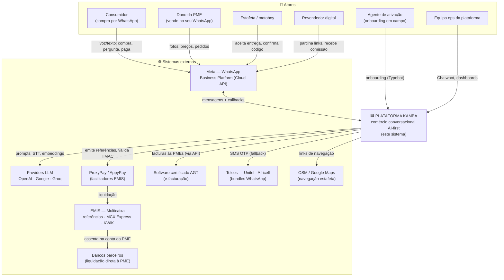

**Leitura:** o consumidor nunca instala nada nem cria conta — fala com o WhatsApp (número da
plataforma e/ou da PME). O dinheiro flui Consumidor → EMIS → **conta bancária da PME**
(a plataforma nunca retém fundos). A plataforma cobra as PMEs com os mesmos rails.

---

## C2 — Containers

Os serviços deployáveis (docker-compose no MVP; k8s na escala):

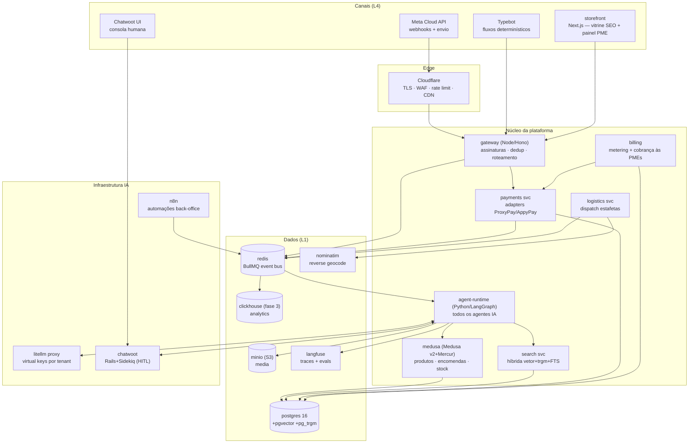

---

## C3 — Componentes (4 containers críticos)

### C3.1 `gateway` — porta de entrada

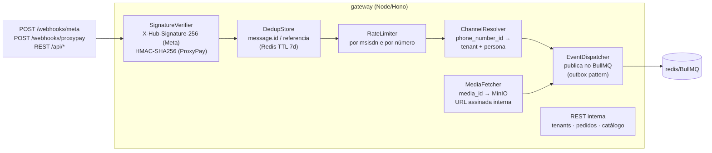

### C3.2 `agent-runtime` — o coração AI-first

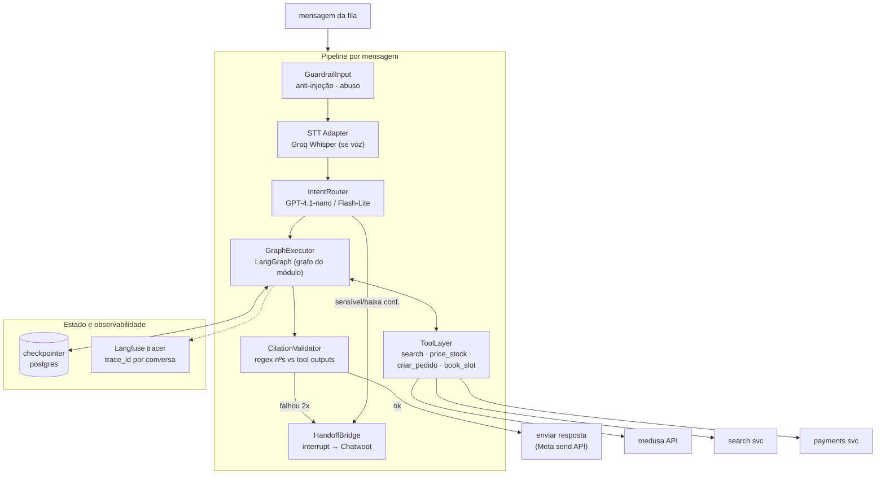

### C3.3 `payments svc` — dinheiro sem fraude

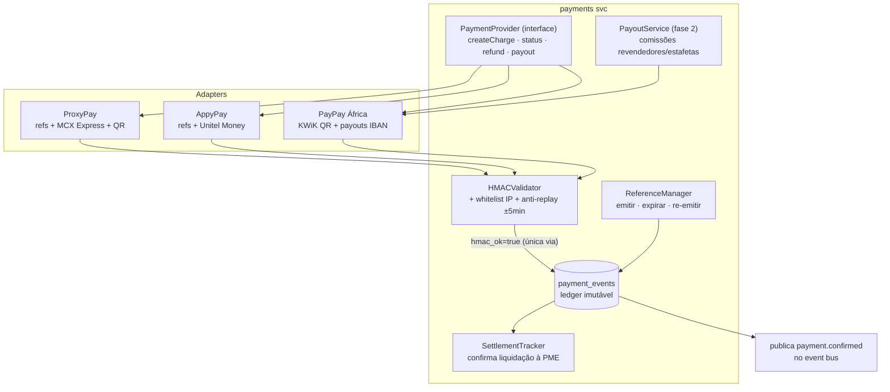

### C3.4 `search svc` — descoberta federada

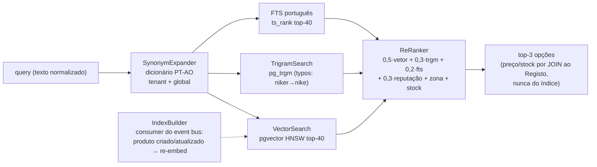

---

## C4 — Nível de código (2 recortes)

### C4.1 Grafo do Vendedor (máquina de estados)

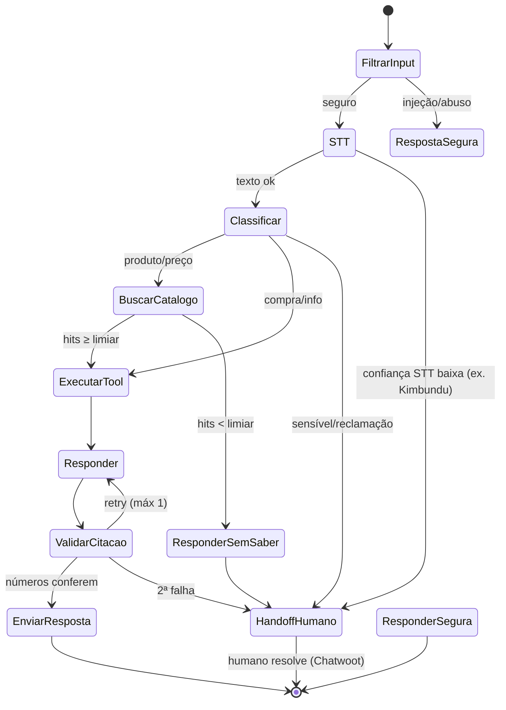

### C4.2 Estrutura de classes — payments

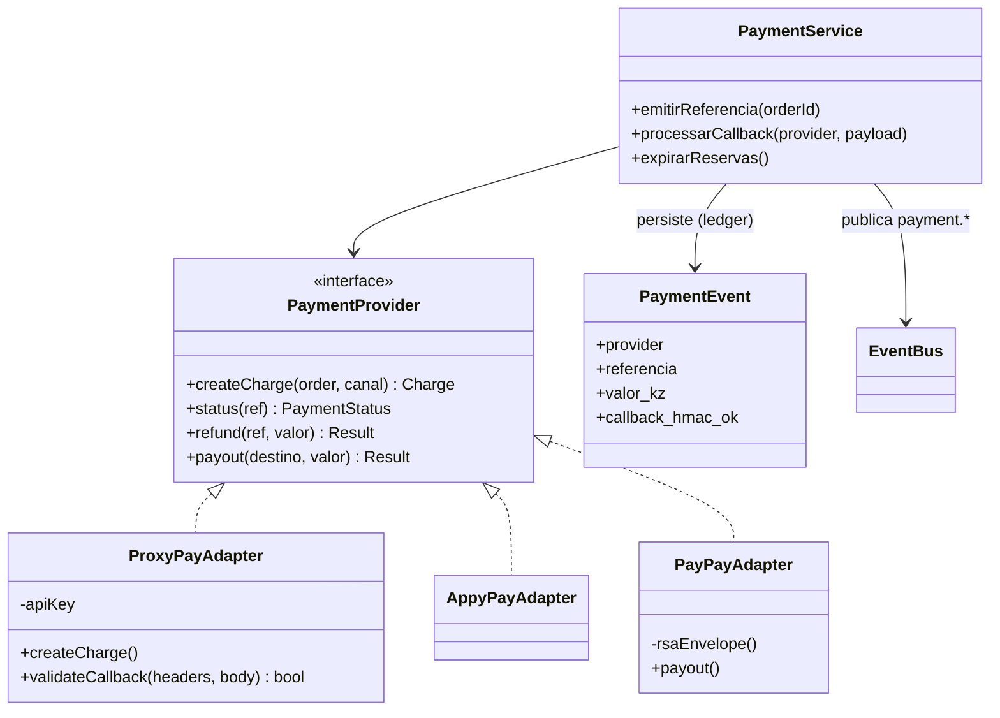

---

## Fluxogramas end-to-end

### F1 — Venda no número da PLATAFORMA (Fluxo B, com decisão B1/B2)

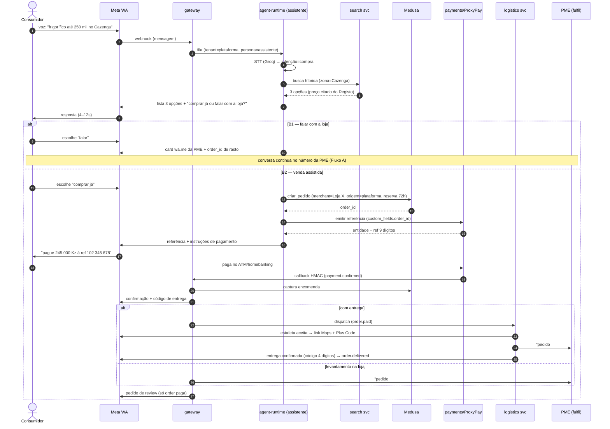

### F2 — Venda no número da PME (Fluxo A)

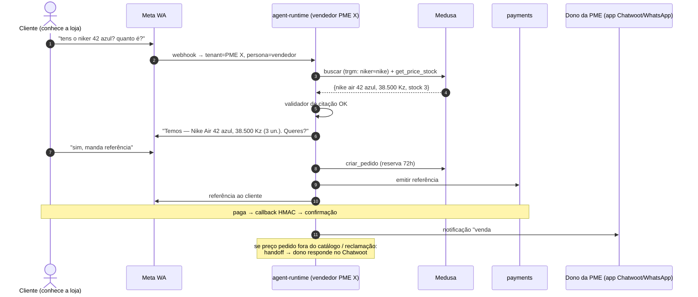

### F3 — Onboarding de uma PME (provisioning)

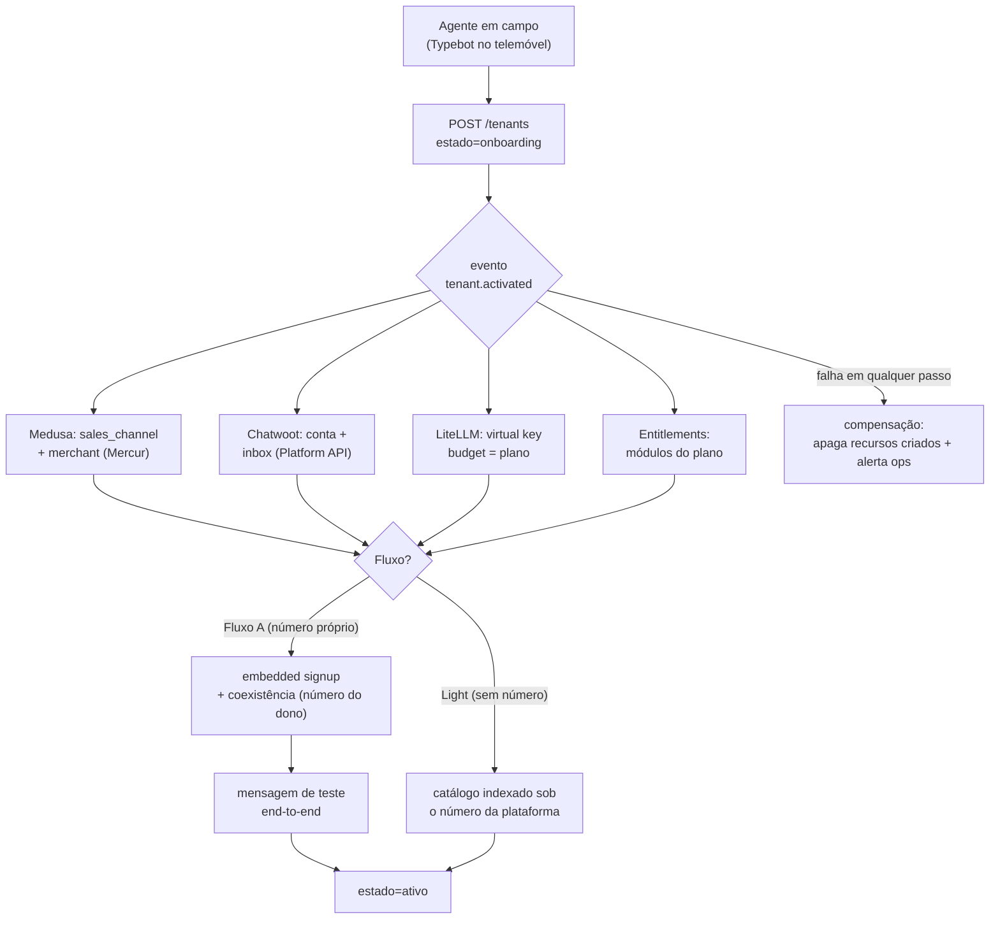

### F4 — Handoff humano (estados da conversa)

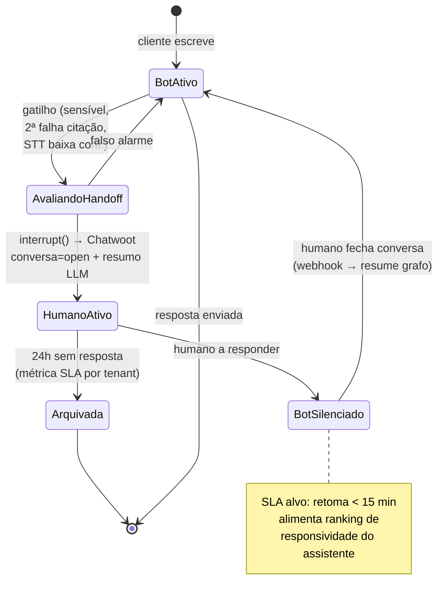

### F5 — Ciclo de vida da encomenda

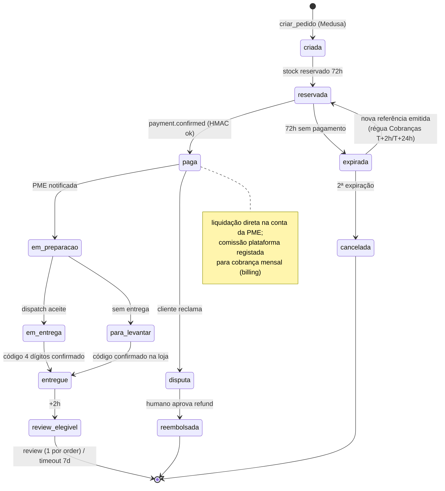

### F6 — Mapa de eventos (quem fala com quem, sem chamadas diretas)

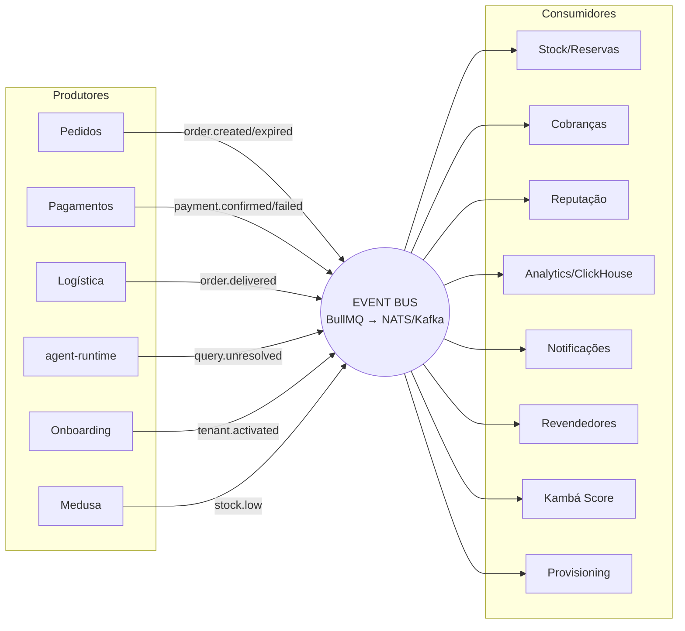

---

## Convenções de leitura

- **C1** responde "quem usa e com o que falamos" — nível de investidor/parceiro
- **C2** responde "que serviços existem" — nível de arquiteto/ops
- **C3** responde "o que há dentro de cada serviço" — nível de dev sénior
- **C4** responde "como está o código" — nível de implementação
- **F1–F6** são os fluxos que cortam as camadas — usar em code review e onboarding da equipa


---


<!-- ============================================================ -->
# 📘 PARTE 13 — big-picture-ecossistema

# Big Picture — o ecossistema completo num mapa

Documento de síntese: como **tudo** se encaixa — core, verticais, ferramentas, integrações,
abstrações e onboarding. Lê-se em 10 minutos; os detalhes estão nas docs 08/10/11/12.
"Kambá" = nome de trabalho da plataforma.

---

## 1. O mapa do ecossistema (uma imagem)

```mermaid
flowchart TB
    subgraph ATORES["👤 QUEM USA"]
        CONS["Consumidor"]
        PME["Dono da PME"]
        AGT["Agente de campo"]
        EST["Estafeta"]
        REV["Revendedor"]
        OPS["Ops plataforma"]
    end

    subgraph CANAIS["📱 CANAIS (onde acontece)"]
        NPLAT["Nº WhatsApp<br/>da PLATAFORMA"]
        NPME["Nº WhatsApp<br/>da PME (coexistência)"]
        WEB["Vitrine web / SEO"]
        CWI["Chatwoot UI (humano)"]
        TPB["Typebot (formulários)"]
    end

    subgraph CORE["🟦 CORE KAMBÁ (construímos 1x — o nosso código)"]
        GW["Gateway<br/>assinaturas · dedup"]
        RES["ChannelResolver<br/>número → tenant + persona"]
        RUN["Agent Runtime<br/>LangGraph multi-agente"]
        BUS["Event Bus<br/>order.* payment.* query.*"]
        REG[("Registo — Medusa<br/>produtos·encomendas·stock")]
        IDX[("Índice federado<br/>pgvector+trgm")]
        LED[("Ledger pagamentos<br/>+ payment_events")]
        TEN["Tenant & Entitlements<br/>identidade · planos · limites"]
        BILL["Billing<br/>cobra as PMEs"]
    end

    subgraph VERT["🧩 VERTICAIS (módulos = config + agentes sobre o CORE)"]
        V1["Vendedor AI"]
        V2["Rececionista"]
        V3["Catálogo AI"]
        V4["Orçamentos"]
        V5["Cobranças"]
        V6["Factura AI"]
        V7["Social AI"]
        V8["Arquivo AI"]
        V9["Compras"]
        V10["Logística"]
        V11["Revendedores"]
        V12["Reputação/Selo"]
        V13["Serviços/Agenda"]
        V14["Kambá Score"]
    end

    subgraph ABST["🔌 ABSTRAÇÕES (interfaces que desacoplam tudo)"]
        AB1["PaymentProvider"]
        AB2["AgentRegistry"]
        AB3["ToolLayer (tools scoped)"]
        AB4["EventBus contracts"]
        AB5["LLMProvider (LiteLLM)"]
        AB6["StorageProvider"]
    end

    subgraph FERR["🧰 FERRAMENTAS (open-source que operamos)"]
        F1["Chatwoot (HITL)"]
        F2["Medusa v2+Mercur"]
        F3["LiteLLM"]
        F4["Langfuse"]
        F5["Typebot"]
        F6["n8n"]
        F7["Postgres+pgvector"]
        F8["Redis/BullMQ"]
        F9["MinIO"]
        F10["Nominatim · Valhalla"]
    end

    subgraph EXT["🌐 INTEGRAÇÕES (fora de nós)"]
        E1["Meta Cloud API"]
        E2["LLMs: OpenAI·Google·Groq"]
        E3["ProxyPay · AppyPay"]
        E4["PayPay África (KWiK+payouts)"]
        E5["EMIS/bancos (liquidação PME)"]
        E6["AGT software certificado"]
        E7["Telcos (bundles WhatsApp)"]
        E8["OSM / Google Maps"]
    end

    CONS & PME & EST & REV --> NPLAT & NPME
    AGT --> TPB
    OPS --> CWI
    NPLAT & NPME --> E1
    E1 <--> GW
    GW --> RES --> RUN
    RUN <--> AB2
    RUN --> AB3
    AB3 --> REG & IDX & AB1
    GW & RUN --> BUS
    BUS --> V5 & V12 & V14
    RUN --- VERT
    VERT --- ABST
    ABST --- FERR
    AB1 --> E3 & E4
    E3 & E4 --> E5
    V6 --> E6
    AB5 --> E2
    V10 --> E8 & F10
    TEN --- REG
    BILL --> AB1
    NPLAT & NPME -.-> E7
```

**Como ler:** os atores falam pelos canais → tudo entra no **CORE** (o que é nosso) → as
**verticais** são finas e penduram-se no core → as **abstrações** são o contrato entre core e
o resto → **ferramentas** e **integrações** são substituíveis porque só falam com as abstrações.

---

## 2. O que é CORE (nosso, insubstituível)

| Componente | Porquê é core |
|---|---|
| **Tenant & Entitlements** | 1 tenant = 1 PME; tudo (dados, custos, números, módulos) pendura daqui |
| **ChannelResolver** | `phone_number_id` → tenant + persona; é o que torna o fluxo dual trivial |
| **Agent Runtime** | LangGraph multi-agente + guardrails + validador de citação + handoff — a "fábrica de agentes" |
| **Event Bus** | a cola: módulos nunca se chamam; subscrevem eventos canónicos |
| **Registo (Medusa)** | a verdade operacional: produtos, encomendas, reservas |
| **Índice federado** | o ativo defensável: o que se vende, onde, a que preço, com que reputação |
| **Ledger + payment_events** | anti-fraude por desenho; base do Kambá Score |
| **Billing** | a plataforma cobra as PMEs com as suas próprias primitivas (dogfooding) |

Regra de ouro: **se um concorrente copiar as ferramentas, não copia o core** — porque o core é
código + dados + contexto acumulado.

## 3. Verticais = configuração, não sistemas

Cada vertical é um tuplo `(grafo LangGraph, tools autorizadas, persona/prompt, entitlements)`:

```yaml
# exemplo: ativar a vertical Cobranças para o tenant X é ISTO, não um projeto
vertical: cobrancas
agente: cobrancas_graph           # registado no AgentRegistry
tools: [listar_referencias_pendentes, reemitir_referencia, notificar_cliente]
subscreve_eventos: [order.expired, payment.pending]
persona: "cobrador educado, PT-AO, nunca ameaçador"
limites: { lembretes_dia: 3, templates: ["lembrete_v1","recuperacao_v1"] }
```

Consequência: lançar uma vertical nova (ex.: Seguros micro na fase 3) = escrever um grafo + 3–5
tools + YAML. Dias, não meses. É por isto que a expansão da doc 06 é barata.

## 4. Abstrações — onde a flexibilidade vive

| Abstração | Contrato | O que permite trocar sem dor |
|---|---|---|
| `PaymentProvider` | createCharge · status · refund · payout | ProxyPay ↔ AppyPay ↔ PayPay ↔ EMIS direto |
| `LLMProvider` (LiteLLM) | chat/embeddings + virtual keys por tenant | OpenAI ↔ Gemini ↔ Qwen self-host |
| `AgentRegistry` | grafo + tools + persona por vertical | adicionar/retirar verticais em runtime |
| `EventBus contracts` | envelopes versionados (`versao: 1`) | BullMQ ↔ NATS/Kafka; consumers ignoram o que não conhecem |
| `ToolLayer` | tools com `tenant_id` do estado, nunca do cliente | segurança: nenhum agente escreve fora do seu tenant |
| `StorageProvider` | put/get URL assinada | MinIO ↔ S3 ↔ Angola Cables Cloud |
| `ChannelAdapter` | send/receive normalizado | Meta oficial (produção) ↔ sandbox de testes |

## 5. Onboarding — os 4 percursos

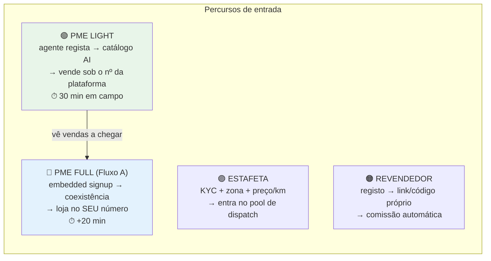

Estados de um tenant: `onboarding → ativo → suspenso` (quality rating/falta de pagamento) —
o billing e a Meta alimentam as transições automaticamente.

## 6. Como tudo funciona junto — o sistema nervoso em 6 batimentos

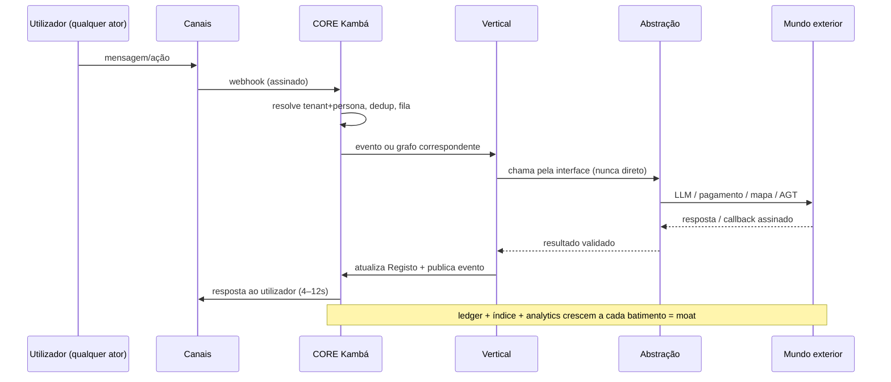

Seis propriedades que este desenho garante:
1. **Qualquer vertical nova** entra sem tocar no core (só regista grafo + tools + subscrições)
2. **Qualquer integração** pode ser trocada sem tocar nas verticais (só o adapter muda)
3. **Qualquer canal novo** (app, Instagram) entra pelo ChannelResolver
4. **Falhas degracam**: LLM em baixo → Typebot; pagamentos em baixo → fila; nunca silêncio
5. **Custo e margem por tenant/vertical** são sempre medidos (LiteLLM + metering) — pricing é
   decisão com dados, não intuição
6. **O ativo cresce sozinho**: cada batimento engorda índice, ledger e sinal de procura

## 7. Build vs ferramenta vs parceiro (a lógica de decisão)

| Camada | Decisão | Razão |
|---|---|---|
| Core (tenants, runtime, bus, índice, ledger) | **BUILD** | é o moat |
| Verticais | **BUILD** (finas) | diferenciação + velocidade |
| Chatwoot, Medusa, Typebot, n8n, Langfuse | **FERRAMENTA** open-source | maduros, MIT, não vale reinventar |
| Pagamentos, EMIS, AGT, telcos | **PARCEIRO** | regulado/relacional; adaptamos, não controlamos |
| LLMs, STT, embeddings | **CONSOME API** | commodity; self-host só no break-even |

Regra: nós construímos o que acumula valor com o uso; adotamos o que é estável; integramos o que
é regulado.

---

## 8. Onde encaixa cada documento

| Se queres… | Vai para |
|---|---|
| Ver o todo em 10 min | esta doc (13) |
| Os diagramas C4 formais | `12-diagramas-c4-fluxogramas.md` |
| Schemas, contratos, deploy | `11-arquitetura-detalhada-engenharia.md` |
| Primitivas e módulos | `10-arquitetura-plataforma-holistica.md` |
| Decisões de produto/canal | `08-arquitetura-tecnica-v2.md` |
| Porquê esta estratégia | `01–07` |

---

## 9. As 5 camadas que faltavam no mapa

A big picture das §§1–7 mostra a **máquina tecnológica**. Um ecossistema completo precisa de mais
cinco camadas — adicionadas aqui.

### 9.1 O terceiro lado: o motor de atenção (anunciantes)

O modelo Google (doc 03) tem **três** lados; o mapa só tinha dois. O terceiro lado entra assim:

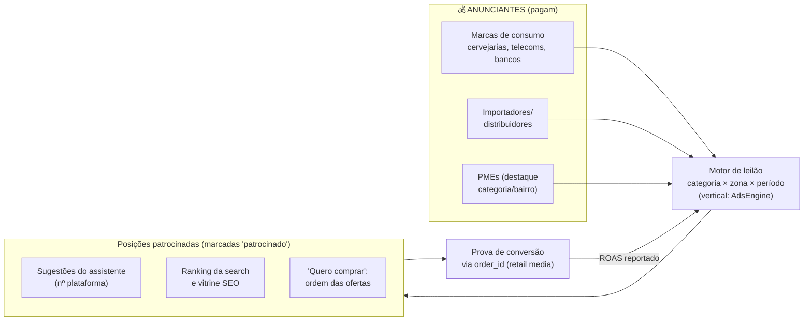

Regras herdadas da doc 03: transparência radical (rótulo + alternativa orgânica sempre visível),
só em conversas iniciadas pelo utilizador, e **só depois das linhas 1–3 de receita** — a Ayoba
morreu por inverter esta ordem. Tecnicamente é só mais uma vertical (`AdsEngine`) sobre o core:
subscreve queries, escreve placements, cobra via billing. Nada de novo na espinha.

### 9.2 O mapa de dinheiro (quem paga a quem, em que moeda)

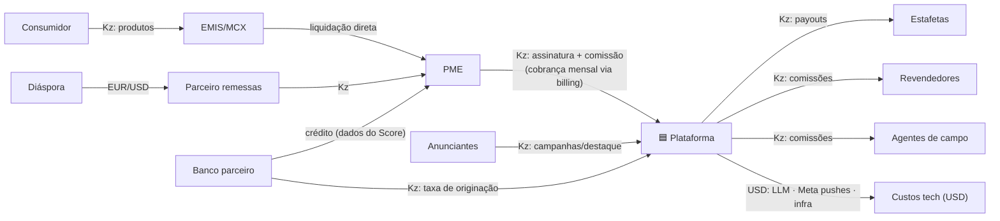

Leituras que só este mapa revela:
- **Hedge cambial natural**: entradas em Kz + EUR (diáspora) contra custos críticos em USD —
  a diáspora não é "mais um módulo", é a proteção da margem
- **A PME paga duas vezes sem sentir**: assinatura (billing) + comissão (registada no ledger)
- **Todo o payout é Kz doméstico** via PayPay IBAN — nenhum câmbio na operação interna

### 9.3 A camada de governação (a organização, não só a tech)

O mapa tinha código onde também devia ter **pessoas e processos**:

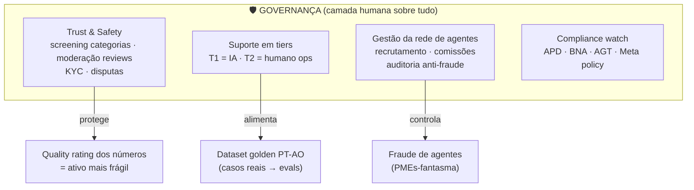

Notas: (1) o suporte T2 não é custo morto — cada caso humano vira exemplo do dataset golden que
treina o T1; (2) Trust & Safety decide **quem pode entrar** antes de qualquer código — uma PME de
categoria proibida degrada o quality rating de todos; (3) a gestão de agentes precisa de auditoria
desde o agente nº 1 (o incentivo à fraude nasce com a comissão).

### 9.4 O quarto percurso esquecido: o consumidor

Os percursos da §5 são todos do lado da oferta. O lado que sustenta o modelo Google:

```mermaid
flowchart LR
    D["Descoberta<br/>indicação · SEO vitrine<br/>grupos de bairro"] --> C1["1º contacto<br/>consentimento (log)"]
    C1 --> AHA["'Aha' <30s<br/>1ª resposta útil"]
    AHA --> T1["1ª transação<br/>(B1 ou B2)"]
    T1 --> HAB["Hábito<br/>utilidades diárias:<br/>câmbio, horários, farmácia"]
    HAB --> VIR["Partilha<br/>'pergunta ao Kambá'<br/>→ loop viral"]
    VIR --> D
    T1 -.->|se falhar| RET["recuperação:<br/>humano + crédito de confiança"]
```

Métrica por passo: taxa de consentimento · % respostas úteis <30s · conversão 1ª transação ·
retorno semanal (W4) · K-factor de partilha. **Sem este funil, o "modelo Google" é só B2B com
extra steps** — é o ponto cego "Shopify vs Google" da ronda 2 tornado operacional.

### 9.5 Tempo, degradação, métricas e linhagem

**A dimensão temporal** (o mapa não é estático):

| Fase | O que existe no mapa |
|---|---|
| Piloto | Core mínimo + Loja (Fluxo A) + número plataforma + pagamentos ProxyPay + governação manual |
| Clusters | + verticais Serviços/Cobranças/Logística/Factura + consumidor em 1 cluster + AdsEngine piloto |
| Escala | + Analytics/Score/Diáspora/Revendedores + leilão + API aberta + parceiros estratégicos |

**O mapa de degradação** (o que morre quando X falha):

| Falha | Impacto | Fallback desenhado |
|---|---|---|
| Meta API em baixo | Canais parados | Fila absorve; painel web continua; status page para PMEs |
| Número da plataforma com rating vermelho | Fluxo B morre | Throttling preventivo + números de reserva + screening de categorias |
| EMIS/ProxyPay em baixo | Sem pagamentos | Fila com reconciliação diferida; comprovativo NUNCA é fallback |
| LLM provider em baixo | Agentes parados | LiteLLM failover (OpenAI→Gemini) → Typebot determinístico |
| LLM caro demais (câmbio) | Margem comprime | Downgrade para nano/Flash-Lite por intenção; revisão trimestral de preços |
| Fraude de agentes | Base de PMEs envenenada | Auditoria + comissão só após 1ª venda real da PME |

**North-star e métricas por camada:**

| Camada | Métrica |
|---|---|
| Ecossistema | **Transações confirmadas/semana** (north-star) |
| Consumidor | perguntas/semana · % útil · retorno W4 |
| PME | módulos por tenant · receita atribuída · churn |
| Atenção | leads→vendas · ROAS dos placements |
| Governação | % disputas · tempo de resolução · quality rating médio |
| Técnica | custo/PME · p95 latência · % handoff |

**Linhagem dos dados** (dos eventos aos produtos):

```
eventos (order.*, payment.*, query.*) → ClickHouse
   ├─→ Kambá Score → banco parceiro (originação de crédito)
   ├─→ Sinal de procura → PME ("procuram X, ninguém tem")
   ├─→ Índice de preços → marcas/B2G ("inflação de bairro")
   └─→ ROAS placements → anunciantes (renovação do leilão)
Consentimento + HMAC de msisdn aplicados na origem (Lei 22/11); dados nunca saem como PII.
```


---


<!-- ============================================================ -->
# 📘 PARTE 14 — tese-minima-e-plano-de-validacao

# 14 — Tese mínima e plano de validação (de exploração a ideia testável)

Os documentos 01–13 são exploratórios. Este documento fixa **o que se vai testar primeiro** e
**o que se deixa de lado até haver evidência**. Onde diz *[decisão]*, é escolha do fundador;
onde diz *[hipótese]*, é proposta a validar, não facto.

---

## 1. Tese mínima

**Segmento [decisão]:** PMEs formais ou em formalização em Luanda (têm NIF e conta bancária).

**Produto de entrada [decisão]:** "Rececionista + Loja" para essas PMEs, no WhatsApp:
responde a clientes, mostra catálogo, marca/reserva e emite o pedido com pagamento.

**Promessa:** *"Não perca mais nenhum cliente por não responder ao WhatsApp, e receba o pagamento
sem andar atrás de comprovativos."*

**Quem paga [hipótese]:** a PME, por assinatura (planos do doc 02 §6). Comissão sobre transacção
fica **desligada** até haver unit economics provados.

**Fica fora até haver evidência:** assistente de consumo no número da plataforma (Fluxo B/B2),
PME light, logística federada, revendedores, Kambá Score, diáspora, AdsEngine, API aberta,
grupos de bairro, índice federado. Ficam como opções futuras; não entram no piloto nem no
orçamento.

**Porquê esta redução:** as hipóteses que mais pesam (pagamento por PME, política da Meta para
número agregador, preço opaco, atribuição de comissão) pertencem todas ao Fluxo B e ao
marketplace. O Fluxo A para PME formal, no número dela, evita a maioria.

**Tensão a gerir:** juntar Rececionista e Loja alarga o piloto. Proponho que a Loja entre
**por camadas** (§4): primeiro atendimento e catálogo informativo, depois pedido, depois pagamento.

**Módulos de entrada [decisão do fundador, 2026-10-09; ADR-020].** Além do atendimento, entram
no Piloto (Fase 1) até **4 módulos de captação e suporte**, *owner-facing* e com o dono no circuito:
**Catálogo AI**, **Foto de produtos AI**, **Social AI** (calendário, legendas e artes para
**publicação manual**) e **Orçamento expresso**. Porquê: dão valor à PME sem depender de pagamento
integrado nem de Fluxo B, funcionam no painel web mesmo antes de o WhatsApp estar ligado, e atacam
o risco dominante (distribuição, H1) com um produto que se demonstra em minutos. Limites que
protegem o core: máximo 4; o dono aprova tudo o que sai para terceiros; sem publicação automática
em redes; **não bloqueiam o gate da Fase 0**; cortam-se primeiro se a Fase 0 derrapar (excepto o
Catálogo AI, pré-requisito do onboarding). Hipóteses H10–H12 (§2). Ficam de fora: Arquivo AI,
Compras AI, consignação, clube digital; Factura AI só como spike (KAM-126).

---

## 2. Hipóteses críticas e critério de sucesso

Cada hipótese tem de morrer ou sobreviver com um número. Limiares são **propostas minhas**.

| # | Hipótese | Como testar | Sucesso | Prazo |
|---|---|---|---|---|
| H1 | PMEs formais pagam por atendimento + loja no WhatsApp | 30 entrevistas + 10 pilotos concierge a preço real | ≥ 5 pagam após 30 dias de piloto | sem. 1–8 |
| H2 | O preço pode ser publicado/respondido pelo bot | Entre as 30 PMEs, quantas aceitam preço fixo ou "a partir de" | ≥ 50% aceitam para ≥ 70% do catálogo | sem. 1–4 |
| H3 | Coexistência funciona no número da PME angolana | Spike técnico: 3 números reais, embedded signup, sync | 3/3 ligados sem perda de histórico | sem. 1–3 |
| H4 | A Meta aceita o caso de uso (assistente de PME, templates, opt-in) | Leitura da política em fonte primária + pedido de Tech Provider/BSP | Resposta escrita ou aprovação | sem. 1–6 |
| H5 | Existe via de cobrança com confirmação server-side para uma PME | Reunião com 2 bancos + 2 facilitadores (ProxyPay, AppyPay) | Prazo e custo por PME conhecidos e ≤ 6 semanas | sem. 1–6 |
| H6 | Custo por conversa fecha com a assinatura | Medir 500 conversas reais: LLM + voz + Meta | Custo ≤ 15% da mensalidade | sem. 4–10 |
| H7 | O bot não fica sozinho em apuros (voz, regateio, kimbundu) | Dataset de 100 conversas reais, avaliação humana | ≥ 85% resolvidas sem handoff errado | sem. 4–10 |
| H8 | A PME mantém o catálogo actualizado | Observar 4 semanas: % de actualizações vs. mudanças reais | ≥ 60% de catálogos correctos em auditoria | sem. 4–12 |
| H9 | Retenção: usam depois do 1º mês | Cohorts do piloto | ≥ 70% activos ao dia 60 (das PMEs activadas até à semana 4) | sem. 8–12 |
| H10 | Os **módulos de entrada** (Catálogo AI, Foto de produtos AI, Social AI, Orçamento expresso) atraem PMEs | % das PMEs onboardadas que usam ≥ 1 módulo de entrada nas 2 primeiras semanas | ≥ 60% (*proposta*) | sem. 7–12 |
| H11 | Os módulos de entrada levam ao atendimento | % das PMEs que entram por um módulo de entrada e activam o Vendedor/Serviços aos 30 dias | ≥ 30% (*proposta*) | sem. 8–12 |
| H12 | O custo de geração fecha e há disposição a pagar | Custo por PME/módulo (imagem + texto) e nº de PMEs que pagam por módulo isolado | custo ≤ 15% do preço do módulo; ≥ 3 PMEs pagam (*propostas*) | sem. 8–12 |

**Regra de decisão:** se H1 ou H5 falharem, a tese muda antes de se escrever mais código
(ver §6). H3 e H4 são técnicos e baratos, mas bloqueiam tudo: correm primeiro.

---

## 3A. Caminho escolhido: build-first *[decisão do fundador]*

O fundador domina a parte técnica e vai construir primeiro; o produto a funcionar é a ferramenta
de venda (demo viva) e o que abre a rede comercial. As regras abaixo limitam o risco desse caminho.

**Regra 1 — Fatia fina vendável (8–10 semanas).** Só o que se demonstra a uma PME:
- Número da PME por coexistência (Fluxo A), nada de número agregador.
- Agente único (LangGraph) com: atendimento, catálogo (foto → produto), horários/morada,
  marcação ou pedido com reserva de stock, handoff para o dono.
- Pagamento por **adapter**: começa em `ManualProvider` (dono confirma, limite de valor) e troca
  para ProxyPay/AppyPay quando o contrato existir. O resto do código não muda.
- **Decisão do fundador: base arquitectural forte desde o início, para explorar verticais.**
  Não se troca o desenho do doc 10/11 por um MVP descartável. Em vez de cortar serviços, corta-se
  a **profundidade** de cada um (ver Regra 1B).
- Fora do piloto: voz em kimbundu, logística, revendedores, índice federado, número da plataforma.

**Regra 1B — Esqueleto andante (walking skeleton) com costuras definitivas.**
Primeiro um fio fino que atravessa **todas** as primitivas de ponta a ponta, depois engorda-se.

| Costura (fixar já, não reescrever) | Implementação inicial (pode ser fina) |
|---|---|
| Tenant + entitlements + `ChannelResolver` | tabelas do doc 11 §2; 1 persona por número |
| Event bus com outbox transaccional + envelope versionado | BullMQ/Redis |
| `AgentRegistry` + `ToolLayer` (tenant vem do estado, nunca do texto) | 2 verticais de atendimento desde o início, mais até 4 **módulos de entrada** finos (Catálogo AI, Foto de produtos AI, Social AI, Orçamento expresso) na Fase 1, com o dono no circuito (ADR-020) |
| `PaymentProvider` | `ManualProvider` → ProxyPay/AppyPay |
| `LLMProvider` (LiteLLM) + metering por tenant | OpenAI/Gemini com chaves virtuais |
| `HandoffProvider` | Chatwoot via Agent Bot API (atrás da interface) |
| Registo de comércio (produtos, pedidos, stock, reservas) | **Medusa v2**, após spike de 3–5 dias; fallback Medusa puro + `merchant_id` |
| `ChannelAdapter` | Cloud API + coexistência |

Diferimento permitido (só o *como*, nunca o *onde*): ClickHouse, Keycloak, Valhalla, k8s,
Meilisearch, Mercur (se o spike falhar), tier público de API.

**Regra de dois:** uma abstracção só se valida com **duas** verticais diferentes. Construir em
paralelo **Vendedor** (catálogo, pedido, pagamento, stock) e **Serviços/Rececionista** (agenda,
marcação, lembretes). Se o mesmo `AgentRegistry`, `ToolLayer`, eventos e entitlements servirem às
duas sem excepções no core, a tese "verticais são configuração" fica provada; se não, corrige-se
a abstracção antes de haver uma terceira vertical.

**Controlo do risco de escopo (o preço desta escolha).** Fundação e piloto não se confundem:
- A fundação tem **teto de 6 semanas** até o esqueleto andante responder numa conversa real,
  criar um pedido, receber um callback de pagamento e disparar um evento consumido por outra vertical.
- A cada vertical nova aplica-se o teste do doc 10: ≥ 70% reaproveitado. Abaixo disso, parar e rever.
- A validação comercial (H1, H9) corre sobre o esqueleto; não espera pelas verticais todas.

**Regra 2 — Demo como motor de distribuição.** Um número de demonstração (loja fictícia) que
qualquer pessoa pode testar em 2 minutos. É o que se mostra a contabilistas, bancos, associações
e conhecidos. Cada demo termina em pedido de piloto.

**Regra 3 — Itens com tempo de espera arrancam na semana 1, em paralelo ao código.** Dependem
de papel e de investimento, não de engenharia, e são o caminho crítico real:

| Item | Porquê já | Investimento |
|---|---|---|
| Empresa/entidade legal e portfólio Meta Business verificado | Sem isto não há embedded signup nem tiers | baixo, tempo |
| Pedido de Tech Provider / escolha de BSP | A elegibilidade e prazos condicionam o produto | baixo, tempo |
| Banco ou facilitador (ProxyPay/AppyPay) | 2–6 semanas; define a camada 3 | contrato + taxas |
| Parecer jurídico (Lei 22/11, BNA) | Bloqueante se houver transferência de dados e comissão | honorários |
| Software AGT certificado (parceiro Factura AI) | Gancho de 2027 | acordo comercial |

**Regra 4 — O sinal comercial mede-se em uso real, não em simpatia.** 10 PMEs em piloto gratuito
de 30 dias com meta de ≥ 5 a converter a pago (H1) e ≥ 70% activas ao dia 60 (H9). Quem não
usa na semana 2 sai e é substituído.

**Regra 5 — Pontos de decisão.** Se na semana 6 H3 (coexistência) ou H4 (Meta) falharem, pára-se
a camada de canal e muda-se a estratégia (BSP/outro canal) antes de gastar mais engenharia. Se
na semana 10 não houver 5 PMEs a usar a demo no número delas, o problema é distribuição, não
produto, e passa-se ao §3 como trabalho principal.

---

## 3. Experimentos sem código (complementar: ~20% do tempo, em paralelo)

**Ponto de partida honesto: não há rede comercial.** No caminho build-first, estes experimentos
deixam de ser a fase 1 e passam a correr ao lado do código, sobretudo a abertura de canais
(contabilistas, associações) e as cartas às partes reguladas.

1. **Canal de acesso a PMEs formais [hipótese]:** contabilistas e gabinetes de contabilidade são
   quem já fala com PMEs sobre NIF, facturação e AGT. Testar 5 parcerias: o contabilista indica,
   a plataforma dá-lhe comissão ou a ferramenta como serviço seu. Alternativas a testar em
   paralelo: associações comerciais, programas PME de bancos, incubadoras.
2. **Entrevistas (30):** dor real de atendimento, quanto pagariam, como cobram hoje, que
   comprovativos recebem, se publicariam preços. Guião curto, sem pitch.
3. **Piloto concierge (10 PMEs):** operação manual por trás do WhatsApp Business da PME, com
   IA a rascunhar e um humano a aprovar. Mede-se o problema antes de automatizar.
4. **Cartas às partes reguladas e infraestruturais:** perguntas escritas a Meta/BSP, a 2
   facilitadores de pagamento e a um advogado local (APD, BNA, informação de crédito).
5. **Pesquisa de concorrência directa:** quem já vende atendimento/loja no WhatsApp em Angola
   ou em mercados vizinhos, a que preço, com que resultados.

Perguntas que o advogado e os parceiros têm de responder por escrito:
- A plataforma pode cobrar mensalidade e, no futuro, comissão sem licença BNA, mantendo a
  liquidação directa à PME?
- Que entidade/TPA virtual precisa cada PME, e em quanto tempo e a que custo?
- Enviar conversas a APIs de LLM fora de Angola exige autorização da APD? Com que texto de
  consentimento?
- O número agregador da plataforma é permitido pela política da Meta? (só relevante se o
  Fluxo B regressar.)

---

## 4. Faseamento do produto (só depois de H3, H4 e H1 parcial)

| Camada | Entrega | Pagamento | Gate para avançar |
|---|---|---|---|
| 1 | Atendimento + catálogo informativo + marcações, no número da PME | Nenhum | H2, H3, H7 |
| 2 | Pedido registado com reserva | PME cobra nos seus meios; **confirmação humana, sem comprovativo como prova automática** | H8 |
| 3 | Pedido com pagamento confirmado server-side | Facilitador (ProxyPay/AppyPay) | H5 |
| 4 | Cobranças automáticas, Factura AI via parceiro certificado | idem | H9 |

A camada 2 reconhece o que o doc 08 já admitia: sem facilitador ainda, o pagamento é confirmado
por pessoa. Isso é aceitável **no piloto**, mas tem de estar assumido e limitado (valor máximo
por pedido) e não escondido atrás da regra "nunca comprovativo".

---

## 5. Orçamento e equipa (preencher com os números reais)

Não tenho os valores de capital nem o tamanho da equipa. A estrutura do orçamento para 12 semanas:

| Rubrica | Notas |
|---|---|
| Pessoa(s) a tempo inteiro | produto/comercial em Luanda; engenharia |
| Operador humano do concierge | 1 pessoa cobre 10 PMEs no início |
| Jurídico (Lei 22/11, BNA) | pareceres escritos, não conversas |
| Técnica | Meta, LLM, voz, VPS — ordem de dezenas de dólares por mês no piloto (doc 08 §8) |
| Incentivos a parceiros (contabilistas) | comissão só por PME paga |
| Deslocações/materiais de campo | |

**Pergunta ao fundador:** com este capital, quantos meses de pista existem, e qual é o ponto em
que se pára ou se muda?

---

## 6. Critérios de pivô e de paragem

| Se acontecer… | Então… |
|---|---|
| H1 falha (menos de 5 pagantes) | Voltar às entrevistas: mudar segmento ou produto (candidato: Factura AI isolada) |
| H4 ou H3 falham | Mudar de canal: BSP parceiro, outro número, ou produto sem automação no WhatsApp da PME |
| H5 falha (pagamento > 6 semanas ou inviável) | Manter camadas 1–2; vender atendimento/agenda sem cobrança integrada |
| H2 falha (ninguém publica preço) | Reposicionar: atendimento e disponibilidade, não comparação de preço |
| H6 falha (custo > 15% da mensalidade) | Subir preço, reduzir modelo/voz, ou limitar volume por plano |
| Nenhum canal de acesso a PMEs funciona (§3.1) | Antes de construir mais, resolver distribuição: parceiro de banco, associação ou contratar comercial |

Paragem total: se ao fim de 12 semanas não houver ≥ 3 pagantes recorrentes e nenhum canal
comercial repetível.

---

## 7. Higiene documental (tarefas)

1. Arquivar 09 (desatualizado) e mover 08, 10, 11, 12 e 13 para uma pasta `visao-futura/`,
   com uma nota de que descrevem a arquitectura-alvo, não o piloto.
2. Resolver as contradições já identificadas: n8n/Typebot (licenças), custo por conversa
   (doc 07 vs 08), cunha (02/03 vs 05 vs 06), comprovativo na fase 0, farmácia (07 vs 13).
3. Corrigir o `../INDICE.md`: contagem de documentos e remover a ligação a `../tecnica/` (os 11
   documentos não existem), ou marcar `../tecnica/INDICE.md` como plano.
4. Passar a manter um **registo de decisões e de evidências**: cada hipótese H1–H9 com data,
   resultado e fonte.
5. Substituir as afirmações de mercado (EMIS, Meta, preços) por fonte primária ou marcá-las
   como não verificadas.

---

## 8. Próximos 14 dias

1. Fechar este documento com os dados em falta (capital, equipa, objectivo de receita).
2. Escrever o guião de entrevista e a lista de 30 PMEs-alvo (via contabilistas e associações).
3. Spike H3: ligar 3 números por coexistência.
4. Pedir as reuniões bancárias e as respostas escritas do §3.4.
5. Montar a folha de registo de hipóteses.


---
