# Diagramas do sistema — modelo C4 (C1→C4) + fluxogramas

Documento visual da plataforma. Todos os diagramas em **Mermaid** (renderizam em GitHub,
VS Code, Typora, Obsidian). Base: `10-arquitetura-plataforma-holistica.md` e
`11-arquitetura-detalhada-engenharia.md`. "Kambá" = nome de trabalho da plataforma.

---

## C1 — Contexto do sistema

Quem usa e com o que a plataforma fala:

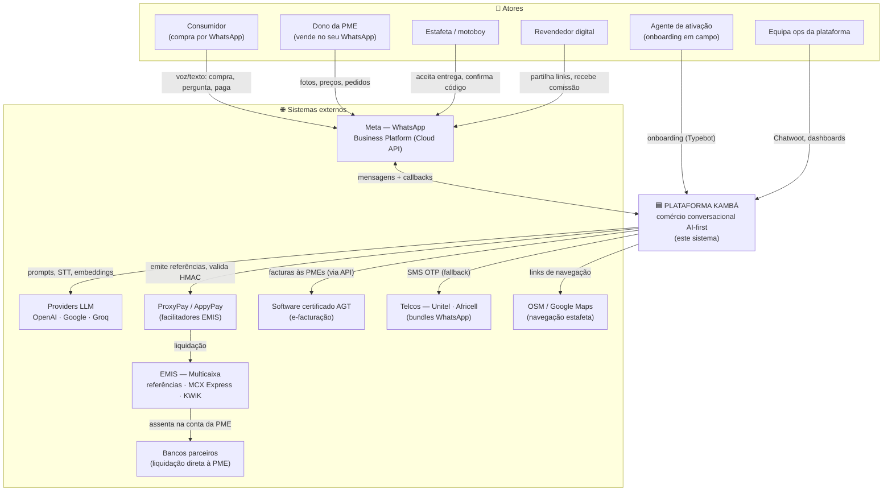

**Leitura:** o consumidor nunca instala nada nem cria conta — fala com o WhatsApp (número da
plataforma e/ou da PME). O dinheiro flui Consumidor → EMIS → **conta bancária da PME**
(a plataforma nunca retém fundos). A plataforma cobra as PMEs com os mesmos rails.

---

## C2 — Containers

Os serviços deployáveis (docker-compose no MVP; k8s na escala):

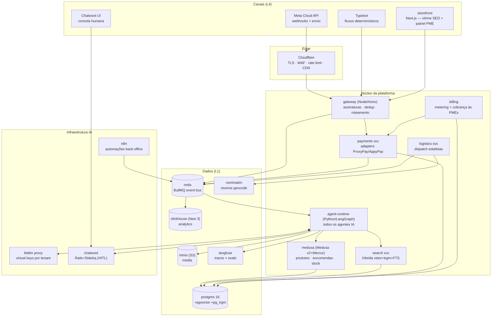

---

## C3 — Componentes (4 containers críticos)

### C3.1 `gateway` — porta de entrada

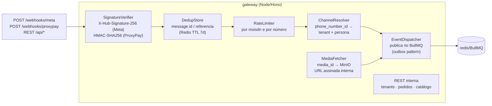

### C3.2 `agent-runtime` — o coração AI-first

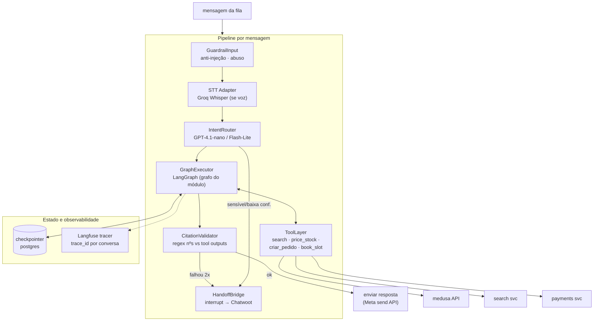

### C3.3 `payments svc` — dinheiro sem fraude

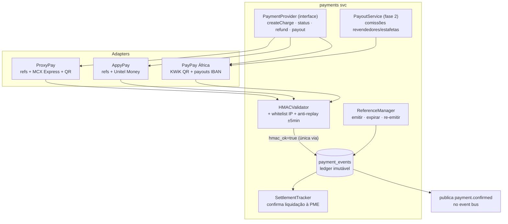

### C3.4 `search svc` — descoberta federada

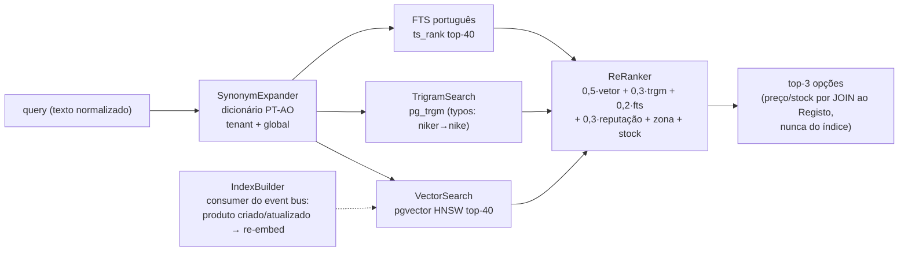

---

## C4 — Nível de código (2 recortes)

### C4.1 Grafo do Vendedor (máquina de estados)

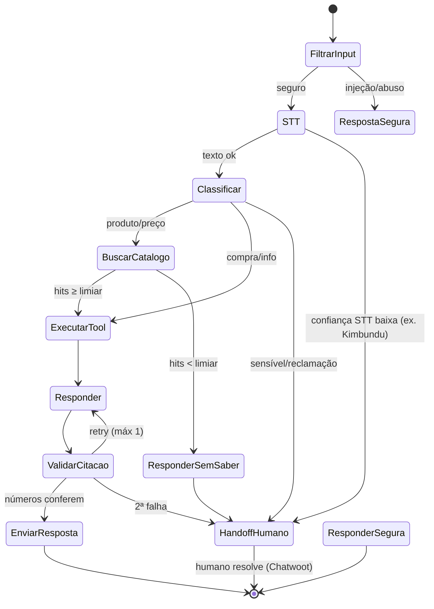

### C4.2 Estrutura de classes — payments

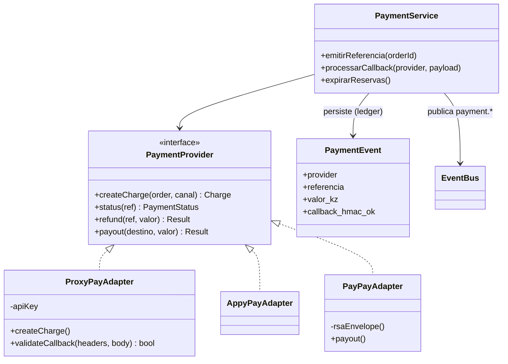

---

## Fluxogramas end-to-end

### F1 — Venda no número da PLATAFORMA (Fluxo B, com decisão B1/B2)

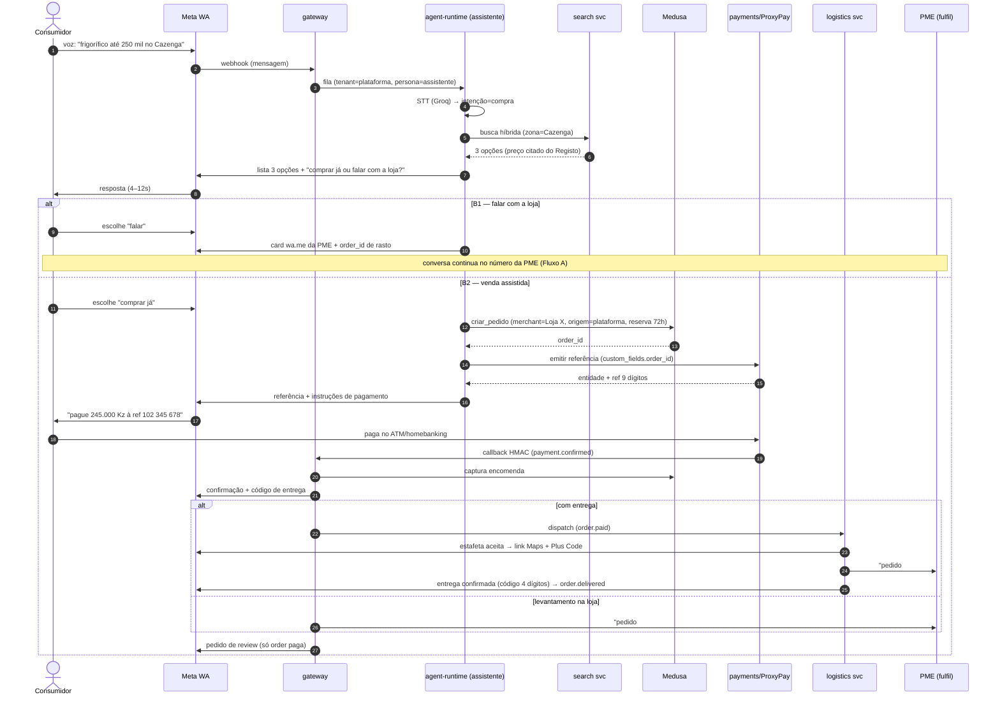

### F2 — Venda no número da PME (Fluxo A)

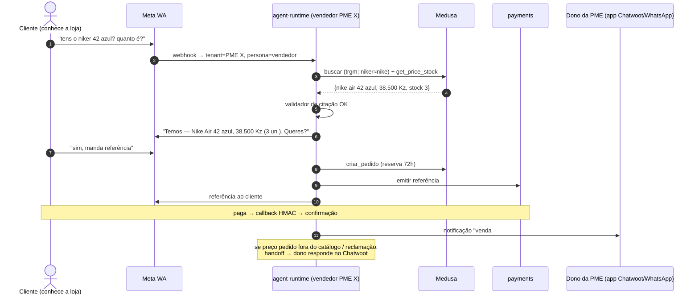

### F3 — Onboarding de uma PME (provisioning)

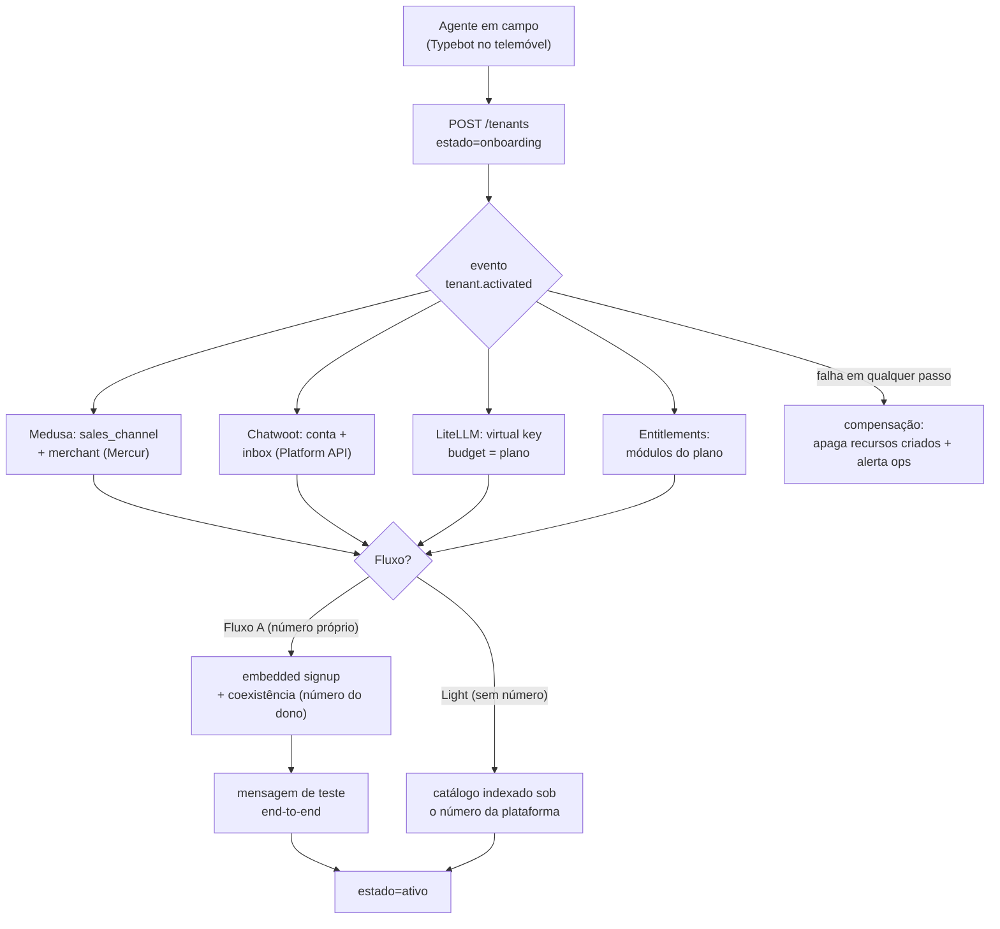

### F4 — Handoff humano (estados da conversa)

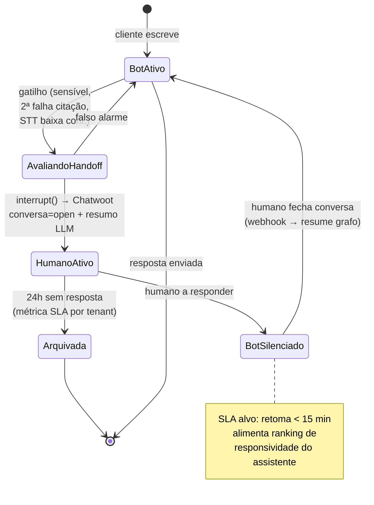

### F5 — Ciclo de vida da encomenda

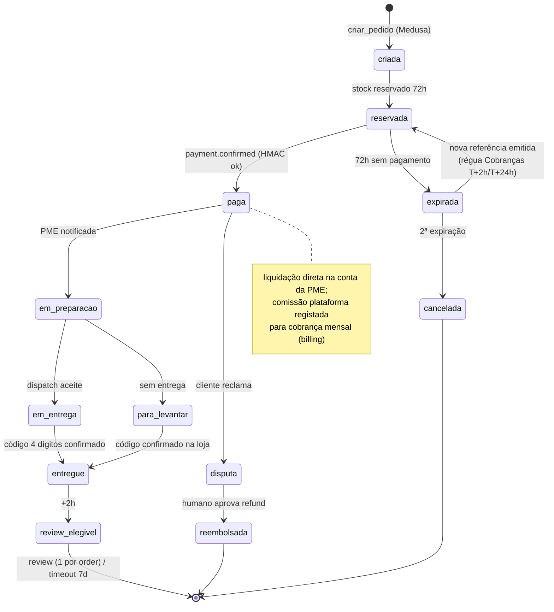

### F6 — Mapa de eventos (quem fala com quem, sem chamadas diretas)

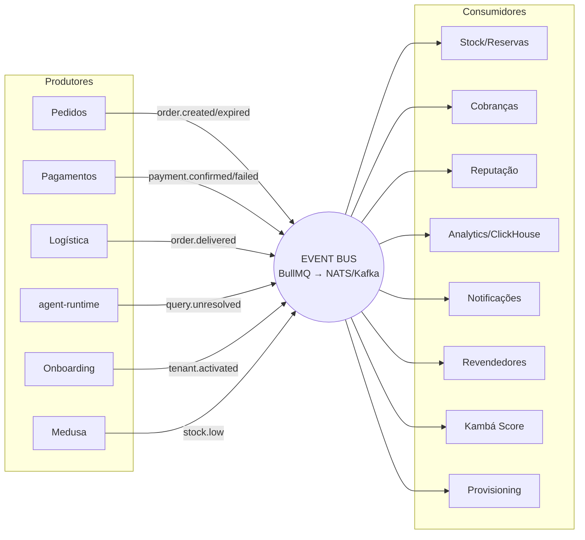

---

## Convenções de leitura

- **C1** responde "quem usa e com o que falamos" — nível de investidor/parceiro
- **C2** responde "que serviços existem" — nível de arquiteto/ops
- **C3** responde "o que há dentro de cada serviço" — nível de dev sénior
- **C4** responde "como está o código" — nível de implementação
- **F1–F6** são os fluxos que cortam as camadas — usar em code review e onboarding da equipa
