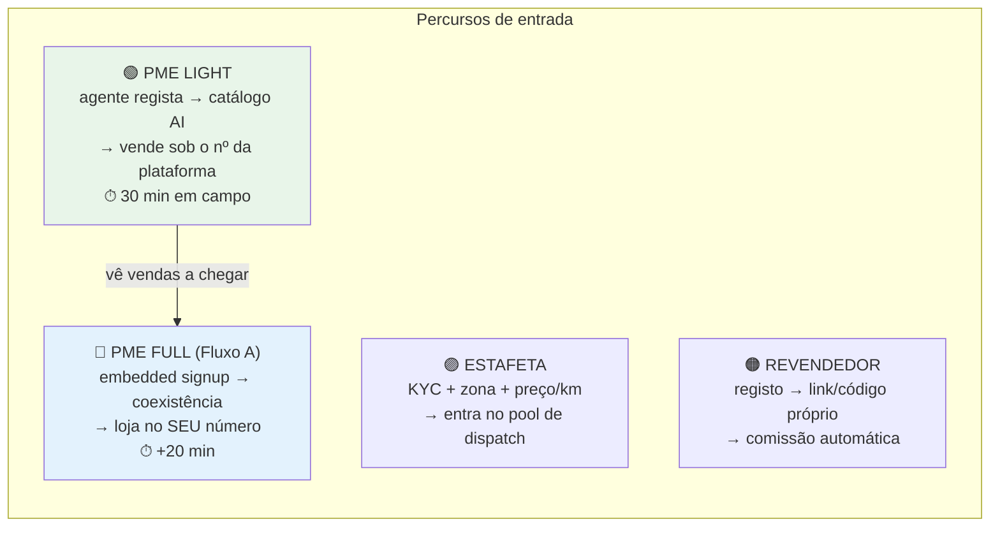
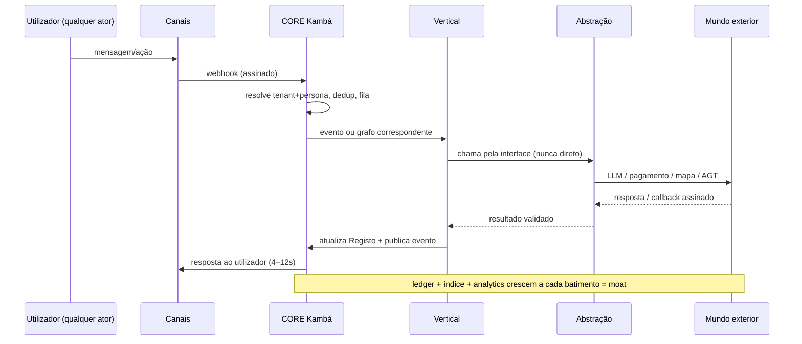
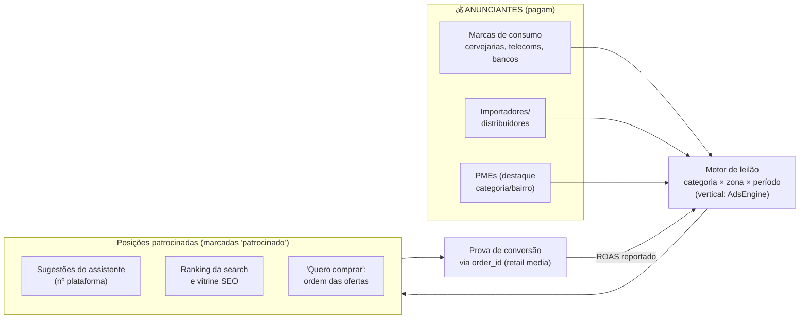
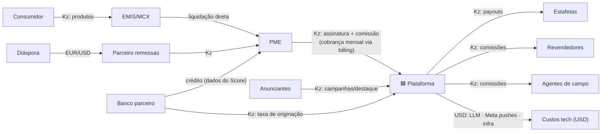
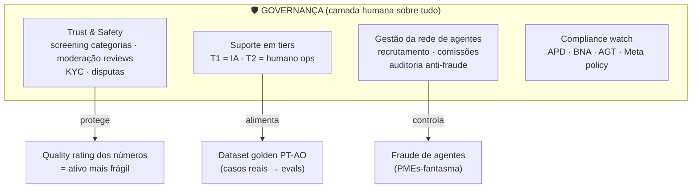
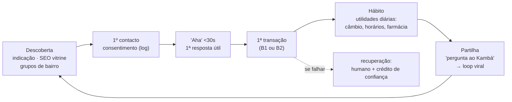

# Big Picture — o ecossistema completo num mapa

Documento de síntese: como **tudo** se encaixa — core, verticais, ferramentas, integrações,
abstrações e onboarding. Lê-se em 10 minutos; os detalhes estão nas docs 08/10/11/12.
"Kambá" = nome de trabalho da plataforma.

---

## 1. O mapa do ecossistema (uma imagem)

```mermaid
flowchart TB
    subgraph ATORES["👤 QUEM USA"]
        CONS["Consumidor"]
        PME["Dono da PME"]
        AGT["Agente de campo"]
        EST["Estafeta"]
        REV["Revendedor"]
        OPS["Ops plataforma"]
    end

    subgraph CANAIS["📱 CANAIS (onde acontece)"]
        NPLAT["Nº WhatsApp<br/>da PLATAFORMA"]
        NPME["Nº WhatsApp<br/>da PME (coexistência)"]
        WEB["Vitrine web / SEO"]
        CWI["Chatwoot UI (humano)"]
        TPB["Typebot (formulários)"]
    end

    subgraph CORE["🟦 CORE KAMBÁ (construímos 1x — o nosso código)"]
        GW["Gateway<br/>assinaturas · dedup"]
        RES["ChannelResolver<br/>número → tenant + persona"]
        RUN["Agent Runtime<br/>LangGraph multi-agente"]
        BUS["Event Bus<br/>order.* payment.* query.*"]
        REG[("Registo — Medusa<br/>produtos·encomendas·stock")]
        IDX[("Índice federado<br/>pgvector+trgm")]
        LED[("Ledger pagamentos<br/>+ payment_events")]
        TEN["Tenant & Entitlements<br/>identidade · planos · limites"]
        BILL["Billing<br/>cobra as PMEs"]
    end

    subgraph VERT["🧩 VERTICAIS (módulos = config + agentes sobre o CORE)"]
        V1["Vendedor AI"]
        V2["Rececionista"]
        V3["Catálogo AI"]
        V4["Orçamentos"]
        V5["Cobranças"]
        V6["Factura AI"]
        V7["Social AI"]
        V8["Arquivo AI"]
        V9["Compras"]
        V10["Logística"]
        V11["Revendedores"]
        V12["Reputação/Selo"]
        V13["Serviços/Agenda"]
        V14["Kambá Score"]
    end

    subgraph ABST["🔌 ABSTRAÇÕES (interfaces que desacoplam tudo)"]
        AB1["PaymentProvider"]
        AB2["AgentRegistry"]
        AB3["ToolLayer (tools scoped)"]
        AB4["EventBus contracts"]
        AB5["LLMProvider (LiteLLM)"]
        AB6["StorageProvider"]
    end

    subgraph FERR["🧰 FERRAMENTAS (open-source que operamos)"]
        F1["Chatwoot (HITL)"]
        F2["Medusa v2+Mercur"]
        F3["LiteLLM"]
        F4["Langfuse"]
        F5["Typebot"]
        F6["n8n"]
        F7["Postgres+pgvector"]
        F8["Redis/BullMQ"]
        F9["MinIO"]
        F10["Nominatim · Valhalla"]
    end

    subgraph EXT["🌐 INTEGRAÇÕES (fora de nós)"]
        E1["Meta Cloud API"]
        E2["LLMs: OpenAI·Google·Groq"]
        E3["ProxyPay · AppyPay"]
        E4["PayPay África (KWiK+payouts)"]
        E5["EMIS/bancos (liquidação PME)"]
        E6["AGT software certificado"]
        E7["Telcos (bundles WhatsApp)"]
        E8["OSM / Google Maps"]
    end

    CONS & PME & EST & REV --> NPLAT & NPME
    AGT --> TPB
    OPS --> CWI
    NPLAT & NPME --> E1
    E1 <--> GW
    GW --> RES --> RUN
    RUN <--> AB2
    RUN --> AB3
    AB3 --> REG & IDX & AB1
    GW & RUN --> BUS
    BUS --> V5 & V12 & V14
    RUN --- VERT
    VERT --- ABST
    ABST --- FERR
    AB1 --> E3 & E4
    E3 & E4 --> E5
    V6 --> E6
    AB5 --> E2
    V10 --> E8 & F10
    TEN --- REG
    BILL --> AB1
    NPLAT & NPME -.-> E7
```



**Como ler:** os atores falam pelos canais → tudo entra no **CORE** (o que é nosso) → as
**verticais** são finas e penduram-se no core → as **abstrações** são o contrato entre core e
o resto → **ferramentas** e **integrações** são substituíveis porque só falam com as abstrações.

---

## 2. O que é CORE (nosso, insubstituível)

| Componente | Porquê é core |
|---|---|
| **Tenant & Entitlements** | 1 tenant = 1 PME; tudo (dados, custos, números, módulos) pendura daqui |
| **ChannelResolver** | `phone_number_id` → tenant + persona; é o que torna o fluxo dual trivial |
| **Agent Runtime** | LangGraph multi-agente + guardrails + validador de citação + handoff — a "fábrica de agentes" |
| **Event Bus** | a cola: módulos nunca se chamam; subscrevem eventos canónicos |
| **Registo (Medusa)** | a verdade operacional: produtos, encomendas, reservas |
| **Índice federado** | o ativo defensável: o que se vende, onde, a que preço, com que reputação |
| **Ledger + payment_events** | anti-fraude por desenho; base do Kambá Score |
| **Billing** | a plataforma cobra as PMEs com as suas próprias primitivas (dogfooding) |

Regra de ouro: **se um concorrente copiar as ferramentas, não copia o core** — porque o core é
código + dados + contexto acumulado.

## 3. Verticais = configuração, não sistemas

Cada vertical é um tuplo `(grafo LangGraph, tools autorizadas, persona/prompt, entitlements)`:

```yaml
# exemplo: ativar a vertical Cobranças para o tenant X é ISTO, não um projeto
vertical: cobrancas
agente: cobrancas_graph           # registado no AgentRegistry
tools: [listar_referencias_pendentes, reemitir_referencia, notificar_cliente]
subscreve_eventos: [order.expired, payment.pending]
persona: "cobrador educado, PT-AO, nunca ameaçador"
limites: { lembretes_dia: 3, templates: ["lembrete_v1","recuperacao_v1"] }
```

Consequência: lançar uma vertical nova (ex.: Seguros micro na fase 3) = escrever um grafo + 3–5
tools + YAML. Dias, não meses. É por isto que a expansão da doc 06 é barata.

## 4. Abstrações — onde a flexibilidade vive

| Abstração | Contrato | O que permite trocar sem dor |
|---|---|---|
| `PaymentProvider` | createCharge · status · refund · payout | ProxyPay ↔ AppyPay ↔ PayPay ↔ EMIS direto |
| `LLMProvider` (LiteLLM) | chat/embeddings + virtual keys por tenant | OpenAI ↔ Gemini ↔ Qwen self-host |
| `AgentRegistry` | grafo + tools + persona por vertical | adicionar/retirar verticais em runtime |
| `EventBus contracts` | envelopes versionados (`versao: 1`) | BullMQ ↔ NATS/Kafka; consumers ignoram o que não conhecem |
| `ToolLayer` | tools com `tenant_id` do estado, nunca do cliente | segurança: nenhum agente escreve fora do seu tenant |
| `StorageProvider` | put/get URL assinada | MinIO ↔ S3 ↔ Angola Cables Cloud |
| `ChannelAdapter` | send/receive normalizado | Meta oficial (produção) ↔ sandbox de testes |

## 5. Onboarding — os 4 percursos



Estados de um tenant: `onboarding → ativo → suspenso` (quality rating/falta de pagamento) —
o billing e a Meta alimentam as transições automaticamente.

## 6. Como tudo funciona junto — o sistema nervoso em 6 batimentos



Seis propriedades que este desenho garante:
1. **Qualquer vertical nova** entra sem tocar no core (só regista grafo + tools + subscrições)
2. **Qualquer integração** pode ser trocada sem tocar nas verticais (só o adapter muda)
3. **Qualquer canal novo** (app, Instagram) entra pelo ChannelResolver
4. **Falhas degracam**: LLM em baixo → Typebot; pagamentos em baixo → fila; nunca silêncio
5. **Custo e margem por tenant/vertical** são sempre medidos (LiteLLM + metering) — pricing é
   decisão com dados, não intuição
6. **O ativo cresce sozinho**: cada batimento engorda índice, ledger e sinal de procura

## 7. Build vs ferramenta vs parceiro (a lógica de decisão)

| Camada | Decisão | Razão |
|---|---|---|
| Core (tenants, runtime, bus, índice, ledger) | **BUILD** | é o moat |
| Verticais | **BUILD** (finas) | diferenciação + velocidade |
| Chatwoot, Medusa, Typebot, n8n, Langfuse | **FERRAMENTA** open-source | maduros, MIT, não vale reinventar |
| Pagamentos, EMIS, AGT, telcos | **PARCEIRO** | regulado/relacional; adaptamos, não controlamos |
| LLMs, STT, embeddings | **CONSOME API** | commodity; self-host só no break-even |

Regra: nós construímos o que acumula valor com o uso; adotamos o que é estável; integramos o que
é regulado.

---

## 8. Onde encaixa cada documento

| Se queres… | Vai para |
|---|---|
| Ver o todo em 10 min | esta doc (13) |
| Os diagramas C4 formais | `12-diagramas-c4-fluxogramas.md` |
| Schemas, contratos, deploy | `11-arquitetura-detalhada-engenharia.md` |
| Primitivas e módulos | `10-arquitetura-plataforma-holistica.md` |
| Decisões de produto/canal | `08-arquitetura-tecnica-v2.md` |
| Porquê esta estratégia | `01–07` |

---

## 9. As 5 camadas que faltavam no mapa

A big picture das §§1–7 mostra a **máquina tecnológica**. Um ecossistema completo precisa de mais
cinco camadas — adicionadas aqui.

### 9.1 O terceiro lado: o motor de atenção (anunciantes)

O modelo Google (doc 03) tem **três** lados; o mapa só tinha dois. O terceiro lado entra assim:



Regras herdadas da doc 03: transparência radical (rótulo + alternativa orgânica sempre visível),
só em conversas iniciadas pelo utilizador, e **só depois das linhas 1–3 de receita** — a Ayoba
morreu por inverter esta ordem. Tecnicamente é só mais uma vertical (`AdsEngine`) sobre o core:
subscreve queries, escreve placements, cobra via billing. Nada de novo na espinha.

### 9.2 O mapa de dinheiro (quem paga a quem, em que moeda)



Leituras que só este mapa revela:
- **Hedge cambial natural**: entradas em Kz + EUR (diáspora) contra custos críticos em USD —
  a diáspora não é "mais um módulo", é a proteção da margem
- **A PME paga duas vezes sem sentir**: assinatura (billing) + comissão (registada no ledger)
- **Todo o payout é Kz doméstico** via PayPay IBAN — nenhum câmbio na operação interna

### 9.3 A camada de governação (a organização, não só a tech)

O mapa tinha código onde também devia ter **pessoas e processos**:



Notas: (1) o suporte T2 não é custo morto — cada caso humano vira exemplo do dataset golden que
treina o T1; (2) Trust & Safety decide **quem pode entrar** antes de qualquer código — uma PME de
categoria proibida degrada o quality rating de todos; (3) a gestão de agentes precisa de auditoria
desde o agente nº 1 (o incentivo à fraude nasce com a comissão).

### 9.4 O quarto percurso esquecido: o consumidor

Os percursos da §5 são todos do lado da oferta. O lado que sustenta o modelo Google:



Métrica por passo: taxa de consentimento · % respostas úteis <30s · conversão 1ª transação ·
retorno semanal (W4) · K-factor de partilha. **Sem este funil, o "modelo Google" é só B2B com
extra steps** — é o ponto cego "Shopify vs Google" da ronda 2 tornado operacional.

### 9.5 Tempo, degradação, métricas e linhagem

**A dimensão temporal** (o mapa não é estático):

| Fase | O que existe no mapa |
|---|---|
| Piloto | Core mínimo + Loja (Fluxo A) + número plataforma + pagamentos ProxyPay + governação manual |
| Clusters | + verticais Serviços/Cobranças/Logística/Factura + consumidor em 1 cluster + AdsEngine piloto |
| Escala | + Analytics/Score/Diáspora/Revendedores + leilão + API aberta + parceiros estratégicos |

**O mapa de degradação** (o que morre quando X falha):

| Falha | Impacto | Fallback desenhado |
|---|---|---|
| Meta API em baixo | Canais parados | Fila absorve; painel web continua; status page para PMEs |
| Número da plataforma com rating vermelho | Fluxo B morre | Throttling preventivo + números de reserva + screening de categorias |
| EMIS/ProxyPay em baixo | Sem pagamentos | Fila com reconciliação diferida; comprovativo NUNCA é fallback |
| LLM provider em baixo | Agentes parados | LiteLLM failover (OpenAI→Gemini) → Typebot determinístico |
| LLM caro demais (câmbio) | Margem comprime | Downgrade para nano/Flash-Lite por intenção; revisão trimestral de preços |
| Fraude de agentes | Base de PMEs envenenada | Auditoria + comissão só após 1ª venda real da PME |

**North-star e métricas por camada:**

| Camada | Métrica |
|---|---|
| Ecossistema | **Transações confirmadas/semana** (north-star) |
| Consumidor | perguntas/semana · % útil · retorno W4 |
| PME | módulos por tenant · receita atribuída · churn |
| Atenção | leads→vendas · ROAS dos placements |
| Governação | % disputas · tempo de resolução · quality rating médio |
| Técnica | custo/PME · p95 latência · % handoff |

**Linhagem dos dados** (dos eventos aos produtos):

```
eventos (order.*, payment.*, query.*) → ClickHouse
   ├─→ Kambá Score → banco parceiro (originação de crédito)
   ├─→ Sinal de procura → PME ("procuram X, ninguém tem")
   ├─→ Índice de preços → marcas/B2G ("inflação de bairro")
   └─→ ROAS placements → anunciantes (renovação do leilão)
Consentimento + HMAC de msisdn aplicados na origem (Lei 22/11); dados nunca saem como PII.
```
