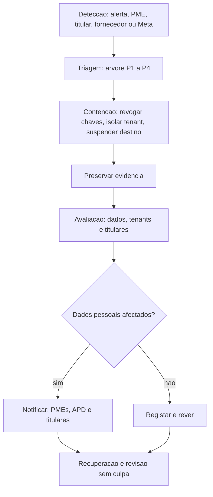
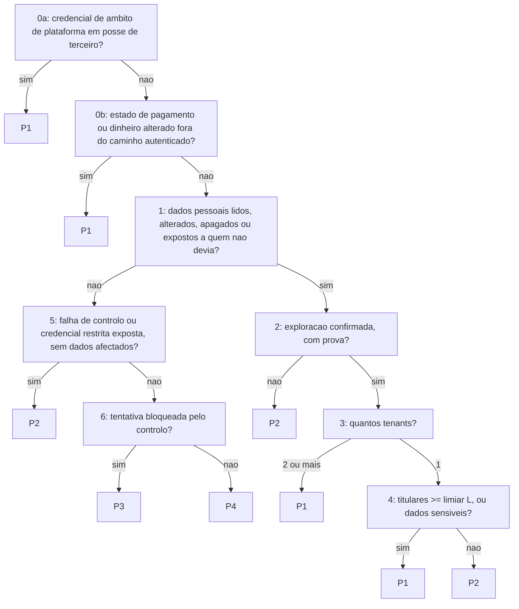

# Resposta a incidentes e notificação de violação de dados (RB-K10)

| Campo | Valor |
|---|---|
| Ticket | KAM-113 — Resposta a incidentes e notificação de violação de dados |
| Fonte normativa | [`docs/tecnica/08_Seguranca_Conformidade.md`](../tecnica/08_Seguranca_Conformidade.md) §10 (o fluxo e as classes), §7.1 (a retenção de logs), §8.5 requisitos 12 e 25; [`docs/tecnica/evidencia/E3_Regulatorio_Dados.md`](../tecnica/evidencia/E3_Regulatorio_Dados.md) requisitos 12 e 25, pergunta 7 |
| Runbook operacional | **RB-K10** de [`docs/tecnica/09_Topologia_Operacao_Escala.md`](../tecnica/09_Topologia_Operacao_Escala.md) §13 — este documento é o seu conteúdo. O ficheiro do runbook no modelo comum é [`../runbooks/RB-K10-incidente-de-seguranca.md`](../runbooks/RB-K10-incidente-de-seguranca.md) (KAM-083), e **remete para aqui** em vez de duplicar |
| Acompanham | [`modelos/`](modelos/) (APD, PME afectada, titular), [`contactos_incidentes.md`](contactos_incidentes.md), [`exercicio_simulacao.md`](exercicio_simulacao.md) |
| Estado | **Esboço / proposta.** Nada aqui está ratificado, e nenhuma parte foi vista por advogado |

| Aprovação | Nome | Data |
|---|---|---|
| Responsável de Segurança (SEG) | *(por aprovar)* | — |
| Responsável de privacidade (PRIV) | *(por rever)* | — |
| Advogado externo (ADV) — texto jurídico | *(por rever; antes de qualquer uso externo)* | — |

> **A regra que atravessa este documento.** Nenhum prazo e nenhuma obrigação aqui é
> apresentado como direito vigente. Cada prazo leva a marca **«boa prática; obrigação a
> confirmar por parecer»**, e todo o texto jurídico leva **«(a confirmar por parecer)»**.
> Onde o texto diz «assume-se», é uma decisão de engenharia para agir já, não uma leitura
> da lei. O parecer é pedido no pacote do KAM-104 (§13).

---

## 1. O que isto é, e o que não é

Um procedimento para a pessoa de serviço ter, na primeira hora de um incidente de segurança,
**o que decidir, por que ordem, e quem o faz** — sem ter de ler o desenho. Segue o fluxo de
`08` §10:



**Fora de âmbito** (por escrito no ticket): SOC, SIEM e detecção automática de fuga
(Clusters); o registo e a notificação *do tratamento* à APD (`08` §8.6, KAM-105); o pentest
(KAM-074). Os **modelos** e a **lista de contactos** têm ficheiro próprio.

### 1.1 O estado das afirmações em que o runbook assenta

| Afirmação | Estado | Fonte |
|---|---|---|
| A Lei 22/11 não obriga o responsável em geral a notificar violações (só prestadores de comunicações electrónicas) | **INDÍCIO** (leitura única, 2021) | `E3` §1 |
| Existe uma «Circular 02» da APD sobre comunicação de incidentes informáticos, e a imprensa de 2026 refere multas por «não notificação» | **INDÍCIO**, **contraditório** com a linha anterior | `E3` §1, pergunta 7 |
| O alvo de 72 h (PRZ-4, PRZ-5: boa prática; obrigação a confirmar por parecer) vem do projecto de revisão da lei (2025) e de boa prática | **INDÍCIO** | `E3` §1, `08` §10 |
| Coimas do Art. 51.º: USD 75.000 a 150.000 (segurança, notificação), triplicadas para pessoas colectivas *(a confirmar por parecer)*. O `E3` não distingue aqui a notificação de uma violação da notificação do tratamento à APD | **CONFIRMADO** em duas leituras de portais não oficiais — *verificar no Diário da República* | `E3` §1 |
| O intervalo «USD 7.000 a 15.000» para falta de notificação | **NÃO VERIFICADO** (contraditório, sem fonte aberta) | `E3` §1 |
| A KAMBÁ é subcontratada ou co-responsável, e quem notifica | **Aberto** — decisão **D9** | `00` §13.3 |

**Daí a postura, que é de engenharia e não de direito:** *assume-se a obrigação* de notificar
(`E3` pergunta 7; `08` §10), porque notificar sem dever custa, em princípio, menos do que não notificar com dever (coimas). Não custa
nada: avisar o titular pode ser uma finalidade nova do contacto (§9.2), e por isso o texto passa
pelo ADV. Isto não diz que o dever existe *(a confirmar por parecer)*.

---

## 2. Prazos

Todos são **proposta**. **T0** é o instante em que a **primeira pessoa** na KAMBÁ tomou
conhecimento razoável de que *pode* haver um incidente — a hora do alerta ou da mensagem, não a
certeza, e **não** a hora em que alguém abriu o registo (§4): se o registo abre depois, escreve-se
nele o T0 verdadeiro, retroactivo. Contar desde T0
é a leitura mais exigente; `08` §10 não diz a partir de quando se conta, e quando o relógio
começa é uma das perguntas do §13 *(a confirmar por parecer)*.

| ID | Prazo | Quem | Marca |
|---|---|---|---|
| PRZ-1 | **Triagem** concluída e classe P1 a P4 atribuída: ≤ 1 h desde T0 | SEG | boa prática; obrigação a confirmar por parecer |
| PRZ-2 | **Avaliação** concluída (dados, tenants, titulares, consequências): ≤ 24 h desde T0 | SEG, PRIV | boa prática; obrigação a confirmar por parecer |
| PRZ-3 | **PMEs afectadas** avisadas: ≤ 24 h desde T0 (cláusula a prever no DPA, KAM-090) | SEG, ADV | boa prática; obrigação a confirmar por parecer |
| PRZ-4 | **APD** notificada: ≤ 72 h desde T0 | SEG, ADV | boa prática; obrigação a confirmar por parecer |
| PRZ-5 | **Titulares** avisados: ≤ 72 h desde T0 | PRIV, ADV | boa prática; obrigação a confirmar por parecer |
| PRZ-6 | **Pedido da APD** tratado por T3: ≤ 5 dias úteis desde a recepção (`10` §11.1, valor sugerido; `E3` requisito 25) | PRIV, ADV | boa prática; obrigação a confirmar por parecer |
| PRZ-7 | **Evidência** exportada e selada: ≤ 24 h desde T0 | OPS, SEG | **proposta de engenharia, não é prazo legal**: decorre da retenção de logs de 30 dias (`08` §7.1; Loki, `09` §9.1) |

No resto do documento os prazos citam-se pelo **ID**, para que o valor e a marca vivam só aqui.

---

## 3. Quem faz o quê

Os papéis são os da legenda de `08` §8.5. **Um dono por papel**, e um suplente por papel na
[lista de contactos](contactos_incidentes.md) (hoje todos vagos); sem suplente o papel está vago e o
incidente escala para o fundador.

| Papel | Quem | No incidente |
|---|---|---|
| **SEG** | Responsável de Segurança | **Comanda o incidente.** Atribui a classe, ordena contenção, autoriza a notificação, assina o fecho |
| **PRIV** | Responsável interno de privacidade | Categorias e n.º de titulares; decide se há notificação; redige o texto aos titulares; guarda o registo e o repositório de provas |
| **ADV** | Advogado externo | Revê **todo** o texto jurídico antes de sair; responde sobre quem notifica e o prazo. *Ainda não contratado* (KAM-104) |
| **OPS** | SRE | Contenção técnica, preservação de evidência, recuperação |
| **AP** | Arquitecto de Plataforma | Âmbito técnico (que tenants, que dados, que caminho), correcção de causa |

O papel que **não** existe na legenda de `08` §8.5 e que o incidente precisa é o do **escriba**: quem
mantém a linha temporal (§4.2). Não é o SEG, que está a decidir.

---

## 4. Detecção e abertura do registo

Qualquer pessoa que ouça falar de um incidente **abre o registo antes de o avaliar**. Um
registo aberto e depois descartado custa uma linha; um incidente que ninguém registou custa o
relógio.

| Origem | Como chega | Quem recebe | Primeiro passo |
|---|---|---|---|
| **Alerta** | `09` §9.2 (ver §4.3) | OPS de serviço | Abre o registo; chama SEG |
| **PME** | Suporte da KAMBÁ à PME (`10` §11.1: T1 escala a T2, T2 a T3) | T2 | Abre o registo; **não** pede à PME dados de clientes; chama SEG |
| **Titular** | Reclamação ou pedido por qualquer canal | PRIV | Abre o registo; identifica o titular **por identificador opaco**, nunca por nome ou número no registo |
| **Fornecedor** | Aviso de violação de LLM, cloud, facilitador, Meta Business | Quem receber → SEG | Abre o registo; guarda o aviso original no repositório de provas |
| **Meta** | Mensagem de Direct Support ou `account_update` | OPS | Abre o registo; distingue incidente da Meta de incidente nosso (RB-K01, RB-K06) |

### 4.1 O que o registo contém — e o que nunca contém

Contém: T0 e a hora do registo, quem o abriu, a origem, o que foi observado em **uma frase
factual**, os identificadores técnicos envolvidos (`tenant_id`, `turn_id`, `msg_id`), e a classe
quando existir.

**Nunca contém:** texto de mensagens, transcrições, números de telefone, nomes, moradas,
capturas de ecrã de conversas, nem segredos. Se o incidente *é* uma fuga dessas coisas, o
registo refere-as **por identificador e por contagem**, não por valor — é a mesma regra de
`../logs.md` (logs sem conteúdo).

### 4.2 A linha temporal

O escriba acrescenta uma linha por facto e por decisão, **em UTC** (apresentação em
`Africa/Luanda`): `hora UTC | quem | o que se observou ou decidiu | evidência (id)`. É o que
a revisão sem culpa (§10) e o exercício (§12) medem — sem ela, PRZ-1 a PRZ-5 não se verificam.

### 4.3 Os alertas P1 de `09` §9.2 e este runbook

Um alerta de severidade P1 **abre a triagem**; não é, por si, um incidente de segurança, e a
classe P1 a P4 do §5 **não é** a severidade do alerta. Cada alerta tem o seu runbook
operacional; entra na árvore do §5 quando há indício de causa hostil.

| Alerta P1 (`09` §9.2) | Runbook operacional | Quando entra na árvore do §5 |
|---|---|---|
| Ingress parado | RB-K01, RB-K08 | Se a causa for tráfego hostil ou credencial comprometida, e não falha da Meta ou do host |
| Callbacks: falhas HMAC > 3/h, ou pagamento por reconhecer | RB-K02 | **Sempre que um estado de pagamento tenha mudado sem evento autenticado** (pergunta 0b do §5); falhas de HMAC repetidas são o sinal de tentativa de forja |
| WAL: último arquivo > 5 min | RB-K08 | Se a causa for credencial comprometida ou *ransomware* (`09` §8.3, «Credenciais comprometidas») |
| Quality rating vermelho | RB-K04 | Só se houver indício de que a conta foi tomada por terceiro |

---

## 5. Triagem: a árvore de classificação P1 a P4

A classe decide a **intensidade da resposta** (`08` §10). Quem notifica e quando decide-se
à parte, no §8. As respostas são **factos verificáveis**, cada uma com a sua prova. Duas regras de prova:

- Um «sim» nas perguntas **0a, 0b, 1, 5 e 6** pede um indício concreto; um alerta sem causa
  conhecida não é, por si, um «sim».
- Nas perguntas **2, 3 e 4** (exploração, tenants, titulares) a triagem **falha para cima**: sem a
  prova que daria «não», ou sem a contagem, a resposta é a que sobe a classe.

**Duas definições que a árvore usa:**

- **Em posse de terceiro** (uma credencial): há evidência de que alguém de fora a possui ou a
  usou, **ou** ela esteve num sítio público — repositório público (este é público), *paste*,
  *log* ou página acessível. «Exposta» sem nenhuma dessas provas não é «em posse».
- **Âmbito de plataforma** (uma credencial): serve mais do que um tenant, ou fala em nome da
  KAMBÁ a um fornecedor — chave de LLM, token da Meta da plataforma, **`meta_app_secret` e
  `meta_verify_token`** (um valor para a plataforma inteira, `ops/secrets-inventory.yaml`),
  credencial do facilitador, *master key* do gateway, *pepper* do HMAC, credencial da base de
  dados. **Âmbito restrito**: serve um só tenant ou uma só conta — p. ex. o `webhook_token` de
  uma conta de pagamento —, mesmo que sirva vários canais desse tenant.
- **«Webhook secret exposto» de `08` §10 (P2) lê-se como o de âmbito restrito.** Se o segredo for
  o `meta_app_secret` ou o `meta_verify_token`, é de plataforma e a árvore dá **P1** (0a). A
  leitura de `08` §10 é nossa e fica a confirmar pelo SEG; em dúvida sobre qual é o segredo, é P1.



| # | Pergunta | A prova que a responde |
|---|---|---|
| **0a** | Uma credencial **de âmbito de plataforma** está **em posse de terceiro**? | Aviso do fornecedor; uso fora do padrão nos logs do fornecedor ou no `llm_call_log`; o valor num sítio público (varredura do *scanner* de segredos, `tools/scan_secrets/`) |
| **0b** | Um estado de **pagamento ou dinheiro** foi alterado **sem evento autenticado** (ADR-013), por atacante **ou por erro interno**? | `payment_events` e `audit_log` do tenant: confirmação sem a assinatura do facilitador; a reconciliação encontra o que o evento não explica |
| **1** | **Dados pessoais** foram, **de facto**, devolvidos, lidos, alterados, apagados ou deixados expostos (um recurso aberto, que qualquer pedido alcançava) a quem não devia — incluindo abuso de acesso legítimo, como um colaborador que os leva para fora? Um defeito que **permitiria** isso, sem que os dados tenham saído, não é «sim»: vai à 5 | Consulta aos logs de acesso e ao `audit_log`; o achado da verificação da cadeia (§7.1); o âmbito do defeito (que tabelas, que RLS) |
| **2** | A **exploração** está **confirmada com prova**, e não só possível? Uma exposição de que há registo de acesso por terceiros, ou um abuso de acesso legítimo com saída dos dados, é exploração | Registo de acesso de quem não devia; um achado de verificação da cadeia do `audit_log`. **A ausência de exploração só se afirma com os logs que a mostrariam, e quem decide que bastam é o SEG, por escrito.** Sem esses logs (nunca existiram, ou passaram a retenção de 30 dias, PRZ-7) a resposta é «sim» |
| **3** | **Quantos tenants** estão envolvidos — contam-se **os dois lados**: o tenant cujos dados foram expostos e o que os acedeu. Uma fuga *entre* tenants envolve, por definição, pelo menos dois. Lista desconhecida: conta-se «2 ou mais» | `tenant_id` nos registos; a lista é parte da avaliação (PRZ-2) |
| **4** | Com um só tenant: o n.º de **titulares** atinge o limiar **L**, ou há **dados sensíveis** (Art. 5.º c) da Lei 22/11, `08` §7.5)? **Conteúdo de conversa e áudio contam como sensíveis até prova em contrário**, porque o conteúdo não se filtra à entrada (*proposta*) | Contagem de `contact_hmac` distintos afectados; classes de dados da tabela `08` §7.1 |
| **5** | Sem dados afectados: há uma **falha de controlo** que daria acesso (p. ex. uma política RLS furada), uma credencial de âmbito restrito **exposta**, ou **indício de tomada de uma conta de pessoal** (início de sessão que o titular da conta não reconhece, ou fora de padrão com acção sensível)? | Revisão de código, teste de isolamento, varredura do *scanner* de segredos, registo de sessões |
| **6** | Sem nada do anterior: foi uma **tentativa** que o controlo bloqueou? **Sim** → P3. **Não**, mas é uma anomalia de segurança sem impacto → P4. **Não é matéria de segurança** (p. ex. um pico de tráfego legítimo) → fecha-se o registo sem classe | O código de recusa nos logs (`error_code`); sem efeito observado |

**O limiar L é uma proposta não calibrada: 100 titulares, e não tem fonte.** Com o conteúdo de
conversa e o áudio sensíveis por defeito, L só actua sobre fugas de contacto e de encomendas;
qualquer fuga de conversa de um tenant com exploração confirmada é P1 com um só titular. A árvore
é conservadora de propósito. Calibra-se no primeiro exercício (§12) e por decisão do SEG; até lá, em dúvida
entre P1 e P2, é P1.

**Sobre os dois «sim» antes da pergunta de dados (0a e 0b).** Os exemplos de `08` §10 obrigam a
eles: uma *chave de fornecedor comprometida* e uma *confirmação de pagamento forjada* são P1
**sem que se saiba ainda que dados pessoais foram afectados**. Se a árvore perguntasse só
pelos dados pessoais, esses dois exemplos — que são o teste dela — saíam em P2 ou menos.

### 5.1 O que a classe manda fazer

| Classe | Resposta (de `08` §10) | Quem |
|---|---|---|
| **P1** | Equipa completa; contenção imediata; notificações do §8 | SEG, PRIV, ADV, OPS, AP |
| **P2** | Rotação e correcção em ≤ 24 h (alvo de `08` §10; proposta de engenharia, não é prazo legal); notificações se a pergunta 1 foi «sim» | SEG, OPS, AP; PRIV se houver dados |
| **P3** | Ajuste de filtros e registo | OPS |
| **P4** | Registo | OPS |

### 5.2 Mudar de classe

- **Sobe** a qualquer momento, por qualquer pessoa do registo, com a evidência anotada.
- **Desce** só na avaliação (PRZ-2), por escrito do SEG, com a prova que a pergunta pedia.
  Um incidente nunca desce por «parece menos grave».

### 5.3 Teste da árvore

Os exemplos de `08` §10 caem, pela árvore e não por intuição:

| Exemplo de `08` §10 | Caminho | Classe |
|---|---|---|
| Fuga cruzada entre tenants (exploração confirmada, ≥ 2 tenants) | 0a não → 0b não → 1 sim → 2 sim → 3: 2 ou mais | **P1** |
| Chave de provedor comprometida | 0a **sim** | **P1** |
| Confirmação de pagamento forjada | 0a não → 0b **sim** | **P1** |
| Webhook secret exposto (âmbito restrito, sem uso provado) | 0a não → 0b não → 1 não → 5 sim | **P2** |
| Falha de RLS sem exploração | 0a não → 0b não → 1 não → 5 sim | **P2** |
| Tentativa de injecção sem efeito | 1 não → 5 não → 6 sim (bloqueada pelo controlo) | **P3** |
| Anomalia sem impacto | 1 não → 5 não → 6 não | **P4** |

Dez cenários fictícios adicionais, para classificação cega por dois revisores, estão no
[Anexo A](#anexo-a--dez-cenários-para-o-teste-de-classificação).

---

## 6. Contenção

**Conter antes de compreender**, mas **sem destruir o que se vai precisar**: a ordem é
conter a hemorragia → preservar (§7) → só então limpar. Cada acção regista-se na linha
temporal. As acções, e o que ainda **não existe** para as executar:

| Acção | Quando | Como (hoje) | O que falta |
|---|---|---|---|
| **Revogar e rodar chaves** | Pergunta 0a «sim»; qualquer suspeita de segredo em posse de terceiro | RB-K07: fornecedores de LLM **primeiro** em incidente; anel `[actual, anterior]` onde o consumidor o suporta; registar a rotação (o identificador e a hora, **nunca o valor**) — **na linha temporal, e não no `audit_log`**, que não tem acção para isso (RB-K07 §0). LLM: [`docs/runbooks/rotacao-de-chaves-de-llm.md`](../runbooks/rotacao-de-chaves-de-llm.md), `infra/llm/chaves.py`, [`ops/secrets-inventory.yaml`](../../ops/secrets-inventory.yaml) | Meta, facilitador e HMAC: o suporte a duas chaves e o runbook por segredo são o **KAM-072**, ainda por entregar — hoje a rotação é manual |
| **Isolar um tenant** | O incidente é de um tenant, ou um tenant é a origem | Estado do tenant → `suspenso` (dicionário §3), e cortar o acesso da chave virtual do tenant no gateway (`max_budget: 0`; **não** é rodar o valor — o runbook de rotação, §3, distingue as duas). Avisar a PME por **canal alternativo** (§7.2) | **A chave virtual não existe no compose actual**: o LiteLLM não tem base de dados, e `/key/update` responde 500 (RB-K03 §0). A transição para `suspenso` também não tem código: é o comando do RB-K04 §3, passo 5 |
| **Suspender um destino de transferência** | Um fornecedor de LLM/STT/cloud é a origem ou foi comprometido | O gate de destino de ADR-008 falha fechado: sem linha `autorizado` a chamada falha (`08` §7.4). Marcar o destino como não autorizado | **A acção existe desde o KAM-069**: a tabela `platform.tenant_destinations` (revisão `0036`) e a porta que a lê. Suspender um destino é pôr a linha em `revogado` com `revogado_em`, e a chamada seguinte falha em **≤ 60 s** — o TTL da *cache* da porta, que é o tecto do critério 3 daquele ticket; quem não quiser esperar chama `invalidar`. Escreve o `kamba_batch`: o `kamba_app` tem `SELECT` e mais nada. Em `prod` o *gate* continua a recusar **todos** os fornecedores, já não por falta de tabela mas por falta de `apd_ref` (`../runbooks/rotacao-de-chaves-de-llm.md` §5) |
| **Segredo num repositório** | Um segredo foi *commitado* | **Rodar primeiro.** Este repositório é público: um segredo ali conta como em posse de terceiro (§5). Reescrever a história **não** torna o segredo seguro, apenas esconde-o; é segunda ordem | Limpar a história: o KAM-131 devolve-a a este ticket («é resposta a incidente, KAM-113»), e **nenhum dos dois a especifica**. Este runbook só manda rodar primeiro |
| **Cortar um caminho** | O ataque usa um endpoint ou integração | Desligar o caminho (flag, regra de CDN) em vez de desligar o serviço | — |

**O que a contenção não faz:** não apaga logs, não reinicia o serviço afectado antes do
*snapshot* quando a contenção o permitir, não altera o `audit_log` (não é possível: é
*append-only*), e não avisa ninguém de fora — isso é o §9, e sai pelo SEG depois da revisão de
ADV.

---

## 7. Preservar a evidência

**Em ≤ 24 h (PRZ-7; proposta de engenharia, não é prazo legal)**, porque a retenção de logs técnicos é de **30 dias** e o que passa esse
prazo deixa de existir (`08` §7.1). O que se preserva, por quem, e
onde fica:

| Evidência | Como | Dono |
|---|---|---|
| **Extracto do `audit_log` com a cadeia verificada** | Ver §7.1. A cadeia verifica-se **primeiro**, e o resultado (a saída e o código de saída) guarda-se com o extracto | OPS |
| **Logs** dos serviços envolvidos, dos três dias anteriores a T0 até ao presente (proposta de engenharia) | Exportar do Loki para ficheiro; **os logs são sem conteúdo** (`08` §7.3), mas o ficheiro trata-se como sensível na mesma | OPS |
| ***Snapshots*** do que existe: estado do tenant, configuração de destinos, lista de segredos rodados (identificadores) | Cópia com data | OPS, AP |
| **Avisos de terceiros** (fornecedor, Meta, PME, titular) | O original, sem edição | SEG |
| **A linha temporal** (§4.2) | Cópia selada no fim de cada dia | O escriba |

**Cada ficheiro selado** leva o `sha256` calculado e escrito na linha temporal; **depois de
selado, não se edita** — corrige-se com ficheiro novo. A cadeia de custódia (quem exportou,
quando, para onde) é uma coluna da linha temporal. Tudo vai para o **repositório de provas**
(`E3` requisito 25), **que não é este repositório**: é privado, e o que lá cabe — extractos,
logs, avisos — não pode estar num repositório público.

### 7.1 O extracto do `audit_log` e a cadeia

O `audit_log` tem uma cadeia de hash **por tenant** (`prev_hash`, `row_hash`; KAM-012, ver
[`docs/auditoria.md`](../auditoria.md)). O que isto implica para o extracto:

1. **Verificar a cadeia na base viva, antes de exportar.** O verificador percorre a cadeia pelo
   `prev_hash` e dá quatro achados que a resposta operacional distingue: *fora da cadeia*,
   *hash errado*, *cabeça errada* e *desapareceu inteira* (`../auditoria.md` §6):

   ```sh
   python db/auditoria.py verificar --tenant <uuid>
   ```

   O comando usa a identidade omissa (`batch`), que vê tudo. Com `--papel audit` o papel é o
   `kamba_audit` (só leitura), mas **só vê linhas com `--tenant`**: sem ele, vê zero linhas e
   responde «intacta» sobre nada (`db/auditoria.py`, comentário em `main`).

   **O que um `0` vale hoje é pouco**, e o texto não o esconde: nada escreve ainda no `audit_log`
   em produção (`../auditoria.md` §8, item 8), o *job* nocturno é o KAM-078 e o conteúdo das
   conversas não entra no `audit_log` (`08` §6). Um `0` diz que **as linhas que existem** estão
   inteiras; não diz que o que devia ter sido registado o foi. Enquanto assim for, a pergunta 1 e
   a 0b respondem-se também com os logs do serviço e com `payment_events`.

   Sai `0` se a cadeia está inteira. **Qualquer outro código é, só por si, um achado de
   incidente** — alguém alterou ou apagou prova de dinheiro, stock ou preço. Entra na árvore na
   pergunta 1, e **responde-se «sim»**: apagar ou alterar registos é alterar dados (regra
   *proposta* deste runbook).
2. **Verificar com a âncora de um dia anterior** quando existir (`--ancora <ficheiro>`): é o
   único modo de ver uma cadeia que *desapareceu inteira*. A âncora diária é um ficheiro
   local hoje; a exportação para fora do *host* é o KAM-079.
3. **Exportar a cadeia do tenant inteira** (com `prev_hash` e `row_hash`), **não só a janela**
   do incidente. Um extracto cortado não permite refazer a verificação, e é essa que prova que
   o extracto não foi tocado.
4. **Selar** (`sha256`) e guardar com a saída do passo 1.

**Não existe um *script* de recolha.** O ticket admite um, opcional; só entra em `ci/` se o
exercício (§12) mostrar que a exportação à mão falha PRZ-7. Hoje o extracto faz-se com o
papel `kamba_audit` (só leitura), sempre com `--tenant`.

### 7.2 Avisar a PME por canal alternativo

A PME é avisada da preservação (porque pode ter dados de clientes envolvidos) **por e-mail ou
pela notificação do painel** — os canais de KAM-115 ([`../avisos-ao-dono.md`](../avisos-ao-dono.md)) — e
**nunca pelo WhatsApp se o incidente envolver o canal**. Atenção: o módulo do KAM-115 só
emite os **cinco gatilhos** de falha de canal e «um gatilho fora da lista não envia nada».
**Um aviso de incidente não é um desses cinco**, pelo que hoje se envia **à mão**, com o
modelo da PME, a partir do contacto verificado do dono. Um sexto gatilho `incidente_de_seguranca`
seria alteração de contrato do KAM-115 e não é decidido aqui.

---

## 8. Avaliação (PRZ-2)

Responde por escrito, com a prova, a cada pergunta. É o que alimenta os modelos.

| # | Pergunta | Quem responde |
|---|---|---|
| 1 | O que aconteceu, desde quando, e como foi detectado | SEG, AP |
| 2 | Que **categorias** de dados (`08` §7.1: contacto, conteúdo de conversa, áudio, encomendas e pagamentos, consentimentos) | PRIV |
| 3 | Quantos **titulares**, aproximadamente, e quantos **tenants** | PRIV, AP |
| 4 | Há **dados sensíveis** (saúde, religião, política, vida sexual, Art. 5.º c); a «vida privada» que o `E3` §1 também lista tem âmbito em aberto, A-04 do pacote do KAM-104) | PRIV |
| 5 | Os dados estavam cifrados, **pseudonimizados** ou minimizados? Um HMAC de telefone é pseudonimização, **não** anonimização: continua dado pessoal (`08` §7.2) | AP, PRIV |
| 6 | Consequências **prováveis** para os titulares (o que um terceiro pode fazer com isto) | PRIV |
| 7 | A causa está **contida**? As medidas tomadas e as que faltam | OPS |
| 8 | A classe mantém-se, sobe, ou desce (§5.2) | SEG |
| 9 | Quem tem o **dever** de notificar, a quem, e se há prazo contado | ADV (*a confirmar por parecer*) |

**A pergunta 1 do §5 responde-se sempre aqui**, mesmo quando a classe já é P1 por 0a ou 0b e a árvore
não a chegou a fazer. **Decisão de notificar** (`08` §10: «dados pessoais afectados?»): se a
resposta à pergunta 1 foi **sim**, há notificação — de P1 ou de P2. Se foi **não**, regista-se, revê-se, e
não se notifica; **a decisão de não notificar assina-a o SEG e fica no registo com as provas.**

---

## 9. Notificação

**Nada sai sem ADV ter lido** o texto (critério do ticket: «revisto pelo advogado antes de
qualquer uso externo»), **salvo a excepção do fundador do §9.4**. O tempo corre: o rascunho prepara-se enquanto a avaliação decorre,
a partir dos [modelos](modelos/).

### 9.1 Quem notifica quem — assumindo, até haver parecer

| Destinatário | Prazo | Quem envia | Modelo | Estado |
|---|---|---|---|---|
| **PMEs afectadas** | PRZ-3 | SEG, com ADV | [`modelos/pme_afectada.md`](modelos/pme_afectada.md) | boa prática; obrigação a confirmar por parecer. A KAMBÁ como subcontratada avisa o responsável *(a confirmar por parecer — D9)* |
| **APD** | PRZ-4 | **Em aberto (D9):** a KAMBÁ, cada PME, ou ambas | [`modelos/apd.md`](modelos/apd.md) | O modelo é escrito **do ponto de vista da KAMBÁ** e diz-o; se o parecer disser que cada PME notifica, a KAMBÁ entrega-lhes o texto |
| **Titulares** | PRZ-5 | **Em aberto (D9):** ver 9.2 | [`modelos/titular.md`](modelos/titular.md) | Prevê as duas opções sem escolher |

### 9.2 O canal para avisar os titulares é decisão aberta

Há duas opções, ambas com defeito, e o modelo do titular tem os dois blocos:

- **(a) Pela PME responsável**, no canal que o titular já usa com ela. Defeito: a PME pode
  não colaborar, ou o WhatsApp dela pode ser o canal comprometido.
- **(b) Directamente pela KAMBÁ**, a partir do número da PME ou do BSUID. Defeito: usar o
  número da loja para falar em nome da KAMBÁ, e tratar o contacto do titular com uma
  finalidade nova *(a confirmar por parecer)*.

**Esta decisão não se toma durante um incidente.** Está no pacote do KAM-104 (§13).

### 9.3 O que um texto de notificação nunca leva

Dados pessoais de titulares, conteúdo de mensagens, nomes, telefones; segredos; a descrição
técnica do defeito além do que é preciso para o destinatário agir; atribuição de culpa; e
qualquer afirmação de obrigação legal ou de coima. Quem lê um texto da KAMBÁ não deve saber
mais do que precisa para se proteger.

### 9.4 Se o advogado não responder

PRZ-3 a PRZ-5 correm quer o ADV responda quer não, e **hoje não há ADV contratado** (KAM-104,
critério 5 por cumprir).

**Decisão do fundador (Novembro de 2026, dada em sessão; é do fundador e não de parecer):** quando
não há ADV contratado, ou ele não responde a tempo, **o SEG autoriza o envio** sem revisão do
advogado. As condições abaixo são a forma que este runbook dá à decisão, *proposta* e a confirmar
pelo fundador:

- o SEG regista na linha temporal (§4.2) que não houve revisão do ADV, e porquê;
- o texto sai tal como o modelo, **sem afirmar obrigação legal nem coima**, e com a marca
  «(a confirmar por parecer)» onde o modelo a tem;
- o texto enviado e o registo vão ao repositório de provas, e a revisão do advogado faz-se
  **depois**, assim que existir, e alimenta a revisão sem culpa (§10);
- a excepção vale **enquanto não houver ADV**; contratado o advogado, a regra do §9 volta a valer.

Isto **afasta** a frase do ticket «revisto pelo advogado antes de qualquer uso externo» para este
caso, por decisão de quem a escreveu; o critério 8 fica `parcial` pela pergunta que falta no
pacote, e não por isto.

---

## 10. Recuperação e revisão sem culpa

**Recuperação.** A causa está corrigida e verificada; os segredos rodados estão a funcionar;
os tenants isolados voltam a `ativo` **por decisão escrita do SEG**; a cadeia do `audit_log`
verifica-se de novo e sai `0`; a monitorização que detectou o incidente continua activa. O fecho é do SEG.

**Revisão sem culpa.** Em reunião com data marcada pelo SEG ao fechar, com a linha temporal à
frente: o que aconteceu, o que correu bem, o que atrasou PRZ-1 a PRZ-5, o que a árvore (§5)
decidiu mal. O produto é uma lista de **tickets**: cada falha vira ticket `fix` (a regra do
exercício vale também para o real). **Ninguém é nomeado como causa**; nomeiam-se mecanismos
e papéis. A acta é pública para a equipa e guarda-se no repositório de provas.

---

## 11. Pedidos da APD (PRZ-6)

Um pedido da APD recebido por qualquer via vai a PRIV no dia, abre registo (§4), e é tratado por
T3 em PRZ-6. O texto da resposta passa por ADV. A cópia da resposta vai ao repositório de
provas (`E3` requisito 25).

---

## 12. O exercício anual

Está em [`exercicio_simulacao.md`](exercicio_simulacao.md): um *tabletop* de 2 h, cenário P1 de
fuga cruzada em `staging` com dados sintéticos, feito **antes do primeiro tenant com dados
reais**, com linha temporal registada, repetido todos os anos. **Ainda não foi feito.** O
guião está pronto; quem tem de reunir as pessoas é o SEG.

---

## 13. Questões para o pacote do KAM-104

O ticket manda entregar ao pacote cinco questões. O pacote
([`Pacote_Parecer_Juridico.md`](../tecnica/evidencia/validacao/Pacote_Parecer_Juridico.md))
**já cobre quatro**, e este ticket não o reescreve; **a quinta não tem pergunta própria**.

| # | Questão do runbook | Pergunta do pacote | Estado |
|---|---|---|---|
| 1 | Quem notifica: a KAMBÁ, cada PME, ou ambas (**D9**) | A-01 (`E3` 1) | Coberta |
| 2 | Âmbito da Circular 02 da APD | A-05 (`E3` 7) | Coberta |
| 3 | Prazo legal de notificação, e desde quando se conta (T0 do §2) | A-05 (`E3` 7); a parte «desde quando se conta» **não** está escrita na pergunta | Coberta em parte |
| 4 | Coimas (Art. 51.º) | A-06 (`E3` 8) | Coberta |
| 5 | **Canal para avisar os titulares** (§9.2) | — | **Sem pergunta.** Credor: o pacote do KAM-104; texto abaixo |
| 6 | **Quem autoriza o envio quando o ADV não responde** (§9.4) | — | **Sem pergunta: decidido pelo fundador** (o SEG autoriza), não é matéria de parecer |

**Texto proposto para a pergunta em falta** (os oito campos de `Pacote_Parecer_Juridico.md` §0.6), a
acrescentar por quem detém o pacote, *(a confirmar por parecer)*:

- **Texto.** Quando há violação de dados pessoais que afecta clientes finais de uma PME, por
  que canal podem os titulares ser avisados: pela PME responsável, pelo número da PME, ou
  directamente pela KAMBÁ? Avisar o titular é uma finalidade nova do contacto?
- **Contexto.** A KAMBÁ detém o BSUID e, por vezes, o telefone cifrado do titular
  (`08` §7.2); a relação jurídica é com a PME (D9). Estado: **NÃO VERIFICADO**.
- **Por que importa.** Decide qual dos dois blocos do modelo do titular se usa e se a KAMBÁ
  pode mandar uma mensagem sem ser a PME. Bloqueia **KAM-113** na parte do canal.
- **Opções propostas pela KAMBÁ.** (a) a PME avisa; (b) a KAMBÁ avisa pelo canal da PME;
  (c) a KAMBÁ avisa por canal próprio.
- **Resposta pedida.** Parecer escrito, e indicação de se o aviso aos titulares é obrigatório
  quando só a APD é notificada.

---

## Anexo A — dez cenários para o teste de classificação

Fictícios. Sem dados reais. Para **classificação cega por dois revisores** (SEG e PRIV),
usando só o §5 — **a coluna da classe esperada não é mostrada aos revisores**. Concordância
exigida: ≥ 90% (*proposta*; 9 em 10 coincidem entre os dois e com a árvore).

| # | Cenário | Classe pela árvore | Caminho |
|---|---|---|---|
| C1 | Um teste de isolamento em `staging` mostra que uma consulta autenticada como o tenant A devolve linhas do tenant B; os logs de `prod` mostram a mesma consulta, de um utilizador real, em 3 dias diferentes | **P1** | 1 sim → 2 sim (logs) → 3: 2 tenants |
| C2 | A chave de um fornecedor de LLM aparece num repositório público de terceiros, copiada de um fork; o fornecedor reporta uso de outro país | **P1** | 0a sim |
| C3 | Um *scanner* de segredos encontra, no histórico deste repositório público, a credencial de um webhook de **um** tenant; não há uso nos logs | **P2** | 0a não (âmbito **restrito**, ainda que em sítio público) → 0b não → 1 não → 5 sim |
| C4 | Um pagamento aparece `confirmado` sem evento do facilitador; a reconciliação não o explica | **P1** | 0b sim |
| C5 | Uma política RLS tem um furo identificado em revisão de código; nenhum log mostra que fosse explorado, e os logs cobrem todo o período do defeito | **P2** | 0a não → 0b não → 1 não → 5 sim |
| C6 | Um *bucket* de áudios ficou legível sem autenticação 6 horas; os logs de acesso mostram só pedidos do nosso IP; 40 titulares; 1 tenant | **P2** | 1 sim → 2 não (logs completos) |
| C7 | Um atacante testa 10 000 pedidos com cabeçalho forjado; o gateway recusa todos com 401 | **P3** | 1 não → 5 não → 6 sim |
| C8 | O *scanner* de segredos assinala como credencial um valor que se confirma ser uma *fixture* de teste, nunca emitida por serviço nenhum | **P4** | 1 não → 5 não (não é credencial real) → 6 não (não é tentativa), anomalia sem impacto |
| C9 | Um colaborador exporta o extracto de conversas de 2 tenants e envia-o por correio a uma conta pessoal; o `audit_log` regista o acesso | **P1** | 1 sim → 2 sim (o acesso está registado) → 3: 2 tenants |
| C10 | A verificação nocturna da cadeia do `audit_log` de um tenant sai com «hash errado» numa linha de há 12 dias; ninguém sabe porquê | **P1** | 1 sim (regra do §7.1) → 2 sim (a linha foi alterada) → 3: 1 tenant → 4: sem contagem de titulares nem classe de dados, **sobe** |

**Nota C3.** A credencial de um webhook de um tenant, mesmo num repositório público, é de âmbito **restrito**: a pergunta 0a exige âmbito de plataforma **e** posse de terceiro, e aqui só a segunda se verifica. Roda-se na mesma (§6), mas a classe é P2.

| # | Revisor 1 (SEG) | Revisor 2 (PRIV) | Coincidem com a árvore? |
|---|---|---|---|
| C1 a C10 | *(por preencher)* | *(por preencher)* | *(por medir)* |

---

## Controlo de versões

| Versão | Data | Alteração | Autor |
|---|---|---|---|
| 0.1 | Novembro 2026 | Emissão (KAM-113): fluxo, prazos com marca, árvore P1 a P4, contenção, preservação de evidência, notificação, revisão sem culpa, questões para o parecer e dez cenários. *Esboço*: sem revisão de SEG, PRIV nem ADV | Equipa KAMBÁ |
| 0.2 | Novembro 2026 | **KAM-069**: a acção de contenção «suspender um destino de transferência» deixa de ser uma intenção e passa a ter mecanismo — pôr a linha de `platform.tenant_destinations` em `revogado` com `revogado_em`, e a chamada seguinte falha em **≤ 60 s** (o TTL da *cache* da porta), ou de imediato com `invalidar`. Escreve o `kamba_batch`. Era uma das três acções que a nota do critério 1 marcava como dependentes do que ainda não existia; as outras duas continuam (KAM-072, KAM-079). |
| 0.3 | Novembro 2026 | **KAM-083**: propagação. O campo «Runbook operacional» dizia que o RB-K10 no modelo comum ainda não existia; passa a apontá-lo, em `docs/runbooks/` (onde os alertas e os *linters* os procuram) e não em `ops/runbooks/` | KAM-083 |
