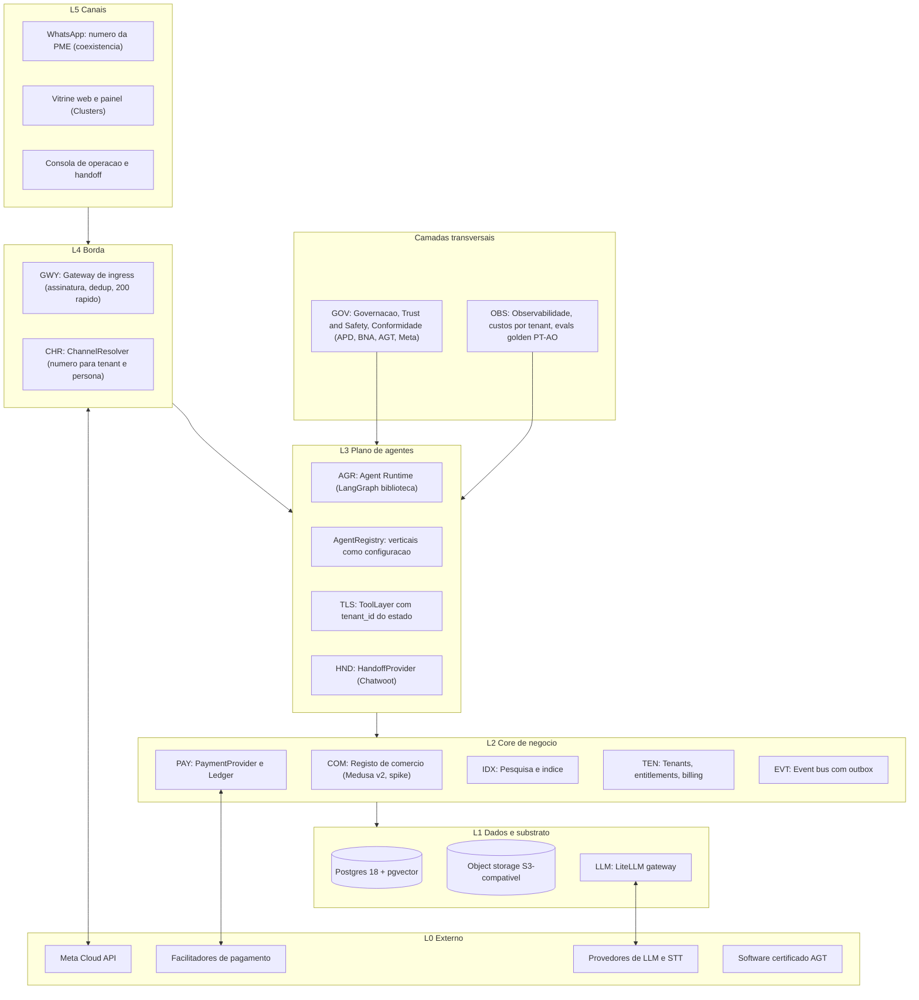
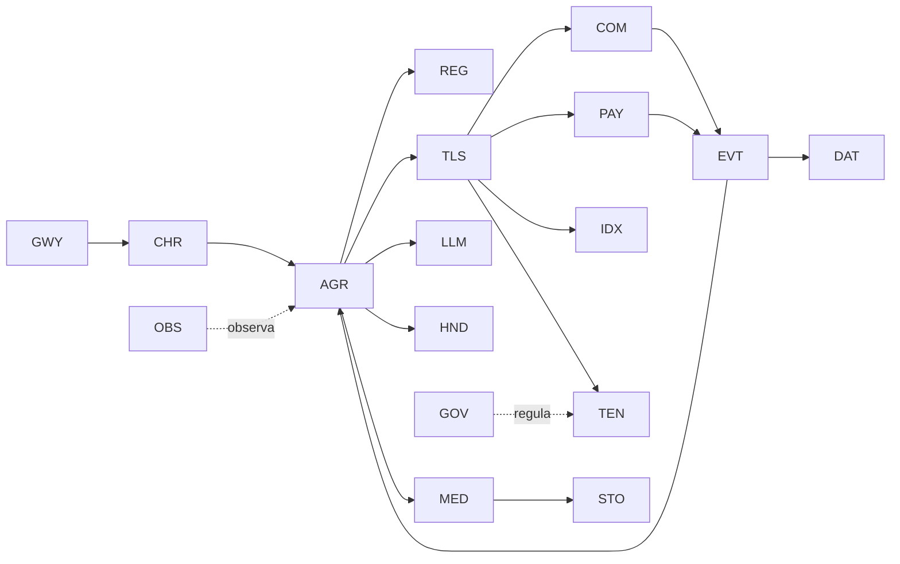
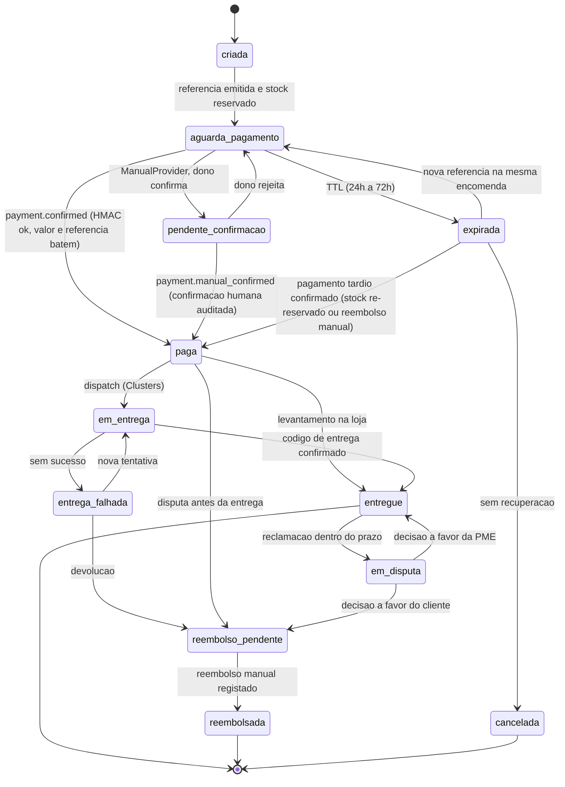
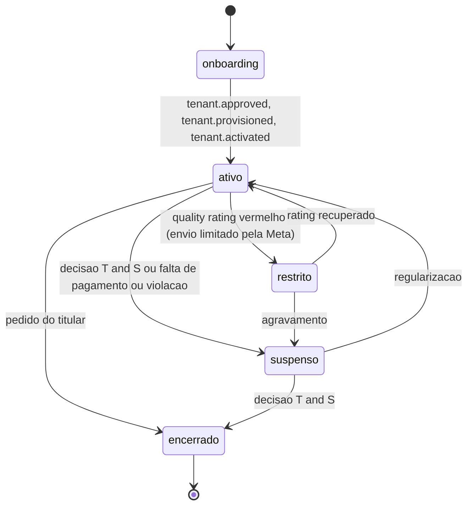
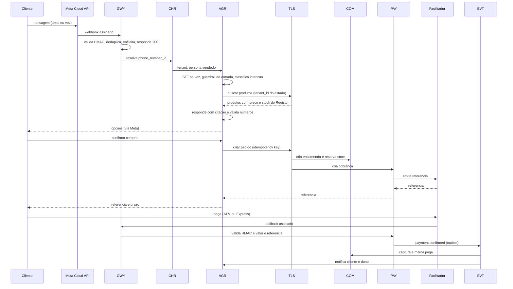
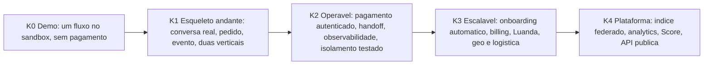

# Documento de Arquitectura de Solução — KAMBÁ

| Campo | Valor |
|---|---|
| Produto | KAMBÁ (nome de trabalho) — plataforma WhatsApp-native de comércio conversacional para Angola |
| Documento | Arquitectura de Solução — Documento de Arquitectura de Solução |
| Versão | 1.0 |
| Data | Outubro de 2026 |
| Classificação | Documento de Referência — Interno |
| Documento-fonte | `../exploracao/13-big-picture-ecossistema.md`, `../exploracao/14-tese-minima-e-plano-de-validacao.md` |
| Evidência | `evidencia/E1_Meta_WhatsApp.md`, `evidencia/E2_Pagamentos_Angola.md`, `evidencia/E3_Regulatorio_Dados.md`, `evidencia/E4_Stack_Licencas.md` |
| Documentos relacionados | `01_Canais_WhatsApp_Fluxo_Dual.md`, `02_Agent_Runtime_Verticais.md`, `03_Core_Comercio_Medusa.md`, `04_Pagamentos_Liquidacao_AntiFraude.md`, `08_Seguranca_Conformidade.md`, `09_Topologia_Operacao_Escala.md` |

> **Estado das afirmações.** Este conjunto distingue o que está **CONFIRMADO (fonte primária)**, o que é
> **INDÍCIO (fonte secundária)** e o que é **NÃO VERIFICADO**, segundo os relatórios de `evidencia/`
> (datados de 8 de Outubro de 2026). Onde uma decisão depende de um facto não verificado, o ADR di-lo e
> a dependência aparece em §13.3 (Decisões abertas). Esta documentação **não é aconselhamento jurídico**:
> tudo o que toca BNA, APD, AGT e política da Meta tem de ser confirmado por escrito pela parte competente.

---

## 1. Introdução

### 1.1 Propósito

Este documento é a **âncora arquitectural** do conjunto técnico da KAMBÁ. Estabelece a visão de alto nível,
o modelo em camadas canónico, o catálogo de componentes, a separação entre plano de controlo e plano de
dados, as decisões de arquitectura (ADRs), os drivers não-funcionais, a vista de qualidade e o modelo de
maturidade. Os documentos `01`–`10` aprofundam cada subsistema; este fixa o enquadramento
que todos partilham e **prevalece** em caso de divergência com a biblioteca exploratória (`../exploracao/01`–`../exploracao/14`).

A tese central: uma plataforma de comércio conversacional só é digna de produção se tornar as falhas
*arquitecturalmente impossíveis* — não meramente desencorajadas — através de quatro fundações
não-negociáveis:

1. **Canal oficial** (Cloud API + coexistência) com o número da PME como superfície primária;
2. **Mediação total pelo agent runtime** — nenhum agente escreve fora do seu tenant e nenhum preço é citado sem prova;
3. **Dinheiro confirmado só por evento assinado do facilitador**, com liquidação directa à PME e a plataforma nunca na posse dos fundos;
4. **Core próprio com verticais como configuração** — primitivas construídas uma vez, módulos finos por cima.

> **Nota de calibração (rigor técnico).** *«Arquitecturalmente impossível»* designa um **objectivo de desenho**
> — eliminar o *caminho* de falha — e **não** uma garantia absoluta. Permanece **risco residual** (defeitos de
> implementação, comprometimento de dependências, decisões de terceiros como a Meta) que é gerido e medido.

### 1.2 Âmbito

Cobre o desenho da plataforma KAMBÁ para a fase **Piloto e Clusters** (ver §13): canais, agentes, core de
comércio, pagamentos, índice, dados, geo-logística, segurança, operação e governação. A arquitectura-alvo da
biblioteca exploratória (`../exploracao/10`–`../exploracao/13`) mantém-se como **visão**; este conjunto marca explicitamente, em
cada componente, o que é **Piloto**, o que é **Clusters** e o que é **Diferido**.

Fora de âmbito: implementação linha-a-linha (remetida para `specs/`), estratégia comercial (biblioteca `../exploracao/01`–`../exploracao/07`)
e qualquer aconselhamento jurídico ou financeiro.

### 1.3 Audiência

Arquitectos de plataforma, engenheiros de canais, runtime, pagamentos e dados, responsáveis de produto,
SRE e revisão de conformidade (APD, BNA, AGT, Meta). Serve de referência para as *specs* executáveis
(`../specs/`, a criar).

### 1.4 Definições e termos

- **Tenant:** unidade de isolamento e de facturação. 1 tenant = 1 PME (ou 1 estafeta, revendedor, agente, plataforma).
- **Fluxo A:** o cliente fala com o WhatsApp **da PME** (Cloud API + coexistência). **Único fluxo em produção no Piloto.**
- **Fluxo B:** o cliente fala com um número **da plataforma** (B1 handoff, B2 venda assistida). **Diferido** (ADR-011).
- **Coexistência:** o mesmo número funciona simultaneamente na app WhatsApp Business do dono e na Cloud API.
- **Tech Provider:** estatuto Meta que permite à plataforma fazer *Embedded Signup* de clientes.
- **BSUID:** identificador de utilizador da Meta; o telefone pode faltar nos webhooks, logo **não é chave de identidade**.
- **Facilitador de pagamento:** terceiro (ProxyPay, AppyPay…) que emite referências/cobranças e notifica o resultado; a liquidação vai directa da EMIS ao comerciante.
- **PSP:** prestador de serviços de pagamento licenciado pelo BNA (entidade que *pode* deter fundos).
- **ToolLayer:** única via por que um agente lê/escreve; recebe `tenant_id` do estado, nunca do texto do cliente.
- **Validador de citação:** verificação pós-geração de que cada número (preço, quantidade, total) citado existe no output real de uma tool.
- **Outbox transaccional:** escrita do evento na mesma transacção que o dado, publicada depois no bus.
- **Esqueleto andante (walking skeleton):** fio fino que atravessa todas as primitivas de ponta a ponta antes de as engrossar.

- **Módulo de entrada:** vertical *owner-facing* fina (Catálogo AI, Foto de produtos AI, Social AI, Orçamento expresso) que capta a PME e lhe dá valor imediato; corre sobre o mesmo AGR/REG/TLS, com o dono no circuito (ADR-020).
- **Canal do dono:** o dono fala com o número da própria loja a partir do telemóvel verificado por OTP no onboarding; o CHR reconhece-o (`papel=dono`) e encaminha-o para a persona Assistente do Dono. Não exige número da KAMBÁ (D10). **Limite:** se o número da loja for o próprio telemóvel do dono, esse canal não existe e o painel web é o canal por omissão.

---

## 2. Princípios orientadores

1. **Oficial por defeito, nunca não-oficial como base.** Um número banido é a morte da loja da PME. Gateways não-oficiais só em prototipagem interna (ADR-001).
2. **Mediação total pelo runtime.** Todo o efeito de negócio (ler catálogo, criar pedido, emitir referência, enviar mensagem) atravessa a ToolLayer com `tenant_id` do estado (ADR-002, ADR-012).
3. **O número é prova, o texto não.** Preço, stock e totais só existem no Registo; o modelo cita-os, nunca os origina. Validador de citação obrigatório (ADR-007).
4. **Dinheiro: só evento assinado.** O estado de pagamento muda apenas por callback/consulta autenticada do facilitador, com valor e referência a bater. Imagem de comprovativo nunca é prova (ADR-013).
5. **A plataforma nunca detém fundos.** Receber-e-repassar, escrow e payouts a terceiros são actividades reguladas: só através de PSP licenciado e fora do Piloto (ADR-004).
6. **Os dados nascem na nossa base; o WhatsApp é renderização.** Identidade de contacto por BSUID/HMAC, nunca telefone como chave (ADR-010).
7. **Fricção proporcional ao risco.** Acções reversíveis e de baixo valor correm; as de dinheiro, preço e stock têm confirmação e limites.
8. **Costuras definitivas, implementações finas.** As interfaces (`PaymentProvider`, `HandoffProvider`, `LLMProvider`, `ChannelAdapter`, `StorageProvider`, `AgentRegistry`) fixam-se já; a profundidade de cada uma cresce por fase (ADR-012, ADR-014).
9. **Verticais são configuração, validada por regra de dois.** Uma abstracção só conta como provada com duas verticais distintas a usá-la sem excepções no core.
10. **Soberania e conformidade por desenho.** Transferência de dados para fora de Angola exige notificação ou autorização prévia da APD; não se vai para produção sem isso (ADR-008, ADR-010).
11. **Custo medido por tenant e por vertical.** Sem metering por tenant, o preço é adivinhação e a margem desaparece com o câmbio.
12. **Degradar, nunca calar.** Falha de LLM, canal ou pagamento tem fallback determinístico ou fila com reconciliação; o utilizador nunca fica sem resposta.

13. **Módulos de entrada limitados e com o dono no circuito.** Captação e suporte (catálogo, foto, social, orçamento) entram no Piloto, mas finos: o dono aprova antes de qualquer saída a terceiros, nada de irreversível, nada de dinheiro de terceiros, e nunca à custa do gate da Fase 0 (ADR-020).

---

## 3. Visão de alto nível

A KAMBÁ estrutura-se em seis camadas. As camadas **transversais** (Governação & Conformidade; Observabilidade &
Avaliação) envolvem as outras. O **core de negócio** é o único caminho legítimo para efeitos no mundo (dinheiro, stock, mensagens).

**Sumário de comunicações.** Todo o tráfego externo entra pelo **GWY**, que valida a assinatura, deduplica e responde
200 em menos de 500 ms; o **CHR** resolve `phone_number_id → tenant + persona`; o **AGR** executa o grafo da vertical
correspondente, lendo e escrevendo **apenas** através da **TLS**. A TLS fala com **COM** (pedidos, stock, reservas),
**PAY** (referências, estado) e **IDX** (pesquisa). Cada mudança de estado é gravada com **outbox** e publicada no **EVT**;
as verticais subscrevem eventos em vez de se chamarem entre si. O **LLM** gateway mede custo por tenant. O **HND** passa a
conversa a um humano quando o grafo decide `interrupt()`.

---

## 4. Componentes (catálogo)

Fase: **P** = Piloto, **C** = Clusters, **D** = Diferido.

| Código | Componente | Responsabilidade | Fase |
|---|---|---|---|
| GWY | Gateway de ingress | **Único endpoint de webhook da Meta** (o Chatwoot recebe um espelho por inbox de tipo API, não a ligação nativa ao WhatsApp); TLS público único; validação `X-Hub-Signature-256` sobre o corpo bruto; deduplicação por `message.id`; 200 em <500 ms; enfileira. Callbacks de pagamento: HMAC sobre o corpo, allowlist, **idempotência** por `(provider, account_id, referencia)`; o *replay* por timestamp só se o facilitador assinar um timestamp (o RPS do ProxyPay não o documenta, `evidencia/E2`). | P |
| CHR | ChannelResolver | `phone_number_id → (tenant, persona, plano)` antes de tocar no runtime; trata BSUID/telefone; aplica estado do tenant (suspenso, onboarding). **Reconhece o dono** (contacto com `papel=dono`, verificado por OTP no onboarding) e encaminha-o para a persona Assistente do Dono (ADR-020). | P |
| AGR | Agent Runtime | LangGraph **como biblioteca MIT** (não o Server): grafos por vertical, checkpoints Postgres, guardrails, STT, validador de citação, handoff. `interrupt()` re-executa o nó: nós de handoff **idempotentes**. | P |
| REG | AgentRegistry | Tuplo `(grafo, tools autorizadas, persona, entitlements, subscrições)` por vertical; permite activar/desactivar verticais por tenant. | P |
| ENT | Módulos de entrada | Verticais *owner-facing* finas sobre o canal do dono: `catalogo` (completar e publicar produtos), `foto` (ImageProvider: fundo limpo, luz, variações), `social` (calendário, legendas e artes para **publicação manual**), `orcamento` (preço «sob consulta» → pedido ao dono → proposta). Aprovação do dono obrigatória; metering por módulo; reaproveitam ≥ 70% do core. | P (Fase 1) |
| TLS | ToolLayer | Única via de leitura/escrita dos agentes; `tenant_id` do estado, nunca do texto; idempotency-key por operação; audita dinheiro/stock/preço. | P |
| HND | HandoffProvider | Interface; implementação inicial Chatwoot (self-host, Agent Bot API); protocolo de passagem, silenciamento do bot e retoma. | P |
| COM | Core de Comércio | Produtos, encomendas, stock, reservas 24–72 h, **e o módulo `servicos` (agenda, serviços, marcações)**, necessário para a vertical Serviços provar a regra de dois. **Medusa v2 sujeito a spike com testes de isolamento**; o spike avalia **Medusa puro + `merchant_id`**; o Mercur fica fora do Piloto e só entra se um spike posterior passar. Acesso através de uma porta `CommerceRegistry`. | P |
| PAY | Pagamentos e Ledger | Interface `PaymentProvider` (`createCharge`, `status`, `refund`, `payout`, **`verifyCallback`, `reconcile`**); adapters `ManualProvider` (P), facilitador (P→C), futuros; `payment_events` append-only (INSERT só por função); beneficiário por conta (inclui a receita própria da KAMBÁ, sem activar o tenant `platform`). | P |
| IDX | Índice e pesquisa | pgvector + pg_trgm + FTS-pt; scoped por tenant; sinónimos PT-AO. Índice **federado entre tenants** só em Clusters. | P (por tenant) / C |
| EVT | Event bus | Outbox transaccional → BullMQ/Redis; envelope versionado; consumidores idempotentes; DLQ. | P |
| TEN | Tenants, entitlements, billing | Identidade de tenant, planos, limites, provisioning e cobrança da assinatura (com a mesma `PaymentProvider`). | P |
| LLM | LLM Gateway | LiteLLM (versão ≥ 1.83.0, imagem fixada por digest): chaves virtuais por tenant, budgets, fallbacks multi-provider. | P |
| MED | Media pipeline | Foto/áudio/documento → storage → STT/visão → URL interna assinada. | P |
| STO | StorageProvider | Interface S3-compatível; implementação a decidir (MinIO está arquivado): SeaweedFS ou S3 gerido. | P |
| GEO | Geo e logística | Pin WhatsApp + Plus Code + Nominatim self-host; dispatch de estafetas. | C |
| DAT | Dados e analytics | **P:** eventos, `assistant_queries`, agregados e SLIs em Postgres + jobs. **D:** ClickHouse, Kambá Score (sujeito a parecer sobre informação de crédito), índice de preços, sinal de procura vendido. | P / D |
| OBS | Observabilidade | **P:** métricas Prometheus/Grafana, logs JSON sem conteúdo, custo por tenant via LiteLLM, avaliação golden em CI. **C:** Langfuse (o v4 exige Postgres, ClickHouse, Redis e S3; ~4 núcleos e 16 GiB, `evidencia/E4`; Langfuse Cloud seria uma transferência sob ADR-008). | P / C |
| GOV | Governação | Trust & Safety (screening de categorias, KYC), suporte em tiers, gestão de agentes de ativação, compliance watch. | P (mínimo) / C |

---

## 5. Fluxo dual: o que é Piloto e o que é Diferido

A biblioteca exploratória definia dois canais de entrada. A pesquisa de Outubro de 2026 (`evidencia/E1`) e a análise adversarial mudaram o seu estatuto:

| Fluxo | Descrição | Estado | Razão |
|---|---|---|---|
| **A — número da PME** | Cloud API + coexistência; o cliente fala com a loja que conhece; persona *Vendedor/Rececionista* | **Piloto (produção)** | Sem agregador; compatível com a política da Meta; atribuição pela própria encomenda |
| **B1 — handoff** a partir de número da plataforma | Assistente responde e passa a conversa à PME | **Diferido (ADR-011)** | Depende da política Meta sobre número agregador (NÃO VERIFICADO) e de densidade de lojas |
| **B2 — venda assistida** pela plataforma | A plataforma fecha pedido em nome da PME | **Diferido (ADR-011)** | Exige liquidação directa por PME e partilha de limite de 1.000 service messages grátis por número |
| **PME light** (sem número próprio) | Vende sob o número da plataforma | **Diferido (ADR-011)** | Mesmo bloqueio de B2 |

Consequência para a arquitectura: o **CHR** e o `ChannelAdapter` continuam a suportar `persona = assistente` e
`origem = plataforma` (costura definitiva, ADR-011), mas **nenhum tenant de tipo `platform` entra em produção** até as
perguntas escritas à Meta (§13.3, D2) terem resposta. O DDL mantém os campos; o runtime não regista o grafo `assistente`
no ambiente de produção do Piloto.

---

## 6. Máquinas de estados

### 6.1 Encomenda e pagamento

O pagamento por referência Multicaixa acontece **horas ou dias depois** da encomenda; o stock fica reservado e é libertado na expiração. O estado `paga` só é alcançável por evento autenticado (ADR-013).

`pendente_confirmacao` só existe com `ManualProvider` (Piloto), com **valor máximo por pedido** configurável por tenant e registo de quem confirmou. Reembolsos são sempre manuais e fora da plataforma até existir PSP (ADR-004). O `falhada` do §7 é estado da **cobrança** (`payment_events`), não da encomenda. As referências Multicaixa não têm devolução automática (`evidencia/E2`).

### 6.2 Tenant

O estado `restrito` distingue uma limitação **imposta pela Meta** (quality rating) de uma suspensão **decidida por nós**; no primeiro caso o bot continua a servir dentro do que a Meta permite. O evento `tenant.activated` do doc exploratório é desdobrado em `approved`, `provisioned` e `activated`, porque a activação depende de recursos que a própria saga de provisioning cria (`10`). Um encerrado mantém dados apenas pelo período de retenção fiscal e legal (a confirmar por parecer, `evidencia/E3`).

---

## 7. Fluxo de execução end-to-end (Fluxo A com pagamento por referência)

Falhas tratadas: callback duplicado (idempotência por `(provider, referencia)`), pagamento de valor diferente (estado `falhada` + humano),
referência expirada (nova referência), LLM em baixo (fluxo determinístico para menus e estado de pedido), Meta em baixo (fila com *backoff*; os webhooks da Meta repetem até 7 dias).

---

## 8. Decisões de arquitectura (ADRs)

Vinte ADRs canónicos. Os ADR-001 a ADR-012 mantêm a numeração do índice exploratório, **revistos pela evidência**; ADR-013 e ADR-014 resultam da pesquisa; **ADR-015 a ADR-020 foram promovidos das propostas dos documentos 01–10 e de decisões do fundador** (o mapeamento completo das propostas está em `INDICE.md` §6). As restantes propostas ficam como decisões locais do documento que as formula.

| ADR | Decisão | Racional e evidência |
|---|---|---|
| ADR-001 | **Cloud API oficial + coexistência; Tech Provider; Embedded Signup v4; GWY como único endpoint de webhook da Meta (Chatwoot como espelho por inbox de tipo API).** Gateway não-oficial banido de produção. | Número banido mata a loja. O Embedded Signup v2/v3 deixa de funcionar a 2026-10-15. Coexistência: sem exclusão documentada para Angola, **mas sem confirmação** — teste com número +244 (E1). Limite 20 mps; desliga após ~14 dias sem abrir a app. |
| ADR-002 | **Core conversacional em LangGraph como biblioteca MIT própria.** Dify, n8n (SUL) e Typebot (FSL) vedados a qualquer superfície exposta a tenants. | E4: Server (`langgraph-api`) é Elastic-2.0 e exige chave de licença. `interrupt()` re-executa o nó → handoff idempotente. n8n e Typebot só como ferramenta **interna** nossa. |
| ADR-003 | **Medusa v2 como registo de comércio, condicionado a spike de 5 dias com testes de isolamento entre vendedores; fallback Medusa puro + `merchant_id`.** Mercur só se o spike passar. Índice de pesquisa próprio. | E4: Mercur v2.3.7 corrigiu falhas de autorização entre vendedores; payout só Stripe Connect. Medusa Enterprise (RBAC/SSO) desde 2026-08-11. Reservas e máquina de estados da encomenda são o que é caro de migrar. |
| ADR-004 | **Pagamentos via facilitador; liquidação sempre directa à PME; a plataforma nunca detém fundos.** Receber-e-repassar, escrow e payouts só via PSP licenciado e fora do Piloto. | E2: Aviso BNA 2/22 art. 4 exclui prestadores técnicos que nunca tomam posse dos fundos, ressalvada a iniciação de pagamento (leitura a confirmar por parecer). Subadquirência, escrow e payouts são actividades reguladas. |
| ADR-005 | **APIs de LLM, via LiteLLM desde o dia 1 (versão ≥ 1.83.0, imagem por digest);** self-host só acima do break-even. Modelos por papel (roteamento nano, conversa mini, visão na ingestão). | E4: ataque de supply chain ao LiteLLM (2026-03-24). Preços por 1M tokens a reconferir antes de fixar tarifas. |
| ADR-006 | **Postgres 18 único (registo + vectores) até aos gargalos mapeados;** pgvector ≥ 0.8.7; filtro por tenant com `iterative_scan` ou partição. | E4: pgvector aplica o filtro após o índice aproximado — risco de resultados vazios por tenant. |
| ADR-007 | **Preço e stock nunca em embeddings nem em prompts;** vêm de tool calls com validador de citação pós-geração (números, totais, moeda, produto). | Princípio 3. O validador não cobre «produto errado com preço certo»: acrescentar verificação por `sku` citado. |
| ADR-008 | **Residência e transferências: nenhum dado pessoal de produção sai de Angola sem a notificação ou autorização da APD aplicável.** Alojamento: Luanda (Raxio, Paratus, Angola Cables, Cloud Nacional) como alvo; JNB/CPT apenas com procedimento APD concluído. | E3: multa da APD de USD 505 mil (24-06-2026) por cloud fora do país sem notificação/autorização; Arts. 33.º–34.º da Lei 22/11. **Substitui** o antigo «JNB/CPT no MVP». |
| ADR-009 | **Event bus BullMQ/Redis com outbox transaccional;** envelope versionado; consumidores idempotentes; Kafka/NATS só na escala. | Mantido. |
| ADR-010 | **Identidade de contacto em duas camadas:** `contact_id` aleatório nas tabelas de negócio e eventos; BSUID e telefone (cifrado) numa tabela separada (`contacts` / `contact_endpoints`); `sujeito_ref = HMAC(chave rodada, contact_id)` para analytics. Telefone nunca é chave; logs sem conteúdo; consentimento no 1.º contacto; minimização; apagamento por cofre de identidade + *crypto-shredding*. | E1: BSUID obrigatório, o telefone pode faltar nos webhooks. E3: HMAC de msisdn é reversível por enumeração → usar HMAC com segredo rodado e guardar o mínimo. |
| ADR-011 | **Fluxo dual como costura definitiva, mas só o Fluxo A em produção no Piloto.** Fluxo B / PME light / número agregador **diferidos** até resposta escrita da Meta. | E1: Termos de 15-01-2026 proíbem chatbots de IA de uso geral; agregador NÃO VERIFICADO; service messages pagas (1.000 grátis por número/mês) e limite de 250 contactos novos/dia por portfólio. |
| ADR-012 | **Verticais como configuração sobre o core,** validado pela **regra de dois** (Vendedor + Serviços). Cada vertical nova deve reaproveitar ≥ 70%. | `../exploracao/14` §3A. |
| **ADR-013** | **Pagamento só por evento autenticado do facilitador;** comprovativo (imagem) nunca é prova. Fase de arranque: `ManualProvider` com confirmação humana auditada e limite de valor por pedido. | E2: fraude de comprovativos documentada. Callback do GPO directo da EMIS pode não ser assinado (INDÍCIO) → preferir facilitador com HMAC. |
| **ADR-014** | **Object storage atrás de `StorageProvider`;** MinIO excluído (arquivado desde 04/2026). SeaweedFS (Apache-2.0) ou S3 gerido. | E4. |
| **ADR-015** | **Isolamento de tenant em profundidade:** `tenant_id` do estado na ToolLayer **e** row-level security `FORCE` em todas as tabelas com `tenant_id`; tools classificadas `read` / `write` / `money` (escrita só com confirmação e idempotência; `money` sempre com limite e auditoria). Suite de testes cruzados no CI falha o build. | `08`; E4 (falhas de autorização entre vendedores no Mercur). |
| **ADR-016** | **Sem COD em numerário via estafeta.** Pagamento na entrega só como pagamento na porta com **evento autenticado** (referência/QR); o estafeta nunca recebe nem transporta fundos de terceiros. Oferta ao estafeta sem pin exacto até aceitação. | `07`; E2 (fraude); ADR-004, ADR-013. |
| **ADR-017** | **Comissões (agentes, revendedores) e comissão sobre transacção:** só após a 1.ª venda **paga por evento autenticado**, com *clawback*; no Piloto a receita é **assinatura**, e a comissão sobre transacção fica desligada até haver parecer (D8). | `04`, `10`; `../exploracao/07` §8 e §14. |
| **ADR-020** | **Módulos de entrada (captação e suporte) no Piloto, limitados e com o dono no circuito.** Até **4** módulos *owner-facing* — Catálogo AI conversacional, Foto de produtos AI, Social AI (calendário, legendas e artes para **publicação manual**) e Orçamento expresso — corridos pelo mesmo AGR/REG/TLS sobre o **canal do dono**. Regras: (1) aprovação do dono antes de qualquer saída a terceiros; (2) sem acções irreversíveis nem dinheiro de terceiros; (3) **sem publicação automática em redes** (Diferida, D13); (4) reaproveitamento ≥ 70% do core; (5) **não bloqueiam o gate da Fase 0** e, se a Fase 0 derrapar, são cortados primeiro (excepto o Catálogo AI, pré-requisito do onboarding); (6) mais de 4 módulos exige emenda; (7) se o número da loja for o telemóvel do dono, o painel web é o canal do dono por omissão. | Decisão do fundador (2026-10-09); `02` §21; hipóteses H10–H12 em `../exploracao/14`; E5 (fornecedores de imagem, publicação, mensagens proactivas). |
| **ADR-018** | **Observabilidade leve no Piloto:** métricas próprias, logs sem conteúdo e custo por tenant via LiteLLM; Langfuse só em Clusters, auto-hospedado (a versão Cloud seria transferência sob ADR-008). Golden set por **reescrita sintética**: os Termos da Meta proíbem treinar ou melhorar ML com dados do WhatsApp. | `09`, `10`; E1, E4. |
| **ADR-019** | **Onboarding da PME self-service e automático no Piloto** (onboarding-web + OTP + KYC K1 automático por OCR/consistência + screening automático + Embedded Signup v4 + provisioning por saga + catálogo e teste automáticos). A equipa só intervém **por excepção**, numa fila de revisão com SLA; o risco de registo falso é compensado por tectos iniciais baixos e confiança gradual por histórico. K2/selo é upgrade opcional. Não há rede de agentes no Piloto. | Decisão do fundador; `10` §4.1; E1 (o dono tem de autenticar no ES; limite 10 clientes/7 dias → lista de espera); E2 (contrato de pagamento por PME fora do caminho de onboarding). |

---

## 9. Drivers não-funcionais

| Driver | Alvo | Mecanismo |
|---|---|---|
| Ingress de webhook | resposta 200 em < 500 ms; zero perda | fila + deduplicação por `message.id`; retry da Meta até 7 dias (E1) |
| Latência de resposta | p95 texto 4–8 s; voz 6–12 s | roteamento por modelo; STT rápido; reacção imediata |
| Correcção de números citados | 0 preços/totais divergentes das tools em produção | validador de citação (ADR-007); regressão no golden set |
| Confirmação de pagamento | 100% por evento autenticado | ADR-013; `payment_events` com `authn_ok` e `authn_method` |
| Duplicação de encomenda | 0 por duplo toque/reenvio | idempotency key + índice único |
| Isolamento entre tenants | 0 leituras cruzadas | `tenant_id` do estado na TLS; testes cruzados no CI (falham o build) |
| Disponibilidade do caminho de venda | 99,5% (Piloto), 99,9% (Escala) | workers stateless; fila absorve picos; degradação graciosa |
| Custo de IA por conversa | ≤ 15% da mensalidade (a validar, H6) | LiteLLM budgets por tenant; modelo nano para roteamento |
| Custo de mensagens Meta | monitorizado por tenant | service messages > 1.000/mês a 0,004 USD; templates evitados quando a janela está aberta |
| Taxa de handoff correcto | ≥ 85% resolvidas sem handoff errado (H7) | dataset golden PT-AO como gate de deploy |
| Conformidade de transferência | 100% dos fluxos para fora de Angola cobertos por registo APD | ADR-008; inventário de subprocessadores |
| RPO / RTO | RPO ≤ 5 min; RTO ≤ 2 h (Piloto) | WAL archiving; backups fora do host primário |

---

## 10. Vista de qualidade

### 10.1 Arquitectura
Fronteiras claras (borda / agentes / core / substrato); event bus com outbox; costuras por interface; esqueleto andante antes de engrossar.

### 10.2 Segurança
Validação de assinatura Meta em todo o POST; HMAC e replay nos callbacks de pagamento; `tenant_id` do estado; guardrails de entrada e de saída; segredos em OpenBao/Doppler com rotação; imagens fixadas por digest (lição LiteLLM).

### 10.3 Escalabilidade
Workers horizontais atrás da fila; Postgres com partições para `assistant_queries` e índices por tenant; Meilisearch/Qdrant só se os limites do pgvector se confirmarem; Chatwoot sharded por cluster de PMEs.

### 10.4 Observabilidade
Traces por conversa com custo por tenant; métricas de mensagens, handoff, callbacks falhados, p95; logs sem conteúdo; alertas para quality rating e esgotamento do free tier de service messages.

### 10.5 Governação
Screening de categorias no onboarding: **lista de bloqueio = política da Meta ∪ lei angolana** (a Meta bloqueia álcool e tabaco independentemente da lei local, `evidencia/E1`; jogos exigem licença em Angola; medicamentos e armas pendentes de parecer); auditoria de alterações de preço/stock/dinheiro; Trust & Safety decide quem entra.

### 10.6 Experiência de utilização
Menos de 30 s até à primeira resposta útil; mensagens em PT-AO; voz com *fallback* a humano para línguas nacionais; dono controla a loja por mensagem ou painel mínimo.

### 10.7 Manutenção evolutiva
SemVer nos contratos de eventos e de tools; migrações reversíveis; avaliação golden como gate; *watch list* trimestral de dependências, preços e políticas (§12 e `09`).

---

## 11. Constrangimentos e premissas técnicas

- **Canal:** a plataforma depende de a Meta aceitar o caso de uso. Sem Tech Provider/BSP não há Embedded Signup. Até 10 clientes/7 dias antes de verificação completa (E1).
- **Custo de mensagens:** desde 2026-10-01 service messages são pagas após 1.000/mês por número; utility dentro da janela também. O cliente-PME paga à Meta por cartão (E1).
- **Identidade:** o telefone pode faltar nos webhooks; o desenho usa BSUID e guarda o telefone só quando disponível e necessário.
- **Pagamentos:** o onboarding de cada PME exige banco de apoio, contrato EMIS e contrato com o facilitador; o prazo não está publicado. Referências não têm devolução automática (E2).
- **Regulação:** o enquadramento do modelo de facilitador no Aviso BNA 2/22 precisa de parecer; a e-factura generalizada a 2027 precisa de confirmação escrita da AGT.
- **Câmbio:** receita em Kz, custos críticos em USD (taxa ~913 AOA/USD em 08-10-2026); cláusula de revisão de preços.
- **Voz:** sem STT de produção para Kimbundu/Umbundu; baixa confiança → humano.
- **Premissa de equipa:** equipa pequena com capital limitado; tudo o que não é caminho crítico fica em *Diferido*.
- **Dados da Meta e ML:** os Termos proíbem treinar ou melhorar modelos de ML com dados do WhatsApp; o dataset de avaliação é construído por reescrita sintética e por casos autorizados pela PME (ADR-018).
- **Economia do Piloto (estimativa, `09`):** o conjunto reduzido de ~18 GB cabe num host de 8 vCPU/32 GB; a infra custa ~450–680 USD/mês e o custo técnico total ~490–795 USD, com ponto de equilíbrio entre ~8 e ~28 PMEs. Só os requisitos de recursos de Chatwoot, Langfuse v4 e Medusa vêm de documentação oficial; preços de VM e volume por PME são estimativas sem cotação. Isto **substitui** as estimativas de 30–80 USD do doc exploratório `../exploracao/08` §8.
- **Terminologia:** *vertical* é a unidade de configuração (grafo + tools + persona + entitlements); *persona* é o atributo da vertical que define tom e regras. «Vendedor» e «Serviços» são verticais.
- **Escopo do Piloto (ADR-020):** os módulos de entrada são cortáveis; o Catálogo AI é a excepção (pré-requisito do onboarding). Publicação automática em redes: Diferida (D13).
- **Mensagens proactivas ao dono** (propostas de conteúdo, avisos) estão fora da janela de 24 h e custam (utility/marketing; E1, E5): o desenho prefere o dono iniciar («manda-me a proposta da semana»), com push opcional.

---

## 12. Riscos arquitecturais e mitigações

| Risco | Impacto | Mitigação |
|---|---|---|
| Política da Meta (IA de uso geral, agregador) | Perda do canal | Persona limitada a comércio/atendimento; Fluxo B diferido; perguntas escritas à Meta (D2) |
| Coexistência indisponível para +244 | Fluxo A inviável com número existente | Spike de 3 números +244 na semana 1–3 (H3); alternativa: número novo dedicado |
| Embedded Signup mal implementado (v2/v3 mortos em 15-10-2026) | Onboarding bloqueado | Implementar v4; testes de contrato |
| Transferência de dados sem registo APD | Multa; paragem | ADR-008; inventário de subprocessadores; parecer antes de produção |
| Facilitador sem onboarding viável por PME | Sem camada 3 de pagamento | `ManualProvider` com limites; contratos arrancam na semana 1 |
| Dono e bot respondem em simultâneo (coexistência) | Respostas contraditórias | Protocolo de silenciamento: mensagem do dono pausa o bot; estado visível em HND |
| Falha de autorização entre vendedores (Mercur) | Fuga de dados entre PMEs | Spike com testes cruzados obrigatórios; fallback Medusa puro |
| Ataque a dependência (LiteLLM, npm/PyPI) | Execução remota, roubo de chaves | Versões e digests fixados; SBOM; rede egress restrita; rotação |
| Preço opaco: PME não publica preço | Assistente sem valor | `a partir de`, disponibilidade e reserva em vez de comparação (H2) |
| Stock errado (o dono vende por outros canais) | Overselling | Reserva com expiração, confirmação do dono para itens críticos, auditoria de stock |
| Custo LLM + Meta supera a mensalidade | Margem negativa | Metering por tenant; limites por plano; modelo barato por intenção |
| Auto-compra para fabricar reviews/histórico | Score e reputação falsos | Reviews só de pedido pago e entregue; deteção de padrões; sem Score no Piloto |
| Escrow/payouts sem licença | Infracção regulatória | Fora do Piloto; só via PSP licenciado |
| Perda do número por quality rating | Loja parada | Screening de categorias; rate limits; monitorização de rating |
| Módulos de entrada diluem o foco e atrasam o core | Fase 0 falha o prazo; piloto sem prova de pagamento | ADR-020: máx. 4, finos, fora do gate da Fase 0, cortáveis; critérios de abate (H10–H12) |
| Conteúdo gerado (texto/imagem) com alegações falsas, categoria proibida ou direitos de terceiros | Burla, banimento, litígio | Aprovação do dono; screening de categoria (KAM-088); sem publicação automática; marcação de conteúdo gerado por IA; parecer sobre direitos (E5) |
| Imagens de produto com pessoas/rostos enviadas a fornecedor no estrangeiro | Transferência de dados pessoais sem registo | Filtro de rostos/minimização; fornecedor no inventário de subprocessadores com `apd_ref` (ADR-008) |

---

## 13. Modelo de maturidade e roadmap

### 13.1 Níveis de maturidade

Não se salta K1→K3: sem isolamento testado e pagamento autenticado, escalar é amplificar o risco.

### 13.2 Roadmap por fase

| Fase | Entregas técnicas | Gate |
|---|---|---|
| **0 — Fundação (≤ 6 semanas)** | GWY, CHR, TEN/entitlements, EVT/outbox, AGR com 2 verticais (Vendedor, Serviços), TLS, COM (spike + módulo `servicos`), PAY (`ManualProvider`), HND, LLM, OBS mínima | Uma conversa real cria um pedido, recebe confirmação (`payment.manual_confirmed` ou `payment.confirmed`) e esse evento é consumido pela vertical Serviços (lembrete/agenda), sem excepções no core |
| **1 — Piloto (semanas 7–12)** | **Onboarding self-service (onboarding-web, KYC K1 automático, fila de excepções, lista de espera)**, Catálogo AI, **módulos de entrada (canal do dono, Foto de produtos AI, Social AI, Orçamento expresso; ADR-020)**, voz PT-AO, reserva de stock, facilitador (se contrato), painel mínimo, dataset golden, isolamento no CI | ≥ 5 PMEs pagantes a 30 dias (H1); ≥ 70% activas ao dia 60 (H9) |
| **2 — Clusters (3–12 meses)** | Billing, Cobranças, Factura AI via parceiro AGT, GEO/logística, vitrine SEO, T&S e rede de agentes, Luanda | Custo por PME ≤ meta; zero fugas entre tenants |
| **3 — Escala (12–24 meses)** | Índice federado, analytics, Score (sujeito a parecer), API pública, eventual Fluxo B | Decisão documentada sobre B2/PSP |

### 13.3 Decisões abertas (bloqueiam ou condicionam)

| # | Decisão | Depende de | Prazo sugerido |
|---|---|---|---|
| D1 | Alojamento: Luanda desde o início ou JNB/CPT com procedimento APD | Parecer + oferta/preço Raxio/Paratus/Cloud Nacional | antes de dados reais |
| D2 | Fluxo B / número agregador | Resposta escrita da Meta (política, limites) | antes de Clusters |
| D3 | Medusa+Mercur vs Medusa puro vs registo próprio | Spike de 5 dias com testes de isolamento | semana 2–3 |
| D4 | Facilitador (ProxyPay ou AppyPay) e modelo de onboarding por PME | Reuniões e contrato; preços ProxyPay NÃO VERIFICADOS | iniciar semana 1 |
| D5 | Tech Provider directo vs BSP | Prazos e custos de verificação Meta | semana 1–4 |
| D6 | STO: SeaweedFS vs S3 gerido | Local de alojamento (D1) e custo | semana 2 |
| D7 | Parceiro de factura AGT (Vero, CacimboERP, outros) | Confirmação escrita AGT sobre 2027 e certificação | Clusters |
| D8 | Enquadramento BNA do modelo facilitador | Parecer jurídico | antes de comissão sobre transacções |
| D9 | Papel da KAMBÁ perante a Lei 22/11 (responsável ou subcontratada), quem notifica a APD, e **entidade que paga os custos em USD** (Meta, cloud, LLM) | Parecer + estrutura societária; E2 §8.6 | antes de dados reais |
| D10 | Canal operacional da KAMBÁ para estafetas, agentes de ativação e suporte às PMEs (o Fluxo A usa o número da PME; o tenant `platform` está vedado até D2) | Resposta da Meta | antes de Clusters |
| D11 | Enquadramento do Kambá Score como informação de crédito | Parecer; D8 | antes de qualquer Score |
| D12 | CDN/WAF que termina TLS (Cloudflare) como subprocessador; licença do Redis (alternativa Valkey) | Parecer + teste em staging | antes de produção |
| D13 | Publicação automática em Instagram/Facebook pela KAMBÁ (Social AI) | App Review da Meta, permissões e limites (E5); **CONDICIONAL** | só após o Piloto; no Piloto: entrega para publicação manual |

---

## 14. Glossário técnico

- **Outbox:** escrever o evento na mesma transacção que a mudança de dados; um publicador envia depois ao bus.
- **Idempotency key:** chave que garante que repetir uma operação não duplica o efeito.
- **BSUID:** identificador de utilizador da Meta, estável mesmo quando o telefone não vem no webhook.
- **Service message:** resposta dentro da janela de 24 h; desde 2026-10-01 paga após 1.000 por número/mês.
- **Template (utility/marketing/authentication):** mensagem pré-aprovada, necessária fora da janela de 24 h.
- **Embedded Signup:** fluxo da Meta que liga o WhatsApp Business de um cliente à plataforma.
- **Referência Multicaixa:** código (entidade + referência) pago em ATM/homebanking/Express, confirmado pelo facilitador.
- **GPO / TPA virtual:** serviço Multicaixa Express para cobrança online/virtual.
- **Quality rating:** pontuação da Meta por número; baixa restringe envio.
- **Validador de citação:** controlo que confere cada número da resposta contra a saída das tools.
- **Regra de dois:** uma abstracção só está validada com duas verticais distintas.
- **Esqueleto andante:** implementação mínima de ponta a ponta que atravessa todas as camadas.
- **APD:** Agência de Protecção de Dados de Angola. **BNA:** Banco Nacional de Angola. **AGT:** Administração Geral Tributária. **EMIS:** Empresa Interbancária de Serviços.

---

## 15. Tabela de aprovação

| Papel | Nome | Assinatura | Data |
|---|---|---|---|
| Arquitecto de Plataforma |  |  |  |
| Responsável de Segurança |  |  |  |
| Responsável de Produto |  |  |  |

---

## 16. Controlo de versões

| Versão | Data | Descrição | Autor |
|---|---|---|---|
| 1.0 | Outubro 2026 | Emissão inicial; ADR-001 a ADR-014 revistos com a evidência de `evidencia/E1`–`E4`. | Equipa KAMBÁ |
| 1.1 | Outubro 2026 | **Emenda KAM-111** (dicionário canónico): §9, D-04 — `authn_ok` + `authn_method` no lugar da variante substituída. | Equipa KAMBÁ |
| 1.2 | Outubro 2026 | KAM-128: As **19** referências aos documentos irmãos de `docs/tecnica/` passam a resolver: eram relativas à antiga raiz do conjunto e, depois de a árvore passar para `docs/`, não resolviam de posição nenhuma. Os ADRs do §8 e as decisões abertas do §13.3 não foram tocados. Linha acrescentada pelo **KAM-146**, que paga as onze que o KAM-128 não escreveu. | Equipa KAMBÁ |
| 1.3 | Outubro 2026 | KAM-140: §6.1 — a aresta `pendente_confirmacao → paga` do diagrama canónico passa a nomear o `payment.manual_confirmed`. Dizia «confirmacao humana registada e auditada», sem evento, e era por isso que o `03` e o `04` podiam divergir sobre qual dos dois eventos fecha qual aresta sem nenhum deles contradizer este. | Equipa KAMBÁ |
