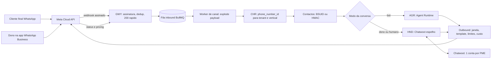
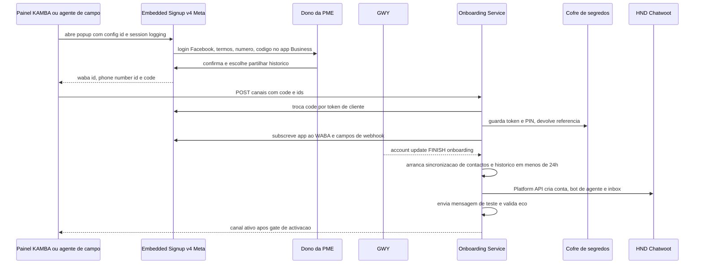
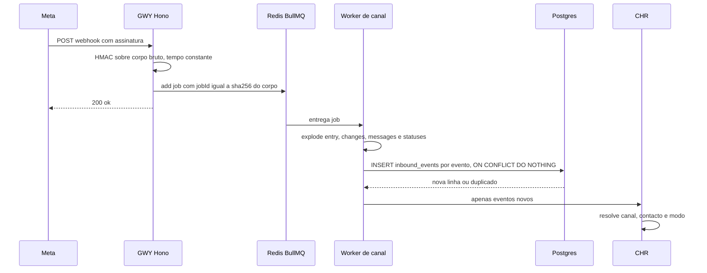
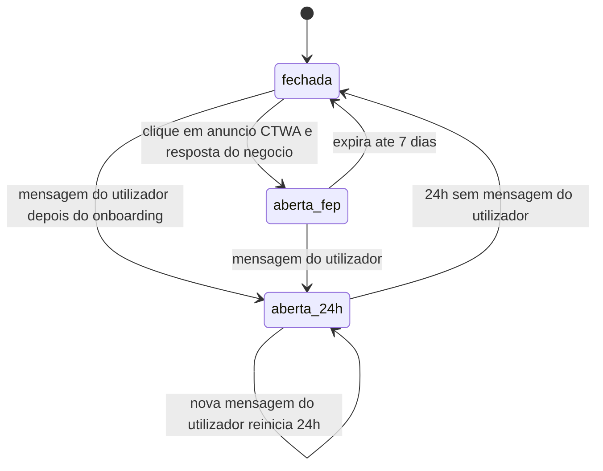
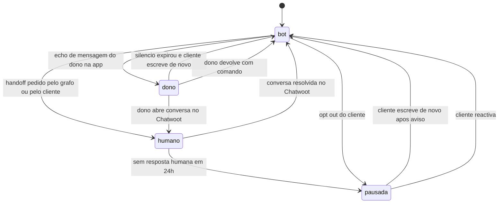
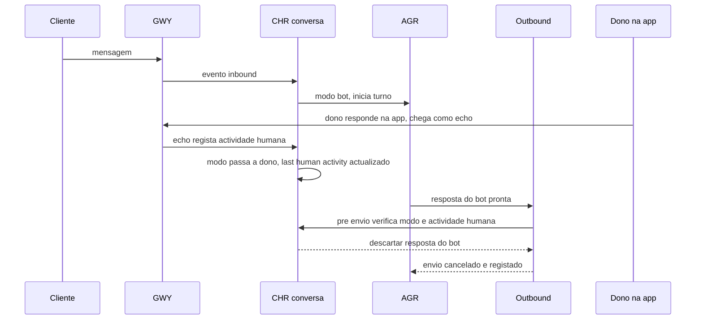
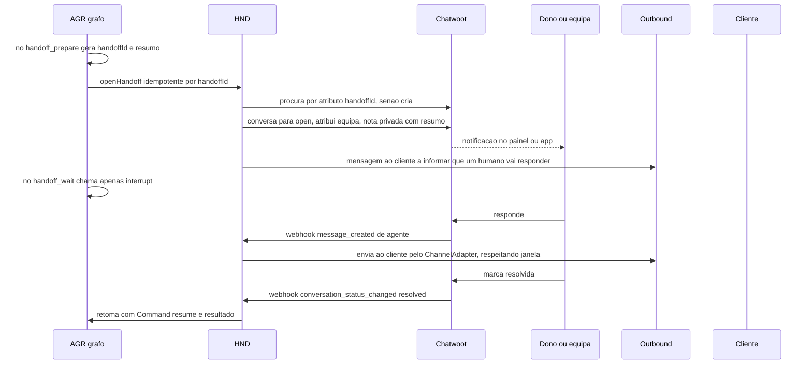
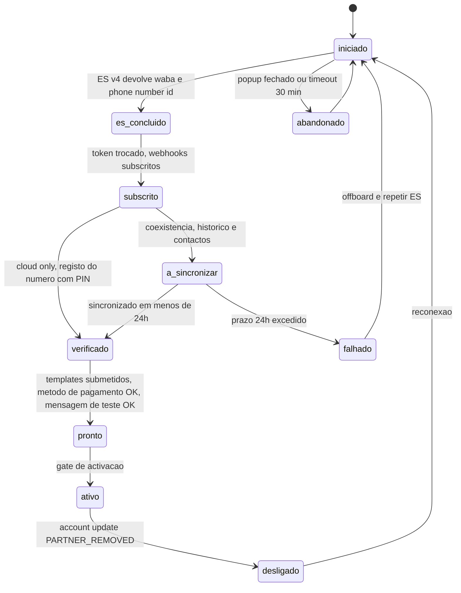

# Canais WhatsApp e Fluxo Dual — KAMBÁ

| Campo | Valor |
|---|---|
| Produto | KAMBÁ (nome de trabalho) — plataforma WhatsApp-native de comércio conversacional para Angola |
| Documento | Técnica — Canais WhatsApp e Fluxo Dual |
| Versão | 1.0 |
| Data | Outubro de 2026 |
| Classificação | Documento de Referência — Interno |
| Documento-fonte | `00_Arquitectura_Solucao.md`, `evidencia/E1_Meta_WhatsApp.md`, `evidencia/E4_Stack_Licencas.md`, `../exploracao/11-arquitetura-detalhada-engenharia.md` §6 |
| Documentos relacionados | `02_Agent_Runtime_Verticais.md`, `04_Pagamentos_Liquidacao_AntiFraude.md`, `08_Seguranca_Conformidade.md`, `09_Topologia_Operacao_Escala.md`, `10_Onboarding_Governanca.md` |

> **Estado das afirmações.** Cada facto externo leva o estado da evidência: **CONFIRMADO** (fonte primária lida),
> **INDÍCIO** (fonte secundária ou inferência) ou **NÃO VERIFICADO**. Citações `evidencia/E1` referem
> `evidencia/E1_Meta_WhatsApp.md` (8 de Outubro de 2026). Tudo o que é jurídico leva «(a confirmar por parecer)».
> O documento 00 prevalece sobre este em caso de divergência; as divergências encontradas estão em «Limites, premissas e itens NÃO VERIFICADOS».

---

## 1. Introdução

### 1.1 Propósito

Especificar a **camada de canais** da KAMBÁ: como uma mensagem de WhatsApp de um cliente final chega ao agent runtime e como a resposta
volta, com o número da PME como superfície primária (Fluxo A). Cobre o estatuto perante a Meta (Tech Provider, Embedded Signup v4), a
borda (GWY), a resolução número→tenant (CHR), a identidade de contacto por BSUID (ADR-010), as regras de janela de 24 h, templates, custos
e qualidade, o protocolo de **coexistência** entre bot e dono, a passagem a humano (HND/Chatwoot), a fronteira de uso do Typebot, o
estatuto diferido do Fluxo B (ADR-011), o onboarding do número e a degradação.

### 1.2 Âmbito

Dentro: GWY, CHR, `ChannelAdapter` (entrada e saída), HND, onboarding de canal, métricas de canal. Fora: lógica dos grafos (`02`),
referências de pagamento e callbacks do facilitador (`04`; o GWY apenas aloja o endpoint, a validação HMAC é de PAY), segurança
transversal e conformidade APD (`08`), topologia (`09`), processo humano de onboarding (`10`).

### 1.3 Audiência

Engenheiros de canais/integração Meta, de runtime, SRE, revisão de conformidade (Meta, APD) e responsáveis de produto que decidem o que
prometer às PMEs sobre coexistência, custos de mensagens e handoff.

### 1.4 Definições e termos

| Termo | Definição |
|---|---|
| WABA / WAAC / Messaging account | Conta WhatsApp Business. Desde 23 Set 2026 divide-se em WAAC (identidade, números, catálogo) e Messaging account (templates, billing, webhooks); o `waba_id` actual passa a ser o ID da Messaging account (CONFIRMADO, E1 §3). |
| `phone_number_id` | Identificador Meta do número de negócio; chave de resolução do CHR. |
| BSUID | Business-scoped User ID (campo `user_id`; formato `PT.xxxxx`), único por par portfólio–utilizador. |
| Janela de atendimento | 24 h desde a última mensagem do utilizador; fora dela só templates. |
| Service message | Mensagem não-template dentro da janela; paga a partir da 1.001.ª por número/mês (0,004 USD, «Rest of Africa»). |
| Echo | Webhook `smb_message_echoes`: cópia de mensagem enviada pelo dono na app WhatsApp Business num número em coexistência. |
| Modo do canal | `coexistencia` (número do dono em app + Cloud API) ou `cloud_only` (número só na Cloud API). |
| Modo da conversa | `bot`, `dono`, `humano`, `pausada` — quem tem a palavra (§9.2). |

---

## 2. Princípios e decisões aplicáveis (ADRs)

| ADR | Aplicação neste documento |
|---|---|
| ADR-001 | Só Cloud API oficial; Tech Provider; Embedded Signup v4 (v2/v3 deixam de funcionar a 2026-10-15). Gateways não-oficiais proibidos em produção. §4, §13 |
| ADR-002 | Typebot (FSL) e n8n (SUL) só como ferramenta **interna**, nunca exposta a tenants; fluxos determinísticos visíveis ao tenant implementam-se em LangGraph. §11 |
| ADR-008 | Conversas, mídia e Chatwoot contêm dados pessoais; alojamento sujeito a D1. Nenhum dado de produção sai de Angola sem procedimento APD (a confirmar por parecer). §10, §14 |
| ADR-009 | Webhooks entram por fila; eventos de canal publicados no EVT com outbox; consumidores idempotentes. §5 |
| ADR-010 | Contacto identificado por BSUID/HMAC; telefone nunca é chave; logs sem conteúdo; consentimento no 1.º contacto. §6 |
| ADR-011 | Fluxo A em produção; Fluxo B, PME light e número agregador **diferidos**, com costura (campos `origem`, `persona`) mantida. §12 |
| ADR-012 | O CHR devolve o `vertical` do registo (`vendedor`, `servicos`); verticais são configuração. §7 |
| ADR-013 | Notificações de pagamento seguem o canal (template/serviço) mas o estado de pagamento nunca depende de mensagens do cliente. §8 |
| ADR-014 | Mídia recebida passa por StorageProvider; URLs Meta nunca são persistidas. §5.4 |

Princípios do documento 00 que mandam aqui: «Degradar, nunca calar» (§14), «O WhatsApp é renderização» (a verdade vive na nossa base),
«Oficial por defeito».

---

## 3. Visão do subsistema de canais



| Componente | Responsabilidade neste documento | Fase |
|---|---|---|
| GWY | Endpoint público único Meta; assinatura; dedup; 200 rápido; fila | P |
| CHR | Resolução, estado do tenant/canal, identidade de contacto, modo da conversa | P |
| ChannelAdapter (Cloud API) | Envio, janela, templates, rate limit, metering de custo | P |
| HND (Chatwoot) | Handoff, espelho de conversa, retoma | P |
| Onboarding de canal (Embedded Signup v4) | Ligação do número da PME | P |
| Fluxo B / número agregador / PME light | Persona `assistente`, `origem=plataforma` | **D** (ADR-011) |
| Click-to-WhatsApp (janela FEP 7 dias) | Respostas grátis a anúncios | C |
| WhatsApp Flows (checkout estruturado) | Formulários no chat | C (Angola NÃO VERIFICADO) |
| Catálogo nativo Meta, Groups API, pagamentos nativos | — | Fora (§4.5) |

---

## 4. Estatuto perante a Meta

### 4.1 Tech Provider vs BSP (D5)

| Opção | Factos (E1 §3, §8) | Consequência |
|---|---|---|
| **Tech Provider** (recomendada para arrancar) | CONFIRMADO: sem credit line; o cliente adiciona o seu método de pagamento e a Meta factura o cliente; a plataforma factura o seu serviço; Embedded Signup e coexistência exigem Solution Partner **ou** Tech Provider. | Controlo total do canal; obriga a Business Verification nossa, App Review e suporte próprio. PME precisa de cartão em USD/EUR (barreira). |
| Solution Partner / Multi-Partner Solution | CONFIRMADO: credit line, factura o cliente; processo «demorado». | Resolve facturação em moeda local (por confirmar); depende de parceiro. |
| BSP (360dialog, Twilio, …) | INDÍCIO: taxa mensal e/ou markup; sem tarifa específica para Angola. | Alternativa só se Tech Provider falhar; abstracção por `ChannelAdapter` mantém a troca barata. |

Decisão de arranque: **Tech Provider directo**, com cotação formal a 2 BSPs como plano B (D5, semana 1–4). Gate do documento 14 (Regra 5): se H3 (coexistência)
ou H4 (Meta) falharem na semana 6, para-se a camada de canal e muda-se de estratégia.

### 4.2 Pré-requisitos e limites de onboarding de clientes

| Passo / limite | Estado | Nota |
|---|---|---|
| App Meta tipo Business + caso de uso WhatsApp + portfólio | CONFIRMADO | |
| Business Verification **da nossa empresa** antes do App Review | CONFIRMADO; prazo NÃO VERIFICADO; aceitação de documentos angolanos NÃO VERIFICADA | Caminho crítico; arrancar na semana 1 |
| App Review: Advanced access a `whatsapp_business_messaging` e `whatsapp_business_management`; 2 vídeos (mensagem, template) por permissão | CONFIRMADO; «cerca de 24 h» é média da Meta | Planear 1–2 semanas com rejeições |
| Até **10 clientes novos / 7 dias** sem verificação completa; **200 / 7 dias** com Business Verification + App Review + «Access Verification» | CONFIRMADO; «Access Verification» NÃO VERIFICADO (detalhe) | Fila de onboarding com *throttle* (§13) |
| Contas criadas via developer app não podem ser onboarded por ES | CONFIRMADO | |
| Modelo On-Behalf-Of descontinuado: o cliente é sempre dono dos activos | CONFIRMADO | Churn de custo baixo para a PME; documentar no contrato |

### 4.3 Embedded Signup v4

Regras (CONFIRMADO, E1 §2–3): v2/v3 morrem a **2026-10-15**, logo implementa-se directamente v4; coexistência usa
`extras.featureType = "whatsapp_business_app_onboarding"` e `sessionInfoVersion: "3"`; o evento final é `FINISH_WHATSAPP_BUSINESS_APP_ONBOARDING`
e **não há registo do número**; em v4 o «Phone Number First» detecta o número da app e entra em coexistência automaticamente se estiver activa.
O ES devolve `waba_id`, `phone_number_id` e um *code* trocável por token de cliente. O cliente mantém acesso total ao WhatsApp Manager.



### 4.4 Webhooks a subscrever

| Campo (webhook) | Uso | Estado |
|---|---|---|
| `messages` (mensagens + `statuses`) | Entrada, estados, `pricing` por mensagem | CONFIRMADO |
| `smb_message_echoes` | Mensagens do dono na app (coexistência) | CONFIRMADO |
| `history`, `smb_app_state_sync` | Sincronização inicial e contactos; erro 2593109 = cliente não partilhou histórico | CONFIRMADO |
| `account_update` | `PARTNER_REMOVED` (`PRIMARY_INACTIVITY`, `COMPANION_INACTIVITY`, `BUSINESS_DOWNGRADE`, `CHANGE_NUMBER`, `USER_RE_REGISTERED`, `ACCOUNT_DISCONNECTED`) | CONFIRMADO |
| `phone_number_quality_update`, `business_capability_update`, `account_alerts` | Qualidade, escalão, limites de números | CONFIRMADO |
| `message_template_status_update`, `template_category_update`, `message_template_quality_update` | Ciclo de vida dos templates | CONFIRMADO |

Um endpoint por app Meta; multiplexa-se por `entry.id` (WABA) e `metadata.phone_number_id`. A camada de integração guarda `waba_id` **e** `waac_id`
(nulo hoje): a Fase 3 do novo modelo de contas (H1 2028) passa a exigir o ID do WAAC nos caminhos (CONFIRMADO, E1 §3).

### 4.5 O que a Meta oferece e a KAMBÁ não usa no Piloto

| Funcionalidade | Razão (E1) |
|---|---|
| Pagamentos nativos `order_details` | Documentados só para Índia e Brasil; Angola = pagamento fora do WhatsApp (PAY, `04`). |
| Catálogo nativo / carrinho | Ferramentas de negócio da app deixam de funcionar na Cloud API em coexistência; disponibilidade em Angola NÃO VERIFICADA. Catálogo próprio renderizado em lista (≤ 10 linhas) ou carrossel. |
| Groups API | Bot não entra em grupos de terceiros; máx. 8 participantes; exige OBA; incompatível com coexistência. |
| Meta Business Agent | Concorrente directo; disponibilidade em Angola NÃO VERIFICADA; se o cliente o activar, tratar via *standby*/thread control (NÃO VERIFICADO). |

---

## 5. GWY — ingress de webhooks

### 5.1 Contrato

| Requisito | Regra | Fonte |
|---|---|---|
| TLS | HTTPS com certificado válido (self-signed não suportado) | CONFIRMADO E1 §5 |
| Verificação | `GET` com `hub.mode`, `hub.challenge`, `hub.verify_token`: responder 200 com o *challenge* | CONFIRMADO |
| Assinatura | `X-Hub-Signature-256: sha256=<HMAC-SHA256(corpo bruto, App Secret)>`; comparar em tempo constante sobre o **corpo bruto**, antes de `JSON.parse`; falha → 401 | CONFIRMADO |
| Resposta | 200 em < 500 ms (alvo do doc 00); timeout exacto da Meta | alvo interno; timeout **NÃO VERIFICADO** |
| Re-entrega | Até 7 dias com *backoff* exponencial; sem ordem garantida; entrega concorrente | CONFIRMADO |
| Capacidade | Aguentar 3× o tráfego de saída (status) + 1× o de entrada; mediana ≤ 250 ms, < 1% > 1 s | CONFIRMADO |
| Segredo | Aceitar App Secret actual e anterior durante a rotação | desenho |

### 5.2 Pipeline



```ts
// GWY (Hono 4.x; v5 RC nao entra em producao, E4)
app.post('/wa/webhook', async (c) => {
  const raw = await c.req.arrayBuffer();                       // corpo bruto
  const sig = c.req.header('x-hub-signature-256') ?? '';
  if (!verifyAny(raw, sig, [APP_SECRET_CUR, APP_SECRET_PREV])) // timingSafeEqual
    return c.text('invalid signature', 401);
  const jobId = sha256Hex(raw);                                // dedup de re-entrega identica
  await inboundQueue.add('wa', { raw: b64(raw), recvAt: Date.now() }, { jobId, removeOnComplete: 10000 });
  return c.text('ok', 200);                                    // nada de I/O pesado aqui
});
```

Duplicados em dois níveis: `jobId` apanha re-entregas byte-a-byte idênticas; `inbound_events (kind, event_key)` apanha o resto (`wamid` para mensagens;
`wamid + status` para estados). Garantias de entrega do BullMQ **NÃO VERIFICADAS** (E4 §2.10): todos os consumidores são idempotentes.

### 5.3 Ordem e concorrência

Sem ordem garantida e entrega concorrente: duas mensagens do mesmo cliente podem chegar trocadas. Regras: (1) processamento **serializado por conversa** (lock
`pg_advisory_xact_lock(hash(tenant_id, contact_id))` ou fila com chave de grupo); (2) mensagens ordenadas por `timestamp` da Meta dentro de uma janela de coalescência
de 1,5 s (a calibrar), sem nunca atrasar mais do que isso; (3) estados (`sent`/`delivered`/`read`/`failed`) são monotónicos: um estado anterior nunca sobrepõe um posterior.

### 5.4 Tipos de entrada e tratamento

| Tipo | Tratamento |
|---|---|
| `text` | Directo ao AGR |
| `audio` (nota de voz) | `media_id` → GET autenticado → StorageProvider (ADR-014) → MED/STT (`02` §11). URL Meta nunca persistida (expira) |
| `image`, `document` | MED; imagem pode ser comprovativo: **nunca prova de pagamento** (ADR-013) |
| `location` | Pin para morada de entrega (GEO, C) |
| `interactive` (`button_reply`, `list_reply`) | Evento tipado com `reply.id`; o AGR confia no `id` que emitiu, não no título |
| `order` (carrinho nativo) | Fora do Piloto (§4.5); registar e responder com fluxo próprio |
| `reaction`, `sticker`, `unsupported` | Ignorar com contagem; `unsupported` → pedir texto |
| `statuses` | Actualizam `outbound_messages` e custos (§8.4); nunca vão ao AGR |
| `history` | **Só ingestão**; jamais dispara resposta do bot (§9.4) |

### 5.5 Erros do GWY

| Situação | Resposta | Acção |
|---|---|---|
| Assinatura inválida | 401 | Métrica `gwy_sig_fail`; alerta se > 5/min (possível sondagem) |
| JSON inválido com assinatura válida | 200 | Quarentena + alerta (evitar *retry storm* de 7 dias) |
| `phone_number_id` desconhecido | 200 | Quarentena `unrouted_events`; alerta (canal removido ou ES a meio) |
| Fila indisponível (Redis) | 503 | A Meta repete até 7 dias; alerta crítico; ver §14 |
| Pico acima da capacidade | 200 + *shedding* de `statuses` não-faturáveis | Nunca descartar `messages` |

---

## 6. Identidade de contacto: BSUID vs telefone (ADR-010)

### 6.1 Factos (CONFIRMADO, E1 §3; campos confirmados na documentação BSUID da Meta)

| Local | Campo BSUID | Campo telefone | Nota |
|---|---|---|---|
| `contacts[]` (entrada) | `user_id`, `parent_user_id`, `username` | `wa_id` | `wa_id` omitido se o utilizador adoptou *username* e não há contacto recente (30 dias, por número) nem está nos contactos |
| `messages[]` | `from_user_id`, `from_parent_user_id` | `from` | idem |
| `statuses[]` | `recipient_user_id`, `recipient_parent_user_id` | `recipient_id` | em falhas, `contacts[]` pode vir omitido |
| Envio | `recipient` (BSUID) | `to` (telefone; tem precedência se ambos) | envio por BSUID desde Jul 2026 |

O BSUID é **único por par portfólio–utilizador**. Com Tech Provider cada PME tem o seu portfólio: o mesmo cliente tem BSUIDs diferentes em PMEs diferentes, o que
**reforça o isolamento** exigido pela Messaging Policy (não partilhar informação entre clientes). Consequência: não existe identidade de cliente global derivável do canal;
qualquer ligação entre PMEs (índice federado, Clusters) tem de passar por consentimento explícito e fora deste documento.

### 6.2 Modelo

```sql
-- Este e o DDL de referencia das quatro tabelas de identidade (KAM-140). Nao e
-- proposta: e o que a revisao `0003` (KAM-008) implementou e o
-- `db/tests/test_inventario.py` congelou. Onde um documento irmao repetia outra
-- forma, passou a remeter para aqui.
CREATE TABLE platform.hmac_key_versions (          -- rotacao do segredo (§3.9 do dicionario)
  kid        text PRIMARY KEY,
  estado     text NOT NULL,                        -- activa | anterior | retirada
  criado_at  timestamptz NOT NULL DEFAULT now()
);
CREATE TABLE platform.contacts (
  contact_id   uuid PRIMARY KEY DEFAULT gen_random_uuid(),  -- thread_id do AGR usa este id
  tenant_id    uuid NOT NULL REFERENCES platform.tenants(id),
  phone_hmac   bytea,                              -- HMAC-SHA256(segredo rodado, E.164); 32 bytes
  hmac_kid     text REFERENCES platform.hmac_key_versions(kid),   -- qual segredo o calculou
  criado_at    timestamptz NOT NULL DEFAULT now(),
  erased_at    timestamptz,                        -- apagamento a pedido do titular
  merged_into  uuid,                               -- fusao de contactos; FK composta com tenant_id
  merged_at    timestamptz,
  CONSTRAINT contacts_tenant_contact_uq UNIQUE (tenant_id, contact_id)
);
CREATE UNIQUE INDEX contacts_phone_hmac_uq
  ON platform.contacts (tenant_id, hmac_kid, phone_hmac) WHERE phone_hmac IS NOT NULL;

CREATE TABLE platform.contact_deks (               -- uma DEK por contacto, embrulhada pela KEK
  dek_id       uuid PRIMARY KEY,
  tenant_id    uuid NOT NULL, contact_id uuid NOT NULL,
  wrapped_dek  bytea NOT NULL, kek_id text NOT NULL,
  criado_at    timestamptz NOT NULL DEFAULT now(), destroyed_at timestamptz
);
CREATE TABLE platform.contact_endpoints (          -- BSUID e telefone so aqui, cifrados com a DEK
  id           uuid PRIMARY KEY DEFAULT gen_random_uuid(),
  tenant_id    uuid NOT NULL,                      -- obrigatorio: e o que torna a tabela elegivel para RLS
  contact_id   uuid NOT NULL,
  tipo         text NOT NULL CHECK (tipo IN ('bsuid','telefone')),
  bsuid_hmac   bytea, hmac_kid text REFERENCES platform.hmac_key_versions(kid),
  bsuid_enc    bytea, phone_enc bytea, dek_id uuid NOT NULL,
  finalidade   text CHECK (finalidade IN ('pagamento_express','entrega','contacto_pedido')),
  recolhido_at timestamptz NOT NULL DEFAULT now(),
  expira_at    timestamptz,
  CONSTRAINT contact_endpoints_bsuid_uq UNIQUE (tenant_id, hmac_kid, bsuid_hmac),
  -- A finalidade e o prazo sao do **telefone**. Com os dois `NOT NULL`, uma
  -- linha de BSUID era obrigada a declarar uma finalidade de telefone.
  CONSTRAINT contact_endpoints_forma_ck CHECK (
    (tipo = 'bsuid'    AND finalidade IS NULL)
 OR (tipo = 'telefone' AND finalidade IS NOT NULL AND expira_at IS NOT NULL))
);
-- As FK de `contact_endpoints` e de `contact_deks` para `contacts` e para
-- `tenants` sao **compostas** em `(tenant_id, ...)`, e a `tenants.owner_contact_id`
-- tambem: com a FK simples, um tenant podia apontar para o contacto de outro.
```

**`consent_event` nao esta aqui, e isso e deliberado.** O conjunto tinha
**cinco** formas da mesma tabela — esta, `03` §5.3 (como `contacts.consentimento
jsonb`), `06` §7.3, `08` §8.1 e `10` §7.2 — que discordavam nos campos **e** nas
finalidades. A forma de referencia passou a ser a de [`10`](10_Onboarding_Governanca.md)
§7.2, e as finalidades ficam **por fixar**: o dicionario §3.1 e os contratos de
evento ja publicados em `contratos/eventos/consent.*` nomeiam conjuntos que se
intersectam numa so (`marketing`), e escolher entre eles e decidir a taxonomia de
consentimento da plataforma — materia de Lei 22/11 e de parecer, nao de emenda
documental. Esta registado no KAM-159.

### 6.3 Algoritmo de resolução

1. Se vier `user_id`: procurar por `bsuid_hmac` em `contact_endpoints`, dentro do tenant; se existir, usar.
2. Senão, se vier `wa_id`/`from`: calcular HMAC com o segredo activo **e** com o anterior; procurar; se achar contacto só com telefone e o evento trouxer BSUID → **fundir** (gravar o endpoint BSUID: `bsuid_hmac` + `bsuid_enc`).
3. Se nada achar: criar contacto; se houver ambos, guardar ambos.
4. Se chegarem dois contactos que se revelam o mesmo (telefone depois do BSUID): fusão transaccional, `conversations` e checkpoints migram para o `contact_id` mais antigo; evento `contact.merged` no EVT.
5. Resposta: enviar por `recipient` (BSUID) quando existe; por `to` quando só há telefone. O telefone em claro nunca sai do ponto de envio nem entra em logs, prompts ou traces.

Regras duras: (a) HMAC de MSISDN é reversível por enumeração do espaço de números; o segredo vive no cofre, roda-se e nunca está na base de dados (E3 via ADR-010); (b) `phone_enc` só existe se
houver necessidade operacional (p.ex. templates de autenticação *one-tap*/*copy-code*, que exigem telefone — E1 Risco 8; ou contacto do dono ao cliente); (c) `thread_id` do runtime = `tenant_id:contact_id`
(corrige `msisdn_hash+tenant` do documento exploratório `../exploracao/11` §4.1); (d) pedido de apagamento limpa `phone_enc`, `display_name`, mensagens, checkpoints e espelho Chatwoot, preservando o mínimo fiscal/contabilístico (a confirmar por parecer).

Consentimento no 1.º contacto (ADR-010): o primeiro turno do bot inclui aviso curto («Sou o assistente automático de <Loja>. Guardamos esta conversa para tratar do seu pedido…» + link da política) e regista
`consent_event` (finalidade `servico`). Marketing exige opt-in separado e opt-out «PARAR» tratado automaticamente (E1 §4; Lei 22/11 Art. 19.º: a confirmar por parecer).

---

## 7. CHR — ChannelResolver

### 7.1 Modelo de dados

```sql
CREATE TABLE tenant_channels (
  id                 uuid PRIMARY KEY DEFAULT gen_random_uuid(),
  tenant_id          uuid NOT NULL REFERENCES tenants,
  waba_id            text NOT NULL,                 -- ID da Messaging account
  waac_id            text,                          -- nulo ate a Fase 3 do novo modelo de contas
  phone_number_id    text NOT NULL UNIQUE,
  channel_mode       text NOT NULL CHECK (channel_mode IN ('coexistencia','cloud_only')),
  vertical           text NOT NULL,                 -- chave do AgentRegistry: vendedor | servicos | assistente
  origem             text NOT NULL DEFAULT 'pme' CHECK (origem IN ('pme','plataforma')),   -- 'plataforma' = D (ADR-011)
  estado             text NOT NULL DEFAULT 'pendente'
                     CHECK (estado IN ('pendente','ativo','restrito','desligado','suspenso','encerrado')),
  token_ref          text NOT NULL,                 -- referencia ao segredo; nunca o token
  quality_rating     text, messaging_limit text,
  free_tier_used     int  NOT NULL DEFAULT 0, free_tier_month date,   -- contador de service messages (§8.4)
  coexistence_synced_at timestamptz, last_account_update_at timestamptz
);
```

### 7.2 Algoritmo e saída

`resolve(phone_number_id) → ChannelContext{tenant_id, channel_id, vertical, persona, plano, estado_tenant, estado_canal, channel_mode, origem}` com cache (TTL 60 s, invalidado por
evento `channel.updated`). O CHR corre **antes** de qualquer acesso ao runtime e é o único sítio onde o `tenant_id` nasce para o estado do grafo (a TLS só aceita o que vier do estado).

| Estado do tenant/canal | Entrada | Saída automática | Nota |
|---|---|---|---|
| `onboarding` / `pendente` | Registar; não responder ao público | Nenhuma | Só mensagem de teste do onboarding |
| `ativo` | Normal | Normal | |
| `restrito` | Normal | Só respostas dentro da janela; sem templates *marketing* | Resposta a qualidade vermelha ou limite (§9) |
| `desligado` | Nenhuma entrada chega (coexistência removida) | Nenhuma | Fluxo de reconexão (§10.5) |
| `suspenso` | Registar | Mensagem estática («Loja temporariamente indisponível») uma vez por contacto/24 h | Decisão T&S ou falta de pagamento |
| `encerrado` | Registar e descartar | Nenhuma | Retenção segundo política (a confirmar por parecer) |

Guardas do Fluxo B (ADR-011): o CHR **recusa** em produção do Piloto qualquer canal com `origem='plataforma'` ou `vertical='assistente'` (flag de ambiente `KAMBA_FASE=piloto`), e o AgentRegistry não regista o grafo
`assistente` (`02` §5). O DDL mantém os campos; um teste de arranque falha o deploy se existir tal linha em produção.

---

## 8. Saída: janela de 24 h, templates, custos e limites

### 8.1 Máquina de estados da janela



Notas (CONFIRMADO, E1 §1–2): em coexistência, mensagens enviadas pela app **não** abrem nem afectam janelas nem preço da Cloud API; conversas anteriores ao onboarding só se retomam por template até nova mensagem do utilizador. A janela FEP (anúncios CTWA) é «até 7 dias» na documentação actual
(não 72 h; confirmar por escrito, pergunta 10 de E1); mensagens FEP são grátis e não contam para volume tiers. Persistimos `window_expires_at` por contacto.

### 8.2 Decisão de envio

| Situação | Mecanismo | Categoria / custo (Rest of Africa, USD) |
|---|---|---|
| Resposta a mensagem do cliente com janela aberta | Mensagem livre ou interactiva (texto, botões ≤ 3, lista ≤ 10 linhas, pedido de localização) | Service: grátis até 1.000/número/mês, depois 0,004 |
| Notificação (referência emitida, pagamento confirmado) com janela aberta | **Mensagem livre**, não template | Service (evita utility 0,004 dentro da janela, agora paga — E1 §1) |
| Notificação com janela fechada (lembrete, expiração, entrega) | Template *utility* aprovado | 0,004 |
| Promoção / régua de recuperação | Template *marketing*, só com opt-in | 0,0225 (≈ 5,6× utility); limites por utilizador possíveis (erro 131049) |
| Autenticação | Template *authentication* | 0,004; exige telefone |
| Janela FEP | Qualquer categoria é grátis (excepto Meta Business Agent) | 0 |

Regras: (1) uma mensagem por turno quando possível (cada mensagem entregue conta); (2) nenhum *marketing* no Piloto (qualidade e custo); (3) o ChannelAdapter **recusa** envio livre com janela fechada e devolve `WINDOW_CLOSED` ao chamador, que decide template ou desistir; (4) todo envio tem `idempotency_key` (único em `outbound_messages`).

### 8.3 Registo e ciclo de vida de templates

```sql
CREATE TABLE message_templates (
  tenant_id uuid NOT NULL, name text NOT NULL, lang text NOT NULL,
  category text NOT NULL CHECK (category IN ('utility','marketing','authentication')),
  status text NOT NULL CHECK (status IN ('PENDING','APPROVED','REJECTED','PAUSED','DISABLED')),
  quality text, meta_template_id text, body_hash text NOT NULL, updated_at timestamptz DEFAULT now(),
  PRIMARY KEY (tenant_id, name, lang)
);
```

Templates são aprovados **por Messaging account** (não partilhados entre PMEs): o onboarding submete um conjunto padrão *utility* por tenant (confirmação de pedido, referência de pagamento, lembrete de expiração, lembrete de marcação, passagem a humano) e acompanha
`message_template_status_update`/`template_category_update`/`message_template_quality_update`. A Meta pode rever, pausar ou recategorizar a qualquer momento (CONFIRMADO). Recategorização para *marketing* altera o custo: alerta e bloqueio de envio até revisão. Idiomas: `pt_PT` como base; variante `pt_AO` não existe como código (NÃO VERIFICADO) — usar `pt_PT`.

### 8.4 Custos e metering

Registar por mensagem os campos `pricing` dos *status* (`billable`, `pricing_model`, `type`, `category`) em `outbound_messages.pricing` (CONFIRMADO: cobrança na entrega, não no envio; `pricing.type` passa de `free_customer_service` a `regular` para utility na janela desde 2026-10-01).

```sql
CREATE TABLE outbound_messages (
  id uuid PRIMARY KEY, tenant_id uuid NOT NULL, channel_id uuid NOT NULL, contact_id uuid NOT NULL,
  idempotency_key text NOT NULL UNIQUE, wamid text UNIQUE,
  kind text NOT NULL CHECK (kind IN ('service','utility','marketing','authentication')), template_name text,
  state text NOT NULL CHECK (state IN ('queued','sent','delivered','read','failed')),
  pricing jsonb, error_code int, created_at timestamptz DEFAULT now(), delivered_at timestamptz
);
```

Exemplo de custo (tarifas CONFIRMADAS; volume hipotético): um número com 1.500 service messages entregues no mês paga 500 × 0,004 = **2,00 USD** (≈ 1.826 Kz a ~913 AOA/USD, taxa do doc 00 de 08-10-2026). O custo Meta por mensagem
(0,004 USD) é maior que o custo de LLM típico por turno (`02` §13), logo **verbosidade é custo**. Alertas: 80% do *free tier* (800); método de pagamento ausente. Sem método de pagamento na conta, a Meta **deixa de entregar** service messages depois do free tier (CONFIRMADO): o onboarding exige método de pagamento válido (gate de activação) e o GWY monitoriza falhas de entrega por esse motivo.

Quem paga a Meta (PME com cartão USD/EUR vs Multi-Partner Solution com facturação local) é questão aberta (D5; pergunta 11 de E1). Tarifas revêem-se nas datas do calendário de preços (1 Jan, 1 Abr, 1 Jul, 1 Out — calendário a confirmar).

### 8.5 Rate limiting

| Limite | Valor | Estado |
|---|---|---|
| Throughput por número Cloud API | 80 mps (até 1.000 mps por upgrade automático); erro **130429** ao exceder | CONFIRMADO |
| Throughput em coexistência | 20 mps fixo | CONFIRMADO |
| *Pair rate limit* (muitas mensagens ao mesmo utilizador) | valor NÃO VERIFICADO | — |
| Limite de mensagens fora da janela | 250 → 2.000 → 10.000 → 100.000 → ilimitado, por **portfólio**, 24 h móveis, utilizadores únicos | CONFIRMADO |

Implementação: *token bucket* por `phone_number_id` (capacidade configurável: 15 mps em coexistência, folga sobre 20) e por par (tenant, contacto) com tecto próprio de 1 mensagem/s e 30/min (a calibrar); em 130429, *backoff* exponencial com *jitter* e `Retry-After` se existir. Respostas a um mesmo turno são enviadas por ordem.

---

## 9. Qualidade, limites e vigilância

### 9.1 Sinais e acções

| Evento | Significado (CONFIRMADO, E1 §5) | Acção do CHR/Canal |
|---|---|---|
| `phone_number_quality_update` GREEN/YELLOW | Qualidade normal / a vigiar | Métrica; YELLOW → alerta a T&S e revisão de templates |
| `phone_number_quality_update` RED | Qualidade baixa | `estado_canal='restrito'` (sem templates *marketing*; sem iniciar conversas); revisão obrigatória. **Não** suspende automaticamente (ver nota) |
| `business_capability_update` | Mudança de escalão (`TIER_250`…) e de nº máximo de números | Persistir; recalcular capacidade de campanhas |
| `account_alerts` | Alertas da conta | Ticket a T&S |
| `message_template_quality_update` | Qualidade de template baixa pode pausar o template | Pausar envio local; revisão |
| Pico de bloqueios/denúncias (via métrica de opt-out e `failed` 131xxx) | A Meta pode limitar mensagens ou remover acesso **sem aviso** | Congelar iniciativas do bot; revisão |

Nota de divergência com o doc 00 §6.2 («ativo → suspenso: quality rating vermelho»): a Meta já não reduz o limite automaticamente por qualidade (desde 7 Out 2025; estado «Flagged» eliminado — CONFIRMADO). Propõe-se que RED
produza `restrito` (reversível, automático) e que `suspenso` fique para decisão de T&S, falta de pagamento ou violação. Ver «Limites, premissas e itens NÃO VERIFICADOS».

### 9.2 Higiene de qualidade (controlo preventivo)

Sem *marketing* no Piloto; opt-out «PARAR» imediato e persistente; «falar com humano» disponível em todas as conversas (Messaging Policy §2 exige caminhos de escalonamento claros: CONFIRMADO); perfil do negócio com contacto de suporte correcto;
screening de categorias no onboarding (T&S, `10`): bebidas alcoólicas, tabaco, farmácia/saúde, crédito, apostas, MLM, armas são categorias proibidas ou restringidas pela Meta (CONFIRMADO) e levam ao banimento do número da PME e ao risco do nosso estatuto de parceiro.
Escalão inicial de 250 contactos novos/24 h por portfólio de PME: campanhas ficam fora de questão sem Business Verification do cliente.

---

## 10. Coexistência: protocolo bot vs dono

### 10.1 Factos e restrições (CONFIRMADO, E1 §2)

| Item | Valor |
|---|---|
| Requisitos | App WhatsApp Business ≥ 2.24.17; Solution Partner ou Tech Provider; ES com *session logging* |
| Angola | Sem exclusão documentada; elegibilidade **NÃO VERIFICADA** — testar com 3 números +244 (H3, semanas 1–3) |
| Sincronização | Contactos e histórico (últimos **6 meses**) em **24 h** após o onboarding, cada passo executável **uma vez** |
| Throughput | 20 mps fixo |
| Funcionalidades perdidas | Grupos, mensagens temporárias, *view once*, localização em tempo real, listas de difusão (só leitura), chamadas na API; catálogo, pedidos, saudação, ausência, respostas rápidas, etiquetas e perfil da app «não suportados na Cloud API» |
| Dispositivos associados | Ficam desligados no onboarding; WhatsApp for Windows e WearOS não suportados |
| Desligamento | `PARTNER_REMOVED` com `PRIMARY_INACTIVITY` (~14 dias sem abrir a app), etc.; a API de *deregister* não funciona |

Decisão de modo por canal: se H3 passar → `coexistencia` (o dono conserva a app). Se falhar para um número → alternativa **`cloud_only`** com número novo dedicado (o dono responde só pelo Chatwoot/painel); a lógica de saída é a mesma, só muda o §10.2.

### 10.2 Estados da conversa (quem tem a palavra)



| Transição | Gatilho | Parâmetro (a calibrar no Piloto) |
|---|---|---|
| bot → dono | `smb_message_echoes` cujo `wamid` **não** está em `outbound_messages` (não foi enviada por nós) | — |
| dono → bot | Cliente escreve depois de `silencio_dono_min` sem actividade do dono, **ou** o dono envia o comando `/bot` | `silencio_dono_min = 30` |
| humano → bot | Webhook Chatwoot `conversation_status_changed` → `resolved` | — |
| qualquer → pausada | Opt-out «PARAR»; ou 24 h sem humano após handoff | — |

O silenciamento é **por conversa**, nunca por canal. O bot nunca interrompe uma conversa em modo `dono`/`humano`; mensagens do cliente nesses modos são entregues ao dono/Chatwoot e **não** ao AGR.

### 10.3 Corrida dono vs bot



Mecanismo: antes de cada envio do bot, o Outbound executa **verificação pré-envio** sob o mesmo *lock* da conversa: se `modo != bot` ou `last_human_activity_at > inicio_do_turno`, a resposta é **descartada** (registada como `suppressed_by_human`). Janela residual de corrida = latência do echo (NÃO MEDIDA): o dono pode
enviar na app no instante em que o bot envia. Mitigação: o bot assina mensagens como assistente automático no 1.º contacto e o aviso de coexistência ao dono (onboarding) explica a regra «se responder na app, o bot cala-se nessa conversa». Echo de mensagens enviadas **por nós via API**: não se sabe se geram echo (NÃO VERIFICADO); a comparação com `outbound_messages.wamid` torna o tratamento seguro nos dois casos.

### 10.4 Histórico e contactos

O webhook `history` e `smb_app_state_sync` carregam o passado: **nunca** passam pelo AGR nem geram resposta; alimentam `contacts` e um resumo opcional de contexto (apenas metadados; conteúdo anterior ao consentimento não vai para LLM sem base legal — a confirmar por parecer). Se o cliente não partilhou histórico (erro 2593109) trata-se como caso normal. Um *job* de sincronização idempotente com *deadline* de 24 h e alerta aos 12 h; falha → offboard e repetir ES.

### 10.5 `account_update` e reconexão

| `PARTNER_REMOVED` / evento | Efeito | Acção |
|---|---|---|
| `PRIMARY_INACTIVITY` | Ligação cai (~14 dias sem abrir a app) | Estado `desligado`; avisar dono por canal alternativo (e-mail/telefone registados); passos de reconexão no painel; aviso preventivo aos 10 dias sem actividade do dono (heurística: sem echo e sem acesso ao painel) |
| `COMPANION_INACTIVITY` (~30 dias) | Dispositivo associado removido | Informar |
| `BUSINESS_DOWNGRADE`, `CHANGE_NUMBER`, `USER_RE_REGISTERED`, `ACCOUNT_DISCONNECTED` | Perda do canal | `desligado`; ticket T&S; reconexão por novo ES |

Comportamento durante `desligado`: conversas pendentes ficam sem canal; pedidos com pagamento em curso **não são afectados** (o pagamento é por evento do facilitador; a notificação ao cliente pode falhar e fica em fila de reentrega até o canal voltar ou o cliente escrever).

---

## 11. HandoffProvider e Chatwoot

### 11.1 Interface

```ts
interface HandoffProvider {
  ensureAccount(tenantId: string): Promise<{ accountId: number; inboxId: number; botId: number }>;      // P
  mirrorMessage(ctx: ChannelContext, m: MirrorMessage): Promise<void>;                                  // idempotente por wamid
  openHandoff(req: { tenantId; contactId; conversationId; handoffId: string; motivo; resumo }): Promise<{ externalId: string }>; // idempotente por handoffId
  setBotMuted(conversationId: string, muted: boolean): Promise<void>;
  onHumanEvent(handler: (e: HumanEvent) => Promise<void>): void;   // message_created (agente), status_changed
  close(handoffId: string, outcome: 'resolved'|'timeout'|'cancelled'): Promise<void>;
}
```

`openHandoff` é a única operação com efeito externo antes do `interrupt()`; é idempotente por `handoffId = hash(thread_id, ordinal_do_handoff)` (`02` §12).

### 11.2 Quem é o endpoint Meta: decisão de topologia (Proposta 01-A)

Há dois desenhos possíveis e o conjunto exploratório mistura-os (`../exploracao/11` §5.3 cria «inbox WhatsApp» no Chatwoot via `phone_number_id`; o doc 00 diz que todo o ingress passa pelo GWY).

| Desenho | Descrição | Prós | Contras |
|---|---|---|---|
| **I — GWY único endpoint Meta; Chatwoot recebe espelho (recomendado)** | O GWY valida/deduplica; o HND grava no Chatwoot via inbox de tipo API; o *Agent Bot* (`outgoing_url` = HND) notifica-nos de mensagens e estados humanos; o envio ao cliente é sempre pelo nosso ChannelAdapter | Um único ingress e um único modelo de custo/janela/rate limit; CHR, BSUID e modo da conversa aplicam-se a tudo; Chatwoot é substituível (ADR-012) | Mais código (espelho bidireccional); não se usam templates/ES nativos do Chatwoot |
| II — Inbox WhatsApp Cloud nativo do Chatwoot | O Chatwoot fala com a Meta; o webhook por WABA é sobreposto via `subscribed_apps` (issue #13426 fechado em 2026-02-03: INDÍCIO) | Menos código | O tráfego contorna o GWY (dedup, CHR, modo); duas fontes de verdade para janela/custo; versão de ES do Chatwoot NÃO VERIFICADA (v2/v3 morrem em 2026-10-15) |

Adopta-se o **Desenho I**; o II fica como plano de contingência para handoff apenas se o espelho se revelar caro. Requer ADR (Proposta 01-A, no fim).

### 11.3 Utilização do Chatwoot (CONFIRMADO no código/documentação, E4 §2.2)

| Peça | Uso |
|---|---|
| **Platform API** (`accounts`, `users`, `account_users`, `agent_bots`) | Provisionar **1 conta por PME**, utilizadores (dono, equipa), *agent bot* e inbox no evento `tenant.approved` |
| **Agent Bot API** (`bot_type=webhook`, `outgoing_url`, `secret`, `access_token`) | Bot ligado ao inbox; conversas com bot nascem `pending`; eventos de mensagem e estado chegam ao nosso HND. Webhooks Chatwoot (nomes na documentação): `conversation_created`, `conversation_status_changed`, `conversation_updated`, `message_created`, `message_updated`, … |
| Estados de conversa | `open`, `resolved`, `pending`, `snoozed` (CONFIRMADO). A documentação indica que o token de *agent bot* acede apenas a APIs «permitidas ao bot»: que o bot consiga mudar `pending → open` **NÃO VERIFICADO** — spike de 1 dia; plano B: utilizador-serviço «KAMBÁ Bot» com token da Application API |
| Segurança | Verificar `secret` do bot em cada callback; token por conta; nunca partilhar token entre contas |
| **Não usar** (Enterprise) | Marca branca, SLA, audit logs, custom roles, SAML, Captain/Copilot, capacity (produção exige subscrição — CONFIRMADO) |

Limites do self-host: sem limite de contas/agentes na parte MIT (limite = Rails + Sidekiq + Postgres + Redis); capacidade ~100k conversas / 40 agentes em 8 vCPU/32 GB é estimativa exploratória **NÃO VERIFICADA**; *shard* por cluster de PMEs a partir de um limiar a medir (`09`). Dados pessoais no Chatwoot (mensagens, nomes): alojamento sob D1/ADR-008 e retenção alinhada com o AGR.

### 11.4 Protocolo de handoff



Regras: (1) a resposta humana segue pelo mesmo Outbound (janela, template se fechada, custo registado); se a janela estiver fechada, o painel avisa o agente e propõe template utility; (2) a notificação ao dono sobre handoff **não pode** usar o próprio número da loja como canal (é o mesmo número): usa push/e-mail do Chatwoot e, opcionalmente, *template utility* para um segundo número do dono registado e consentido (custo 0,004 por aviso; NÃO VERIFICADO que seja aceitável para a Meta enviar para o próprio dono, tratar como contacto normal com opt-in);
(3) SLA de retoma < 15 min medido por tenant; (4) sem resposta humana em 24 h: o cliente recebe mensagem com alternativas (telefone/e-mail/loja, exigência da Messaging Policy) e a conversa passa a `pausada`.

### 11.5 Erros do HND

| Erro | Tratamento |
|---|---|
| Chatwoot indisponível | `openHandoff` falha → fila com retry; bot informa o cliente («já avisámos a loja») e **silencia** a conversa; alerta a ops; ver §14 |
| Conversa já existe para `handoffId` | Reutilizar (idempotência) |
| Webhook duplicado `resolved` | Compare-and-set em `handoffs.status` (`waiting → resumed`); segundo é *no-op* |
| Secret inválido | 401; métrica |
| Conta Chatwoot em falta | `ensureAccount` repõe; incidente se persistir |

---

## 12. Fluxo A vs Fluxo B

| Dimensão | Fluxo A — número da PME | Fluxo B — número da plataforma |
|---|---|---|
| Fase | **P** (único em produção) | **D** (ADR-011) |
| Superfície | Cloud API + coexistência no número do dono | B1 handoff: assistente passa à PME; B2 venda assistida; PME light sem número |
| Persona | Vendedor / Rececionista (identifica-se como assistente da loja) | Assistente da plataforma (identifica-se como plataforma) |
| Meta: nome/personificação | Número e nome da própria loja | Colide com não-personificação e isolamento entre clientes (CONFIRMADO, E1 §4) se falar «como» as lojas |
| Custos | Free tier de 1.000 service messages **por loja**; portfólio por PME (250 contactos novos/dia cada) | Free tier **partilhado** por todas as lojas; um portfólio, 250 contactos novos/dia, cap de 2–20 números |
| BSUID | Um por (cliente, PME) | Um por (cliente, portfólio da plataforma): atravessa lojas, tensão com isolamento |
| Política | Dentro do caso de uso «comércio/atendimento» | Risco de classificação «AI Provider»; permissão do agregador **NÃO VERIFICADA** |
| Pagamento | Liquidação directa à PME | B2 exige liquidação directa por PME (ADR-004) |

**Pré-condições para activar o Fluxo B** (D2): resposta escrita da Meta às perguntas 1, 2 e 6 de E1 (agregador permitido e em que nome; classificação «AI Provider»; Meta Business Agent) e decisão documentada. Alternativa de baixo risco, em avaliação: o número da
plataforma identifica-se **como a plataforma**, faz triagem e redirecciona para a loja (`wa.me`/número da loja) em vez de falar como a loja.

**Costura mantida no Piloto:** `tenant_channels.origem`, `vertical='assistente'`, `tenants.tipo='platform'`, ChannelAdapter parametrizado por canal, `persona` no `ChannelContext`. **Não** se implementa: grafo `assistente`, índice federado de consumo, atribuição entre lojas, PME light.

---

## 13. Onboarding do número

### 13.1 Máquina de estados do canal



### 13.2 Passos, prazos e compensação

| # | Passo | Prazo / limite | Falha → compensação |
|---|---|---|---|
| 1 | Pré-requisitos do tenant: NIF, categoria passou screening T&S, consentimento do dono | — | Bloqueia |
| 2 | ES v4 (popup com `config_id`, *session logging*, `featureType` de coexistência) | Fila ≤ 10 clientes/7 dias até verificação completa | Retry do popup; sem recursos criados |
| 3 | Trocar *code* por token; guardar no cofre (`token_ref`); PIN 2FA de 6 dígitos no cofre (a Meta está a descontinuá-lo) | Imediato | Revogar token |
| 4 | Subscrever app ao WABA e campos (§4.4); validar com evento de teste | Imediato | Repetir; alerta |
| 5 | Coexistência: sincronizar contactos/histórico | **24 h**, uma vez por passo | Offboard, repetir ES |
| 5′ | Cloud-only: registar número; verificação SMS/voz | Números **fixos** (comuns em PMEs) exigem verificação **por voz**; entrega de SMS Unitel/Africell NÃO VERIFICADA | Alternativa de voz |
| 6 | Nome de exibição (aprovação automática; alteração limitada: 10/30 dias) | — | Alterar |
| 7 | Método de pagamento no Billing Hub (Tech Provider) | Sem ele a entrega pára após o free tier | Gate falha |
| 8 | Submeter conjunto padrão de templates utility (§8.3) | Aprovação variável | Activar sem templates, só janela |
| 9 | Chatwoot: conta, bot, inbox (`tenant.approved`) | — | Compensação: apagar recursos criados |
| 10 | Mensagem de teste ponta-a-ponta (envio, recepção, eco, resposta do bot) | — | Falha → não activa |
| 11 | Gate de activação (doc 00 §6.2): verificação Meta + catálogo mínimo + consentimento | — | Mantém `onboarding` |

Rollback é uma **saga**: cada passo regista o recurso criado; a falha dispara a compensação inversa e um alerta (`10` §percursos). Ordem de segurança: nenhum cliente é contactado até ao passo 10 passar.
Verificação do tempo de onboarding-alvo («+20 min», doc 13) está **NÃO VERIFICADA**: depende de Business Verification do cliente e templates.

---

## 14. Degradação

| Falha | Detecção | Comportamento | Recuperação |
|---|---|---|---|
| Meta Cloud API indisponível (envio) | 5xx/timeout | Fila `outbound` com *backoff* exponencial+*jitter*, ordem por conversa; mensagens fora da janela esperam | Reentrega automática; expirar após 24 h e avisar dono |
| Nosso webhook em baixo | Alertas de disponibilidade | A Meta re-entrega até **7 dias** (CONFIRMADO): nada se perde se voltarmos a tempo | Reprocessar; dedup protege |
| Redis/BullMQ em baixo | `PING`, 503 do GWY | GWY devolve 503 (a Meta repete); sem perda dentro de 7 dias | Subir Redis com AOF; reconciliar |
| LLM em baixo ou lento | Timeout/circuit breaker no LLM gateway | Fluxos determinísticos do AGR (menus, estado do pedido, horário, «falar com humano») — implementados em LangGraph, **não** em Typebot | `02` §13 |
| Chatwoot em baixo | Healthcheck do HND | Handoff degrada: bot silencia a conversa, informa o cliente, notifica o dono por canal alternativo; mensagens ficam em fila de espelho | Reconciliar espelho por `wamid` |
| Coexistência caída | `account_update` | `desligado` (§10.5) | Reconexão guiada |
| Método de pagamento Meta inválido | Falhas de entrega após free tier | Alerta ao dono e a ops; `restrito` | Actualizar cartão |
| Quality RED / template pausado | Eventos | `restrito` (§9) | Revisão de templates |
| Excesso de `statuses` | Fila > limiar | *Shedding* de estados não-faturáveis; nunca de `messages` | — |

Princípio: o cliente nunca fica sem resposta; se nenhuma resposta automática for possível, regista-se `pending_reply` e envia-se a primeira mensagem disponível quando o canal voltar (dentro da janela; se expirou, a mensagem é descartada com nota ao dono).

---

## 15. Typebot e n8n: uso exclusivamente interno

| Item | Regra |
|---|---|
| Licença Typebot | FSL-1.1-Apache-2.0; «Competing Use» proibido (inclui oferecer funcionalidade igual a terceiros); uso interno permitido (CONFIRMADO, E4 §2.3); cada versão converte-se em Apache-2.0 ao 2.º aniversário |
| Uso permitido | Ferramenta **nossa**: app dos agentes de campo no onboarding, captura de morada/pin em fluxos de ensino e testes, protótipos |
| Uso vedado (ADR-002) | Construtor ou runtime visível ao tenant; fluxo de atendimento ao cliente final da PME; dispatch com ofertas a estafetas em produção (substituído por grafo/serviço próprio, `07`) |
| Fluxos determinísticos para tenants | LangGraph (sub-grafos sem LLM) e, em C, WhatsApp Flows (Angola NÃO VERIFICADO) |
| Garantias técnicas | Typebot/n8n em rede interna sem rota para o GWY nem para webhooks Meta; sem credenciais Meta; CI com lista de bloqueio de imagens/dependências; revisão trimestral da licença (watch list) |
| n8n | Sustainable Use License: só automações internas de back-office (relatórios) |
| Dúvida | Pedir confirmação escrita ao licenciante antes de qualquer extensão do uso (E4 §6) |

Correcção face ao documento exploratório: `../exploracao/10` e `../exploracao/11` atribuem a «degradação graciosa» e a «academia» ao Typebot; ambos passam a LangGraph/serviço próprio.

---

## 16. Requisitos não-funcionais e alvos mensuráveis

| Alvo | Valor | Mecanismo / medição |
|---|---|---|
| Resposta do GWY | p99 < 500 ms; 0 mensagens perdidas | Fila, dedup; teste de carga com 3× status |
| Duplicados processados | 0 mensagens duplicadas no AGR | `inbound_events` único; teste de re-entrega |
| Assinatura | 100% dos POST validados | Teste de contrato; métrica `gwy_sig_fail` |
| Latência canal (webhook → AGR iniciado) | p95 < 1 s | Métrica de fila |
| Envio (AGR → Meta aceite) | p95 < 1 s | Métrica |
| Mensagens enviadas fora das regras de janela | 0 (envio livre com janela fechada) | `WINDOW_CLOSED` + teste |
| Bot a responder durante modo dono/humano | 0 respostas | Verificação pré-envio; teste de corrida |
| Isolamento por tenant | 0 leituras cruzadas | Testes cruzados no CI (build falha) |
| Dados pessoais em logs | 0 telefones/conteúdos | Revisão de logs, linter de logging |
| Retoma de handoff | < 15 min em ≥ 80% (alvo a validar) | Métrica por tenant |
| Disponibilidade do caminho de entrada | 99,5% (Piloto) | Doc 00 §9 |
| Sincronização de coexistência | 100% concluída < 24 h | Job com alerta aos 12 h |
| Custo Meta | Monitorizado por tenant e por mensagem | `pricing` dos status |

---

## 17. Riscos e mitigações

| Risco | Impacto | Mitigação |
|---|---|---|
| Coexistência indisponível ou instável em +244 | Fluxo A com número existente inviável | Spike de 3 números (H3); alternativa `cloud_only` com número novo |
| Classificação «AI Provider» ou política de IA | Perda do canal | Domínio comercial estrito (guardrails em `02` §8); pergunta escrita à Meta (D2); logs de prova do âmbito |
| Business Verification/App Review atrasam | Onboarding bloqueado | Arrancar semana 1; plano B BSP |
| Embedded Signup mal implementado | Onboarding bloqueado | Construir em v4; testes de contrato; sandbox |
| PME sem cartão USD/EUR | Entrega pára após o free tier | Multi-Partner Solution; gate de activação; alerta aos 800 |
| Dono e bot respondem em simultâneo | Respostas contraditórias | Modo por conversa, verificação pré-envio (§10.3) |
| Cliente da PME inactivo ~14 dias | Canal desligado | Aviso preventivo; reconexão guiada |
| Falha de isolamento no Chatwoot | Fuga entre PMEs | 1 conta por PME, tokens por conta, testes de autorização cruzada |
| Mudança de preços/políticas Meta | Margem/risco | Watch list trimestral; tarifas em configuração |
| Perda do BSUID/telefone ao fundir | Contactos duplicados | Fusão transaccional, evento `contact.merged` |
| Transferência de dados (Chatwoot/Meta/LLM) sem procedimento APD | Multa | ADR-008; D1; parecer |
| Banimento por categoria proibida | Perda da loja | Screening T&S |

---

## 18. Limites, premissas e itens NÃO VERIFICADOS

| # | Item | Estado | Ligação |
|---|---|---|---|
| L1 | Coexistência para números +244 (móveis e fixos) | NÃO VERIFICADO | H3; plano `cloud_only`; D5 |
| L2 | Timeout exacto do webhook e política de retry antes de 7 dias; pair rate limit | NÃO VERIFICADO | §5.1, §8.5; pergunta 12 de E1 |
| L3 | Aceitação de documentos angolanos na Business Verification; prazo; «Access Verification» | NÃO VERIFICADO | D5 |
| L4 | Método de pagamento local para PMEs (Kz, Multicaixa) no Billing Hub; Solution Partner com facturação em Angola | NÃO VERIFICADO | D5 |
| L5 | Agregador permitido; classificação «AI Provider»; Meta Business Agent em Angola | NÃO VERIFICADO | D2; ADR-011 |
| L6 | Echo de mensagens enviadas por API; latência do echo | NÃO VERIFICADO | §10.3 |
| L7 | Que o token de *agent bot* do Chatwoot consegue passar `pending → open`; versão de ES do Chatwoot em uso | NÃO VERIFICADO | Spike HND; §11.3 |
| L8 | Capacidade do Chatwoot (conversas/agentes por nó) | NÃO VERIFICADO | `09` |
| L9 | Catálogo nativo, Flows e limites por utilizador de templates *marketing* em Angola | NÃO VERIFICADO / INDÍCIO | C |
| L10 | SMS internacional Unitel/Africell para verificação | NÃO VERIFICADO | §13 |
| L11 | Alojamento de conversas/Chatwoot/mídia (Luanda vs JNB/CPT) e procedimento APD | Decisão aberta | D1 |
| L12 | Localização de objecto de mídia (SeaweedFS vs S3 gerido) | Decisão aberta | D6 |
| L13 | BSUID para todos os tipos de template e fluxos de autenticação | INDÍCIO (envio por BSUID desde Jul 2026; templates não confirmados) | §6 |
| L14 | Tarifas: «Rest of Africa» lida em ficheiro oficial de 1 Out 2026; reler antes de fixar preços | CONFIRMADO, perecível | §8.4 |
| L15 | Texto exacto dos Termos §4.7 (treino de ML com dados da plataforma) | NÃO VERIFICADO (leitura automática PT) | `02`, `08` |

**Divergências com o documento 00 (para correcção):** (i) §6.2 suspende o tenant com quality RED, mas a Meta deixou de baixar limites por qualidade — proposto `restrito`; (ii) CHR devolve «persona» no doc 00 mas o registo usa `vertical`; (iii) não define o desenho de ingress com Chatwoot (Proposta 01-A);
(iv) ADR-011 refere «limite de 250 contactos novos/dia por portfólio» — confirmar que é 24 h móveis e por portfólio de negócio (E1 §5); (v) exemplo de «reacção imediata» (doc 00 §9) sem custo/suporte confirmado na evidência.

---

## 19. Propostas de ADR

| Código provisório | Proposta | Racional |
|---|---|---|
| **01-A** | **GWY como único endpoint Meta; Chatwoot recebe espelho por inbox de tipo API; Agent Bot notifica o HND; envio ao cliente só pelo ChannelAdapter.** | Mantém um ingress, uma verdade de janela/custo/modo e a substituibilidade do Chatwoot; evita dependência da versão de ES do Chatwoot. Ver §11.2. |
| **01-B** | **Estado do canal `restrito` para qualidade RED; `suspenso` apenas por T&S, pagamento ou violação.** | Alinha a máquina de estados com o comportamento actual da Meta (E1 §5). |
| **01-C** | **Modo da conversa (`bot`/`dono`/`humano`/`pausada`) como estado de primeira classe com verificação pré-envio.** | Torna o protocolo de coexistência testável e auditável. |

---

## 20. Tabela de aprovação

| Papel | Nome | Assinatura | Data |
|---|---|---|---|
| Arquitecto de Plataforma |  |  |  |
| Responsável de Segurança |  |  |  |
| Responsável de Produto |  |  |  |

---

## 21. Controlo de versões

| Versão | Data | Descrição | Autor |
|---|---|---|---|
| 1.0 | Outubro 2026 | Emissão inicial: canais WhatsApp, fluxo dual, coexistência, HND e onboarding do número, revistos com `evidencia/E1` e `E4`. | Equipa KAMBÁ |
| 1.1 | Outubro 2026 | **Emenda KAM-111** (dicionário canónico): §6.2–§6.3, D-01 (`contacts` + `contact_endpoints`) e D-02 (`consent_event`); §11 e §13.2, D-07 (gatilho `tenant.approved`). | Equipa KAMBÁ |
| 1.2 | Outubro 2026 | KAM-128: As **24** referências aos documentos irmãos de `docs/tecnica/` passam a resolver: eram relativas à antiga raiz do conjunto e, depois de a árvore passar para `docs/`, não resolviam de posição nenhuma. Linha acrescentada pelo **KAM-146**, que paga as onze que o KAM-128 não escreveu. | Equipa KAMBÁ |
| 1.3 | Outubro 2026 | KAM-140: §6.2 passa a ser **o** DDL de referência das quatro tabelas de identidade, e passa a dizer o que a revisão `0003` implementou — `hmac_kid` (era `phone_hmac_kid smallint`, e sem ele o `phone_hmac` não sabe que segredo o calculou), `merged_into`/`merged_at`, as duas tabelas que não tinham documento nenhum (`contact_deks`, `hmac_key_versions`), a chave primária de `contact_endpoints`, o `tenant_id` que lhe faltava **e sem o qual a tabela não é elegível para a RLS**, e o `contact_endpoints_forma_ck`. O `consent_event` sai daqui: eram cinco formas no conjunto, e as finalidades ficam por fixar no KAM-159. | Equipa KAMBÁ |
