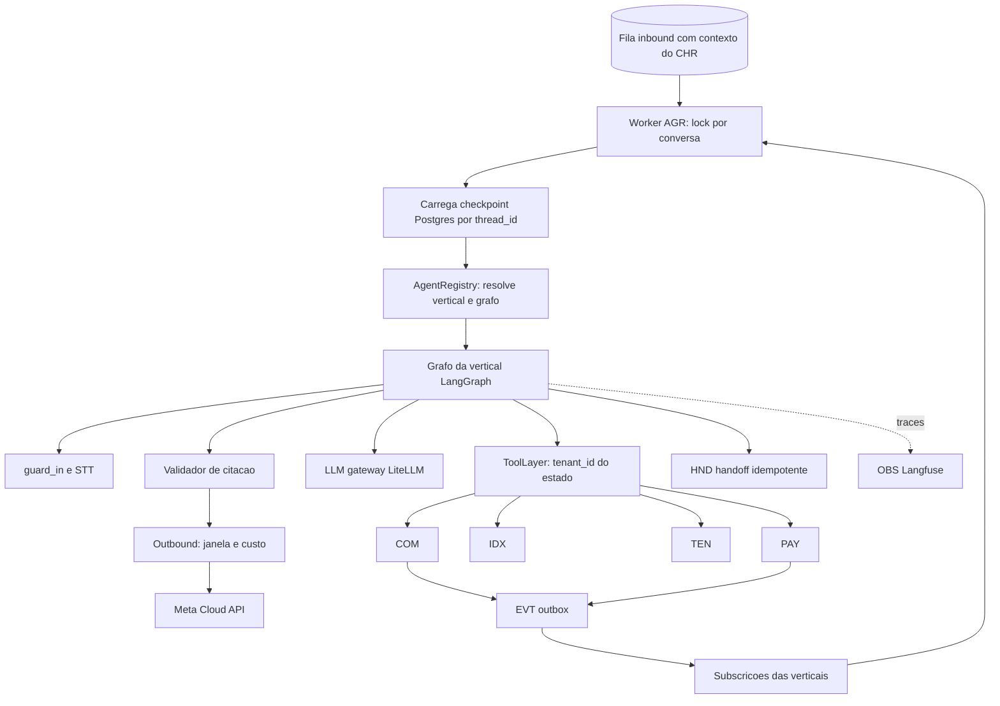
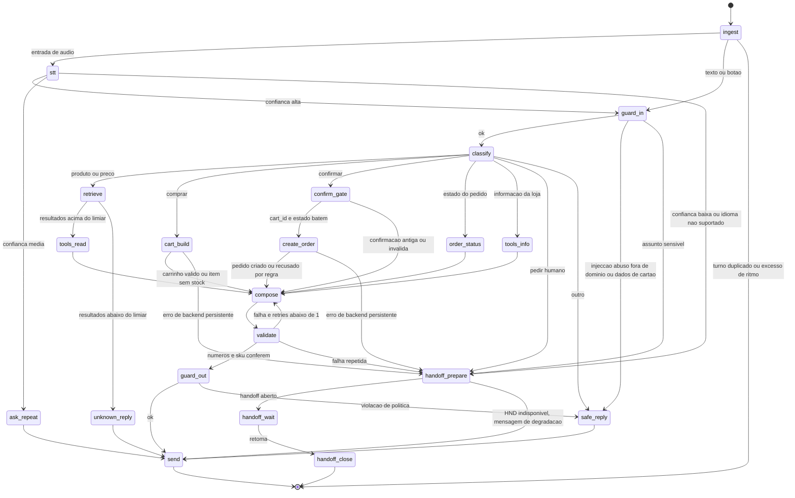
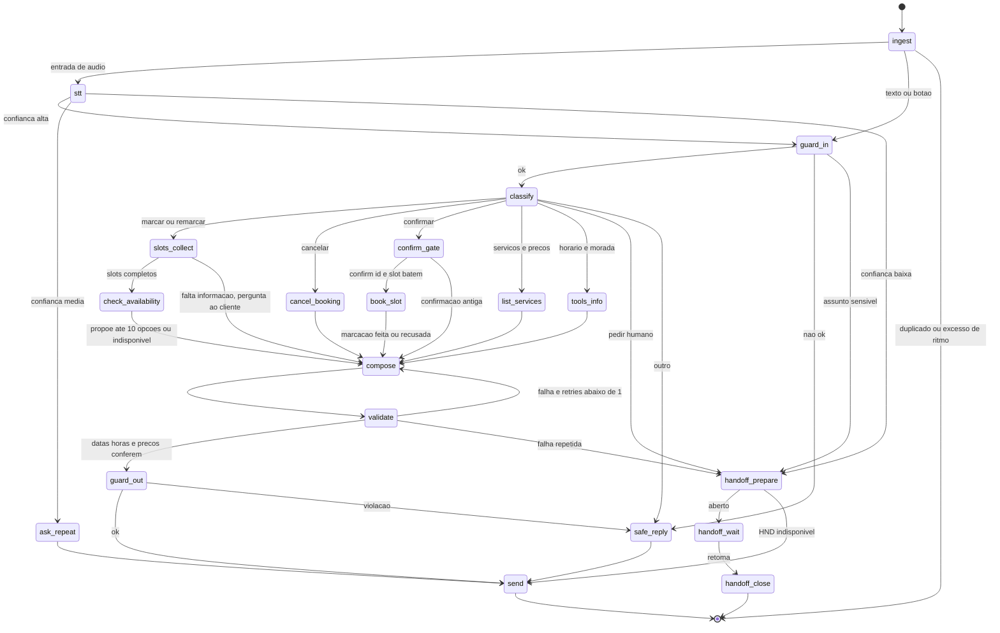
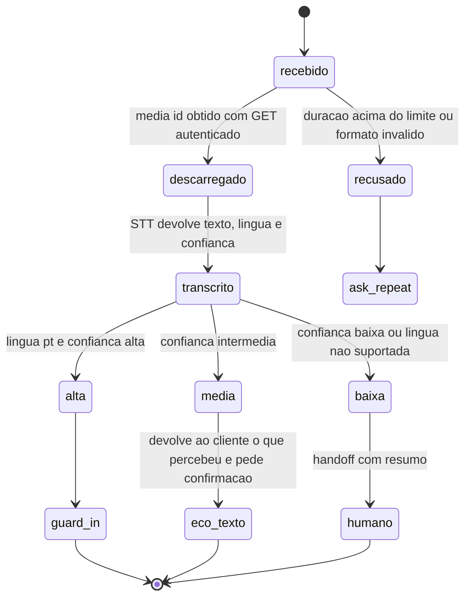

# Agent Runtime e Verticais — KAMBÁ

| Campo | Valor |
|---|---|
| Produto | KAMBÁ (nome de trabalho) — plataforma WhatsApp-native de comércio conversacional para Angola |
| Documento | Técnica — Agent Runtime e Verticais |
| Versão | 1.5 |
| Data | Outubro de 2026 |
| Classificação | Documento de Referência — Interno |
| Documento-fonte | `00_Arquitectura_Solucao.md`, `evidencia/E4_Stack_Licencas.md`, `evidencia/E1_Meta_WhatsApp.md`, `../exploracao/11-arquitetura-detalhada-engenharia.md` §4, `../exploracao/12-diagramas-c4-fluxogramas.md` C4.1, `../exploracao/14-tese-minima-e-plano-de-validacao.md` §3A |
| Documentos relacionados | `01_Canais_WhatsApp_Fluxo_Dual.md`, `03_Core_Comercio_Medusa.md`, `04_Pagamentos_Liquidacao_AntiFraude.md`, `05_Indice_Pesquisa_Motor_Atencao.md`, `06_Dados_Eventos_Analytics.md`, `08_Seguranca_Conformidade.md`, `10_Onboarding_Governanca.md` |

> **Estado das afirmações.** CONFIRMADO (fonte primária), INDÍCIO (fonte secundária ou inferência) e NÃO VERIFICADO, segundo `evidencia/` (8 de Outubro de 2026).
> Tudo o que é jurídico leva «(a confirmar por parecer)». Onde este documento diverge do exploratório (`../exploracao/11` §4), a divergência está assinalada como **correcção**.

---

## 1. Introdução

### 1.1 Propósito

Especificar o **Agent Runtime (AGR)** da KAMBÁ: como uma mensagem já resolvida pelo CHR (`01`) é transformada numa resposta correcta, auditável e barata, sem que o modelo possa escrever fora do seu tenant nem inventar números.
Cobre o uso do LangGraph como biblioteca MIT, o AgentRegistry (verticais como configuração), a ToolLayer, os grafos das duas verticais de atendimento do Piloto (Vendedor e Serviços/Rececionista) e, por adenda (§21, ADR-020), os módulos de entrada *owner-facing*, guardrails, validador de citação, pipeline de voz, `interrupt()` idempotente, checkpointer Postgres, LLM gateway, latência e o dataset *golden* PT-AO como gate.

### 1.2 Âmbito

Dentro: AGR, REG, TLS (contrato e auditoria), LLM (uso), MED/STT (lado do runtime). Fora: implementação interna do COM/PAY/IDX (`03`–`05`), webhooks e janela de 24 h (`01`), segurança transversal (`08`), processo de curadoria humana (`10`).

### 1.3 Audiência

Engenheiros de runtime/IA, de integração (COM, PAY, IDX), SRE e revisão de conformidade. Quem implementa os grafos deve conseguir fazê-lo a partir das tabelas de arestas (§7–§8), dos contratos (§6) e dos critérios de gate (§16).

### 1.4 Definições e termos

| Termo | Definição |
|---|---|
| Vertical | Tuplo de configuração `(grafo, tools autorizadas, persona, entitlements, subscrições)` registado no AgentRegistry. |
| Turno | Uma invocação do grafo, iniciada por uma mensagem de entrada (ou por um evento) e terminada com ≤ 1 envio ao cliente. |
| Fact | Valor estruturado devolvido por uma tool no turno corrente (preço, total, stock, data/hora, SKU…): a **única** origem legítima de números nas respostas. |
| Citação | Referência de um número ou item da resposta a um `fact_id`. |
| `cart_id` | Identificador de um carrinho proposto e ainda não confirmado; vai embutido no `id` do botão de confirmação. |
| Regra de dois | Uma abstracção só está validada com duas verticais distintas a usá-la sem excepções no core (ADR-012). |
| Papel de modelo | Alias lógico no LLM gateway (`kamba-router`, `kamba-chat`, …) que desacopla o grafo do fornecedor concreto. |

---

## 2. Princípios e decisões aplicáveis (ADRs)

| ADR | Aplicação |
|---|---|
| ADR-002 | LangGraph **biblioteca MIT**; Server (`langgraph-api`, Elastic-2.0, chave de licença) proibido; Dify, n8n e Typebot nunca expostos a tenants. §4 |
| ADR-005 | Modelos por API via LiteLLM desde o dia 1 (≥ 1.83.0, digest fixado); roteamento por papel. §13 |
| ADR-006 | Pesquisa por tenant (`iterative_scan`/partição) — a ToolLayer só consulta IDX com `tenant_id` do estado. §6 |
| ADR-007 | Preço e stock nunca em embeddings nem em prompts; vêm de tools; validador de citação com verificação por `sku`. §9 |
| ADR-008 | Texto, áudio e transcrições são dados pessoais; chamadas a LLM/STT no estrangeiro são transferências até prova em contrário (a confirmar por parecer). §10, §13 |
| ADR-009 | Efeitos de negócio emitem eventos via outbox; verticais subscrevem eventos em vez de se chamarem. §5 |
| ADR-010 | Identidade por `contact_id` (BSUID/HMAC); `thread_id` nunca contém telefone. §12 |
| ADR-011 | Persona `assistente` (Fluxo B) não é registada em produção no Piloto. §5.4 |
| ADR-012 | Verticais como configuração; regra de dois; cada vertical nova reaproveita ≥ 70%. §5 |
| ADR-013 | Nenhum nó muda o estado de pagamento; só eventos autenticados do PAY. A confirmação humana do `ManualProvider` é um evento, não uma tool do agente. §6 |
| ADR-014 | Mídia via StorageProvider; áudio apagado após transcrição. §10 |

---

## 3. Visão do subsistema



| Capacidade | Fase |
|---|---|
| AGR com 2 verticais (Vendedor, Serviços), REG, TLS, checkpointer Postgres, guardrails, validador, handoff idempotente, LLM gateway com chaves virtuais | **P** |
| Voz PT (STT com confiança, fallback a humano) | **P** (Fase 1, semanas 7–12) |
| Voz em Kimbundu/Umbundu | **D** (sem STT de produção; baixa confiança → humano) |
| Módulos de entrada (canal do dono, Catálogo AI conversacional, Foto de produtos AI, Social AI, Orçamento expresso; ADR-020, §21) | **P (Fase 1)** |
| Compras | **C** |
| Persona `assistente` / índice federado de consumo | **D** (ADR-011) |
| LLM self-host | **D** (só acima do break-even, ADR-005) |

---

## 4. LangGraph como biblioteca MIT (ADR-002)

### 4.1 O que se usa e o que é proibido

| Componente | Estado | Licença / nota (CONFIRMADO, E4) |
|---|---|---|
| `langgraph` (1.2.14 em 2026-10-06) | **Usar** | MIT |
| `langgraph-checkpoint-postgres` (3.1.2) | **Usar** | MIT |
| `langgraph-api`, `langgraph-runtime-inmem`, LangGraph Server / «LangSmith Deployment» | **Proibido** | Elastic-2.0; Standalone exige `LANGSMITH_API_KEY`, `LANGGRAPH_CLOUD_LICENSE_KEY` e egress para `beacon.langchain.com` |
| `open-agent-platform` | **Proibido** | Repositório arquivado (2026-02-25) |
| Outros pacotes `langgraph-*` (cli, sdk) | Verificar licença antes de adicionar | NÃO VERIFICADO caso a caso |

Fixar versões exactas (lockfile com *hashes*), actualizar de forma controlada (releases semanais) e re-executar o dataset *golden* (§16) a cada actualização do LangGraph.

### 4.2 Guardas técnicas (CI e runtime)

1. **CI — lista de bloqueio:** a pipeline falha se o lockfile contiver `langgraph-api`, `langgraph-runtime-inmem` ou qualquer pacote fora da lista de licenças permitidas (MIT, Apache-2.0, BSD, PostgreSQL License, MPL-2.0 sem modificação); relatório de licenças por *build* (SBOM).
2. **Runtime — telemetria desligada:** `LANGSMITH_TRACING=false` e rede de saída do AGR limitada por *allowlist* (LLM gateway interno, Postgres, Redis, HND, Langfuse); `beacon.langchain.com` bloqueado. Nome exacto das variáveis a validar na versão fixada.
3. **Traces:** Langfuse (OBS), não LangSmith. Conteúdo das mensagens nos traces desactivado por omissão em produção (amostragem com consentimento, `08`).
4. **Serviço próprio:** o AGR é um processo Python (workers *async*) com API interna mínima (`/internal/turn`, `/internal/resume`, `/healthz`); não há «assistants API» nem *cron* do LangGraph — agendamento é do EVT/scheduler da plataforma.

---

## 5. AgentRegistry e verticais como configuração (ADR-012)

### 5.1 O tuplo e o esquema YAML

```yaml
# registry/vendedor.yaml
id: vendedor
version: 1.0.0                    # SemVer do grafo + prompts + tools autorizadas
phase: P                          # P | C | D  (D e rejeitado em producao no Piloto)
persona:
  nome: "Vendedor"
  idioma: pt
  tom: "cordial, directo, portugues de Angola; sem emojis em excesso"
  apresentacao: "Sou o assistente automatico de {loja}. Posso ajudar com produtos, precos e pedidos."
graph: kamba.verticals.vendedor:build_graph
tools:                            # lista fechada; a ToolLayer recusa qualquer outra
  - search_catalog
  - get_price_stock
  - propose_cart
  - criar_pedido
  - get_order_status
  - get_store_info
entitlements:
  modulo: vendedor
  limites: [msgs_ai_mes, valor_max_pedido_minor]
subscriptions:                    # eventos do EVT (envelope versionado, ADR-009)
  - { tipo: payment.confirmed,        versao: 1 }
  - { tipo: payment.manual_confirmed, versao: 1 }   # os dois: dicionario 3.4
  - { tipo: order.expired,            versao: 1 }
  - { tipo: stock.low,                versao: 1 }
models: { router: kamba-router, chat: kamba-chat }
guardrails: { dominio: comercio_atendimento, handoff_triggers: [pedido_humano, reclamacao_grave, saude] }
golden: { dataset: "golden/vendedor/v1", gate: "gates/vendedor.yaml" }
```

```yaml
# registry/servicos.yaml  (persona Rececionista)
id: servicos
version: 1.0.0
phase: P
persona: { nome: "Rececionista", idioma: pt, apresentacao: "Sou o assistente automatico de {loja}. Posso tratar de marcacoes e informacoes." }
graph: kamba.verticals.servicos:build_graph
tools: [list_services, get_availability, book_slot, cancel_booking, reschedule_booking, get_store_info]
entitlements: { modulo: servicos, limites: [msgs_ai_mes, marcacoes_mes] }
subscriptions:
  - { tipo: booking.created,          versao: 1 }
  - { tipo: booking.reminder_due,     versao: 1 }
  - { tipo: payment.confirmed,        versao: 1 }   # sinal de marcacao, quando existir
  - { tipo: payment.manual_confirmed, versao: 1 }   # e o do ManualProvider: dicionario 3.5
models: { router: kamba-router, chat: kamba-chat }
golden: { dataset: "golden/servicos/v1", gate: "gates/servicos.yaml" }
```

### 5.2 Contrato do registo

```python
class Vertical(Protocol):
    id: str; version: str; phase: Literal["P","C","D"]
    def build_graph(self, deps: Deps) -> CompiledStateGraph: ...    # recebe ToolLayer, LLM, HND, Outbound por injeccao

class AgentRegistry:
    def load_all(self, env: Env) -> None                          # valida e regista; falha o arranque se invalido
    def resolve(self, ctx: ChannelContext) -> Vertical            # por ctx.vertical + entitlement activo do tenant
```

**Validação no arranque (falha o deploy):** (1) todas as `tools` existem no catálogo da ToolLayer e **nenhuma** tem parâmetro `tenant_id`/`merchant_id` no esquema visível ao modelo; (2) as chaves de `entitlements` existem no TEN; (3) o grafo compilado contém os nós obrigatórios `ingest`, `guard_in`, `validate`, `guard_out`, `send` e `handoff_wait` (teste de contrato);
(4) as `subscriptions` referem tipos e versões conhecidos; (5) `phase: D` é rejeitado se `KAMBA_FASE=piloto` (garante que `assistente` nunca está activo, ADR-011); (6) o dataset *golden* referido existe e o gate da versão está verde.

**Activação por tenant:** o CHR devolve `vertical`; o REG verifica `entitlements(tenant, modulo).ativo`. Sem entitlement → resposta estática «serviço indisponível» e alerta. Várias verticais no mesmo número: **C** (requer *front-door router*; no Piloto, uma vertical principal por número).

### 5.3 Estado partilhado

```python
class ConversaState(TypedDict):
    schema_version: int                      # migracoes de estado em `ingest`
    tenant_id: str                           # injectado pelo CHR; imutavel; nunca vem do texto
    channel_id: str; contact_id: str; conversation_id: str; vertical: str
    turn_id: str                             # wamid da mensagem que iniciou o turno (dedup natural)
    thread_id: str                           # f"{tenant_id}:{contact_id}"
    input_kind: Literal["text","audio","interactive","location","image"]
    messages: Annotated[list[AnyMessage], add_messages]   # janela recortada + `summary`
    summary: str | None
    stt: SttResult | None; guard: GuardVerdict | None; intent: str | None
    admissao: str | None                     # desfecho da linha 4 do 7.3; None se o turno corre
    facts: list[Fact]                        # so deste turno; reiniciado em `ingest`
    ofertas: list[Oferta]                    # (sku, nome, preco_tipo) das tools; so deste turno
    avisos: list[str]                        # codigos de negocio que o `compose` explica (emenda 1.40)
    handoff_motivo: str | None               # o que o §11 le no `handoff_prepare`
    cart: Cart | None                        # {cart_id, items, total_fact_id, expira_at}
    stage: Literal["browsing","awaiting_confirm","awaiting_payment","done"]
    slots: dict | None                       # Servicos
    draft: Draft | None; citation_retries: int
    handoff_seq: int; handoff: HandoffInfo | None
```

**Os `ofertas`, `avisos`, `handoff_motivo` e `admissao` entram pela emenda 1.40 (KAM-031)**, e
as tres ausencias aparecem ao escrever o grafo contra o §7.3. O `ofertas` e o que
o `validate` precisa para resolver um nome de produto a um `sku` — o nome vive no
`ToolResult.data` do `05` §6.3 e nao num `Fact` (divida 105). O `avisos` e por
onde `STALE_CONFIRMATION`, `OUT_OF_STOCK`, `PRICE_CHANGED` e `LIMIT_EXCEEDED`
chegam ao `compose`: os criterios 3 e 6 do bloco do KAM-031 chamam-lhes «*facts*»
e nao o podem ser, porque um `Fact` e um numero com proveniencia e o `kind` esta
fechado nos quatro do §6.2. O `handoff_motivo` ja era lido pelo codigo do §11 e
nao estava declarado aqui. O `admissao` e o canal da decisao do `ingest`: sem
ele o `r_ingest` tinha de voltar a perguntar ao ritmo do KAM-025, que **registra
a chegada** — e duas perguntas por turno cortavam o tecto a metade. Os tres sao **do turno** e reiniciam-se no `ingest`,
como os `facts`.

### 5.4 Regra de dois: o que é partilhado e o que é específico

| Elemento | Partilhado (core) | Específico da vertical |
|---|---|---|
| Nós | `ingest`, `stt`, `guard_in`, `classify` (esqueleto), `compose`, `validate`, `guard_out`, `send`, `handoff_*`, `safe_reply`, `ask_repeat`, `unknown_reply` | `retrieve`/`cart_build`/`create_order` (Vendedor); `slots_collect`/`check_availability`/`book_slot` (Serviços) |
| Tools | ToolLayer (validação, entitlement, idempotência, auditoria, facts) | Catálogo de tools por vertical |
| Estado | `ConversaState` base, `facts`, `handoff` | `cart` vs `slots` |
| Eventos | Envelope, outbox, DLQ, `events_consumed` | Tipos subscritos |
| Persona / prompts | Estrutura de prompt e *compose* com placeholders | Texto de persona e exemplos |
| Dados | `contacts`, `conversations`, `tool_audit`, `llm_call_log` | `orders` (COM) vs `bookings` (§8.3) |

**Medida de reaproveitamento (ADR-012):** `reuso = 1 − LoC_específico / LoC_total` calculado sobre o caminho de execução da vertical (grafo + tools + prompts + migrações), medido em CI; limiar ≥ 70% para uma vertical nova. **Vertical «provada»** (gate da Fase 0, doc 00 §13.2) quando: (a) Vendedor e Serviços correm no mesmo AGR/TLS/EVT/TEN sem *flags* de vertical no core; (b) um evento produzido por uma vertical (proposta: `payment.confirmed` de um sinal de marcação ou de uma encomenda) é consumido pelo handler da outra sem alteração do bus;
(c) os testes cruzados de isolamento passam para ambas; (d) nenhuma excepção no core (`grep` de nomes de vertical em `core/` = 0).

---

## 6. ToolLayer (TLS)

### 6.1 Contrato

A TLS é a **única** via de leitura e escrita dos agentes. O modelo nunca vê nem fornece `tenant_id`: as tools são construídas por turno a partir do contexto do estado.

```python
@dataclass(frozen=True)
class ToolContext:                      # construido a partir de ConversaState, nunca de texto
    tenant_id: UUID; channel_id: UUID; contact_id: UUID; conversation_id: UUID
    turn_id: str; vertical: str; run_id: str; graph_version: str

class ToolLayer:
    def for_context(self, ctx: ToolContext, allowed: list[str]) -> list[BoundTool]: ...
    async def invoke(self, ctx: ToolContext, name: str, args: dict, *, confirmation: Confirmation | None) -> ToolResult: ...

@dataclass
class ToolResult:
    ok: bool; data: dict; facts: list[Fact]; error: ToolError | None; idempotent_replay: bool = False
```

Pipeline de `invoke` (falha-fecha em cada passo): (1) a tool pertence à lista `allowed` da vertical; (2) entitlement activo e limites do TEN (`msgs_ai_mes`, `valor_max_pedido_minor`); (3) argumentos validados por Pydantic com `extra="forbid"`; (4) tools de classe `write`/`money` exigem `confirmation` com `cart_id` confirmado por botão no turno actual;
(5) chave de idempotência (§6.3); (6) chamada ao backend com `tenant_id` no cabeçalho **e** `SET LOCAL app.tenant_id` (RLS no Postgres das nossas tabelas — defesa em profundidade; as tabelas do Medusa são protegidas pelo adaptador COM); (7) linha em `tool_audit`; (8) devolução de `facts`.

### 6.2 Catálogo de tools do Piloto

| Tool | Vertical | Classe | Confirmação | Âmbito de dados | Notas |
|---|---|---|---|---|---|
| `search_catalog(query, filtros)` | Vendedor | read | — | tenant | IDX com `iterative_scan`/partição (ADR-006); devolve candidatos (sku, nome) **sem preço no ranking** |
| `get_price_stock(skus[])` | Vendedor | read | — | tenant | Facts `price`, `stock` (com `retrieved_at`) |
| `propose_cart(items[])` | Vendedor | read | — | tenant + contacto | Calcula total no backend; devolve `cart_id` e fact `total`; sem efeitos |
| `criar_pedido(cart_id)` | Vendedor | **money** | botão `confirm:{cart_id}` | tenant + contacto | Reserva stock 24–72 h (COM) + `createCharge` (PAY); respeita `valor_max_pedido_minor` (ManualProvider, ADR-013) |
| `get_order_status(order_id)` | Vendedor | read | — | tenant **e contacto** | Só encomendas do próprio contacto (evita fuga intra-tenant) |
| `get_store_info()` | ambas | read | — | tenant | Horário, morada, Plus Code |
| `list_services()`, `get_availability(serviço, intervalo)` | Serviços | read | — | tenant | Slots como facts `datetime` |
| `book_slot(slot_id, serviço)` | Serviços | **write** | botão `confirm:{hold_id}` | tenant + contacto | Idempotente por `(contact, slot_id)` |
| `cancel_booking(id)`, `reschedule_booking(id, novo_slot)` | Serviços | write | botão | tenant + contacto | `reschedule` é atómica (cancela+marca) |

Não existe tool de envio de mensagem: o único caminho para o cliente é o nó `send` → Outbound (`01` §8). Também não existem, no registo das verticais voltadas ao cliente, tools que alterem preço, stock ou estado de pagamento (acções do dono ficam numa persona própria, **C**).

### 6.3 Idempotência (correcção do exploratório)

O exploratório deriva a chave de `hash(msisdn + sku + janela_5min)` (`../exploracao/11` §4.2). Problemas: usa telefone (ADR-010), a janela temporal parte-se na fronteira (dois toques às 4:59 e 5:01 geram duas encomendas) e confunde recompras legítimas. **Regra adoptada:**

```
idempotency_key = sha256(tenant_id | contact_id | tool | cart_id)       # um pedido por carrinho
botao de confirmacao: id = "confirm:{cart_id}" (Vendedor) | "confirm:{hold_id}" (Servicos)   # embutido no reply button
```

Duplo toque ou re-entrega do webhook: (i) o `wamid` repetido é filtrado no GWY; (ii) um segundo toque com `wamid` novo encontra `stage != awaiting_confirm` (o `confirm_gate` trata-o como *stale*, §7); (iii) mesmo que ambos corram em concorrência, a chave devolve o resultado guardado (`idempotent_replay=true`). **O *lock* por conversa já não é o que os serializa**, e esta frase dizia que era: a revisão adversarial do KAM-028 substituiu o trinco único da ToolLayer por uma `asyncio.Queue` de tomadas, pelo que quem serializa pelo `cart_id` é o `INSERT … ON CONFLICT DO NOTHING` da `tool_idempotency` (KAM-029) e mais nada.
Tabela `tool_idempotency(key PK, tool, result jsonb, created_at)`; retenção ≥ validade da reserva + prazo de disputa (a definir em `04`).

**Entregue pelo KAM-029, com quatro coisas que este parágrafo não dizia** (revisão
`0022`, dicionário §3.28):

1. **O `|` da fórmula não é um caractere separador.** O `cart_id` é opaco
   (KAM-046), pelo que nenhum caractere é seguro: com um separador literal,
   `(a, b|c)` e `(a|b, c)` dão a mesma chave — numa tool `money`, a encomenda de
   um cliente a responder pela de outro. A derivação prefixa cada parte com o
   comprimento.
2. **A `idempotency_key` da `tool_audit` não é esta chave.** Aquela é do
   **turno** (vai ao `usage_ledger` no passo 2; o KAM-025 usa `turn_id:seq`) e
   esta é do **carrinho**. Não podiam ser a mesma: o segundo toque de que o ponto
   (ii) acima fala é um turno novo, e uma desduplicação por chave de turno
   cobrava outra vez.
3. **Três estados e não dois.** `em_curso` → quem chega espera (tecto de 3 s,
   `03` §6.3, depois `UPSTREAM_TIMEOUT` sem executar); `concluida` → devolve-se o
   resultado guardado; `falhada` → **retoma-se** e executa-se outra vez, o que
   só é seguro porque a chave vai ao backend, que é idempotente por ela.
4. **A coluna `key` tem `CHECK` de forma hexadecimal.** «Sem telefone na chave»
   deixa de depender de quem chama (ADR-010).

A retenção fica em **30 dias, *proposta***: a validade da reserva está fixada
(`03` §6.4, tecto de 72 h) mas o **prazo de disputa não está fixado em documento
nenhum** — o `04` tem `refund_cases` e a transição `paga → reembolso_pendente` e
não dá prazo. Recalibra-se quando o `04` o fixar.

### 6.4 Auditoria

```sql
CREATE TABLE tool_audit (                -- append-only; sem UPDATE/DELETE para o papel da aplicacao
  id bigserial PRIMARY KEY, ts timestamptz NOT NULL DEFAULT now(),
  tenant_id uuid NOT NULL, contact_id uuid, conversation_id uuid, turn_id text, run_id text,
  vertical text, graph_version text, tool text NOT NULL, tool_version text, klass text NOT NULL,
  args_hash bytea NOT NULL, args_redacted jsonb, idempotency_key text,
  status text NOT NULL, error_code text, result_hash bytea, fact_ids text[], latency_ms int
);
```

Dinheiro, stock e preço têm, além disto, o seu registo no domínio (`payment_events`, movimentos de stock). A auditoria não guarda conteúdo de mensagens nem telefone.

### 6.5 Erros tipados

| Código | Significado | Tratamento no grafo |
|---|---|---|
| `NOT_FOUND`, `OUT_OF_STOCK`, `PRICE_CHANGED` | Estado de negócio | `compose` explica; `PRICE_CHANGED` força novo `propose_cart` |
| `LIMIT_EXCEEDED` (valor máx., `msgs_ai_mes`) | Limite do plano/ManualProvider | Mensagem honesta + oferta de handoff |
| `ENTITLEMENT_DENIED`, `TOOL_NOT_ALLOWED`, `TENANT_MISMATCH` | Violação | Bloqueio, alerta de segurança, `safe_reply`; **nunca** tentar de novo |
| `UPSTREAM_TIMEOUT`, `UPSTREAM_DOWN` | COM/PAY/IDX indisponível | 1 retry com *backoff*; depois `handoff_prepare` ou fluxo determinístico |
| `VALIDATION_ERROR` | Argumentos inválidos do modelo | 1 correcção automática; depois `unknown_reply` |
| `INTENT_REUSED_WITH_DIFFERENT_CONTENT` | O mesmo `cart_id` com outro conteúdo (§6.3) | Defeito do chamador: o carrinho mudou e não gerou `cart_id` novo. **Nunca** repetir; novo `propose_cart` |

**São onze e não dez** (KAM-029). O décimo primeiro nasce no §6.3 e não aqui, e
não é uma constante: a `tool_audit.error_code` é um `CHECK` fechado, pelo que ele
obriga a uma revisão de base de dados (a `0022`), entra no dicionário §3.28 e
muda a etiqueta de `agr_tool_erros_total` — que é **derivada** da lista e não
escrita à mão. Não é violação e não levanta alerta de segurança: é um defeito de
quem chama, não uma tentativa de atravessar fronteira.

Timeouts por classe: read 2 s, write/money 8 s; *circuit breaker* por backend. Testes cruzados (tenant A tenta ler B, contacto X tenta ler encomenda de Y) fazem falhar o *build* (doc 00 §9).

---

## 7. Grafo do Vendedor (corrigido)

### 7.1 Defeitos do grafo exploratório (`../exploracao/11` §4.2)

| # | Defeito | Correcção |
|---|---|---|
| 1 | `filtrar_input` antes de `stt`: não se filtra áudio por regras de texto | `stt` antes de `guard_in`; áudio de baixa confiança sai por `ask_repeat`/handoff |
| 2 | Só existem arestas `START→filtrar_input` e as condicionais de `classificar`; faltam `filtrar_input→stt/classificar`, `stt→classificar`, `responder→validar_citacao` e o nó terminal de envio | Grafo completo com todas as arestas (tabela 7.3) |
| 3 | `validar_citacao → responder` com «1 retry → handoff» apenas em comentário: o contador não existe e o ciclo é ilimitado | `citation_retries` no estado; 2.ª falha → `handoff_prepare` |
| 4 | `compra → ferramentas` executa `criar_pedido` directamente após a classificação, sem confirmação do cliente nem verificação de stock/valor | `cart_build` → `compose` (botões) → turno seguinte → `confirm_gate` → `create_order` |
| 5 | Sem caminho para `hits < limiar` (existe só no C4.1 de `../exploracao/12`) | `unknown_reply` |
| 6 | `handoff` como `interrupt` num único nó com efeitos (Chatwoot) antes do `interrupt()`: re-executa na retoma | `handoff_prepare` (idempotente) + `handoff_wait` (só `interrupt`) — §11 |
| 7 | Sem ramo para fora de domínio, dados de cartão, saúde, injecção | `guard_in` com veredictos e `safe_reply` (§8) |
| 8 | Sem filtro de saída | `guard_out` após `validate` |
| 9 | Sem tratamento de turno duplicado ou excesso de ritmo | `ingest` termina silenciosamente em `END` |
| 10 | `thread_id = msisdn_hash+tenant` | `tenant_id:contact_id` (§12) |

### 7.2 Diagrama



### 7.3 Tabela de arestas (completa)

| # | De → Para | Condição |
|---|---|---|
| 1 | START → `ingest` | sempre |
| 2 | `ingest` → `stt` | `input_kind == audio` |
| 3 | `ingest` → `guard_in` | texto, botão, localização |
| 4 | `ingest` → END | `turn_id` já processado, contacto bloqueado ou excesso de ritmo |
| 5 | `stt` → `guard_in` | confiança alta e idioma `pt` |
| 6 | `stt` → `ask_repeat` | confiança média (§10) |
| 7 | `stt` → `handoff_prepare` | confiança baixa, idioma não suportado, duração > limite |
| 8 | `guard_in` → `classify` | veredicto `ok` |
| 9 | `guard_in` → `safe_reply` | `injection`, `abuse`, `out_of_domain`, `card_data` |
| 10 | `guard_in` → `handoff_prepare` | `sensitive` (saúde, reclamação grave) |
| 11 | `classify` → `retrieve` | intenção `produto`, `preco_stock` |
| 12 | `classify` → `cart_build` | `comprar` |
| 13 | `classify` → `confirm_gate` | `confirmar` (resposta a botão `confirm:*`) |
| 14 | `classify` → `order_status` | `pagamento_estado`, `encomenda` |
| 15 | `classify` → `tools_info` | `info_loja` |
| 16 | `classify` → `handoff_prepare` | `humano` |
| 17 | `classify` → `safe_reply` | `outro` |
| 18 | `retrieve` → `tools_read` | melhor resultado ≥ limiar |
| 19 | `retrieve` → `unknown_reply` | abaixo do limiar |
| 20 | `tools_read` → `compose` | sempre |
| 21 | `cart_build` → `compose` | carrinho criado, ou item sem stock/preço alterado (explicação) |
| 22 | `cart_build` → `handoff_prepare` | `UPSTREAM_*` após retry |
| 23 | `confirm_gate` → `create_order` | `stage == awaiting_confirm` e `cart_id` do botão == `state.cart.cart_id` e `cart` não expirado |
| 24 | `confirm_gate` → `compose` | confirmação antiga/inválida (recebe fact `STALE_CONFIRMATION`; pede reconfirmação) |
| 25 | `create_order` → `compose` | sucesso ou recusa por regra (`OUT_OF_STOCK`, `LIMIT_EXCEEDED`, `PRICE_CHANGED`) |
| 26 | `create_order` → `handoff_prepare` | `UPSTREAM_*` persistente |
| 27 | `order_status`, `tools_info` → `compose` | sempre |
| 28 | `compose` → `validate` | sempre |
| 29 | `validate` → `guard_out` | citações e `sku` conferem |
| 30 | `validate` → `compose` | falha e `citation_retries < 1` (incrementa; o rascunho recebe a lista de erros) |
| 31 | `validate` → `handoff_prepare` | falha e `citation_retries ≥ 1` |
| 32 | `guard_out` → `send` | ok |
| 33 | `guard_out` → `safe_reply` | violação (promessa proibida, identidade, fuga de dados) |
| 34 | `unknown_reply`, `ask_repeat`, `safe_reply` → `send` | sempre (textos estáticos; sem números de negócio) |
| 35 | `send` → END | sempre; `send` chama o Outbound com `idempotency_key = turn_id:seq` |
| 36 | `handoff_prepare` → `handoff_wait` | `openHandoff` ok |
| 37 | `handoff_prepare` → `send` | HND indisponível: mensagem de degradação e `conversation.mode = pausada` |
| 38 | `handoff_wait` → `handoff_close` | retoma (`Command(resume=…)`) |
| 39 | `handoff_close` → END | sempre; em `timeout` o Outbound envia a mensagem de alternativas |

O fluxo de compra atravessa **dois turnos**: no 1.º, `cart_build → compose` envia resumo e botões `confirm:{cart_id}` / `cancelar` / `falar com humano`; no 2.º, o toque no botão entra por `classify → confirm_gate → create_order`. A confirmação é um **turno novo**, não um `interrupt()` (que fica reservado a esperas por humano).

### 7.4 Esqueleto de código (todas as arestas declaradas)

```python
def build_graph(deps: Deps) -> CompiledStateGraph:
    g = StateGraph(ConversaState)
    for name, fn in NODES.items():           # ingest, stt, guard_in, classify, retrieve, tools_read, cart_build,
        g.add_node(name, fn(deps))           # confirm_gate, create_order, order_status, tools_info, compose, validate,
                                             # guard_out, unknown_reply, ask_repeat, safe_reply, send,
                                             # handoff_prepare, handoff_wait, handoff_close
    g.add_edge(START, "ingest")
    g.add_conditional_edges("ingest", r_ingest,        {"stt": "stt", "guard_in": "guard_in", "end": END})
    g.add_conditional_edges("stt", r_stt,              {"ok": "guard_in", "repeat": "ask_repeat", "human": "handoff_prepare"})
    g.add_conditional_edges("guard_in", r_guard,       {"ok": "classify", "safe": "safe_reply", "human": "handoff_prepare"})
    g.add_conditional_edges("classify", r_intent,      {"search": "retrieve", "buy": "cart_build", "confirm": "confirm_gate",
                                                        "status": "order_status", "info": "tools_info",
                                                        "human": "handoff_prepare", "other": "safe_reply"})
    g.add_conditional_edges("retrieve", r_hits,        {"hit": "tools_read", "miss": "unknown_reply"})
    g.add_conditional_edges("cart_build", r_upstream,  {"ok": "compose", "down": "handoff_prepare"})
    g.add_conditional_edges("confirm_gate", r_confirm, {"go": "create_order", "stale": "compose"})
    g.add_conditional_edges("create_order", r_upstream,{"ok": "compose", "down": "handoff_prepare"})
    for n in ("tools_read", "order_status", "tools_info"):
        g.add_edge(n, "compose")
    g.add_edge("compose", "validate")
    g.add_conditional_edges("validate", r_cite,        {"ok": "guard_out", "retry": "compose", "human": "handoff_prepare"})
    g.add_conditional_edges("guard_out", r_out,        {"ok": "send", "safe": "safe_reply"})
    for n in ("unknown_reply", "ask_repeat", "safe_reply"):
        g.add_edge(n, "send")
    g.add_edge("send", END)
    g.add_conditional_edges("handoff_prepare", r_handoff, {"wait": "handoff_wait", "degraded": "send"})
    g.add_edge("handoff_wait", "handoff_close")
    g.add_edge("handoff_close", END)
    return g.compile(checkpointer=deps.checkpointer)      # AsyncPostgresSaver (§12)
```

Um teste de contrato percorre o grafo compilado e falha se existir nó sem aresta de saída, nó inalcançável ou ciclo sem contador (`compose↔validate`).

---

## 8. Grafo de Serviços (Rececionista) e guardrails

### 8.1 Diagrama



Nós comuns com o Vendedor: `ingest`, `stt`, `guard_in`, `compose`, `validate`, `guard_out`, `send`, `ask_repeat`, `safe_reply`, `handoff_*`, `confirm_gate` (a mesma lógica, `cart_id` ↔ `slot_hold_id`). Específicos: `classify` (intenções próprias), `slots_collect`, `check_availability`, `book_slot`, `cancel_booking`, `list_services`. Falhas de backend em `check_availability`/`book_slot`/`cancel_booking` seguem `handoff_prepare` como no Vendedor (omitido do diagrama por legibilidade; a tabela de arestas segue a mesma regra `UPSTREAM_*`).

### 8.2 Particularidades

| Tema | Regra |
|---|---|
| Intenções | `marcar`, `remarcar`, `cancelar`, `disponibilidade`, `servicos_precos`, `info_loja`, `confirmar`, `humano`, `outro` |
| Slots | `servico`, `data`, `hora`, `profissional?`, preenchidos ao longo de vários turnos; `slots_collect` pergunta **uma** coisa de cada vez (custo de mensagem, `01` §8) |
| Disponibilidade | Só tool; o modelo não calcula horas livres. Máximo 10 opções por lista interactiva (limite Meta, CONFIRMADO) |
| Confirmação | Botão `confirm:{hold_id}`; `book_slot` mantém *hold* curto (a definir) e é idempotente por `(contact, slot_id)` |
| Validador | Estendido a **datas, horas e durações** (§9): cada `datetime` citado tem de existir num fact `datetime` |
| Lembretes | Evento `booking.created` → scheduler cria `booking.reminder_due` (T−24 h, valor a calibrar) → mensagem livre se a janela está aberta, senão *template utility* (`01` §8.2) |
| Sinal/depósito | Opcional: usa PAY como no Vendedor. A marcação confirma-se com **qualquer um** dos dois eventos de pagamento — e o dicionário §3.5 nomeia precisamente o `payment.manual_confirmed` como o do *gate* da Fase 0 para esta vertical, que é o inverso do que esta linha dizia |

### 8.3 Lacuna: onde vive a agenda

O doc 00 §4 define COM como «produtos, encomendas, stock, reservas 24–72 h»; **não prevê agenda, serviços nem marcações**. Proposta (a ratificar no `03`): módulo `servicos` no mesmo Postgres (esquema próprio, RLS por `tenant_id`) com `services`, `resources`, `availability_rules`, `bookings`, acedido só pela TLS; reservas de slot como as de stock (TTL e libertação por evento). Sem isto, a vertical Serviços não prova a regra de dois (Fase 0).

### 8.4 Guardrails

| Camada | Verificação | Mecanismo | Acção |
|---|---|---|---|
| Entrada | Injecção de prompt, pedidos de revelar instruções | Regras (padrões) + classificador barato (`kamba-router`) | `safe_reply`; contador por contacto |
| Entrada | **Fora de domínio** (perguntas gerais, «assistente universal») | Classificador + lista de intenções do domínio | `safe_reply` redireccionando ao âmbito da loja. **Requisito de política:** a Meta proíbe «AI Provider» de uso geral como funcionalidade principal (CONFIRMADO, E1 §4); o âmbito comercial é prova a guardar em logs agregados |
| Entrada | Dados de cartão/conta/BI enviados pelo cliente | Regex (PAN com Luhn, IBAN) | Redigir, não guardar, avisar o cliente; **nunca** pedir tais dados (Meta Commerce Policy) |
| Entrada | Saúde, medicamentos, armas, álcool, apostas, crédito | Classificador + categorias da loja | `sensitive` → handoff ou recusa. Categorias proibidas na Meta (CONFIRMADO); «saúde» é dado sensível na Lei 22/11 Art. 5.º c) (CONFIRMADO, E3); autorização APD (a confirmar por parecer) |
| Entrada | Conteúdo ofensivo/abuso | Regras + classificador | `safe_reply`; após N ocorrências, `pausada` |
| Dados não fiáveis | Texto de catálogo escrito pela PME e mensagens de clientes | **Tratados como dados, nunca como instruções**: delimitados no prompt; sem dígitos copiáveis (§9); tools não aceitam argumentos vindos de descrições | Mitiga injecção indirecta |
| Saída | Citação de números e `sku` | Validador (§9) | retry → handoff |
| Saída | Promessas proibidas: descontos, prazos de entrega, «pago/confirmado» sem evento, comparações («o mais barato») | Regras + facts exigidos | `safe_reply` |
| Saída | Identidade e transparência | A 1.ª mensagem identifica o assistente automático da loja | Alinha com Lei de IA em projecto (INDÍCIO, E3 §3) |
| Saída | Fuga de PII / de outro tenant | Verificação de tokens do tenant corrente; nada de telefone em claro | `safe_reply` + alerta de segurança |
| Minimização | Dados enviados ao LLM | Contacto como «Cliente»; sem telefone; endereço só quando indispensável | Reduz transferência (ADR-008) |

Os guardrails determinísticos correm primeiro (custo zero); o classificador barato só quando as regras não decidem.

---

## 9. Validador de citação (ADR-007) e as suas limitações

### 9.1 Desenho em duas camadas

**Camada 1 — citação por referência (preferida; Proposta 02-A).** O modelo `compose` não escreve números em prosa: devolve blocos estruturados e o *renderer* determinístico preenche-os com facts.

```json
{ "blocks": [
  { "type": "text", "text": "Encontrei estas opções para si:" },
  { "type": "item", "sku": "SKU-123", "show": ["name", "price", "stock"] },
  { "type": "total", "fact_id": "f_9" },
  { "type": "buttons", "ids": ["confirm:c_77", "cancel:c_77", "human"] } ] }
```

**Camada 2 — validador pós-geração (rede de segurança)**, aplicado ao texto final já renderizado e a qualquer prosa livre:

```python
def validate(text: str, facts: list[Fact], policy: Policy) -> Verdict:
    toks = extract(text)      # dinheiro, quantidades, percentagens, SKUs, datas/horas, numeros por extenso (pt)
    errs = []
    for m in toks.money:                                   # tolerancia zero
        if not any(f.kind in MONEY_KINDS and f.value_minor == m.value_minor for f in facts): errs.append(("money_unbacked", m))
    for line in toks.lines():                              # vinculo produto-preco (limitacao classica)
        for sku, price in line.sku_price_pairs():
            if not any(f.kind == "price" and f.sku == sku and f.value_minor == price for f in facts): errs.append(("sku_price_mismatch", sku, price))
        for name in line.product_names():                  # nome sem SKU visivel tambem se resolve via facts.name
            if resolve_sku(name, facts) not in line.skus(): errs.append(("name_sku_mismatch", name))
    for q in toks.quantities:  require_fact(q, kinds={"qty","stock"}) or errs.append(("qty_unbacked", q))
    for d in toks.datetimes:   require_fact(d, kinds={"datetime","expiry"}) or errs.append(("datetime_unbacked", d))
    for p in toks.percentages: errs.append(("discount_unbacked", p)) if not has_fact("discount", p) else None
    for n in toks.other_numbers:                           # lista curta permitida: "24 horas", "1 minuto", horarios da loja (fact)
        if n not in policy.allowed_literals: errs.append(("number_unbacked", n))
    return Verdict(ok=not errs, errors=errs)
```

Normalização monetária (`value_minor`, inteiro, em **cêntimos de AOA**): aceita `12500`, `12.500`, `12 500`, `12,500`, `12500 Kz`, `12.500,00 Kz`, `Kz 12.500`, `12,5 mil`, «doze mil e quinhentos»; qualquer moeda diferente de Kz sem fact de moeda é erro. **O cliente e o assistente falam em Kz; a comparação faz-se em cêntimos**, e é a normalização que converte — «12.500 Kz» dá `value_minor = 1250000`. Isto não é detalhe: o *fact* vem do `search_catalog` do `05` §6.3, cujo contrato de saída é `preco_minor`, e comparar a fala do cliente em Kz com um *fact* em cêntimos falha **sempre**, por um factor de cem. O nome era `value_kz` e a comparação estava errada desde que o `05` passou a `preco_minor` (KAM-139; apanhado pela revisão adversarial, achado C1). Os totais **nunca** são somados pelo modelo: vêm do backend (`propose_cart`); uma soma correcta mas não-fact também falha.

### 9.2 Limitações assumidas

| Limitação | Efeito | Mitigação |
|---|---|---|
| **Produto errado com preço certo** (o número existe nos facts mas pertence a outro SKU) — ponto cego do validador só-numérico (ADR-007) | Cliente vê «Produto A — preço de B» | Vínculo `sku↔preço` por linha/bloco; renderização por referência (Camada 1); nomes resolvidos a SKU; teste adversarial no *golden* |
| Afirmações sem números («mais barato», «chega amanhã», «está em promoção», «temos sempre») | Não cobertas | `guard_out` com regras e exigência de fact; lista de frases vetadas; revisão no *golden* |
| Disponibilidade qualitativa («há em stock») sem quantidade | Pode divergir do stock real | Fact `stock` com *bucket* e `retrieved_at`; texto produzido só por *renderer* |
| Facts obsoletos entre turnos (preço mudou antes da confirmação) | Confirmação com preço antigo | `cart_build` e `create_order` revalidam preço/stock no backend; `PRICE_CHANGED` obriga a reconfirmar |
| Texto da PME (descrição) com preços ou instruções | Contradiz o Registo | Descrições são dados não fiáveis: dígitos nelas **não** são facts; o modelo não os pode repetir |
| Números por extenso, formatos regionais, abreviaturas («2 mil») | Falhas de extracção | Parser pt-AO com testes; cobertura no *golden* |
| Coincidência de valores (preço de A igual ao stock de B) | Falso aceite | Validação por `kind` e por vínculo |
| Dependência do modelo para escolher o fact certo | Escolha errada de item | Camada 1 (referência) e retries limitados |

**Garantia pretendida:** *0 preços/totais divergentes das tools em produção* (doc 00 §9) é um **objectivo de desenho** com risco residual (defeitos do extractor, formatos não previstos); mede-se por amostragem de produção (`citation_fail_rate`, auditoria de conversas com consentimento) além do *golden*.

Métricas: `validate_fail_rate`, `validate_retry_rate`, `handoff_by_citation`, `render_only_ratio` (proporção de respostas sem prosa numérica livre).

---

## 10. Pipeline de voz



| Etapa | Regra |
|---|---|
| Recepção | Nota de voz WhatsApp (OGG/Opus). Descarregar `media_id` com credenciais do tenant; guardar no StorageProvider (ADR-014); **nunca** persistir URL Meta. Limite de duração por turno (ex. 120 s, a calibrar); acima → pedir mensagem mais curta |
| STT | Fornecedor atrás de interface `SttProvider`. Candidatos com preço CONFIRMADO/INDÍCIO (E4): Groq `whisper-large-v3-turbo` ~0,04 USD/h (WER 12%, INDÍCIO-forte), `whisper-large-v3` ~0,111 USD/h; OpenAI `gpt-4o-mini-transcribe` ~0,003 USD/min, `gpt-transcribe` 0,0045 USD/min. **Qualidade em português de Angola: NÃO VERIFICADA** — decide-se com áudio real no dataset *golden* |
| Confiança | Sinais disponíveis por fornecedor (ex. `avg_logprob`, `no_speech_prob`, `compression_ratio` nos Whisper; *logprobs* nos modelos GPT: a confirmar) + língua detectada. Limiares iniciais herdados do Whisper de referência (`avg_logprob` −1,0; `compression_ratio` 2,4; `no_speech_prob` 0,6: INDÍCIO) — **a calibrar** com áudio PT-AO |
| Níveis | **Alta**: segue. **Média**: eco do entendido («Percebi: 2 sacos de cimento. Está certo?» + botões). **Baixa** ou língua ≠ pt: handoff com resumo («cliente enviou nota de voz que não foi possível transcrever») |
| Kimbundu/Umbundu | Sem STT de produção (doc 00 §11): baixa confiança → humano. A detecção de língua dos modelos genéricos pode classificar mal estas línguas (não constam, que se saiba, entre as suportadas: NÃO VERIFICADO — conferir a lista do fornecedor escolhido). **D**: avaliar STT dedicado só com dados reais e consentimento |
| Dinheiro por voz | Compra iniciada por voz **exige sempre** confirmação por botões com resumo do carrinho (o erro de STT não pode virar pedido) |
| Retenção | Áudio apagado após transcrição (prazo curto, ex. 24–72 h para auditoria/contestação, a decidir em `08`); transcrição tratada como mensagem; áudio bruto não vai a terceiros sem base legal (a confirmar por parecer, E3) |
| Transferência | STT em fornecedor fora de Angola = transferência de dados pessoais (voz identifica) — D1/ADR-008; sem procedimento APD concluído não entra voz em produção com dados reais |
| Custo (ilustrativo) | Nota de 20 s: ~0,0002 USD (Groq turbo, 0,04 USD/h) ou ~0,001 USD (0,003 USD/min). Pequeno face a 0,004 USD por mensagem Meta; o custo dominante é o do canal, não o da voz |
| Saída em voz | Fora do Piloto (só texto) |

---

## 11. `interrupt()` idempotente (handoff)

Facto (CONFIRMADO, docs LangGraph/E4): `interrupt()` exige checkpointer durável e `thread_id`; na retoma **o nó reinicia desde o início**; a ordem de múltiplos `interrupt()` num nó é por índice; **não** se pode envolver `interrupt()` em `try/except` genérico; não se usa em ciclos `while`.

**Padrão adoptado: dois nós.**

```python
def handoff_prepare(deps):
    def node(state: ConversaState):
        hid = sha256(f"{state['thread_id']}:{state['handoff_seq']}")          # estavel entre re-execucoes
        try:
            ref = deps.hnd.open_handoff(handoff_id=hid, tenant_id=state["tenant_id"], contact_id=state["contact_id"],
                                        conversation_id=state["conversation_id"], motivo=state["handoff_motivo"],
                                        resumo=summarise(state))                 # idempotente por hid no HND
        except HandoffUnavailable:
            return {"handoff": {"id": hid, "status": "degraded"}}               # -> aresta "degraded" -> send
        deps.outbound.queue_text(state, MSG_HUMANO_A_CAMINHO, key=f"{hid}:msg")  # idempotente por key
        return {"handoff": {"id": hid, "external_id": ref, "status": "waiting"}, "handoff_seq": state["handoff_seq"] + 1}
    return node

def handoff_wait(deps):
    def node(state: ConversaState):
        outcome = interrupt({"handoff_id": state["handoff"]["id"], "motivo": state["handoff_motivo"]})   # 1.a linha; sem efeitos antes
        return {"handoff": {**state["handoff"], "status": "resumed", "outcome": outcome["outcome"]}}
    return node

def handoff_close(deps):
    def node(state: ConversaState):
        if state["handoff"]["outcome"] == "timeout":
            deps.outbound.queue_text(state, MSG_ALTERNATIVAS, key=f"{state['handoff']['id']}:timeout")   # idempotente
        return {"stage": "done"}
    return node
```

Regras: (1) `handoff_prepare` **não** reexecuta na retoma (só reexecuta o nó interrompido); mesmo assim todos os efeitos são idempotentes por `handoff_id`/`key`, porque o worker pode falhar a meio e repetir o nó; (2) `handoff_wait` não tem efeitos antes do `interrupt()` e não tem `try/except`; (3) **retoma** por `POST /internal/resume {thread_id, handoff_id, outcome}`: *compare-and-set* em `handoffs(status: waiting → resumed)`; só o primeiro vence, o segundo é *no-op* (webhook duplicado do Chatwoot); autenticação da origem pelo `secret` do *agent bot* (HND); a invocação `Command(resume=…)` corre sob o *lock* da conversa;
(4) **invariante:** nunca se invoca o grafo com *input* novo num thread com `interrupt` pendente — o CHR/AGR consultam `conversations.mode` e `handoffs.status='waiting'` antes (mensagens do cliente nesse período vão ao Chatwoot, `01` §10.2); (5) *timeout*: o scheduler retoma com `outcome=timeout` às 24 h; (6) sem checkpointer durável o `interrupt()` perde-se: o arranque do AGR falha se o saver não estiver configurado.

Estados de `handoffs`: `waiting → resumed | timeout | cancelled | degraded`, com `opened_at`, `resumed_at`, `resolver` (humano), para o SLA < 15 min por tenant.

---

## 12. Checkpointer Postgres

| Item | Decisão |
|---|---|
| Pacote | `langgraph-checkpoint-postgres` 3.1.2 (MIT); `AsyncPostgresSaver` com *pool* próprio; ligações com `autocommit=True` e `row_factory=dict_row` quando se fornece ligação própria (requisito conhecido do saver); `await saver.setup()` em migração controlada, não em *runtime* |
| Localização | Mesmo Postgres 18 (ADR-006), **esquema `lg`**, separado do `platform` e do Medusa; *role* próprio |
| `thread_id` | `f"{tenant_id}:{contact_id}"` — **correcção** do exploratório (`msisdn_hash+tenant`): telefone nunca é chave (ADR-010); a fusão de contactos migra o thread |
| Conteúdo | Estado mínimo: janela de mensagens recortada (últimas K, K a calibrar) + `summary`; sem binários, sem catálogo completo, sem segredos; `facts` só do turno |
| Durabilidade | Modo síncrono para os grafos com dinheiro/escrita (parâmetro de durabilidade do LangGraph; nome e semântica a confirmar na versão fixada) — o *checkpoint* precede o efeito seguinte |
| Concorrência | Um turno activo por thread: `pg_advisory_xact_lock(hash(thread_id))` ou fila por chave; mensagens que chegam durante o turno ficam em fila e são tratadas a seguir (coalescidas se < 1,5 s) |
| Retenção | Dados pessoais: *threads* inactivos > 30 dias (a calibrar; a confirmar por parecer) apagados com a API de remoção por `thread_id` do saver (a confirmar na versão fixada); pedido de apagamento do titular remove o thread e o espelho Chatwoot; poda de checkpoints antigos por thread (manter últimos N) |
| Versionamento | `schema_version` no estado; `ingest` migra estados antigos; uma alteração incompatível exige *drain* dos handoffs `waiting` ou compatibilidade dos nós pós-`interrupt` durante N releases |
| Recuperação | Worker que cai a meio: o turno repete-se a partir do último checkpoint; efeitos externos idempotentes (§6.3, §11) |
| Backups | Incluídos no PITR do Postgres (RPO ≤ 5 min, doc 00 §9); contêm texto de clientes → mesma classificação e residência (D1) |

---

## 13. LLM gateway (LLM)

### 13.1 Regras

LiteLLM proxy (ADR-005) como único caminho para modelos: imagem Docker **por digest** com verificação cosign, **versão ≥ 1.83.0** (as 1.82.7 e 1.82.8 foram maliciosas, 2026-03-24 — CONFIRMADO, E4), sem `pip install` na *build*, rede de saída restrita aos fornecedores aprovados, não exposto fora da rede interna, *master key* no cofre (OpenBao/Doppler) e rotação de chaves de fornecedor por procedimento manual (a rotação automática é Enterprise). Apenas a parte MIT: chaves virtuais, budgets, rate limits, *spend tracking*, *fallbacks*. SSO/SCIM/JWT/audit logs são Enterprise (E4): a auditoria de chamadas é nossa (`llm_call_log`).

```yaml
# litellm config (nomes de parametros a validar na versao fixada)
model_list:
  - model_name: kamba-router              # classificar intencao e guardrails; barato
    litellm_params: { model: "<fornecedor/modelo-barato>", api_key: os.environ/KEY_P1, timeout: 8 }
  - model_name: kamba-chat                # compor resposta com facts
    litellm_params: { model: "<fornecedor/modelo-intermedio>", api_key: os.environ/KEY_P1, timeout: 20 }
  - model_name: kamba-chat                # mesmo papel, outro fornecedor (fallback)
    litellm_params: { model: "<outro-fornecedor/modelo>", api_key: os.environ/KEY_P2, timeout: 20 }
  - model_name: kamba-vision              # ingestao de catalogo (COM, nao o AGR)
  - model_name: kamba-embed
router_settings: { num_retries: 1, allowed_fails: 3, cooldown_time: 30 }
general_settings: { master_key: os.environ/LITELLM_MASTER_KEY }
```

```bash
# chave virtual por tenant (no evento tenant.approved)
POST /key/generate { "key_alias": "tenant-<uuid>", "models": ["kamba-router","kamba-chat"],
                     "max_budget": <usd_mes_do_plano>, "budget_duration": "30d",
                     "rpm_limit": <n>, "tpm_limit": <n>, "metadata": {"tenant_id": "<uuid>", "plano": "<p>"} }
```

### 13.2 Roteamento por papel e escolha de modelos

| Papel | Uso | Candidatos com preço CONFIRMADO (USD / 1M tokens, E4) — **sem ranking** |
|---|---|---|
| `kamba-router` | Classificar intenção, guardrails, resumos curtos | Haiku 5.5 (0,10 / 0,50); gpt-6-luna (0,10 / 0,50); Gemini 3.1 Flash-Lite (0,25 / 1,50) (INDÍCIO-forte) |
| `kamba-chat` | Compor resposta estruturada com facts | Sonnet 5.5 (2,00 / 10,00); gpt-6.1-sol (2,00 / 10,00); Gemini 3.7/3.8 Flash (0,75 / 3,75 em promoção até 2026-12-31; 1,50 / 7,50 a partir de 2027-01-01) |
| `kamba-vision` | Foto → produto (COM) | A decidir em `03` |
| `kamba-embed` | Embeddings do catálogo (IDX) | A decidir em `05` |

A escolha **não** se faz por ranking público: qualidade em português de Angola e latência são **NÃO VERIFICADAS** (E4 §3.5); decide-se com o dataset *golden* (§16). Mudar o modelo por trás de um alias é um *release*: passa o gate e fica registado.
Tokenizador: Anthropic ≥ 4.7 produz ~30% mais tokens para o mesmo texto (E4): o custo efectivo em português é superior ao da tabela.

### 13.3 Custo por turno (ilustrativo) e orçamento

Turno com 3.000 tokens de entrada e 300 de saída em modelo de 0,10 / 0,50: 3.000 × 0,10/1M + 300 × 0,50/1M = 0,0003 + 0,00015 = **0,00045 USD** (~0,00059 USD com +30% de tokens). Com o `compose` num modelo de 2,00 / 10,00 o mesmo turno custa 0,006 + 0,003 = **0,009 USD**: o modelo escolhido para `kamba-chat` domina o custo de IA. Comparação: uma service message acima do *free tier* custa 0,004 USD (Meta) — **o canal pode custar mais do que o LLM**.
Alvo: custo de IA por conversa ≤ 15% da mensalidade (H6, a validar). Orçamento mensal da chave = 15% × mensalidade em USD (valor da mensalidade por definir em `10`); alertas a 80%; ao esgotar, o LiteLLM recusa e o AGR degrada para o modo determinístico (§14).

### 13.4 Política de dados e conformidade

| Tema | Regra |
|---|---|
| Treino | Dados de conversas **não** são usados para treinar/afinar modelos (Termos Meta §4.7, leitura automática: NÃO VERIFICADO o texto exacto); contratos com fornecedor sem retenção/treino por defeito (a confirmar por fornecedor) |
| Transferência | Cada fornecedor fora de Angola é subprocessador e destino de transferência: inventário e procedimento APD antes de produção (ADR-008, D1; a confirmar por parecer). A Anthropic indica `inference_geo` com custo 1,1× — **não** resolve por si a questão angolana |
| *Fallback* | Só entre fornecedores previamente aprovados; o fallback não cria novo destino de dados |
| Segurança | Chaves de fornecedor só no cofre/variáveis do proxy; logs do proxy sem corpo de mensagens |
| Metering | Tag `tenant_id`, `vertical`, `papel`, `graph_version` por chamada → `llm_call_log` e Langfuse (custos por tenant e por vertical) |

---

## 14. Degradação do runtime

| Falha | Detecção | Comportamento |
|---|---|---|
| LLM indisponível, lento ou orçamento esgotado | Timeout 20 s / HTTP 429 / 400 de budget; *circuit breaker* | **Modo determinístico** (sub-grafo LangGraph sem LLM): menus por botões/lista, estado do pedido, horário/morada, referência de pagamento já emitida, «falar com humano». Alerta e métrica `degraded_turns` |
| Validador falha 2× | `citation_retries ≥ 1` | `handoff_prepare` |
| COM/PAY/IDX indisponível | `UPSTREAM_*` | 1 retry; depois handoff ou mensagem honesta; nunca inventar valores |
| STT indisponível | Timeout | `ask_repeat` pedindo texto |
| Postgres/checkpointer indisponível | Erro de ligação | O turno não corre; a mensagem permanece na fila (a Meta e o BullMQ re-entregam); alerta crítico |
| HND/Chatwoot indisponível | Falha em `openHandoff` | `degraded` → mensagem ao cliente, conversa `pausada`, notificação ao dono por canal alternativo |
| Worker cai a meio de turno | Job *stalled* | Repete a partir do checkpoint; efeitos idempotentes |

O modo determinístico é implementado em LangGraph (não Typebot, ADR-002). Ao recuperar, não se reenviam respostas antigas fora da janela.

---

## 15. Latência e concorrência

### 15.1 Orçamento de latência (alvo p95 texto 4–8 s; voz 6–12 s)

| Etapa | Orçamento texto (s) | Nota |
|---|---|---|
| GWY → fila → worker | 0,2 – 0,4 | |
| Checkpoint + contexto | 0,05 – 0,15 | Postgres local |
| `guard_in` (regras + `kamba-router`) | 0,1 – 1,0 | Router só se as regras não decidem |
| `classify` (`kamba-router`) | 0,4 – 1,0 | Pode fundir-se com `guard_in` numa chamada |
| `retrieve` + tools | 0,2 – 0,6 | IDX/COM |
| `compose` (`kamba-chat`) | 1,5 – 3,5 | Domina |
| `validate` + `guard_out` | < 0,05 | Local |
| Outbound → Meta aceite | 0,3 – 0,8 | |
| **Total p95 (alvo)** | **≈ 3 – 7** | Dentro de 4–8 s |
| Voz | + STT 0,5 – 3,0 + download 0,3 | |

Estes valores são **orçamento de desenho**, não medições: latência real dos modelos é NÃO VERIFICADA (E4) e mede-se com o nosso prompt a partir de uma região próxima. Medidas de mitigação percebidas: marcar como lida e reacção imediata (custo/suporte da reacção não confirmados na evidência); uma só mensagem por turno.

### 15.2 Concorrência

Lei de Little: conversas concorrentes `L = λ × W`. Para `W = 6 s`: λ = 10 turnos/min → L ≈ 1; 30/min → 3; 100/min → 10. O gargalo é o RPM/TPM do fornecedor de LLM, não a CPU (exploratório: 4 *workers* *async* → ~50 conversas simultâneas, NÃO VERIFICADO). Regras: (1) um turno por conversa (lock); (2) tecto de concorrência **por tenant** (anti vizinho ruidoso) e prioridade de eventos de pagamento sobre conversa; (3) limite de mensagens por contacto (p.ex. 20/min, a calibrar) com descarte silencioso e aviso único; (4) contrapressão: se a fila excede o limiar, sobe a escala horizontal dos workers e activa o modo determinístico para tenants no tecto; (5) workers stateless atrás do BullMQ (garantias de entrega do BullMQ NÃO VERIFICADAS → handlers idempotentes).

---

## 16. Dataset *golden* PT-AO como gate

### 16.1 Composição inicial (100–300 conversas; E4 §3.5)

| Categoria | Foco | Verificação |
|---|---|---|
| Procura de produto/preço/stock | Léxico PT-AO (kwanzas/Kz, «mil» abreviado, bairros e referências de lugar), erros de escrita, sinónimos | Facts correctos; recall do IDX |
| Citação adversarial | Produto errado com preço certo; totais; descontos pedidos; moeda; número por extenso | Validador: 100% |
| Compra de ponta a ponta | Carrinho → botão → pedido; duplo toque; confirmação antiga; stock insuficiente; limite do ManualProvider | 1 pedido por `cart_id`; sem pedido fantasma |
| Serviços | Marcar/remarcar/cancelar, fusos e horas ambíguas | Datas/horas só de facts |
| Injecção e abuso | Directa e indirecta (descrição de produto com instruções) | Sem obediência; sem fuga |
| Fora de domínio | Perguntas gerais, política, código | Recusa e redirecção |
| Sensíveis | Saúde, armas, álcool, crédito, dados de cartão | Handoff/recusa/redacção |
| Handoff | Pedidos de humano, frustração, falhas | Taxa de handoff correcto (≥ 85%, H7) |
| Voz | Transcrições com erros; áudio PT-AO real quando houver consentimento; Kimbundu/Umbundu | WER por fornecedor; decisão de nível de confiança; baixa → humano |
| Isolamento | Pedidos «da outra loja», de encomendas alheias | 0 fugas |

### 16.2 Gate

| Métrica | Limiar | Tipo |
|---|---|---|
| Números/`sku` citados divergentes | **0** no conjunto adversarial | Duro |
| Fuga entre tenants/contactos | **0** | Duro |
| Pedidos duplicados | **0** | Duro |
| Injecção bem-sucedida / resposta fora de domínio | **0** nos casos críticos; ≥ 95% de recusa nos restantes (a calibrar) | Duro / relativo |
| Handoff correcto | ≥ 85% (H7) | Relativo ao baseline |
| Qualidade global (juiz LLM + asserções determinísticas) | ≥ baseline da versão anterior | Relativo |
| Latência p95, custo por conversa | Dentro do orçamento | Monitorizado |

Regras: (1) **asserções determinísticas primeiro**, juiz LLM só para qualidade de linguagem; (2) o gate corre a cada alteração de grafo, prompt, tools, versão do LangGraph e **alias de modelo**; (3) **0 falhas em N casos não prova 0%**: com N = 200 o limite superior a 95% é ≈ 3/N = 1,5% (regra dos três) — por isso o gate duro é complementado por amostragem em produção;
(4) origem dos casos: sintéticos e escritos pela equipa, casos de suporte T2 anonimizados (ciclo `10`) e, só com consentimento e base legal, conversas reais; a cláusula dos Termos Meta §4.7 sobre «melhorar sistemas de IA» e a Lei 22/11 tornam o uso de conversas reais para avaliação **uma questão a confirmar por parecer** (L-G1); (5) o dataset é versionado (`golden/<vertical>/vN`) e ligado ao `registry/*.yaml`.

---

## 17. Requisitos não-funcionais e alvos mensuráveis

| Alvo | Valor | Mecanismo |
|---|---|---|
| Números citados divergentes das tools | 0 em produção (objectivo de desenho; risco residual medido) | §9; golden; amostragem |
| Isolamento entre tenants / contactos | 0 leituras cruzadas | `tenant_id` do estado; RLS; testes cruzados que falham o build |
| Pedidos duplicados | 0 por duplo toque/reenvio | §6.3 |
| Latência de resposta | p95 texto 4–8 s; voz 6–12 s | §15 |
| Disponibilidade do caminho de venda | 99,5% (Piloto) | Workers stateless; fila; modo determinístico |
| Custo de IA por conversa | ≤ 15% da mensalidade (H6) | Budgets LiteLLM; roteamento por papel |
| Handoff correcto | ≥ 85% (H7) | Golden |
| Retoma de handoff | < 15 min em ≥ 80% (a validar) | Métrica por tenant |
| Idempotência de nós com efeitos | 100% com chave | Teste de contrato |
| Reaproveitamento por vertical nova | ≥ 70% | Medida de CI (§5.4) |
| Telemetria externa do LangGraph | 0 chamadas a `beacon.langchain.com`/LangSmith | Egress bloqueado; teste |
| Cobertura de auditoria | 100% das tools `write`/`money` em `tool_audit` | Teste |

---

## 18. Riscos e mitigações

| Risco | Impacto | Mitigação |
|---|---|---|
| Dependência de Server/licença LangGraph por engano | Licença/telemetria | Lista de bloqueio no CI; egress |
| Alucinação de preço/produto | Perda de confiança, disputa | Camada 1 + validador + vínculo `sku` + golden adversarial |
| Fuga entre tenants/contactos | Violação de dados | `tenant_id` do estado, RLS, testes cruzados, escopo por contacto |
| Pedido duplicado/pedido sem consentimento | Dinheiro | `cart_id` + botão + `confirm_gate` |
| Prompt injection (directa e indirecta) | Acção indevida | Dados não fiáveis; tools de lista fechada; confirmação para escrita |
| Reclassificação «AI Provider» pela Meta | Perda do canal | Guardrail de domínio; logs de âmbito; D2 |
| Ataque a dependência (LiteLLM, PyPI/npm) | Roubo de chaves | Digest+cosign, versão ≥ 1.83.0, egress, SBOM, rotação |
| Qualidade em PT-AO insuficiente | Erros, handoff excessivo | Golden como gate; escolha por medição; fallback humano |
| Custo de IA acima do previsto | Margem | Budgets, roteamento, cache de prompt, modelo barato por papel |
| Estado do checkpoint com dados pessoais | Conformidade | Retenção, minimização, residência (D1) |
| Voz mal transcrita vira pedido | Encomenda errada | Confirmação obrigatória por botões |
| Upgrade do LangGraph quebra checkpoints | Conversas presas | Versões fixadas; testes de retoma; `schema_version` |

---

## 19. Limites, premissas e itens NÃO VERIFICADOS

| # | Item | Estado | Ligação |
|---|---|---|---|
| L1 | Qualidade (WER) dos STT em português de Angola e língua detectada para Kimbundu/Umbundu | NÃO VERIFICADO | Golden; D (voz em línguas nacionais) |
| L2 | Latência p50/p95 real dos modelos e do STT | NÃO VERIFICADO | §15; medir no Piloto |
| L3 | Qualidade dos modelos candidatos em PT-AO; datas de retirada de modelos antigos | NÃO VERIFICADO | §13.2; golden |
| L4 | Preços Google/OpenAI lidos por sumarizador; preço promocional Gemini duplica em 2027-01-01 | INDÍCIO-forte; reler antes de fixar tarifas | ADR-005 |
| L5 | Nomes/semântica exactos na versão fixada: variáveis de telemetria, modo de durabilidade, API de remoção de thread, parâmetros do LiteLLM | A confirmar na integração | §4, §12, §13 |
| L6 | Garantias de entrega do BullMQ | NÃO VERIFICADO | §15.2 |
| L7 | Capacidade «~50 conversas / 4 workers» | NÃO VERIFICADO | §15.2 |
| L8 | Transferência para LLM/STT no estrangeiro e procedimento APD; pseudonimização como remédio | A confirmar por parecer | D1, ADR-008 |
| L9 | Texto exacto dos Termos Meta §4.7 (treino/melhoria de IA) e uso de conversas para avaliação | NÃO VERIFICADO | L-G1; §16 |
| L10 | Classificação como «AI Provider» e requisitos do âmbito comercial | NÃO VERIFICADO | D2; `01` |
| L11 | Persistência da agenda do vertical Serviços (lacuna do doc 00) | Decisão aberta | `03`; D3 |
| L12 | Comportamento do COM (Medusa/Mercur) sob testes de isolamento: a ToolLayer assume adaptador com `merchant_id` | Condicionado ao spike | D3 |
| L13 | Facilitador e semântica de `createCharge` por PME | Decisão aberta | D4; `04` |
| L14 | Alojamento do Postgres/checkpoints/Chatwoot e do proxy LLM | Decisão aberta | D1; D6 para mídia |
| L15 | Lei de IA (projecto) e obrigações de transparência | INDÍCIO (projecto) | E3 §3 |
| L16 | Langfuse v4: 4 serviços de estado vs Cloud; conteúdo de traces | Decisão aberta | `09`, D1 |

**Divergências com o documento 00 (para correcção):** (i) COM não cobre agenda/marcações (Serviços); (ii) «persona» (Vendedor/Rececionista) vs `vertical` (vendedor/servicos) — uniformizar; (iii) o doc 00 §4 descreve «nós de handoff idempotentes» sem o padrão de dois nós (§11); (iv) ADR-007 manda «verificação por `sku`», mas não define como se liga `sku↔preço` (§9); (v) o gate da Fase 0 («evento consumido pela outra vertical») não nomeia o evento.

---

## 20. Propostas de ADR

| Código provisório | Proposta | Racional |
|---|---|---|
| **02-A** | **Respostas com números por referência:** o modelo emite blocos estruturados e um *renderer* determinístico preenche preços, totais, stock e datas a partir de facts; o validador pós-geração é rede de segurança. | Torna «0 números divergentes» verificável por construção; trata o ponto cego de ADR-007 (produto errado/preço certo). |
| **02-B** | **Idempotência por `cart_id` e `thread_id` por `contact_id`.** | Remove telefone e janela temporal das chaves (ADR-010); fecha o duplo toque. |
| **02-C** | **Padrão de dois nós para qualquer espera por humano** (`*_prepare` idempotente + `*_wait` só com `interrupt()`), com *compare-and-set* na retoma. | Torna o ADR-002 (re-execução do nó) testável. |
| **02-D** | **Lista de bloqueio de dependências e egress** (LangGraph Server/LangSmith/telemetria) como controlo obrigatório de CI e de rede. | Operacionaliza o ADR-002. |

---

## 21. Adenda — Módulos de entrada e canal do dono (ADR-020)

> **Estado.** Adenda de 2026-10-09 por decisão do fundador (ADR-020). Os factos sobre fornecedores de imagem, publicação em redes e custo de mensagens proactivas estão em `evidencia/E5` (a verificar); tudo o que lá for NÃO VERIFICADO mantém essa marca aqui.

### 21.1 O que muda
O Piloto deixa de ter só duas verticais de atendimento (Vendedor, Serviços). Entram até **4 módulos de entrada** *owner-facing*, finos e com o dono no circuito: `catalogo`, `foto` (ferramenta), `social` e `orcamento`. A linha «Agente do dono, Orçamentos» da tabela do §3 passa de **C** para **P (Fase 1)**; «Compras» fica em **C**. A **prova da regra de dois** (gate da Fase 0, KAM-108) continua a ser feita só com Vendedor e Serviços: os módulos de entrada não bloqueiam esse gate.

### 21.2 Canal do dono
O dono fala com o **número da própria loja**, a partir do telemóvel verificado por OTP no onboarding. O CHR reconhece o contacto (`contacts.papel='dono'`) e encaminha-o para a persona **Assistente do Dono**, que corre os módulos de entrada. Não exige número da KAMBÁ (D10). Quando o WhatsApp ainda não está ligado (Embedded Signup por concluir, limite de 10 clientes/7 dias da Meta), os mesmos módulos ficam acessíveis no **painel web** (onboarding-web), o que desacopla o valor de entrada do canal.

| Controlo | Regra |
|---|---|
| Autenticação do dono | Telefone verificado por OTP (SMS) + `contact_id` marcado `dono`; mudança de telefone do dono exige novo OTP e aviso (risco de troca de SIM: INDÍCIO) |
| Acções sensíveis | Alterar preço/stock em massa, aprovar conteúdo para terceiros e enviar proposta a cliente exigem confirmação por botão (`confirm:{id}`), como o fluxo de compra |
| Isolamento | O dono só vê e altera o seu tenant; a ToolLayer mantém `tenant_id` do estado (ADR-015) |
| **Limite conhecido** | Se o número da loja for **o próprio telemóvel do dono** (comum em coexistência), o dono não pode conversar com esse número: o canal WhatsApp do dono **não existe** e o **painel web é o canal** (ou o dono usa um segundo número verificado por OTP). A KAM-118 trata este caso como o por omissão, não como excepção |
| Mensagens proactivas | Fora da janela de 24 h custam e exigem template; o desenho prefere o dono iniciar («manda-me a proposta da semana»), com push opcional (custo em E1/E5) |

### 21.3 Módulos
| Módulo | Natureza | Tools (classe) | Aprovação | Fase |
|---|---|---|---|---|
| `catalogo` | Vertical *owner-facing* | `create_product_draft` (write), `ask_missing_fields` (read), `publish_product` (write, confirmação), `get_catalog_status` (read) | Confirmação do dono antes de publicar | 1 |
| `foto` | **Ferramenta** (não é vertical conversacional), invocada por `catalogo` e `social` | `enhance_image` via `ImageProvider` (write, gera nova versão, nunca substitui o original) | O dono escolhe a versão | 1 |
| `social` | Vertical *owner-facing* | `get_brand_profile` (read), `generate_calendar` (write), `generate_caption` (write), `generate_art` (write), `request_approval` (write) | Aprovação do dono; **sem tool de publicação**: o dono publica manualmente | 1 |
| `orcamento` | Vertical fina; liga o cliente ao dono | `request_quote` (write, cliente), `submit_quote` (write, dono), `send_quote` (write, confirmação do dono) | O dono fixa o preço; o bot nunca o calcula | 1 |

Regras comuns: preços e totais de uma proposta são *facts* inseridos pelo dono (`quote_price`) e passam pelo validador de citação; conteúdo gerado para terceiros é marcado como gerado por IA; categorias bloqueadas (ADR-019, KAM-088) aplicam-se também ao conteúdo social; nenhuma tool envia mensagens ou publica por si (o `send` continua a ser o único caminho ao cliente).

### 21.4 Registo
Quatro novos ficheiros `registry/*.yaml` (`catalogo`, `social`, `orcamento` e a persona `dono` que os agrega) seguem o mesmo esquema do §5; `foto` é uma ferramenta registada no catálogo da ToolLayer. A validação do arranque (§5.2) aplica-se sem excepções; um módulo que precise de uma excepção no core falha o critério de reaproveitamento ≥ 70% e é recusado.

### 21.5 Custo, métricas e abate
Metering por módulo (KAM-124); budgets LiteLLM por tenant incluem o custo de imagem quando exposto pelo gateway. Métricas: ativação de módulos nas 2 primeiras semanas (H10), conversão para atendimento (H11), custo por PME e disposição a pagar (H12). Critério de abate por módulo definido em KAM-127.

## 22. Tabela de aprovação

| Papel | Nome | Assinatura | Data |
|---|---|---|---|
| Arquitecto de Plataforma |  |  |  |
| Responsável de Segurança |  |  |  |
| Responsável de Produto |  |  |  |

---

## 23. Controlo de versões

| Versão | Data | Descrição | Autor |
|---|---|---|---|
| 1.0 | Outubro 2026 | Emissão inicial: Agent Runtime, AgentRegistry, ToolLayer, grafos Vendedor/Serviços corrigidos, validador, voz, `interrupt()` idempotente, checkpointer, LLM gateway e gate *golden*, revistos com `evidencia/E1` e `E4`. | Equipa KAMBÁ |
| 1.1 | Outubro 2026 | **Emenda KAM-111** (dicionário canónico): §6.2–§6.3, D-11 (`confirm:{hold_id}` em Serviços); §13.1, D-07 (gatilho `tenant.approved`). | Equipa KAMBÁ |
| 1.2 | Outubro 2026 | KAM-128: As **28** referências aos documentos irmãos de `docs/tecnica/` passam a resolver: eram relativas à antiga raiz do conjunto e, depois de a árvore passar para `docs/`, não resolviam de posição nenhuma. Linha acrescentada pelo **KAM-146**, que paga as onze que o KAM-128 não escreveu. | Equipa KAMBÁ |
| 1.3 | Outubro 2026 | **KAM-139** (variantes vivas do dicionário): §5.1, §6.1 e §6.2 passam a dizer `valor_max_pedido_minor` (3 ocorrências) e §5.3 passa a dizer `expira_at` (1 ocorrência) — eram variantes vivas das formas canónicas do dicionário §3.2 e §3.3 (emenda 1.12). | Equipa KAMBÁ |
| 1.4 | Outubro 2026 | KAM-140: §5.1 — os dois manifestos de exemplo (`vendedor.yaml` e `servicos.yaml`) passam a subscrever os **dois** eventos de pagamento. O dicionário §3.4 diz que quem não distingue o caminho subscreve ambos, e o *gate* 3b já impõe essa regra em `registry/*.yaml` — o exemplo escapava-lhe só por viver num `.md`, e foi medido no KAM-139. §8.2 — a linha do sinal de marcação dizia que é o `payment.confirmed` que a confirma, quando o §3.5 nomeia o `payment.manual_confirmed` como o do *gate* da Fase 0 desta vertical; era o inverso. O `vendedor.yaml` não estava no ticket e tinha o mesmo defeito. | Equipa KAMBÁ |
| 1.5 | Outubro 2026 | KAM-031: §5.3 — o estado partilhado passa a declarar `ofertas`, `avisos` e `handoff_motivo` (emenda 1.40 do dicionario). Os tres aparecem ao escrever o grafo do Vendedor contra o §7.3 e nenhum era declaravel sem emenda: o `ofertas` e o quarto parametro do validador do KAM-032 (o nome de um produto vive no `ToolResult.data` do `05` §6.3 e nao num `Fact`, divida 105); o `avisos` e por onde os criterios 3 e 6 do bloco mandam `STALE_CONFIRMATION` e `OUT_OF_STOCK` chegar ao `compose` «como *facts*», o que um `Fact` nao pode ser — e um numero com proveniencia, de `kind` fechado nos quatro do §6.2; e o `handoff_motivo` ja era lido pelo codigo do §11 sem estar declarado. | Equipa KAMBA |
