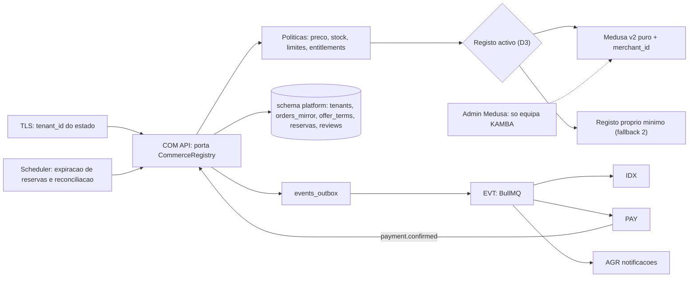
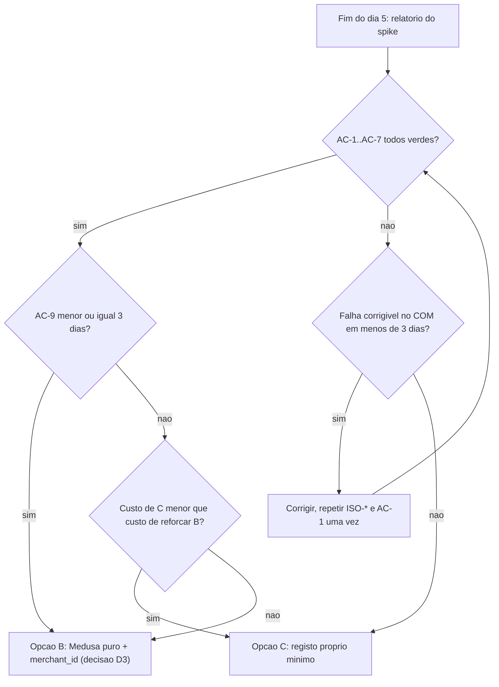
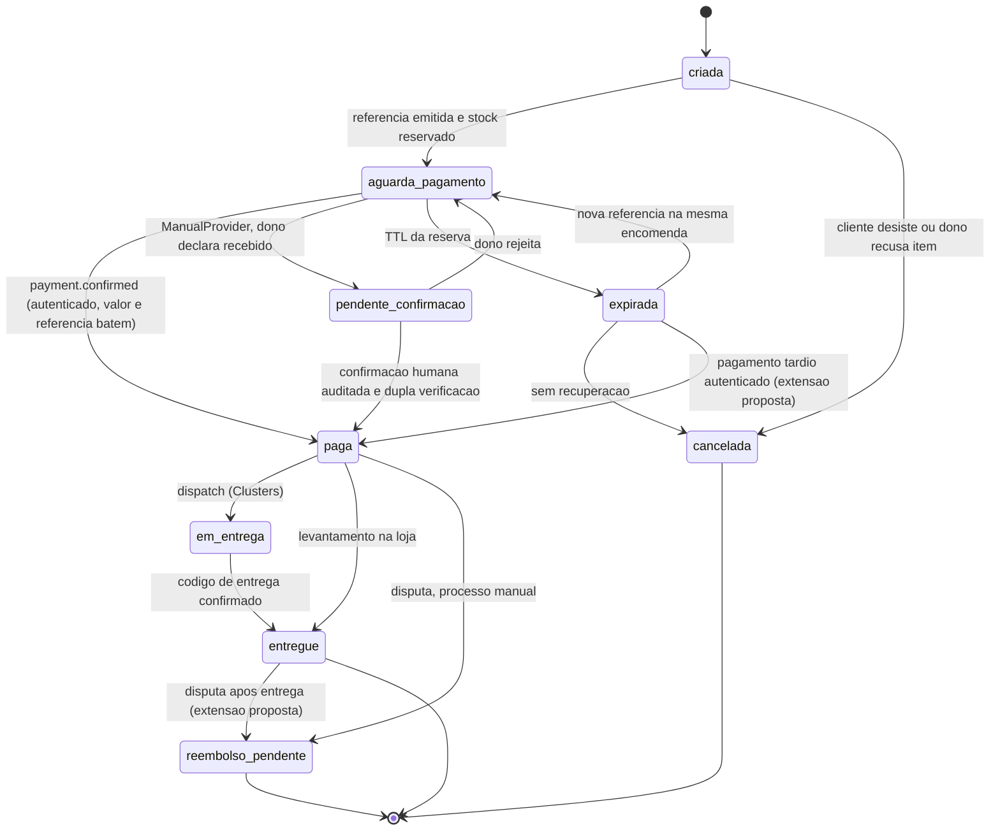
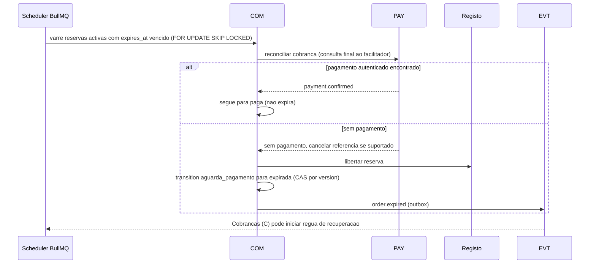
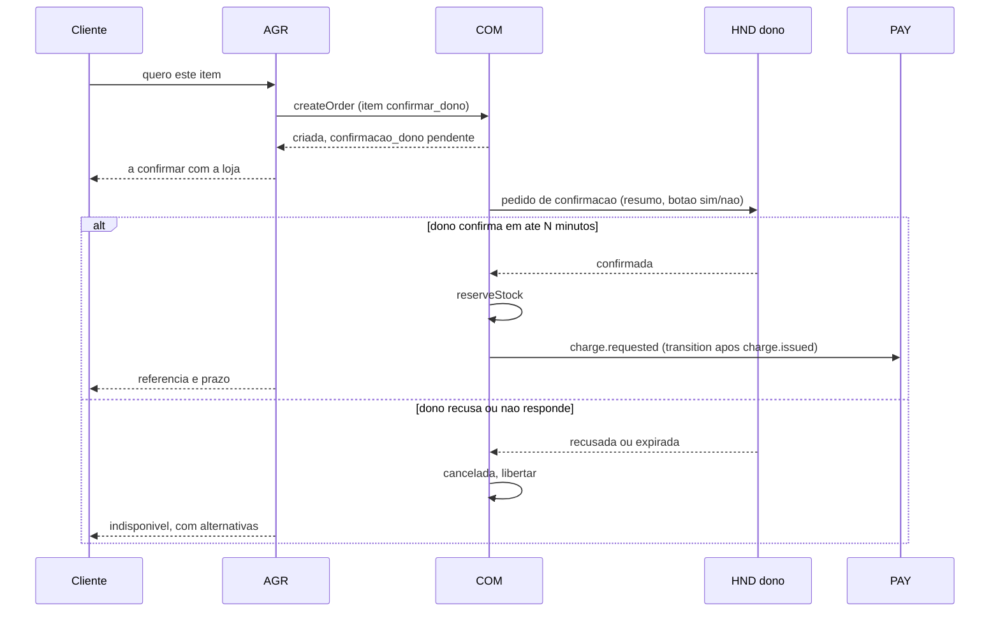
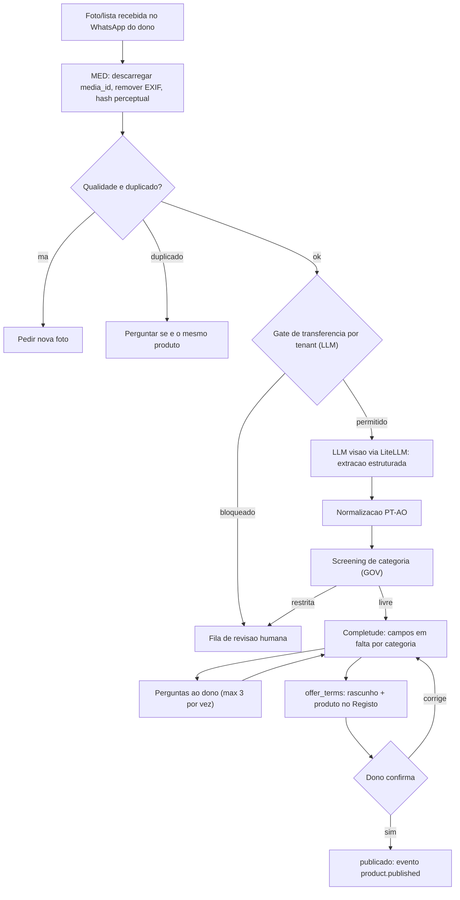
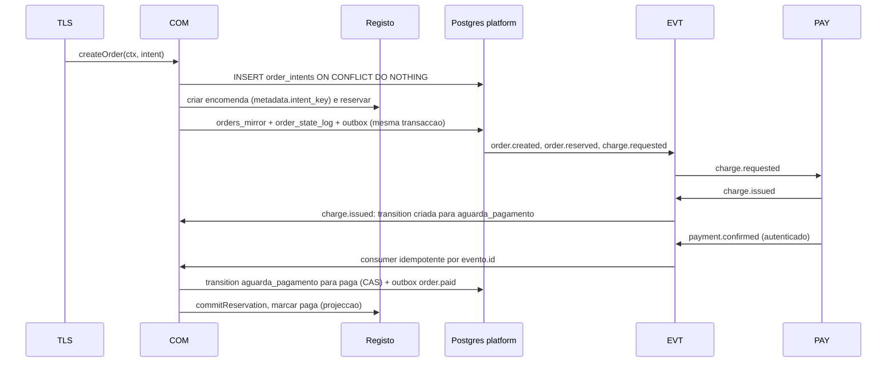

# Core de Comércio (Medusa) — KAMBÁ

| Campo | Valor |
|---|---|
| Produto | KAMBÁ (nome de trabalho) — plataforma WhatsApp-native de comércio conversacional para Angola |
| Documento | Técnica — Core de Comércio (COM): Medusa v2 sujeito a spike, modelo de dados `platform`, encomendas, reservas, Catálogo AI, reviews |
| Versão | 1.0 |
| Data | Outubro de 2026 |
| Classificação | Documento de Referência — Interno |
| Documento-fonte | `00_Arquitectura_Solucao.md` (âncora), `../exploracao/11-arquitetura-detalhada-engenharia.md` §2–§5, `../exploracao/14-tese-minima-e-plano-de-validacao.md` §3A |
| Evidência | `evidencia/E4_Stack_Licencas.md` (Medusa, Mercur, Postgres), `evidencia/E3_Regulatorio_Dados.md` (consumidor, dados), `evidencia/E2_Pagamentos_Angola.md` (prazos de referência) |
| Documentos relacionados | `04_Pagamentos_Liquidacao_AntiFraude.md` (PAY: `payment_events`, cobranças), `02_Agent_Runtime_Verticais.md` (TLS, validador de citação), `05_Indice_Pesquisa_Motor_Atencao.md` (IDX), `06_Dados_Eventos_Analytics.md` (EVT), `08_Seguranca_Conformidade.md`, `09_Topologia_Operacao_Escala.md`, `10_Onboarding_Governanca.md` |

> **Estado das afirmações.** Segue a convenção do documento 00: **CONFIRMADO** (fonte primária), **INDÍCIO** (fonte secundária ou inferência) e **NÃO VERIFICADO**. A documentação oficial do Medusa v2 (módulos de inventário, workflows) **não foi acessível** na sessão de pesquisa de 8 de Outubro de 2026 (`evidencia/E4` §6); as capacidades do Medusa descritas aqui como «a validar no spike» são hipóteses de trabalho, não factos. Nada aqui é aconselhamento jurídico.

---

## 1. Introdução

### 1.1 Propósito

Especifica o **Core de Comércio (COM)** da KAMBÁ: o registo de produtos, encomendas, stock e reservas de que os agentes dependem para nunca inventar preços, disponibilidades ou totais (ADR-007). Fixa (i) a decisão D3 como um **spike de 5 dias com critérios de aceitação numéricos**, (ii) o modelo de dados do schema `platform` (corrigindo o DDL do documento 11 §2), (iii) a máquina de estados e a idempotência da encomenda (corrigindo a chave `hash(msisdn+sku+janela_5min)`), (iv) reservas de inventário com expiração, (v) preço opaco e stock não-garantido, (vi) o pipeline do Catálogo AI e (vii) reviews, espelho de pedidos, migrações e eventos.

### 1.2 Âmbito

Dentro: COM, a fatia de TEN que vive no schema `platform` (tenants, entitlements, canais), contactos, `orders_mirror`, reservas, `offer_terms`, `reviews`, Catálogo AI (lado COM/MED), eventos do comércio. Fora: pagamentos, `payment_events`, comissão e anti-fraude (`04`); pesquisa e embeddings (`05`); logística e código de entrega (`07`); isolamento transversal, segredos e APD (`08`); provisioning de tenants (`10`). **Fase:** o Piloto cobre só o **Fluxo A** (ADR-011); `origem = plataforma`, PME light e encomendas multi-vendedor são **Diferido**.

### 1.3 Audiência

Engenheiros de comércio e dados, engenheiros de runtime (ToolLayer), engenheiros de pagamentos (contrato de estados), revisão de segurança (isolamento) e produto (preço opaco, H2/H8).

### 1.4 Definições e termos

- **COM:** componente Core de Comércio; expõe a porta `CommerceRegistry` à TLS. Os agentes nunca falam com o Medusa.
- **Registo:** a implementação por trás da porta: Medusa puro + `merchant_id` (base do spike), Medusa+Mercur (avaliado, não adoptado) ou registo próprio mínimo (fallback 2).
- **`orders_mirror`:** tabela do schema `platform` que guarda o **ciclo de vida** da encomenda (estados do documento 00 §6.1) e um *snapshot* imutável de linhas e totais. Ver §10 para a matriz de autoridade.
- **Intenção de encomenda (`intent_key`):** identificador determinístico de «este rascunho de carrinho nesta versão», usado para idempotência (§6.3).
- **Reserva:** retenção de stock por encomenda com `expires_at`; dura 24–72 h conforme a validade da referência de pagamento.
- **Modo de preço:** `fixo`, `a_partir_de` ou `sob_consulta`. **Modo de stock:** `garantido`, `indicativo` ou `confirmar_dono`.
- **Contacto:** o cliente final de uma PME, identificado por BSUID/HMAC (ADR-010); nunca por telefone em claro.
- **TLS / CHR / EVT / PAY / IDX / MED / STO / LLM / TEN / GOV:** códigos do documento 00 §4.

---

## 2. Princípios e decisões aplicáveis (ADRs)

| ADR | Aplicação neste documento |
|---|---|
| **ADR-003** | Medusa v2 condicionado ao spike (§4) com testes de isolamento obrigatórios; fallback 1 Medusa puro + `merchant_id`; fallback 2 registo próprio. Mercur fora do Piloto (§4.6). |
| **ADR-004** | O COM nunca regista saldos «devidos» à PME: não detém fundos. Reembolsos são manuais (estado `reembolso_pendente`). |
| **ADR-006** | Postgres 18 único: schemas `platform` (nosso) e `medusa` (do Medusa) na mesma instância; RLS no `platform` (§5.5). |
| **ADR-007** | Preço e stock só existem no Registo; `offer_terms` devolve o modo de preço para o validador de citação (§7). Embeddings sem preço nem stock. |
| **ADR-009** | Toda a mudança de estado grava no *outbox* na mesma transacção; consumidores idempotentes (§12). |
| **ADR-010** | `orders_mirror` e `reviews` apontam para `contact_id`; o telefone nunca é chave nem coluna de pedido (§5.3). |
| **ADR-011** | `origem = 'plataforma'` e tenants `tipo = 'platform'` existem no DDL mas não entram em produção no Piloto. |
| **ADR-012** | Verticais (Vendedor, Serviços) usam a mesma porta; Serviços usa reserva de horário em vez de stock (fora deste documento). |
| **ADR-013** | `paga` só por evento autenticado (PAY) ou confirmação humana auditada (`ManualProvider`); o COM só **consome** `payment.confirmed`. |
| **ADR-014** | Fotos e documentos vão para STO atrás de `StorageProvider`; MinIO excluído. |
| **ADR-002** | O admin do Medusa e qualquer n8n/Typebot nunca são expostos a tenants; a PME interage por WhatsApp ou painel mínimo próprio. |

**Princípios específicos do COM.** (1) A porta `CommerceRegistry` é a única costura; trocar de Registo não altera agentes. (2) O `tenant_id` vem do estado do agente, nunca do texto (TLS). (3) Estados e totais não se editam: avançam por transições auditadas. (4) O que a IA extrai de uma foto é **rascunho** até o dono confirmar. (5) Não se promete o que o dono não garante (stock) nem o que não publicou (preço).

---

## 3. Arquitectura do COM

### 3.1 Posição no sistema



O COM é um serviço nosso (módulo de comércio) que **encapsula** o Registo. Os agentes chamam a TLS, a TLS chama a porta; ninguém fora do COM tem credenciais do Medusa. O admin do Medusa existe apenas para a equipa KAMBÁ (suporte e operação), atrás de VPN, sem feature flags Enterprise (§4.7).

### 3.2 Porta `CommerceRegistry` (contrato)

```ts
// ctx vem SEMPRE do estado do agente / sessão autenticada, nunca do texto do cliente.
type Ctx = { tenantId: Uuid; actor: { kind: 'agente'|'dono'|'sistema'|'ops'; id: string }; traceId: string };

interface CommerceRegistry {
  // Catalogo
  upsertProductDraft(ctx: Ctx, d: ProductDraft): Promise<ProductRef>;          // rascunho, nunca publica
  publishProduct(ctx: Ctx, ref: ProductRef, c: OwnerConfirmation): Promise<void>; // exige confirmacao do dono
  getOfferView(ctx: Ctx, sku: string): Promise<OfferView>;                       // {precoModo, precoDisplay, stockModo, disponibilidade, atualizadoAt}
  // Encomendas (idempotente por intentKey)
  createOrder(ctx: Ctx, i: OrderIntent): Promise<OrderRef>;                      // cria linhas + snapshot; NAO emite cobranca
  requestOwnerConfirmation(ctx: Ctx, orderId: Uuid): Promise<void>;              // itens confirmar_dono
  reserveStock(ctx: Ctx, orderId: Uuid, ttl: Duration): Promise<Reservation[]>;
  extendReservation(ctx: Ctx, orderId: Uuid, until: Instant): Promise<void>;
  commitReservation(ctx: Ctx, orderId: Uuid): Promise<void>;                     // chamada pelo consumer de payment.confirmed
  releaseReservation(ctx: Ctx, orderId: Uuid, motivo: 'expirada'|'cancelada'|'recusada_dono'): Promise<void>;
  transition(ctx: Ctx, orderId: Uuid, to: OrderState, expectedVersion: number, causa: Cause): Promise<OrderRef>;
  // Leitura
  getOrder(ctx: Ctx, orderId: Uuid): Promise<OrderView>;
  listOrders(ctx: Ctx, f: OrderFilter): Promise<Page<OrderView>>;
}
```

Regras da porta: (1) toda a chamada recebe `ctx`; sem `ctx.tenantId` a implementação falha fechada; (2) `createOrder` é idempotente por `(tenantId, intentKey)`; (3) `transition` usa concorrência optimista (`expectedVersion`) e só aceita as transições do §6.2; (4) nenhuma operação aceita um preço do chamador: o preço vem de `offer_terms`/Registo, ou de uma `price_quote` do dono (§7.2).

### 3.3 Mapeamento conceptual para o Medusa v2 (a validar no spike)

| Conceito KAMBÁ | Medusa v2 (hipótese) | Estado | Nota |
|---|---|---|---|
| Tenant / vendedor | módulo custom `merchant` + *links* para produto, stock location, sales channel, encomenda | NÃO VERIFICADO | Base do fallback 1 (`merchant_id`); o Medusa não é multi-tenant nativo (`evidencia/E4` §2.1). |
| Produto e variante | Product Module | INDÍCIO | Preço `fixo` pode viver no Pricing Module; os modos `a_partir_de`/`sob_consulta` vivem em `offer_terms`. |
| Stock | Inventory Module (itens, níveis por localização, *reservation items*) | INDÍCIO | **Sem TTL nativo assumido**: a expiração é nossa (`stock_reservations.expires_at` + scheduler, §6.5). |
| Encomenda | Order Module + *workflow* com compensação | INDÍCIO | O ciclo de vida de §6.1 é mantido em `orders_mirror`; o `status` do Medusa segue como projecção. |
| Canal por tenant | Sales Channel + Stock Location por tenant | INDÍCIO | Reforço de âmbito, não substitui o filtro `merchant_id`. |
| Eventos | *subscribers* do Medusa → *outbox* próprio | INDÍCIO | O bus canónico é o EVT (ADR-009), não o do Medusa. |

### 3.4 Licenciamento (CONFIRMADO em `evidencia/E4` §2.1)

- Medusa é MIT **excepto** materiais *Enterprise Edition* desde 2026-08-11: **RBAC** (`rbac`, `policies`, rotas `admin/rbac`), **SSO/OIDC** (`providers/auth-oidc`). «Activar qualquer *feature flag* Enterprise constitui declaração de que se detém acordo comercial.»
- **Decisão:** não activar `rbac` nem `auth-oidc` nem `policies`. As permissões por tenant e por utilizador do tenant são **nossas**, na API do COM (dono, funcionário, ops). O admin Medusa serve apenas operadores internos com utilizador genérico (MIT).
- **Controlo:** teste de CI que falha o *build* se `medusa-config` contiver módulos ou flags EE; registo de licença por versão fixada (as versões anteriores a 2026-08-11 permanecem MIT). Se RBAC/SSO do admin passarem a ser necessários (equipa de suporte grande), a alternativa é **licença Enterprise do Medusa** (custo NÃO VERIFICADO; pedir proposta) — não contornar.

---

## 4. Spike D3 — Medusa sujeito a prova

### 4.1 Opções avaliadas

| Opção | Descrição | Fase | Posição |
|---|---|---|---|
| **A** | Medusa v2 + Mercur (marketplace: vendedores, *order splitting*, comissões, payout) | — | **Não adoptar no Piloto** (§4.6). |
| **B** | **Medusa v2 puro + `merchant_id`** (módulo `merchant` próprio, filtros nos repositórios do COM) | P | **Alvo do spike.** Base recomendada. |
| **C** | **Registo próprio mínimo** em Postgres (schema `commerce`, RLS) | P (fallback 2) | Se B falhar os critérios (§4.5). |

> **Nota de interpretação.** O ADR-003 e a D3 do documento 00 nomeiam «Medusa+Mercur vs Medusa puro vs registo próprio». Este documento interpreta que, no Fluxo A, cada encomenda pertence a **um** tenant e portanto o valor de Mercur (divisão de encomendas multi-vendedor, comissões, payout) só existe no Fluxo B (Diferido, ADR-011); o spike testa **B** e usa o Mercur apenas como avaliação lateral opcional (§4.6).

### 4.2 Plano de 5 dias

| Dia | Entrega | Saída verificável |
|---|---|---|
| 1 | Medusa v2.21.x em contentor (versão fixada), módulo `merchant`, 3 tenants fictícios (canal + localização + `merchant_id`), `CommerceRegistry` mínima (`getOfferView`, `createOrder`) | Criação de pedido ponta a ponta por tenant. |
| 2 | **Suite de isolamento** (§4.4): API da loja com chave de tenant A a sondar ids de B; rotas Admin; consultas por *query graph*; acesso directo a tabelas | Relatório de casos (passa/falha) com evidência. |
| 3 | Reservas e concorrência: 1.000 tentativas paralelas sobre stock 10; expiração por scheduler; idempotência (`intent_key`); falha a meio de *workflow* (compensação) | Zero sobrevenda; zero encomendas duplicadas. |
| 4 | Integração: *outbox* → EVT; projecção para `orders_mirror`; carga (20 pedidos/s); *dry-run* de actualização minor (2.21→2.22); migrações Alembic + Medusa na mesma *pipeline* | Latências medidas; pipeline reprodutível. |
| 5 | Relatório, decisão D3 (§4.5), custo do fallback C estimado em dias-pessoa, actualização do ADR-003 | Decisão assinada pelo Arquitecto de Plataforma e Responsável de Segurança. |

### 4.3 Critérios de aceitação (todos obrigatórios salvo indicação)

| ID | Critério | Limiar | Tipo |
|---|---|---|---|
| AC-1 | Leituras/escritas cruzadas entre tenants nos casos de §4.4 | **0** passes indevidos em ≥ 60 casos | Bloqueante |
| AC-2 | Credenciais do admin Medusa fora da rede de aplicação e dos tenants | verificado por teste de rede | Bloqueante |
| AC-3 | Sobrevenda em stock `garantido` (1.000 tentativas paralelas, stock 10) | **0** reservas acima do stock | Bloqueante |
| AC-4 | Idempotência: 50 repetições de `createOrder` com o mesmo `intent_key` (concorrentes) | **1** encomenda | Bloqueante |
| AC-5 | Falha injectada entre criação no Registo e escrita no `orders_mirror` | reconciliação recupera em ≤ 5 min, sem órfãos | Bloqueante |
| AC-6 | Expiração: libertação de reserva após `expires_at` | p99 ≤ 60 s | Bloqueante |
| AC-7 | Nenhum módulo ou *flag* Enterprise (RBAC/SSO/policies) activo | teste de CI verde | Bloqueante |
| AC-8 | `createOrder` (sem LLM) a 20 pedidos/s | p95 ≤ 800 ms | Alvo (proposta) |
| AC-9 | Esforço para impor filtro de tenant em todos os repositórios do COM | ≤ 3 dias-pessoa | Alvo |
| AC-10 | Actualização minor com *dry-run* sem perda de dados nem alteração do contrato da porta | sim | Alvo |

### 4.4 Matriz de testes de isolamento (obrigatória; falha de qualquer linha Bloqueante reprova a opção)

| ID | Superfície | Cenário | Esperado |
|---|---|---|---|
| ISO-01..08 | `CommerceRegistry` | Com `ctx` do tenant A: `getOfferView`, `getOrder`, `listOrders`, `transition`, `releaseReservation`, `publishProduct`, `requestOwnerConfirmation`, `commitReservation` sobre ids/skus do tenant B | 404/erro de política; nunca dados |
| ISO-09 | `CommerceRegistry` | `ctx` sem `tenantId` ou com `tenantId` inexistente | falha fechada |
| ISO-10 | `listOrders` | filtros vazios, paginação por cursor forjado, `OR` em filtro | só linhas de A |
| ISO-11..18 | API Store do Medusa | Chave/canal de A a pedir produtos, *carts*, encomendas, stock e preços de B por id e por pesquisa | negado ou vazio |
| ISO-19..26 | API Admin do Medusa | Token de operador usado a partir de rede de tenant; rotas de listagem sem filtro | inacessível (AC-2); com acesso operador, auditado |
| ISO-27..32 | *Query graph* / módulos | Consulta por *link* que atravessa `merchant` sem filtro; relação produto→localização de outro tenant | filtro imposto pelo COM |
| ISO-33..38 | Reservas | A reserva stock de SKU de B por `sku` igual (colisão de SKU entre tenants) | reserva só no inventário de A |
| ISO-39..42 | `orders_mirror` / RLS | Sessão SQL com `app.tenant_id` de A: `SELECT/UPDATE/DELETE` em linhas de B; sessão sem `app.tenant_id` | 0 linhas; falha fechada |
| ISO-43..46 | Eventos | Consumidor de A a ler *outbox*; envelope com `tenant_id` forjado | rejeitado pela validação do envelope |
| ISO-47..50 | Média e URLs | URL assinada de foto do tenant B usada com contexto A | recusada |
| ISO-51..56 | Concorrência | Pedidos simultâneos de A e B ao mesmo SKU global | contagens independentes |
| ISO-57..60 | Injecção | `tenant_id` no texto do cliente / nas notas do pedido / no nome do produto | ignorado (o `tenant_id` só vem do estado) |

Estes testes entram na *pipeline* (`08`) e **falham o build** (documento 00 §9). Repetem-se a cada actualização do Medusa.

### 4.5 Decisão e fallbacks



**Fallback 1 — Medusa puro + `merchant_id`.** Um único Medusa; o COM injecta `merchant_id` em todas as leituras e escritas; canal de vendas e localização por tenant servem de segunda barreira; o admin fica interno. **Fallback 2 — registo próprio mínimo** (esforço estimado 2–3 semanas de um engenheiro; estimativa nossa):

```sql
-- Esqueleto do registo proprio (schema commerce). Mesma porta CommerceRegistry; RLS por tenant.
CREATE TABLE commerce.products (
  tenant_id uuid NOT NULL REFERENCES platform.tenants(id), sku text NOT NULL,
  nome text NOT NULL, descricao text, categoria text, atributos jsonb NOT NULL DEFAULT '{}',
  deleted_at timestamptz, PRIMARY KEY (tenant_id, sku)); CREATE TABLE commerce.stock_levels (
  tenant_id uuid NOT NULL, sku text NOT NULL, quantidade integer NOT NULL CHECK (quantidade >= 0),
  reservada integer NOT NULL DEFAULT 0 CHECK (reservada >= 0), CHECK (reservada <= quantidade),
  PRIMARY KEY (tenant_id, sku), FOREIGN KEY (tenant_id, sku) REFERENCES commerce.products);
-- encomendas e linhas: orders_mirror ja contem lines_snapshot; commerce.order_lines normaliza se necessario
```

Em qualquer opção, a **máquina de estados e a idempotência vivem no schema `platform`** (§6), pelo que a troca de Registo não toca nos contratos com PAY, EVT e agentes.

### 4.6 Mercur — estado e decisão

| Facto | Estado | Fonte |
|---|---|---|
| v2.3.7 em 2026-10-08; v2.0.0 em 2026-03-18; MIT; ~1,8k estrelas, ~14 contribuidores no 1.º ano da v2 | CONFIRMADO | `evidencia/E4` §1, §2.1 |
| Último commit (2026-10-08): «fechar falhas de autorização entre vendedores na API de vendedor» — havia **falhas de isolamento entre vendedores** até esse dia | CONFIRMADO | `evidencia/E4` §2.1 |
| Payout: só `payout-stripe-connect`; disponibilidade do Stripe em Angola | NÃO VERIFICADO | `evidencia/E4` §2.1 |
| Módulos proprietários «Mercur Enterprise» (KYC, Buy Box, sincronização) | INDÍCIO | `evidencia/E4` §2.1 |

**Decisão:** não usar Mercur no Piloto. A propriedade que mais interessa (isolamento) acabou de ter correcções de segurança; o payout não serve (ADR-004 impede-nos de executar payouts; PAY usa facilitador com liquidação directa); e a divisão de encomendas só é útil no Fluxo B. **Reavaliação** quando (e se) a D2 abrir o Fluxo B: novo spike com a mesma suite ISO-* mais revisão de segurança independente do código de autorização.

### 4.7 Medusa Enterprise — quando e como

RBAC/SSO do admin só se a equipa de operação precisar de papéis granulares no admin. Preferimos construir as permissões na nossa API (necessárias de qualquer forma para o painel da PME). Se se optar pela licença: obter acordo escrito antes de activar qualquer flag; ajustar AC-7.

---

## 5. Modelo de dados — schema `platform`

### 5.1 Convenções e correcções ao documento 11

| # | Convenção | Razão / correcção ao doc 11 §2 |
|---|---|---|
| 1 | Chaves `uuid` (`gen_random_uuid()`); tempos `timestamptz`; nomes de colunas em português | Consistência com o conjunto. |
| 2 | Dinheiro em **unidades menores** (`*_minor bigint`, 1 Kz = 100 cêntimos) + `currency char(3) DEFAULT 'AOA'` | `total_kz int` do doc 11 perde cêntimos (a API ProxyPay aceita 0,01) e limita o intervalo. |
| 3 | **Sem `msisdn` em claro** em tabelas de pedidos; `contact_id` → `contacts` | `orders_mirror.cliente_msisdn text NOT NULL` do doc 11 viola o ADR-010 e a minimização (Lei 22/11, `evidencia/E3` §1). |
| 4 | `waba_id` / `phone_number_id` saem de `tenants` para `tenant_channels` | Um tenant pode ter vários canais; o CHR resolve por `phone_number_id` único. |
| 5 | `tenants.estado` com os valores do documento 00 §6.2 | `onboarding`, `ativo`, `restrito`, `suspenso`, `encerrado`. |
| 6 | Soft delete (`deleted_at`) + RLS por tenant | Histórico imutável; ver §5.5, §11. |
| 7 | Todas as FK entre `platform` e `medusa` são **lógicas** (texto), nunca FK de base de dados | Evita acoplar migrações. |

### 5.2 Tenants, canais e entitlements

```sql
CREATE SCHEMA IF NOT EXISTS platform;

CREATE TABLE platform.tenants (
  id                       uuid PRIMARY KEY DEFAULT gen_random_uuid(),
  tipo                     text NOT NULL CHECK (tipo IN ('pme','courier','reseller','agent','platform')),
  nome                     text NOT NULL,
  nif                      text,                                   -- NULL = sem NIF (afecta PAY, ver 04 §10)
  contacto_negocio_enc     bytea,                                  -- cifrado em aplicacao; nunca usado como chave
  owner_contact_id         uuid,                                   -- FK diferida para platform.contacts (abaixo)
  zona                     text, plus_code text, plano                    text NOT NULL DEFAULT 'free',
  estado                   text NOT NULL DEFAULT 'onboarding'
                           CHECK (estado IN ('onboarding','ativo','restrito','suspenso','encerrado')),
  medusa_sales_channel_id  text, medusa_merchant_id text,          -- NULL se registo proprio
  chatwoot_account_id      integer, litellm_key_id text, fuso_horario             text NOT NULL DEFAULT 'Africa/Luanda',
  verificado_at            timestamptz, criado_at                timestamptz NOT NULL DEFAULT now(),
  deleted_at               timestamptz
);
CREATE UNIQUE INDEX tenants_nif_uq ON platform.tenants (nif) WHERE nif IS NOT NULL AND deleted_at IS NULL;

CREATE TABLE platform.tenant_channels (            -- usada pelo CHR: phone_number_id -> tenant + persona
  id                uuid PRIMARY KEY DEFAULT gen_random_uuid(),
  tenant_id         uuid NOT NULL REFERENCES platform.tenants(id),
  canal             text NOT NULL DEFAULT 'whatsapp_cloud' CHECK (canal IN ('whatsapp_cloud')),
  waba_id           text NOT NULL, phone_number_id   text NOT NULL UNIQUE,
  persona           text NOT NULL DEFAULT 'vendedor',
  origem            text NOT NULL DEFAULT 'pme' CHECK (origem IN ('pme','plataforma')),   -- 'plataforma' = Diferido (ADR-011)
  coexistencia      boolean NOT NULL DEFAULT true,
  estado            text NOT NULL DEFAULT 'ativo' CHECK (estado IN ('ativo','pausado','revogado')),
  criado_at         timestamptz NOT NULL DEFAULT now()
);

CREATE TABLE platform.entitlements (
  tenant_id uuid NOT NULL REFERENCES platform.tenants(id), modulo    text NOT NULL,
  limites   jsonb NOT NULL DEFAULT '{}',           -- ex.: {"msgs_ai_mes":100,"manual_max_minor":5000000}
  ativo     boolean NOT NULL DEFAULT true, PRIMARY KEY (tenant_id, modulo)
);
```

### 5.3 Contactos (identificador de contacto separado)

O contacto é o **cliente final**. A chave de identidade é o **BSUID** da Meta, pseudonimizado com HMAC (segredo em cofre, versionado). O telefone pode não vir no webhook (ADR-010; `evidencia/E1`); quando vem e é necessário (ex.: pagamento Express), fica numa tabela **separada**, cifrada, com finalidade e prazo.

```sql
CREATE TABLE platform.contacts (                   -- forma canonica: dicionario §3.1; DDL final em KAM-008 (proposta)
  contact_id       uuid PRIMARY KEY DEFAULT gen_random_uuid(),
  tenant_id        uuid NOT NULL REFERENCES platform.tenants(id),
  phone_hmac       bytea,                           -- HMAC do E.164 quando conhecido: so para anti-fraude/auto-compra
  consentimento    jsonb NOT NULL DEFAULT '{}',     -- {finalidade: {versao, em}} (Lei 22/11; ver 08)
  criado_at        timestamptz NOT NULL DEFAULT now(),
  erased_at        timestamptz                      -- eliminacao/anonimizacao a pedido do titular
);
ALTER TABLE platform.tenants ADD CONSTRAINT tenants_owner_fk
  FOREIGN KEY (owner_contact_id) REFERENCES platform.contacts(contact_id) DEFERRABLE INITIALLY DEFERRED;

CREATE TABLE platform.contact_endpoints (            -- acesso restrito (papel proprio); nunca em joins de pedidos
  contact_id      uuid NOT NULL REFERENCES platform.contacts(contact_id),
  tenant_id       uuid NOT NULL REFERENCES platform.tenants(id),
  tipo            text NOT NULL,                      -- valores de `tipo`: KAM-008
  bsuid_hmac      bytea,                              -- HMAC-SHA256(segredo_vN, bsuid): so para correspondencia
  bsuid_enc       bytea, phone_enc bytea,             -- cifrados com DEK por contacto
  dek_id          uuid NOT NULL,
  finalidade      text NOT NULL CHECK (finalidade IN ('pagamento_express','entrega','contacto_pedido')),
  recolhido_at    timestamptz NOT NULL DEFAULT now(),
  expira_at       timestamptz NOT NULL                -- retencao minima; purga automatica (ver 08)
);
```

Notas: (a) o espaço de números angolanos é pequeno e um HMAC simples é reversível por enumeração **se o segredo vazar** (`evidencia/E3`, ADR-010) — o segredo vive em cofre, com rotação (versão da chave: KAM-008); a pesquisa por contacto tenta a versão corrente e a anterior; (b) `phone_hmac` serve para detectar auto-compra e fraude sem guardar o número em claro; (c) o mesmo cliente em dois tenants é **dois contactos** (isolamento; `UNIQUE` inclui `tenant_id`); (d) a eliminação a pedido do titular anula `contact_endpoints`, define `erased_at` e substitui `bsuid_hmac` por um valor aleatório, mantendo as encomendas (retenção fiscal separada, prazo CGT NÃO VERIFICADO, `evidencia/E3` §6).

### 5.4 Encomendas, intenções, reservas, ofertas

```sql
CREATE TABLE platform.orders_mirror (
  id                    uuid PRIMARY KEY DEFAULT gen_random_uuid(),
  tenant_id             uuid NOT NULL REFERENCES platform.tenants(id),
  contact_id            uuid NOT NULL REFERENCES platform.contacts(contact_id),
  origem                text NOT NULL DEFAULT 'pme' CHECK (origem IN ('pme','plataforma')),
  numero_publico        text NOT NULL,              -- curto, base32 sem ambiguos (ex.: K7H3Q9); tambem serve de referencia curta em PAY
  intent_key            text NOT NULL,              -- ver 6.3
  medusa_order_id       text,                       -- NULL no fallback 2
  estado                text NOT NULL DEFAULT 'criada'
                        CHECK (estado IN ('criada','aguarda_pagamento','pendente_confirmacao','paga','em_entrega',
                                          'entregue','expirada','cancelada','reembolso_pendente')),
  confirmacao_dono      text NOT NULL DEFAULT 'nao_aplicavel'
                        CHECK (confirmacao_dono IN ('nao_aplicavel','pendente','confirmada','recusada','expirada')),
  total_minor           bigint NOT NULL CHECK (total_minor >= 0), currency              char(3) NOT NULL DEFAULT 'AOA',
  lines_snapshot        jsonb NOT NULL,             -- [{sku,nome,qty,preco_minor,preco_modo,origem_preco}] IMUTAVEL apos aguarda_pagamento
  entrega_modo          text NOT NULL DEFAULT 'levantamento' CHECK (entrega_modo IN ('levantamento','entrega')),
  expira_at             timestamptz,                -- fim da reserva activa
  paga_at               timestamptz,
  paga_via              text CHECK (paga_via IN ('provider_autenticado','manual_auditado','cod_manual')),
  excepcao              text CHECK (excepcao IN ('pagamento_tardio_sem_stock','pagamento_duplicado','valor_divergente')),
  entregue_at           timestamptz,
  entrega_confirmada_por text CHECK (entrega_confirmada_por IN ('cliente','dono','estafeta')),
  version               integer NOT NULL DEFAULT 1, -- concorrencia optimista
  criado_at             timestamptz NOT NULL DEFAULT now(), atualizado_at         timestamptz NOT NULL DEFAULT now(),
  deleted_at            timestamptz, UNIQUE (tenant_id, intent_key), UNIQUE (tenant_id, numero_publico)
);
CREATE INDEX orders_mirror_estado_idx ON platform.orders_mirror (tenant_id, estado, criado_at DESC);
CREATE INDEX orders_mirror_expira_idx ON platform.orders_mirror (expira_at) WHERE estado IN ('aguarda_pagamento','pendente_confirmacao');

CREATE TABLE platform.order_intents (               -- recibo de idempotencia (6.3)
  tenant_id    uuid NOT NULL REFERENCES platform.tenants(id), intent_key   text NOT NULL,
  draft_hash   bytea NOT NULL,                      -- hash do conteudo do rascunho confirmado
  estado       text NOT NULL DEFAULT 'em_curso' CHECK (estado IN ('em_curso','concluida','falhada')),
  order_id     uuid REFERENCES platform.orders_mirror(id), criado_at    timestamptz NOT NULL DEFAULT now(),
  PRIMARY KEY (tenant_id, intent_key)
);

CREATE TABLE platform.order_state_log (              -- append-only
  id          bigint GENERATED ALWAYS AS IDENTITY PRIMARY KEY,
  tenant_id   uuid NOT NULL, order_id uuid NOT NULL REFERENCES platform.orders_mirror(id),
  de          text NOT NULL, para text NOT NULL,
  causa       text NOT NULL,                        -- 'payment.confirmed','ttl','dono_confirma','cliente_cancela',...
  evento_id   text, actor_kind text NOT NULL, actor_id text, em          timestamptz NOT NULL DEFAULT now()
);

CREATE TABLE platform.stock_reservations (
  id                      uuid PRIMARY KEY DEFAULT gen_random_uuid(),
  tenant_id               uuid NOT NULL REFERENCES platform.tenants(id),
  order_id                uuid NOT NULL REFERENCES platform.orders_mirror(id), line_no                 smallint NOT NULL,
  sku                     text NOT NULL, qty                     integer NOT NULL CHECK (qty > 0),
  estado                  text NOT NULL DEFAULT 'ativa' CHECK (estado IN ('ativa','consumida','libertada','expirada')),
  expires_at              timestamptz NOT NULL, medusa_reservation_id   text,
  criado_at               timestamptz NOT NULL DEFAULT now(), UNIQUE (order_id, line_no)
);
CREATE INDEX stock_reservations_expiry_idx ON platform.stock_reservations (expires_at) WHERE estado = 'ativa';

CREATE TABLE platform.offer_terms (                  -- termos comerciais por SKU (preco opaco e stock nao-garantido)
  tenant_id           uuid NOT NULL REFERENCES platform.tenants(id), sku                 text NOT NULL,
  medusa_variant_id   text, preco_modo          text NOT NULL CHECK (preco_modo IN ('fixo','a_partir_de','sob_consulta')),
  preco_minor         bigint CHECK (preco_minor >= 0),    -- fixo: preco; a_partir_de: minimo; sob_consulta: NULL
  currency            char(3) NOT NULL DEFAULT 'AOA', preco_atualizado_at timestamptz, preco_valido_ate timestamptz,
  stock_modo          text NOT NULL DEFAULT 'indicativo' CHECK (stock_modo IN ('garantido','indicativo','confirmar_dono')),
  stock_verificado_at timestamptz,
  estado              text NOT NULL DEFAULT 'rascunho' CHECK (estado IN ('rascunho','publicado','pausado','arquivado')),
  categoria_restrita  text,                           -- preenchida pelo screening (GOV); bloqueia publicacao
  deleted_at          timestamptz, PRIMARY KEY (tenant_id, sku),
  CHECK ((preco_modo = 'sob_consulta' AND preco_minor IS NULL) OR (preco_modo <> 'sob_consulta' AND preco_minor IS NOT NULL))
);

CREATE TABLE platform.price_quotes (                 -- preco dado pelo dono para sob_consulta ou negociacao
  id uuid PRIMARY KEY DEFAULT gen_random_uuid(),
  tenant_id uuid NOT NULL REFERENCES platform.tenants(id), contact_id uuid NOT NULL REFERENCES platform.contacts(contact_id),
  sku text NOT NULL, qty integer NOT NULL CHECK (qty > 0), preco_total_minor bigint NOT NULL CHECK (preco_total_minor >= 0),
  valida_ate timestamptz NOT NULL, estado text NOT NULL DEFAULT 'emitida' CHECK (estado IN ('emitida','aceite','expirada','revogada')),
  emitida_por uuid NOT NULL, criado_at timestamptz NOT NULL DEFAULT now()
);
```

`payment_events`, `payment_charges` e as restantes tabelas de dinheiro têm o **DDL canónico em `04_Pagamentos_Liquidacao_AntiFraude.md` §6**; aqui referem-se apenas por `order_id`. A ordem de migração é `tenants → contacts → orders_mirror → payment_charges → payment_events` (§11).

### 5.5 Isolamento por RLS (defesa em profundidade)

```sql
-- papeis: kamba_app (RLS aplicado), kamba_ops (BYPASSRLS, auditado), kamba_migrator (DDL)
ALTER TABLE platform.orders_mirror ENABLE ROW LEVEL SECURITY;
ALTER TABLE platform.orders_mirror FORCE ROW LEVEL SECURITY;
CREATE POLICY tenant_isolamento ON platform.orders_mirror
  USING      (tenant_id = NULLIF(current_setting('app.tenant_id', true), '')::uuid)
  WITH CHECK (tenant_id = NULLIF(current_setting('app.tenant_id', true), '')::uuid);
-- cada transaccao: SET LOCAL app.tenant_id = '<uuid do ctx>'; sem isto, 0 linhas (falha fechada)
```

Aplica-se a todas as tabelas com `tenant_id` (`contacts`, `contact_endpoints`, `order_intents`, `order_state_log`, `stock_reservations`, `offer_terms`, `price_quotes`, `reviews`). O CHR e o GWY usam um papel estreito para resolver `phone_number_id → tenant` antes de existir contexto. A RLS é a **segunda** barreira; a primeira é a porta `CommerceRegistry` (ISO-39..42).

### 5.6 Soft delete e retenção

Nenhuma encomenda, reserva, review ou evento é apagado fisicamente: `deleted_at` (produtos, ofertas, encomendas só por correcção administrativa) e estados terminais. Eliminação de dados pessoais = anonimização do contacto (§5.3), não do pedido. Purga física só por política de retenção aprovada (`08`), com *log* da eliminação. `order_state_log`, `payment_events` e `events_outbox` são *append-only* (privilégios `INSERT` apenas para `kamba_app`).

---

## 6. Encomendas e reservas

### 6.1 Máquina de estados (canónica: documento 00 §6.1)



As duas transições marcadas «extensão proposta» **não existem** no documento 00 §6.1 e são necessárias (§6.6, e `entregue` com disputa). Até serem ratificadas, o COM implementa-as protegidas por *flag* de configuração e regista a lacuna em §15.

### 6.2 Tabela de transições (guarda → efeitos → evento)

| De | Para | Disparador | Guarda | Efeitos | Evento |
|---|---|---|---|---|---|
| — | criada | `createOrder` | rascunho confirmado pelo cliente; preços resolvidos pelo Registo | `orders_mirror` + `order_intents` + linhas; se houver itens `confirmar_dono`: `confirmacao_dono='pendente'` | `order.created` |
| criada | aguarda_pagamento | `reserveStock` e depois `charge.issued` (PAY) | `confirmacao_dono IN ('nao_aplicavel','confirmada')`; stock disponível | reservas `ativa` com `expira_at` provisório; ao receber `charge.issued` fixa `expira_at` = validade da cobrança + folga (§6.4); sem `charge.issued` em 2 min liberta a reserva | `order.reserved`, `charge.requested` |
| criada | cancelada | cliente desiste / dono recusa | — | libertar reservas (se existirem) | `order.cancelled` |
| aguarda_pagamento | paga | `payment.confirmed` | PAY garante `authn_ok`, valor, referência (04 §5); `paga_via` definido pelo evento | reservas `consumida`; `paga_at` | `order.paid` |
| aguarda_pagamento | pendente_confirmacao | dono declara «recebi» (Manual) | `total_minor <= limite_manual` do tenant | cobrança passa a `pendente_confirmacao` (PAY) | `order.manual_confirmation_requested` |
| pendente_confirmacao | paga | confirmação humana concluída | dupla verificação cumprida (04 §4) | idem `paga`, `paga_via='manual_auditado'` | `order.paid` |
| pendente_confirmacao | aguarda_pagamento | dono rejeita / TTL da confirmação | — | cobrança volta a `emitida` | `order.manual_confirmation_rejected` |
| aguarda_pagamento | expirada | TTL | `now() >= expira_at`; **reconciliação final** com PAY feita | reservas `expirada`; stock libertado | `order.expired` |
| expirada | aguarda_pagamento | nova referência | stock ainda disponível (re-reserva) | nova reserva e nova cobrança (`tentativa+1`) | `order.reserved` |
| expirada | cancelada | 2.ª expiração ou pedido do cliente | — | — | `order.cancelled` |
| expirada | paga | pagamento tardio autenticado | ver §6.6 | tenta re-reservar; senão `excepcao` | `order.paid` (+ `order.exception`) |
| paga | entregue | levantamento confirmado | `entrega_confirmada_por` definido | `entregue_at` | `order.delivered` |
| paga | em_entrega | dispatch (C) | entrega aceite | — | `order.dispatched` |
| em_entrega | entregue | código de entrega | código válido (`07`) | idem | `order.delivered` |
| paga / entregue | reembolso_pendente | disputa | aprovação humana | caso manual (ADR-004); nada é movido pela plataforma | `order.refund_requested` |

Implementação: a tabela é dados (`order_state_graph(de, para)`) validados por *trigger* `BEFORE UPDATE` sobre `estado`; a função `transition` faz `UPDATE ... WHERE id=$1 AND version=$2 AND estado=$de RETURNING *`, grava `order_state_log` e `events_outbox` na **mesma transacção**. Falha de CAS ⇒ reler e reavaliar (nunca forçar).

### 6.3 Idempotência de criação de pedido (correcção do doc 11 §4.2)

**Problema da chave `hash(msisdn + sku + janela_5min)`:**

| Defeito | Consequência |
|---|---|
| Fronteira da janela: dois toques às 14:04:59 e 14:05:01 caem em janelas diferentes | **Duplica a encomenda** exactamente o caso que devia evitar. |
| O mesmo cliente que recompra o mesmo SKU em < 5 min tem a mesma chave | **Bloqueia compras legítimas** (ou devolve a encomenda antiga). |
| Ignora quantidade, variante, entrega e preço | Edição do carrinho colide com o pedido anterior. |
| Usa `msisdn` | Viola o ADR-010 (telefone não é chave e pode faltar no webhook). |
| O estado do LangGraph pode re-executar o nó após `interrupt()` (ADR-002) | Sem identidade estável da intenção, um *replay* cria nova chave. |

**Desenho adoptado — chave por intenção, não por tempo.** O grafo mantém no estado (checkpoint Postgres) um **rascunho** `{draft_id, draft_version, linhas, entrega}`. `draft_id` é gerado **uma vez**, num nó anterior ao de confirmação, e persiste no checkpoint; `draft_version` incrementa em qualquer alteração de linhas, quantidades, variantes ou entrega.

```
intent_key = base32( HMAC-SHA256(segredo_intents, tenant_id || contact_id || draft_id || draft_version) )[:26]
draft_hash = SHA-256(linhas canonicalizadas || entrega_modo)
```

Algoritmo (`createOrder`):

1. `INSERT INTO order_intents (tenant_id, intent_key, draft_hash) ... ON CONFLICT (tenant_id, intent_key) DO NOTHING RETURNING *`.
2. Se **não inseriu** (já existe): se `draft_hash` difere ⇒ erro `INTENT_REUSED_WITH_DIFFERENT_CONTENT` (bug do chamador); senão devolver a encomenda existente (`concluida`) ou aguardar `em_curso` (poll ≤ 3 s) — **mesma resposta** para N toques.
3. Se inseriu: abrir *saga* — criar encomenda no Registo (com `metadata.intent_key`), escrever `orders_mirror` (+ `numero_publico`), `order.created` no *outbox*, `order_intents.estado='concluida'`. Cada passo idempotente por `intent_key`.
4. Falha a meio ⇒ o *job* de reconciliação (§10.3) procura encomendas do Registo com `intent_key` sem espelho e completa; intenções `em_curso` > 2 min são retomadas ou marcadas `falhada`.

Propriedades: duplo toque ⇒ mesma chave ⇒ 1 encomenda (também na fronteira de qualquer janela); recompra ⇒ novo `draft_id` ⇒ nova encomenda; carrinho editado ⇒ nova `draft_version`. **Salvaguarda de UX (não de integridade):** se existir encomenda não paga do mesmo contacto com `draft_hash` igual criada há < 30 min, o agente pergunta «já tem o pedido K7H3Q9 por pagar; quer mesmo outro?» — nunca bloqueia em silêncio. O `numero_publico` (≤ 8 caracteres) é gerado no COM e reutilizado por PAY como correlação curta (ex.: limite de 15 alfanuméricos do `merchantTransactionId` da AppyPay, INDÍCIO).

### 6.4 Reserva de inventário (24–72 h)

| Aspecto | Regra |
|---|---|
| Quando reserva | Ao emitir cobrança (`criada → aguarda_pagamento`). Itens `confirmar_dono`: só **depois** de `confirmacao_dono='confirmada'` (§7.3). |
| Quanto dura | `expires_at = fim_validade_cobranca + folga`, com `fim_validade_cobranca = min(now + ttl_tenant, now + 72 h)`; `ttl_tenant ∈ [24 h, 72 h]` (omissão 48 h). Referência AppyPay tem 72 h por omissão (CONFIRMADO, `evidencia/E2` §1.3); no ProxyPay `end_datetime` é nosso (CONFIRMADO). Express (push) dura minutos: reserva curta (omissão 30 min, correspondente à expiração de 30 min do OPG, `evidencia/E2` §1.2). |
| Folga | 15 min após o fim da validade no facilitador, para absorver callbacks atrasados antes de libertar stock. |
| Atomicidade | `reserveStock` é tudo-ou-nada por encomenda; sobrevenda impedida por `UPDATE ... SET reservada = reservada + :q WHERE quantidade - reservada >= :q` (ou *reservation items* do Medusa, a validar em AC-3). |
| Stock indicativo | Reserva interna existe, mas **não é promessa de exclusividade** perante o dono (§7.3). |
| Prorrogação | `extendReservation` só enquanto `estado='aguarda_pagamento'`, no máximo ao limite de 72 h; exige cobrança com validade correspondente. |

### 6.5 Expiração



Mecanismo duplo: *job* repetível a cada minuto (garantia) + *delayed job* por reserva (precisão). Ambos idempotentes (CAS por `version`). A expiração **nunca** liberta stock sem a consulta final a PAY (evita libertar stock de uma encomenda já paga cujo callback se atrasou).

### 6.6 Pagamento tardio (callback depois da expiração)

Possível porque a referência pode ser paga em ATM até ao fim da sua validade e o callback pode atrasar-se, e porque uma referência anterior continua válida após emitirmos uma nova. Regra: PAY emite `payment.confirmed` autenticado (dinheiro real); o COM aplica:

1. Estado `expirada` e stock re-reservável ⇒ re-reservar e `expirada → paga`.
2. Sem stock ⇒ `expirada → paga` com `excepcao='pagamento_tardio_sem_stock'`; notifica dono e ops; resolução **manual** (entregar mais tarde ou reembolso manual, ADR-004). O cliente nunca fica sem resposta.
3. Estado `cancelada` ⇒ criar caso de reembolso manual (`reembolso_pendente`) e alertar.
4. Dois pagamentos autenticados para a mesma encomenda ⇒ segundo gera `excepcao='pagamento_duplicado'` e caso de reembolso manual (04 §7).

---

## 7. Preço opaco e stock não-garantido

### 7.1 Preço opaco (hipótese H2)

O preço no comércio informal angolano é frequentemente opaco por desígnio (`../exploracao/07-pontos-cegos-2.md` §1; **INDÍCIO**). O COM modela isso em vez de o ignorar:

| `preco_modo` | Significado | O agente pode… | Checkout |
|---|---|---|---|
| `fixo` | Preço publicado pelo dono | citar o valor; criar pedido | directo |
| `a_partir_de` | Mínimo publicado; preço final depende de variante/quantidade | citar «a partir de X Kz», nunca como preço final | exige preço final por variante **ou** `price_quote` |
| `sob_consulta` | Sem preço publicado | dizer «preço sob consulta», oferecer chamada/orçamento ao dono | só com `price_quote` do dono |

Regras: (1) a TLS devolve `OfferView.precoDisplay` já formatado **com o modo**, para o validador de citação (ADR-007) verificar que «a partir de» não é citado como fixo e que `sob_consulta` não leva número; (2) preços têm `preco_atualizado_at` e `preco_valido_ate` — passado o prazo, o agente trata o preço como `a_partir_de` e pede confirmação ao dono (mitiga câmbio e inflação, `evidencia/E2` §5); (3) a plataforma não compara preço entre lojas no Piloto (IDX por tenant); (4) o objectivo de produto é medir H2: ≥ 50% das PMEs aceitam `fixo`/`a_partir_de` para ≥ 70% do catálogo (`../exploracao/14` §2); se falhar, reposicionar para disponibilidade e reserva.

### 7.2 Cotação do dono (`price_quote`)

`sob_consulta` e negociação resolvem-se por **cotação**: o agente pede ao dono (handoff curto, HND) um preço total para `(sku, qty)` com validade; o dono responde; o COM grava `price_quotes` (`emitida_por` = dono autenticado pelo canal do tenant, `valida_ate`). `createOrder` aceita a cotação como origem do preço da linha (`origem_preco='cotacao_dono'` no `lines_snapshot`). Cotação expirada ⇒ pedido recusado. Ninguém, incluindo o LLM, escreve preço fora de `offer_terms` ou `price_quotes`.

### 7.3 Stock não-garantido (o dono vende por outros canais)

| `stock_modo` | Semântica | Comportamento |
|---|---|---|
| `garantido` | O sistema é a verdade (loja só vende via KAMBÁ ou o dono actualiza na hora) | reserva imediata; «em stock» pode ser dito |
| `indicativo` (omissão) | Dono vende por outros canais; o número é estimativa | o agente diz «disponível, a confirmar»; reserva interna sem promessa; aviso se `stock_verificado_at` > 24 h |
| `confirmar_dono` | Item crítico (alto valor, unidade única, sob encomenda) | a encomenda fica `criada` com `confirmacao_dono='pendente'`; **não se emite referência** até o dono confirmar |



Parâmetros: tempo de espera do dono `N` (omissão 15 min em horário comercial do tenant, `fuso_horario`) e escalada (lembrete aos 5 min; fora de horário informa o cliente da hora provável). `stock_verificado_at` é renovado quando o dono actualiza ou confirma; o agente propõe periodicamente «ainda tem X?» (H8: ≥ 60% de catálogos correctos em auditoria). **Auditoria:** divergências (item confirmado como indisponível) alimentam um indicador por tenant que pode reduzir o modo para `confirmar_dono` automaticamente.

---

## 8. Catálogo AI (foto → produto) — pipeline

### 8.1 Visão geral



O dono envia **fotos soltas, notas de voz ou listas de texto**; o Catálogo AI é uma vertical (grafo + tools) sobre as primitivas do core, não um sistema paralelo (ADR-012). Corre na ingestão, **não** no atendimento ao cliente (custo de visão só na ingestão).

### 8.2 Etapas e controlos

| Etapa | Descrição | Controlo |
|---|---|---|
| 1. Captura (MED) | Descarregar pelo `media_id` (URL da Meta expira), gravar em STO, URL interna assinada; **remover EXIF/GPS** antes de qualquer envio externo | Idempotência por `media_id` e hash perceptual; minimização (`evidencia/E3` req. 6) |
| 2. Qualidade | Desfoque, resolução, produto não visível | Rejeita cedo e pede nova foto (sem custo de LLM) |
| 3. Gate de transferência | Imagens com pessoas/rostos podem ser dados pessoais; visão corre num fornecedor fora de Angola | `allowed_destinations` + `apd_authorization_ref` por tenant; sem autorização ⇒ fila humana (D1, `evidencia/E3` §2) |
| 4. Extracção | LLM de visão devolve JSON com `confianca` por campo: nome, marca, categoria, cor, tamanho, material, unidade, quantidade na embalagem, variantes visíveis, produtos múltiplos na foto | Modelo escolhido por *eval* no dataset golden (não fixado aqui, `evidencia/E4` §3.5); orçamento por tenant na LiteLLM |
| 5. Normalização PT-AO | Dicionário editável (global + por tenant): unidades (`un`, `unid`, `pcs`, `caixa`, `fardo`), moeda (`Kz`, `AKZ`, `kwanzas`, «45 mil» → 45 000 Kz, `k` → milhares), ortografia de marcas por `pg_trgm`, sinónimos de categoria | Tabela `lexico_pt_ao` versionada por *ops*; entrada = ocorrência real do dataset golden, não suposição |
| 6. Screening (GOV) | Medicamentos, armas, jogos, tabaco, álcool (`evidencia/E3` §5) ⇒ `categoria_restrita`, **não publica** | Decisão final de T&S (`10`) |
| 7. Completude | Perfil por categoria (§8.3): campos obrigatórios em falta geram perguntas | Máximo 3 perguntas por mensagem; ordem por impacto na venda |
| 8. Rascunho | Cria produto no Registo (inactivo) e `offer_terms` em `rascunho` | Nada visível ao cliente |
| 9. Confirmação | O agente resume («Camisa Nike, tam. M e L, 12 000 Kz, 5 em stock»). O dono responde «sim» ou corrige | `publishProduct` exige `OwnerConfirmation` (id da mensagem, hora, versão do texto) |

### 8.3 Perfis de completude (campos obrigatórios por categoria)

| Campo | Todas | Vestuário/calçado | Alimentar | Electrónica | Serviço |
|---|---|---|---|---|---|
| nome, categoria | sim | sim | sim | sim | sim |
| `preco_modo` (+ preço quando aplicável) | **sim — 1.ª pergunta** | sim | sim | sim | sim |
| `stock_modo` e quantidade | sim | por variante | validade/lote opcional | garantia | — (agenda, `02`) |
| variantes (tamanho/cor) | — | sim | sabor/peso | modelo/capacidade | duração |
| levantamento/entrega | sim | | | | local |
| outros | | | | marca, garantia | pré-aviso |

Heurística de perguntas: **uma pergunta por vez** quando o campo é crítico (preço, stock); agrupar campos de baixo risco. Cada campo guarda **proveniência** (`dono_texto`, `dono_voz`, `ia_visao`, `importado`) e `confirmado_por_dono`. Campos `ia_visao` com `confianca` abaixo do limiar nunca são mostrados ao cliente sem confirmação (a Lei 15/03 art. 9 exige informação correcta; um erro gerado pela plataforma pode gerar co-responsabilidade, INDÍCIO, `evidencia/E3` §4).

```sql
CREATE TABLE platform.catalog_ingestions (
  id              uuid PRIMARY KEY DEFAULT gen_random_uuid(), tenant_id       uuid NOT NULL REFERENCES platform.tenants(id),
  media_ref       text NOT NULL,                  -- chave STO; nunca URL da Meta
  media_id_meta   text, phash bytea, estado          text NOT NULL DEFAULT 'recebida'
                  CHECK (estado IN ('recebida','rejeitada_qualidade','em_extraccao','a_perguntar','rascunho','publicada','bloqueada_gate','bloqueada_categoria','descartada')),
  extraido        jsonb NOT NULL DEFAULT '{}',    -- campo -> {valor, confianca, fonte, confirmado}
  campos_em_falta text[] NOT NULL DEFAULT '{}', perguntas_feitas smallint NOT NULL DEFAULT 0 CHECK (perguntas_feitas <= 12),
  sku             text, custo_llm_usd numeric(10,6),
  criado_at       timestamptz NOT NULL DEFAULT now(), atualizado_at timestamptz NOT NULL DEFAULT now(),
  UNIQUE (tenant_id, media_id_meta)
);
```

### 8.4 Orçamento e métricas

Estimativa de ordem de grandeza (INDÍCIO, a medir): uma extracção com um modelo barato ~1,5 k tokens de entrada e ~0,4 k de saída custa < US$ 0,001 a preços de Haiku 5.5 ($0,10/$0,50 por 1M, `evidencia/E4` §3.1, com +~30% de tokens do novo tokenizador); orçamento operacional **≤ US$ 0,02 por produto** incluindo repetições. Métricas: tempo foto→rascunho p95 ≤ 20 s; % de rascunhos publicados sem correcção; nº médio de perguntas por produto; % de campos `ia_visao` corrigidos pelo dono; catálogos correctos em auditoria (H8 ≥ 60%).

---

## 9. Reviews por `order_id`

```sql
CREATE TABLE platform.reviews (
  id             uuid PRIMARY KEY DEFAULT gen_random_uuid(), tenant_id      uuid NOT NULL REFERENCES platform.tenants(id),
  order_id       uuid NOT NULL UNIQUE REFERENCES platform.orders_mirror(id),   -- 1 review por encomenda
  contact_id     uuid NOT NULL REFERENCES platform.contacts(contact_id),
  nota           smallint NOT NULL CHECK (nota BETWEEN 1 AND 5), texto          text,
  estado         text NOT NULL DEFAULT 'pendente' CHECK (estado IN ('pendente','publicada','retida','removida')),
  peso_ranking   numeric(3,2) NOT NULL DEFAULT 1.00 CHECK (peso_ranking BETWEEN 0 AND 1), motivo_peso    text,
  criado_at      timestamptz NOT NULL DEFAULT now(), moderado_at    timestamptz, moderado_por uuid
);
-- trigger BEFORE INSERT: order.estado = 'entregue' AND order.paga_at IS NOT NULL
--   AND order.contact_id = NEW.contact_id AND order.entregue_at <= now()
```

**Elegibilidade (verificada na base de dados, não só no agente):** a encomenda está `entregue`, tem `paga_at`, o autor é o `contact_id` da encomenda, e a entrega foi **confirmada pelo cliente** (`entrega_confirmada_por='cliente'`) ou, no levantamento, o cliente respondeu ao pedido de confirmação. Convite a pedir review: `order.delivered` + 2 h (mensagem *utility* dentro da janela quando possível, custo em `01`).

**Mitigação de auto-compra** (risco do documento 00 §12 — «sem Score no Piloto»):

| Controlo | Descrição | Fase |
|---|---|---|
| Peso por via de pagamento | `paga_via='manual_auditado'` ou `'cod_manual'` ⇒ `peso_ranking=0` e `motivo_peso='pagamento_nao_autenticado'`: a review fica visível ao dono mas **não conta** para ranking | P |
| Auto-compra por identidade | `contacts.phone_hmac` igual ao do dono/funcionários (`owner_contact_id`) ou ao pagador Express (`payer_hmac`, 04 §9) ⇒ review `retida` | P |
| Valor mínimo | Encomendas abaixo de limiar configurável não geram review contabilizada | P |
| Velocidade | Muitas primeiras-compras de contactos novos para o mesmo tenant num curto intervalo, mesmo valor, sem conversa prévia ⇒ `retida` para T&S | C |
| Imutabilidade | O vendedor não edita nem apaga reviews; só responde; remoção por T&S com registo | P |
| Sem Score/ranking no Piloto | As reviews são recolhidas e armazenadas; **não alimentam ranking** nem Score até C (e parecer, doc 00 §13.2) | P/C |

Reviews só mostram «comprador verificado» (`evidencia/E3` req. 23). A lei de desinformação (em vigor desde 2026-08-06) aponta para risco de «contas inautênticas» (INDÍCIO): reforça a retenção de reviews suspeitas.

---

## 10. Espelho de pedidos e consistência com o Registo

### 10.1 Matriz de autoridade

| Dado | Autoridade | Projecção / cópia | Mutabilidade |
|---|---|---|---|
| **Estado do ciclo de vida** (`criada`…`reembolso_pendente`) | **`platform.orders_mirror`** (via `transition`) | `status` + metadados no Medusa | só por transição auditada |
| Linhas, preços, totais **no momento da encomenda** | Registo no instante da criação → **copiados** para `lines_snapshot` (imutável) | Medusa mantém as linhas | `lines_snapshot` imutável após `aguarda_pagamento` |
| Stock disponível | Registo (Medusa Inventory ou `commerce.stock_levels`) | nenhuma | só por reserva/consumo/ajuste do dono |
| Reservas e expiração | `platform.stock_reservations` | reservas no Medusa | expiração só pelo COM |
| Estado de pagamento | PAY (`payment_charges`/`payment_events`) | `orders_mirror.paga_*` por consumo de `payment.confirmed` | PAY decide; COM só aplica |
| Termos de preço/stock | `platform.offer_terms` | preço `fixo` no Pricing Module do Medusa | alterações auditadas |

O nome «espelho» do documento 11 mantém-se por compatibilidade, mas a tabela é autoridade do **ciclo de vida**; o Registo é autoridade das **linhas e do stock**. Isto evita que o modelo de estados do Medusa (que não conhece `pendente_confirmacao` nem pagamento por referência) restrinja a máquina de estados do documento 00.

### 10.2 Sequência de criação e confirmação



### 10.3 Reconciliação Registo ↔ espelho

Job a cada 5 min por tenant activo (e imediato após falhas de saga): (1) encomendas no Registo com `intent_key` sem linha em `orders_mirror` ⇒ completar; (2) `orders_mirror` com `medusa_order_id` sem encomenda no Registo ⇒ alerta crítico; (3) divergência de total ou de linhas versus `lines_snapshot` ⇒ **vence o snapshot**, alerta e registo em `order_reconciliation_issues`; (4) reservas `ativa` sem encomenda em `aguarda_pagamento` (ou vice-versa) ⇒ corrigir pelo COM; (5) divergência de estado ⇒ **vence `orders_mirror`**; o Registo é actualizado. Métrica: divergências abertas > 5 min = 0; todas as correcções gravadas em `order_state_log` com `causa='reconciliacao'`.

---

## 11. Migrações, versões e soft delete

| Domínio | Ferramenta | Regra |
|---|---|---|
| Schema `platform` (e `commerce` no fallback 2) | **Alembic** | uma revisão por PR; `upgrade` e `downgrade` obrigatórios; DDL só pelo papel `kamba_migrator` |
| Schema `medusa` | migrações do Medusa (`db:migrate`) | executadas pela mesma *pipeline*, em passo próprio; **nunca** editadas à mão; versão do Medusa fixada |
| Compatibilidade | *expand → migrate → contract* | colunas novas `NULL`/com omissão; remoção só duas releases depois; sem `RENAME` destrutivo |

Ordem na *pipeline*: (1) `alembic upgrade` (expand), (2) migrações Medusa, (3) deploy de aplicação, (4) *smoke test* ponta a ponta e suite ISO-*, (5) `contract` na release seguinte. **Dependências de FK:** `tenants → contacts → tenant_channels → orders_mirror → order_intents/stock_reservations/order_state_log → reviews`, depois as de PAY (`payment_accounts → payment_charges → payment_events`). Rollback de uma revisão que afecte dados exige *backup lógico da tabela* no passo e ensaio em *staging* com dados sintéticos. `orders_mirror`, `order_state_log`, `payment_events` não têm `downgrade` destrutivo (só aditivo).

---

## 12. Mapa de eventos do comércio

Envelope único versionado do documento 11 §3 (`id`, `tipo`, `versao`, `tenant_id`, `trace_id`, `ocorrido_em`, `payload`); entrega *at-least-once*; consumidores idempotentes por `evento.id` (`events_consumed`); DLQ após 5 tentativas (ADR-009). O `tenant_id` do envelope é validado contra a sessão do produtor (ISO-43..46). Pormenor do bus em `06`.

| Evento | Produtor | Consumidores | Payload essencial (sem PII) | Fase |
|---|---|---|---|---|
| `tenant.approved` | TEN | COM (canal, localização, `merchant_id`), HND, LLM | `tenant_id`, `plano` | P |
| `product.draft_created` | Catálogo AI | AGR (perguntas), OBS | `ingestion_id`, `sku`, `campos_em_falta` | P |
| `product.published` / `product.updated` | COM | IDX, AGR | `sku`, `versao`; **sem preço nem stock** (ADR-007) | P |
| `price.changed` | COM | AGR (revalidar carrinhos), DAT | `sku`, `preco_modo`, `por` (dono/ops) | P |
| `stock.changed` / `stock.low` | COM | AGR (aviso ao dono), DAT | `sku`, `nivel` | P |
| `order.created` | COM | PAY, DAT | `order_id`, `total_minor`, `confirmacao_dono` | P |
| `order.owner_confirmation_requested` | COM | HND/AGR (mensagem ao dono) | `order_id`, `expira_em` | P |
| `order.owner_confirmed` / `order.owner_rejected` | COM | COM (reservar/cancelar) | `order_id` | P |
| `order.reserved` | COM | DAT, AGR | `order_id`, `expira_at` | P |
| `charge.requested` | COM | PAY (cria cobrança) | `order_id`, `total_minor`, `valid_until` | P |
| `charge.issued` | PAY | COM (`criada → aguarda_pagamento`), AGR (envia referência/instruções) | `order_id`, `charge_id`, `metodo`, `valid_until` | P |
| `payment.confirmed` (facilitador autenticado) / `payment.manual_confirmed` (`ManualProvider`) — dois eventos distintos | PAY | COM (transição), AGR (notifica cliente e dono), Cobranças, DAT | `order_id`, `charge_id`, `valor_minor`, `paga_via` | P |
| `payment.failed` / `payment.mismatch` | PAY | COM (mantém estado), AGR/HND (humano) | `order_id`, `motivo` | P |
| `order.paid` | COM | AGR, EVT→Factura (C), Reputação, DAT | `order_id`, `paga_via` | P |
| `order.expired` | COM/Scheduler | PAY (cancela referência), AGR, Cobranças (C) | `order_id` | P |
| `order.cancelled` | COM | PAY, AGR | `order_id`, `causa` | P |
| `order.exception` | COM | HND/ops | `order_id`, `excepcao` | P |
| `order.delivered` | COM / GEO (C) | Reputação (review +2 h), Revendedores (D), DAT | `order_id`, `entrega_confirmada_por` | P |
| `order.refund_requested` | COM | HND/ops, PAY (caso manual) | `order_id`, `motivo` | P |
| `review.requested` / `review.created` | Reputação | AGR, IDX (C), DAT | `order_id`, `nota`, `peso_ranking` | P (ranking: C) |
| `order.reconciliation_issue` | COM | OBS, ops | `order_id`, `tipo` | P |

Convenção: nomes `dominio.acao` em minúsculas; versões `v1`; campos novos só aditivos; versões desconhecidas **falham de forma visível** (bloqueio com alerta, `06` §6.6), nunca são ignoradas em silêncio.

---

## 13. Alvos não-funcionais (mensuráveis)

| Dimensão | Alvo | Mecanismo / medição |
|---|---|---|
| Isolamento entre tenants | 0 leituras/escritas cruzadas | ISO-01..60 no CI; RLS; auditoria |
| Sobrevenda em stock `garantido` | 0 | AC-3 e teste de carga recorrente |
| Duplicação de encomenda por duplo toque/reenvio | 0 | `intent_key` + `UNIQUE (tenant_id, intent_key)` |
| Latência `createOrder` (sem LLM) | p95 ≤ 800 ms a 20 pedidos/s | AC-8 (proposta) |
| Libertação de reserva após `expires_at` | p99 ≤ 60 s | métrica `reservation_release_lag` |
| Estado de pedido correcto face a PAY | 100% das encomendas `paga` têm evento autenticado ou confirmação manual auditada | consulta de consistência diária |
| Divergência Registo ↔ espelho | 0 abertas > 5 min | job §10.3 |
| Foto → rascunho (p95) | ≤ 20 s | métrica de pipeline |
| Catálogos correctos em auditoria (H8) | ≥ 60% | auditoria quinzenal |
| Disponibilidade do caminho de venda | 99,5% (Piloto) | documento 00 §9 |
| RPO / RTO | ≤ 5 min / ≤ 2 h | WAL archiving (`09`) |
| Cobertura de migrações reversíveis | 100% das revisões com `downgrade` aditivo | gate de PR |

---

## 14. Riscos e mitigações

| Risco | Impacto | Mitigação |
|---|---|---|
| Medusa sem isolamento por tenant suficiente (NÃO VERIFICADO) | Fuga entre PMEs | Spike com ISO-*; encapsulamento; RLS no `platform`; fallback C |
| Deriva de licença Medusa (open core) | Custos ou bloqueio | AC-7; versão fixada; porta `CommerceRegistry` |
| Mercur com falhas de autorização (corrigidas 2026-10-08) | Fuga | Não usar no Piloto; reavaliar com revisão independente |
| Saga parcial entre Registo e espelho | Pedidos órfãos | `order_intents` + reconciliação; AC-5 |
| Expiração a libertar stock de encomenda já paga | Pedido pago sem stock | Consulta final a PAY; folga de 15 min; §6.6 |
| Preço desactualizado (câmbio, inflação) | Venda abaixo do custo | `preco_valido_ate`; revalidação periódica; modo `a_partir_de` |
| Dono não confirma itens críticos | Cliente à espera | Tempo limite, escalada, mensagem honesta |
| Catálogo AI extrai atributo errado | Informação enganosa (Lei 15/03) | Rascunho + confirmação do dono; confiança por campo |
| Fotos com pessoas enviadas ao LLM no estrangeiro | Multa APD | Gate de transferência; EXIF removido; D1 |
| Reviews falsas por auto-compra | Reputação falsa | §9 (peso por via de pagamento, identidade, velocidade) |
| `msisdn` reintroduzido em tabelas | Violação ADR-010 | Revisão de esquema no CI (lint de colunas) |

---

## 15. Limites, premissas e itens NÃO VERIFICADOS

| Item | Estado | Ligação |
|---|---|---|
| Multi-tenancy nativa e isolamento do Medusa v2 | NÃO VERIFICADO | **D3** — resolve-se no spike |
| Reservas do Medusa sem TTL nativo; reserva atómica sob concorrência | NÃO VERIFICADO (docs não acedidas) | D3 / AC-3, AC-6 |
| Custo e condições da licença Enterprise do Medusa | NÃO VERIFICADO | D3 (apenas se RBAC/SSO forem necessários) |
| Stripe Connect disponível em Angola (payout Mercur) | NÃO VERIFICADO | irrelevante no Piloto (ADR-004) |
| Residência/transferência de imagens para LLM de visão | NÃO VERIFICADO | **D1** (alojamento, autorização APD) |
| Local do object storage para fotos | em aberto | **D6** (STO) |
| Prazo de retenção fiscal (CGT) e anonimização compatível | NÃO VERIFICADO | **D7/D1** com `08` |
| Prazo de reserva óptimo (24–72 h) por tipo de cobrança | hipótese | calibrar no Piloto com PAY (**D4**) |
| Aplicabilidade do direito de desistência de 7 dias úteis a compras por WhatsApp | INDÍCIO | parecer (`evidencia/E3` §4); afecta o estado pós-`entregue` |
| Tabela de transições inclui duas extensões ao doc 00 §6.1 (`expirada→paga`, `entregue→reembolso_pendente`) | proposta | ratificar no doc 00 |
| Valores de limiar (`ttl_tenant`, `N` do dono, peso de reviews, orçamento de visão) | parâmetros propostos | validar no Piloto |

**Lacunas/inconsistências detectadas noutros documentos:** (a) doc 00 §6.1 não tem `expirada → paga` nem disputa após `entregue`; (b) doc 00 §7 usa «`falhada`» como estado de pagamento, mas a máquina §6.1 é só da encomenda; (c) ADR-003/D3 não explicita se «Medusa v2» inclui Mercur; (d) doc 11 §2 usa `int` Kz e `msisdn` em claro; (e) doc 11 §4.2 tem a chave de idempotência defeituosa; (f) doc 00 `tenants.tipo='platform'` está bloqueado em produção (D2) mas a facturação da própria KAMBÁ precisa de um beneficiário (resolvido em `04` sem tenant `platform`).

---

## 16. Propostas de ADR

| Proposta | Texto | Racional |
|---|---|---|
| **PA-03-1 — Porta `CommerceRegistry` e encapsulamento do Medusa** | O COM expõe `CommerceRegistry` à TLS; nenhum componente fora do COM tem credenciais do Medusa; o admin Medusa é interno. A máquina de estados e a idempotência vivem em `platform`. | Torna D3 reversível sem tocar em agentes/PAY; impõe o isolamento num único ponto. |
| **PA-03-2 — Idempotência de pedido por intenção** | `intent_key` derivado de `(tenant, contacto, draft_id, draft_version)`; proíbe chaves por janela temporal ou telefone. | Corrige o defeito de fronteira e a recompra bloqueada. |
| **PA-03-3 — Contacto por BSUID/HMAC e telefone em tabela separada** | `contacts` + `contact_endpoints` cifrada com finalidade e expiração; nenhuma tabela de negócio guarda `msisdn`. | Concretiza o ADR-010. |
| **PA-03-4 — Ratificar extensões da máquina §6.1** | Acrescentar `expirada → paga` (pagamento tardio) e `entregue → reembolso_pendente`; `confirmacao_dono` como subestado de `criada`. | Necessárias por §6.5–§6.6 e §7.3. |

---

## 17. Adenda — Pipeline de imagem e catálogo conversacional (ADR-020)

> **Estado.** Adenda de 2026-10-09. Fornecedores, preços e termos de imagem: `evidencia/E5` (por verificar).

- **Origem da imagem.** Fotos chegam do dono (WhatsApp ou painel web) ao MED/STO. O original é sempre preservado; cada melhoria cria uma nova versão ligada ao original.
- **`ImageProvider`** (interface, como `PaymentProvider`): `enhance(image, opts) → image_version`, com adaptadores intermutáveis; nenhum fornecedor é fixado antes de KAM-120 medir qualidade, custo e termos (E5).
- **Privacidade da imagem.** Remover metadados EXIF (localização) à entrada; detectar rostos e matrículas e não os enviar a fornecedores sem base legal; fornecedor no inventário de subprocessadores (KAM-069, ADR-008).
- **Catálogo conversacional.** O pipeline do Catálogo AI (foto → ficha, KAM-049) é consumido pela vertical `catalogo` (KAM-119): perguntas de completude pelo canal do dono, publicação só com confirmação do dono. Preço e stock continuam a viver só no Registo (ADR-007).
- **Tabela proposta `image_jobs`** (esquema a ratificar em KAM-120): `image_job_id`, `tenant_id`, `origem_asset_id`, `versao_asset_id`, `operacao`, `provider`, `estado`, `custo_minor`, `criado_at`.

## 18. Tabela de aprovação

| Papel | Nome | Assinatura | Data |
|---|---|---|---|
| Arquitecto de Plataforma |  |  |  |
| Responsável de Segurança |  |  |  |
| Responsável de Produto |  |  |  |

---

## 19. Controlo de versões

| Versão | Data | Descrição | Autor |
|---|---|---|---|
| 1.0 | Outubro 2026 | Emissão inicial: spike D3, modelo `platform` corrigido, encomendas, reservas, idempotência por intenção, Catálogo AI, reviews, eventos. | Equipa KAMBÁ |
| 1.1 | Outubro 2026 | **Emenda KAM-111** (dicionário canónico): §5.1–§5.2, D-08 (`restrito`); §5.3 e FK, D-01 (`contacts(contact_id)` + `contact_endpoints`); §12, D-05 (dois eventos de pagamento), D-07 (`tenant.approved`) e D-12 (versões desconhecidas falham de forma visível, ADR-009). | Equipa KAMBÁ |
