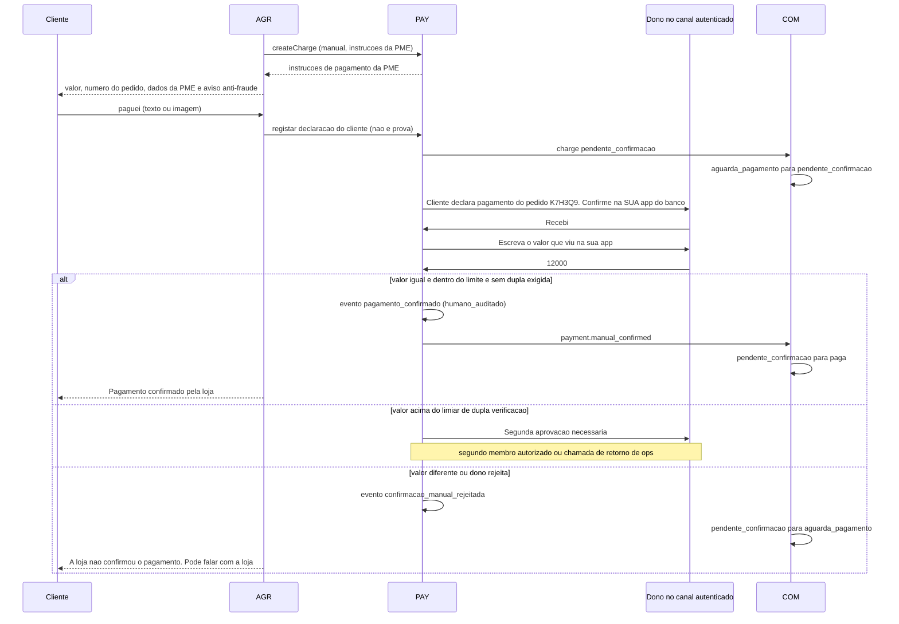
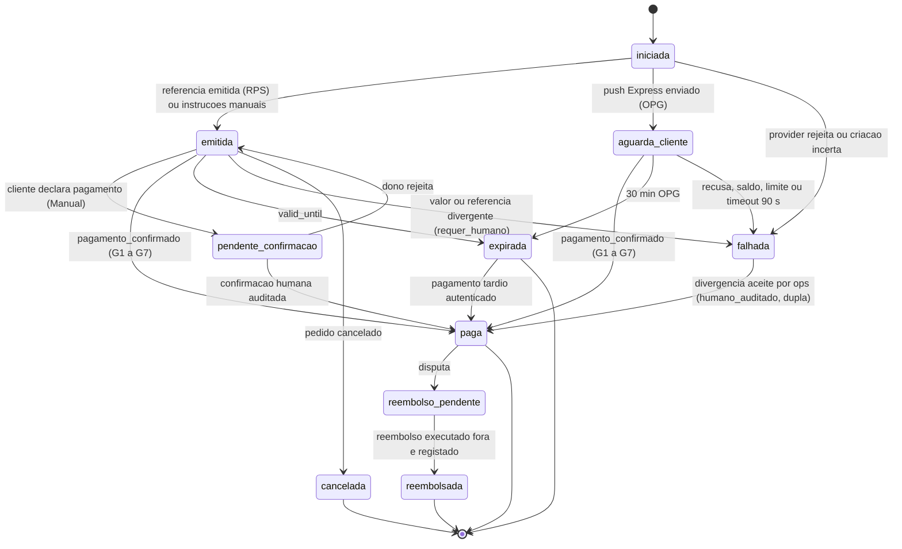
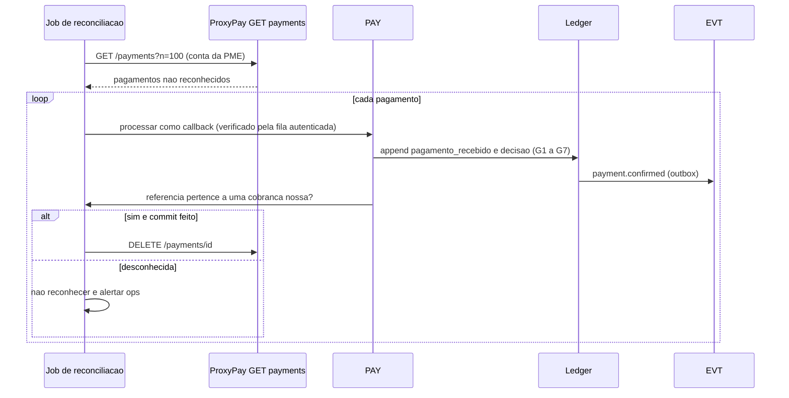
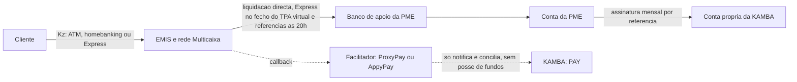
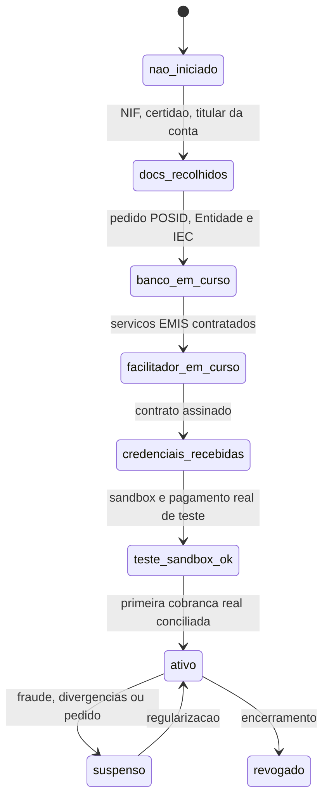

# Pagamentos, Liquidação e Anti-Fraude — KAMBÁ

| Campo | Valor |
|---|---|
| Produto | KAMBÁ (nome de trabalho) — plataforma WhatsApp-native de comércio conversacional para Angola |
| Documento | Técnica — Pagamentos, Liquidação e Anti-Fraude (PAY): `PaymentProvider`, ledger, reconciliação, BNA, comissão, billing, e-factura |
| Versão | 1.0 |
| Data | Outubro de 2026 |
| Classificação | Documento de Referência — Interno |
| Documento-fonte | `00_Arquitectura_Solucao.md` (âncora), `../exploracao/11-arquitetura-detalhada-engenharia.md` §2, §5.1, §6; `../exploracao/14-tese-minima-e-plano-de-validacao.md` §4 |
| Evidência | `evidencia/E2_Pagamentos_Angola.md` (facilitadores, BNA, fraude, câmbio, e-factura), `evidencia/E3_Regulatorio_Dados.md` (consumidor, retenção fiscal), `evidencia/E4_Stack_Licencas.md` (cofres de segredos) |
| Documentos relacionados | `03_Core_Comercio_Medusa.md` (COM: `tenants`, `contacts`, `orders_mirror`, máquina da encomenda), `01_Canais_WhatsApp_Fluxo_Dual.md`, `02_Agent_Runtime_Verticais.md`, `06_Dados_Eventos_Analytics.md`, `08_Seguranca_Conformidade.md`, `10_Onboarding_Governanca.md` |

> **Estado das afirmações.** CONFIRMADO / INDÍCIO / NÃO VERIFICADO, como em `evidencia/E2`. A documentação da AppyPay (Stoplight) **não foi lida**; o que aqui se diz da AppyPay e da EMIS directa é INDÍCIO até receber documentação por escrito. **Preços de facilitadores e prazos de onboarding bancário são NÃO VERIFICADOS.** Nada aqui é aconselhamento jurídico; todo o enquadramento BNA/AGT leva «(a confirmar por parecer)».

---

## 1. Introdução

### 1.1 Propósito

Especifica o componente **PAY**: a interface `PaymentProvider` e os seus adaptadores, a regra imutável de que uma encomenda só passa a `paga` por **evento autenticado** (ADR-013), o *ledger* `payment_events` *append-only* (com o DDL do documento 11 corrigido), a máquina de estados do pagamento, falhas e reconciliação, a liquidação directa à PME e o que cada PME tem de contratar, os limites regulatórios do BNA, a estratégia de comissão, a facturação da própria plataforma, o anti-fraude, o câmbio e a integração de e-factura AGT.

### 1.2 Âmbito

Dentro: PAY, tabelas de dinheiro do schema `platform`, `ManualProvider`, ProxyPay, AppyPay e candidatos, reconciliação, billing das PMEs. Fora: pesquisa (`05`), eventos e analytics (`06`), logística e código de entrega (`07`), segredos e APD (`08`), mensagens (`01`). **Fase:** Piloto = `ManualProvider` + ProxyPay (RPS/OPG) logo que o contrato exista; AppyPay, Cobranças automáticas e factura = Clusters; payouts, escrow, sub-adquirência = **fora de âmbito até existir PSP licenciado** (ADR-004).

### 1.3 Audiência

Engenheiros de pagamentos e de comércio, segurança, produto, e quem trata dos contratos com bancos e facilitadores.

### 1.4 Definições e termos

- **Facilitador:** ProxyPay (TimeBoxed), AppyPay ou similar; emite referências/pedidos de pagamento e notifica; não toca nos fundos (AppyPay, termos cl. 1.5, CONFIRMADO).
- **Cobrança (`charge`):** pedido de pagamento concreto ligado a uma encomenda (ou a um ciclo de facturação) e a uma conta de pagamento.
- **Referência Multicaixa:** par Entidade + Referência + Valor; pagável em ATM, homebanking ou Express; **não admite devolução** (CONFIRMADO, `evidencia/E2` §2).
- **Express/GPO/OPG:** pedido *push* ao Multicaixa Express do cliente (90 s para aprovar); OPG é a API ProxyPay.
- **Conta de pagamento (`payment_account`):** credenciais e identificadores EMIS (Entidade, POSID, IEC) **de uma PME** (ou da KAMBÁ para a sua própria receita).
- **Evento autenticado:** facto de pagamento cuja origem foi provada por HMAC verificado ou por consulta autenticada ao facilitador (§5).
- **PSP:** prestador de serviços de pagamento licenciado pelo BNA; a KAMBÁ **não** o é.
- **Ledger:** `payment_events`, registo *append-only* de factos e decisões; **não** é contabilidade de fundos detidos.

---

## 2. Princípios e decisões aplicáveis (ADRs)

| ADR | Aplicação |
|---|---|
| **ADR-004** | Liquidação directa à PME; a plataforma não detém fundos; `payout()` devolve `NOT_SUPPORTED` e reembolsos são casos manuais (`refund_cases`); guardas técnicas G-1..G-6 (§10.4). |
| **ADR-013** | `paga` só por evento autenticado; imagem de comprovativo nunca é prova; `ManualProvider` com confirmação humana auditada, limite por pedido e dupla verificação (§4). |
| **ADR-010** | Pagador identificado por `contact_id`; telefone Express só em `contact_endpoints` (cifrado, com finalidade); `payer_hmac` para anti-fraude. |
| **ADR-009** | Cada mudança de estado de pagamento grava no *outbox* na mesma transacção; `payment.confirmed` é o único evento que faz avançar a encomenda. |
| **ADR-007** | Valores, referências e prazos mostrados ao cliente vêm da cobrança, nunca do LLM; mensagens de cobrança são *templates* parametrizados. |
| **ADR-011** | Pagamentos por Fluxo B / número agregador / PME *light* são Diferido; `origem='plataforma'` existe no DDL mas não corre em produção. |
| **ADR-005/008** | Custos USD e câmbio (§12); transferência de dados para fora de Angola fora deste documento (`08`). |
| **ADR-002** | O motor de pagamentos é código nosso; nenhuma ferramenta *low-code* exposta a tenants. |

**Princípios específicos.** (1) *Fail closed*: dúvida ⇒ não confirma, encaminha a humano. (2) O dinheiro é um facto observado, não uma intenção: registam-se factos (`pagamento_recebido`) e decisões (`pagamento_confirmado`/`pagamento_divergente`) separadamente. (3) O ledger corrige-se por **eventos compensatórios**, nunca por `UPDATE`. (4) Mesma interface para cobrar clientes das PMEs e para a KAMBÁ cobrar as PMEs (dogfooding).

---

## 3. Interface `PaymentProvider` e adaptadores

### 3.1 Contrato

```ts
type Minor = bigint;                    // unidades menores (cêntimos) de AOA; nunca float
type Metodo = 'referencia' | 'express_push' | 'manual' | 'cod';

interface PaymentProvider {
  readonly id: string;                  // 'manual' | 'proxypay_rps' | 'proxypay_opg' | 'appypay' | ...
  readonly capabilities: ProviderCapabilities;

  // Contrato do documento 00 §4
  createCharge(req: CreateChargeReq): Promise<ChargeResult>;
  status(ref: ProviderRef): Promise<ProviderStatus>;             // consulta autenticada
  refund(req: RefundReq): Promise<RefundResult>;                 // P: NOT_SUPPORTED (ADR-004)
  payout(req: PayoutReq): Promise<PayoutResult>;                 // P: NOT_SUPPORTED (ADR-004)

  // Extensões propostas (PA-04-1): sem elas a regra de autenticidade não é implementável
  verifyCallback(raw: RawHttpCallback, acct: AccountSecrets): Promise<VerifiedEvent[]>;  // lança AuthError
  listUnacknowledged?(acct: AccountSecrets, cursor?: string): Promise<ProviderPaymentPage>;
  acknowledge?(acct: AccountSecrets, providerPaymentId: string): Promise<void>;
  cancelCharge?(ref: ProviderRef): Promise<void>;
}

type CreateChargeReq = {
  chargeId: Uuid;                       // gerado por nós ANTES da chamada; é a chave de idempotência
  tenantId: Uuid; accountId: Uuid; numeroPublico: string;       // numero_publico da encomenda (correlação curta)
  amount: Minor; currency: 'AOA'; metodo: Metodo;
  validUntil: Instant;                  // calculada pelo COM (03 §6.4)
  payer?: { endpointRef: Uuid };        // contact_endpoints.contact_id; o adaptador decifra só no momento do envio (OPG)
  customFields: Record<string, string>; // ex.: { charge: chargeId } — sem PII (ProxyPay: ate 10 pares)
};
type ChargeResult =
  | { kind: 'referencia'; entidade: string; referencia: string; valor: Minor; validoAte: Instant; providerChargeId?: string }
  | { kind: 'push'; providerChargeId: string; aprovarAte: Instant }
  | { kind: 'manual'; instrucoes: string };
type ProviderErr = 'AUTH'|'RATE_LIMIT'|'VALIDATION'|'REJECTED'|'TIMEOUT_UNKNOWN'|'UNAVAILABLE'|'NOT_SUPPORTED';
```

`ProviderCapabilities` declara: métodos suportados; `callbackAuth` (`hmac` | `none` | `desconhecido`); `statusQuery`; `reconciliationQueue`; `refund`; `payout`; `chargeTtl` (mín/máx); `idempotencyWindow`; `amountFormat` (`decimal2` | `inteiro_kz`); `refMaxLen`; `settlement` (descrição). O PAY **recusa** usar uma capacidade não declarada e **recusa** activar um adaptador com `callbackAuth='none'` sem `statusQuery=true` (§5).

### 3.2 Matriz de adaptadores

| Adaptador | Fase | Métodos | Autenticação do callback | Consulta de estado | Reembolso | Evidência |
|---|---|---|---|---|---|---|
| **ManualProvider** | **P** | `manual`, `cod` | n/a — confirmação humana auditada (§4) | n/a | manual (fora) | ADR-013 |
| **ProxyPay RPS v2** (referência) | P→C (com contrato) | `referencia` | **HMAC-SHA256** em `X-Signature` (chave = API key); reentregas; duplicados possíveis | fila `GET /payments`, `DELETE /payments/{id}` | não (referência) | CONFIRMADO |
| **ProxyPay OPG v1** (Express push) | P→C | `express_push` | **não verificada** (docs não mencionam assinatura) | consulta de transacção | NÃO VERIFICADO | CONFIRMADO (API) / NÃO VERIFICADO (assinatura) |
| **AppyPay v2** | C | `referencia`, `express_push`, Unitel Money, débito directo | NÃO VERIFICADO (assinatura, *retries*, idempotência) | endpoint de cobranças (INDÍCIO) | Express: total/parcial dentro da janela do TPA; referência: não | INDÍCIO (SDKs de terceiros) |
| **EMIS GPO directo** | — (não recomendado) | `express_push`, cartão, referência | **não assinado** (INDÍCIO) | **sem consulta** (INDÍCIO) | — | INDÍCIO [BLOG] |
| **MoMenu** (agregador com factura) | candidato C | Express, eKwanza, referência | webhook **sem assinatura** nem reentrega (INDÍCIO) | consulta é a confirmação fiável | NÃO VERIFICADO | INDÍCIO; estrutura de fundos NÃO VERIFICADA |
| **Paybyrd** (PSP internacional) | candidato D | Express (assíncrono) | NÃO VERIFICADO | NÃO VERIFICADO | NÃO VERIFICADO | CONFIRMADO (docs) / resto NÃO VERIFICADO |
| **PayPay / Pay4All (PSP)** | D (só se payouts forem requisito) | carteira, KWiK, IBAN | NÃO VERIFICADO | NÃO VERIFICADO | — | INDÍCIO (licença BNA n.º 420 PayPay); API NÃO VERIFICADO |

Selecção por tenant: `payment_accounts.provider` + `entitlements`. Preferência de arquitectura: **facilitador com HMAC e fila de reconciliação** (ProxyPay RPS) sobre qualquer via sem consulta de estado (ADR-013).

### 3.3 ProxyPay — mapeamento (CONFIRMADO em `evidencia/E2` §1.2)

| Operação KAMBÁ | ProxyPay | Notas de implementação |
|---|---|---|
| Gerar `referencia` | `POST /reference_ids` → `PUT /references/{id}` (`amount` 0,01..99.999.999,99; `end_datetime` ISO-8601; `custom_fields` ≤ 10 pares) → 204 | `PUT` idempotente pelo `id`. Guardar `charge` em `custom_fields`; `end_datetime = valid_until`. Autenticação `Authorization: Token <API_KEY>`. |
| Express push | `POST /opg/v1/transactions` (`type=payment`, `pos_id`, `mobile`, `amount` string 2 casas, `callback_url`) | `Authorization: Bearer`. `Idempotency-Key = chargeId` (**cache de 5 min**). Pedido **expira aos 30 min**; cliente tem **90 s** para aprovar. |
| Callback RPS | POST com `X-Signature = hex(HMAC-SHA256(API_KEY, corpo_cru))` | Validar sobre o corpo **cru**; responder 2xx; 3xx/non-2xx provoca reentrega. O mesmo pagamento pode chegar mais de uma vez. |
| Reconciliação | `GET /payments?n=100`; `DELETE /payments/{id}` | §8. |
| Campos úteis do evento | `entity_id`, `fee`, `terminal_type`, `terminal_transaction_id`, `terminal_location`, `terminal_id` | Guardar `fee` para custo real por transacção. |
| Teste | sandbox + *Mock Payment*; OPG: `900000000` aceita (5–20 s), `900002004` *timeout* (90 s), `900003000` recusa, `9XXXXXXXX` rejeita imediato (2010) | Suite de conformidade do adaptador (§3.5). |
| *Rate limit* | HTTP 429, valor NÃO VERIFICADO | *Backoff* exponencial com *jitter*. |

**Códigos OPG → mensagem ao cliente** (CONFIRMADO, `evidencia/E2` §1.2): `1000–1003` erro de gateway → «Não foi possível enviar o pedido. A tentar novamente.» (nova tentativa, sem custo para o cliente); `2001` saldo insuficiente → «O saldo não chega para este valor.»; `2003` limite diário excedido → «Atingiu o limite diário do cartão.»; `2004` *timeout* → «O tempo para aprovar terminou. Quer que reenvie?»; `3000` recusa do cliente → «Pedido recusado por si. Posso cancelar ou tentar outro meio.»; restantes `2000–2012` → mensagem genérica + registo do código. Todas as mensagens têm o aviso fixo anti-*phishing* (§9).

**Chave HMAC = API key:** a rotação exige janela de **duas chaves** (`credenciais_ref` corrente e anterior; aceitar assinatura de qualquer uma durante a janela, depois revogar a anterior). Uma **chave por conta de PME** e nunca partilhada com outras integrações da mesma PME (§8).

### 3.4 AppyPay e EMIS — estado provisório

AppyPay (`POST /charges`, `merchantTransactionId` 1–15 alfanuméricos; OAuth2 *client credentials*; sandbox `gwy-api-tst`) é **INDÍCIO** (SDKs de terceiros). Contrato interno: o `numero_publico` da encomenda (≤ 8 caracteres) é usado como `merchantTransactionId`. Pendente por escrito (`evidencia/E2` §9, perguntas 11–15): assinatura do *webhook*, *retries*, idempotência, ambiente de testes, modelo *partner/ISV*, esquema de auth. EMIS directo: **não adoptar** enquanto o callback não for assinado nem houver consulta; se imposto por um banco, tratar como `callbackAuth='none'` sem `statusQuery` ⇒ **o adaptador não pode confirmar `paga` sozinho** (só `humano_auditado` com reconciliação por extracto).

### 3.5 Suite de conformidade (por adaptador, no CI com sandbox)

Casos obrigatórios: assinatura adulterada ⇒ rejeita; valor ± 1 cêntimo ⇒ divergência; referência desconhecida ⇒ órfão; callback duplicado ×10 ⇒ 1 efeito; callback fora de ordem; pagamento depois de `valid_until`; *timeout* na criação com resposta perdida (idempotência); rotação de chave; 429; `status()` concorda com o callback. Um adaptador sem a suite verde não é activável em produção.

---

## 4. ManualProvider (Piloto): confirmação humana auditada

O Piloto arranca **sem facilitador** (caminho crítico por papel, §10.2): o cliente paga fora (transferência, depósito, numerário) e o **dono** confirma. A fraude de comprovativos editados está documentada em Angola, com perdas de 500 000 Kz a milhões e detenção confirmada pela Polícia (CONFIRMADO, `evidencia/E2` §4); por isso a imagem de comprovativo **nunca** é prova.

### 4.1 Fluxo



### 4.2 Regras

| # | Regra | Detalhe |
|---|---|---|
| M-1 | Só confirmam sujeitos em `payment_confirmers` | `dono` ou `funcionario` com `pode_confirmar`; o *sender* é identificado por BSUID do canal do tenant, **nunca** pelo texto «sou o dono». O cliente nunca confirma. |
| M-2 | Limite de valor por pedido | `entitlements.limites.manual_max_minor`; omissão **proposta** 50 000 Kz; acima ⇒ `ManualProvider` recusa criar cobrança e o agente propõe outro meio ou espera pelo facilitador. |
| M-3 | Limite diário e por contacto | `manual_daily_max_minor` por tenant e `manual_max_por_contacto_24h`; excedido ⇒ retém para ops. |
| M-4 | **Dupla verificação** (a) | Desafio do valor: o dono escreve o valor visto **na sua** app do banco; tem de igualar `amount_minor` (sem tolerância). Evita toques por engano e confirmação induzida. |
| M-5 | Dupla verificação (b) acima do limiar | `manual_dupla_acima_minor` (proposta **20 000 Kz**): segunda aprovação por outro `payment_confirmer` ou chamada de retorno de ops ao número registado do dono. |
| M-6 | Auditoria total | Cada fase em `manual_confirmations` (actor, `canal_msg_id`, valor declarado, hora) + evento no ledger com `authn_method='humano_auditado'` e `actor_id` obrigatório. |
| M-7 | Evidência ≠ prova | Imagem do cliente guarda-se como `evidencia_ref` com rótulo `nao_prova`; o agente **não** lê o valor da imagem para decidir. |
| M-8 | Sem retroacção silenciosa | Reverter uma confirmação (engano, fraude descoberta) = evento `confirmacao_manual_revertida` + `refund_cases` + `paga → reembolso_pendente` (03 §6.2); nunca apagar. |
| M-9 | Avisos fixos | O cliente é informado de que a confirmação é feita pela loja; reviews de pedidos `manual_auditado` têm `peso_ranking=0` (03 §9). |
| M-10 | Parâmetros | Valores propostos, a calibrar no Piloto (referência: perdas documentadas de 500 000 Kz ou mais); registados em `entitlements`. |

**COD (pagamento na entrega).** Não existe evento autenticado. No Piloto trata-se como `metodo='cod'` do `ManualProvider`, com limite mais baixo, validade curta, opt-in do tenant e confirmação por **dono + código de entrega** (`07`); custódia de numerário por estafetas é Clusters (`07`). Controlos: histórico do contacto, sinal em `fraud_signals` por *no-show*.

---

## 5. Regra imutável: quando uma cobrança fica `paga`

> **Uma cobrança só passa a `paga` (e a encomenda só passa a `paga`) por um evento autenticado que cumpre TODAS as condições G1–G8, escrito no ledger pela função `append_payment_event`. Nenhum endpoint, agente, LLM ou imagem pode escrever esse estado.**

| Gate | Condição | Se falha |
|---|---|---|
| G1 | **Origem autenticada:** HMAC válido sobre o corpo cru (comparação em tempo constante, chave corrente ou anterior) **ou** `status()` autenticado ao facilitador (TLS + credenciais da conta) **ou** confirmação humana M-1..M-6 | `payment_callbacks_inbox.estado='hmac_invalido'`, 401, alerta; nada entra no ledger |
| G2 | **Conta correcta:** o *token* do *webhook* resolve a `payment_account`; `entidade`/`pos_id` do evento batem com a conta | `pagamento_divergente` (`motivo='entidade'`) + humano |
| G3 | **Cobrança existente** para `(provider, account_id, referencia)` | `pagamento_orfao` (alerta a ops); **não** confirma, **não** reconhece no facilitador (§8) |
| G4 | **Valor exacto:** `valor_minor == amount_minor` e moeda `AOA` | `pagamento_divergente` (`motivo='valor'`), `estado='falhada'`, `requer_humano=true` |
| G5 | **Referência bate** com a cobrança (e `chargeId` em `custom_fields`, se o facilitador o devolve) | idem (`motivo='referencia'`) |
| G6 | **Estado compatível:** cobrança em `emitida`/`aguarda_cliente`/`pendente_confirmacao`; em `expirada` só com a regra de pagamento tardio (03 §6.6) | `pagamento_duplicado`/`pagamento_tardio` conforme o caso |
| G7 | **Não repetido:** `provider_event_id` ainda não existe | recibo `duplicado` (200, sem efeito) |
| G8 | **Limites** (só humano): M-2..M-5 cumpridos | `confirmacao_manual_rejeitada` |

**Replay.** O HMAC do ProxyPay cobre apenas o corpo e **não há *timestamp* assinado documentado** (NÃO VERIFICADO); portanto a janela «±5 min» do GWY (doc 00 §4) **não é implementável** nesse adaptador. A defesa contra *replay* é a **idempotência** (G7) mais o ligamento do corpo a `{referencia, valor}`: reentregar um corpo válido só repete um facto já registado. Se um adaptador expuser *timestamp* assinado, aplica-se a janela de ±5 min em cima de G7. Lista de IPs de origem: aplicar quando o facilitador a publicar (NÃO VERIFICADO).

**Facilitadores sem assinatura** (OPG, EMIS, MoMenu): o callback é apenas uma **dica**; o PAY executa `status()` e só então avalia G2–G7 (`authn_method='status_pull'`). Sem `statusQuery` o adaptador não pode confirmar (§3.4).

### 5.1 Tratamento do callback (esquema)

```
POST /hooks/pay/{provider}/{webhook_token}        # token opaco por payment_account
  acct = accounts.by_webhook_token(token)          # desconhecido => 404 uniforme, recibo token_desconhecido
  receipt = inbox.insert(acct, body_hash, body, headers, ip)   # durável ANTES de qualquer 2xx
  try:  evs = provider.verifyCallback(raw, acct)   # G1 (HMAC) ou marca como "dica" (sem assinatura)
  except AuthError: inbox.mark(receipt,'hmac_invalido'); return 401
  return 200                                        # 2xx rapido (<500 ms); o resto assincrono a partir do inbox
worker(receipt):
  for ev in evs (ou status_pull(ev)):               # idempotente por provider_event_id (G7)
     BEGIN
       SELECT ... FROM payment_charges WHERE account_id=:a AND referencia=:r FOR UPDATE   # G3
       append_payment_event('pagamento_recebido', authn_ok=true, ...)
       if G2 && G4 && G5 && G6: append_payment_event('pagamento_confirmado', decisao='aceite')
                                 -> projecta charge.estado='paga' + outbox payment.confirmed
       else:                     append_payment_event('pagamento_divergente', motivo=...) -> charge falhada/requer_humano
     COMMIT
  inbox.mark(receipt,'processado')
```

---

## 6. Ledger e modelo de dados (DDL canónico)

`tenants`, `contacts`, `contact_endpoints` e `orders_mirror` têm o DDL canónico em `03_Core_Comercio_Medusa.md` §5; este documento define as tabelas de dinheiro. **Ordem de migração:** `…orders_mirror` → `payment_accounts` → `payment_charges` → `payment_events` → restantes.

### 6.1 Correcção ao documento 11 §2 (`payment_events`)

| Problema do DDL original | Porquê é errado | Correcção |
|---|---|---|
| `UNIQUE (provider, referencia)` | Uma referência atravessa vários estados (`emitida → paga/expirada/falhada`): ou há **um** registo e tem de ser actualizado (então não é imutável), ou há vários e a restrição **rejeita-os**. Mistura *dedupe* com estado. | Eventos *append-only* com `UNIQUE (provider, account_id, referencia, tipo_evento, sequencia)`; *dedupe* de entregas por `provider_event_id` (índice parcial) e recibos em `payment_callbacks_inbox`. |
| `estado` + `callback_hmac_ok boolean` numa linha | Estado é *projecção*; `boolean` não descreve como foi autenticado (HMAC, consulta, humano). | `tipo_evento` (facto/decisão) + `authn_method` + `authn_ok` + `decisao`; estado vive em `payment_charges` (derivado). |
| Referência única só por `(provider, referencia)` | Uma referência Multicaixa é **Entidade + Referência** (`evidencia/E2` §2); duas PMEs (entidades) podem ter o mesmo número. | Inclui `account_id` (a conta/entidade) na unicidade. |
| `valor_kz int`, sem moeda | Perde cêntimos; limita a 2,1 mil milhões. | `valor_minor bigint` + `currency`. |
| Nada impede `UPDATE`/`DELETE` | «Ledger imutável» sem mecanismo. | `REVOKE` + *triggers* + escrita só por função `SECURITY DEFINER` + cadeia de *hashes*. |
| `order_id` obrigatório | A facturação da KAMBÁ também usa PAY (§11). | `order_id` ou `billing_cycle_id`, exactamente um. |

### 6.2 DDL

```sql
CREATE TABLE platform.payment_accounts (
  id                 uuid PRIMARY KEY DEFAULT gen_random_uuid(),
  beneficiary_kind   text NOT NULL CHECK (beneficiary_kind IN ('tenant','plataforma_receita_propria')),
  tenant_id          uuid REFERENCES platform.tenants(id),          -- beneficiario quando kind='tenant'
  provider           text NOT NULL,                                  -- 'manual','proxypay','appypay',...
  entidade           text, pos_id text, iec text,                    -- identificadores EMIS da PME (ou da KAMBA)
  credenciais_ref    text,                                           -- caminho no cofre; NUNCA o segredo
  webhook_token      text NOT NULL UNIQUE,                           -- gerado na aplicacao; opaco
  liquidacao_destino text CHECK (liquidacao_destino IN ('conta_banco','carteira_unitel_money','conta_pme_fora_plataforma')),
  manual_instrucoes  text,                                           -- dados de pagamento da PME (ManualProvider)
  estado             text NOT NULL DEFAULT 'nao_iniciado'
                     CHECK (estado IN ('nao_iniciado','docs_recolhidos','banco_em_curso','facilitador_em_curso',
                                       'credenciais_recebidas','teste_sandbox_ok','ativo','suspenso','revogado')),
  checklist          jsonb NOT NULL DEFAULT '{}',                    -- ver 10.2
  criado_at          timestamptz NOT NULL DEFAULT now(), CHECK ((beneficiary_kind = 'tenant') = (tenant_id IS NOT NULL))
);
CREATE UNIQUE INDEX payment_accounts_um_ativo ON platform.payment_accounts (tenant_id, provider) WHERE estado IN ('ativo','teste_sandbox_ok');

CREATE TABLE platform.payment_confirmers (                           -- quem pode confirmar no ManualProvider
  tenant_id uuid NOT NULL REFERENCES platform.tenants(id), contact_id uuid NOT NULL REFERENCES platform.contacts(contact_id),
  papel text NOT NULL CHECK (papel IN ('dono','funcionario')), pode_segunda_aprovacao boolean NOT NULL DEFAULT false,
  ativo boolean NOT NULL DEFAULT true, PRIMARY KEY (tenant_id, contact_id)
);

CREATE TABLE platform.payment_charges (                              -- ESTADO DERIVADO do ledger; unica tabela mutavel de PAY
  id                 uuid PRIMARY KEY DEFAULT gen_random_uuid(),     -- = chargeId = Idempotency-Key
  tenant_id          uuid NOT NULL REFERENCES platform.tenants(id),
  order_id           uuid REFERENCES platform.orders_mirror(id),
  billing_cycle_id   uuid,                                           -- FK para billing_cycles (11)
  tentativa          smallint NOT NULL DEFAULT 1, account_id         uuid NOT NULL REFERENCES platform.payment_accounts(id),
  provider           text NOT NULL,
  metodo             text NOT NULL CHECK (metodo IN ('referencia','express_push','manual','cod')),
  referencia         text, provider_charge_id text, amount_minor       bigint NOT NULL CHECK (amount_minor > 0),
  currency           char(3) NOT NULL DEFAULT 'AOA', estado             text NOT NULL DEFAULT 'iniciada'
                     CHECK (estado IN ('iniciada','emitida','aguarda_cliente','pendente_confirmacao','paga',
                                       'expirada','falhada','cancelada','reembolso_pendente','reembolsada')),
  motivo_falha       text CHECK (motivo_falha IN ('valor_divergente','referencia_divergente','entidade_divergente','rejeitada_provider',
                                                  'recusada_cliente','timeout_cliente','provider_indisponivel','criacao_incerta','manual_rejeitada')),
  requer_humano      boolean NOT NULL DEFAULT false, valid_until        timestamptz NOT NULL,
  payer_hmac         bytea,                                          -- HMAC do msisdn Express do pagador (anti-auto-compra)
  criado_at          timestamptz NOT NULL DEFAULT now(), atualizado_at timestamptz NOT NULL DEFAULT now(),
  CHECK ((order_id IS NULL) <> (billing_cycle_id IS NULL)), UNIQUE (order_id, tentativa),
  UNIQUE (billing_cycle_id, tentativa)
);
CREATE UNIQUE INDEX payment_charges_ref_uq ON platform.payment_charges (account_id, referencia) WHERE referencia IS NOT NULL;
CREATE UNIQUE INDEX payment_charges_activa_uq ON platform.payment_charges (COALESCE(order_id, billing_cycle_id))
  WHERE estado IN ('iniciada','emitida','aguarda_cliente','pendente_confirmacao');

CREATE TABLE platform.payment_callbacks_inbox (                      -- TODA a entrega HTTP, incl. rejeitadas; append-only
  id            bigint GENERATED ALWAYS AS IDENTITY PRIMARY KEY,
  account_id    uuid REFERENCES platform.payment_accounts(id),       -- NULL se token desconhecido
  recebido_at   timestamptz NOT NULL DEFAULT now(),
  source_ip     inet, headers jsonb NOT NULL DEFAULT '{}',           -- sem segredos
  body          bytea NOT NULL, body_hash bytea NOT NULL, authn_ok      boolean,
  estado        text NOT NULL DEFAULT 'recebido'
                CHECK (estado IN ('recebido','processado','duplicado','hmac_invalido','token_desconhecido','ignorado','erro')),
  processado_at timestamptz, erro text
);

CREATE TABLE platform.payment_events (                               -- LEDGER append-only
  id               bigint GENERATED ALWAYS AS IDENTITY PRIMARY KEY,
  tenant_id        uuid NOT NULL REFERENCES platform.tenants(id),
  charge_id        uuid NOT NULL REFERENCES platform.payment_charges(id),
  order_id         uuid REFERENCES platform.orders_mirror(id), billing_cycle_id uuid, provider         text NOT NULL,
  account_id       uuid NOT NULL REFERENCES platform.payment_accounts(id),
  referencia       text NOT NULL,                                    -- providers sem referencia: numero_publico#tentativa
  tipo_evento      text NOT NULL CHECK (tipo_evento IN (
                     'cobranca_criada','referencia_emitida','push_enviado','pagamento_recebido','pagamento_confirmado',
                     'pagamento_divergente','pagamento_orfao','pagamento_duplicado','pagamento_rejeitado_provider',
                     'cobranca_expirada','cobranca_cancelada','confirmacao_manual_pedida','confirmacao_manual_registada',
                     'confirmacao_manual_rejeitada','confirmacao_manual_revertida','reembolso_manual_registado','ajuste_reconciliacao')),
  sequencia        integer NOT NULL CHECK (sequencia >= 1),          -- n-esima ocorrencia deste tipo para esta referencia
  provider_event_id text, valor_minor      bigint NOT NULL CHECK (valor_minor >= 0),
  currency         char(3) NOT NULL DEFAULT 'AOA',
  authn_method     text NOT NULL CHECK (authn_method IN ('hmac_sha256','status_pull','humano_auditado','sistema')),
  authn_ok         boolean NOT NULL, decisao          text NOT NULL CHECK (decisao IN ('aceite','rejeitada','informativo')),
  motivo           text, actor_kind       text NOT NULL CHECK (actor_kind IN ('provider','dono','ops','sistema')),
  actor_id         uuid,
  payload_hash     bytea NOT NULL, payload jsonb NOT NULL DEFAULT '{}',   -- payload redigido: sem PII
  ocorrido_at      timestamptz, recebido_at timestamptz NOT NULL DEFAULT now(),
  prev_hash        bytea, row_hash bytea NOT NULL,                   -- cadeia por cobranca (tamper-evident)
  CONSTRAINT payment_events_uq UNIQUE (provider, account_id, referencia, tipo_evento, sequencia),
  CONSTRAINT payment_events_um_sujeito CHECK ((order_id IS NULL) <> (billing_cycle_id IS NULL)),
  CONSTRAINT confirmar_exige_autenticacao CHECK (tipo_evento <> 'pagamento_confirmado'
      OR (authn_ok AND decisao = 'aceite' AND authn_method IN ('hmac_sha256','status_pull','humano_auditado'))),
  CONSTRAINT humano_exige_actor CHECK (authn_method <> 'humano_auditado' OR actor_id IS NOT NULL)
);
CREATE UNIQUE INDEX payment_events_entrega_uq ON platform.payment_events (provider, account_id, provider_event_id)
  WHERE provider_event_id IS NOT NULL AND tipo_evento = 'pagamento_recebido';        -- dedupe de entregas (G7)
CREATE INDEX payment_events_charge_idx ON platform.payment_events (charge_id, id);

-- Imutabilidade: sem UPDATE/DELETE/TRUNCATE para nenhum papel de aplicacao; escrita so pela funcao.
CREATE FUNCTION platform.deny_mutation() RETURNS trigger LANGUAGE plpgsql AS $$
BEGIN RAISE EXCEPTION 'tabela append-only: % proibido em %', TG_OP, TG_TABLE_NAME; END $$;
CREATE TRIGGER payment_events_imutavel BEFORE UPDATE OR DELETE ON platform.payment_events
  FOR EACH ROW EXECUTE FUNCTION platform.deny_mutation();
CREATE TRIGGER payment_events_sem_truncate BEFORE TRUNCATE ON platform.payment_events
  FOR EACH STATEMENT EXECUTE FUNCTION platform.deny_mutation();
REVOKE ALL ON platform.payment_events FROM PUBLIC, kamba_app, kamba_ops;
GRANT SELECT ON platform.payment_events TO kamba_app, kamba_ops;
-- platform.append_payment_event(...) SECURITY DEFINER: unico caminho de INSERT; GRANT EXECUTE a kamba_app.
```

**`append_payment_event` (contrato).** Dentro de uma transacção: (1) `SELECT … FROM payment_charges WHERE id = :charge FOR UPDATE` (serializa); (2) calcula `sequencia = 1 + count(*)` dos eventos do mesmo `(provider, account_id, referencia, tipo_evento)`; (3) recusa `pagamento_confirmado` se `valor_minor ≠ charge.amount_minor`, se `account_id` difere ou se `authn_ok` é falso (cinto-e-suspensórios sobre o CHECK); (4) calcula `row_hash = sha256(prev_hash ‖ campos canónicos)` com `prev_hash` do último evento da cobrança; (5) insere; (6) **projecta** `payment_charges.estado` pela função pura `next_state(estado, tipo_evento, decisao)` (§7); (7) escreve no `events_outbox` (`payment.confirmed`, `payment.mismatch`, …). A cadeia de *hashes* é verificada diariamente e a *cabeça* da cadeia exportada para STO (âncora externa). `rebuild_charge_state(charge_id)` reproduz o estado a partir dos eventos; um *job* nocturno compara-o com a projecção e alerta divergências.

### 6.3 Demais tabelas (resumo)

```sql
CREATE TABLE platform.manual_confirmations (
  id uuid PRIMARY KEY DEFAULT gen_random_uuid(), tenant_id uuid NOT NULL REFERENCES platform.tenants(id),
  charge_id uuid NOT NULL REFERENCES platform.payment_charges(id),
  fase text NOT NULL CHECK (fase IN ('declaracao_cliente','confirmacao','segunda_aprovacao','rejeicao','reversao')),
  actor_contact_id uuid NOT NULL REFERENCES platform.contacts(contact_id), canal_msg_id text NOT NULL,
  valor_declarado_minor bigint, valor_bate boolean, evidencia_ref text,      -- evidencia_ref = anexo NAO-PROVA
  motivo text, criado_at timestamptz NOT NULL DEFAULT now());
CREATE TABLE platform.refund_cases (                                         -- ADR-004: processo manual fora da plataforma
  id uuid PRIMARY KEY DEFAULT gen_random_uuid(), tenant_id uuid NOT NULL REFERENCES platform.tenants(id),
  order_id uuid REFERENCES platform.orders_mirror(id), charge_id uuid REFERENCES platform.payment_charges(id),
  motivo text NOT NULL, valor_minor bigint NOT NULL,
  estado text NOT NULL DEFAULT 'aberto' CHECK (estado IN ('aberto','a_executar_pela_pme','concluido','recusado')),
  prova_ref text, criado_at timestamptz NOT NULL DEFAULT now(), fechado_at timestamptz);
CREATE TABLE platform.fraud_signals (
  id bigint GENERATED ALWAYS AS IDENTITY PRIMARY KEY, tenant_id uuid NOT NULL REFERENCES platform.tenants(id),
  contact_id uuid REFERENCES platform.contacts(contact_id), charge_id uuid REFERENCES platform.payment_charges(id),
  regra text NOT NULL, severidade smallint NOT NULL CHECK (severidade BETWEEN 1 AND 5),
  accao text NOT NULL CHECK (accao IN ('registar','reter_confirmacao','exigir_dupla','bloquear_contacto','suspender_manual')),
  detalhe jsonb NOT NULL DEFAULT '{}', criado_at timestamptz NOT NULL DEFAULT now());
```

Todas as tabelas com `tenant_id` têm RLS (03 §5.5). O guarda de beneficiário (ADR-004, G-1) está em §10.4.

---

## 7. Máquina de estados do pagamento e falhas

### 7.1 Estados da cobrança (projecção do ledger)



Correspondência com a encomenda (`03` §6): cobrança `paga` ⇒ `payment.confirmed` ⇒ `aguarda_pagamento/pendente_confirmacao → paga`; cobrança `expirada` ⇒ COM faz a consulta final e `aguarda_pagamento → expirada`. O estado `falhada` do documento 00 §7 é **estado de cobrança** (com `motivo_falha`), não de encomenda.

### 7.2 Tabela de falhas e respostas

| # | Falha | Detecção | Resposta | Registo |
|---|---|---|---|---|
| F-01 | **Callback duplicado** (reentrega do facilitador) | G7 (`provider_event_id`) | 200, sem efeito | inbox `duplicado` |
| F-02 | **Valor divergente** (a menos ou a mais) | G4 | `falhada`, `requer_humano`; alerta ao dono e ops; **nunca** auto-confirma | `pagamento_divergente` |
| F-03 | **Referência desconhecida / órfã** | G3 | alerta a ops; **não reconhecer** no facilitador (§8) | `pagamento_orfao` |
| F-04 | **Entidade/POSID não corresponde à conta** | G2 | divergência + humano | `pagamento_divergente` |
| F-05 | **HMAC inválido** | G1 | 401; alerta se > N/hora por conta | inbox `hmac_invalido` |
| F-06 | **Referência expirada** (cliente tenta pagar depois) | `valid_until` + provider recusa | COM emite nova cobrança (`tentativa+1`) na mesma encomenda | `cobranca_expirada` |
| F-07 | **Pagamento tardio** (após expiração local) | G6 | COM aplica 03 §6.6 (re-reservar ou excepção) | `pagamento_recebido`, `pagamento_confirmado` |
| F-08 | **Pagamento duplo** (2 pagamentos autenticados) | G6 (cobrança já `paga`) | 2.º ⇒ `pagamento_duplicado` + `refund_cases` | `pagamento_duplicado` |
| F-09 | **OPG: resposta perdida na criação** | `TIMEOUT_UNKNOWN` | retentar **com o mesmo `Idempotency-Key` até 5 min**; depois de 5 min **não** repetir o POST: `status()` por `chargeId`; se desconhecido ⇒ `falhada('criacao_incerta')` e nova tentativa só após 30 min (expiração do OPG) | `cobranca_criada` + nota |
| F-10 | **OPG: cliente não aprova em 90 s** | código 2004 | mensagem + oferta de reenvio (nova cobrança só depois do estado terminal) | `pagamento_rejeitado_provider` |
| F-11 | **OPG: cobrança pendente 30 min** | TTL do OPG | `expirada` | `cobranca_expirada` |
| F-12 | **Saldo (2001), limite (2003), recusa (3000)** | códigos OPG | mensagens de §3.3; oferecer referência como alternativa | `pagamento_rejeitado_provider` |
| F-13 | **Facilitador indisponível / 429** | `UNAVAILABLE`/`RATE_LIMIT` | fila com *backoff*; encomenda fica `criada`; cliente informado sem prometer prazo; fallback **só** `ManualProvider` (nunca comprovativo) | `cobranca_criada` falhada |
| F-14 | **Webhook perdido** | reconciliação (§8) | *job* processa pela mesma via | `pagamento_recebido` (`status_pull`) |
| F-15 | **Pagamento numa encomenda `cancelada`** | G6 | `refund_cases` + alerta | `pagamento_recebido` |
| F-16 | **Rotação de chave / chave errada** | G1 falha em massa | janela de duas chaves; alerta | inbox |
| F-17 | **Moeda ≠ AOA ou formato de valor** | G4 | divergência; conversão **sempre** de `Minor` para `decimal2`/`inteiro_kz` no adaptador, nunca *floats* | — |
| F-18 | **Dono rejeita / não responde (Manual)** | TTL da confirmação (omissão 24 h) | `pendente_confirmacao → emitida`; reserva mantém-se até `expires_at` | `confirmacao_manual_rejeitada` |

---

## 8. Reconciliação

Dois mecanismos independentes, ambos a passar por **G1–G8** (a reconciliação não tem poder especial).

| Mecanismo | Frequência | Acção |
|---|---|---|
| **Fila do facilitador** (ProxyPay RPS) | 5 min por conta activa; *on-demand* antes de expirar uma reserva (03 §6.5) e quando o cliente diz «já paguei» | `GET /payments?n=100` ⇒ processa cada pagamento ⇒ **após o commit no ledger**, `DELETE /payments/{id}` |
| **Consulta de transacção** (OPG, AppyPay) | em cada cobrança `aguarda_cliente` a cada 30 s nos primeiros 3 min, depois 5 min até ao fim | `status()` ⇒ evento `status_pull` |
| **Extracto bancário** (Piloto: manual; C: API do banco, NÃO VERIFICADO) | diária | CSV do banco da PME comparado com `paga`; diferenças ⇒ `ajuste_reconciliacao` (compensatório) e caso para ops |
| **Integridade do ledger** | diária | verifica cadeia de *hashes*; `rebuild_charge_state` vs projecção; exporta cabeça da cadeia para STO |



**Regras:** (a) **nunca** `DELETE` antes do *commit*; se o `DELETE` falhar o pagamento reaparece e G7 absorve-o; (b) **só reconhecer pagamentos de cobranças nossas** — se a PME usar a mesma conta ProxyPay noutra integração (ex.: loja web), o nosso *job* roubar-lhe-ia pagamentos; por isso **uma chave de API dedicada por PME para a KAMBÁ** e alerta de órfãos em vez de `DELETE`; (c) rotação da chave HMAC tem impacto na fila (§3.3).

---

## 9. Anti-fraude

| Ameaça | Vector | Controlo | Fase |
|---|---|---|---|
| **Comprovativo falso** (CONFIRMADO, `evidencia/E2` §4) | Transferência real de montante ínfimo + imagem editada | Imagem nunca é prova (ADR-013); M-1..M-10; desafio do valor; limites; só facilitador autenticado faz `paga` sem humano | P |
| **Callback forjado** | POST falso ao *webhook* | *Token* opaco por conta, HMAC, estado `status_pull`, G2–G5, alerta a falhas de HMAC | P |
| **Replay** | Reentrega de corpo válido | Idempotência G7; recibos; (janela de tempo se houver *timestamp* assinado) | P |
| **Phishing a clientes** (CONFIRMADO, EMIS alerta) | Falsos pedidos, SMS, apps | O bot **nunca** pede PIN, códigos ou números de cartão; mensagens de cobrança com aviso fixo («a aprovação aparece na sua app do banco; nunca partilhe o PIN»); sem links de pagamento; instrução de ignorar links «da EMIS» | P |
| **Auto-compra** (reviews e histórico) | Dono ou conhecido compra para fabricar prova | `contacts.phone_hmac = dono`, `payer_hmac` = dono/funcionários ⇒ `fraud_signals` + review `retida`; valor mínimo; sem Score no Piloto (03 §9) | P |
| **Agentes-fantasma** | Agente de campo regista PMEs falsas para ganhar comissão | Comissão de agente só após 1.ª venda **autenticada** da PME com contactos distintos; KYC (NIF, titular da conta); auditoria de rede (`10`); *shadow* de padrões (mesma morada/dispositivo/IBAN) | C |
| **COD abusivo** | Pedidos sem intenção de levantar | Opt-in; limite baixo; validade curta; histórico do contacto; sinal de *no-show* ⇒ exigir sinal por referência | P/C |
| **Confirmação manual por conta sequestrada** | Atacante controla o WhatsApp do dono | Dupla verificação acima do limiar; chamada de retorno; limites diários; notificação à PME por 2.º canal (e-mail/chamada) | P |
| **Abuso interno** | Ops confirma indevidamente | Papéis separados; confirmações de ops exigem motivo e dupla aprovação; tudo no ledger | P |
| **Pagamento a terceiros / enganos** | Cliente paga à entidade errada | Mensagem mostra entidade e referência do **ledger**; divergência G2 ⇒ humano | P |
| **Abuso de reembolso** | Ciclo pagar–disputar | `refund_cases` com prova; sem reembolso automático (ADR-004) | P |

Motor de sinais (P): regras determinísticas que gravam `fraud_signals` e accionam `reter_confirmacao`, `exigir_dupla`, `bloquear_contacto` ou `suspender_manual` do tenant; limiares configuráveis. Modelos estatísticos só em Clusters com dados do próprio ledger. Eventos relevantes alimentam `06` (Score só após parecer e fora do Piloto).

---

## 10. Liquidação directa e BNA

### 10.1 Fluxo de fundos



A KAMBÁ **não** está no caminho do dinheiro das vendas. Liquidação: Express diária (TPA virtual fecha por omissão 08:00–08:30), referências compensadas às 20:00, Unitel Money fica em carteira (AppyPay, CONFIRMADO); D+0/D+1 e prazo final por banco NÃO VERIFICADOS; a UI nunca promete «dinheiro na hora».

### 10.2 O que exige cada PME (caminho crítico)

| Requisito | Detalhe | Quem | Estado |
|---|---|---|---|
| Banco de apoio | Conta da PME (colectiva); **pessoa singular/empresário em nome individual: NÃO VERIFICADO** | PME + banco | CONFIRMADO (AppyPay: «empresa pública ou privada que o banco autorize») |
| Serviços EMIS via banco | **POSID + supervisor card** (GPO/Express), **Entidade** (referências), **IEC** (débito directo) | banco/EMIS | CONFIRMADO |
| Contrato com o facilitador | AppyPay: contrato de Operação e Manutenção em papel; ProxyPay: contrato com banco e TimeBoxed (INDÍCIO) | PME + facilitador | CONFIRMADO / INDÍCIO |
| Carteira Unitel Money | conta tipo IV (pessoas colectivas), via AppyPay | PME | INDÍCIO |
| Documentos KYC | NIF, certidão comercial, alvará — **requisitos do banco: NÃO VERIFICADO** | PME | NÃO VERIFICADO |
| Prazo total | **NÃO VERIFICADO** (semanas, por banco); critério H5: ≤ 6 semanas | — | NÃO VERIFICADO |
| Preço do facilitador | AppyPay 0,40% (mín. 50, máx. 1 500 Kz), sem mensalidade, IVA a acrescer (CONFIRMADO); **ProxyPay: NÃO VERIFICADO**; comissão do banco/EMIS à parte (tecto 1% / 12 000 Kz em compras >2 000 Kz, INDÍCIO) | — | misto |



**Caminho crítico e mitigação.** Estes itens dependem de papel e de bancos, não de engenharia; **arrancam na semana 1** (D4, doc 00 §13.3) e correm em paralelo ao código. Até estarem `ativo`, cada PME opera em **`ManualProvider`** (camada 2 da tese, `../exploracao/14` §4) com limites; a passagem ao facilitador é uma troca de `payment_account.provider`, sem alterar COM nem agentes. Três níveis de capacidade por tenant: **T0** sem cobrança na plataforma; **T1** `ManualProvider`; **T2** facilitador integrado.

**PME informal sem NIF.** Sem NIF não há conta bancária colectiva nem contrato EMIS ⇒ **fica fora do pagamento integrado (T2)**. Pode, por decisão de produto/GOV (`10`), usar T1 com o limite mais baixo e **sem** comissão nem peso de reviews; ou apenas T0. A segmentação do Piloto é PME formal com NIF (`../exploracao/14` §1). Decisão a registar em `10`.

### 10.3 Dependência do câmbio e do lado do cliente

Os limites por pagamento do cliente (banco, carteira) mordem antes dos da rede para tickets de PME (códigos OPG 2003; carteiras com tectos) — INDÍCIO (`evidencia/E2` §2). A UI oferece alternativa de método quando o OPG devolve 2001/2003.

### 10.4 BNA: o que a plataforma pode e não pode fazer

> Leitura do Aviso n.º 2/22 (texto lido directamente) — **interpretação sujeita a parecer; (a confirmar por parecer)**.

| Desenho (`evidencia/E2` §3.3) | Posição | Permitido no Piloto? |
|---|---|---|
| **A. Facilitador técnico:** credenciais da **PME**; liquidação directa; plataforma só orquestra, notifica e concilia | Enquadra-se na exclusão técnica do art. 4, alínea j («sem nunca entrarem na posse dos fundos»), **com a ressalva de que iniciação de pagamento fica fora da exclusão** | **Sim** — conclusão jurídica INDÍCIO até parecer (D8) |
| **B. Plataforma como comerciante único** que recebe e repassa | Aproxima-se de sub-adquirente (art. 3, aa): autorização BNA, segregação, KYC/AML | **Não** (ADR-004) |
| **C. Payouts a terceiros** (estafetas, revendedores, comissões de terceiros) pela plataforma | Execução de operações de pagamento/remessa: regulado | **Não**; alternativas: a PME paga a partir da sua conta; parceiro PSP executa com conta da PME |
| **D. Escrow / retenção até entrega** | Deter fundos ⇒ PSP/IME com conta fiduciária (arts. 25–28) | **Não** |
| **E. «Agente» de PSP** | Registo no BNA (Lei 40/20 art. 17), regime actual NÃO VERIFICADO | **Não** |
| Subcontratação de serviços operacionais de pagamento (art. 21 proíbe) | Parceria com PSP tem de ser técnica/comercial, com os fundos nas mãos do PSP | Só em D, com parecer |

**Guardas técnicas (tornam o desenho A verificável):**

| ID | Guarda | Mecanismo |
|---|---|---|
| G-1 | Beneficiário = PME | *Trigger* `assert_beneficiary`: para cobranças de encomenda, `payment_accounts.tenant_id = payment_charges.tenant_id` e `beneficiary_kind='tenant'`; cobranças de billing só com `plataforma_receita_propria`. Uma conta nunca é partilhada entre tenants. |
| G-2 | Sem `payout`/`refund` automáticos | `capabilities.payout=false`; chamada devolve `NOT_SUPPORTED`; *feature flag* `payouts_enabled=false` e exige adaptador marcado `psp_licenciado` |
| G-3 | Sem saldos | O ledger regista factos; não existe `balance`/`wallet`; relatórios «a receber pela PME» são só informativos e rotulados |
| G-4 | Sem contas da KAMBÁ como beneficiárias de vendas | Verificação de configuração em CI/arranque: nenhuma `payment_account` de `tenant` aponta para entidade da KAMBÁ |
| G-5 | Sem iniciação a partir da conta do cliente por API bancária | Fora do catálogo de adaptadores; OPG/Express é pedido *push* aprovado pelo cliente na sua app (se isto conta como «iniciação»: pergunta 19–20 ao BNA, `evidencia/E2` §9) |
| G-6 | Reembolso como processo manual | `refund_cases`; execução pela PME a partir da conta dela (Express: dentro da janela do TPA virtual; referência: não há devolução) |

Perguntas por escrito ao BNA/advogado (resumo de `evidencia/E2` §9, 19–25): exclusão técnica do desenho A (com e sem referência/QR), classificação do *push* OPG, payouts instruídos por parceiro licenciado, escrow, capital actual (Aviso 5/23), regime de agentes, sandbox regulatório.

---

## 11. Comissão e billing da plataforma

### 11.1 Comissão: assinatura primeiro

| Facto | Consequência |
|---|---|
| A PME e o cliente têm relação directa no próprio número (coexistência) e podem acordar o pagamento fora da plataforma | **Atribuição inauditável** de vendas ao longo do tempo; comissão é contornável por «paga-me por transferência» |
| No Fluxo B/B1 (Diferido) a venda pode fechar-se depois do *handoff*, sem eventos nossos | Atribuição ainda mais difícil |
| A plataforma não detém fundos (ADR-004) | **Não pode deduzir** comissão da liquidação; só pode facturá-la à PME |
| Tese: comissão desligada até haver *unit economics* provados (`../exploracao/14` §1) e parecer BNA (D8) | **Cobrança de comissão sobre transacção só após parecer** |

**Decisão:** o Piloto cobra **assinatura** (preço fixo por plano). A comissão existe apenas como *accrual* em **modo sombra** (`commission_enabled=false` global e por tenant): calcula-se a partir de `payment.confirmed` com `paga_via='provider_autenticado'` para medir atribuição e *unit economics*, **sem facturar**. Activar facturação de comissão exige: parecer (D8), clientes com `payment_account` T2, taxa por contrato e aviso prévio. Comissão será sempre **facturada à PME** (ciclo seguinte), nunca retida na liquidação.

### 11.2 Billing da própria plataforma (mesma interface)

```sql
CREATE TABLE platform.price_book (
  id uuid PRIMARY KEY DEFAULT gen_random_uuid(), plano text NOT NULL, valor_minor bigint NOT NULL CHECK (valor_minor >= 0),
  currency char(3) NOT NULL DEFAULT 'AOA', iva_pct numeric(4,2) NOT NULL DEFAULT 14.00,
  valido_de date NOT NULL, valido_ate date, nota text, UNIQUE (plano, valido_de)); CREATE TABLE platform.subscriptions (
  id uuid PRIMARY KEY DEFAULT gen_random_uuid(), tenant_id uuid NOT NULL REFERENCES platform.tenants(id),
  plano text NOT NULL, estado text NOT NULL DEFAULT 'ativa' CHECK (estado IN ('ativa','em_atraso','suspensa','cancelada')),
  periodo_dia smallint NOT NULL DEFAULT 1, criado_at timestamptz NOT NULL DEFAULT now(), UNIQUE (tenant_id));
CREATE TABLE platform.billing_cycles (
  id uuid PRIMARY KEY DEFAULT gen_random_uuid(), subscription_id uuid NOT NULL REFERENCES platform.subscriptions(id),
  tenant_id uuid NOT NULL REFERENCES platform.tenants(id), periodo daterange NOT NULL, valor_minor bigint NOT NULL,
  estado text NOT NULL DEFAULT 'aberto' CHECK (estado IN ('aberto','cobranca_emitida','paga','em_atraso','anulado')),
  UNIQUE (subscription_id, periodo));
CREATE TABLE platform.commission_accruals (                     -- append-only; so sombra no Piloto
  id bigint GENERATED ALWAYS AS IDENTITY PRIMARY KEY, tenant_id uuid NOT NULL REFERENCES platform.tenants(id),
  order_id uuid NOT NULL REFERENCES platform.orders_mirror(id), payment_event_id bigint NOT NULL REFERENCES platform.payment_events(id),
  base_minor bigint NOT NULL, taxa_bps integer NOT NULL, comissao_minor bigint NOT NULL, modo text NOT NULL DEFAULT 'sombra' CHECK (modo IN ('sombra','facturavel')),
  UNIQUE (payment_event_id));
ALTER TABLE platform.payment_charges ADD CONSTRAINT charges_billing_fk FOREIGN KEY (billing_cycle_id) REFERENCES platform.billing_cycles(id);
```

Ciclo: `billing_cycles` abre no início do período ⇒ PAY cria cobrança (`referencia`, validade 72 h) numa `payment_account` com `beneficiary_kind='plataforma_receita_propria'` ⇒ cliente-PME paga ⇒ `payment.confirmed` ⇒ ciclo `paga` ⇒ pedido de factura-recibo (§13). Régua (parâmetros propostos): D+0 referência; D+3 lembrete; D+7 aviso de suspensão; D+10 `ativo → suspenso` (transição do doc 00 §6.2, «falta de pagamento»); regularização ⇒ `ativo`. Débito directo recorrente exige **IEC da entidade credora** e mandato (validade omissão 1 ano; CONFIRMADO, `evidencia/E2` §7) — Clusters; alternativa: referência mensal. Sem conta EMIS própria da KAMBÁ (contrato bancário também lhe é exigido, §10.2), o *fallback* é transferência bancária com `ManualProvider` e factura manual. **Nota:** `beneficiary_kind='plataforma_receita_propria'` evita criar um `tenant` de tipo `platform` (bloqueado em produção por D2, doc 00 §5).

---

## 12. Câmbio e revisão de preços

| Facto | Estado | Fonte |
|---|---|---|
| USD/AOA ≈ 913 (30-09-2026); BNI compra 913 / venda 981,475 (08-10-2026): *spread* de retalho ≈ 7% | INDÍCIO / CONFIRMADO (BNI) | `evidencia/E2` §5 |
| Regime de facto controlado; BNA manteve 912 durante 5 meses até 05/2025; inflação homóloga 10,11% (06/2026) | INDÍCIO | idem |
| Choque histórico de ≈ 40% entre 05 e 06/2023 | INDÍCIO [BLOG] | idem |
| Custos críticos em USD (Meta, LLM, cloud), receita em Kz; quem paga USD (entidade com conta no estrangeiro vs angolana), retenção e imposto de selo | NÃO VERIFICADO | `evidencia/E2` §5 |

Desenho: (1) tabelas de preços em Kz em `price_book`, **versionadas** com `valido_de`; (2) `fx_reference(data, fonte, usd_aoa)` diária (BNA/BNI; fonte registada); (3) *job* de margem calcula por tenant `custo_usd × taxa_efectiva` (inclui *spread* ~7%) face à mensalidade e alerta quando o custo de IA+Meta excede **15% da mensalidade** (H6, doc 00 §9); (4) revisão **semestral** indexada à taxa de referência, com banda de gatilho (proposta ±5%) e cenário de choque de +30–40% nos *stress tests* de preço; (5) alteração de preço a clientes existentes só no ciclo seguinte com **aviso prévio** (cláusula de aumento unilateral de preço pode ser abusiva, Lei 15/03 art. 16, INDÍCIO — contrato e aviso a confirmar por parecer); (6) para as PMEs: preços de produtos importados perdem validade (`preco_valido_ate`, 03 §7) e o agente propõe revalidação quando a taxa de referência varia mais do que o limiar. O repasse da variação cambial **nunca** é automático nos preços das PMEs (decisão do dono).

---

## 13. E-factura AGT (integração, não motor próprio)

**Regra:** a KAMBÁ **não** emite facturas fiscais com motor próprio: o contribuinte (PME) emite, com **software certificado AGT**; a plataforma integra (Clusters, vertical Factura AI) e, no Piloto, é «pronta para factura» (guarda os dados necessários e exporta). Emitir sem software validado não é válido (DP 71/25, CONFIRMADO; `evidencia/E3` §6).

| Facto | Estado | Fonte |
|---|---|---|
| DP 71/25 (20-03-2025): regime jurídico das facturas; DE 683/25 (22-08-2025): estrutura de dados e especificações | CONFIRMADO | `evidencia/E2` §6.1 |
| Fase 1 (01-01-2026): grandes contribuintes e fornecedores do Estado | CONFIRMADO | idem |
| Fase 2 (**01-01-2027**): restantes contribuintes dos regimes geral e simplificado do IVA; AGT diz que «não será prorrogado» | INDÍCIO forte | idem |
| Conflito: algumas fontes dão **21-09-2026** (já passou) | INDÍCIO (conflito) | idem — **confirmar por escrito com a AGT (D7)**; plano prudente: tratar 01-01-2027 como oficial e as PMEs como já em risco |
| Regime de exclusão (< 25 M Kz) e Portal do Contribuinte (≤ 300 documentos/ano, sem API) | INDÍCIO | idem |
| Validação AGT pode demorar ~30 min; falhas de rede | INDÍCIO | idem ⇒ emissão **assíncrona** |
| Prazo de conservação fiscal (CGT) | NÃO VERIFICADO | `evidencia/E3` §6 ⇒ parametrizar por tenant |

**Candidatos (parceiro por decidir, D7; todos INDÍCIO):** Vero (multi-tenant `organisations`, `idempotencyKey`, *webhooks* `invoice.issued`/`invoice.cancelled` assinados HMAC, *sandbox* que não submete à AGT; certificado `FE/271/AGT/2026` declarado, não validado), CacimboERP (licença anual por contribuinte, API não documentada), SIGESC (API NÃO VERIFICADO), MoMenu (pagamento + factura, estrutura de fundos NÃO VERIFICADA). Validar o número do certificado na lista oficial da AGT antes de depender.

```ts
interface InvoiceProvider {                                   // porta definitiva; implementacao em Clusters
  ensureOrganisation(tenant: TenantRef): Promise<OrgRef>;
  ensureCustomer(org: OrgRef, c: CustomerFiscal): Promise<CustomerRef>;      // NIF opcional (consumidor final)
  issueInvoiceReceipt(org: OrgRef, req: InvoiceReq & { idempotencyKey: string }): Promise<InvoiceRef>;
  status(ref: InvoiceRef): Promise<{ estado: 'pendente'|'emitida'|'falhada'|'cancelada'; numeroFiscal?: string }>;
  creditNote(ref: InvoiceRef, motivo: string): Promise<InvoiceRef>;
  verifyWebhook(raw: RawHttpCallback): Promise<VerifiedInvoiceEvent>;
}
```

Fluxo: `payment.confirmed` ⇒ (se o tenant tem a vertical activa e obrigação aplicável) criar `invoice_requests` (`idempotencyKey = charge_id`) ⇒ `issueInvoiceReceipt` (factura-recibo; DP 71/25 exige recibo em pagamentos, INDÍCIO) ⇒ resposta do cliente **não espera** pela AGT ("a sua factura segue em breve") ⇒ *webhook*/`status` ⇒ envio do documento ao cliente. Falha ⇒ estado `falhada` com repetição e alerta; a encomenda **nunca** fica bloqueada por factura. A facturação das **assinaturas da KAMBÁ** também exige software certificado (mesmo parceiro, entidade KAMBÁ). Tabela `platform.invoice_requests(id, tenant_id, order_id|billing_cycle_id, provider, provider_invoice_id, numero_fiscal, estado, idempotency_key UNIQUE, erro, criado_at)` e acesso a dados mínimos (NIF do cliente só se o cliente o fornecer, finalidade «facturação»).

---

## 14. Alvos não-funcionais (mensuráveis)

| Dimensão | Alvo | Mecanismo / medição |
|---|---|---|
| Confirmação de pagamento | 100% das `paga` com evento autenticado ou confirmação humana auditada | consulta de consistência diária; CHECK `confirmar_exige_autenticacao` |
| Acks de *webhook* | resposta 2xx p99 < 500 ms (corpo durável no inbox) | GWY, métrica `callback_ack_ms` |
| Latência pagamento→encomenda `paga` | p95 ≤ 5 s | `payment.confirmed` → `order.paid` |
| Cliente notificado após pagamento | p95 ≤ 10 s | EVT → AGR → Meta |
| Pagamentos reconhecidos duas vezes | 0 | G7 + `UNIQUE`; teste de conformidade |
| Pagamentos aceites com valor ≠ cobrança | 0 | G4; teste de conformidade |
| Confirmações manuais sem actor/dupla quando exigida | 0 | CHECK + auditoria |
| Lag de reconciliação | p99 ≤ 10 min (fila RPS) | métrica `reconciliation_lag` |
| Integridade do ledger | cadeia de *hashes* verificada diariamente; 0 `UPDATE/DELETE` | alerta + testes de privilégios |
| Orfãos não tratados | 0 abertos > 24 h | painel ops |
| Disponibilidade da criação de cobrança | 99,5% (Piloto) | fila com *backoff*; fallback Manual |
| Custo por transacção conhecido | `fee` guardada em 100% (ProxyPay) | `payload.fee` |
| RPO/RTO do ledger | ≤ 5 min / ≤ 2 h | WAL, backups fora do host (`09`) |
| Cobertura de conformidade de adaptadores | 100% antes de activar | §3.5 |

---

## 15. Riscos e mitigações

| Risco | Impacto | Mitigação |
|---|---|---|
| Sem facilitador a tempo (bancos, EMIS) | Sem camada de pagamento autenticado | `ManualProvider` com limites; contratos na semana 1 (D4); H5 como gatilho de pivô (`../exploracao/14` §6) |
| Callback não assinado (OPG, EMIS, MoMenu) | Confirmações forjadas | Dica + `status_pull`; adaptador sem consulta não confirma |
| Comprovativo falso no `ManualProvider` | Perda por fraude | M-1..M-10; limites baixos; dupla verificação; revisão de limites com dados |
| Dono incorrecto ou conta WhatsApp sequestrada | Confirmações indevidas | Limiares, chamada de retorno, notificação 2.º canal |
| Reconhecer (DELETE) pagamentos de outra integração da PME | Perda de pagamentos de terceiros | Chave dedicada; só reconhecer cobranças nossas (§8) |
| Interpretação do Aviso 2/22 (iniciação de pagamento, desenho A) | Infracção regulatória | Guardas G-1..G-6; parecer antes de comissão (D8); perguntas escritas ao BNA |
| Pagamento tardio sem stock | Cliente pago sem produto | 03 §6.6, folga 15 min, consulta final antes de libertar |
| Reembolsos manuais mal geridos | Disputas, reputação | `refund_cases` com SLA; política de devolução visível; sem promessa de automático |
| Variação cambial e *spread* | Margem negativa | §12; revisão semestral; alerta de margem |
| Prazo e-factura mal interpretado | PMEs sem factura em 2027 | Plano prudente 01-01-2027; confirmação AGT (D7); parceiro certificado |
| Responsabilidade do facilitador limitada a 1 mês de serviço | Perdas não repassáveis | T&C da KAMBÁ sem garantias que não pode repassar |
| Dependência de licença de terceiros (Vero etc.) | Interrupção de factura | Porta `InvoiceProvider`; segundo parceiro identificado |

---

## 16. Limites, premissas e itens NÃO VERIFICADOS

| Item | Estado | Ligação |
|---|---|---|
| Preços ProxyPay; custo total por transacção | NÃO VERIFICADO | **D4** |
| Prazo e requisitos de onboarding bancário (POSID/Entidade/IEC); pessoa singular | NÃO VERIFICADO | **D4** / H5 |
| Callback OPG assinado? Rate limits? Conta-mestre com sub-comerciantes? | NÃO VERIFICADO | **D4** |
| AppyPay: assinatura de webhook, *retries*, auth, sandbox oficial | NÃO VERIFICADO | **D4** |
| Callback EMIS directo não assinado e sem consulta | INDÍCIO | **D4** (evitar) |
| Qualquer enquadramento BNA do desenho A, do *push* OPG e da comissão | INDÍCIO até parecer | **D8** |
| Payouts, escrow, sub-adquirência: fora do Piloto | decisão (ADR-004) | **D8** |
| API de comerciante PayPay/KWiK; PSP parceiro | NÃO VERIFICADO | futuro (D) |
| Data da fase 2 de e-factura (01-01-2027 vs 21-09-2026); certificados dos parceiros | INDÍCIO / NÃO VERIFICADO | **D7** |
| Prazo de conservação fiscal (CGT) | NÃO VERIFICADO | **D7** com `08` |
| Quem paga USD (Meta, LLM) e regime cambial/fiscal | NÃO VERIFICADO | negócio/contabilista |
| Valores de limite do `ManualProvider` (50 000 / 20 000 Kz), régua de cobrança, banda cambial | propostas | calibrar no Piloto |
| Localização de dados de pagamento (Luanda vs JNB) | em aberto | **D1** |

**Inconsistências/lacunas detectadas noutros documentos.** (a) Doc 00 §4 (GWY): «replay ±5 min» não é implementável no ProxyPay RPS (assinatura sem *timestamp* documentado). (b) Doc 00 §7 usa «idempotência por `(provider, referencia)`»; o ledger precisa de `account_id` e `tipo_evento/sequencia` (§6.1). (c) A interface do doc 00 §4 (4 métodos) não cobre verificação de callback nem reconciliação (PA-04-1). (d) Doc 00 §6.1 não tem `expirada → paga` nem `pendente_confirmacao` com TTL. (e) Doc 00 `tenants.tipo='platform'` está bloqueado (D2) mas o billing precisa de beneficiário próprio (resolvido sem tenant). (f) `INDICE.md` ainda descreve ADR-004 como «ProxyPay» e 12 ADRs, e `../exploracao/11` cita ProxyPay como adapter primário; o doc 00 (14 ADRs, facilitador por decidir) prevalece. (g) Doc 11 §6 «IPs em *whitelist*» exige lista oficial de IPs do facilitador (NÃO VERIFICADO).

---

## 17. Propostas de ADR

| Proposta | Texto | Racional |
|---|---|---|
| **PA-04-1 — Estender `PaymentProvider` com verificação e reconciliação** | Acrescentar `verifyCallback`, `listUnacknowledged`, `acknowledge`, `cancelCharge` e `capabilities`; adaptador sem `statusQuery` e sem HMAC não confirma `paga`. | A regra do ADR-013 não é implementável só com os 4 métodos. |
| **PA-04-2 — Ledger de eventos append-only com escrita por função** | `payment_events` com `UNIQUE (provider, account_id, referencia, tipo_evento, sequencia)`, recibos em `payment_callbacks_inbox`, estado derivado em `payment_charges`, cadeia de *hashes*, `INSERT` só por `append_payment_event`. | Compatível com «imutável» e múltiplos estados; corrige o doc 11. |
| **PA-04-3 — Comissão sobre transacção desligada; assinatura primeiro** | `commission_enabled=false`; *accruals* em modo sombra; facturação só após parecer (D8) e *unit economics*. | Atribuição inauditável; plataforma não retém fundos. |
| **PA-04-4 — Beneficiário por conta e billing sem tenant `platform`** | `payment_accounts.beneficiary_kind` + guarda G-1; receita própria em `plataforma_receita_propria`. | Torna o ADR-004 verificável; evita o bloqueio D2. |
| **PA-04-5 — Porta `InvoiceProvider`** | Integração com software certificado AGT atrás de uma porta; sem motor próprio. | Reduz risco regulatório; parceiro substituível (D7). |

---

## 18. Tabela de aprovação

| Papel | Nome | Assinatura | Data |
|---|---|---|---|
| Arquitecto de Plataforma |  |  |  |
| Responsável de Segurança |  |  |  |
| Responsável de Produto |  |  |  |

---

## 19. Controlo de versões

| Versão | Data | Descrição | Autor |
|---|---|---|---|
| 1.0 | Outubro 2026 | Emissão inicial: `PaymentProvider` e adaptadores, `ManualProvider`, regra de autenticidade, ledger corrigido, reconciliação, BNA, comissão e billing, anti-fraude, câmbio, e-factura. | Equipa KAMBÁ |
| 1.1 | Outubro 2026 | **Emenda KAM-111** (dicionário canónico): §4.1, D-05 (`payment.manual_confirmed`); §6.2, D-04 (`authn_ok`); FK para `contacts(contact_id)`, D-01. | Equipa KAMBÁ |
