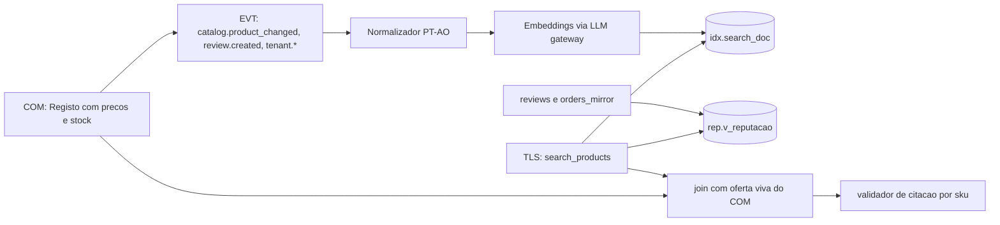
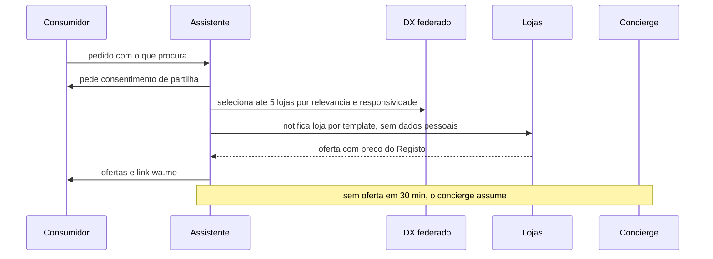

# Índice, Pesquisa e Motor de Atenção — KAMBÁ

| Campo | Valor |
|---|---|
| Produto | KAMBÁ (nome de trabalho) — plataforma WhatsApp-native de comércio conversacional para Angola |
| Documento | Técnica — Índice, Pesquisa e Motor de Atenção (IDX) |
| Versão | 1.0 |
| Data | Outubro de 2026 |
| Classificação | Documento de Referência — Interno |
| Documento-fonte | `../exploracao/11-arquitetura-detalhada-engenharia.md` §7, `../exploracao/13-big-picture-ecossistema.md` §9.1, `../exploracao/06-expansao-plataforma.md`, `../exploracao/03-modelo-plataforma-google-angola.md` |
| Evidência | `evidencia/E1_Meta_WhatsApp.md`, `evidencia/E3_Regulatorio_Dados.md`, `evidencia/E4_Stack_Licencas.md` |
| Documentos relacionados | `00_Arquitectura_Solucao.md`, `01_Canais_WhatsApp_Fluxo_Dual.md`, `02_Agent_Runtime_Verticais.md`, `03_Core_Comercio_Medusa.md`, `06_Dados_Eventos_Analytics.md`, `08_Seguranca_Conformidade.md` |

> **Estado das afirmações.** Segue a convenção do `00_Arquitectura_Solucao.md`: **CONFIRMADO** (fonte primária), **INDÍCIO** (fonte secundária ou conhecimento não relido nesta sessão), **NÃO VERIFICADO**. O SQL deste documento foi escrito para PostgreSQL 18 + pgvector 0.8.7 e **verificado por leitura, não executado** (sem instância disponível na sessão de redacção): o §6.4 traz o *script* de teste que o torna executável em CI. Nada aqui é aconselhamento jurídico; o que toca APD, Meta, BNA ou AGT leva «(a confirmar por parecer)».

---

## 1. Introdução
### 1.1 Propósito
Este documento especifica o **IDX** — o componente que responde a «o que é que esta loja (ou, mais tarde, este cluster) vende que corresponda ao que o cliente escreveu ou disse». Faz três coisas: (1) **corrige e substitui** a query de pesquisa híbrida do doc 11 §7, que não corre como está escrita e viola o ADR-007; (2) fixa o desenho do índice por tenant (Piloto) e do índice federado (Clusters), incluindo o problema do filtro por tenant em pgvector; (3) especifica, como **Diferido** e condicional, a camada de *atenção* — assistente de consumo, «quero comprar» e patrocínio (AdsEngine) — para que as costuras fiquem definitivas sem construir o que ainda não pode ser posto em produção.

A pesquisa é *recuperação de candidatos*; **nunca é fonte de preço nem de stock**. Essas duas grandezas só existem no Registo (COM) e entram na resposta por *join* no momento da resposta, sob o validador de citação (ADR-007).

### 1.2 Âmbito
Cobre: normalização PT-AO, modelo de dados do índice, pesquisa híbrida, filtro por tenant em pgvector, índice por tenant vs federado, ranking e reputação, vitrine SEO, métricas e dataset de avaliação de pesquisa, e o desenho condicional das capacidades Diferidas. Fora de âmbito: o grafo conversacional e o validador de citação (`02`), o Registo e o *pipeline* Catálogo AI (`03`), os contratos de eventos e o *outbox* (`06`), o isolamento e a conformidade (`08`), a geo-logística (GEO, Clusters).

### 1.3 Audiência
Engenheiros de dados, pesquisa e runtime (tool `search_products`), responsáveis de produto (ranking, patrocínio) e revisão de conformidade (APD, Meta).

### 1.4 Definições e termos
- **Candidato:** produto devolvido pelo IDX com *score* de relevância; **ainda sem preço nem stock**.
- **Oferta viva:** vista de leitura do COM (preço, stock, publicação) lida no momento da resposta.
- **RRF (Reciprocal Rank Fusion):** fusão de listas ordenadas por `Σ peso / (k + posição)`; dispensa calibrar escalas de *scores* heterogéneos.
- **Modo lexical:** pesquisa só por trigramas + FTS, sem embedding; é o *fallback* quando o fornecedor de embeddings falha ou a transferência não está autorizada (ADR-008).
- **Índice por tenant:** documentos de um único tenant; **índice federado:** documentos de vários tenants de um cluster, visíveis só com *opt-in* (Clusters).
- **Procura invertida («quero comprar»):** o consumidor publica o que procura e as lojas respondem com oferta.
- **Fase:** **P** Piloto, **C** Clusters, **D** Diferido.

## 2. Princípios e decisões aplicáveis (ADRs)
| ADR | Decisão (doc 00 §8) | Aplicação neste documento |
|---|---|---|
| ADR-003 | Medusa v2 sujeito a spike; **índice de pesquisa próprio** | O IDX não depende do modelo interno do Medusa: recebe `catalog.product_changed` (doc 06) e referencia produtos por `product_ref` opaco. Mudar de D3 não muda o índice. |
| ADR-006 | Postgres 18 único; pgvector ≥ 0.8.7; filtro por tenant com `iterative_scan` ou partição | §7: Piloto sem índice ANN (busca exacta por tenant); Clusters com partição + `hnsw.iterative_scan`. |
| ADR-007 | Preço e stock nunca em embeddings nem prompts; validador de citação | §4.2 (colunas proibidas), §6.3 (*join* vivo), §6.1 defeito D4. Acrescenta-se a verificação por `sku` citado, como pede o ADR. |
| ADR-008 | Nenhum dado pessoal de produção sai de Angola sem procedimento APD | O **texto da consulta do cliente** enviado a um fornecedor de embeddings é transferência (INDÍCIO, `evidencia/E3` §2): o modo lexical é obrigatório (§6.5). |
| ADR-010 | BSUID/HMAC, telefone nunca é chave; logs sem conteúdo | `contact_id` substitui `cliente_msisdn`; pesos e consultas sem identificadores (§9, §11). |
| ADR-011 | Fluxo dual como costura; só Fluxo A em produção | §10, §11, §12: tudo o que pressupõe o número da plataforma é **Diferido**. |
| ADR-013 | Pagamento só por evento autenticado | Prova de conversão do patrocínio e elegibilidade de reviews só contam pagamento autenticado (§9.3, §12.4). |
| ADR-001 / `evidencia/E1` | Cloud API oficial; sem gateway não-oficial | **Assistente em grupos de bairro removido** (§13.4): a Groups API não admite bots em grupos de terceiros (CONFIRMADO). |

**Divergências deliberadas face à biblioteca** (cada uma justificada no ponto indicado): query híbrida (§6.1); `p.stock` no índice (§6.1); `tenant_estado` desnormalizado (§4.3); `cliente_msisdn` em `orders_mirror` e `msisdn_hash` em `assistant_queries` (§9.3 e doc 06); Postgres 16 → 18 e MinIO fora (`evidencia/E4` §4); «assistente em grupos» (§13.4).

## 3. Visão e faseamento


| Capacidade | Fase | Condição de entrada |
|---|---|---|
| Índice por tenant, pesquisa híbrida, normalização PT-AO, modo lexical | **P** | — |
| Dataset de avaliação e métricas de pesquisa | **P** | Concierge/H7 a gerar conversas reais (`../exploracao/14` §3) |
| Reputação por pedido (`v_reputacao`), sem uso no ranking intra-tenant | **P** (recolha) / **C** (ranking) | Ver §9.1 |
| Índice federado por cluster, ranking com reputação + proximidade, vitrine SEO | **C** | Densidade por cluster e categoria; opt-in da PME; GEO |
| Assistente de consumo (Fluxo B), «quero comprar», leads | **D** | D2 (resposta escrita da Meta) + parecer APD (D1) |
| AdsEngine | **D** | Linhas de receita 1–3 provadas (`../exploracao/03` §4) e Fluxo B activo |

## 4. Modelo de dados do índice
### 4.1 Extensões, configuração FTS e *helper*
```sql
CREATE EXTENSION IF NOT EXISTS vector;      -- >= 0.8.7 (E4: corrige buffer overflow IVFFlat)
CREATE EXTENSION IF NOT EXISTS pg_trgm;
CREATE EXTENSION IF NOT EXISTS unaccent;
CREATE SCHEMA IF NOT EXISTS idx;
CREATE OR REPLACE FUNCTION idx.f_unaccent(text) RETURNS text LANGUAGE sql IMMUTABLE PARALLEL SAFE STRICT
  AS $$ SELECT public.unaccent('public.unaccent'::regdictionary, $1) $$;
CREATE TEXT SEARCH CONFIGURATION idx.kamba_pt (COPY = pg_catalog.portuguese);
ALTER TEXT SEARCH CONFIGURATION idx.kamba_pt
  ALTER MAPPING FOR hword, hword_part, word WITH public.unaccent, pg_catalog.portuguese_stem;
```

### 4.2 `idx.search_doc` — um documento por produto
```sql
CREATE TABLE idx.search_doc (
  doc_id           uuid PRIMARY KEY DEFAULT gen_random_uuid(),
  tenant_id        uuid NOT NULL REFERENCES tenants(id),
  product_ref      text NOT NULL,                 -- id opaco no COM; NUNCA preço/stock (ADR-007)
  norm_versao      int  NOT NULL,                 -- versão do dicionário aplicada; reindexa quando muda
  nome_norm        text NOT NULL,                 -- minúsculas, sem acentos, marca/unidade canónicas
  marca_canon text, categoria_canon text,
  descr_norm       text NOT NULL DEFAULT '',
  zona             text,                          -- herdada do tenant, só para filtro grosseiro
  visivel          boolean NOT NULL DEFAULT true, -- publicado e tenant activo (actualizado por evento)
  visivel_federado boolean NOT NULL DEFAULT false,-- opt-in explícito da PME (Clusters)
  embedding        halfvec(1024),                 -- NULL => só modo lexical; dimensão = modelo (§7.4)
  embedding_modelo text,
  fts tsvector GENERATED ALWAYS AS (
        setweight(to_tsvector('idx.kamba_pt'::regconfig, nome_norm), 'A')
     || setweight(to_tsvector('idx.kamba_pt'::regconfig, coalesce(marca_canon, '')), 'A')
     || setweight(to_tsvector('idx.kamba_pt'::regconfig, coalesce(categoria_canon, '')), 'B')
     || setweight(to_tsvector('idx.kamba_pt'::regconfig, descr_norm), 'C')) STORED,
  atualizado_at    timestamptz NOT NULL DEFAULT now(),
  UNIQUE (tenant_id, product_ref)
);
CREATE INDEX search_doc_fts_gin   ON idx.search_doc USING gin (fts);
CREATE INDEX search_doc_nome_trgm ON idx.search_doc USING gin (nome_norm gin_trgm_ops);
CREATE INDEX search_doc_tenant    ON idx.search_doc (tenant_id) WHERE visivel;
-- Piloto: NENHUM índice ANN (hnsw/ivfflat) sobre embedding. Ver §7.
```

**Regras duras (testadas em CI):** (a) nenhuma coluna do schema `idx` se chama ou contém `preco`, `price`, `stock`, `qtd`; (b) o texto que gera o embedding passa por um *lint* que rejeita dígitos seguidos de `kz`/`akz`/`$` e as palavras «stock», «disponível», «preço»; (c) o `descr_norm` vem do catálogo da PME, não de mensagens de clientes. Razão: um preço dentro de um vector é um preço que ninguém consegue citar nem corrigir.

### 4.3 Estado do tenant: sem desnormalização
O doc 11 §7 filtra `tenant_estado='ativo'` como se fosse coluna de `products`. Uma coluna copiada fica velha no instante em que o tenant é suspenso (`ativo → suspenso`, doc 00 §6.2). Desenho corrigido, em **dupla defesa**: (1) `visivel` é mantida pelo consumidor de `tenant.suspended`/`tenant.activated` e `catalog.product_changed` (efeito em segundos); (2) a função de pesquisa **junta `tenants` e exige `estado = 'ativo'`** em cada chamada (§6.2). Se o consumidor atrasar ou falhar, a junção impede que um tenant suspenso apareça.

### 4.4 Dicionário PT-AO
```sql
CREATE TABLE idx.termo_canonico (
  id         bigint GENERATED ALWAYS AS IDENTITY PRIMARY KEY,
  tenant_id  uuid REFERENCES tenants(id),         -- NULL = global; o do tenant prevalece
  tipo       text NOT NULL CHECK (tipo IN ('marca','unidade','sinonimo','erro_comum','stopword')),
  termo      text NOT NULL,                       -- minúsculas, sem acentos
  canonico   text NOT NULL,
  peso       real NOT NULL DEFAULT 1.0 CHECK (peso > 0 AND peso <= 1),
  origem     text NOT NULL CHECK (origem IN ('ops','catalogo','dataset','tenant')),
  activo     boolean NOT NULL DEFAULT true,
  aprovado_por text,
  criado_at  timestamptz NOT NULL DEFAULT now()
);
CREATE UNIQUE INDEX termo_canonico_uq
  ON idx.termo_canonico (COALESCE(tenant_id, '00000000-0000-0000-0000-000000000000'::uuid), tipo, termo)
  WHERE activo;
```

Cada alteração incrementa `idx.norm_versao` global; um *worker* reindexa em segundo plano os documentos com `norm_versao` anterior (marcas, unidades e números são canonizados **no índice e na consulta**; sinónimos só **na consulta**, para que alterar um sinónimo não obrigue a reindexar).

## 5. Normalização PT-AO
### 5.1 Pipeline (determinístico, sem LLM)
```
normalizar(texto, tenant_id, origem: 'texto' | 'voz'):
  1. NFKC; minúsculas; f_unaccent; remover emojis e pontuação; colapsar espaços
  2. se origem == 'voz': converter números por extenso ("duzentos e cinquenta mil" -> 250000)
  3. extrair restrições numéricas  -> {max_preco_minor, min_preco_minor, qtd}  (§5.2)  -- NÃO vão ao índice
  4. canonizar unidades            ("litros","lt","l" -> l ; "giga","gb" -> gb ; "polegadas","pol",'"' -> pol)
  5. canonizar marcas              (tabela tipo='marca', tenant > global)
  6. corrigir erros comuns         (tabela tipo='erro_comum'), depois typo por vocabulário (§5.3)
  7. remover stopwords de domínio  ("quero","queria","tem","vende","aí","por favor","mano","meu")
  8. expandir sinónimos            (tipo='sinonimo') -> q_or = "geleira or frigorifico"   (só consulta)
  9. devolver {q_norm, q_or, restricoes, tokens_nao_resolvidos, norm_versao}
```

Exemplos de dicionário (**ilustrativos**; o léxico real é curado por *ops* e validado contra o dataset do §14, e não foi verificado com falantes — NÃO VERIFICADO):

| tipo | termo | canónico | nota |
|---|---|---|---|
| sinonimo | `geleira` | `frigorifico` | regionalismo; expansão com peso < 1 |
| sinonimo | `telemovel`, `celular`, `telefone` | `telemovel` | atenção a «telefone fixo» (ambíguo → perguntar) |
| marca | `ifone`, `aifone`, `i phone` | `iphone` | marca canónica `apple` em `marca_canon` |
| erro_comum | `niker`, `naike` | `nike` | |

### 5.2 Números, moeda e restrições
O preço que o cliente diz é **restrição**, não texto de índice. É extraído no passo 3 e aplicado sobre a **oferta viva** (§6.3), nunca sobre o índice. O cliente fala em Kz; as restrições são guardadas na **unidade menor inteira** (cêntimos de AOA, dicionário §2), daí o factor 100 entre a coluna da esquerda e a da direita.

| Entrada | Saída |
|---|---|
| `até 250 mil`, `no máximo 250k`, `menos de 250.000 kz` | `max_preco_minor = 25000000` |
| `entre 100 e 150 mil` | `min=10000000, max=15000000` |
| `250 mil` sem verbo de limite | `alvo_preco_minor = 25000000` (ordena por proximidade, não filtra) |
| `kz`, `kwanza(s)`, `akz`, `kuanza` | moeda AOA; qualquer outra moeda → pergunta |

### 5.3 Typos e «não resolvido»
Vocabulário do tenant obtido de `ts_stat('SELECT fts FROM idx.search_doc WHERE tenant_id = ''…''')`. Para cada *token* fora do vocabulário: candidato = lexema de maior `similarity()` com frequência como desempate; **auto-correcção só se** `similarity ≥ 0.6` **e** a consulta corrigida devolve ≥ 1 candidato; caso contrário o token vai em `tokens_nao_resolvidos` e o AGR pergunta (uma pergunta, não duas). *Tokens* não resolvidos agregados alimentam a revisão semanal do dicionário por *ops* — sem texto bruto nem `contact_id` (ver §14.4 e a ressalva Meta §4.7 em §17).

## 6. Pesquisa híbrida (substitui o doc 11 §7)
### 6.1 Diagnóstico da query do doc 11
| # | Defeito | Consequência | Correcção |
|---|---|---|---|
| D1 | **Aliases inexistentes.** O `SELECT` usa `s.s`, `t.t`, `f.f`, mas `sem` nunca é junto e `tri`/`fts` são juntos sem alias `t`/`f` | A query falha com *missing FROM-clause entry* | Aliases explícitos `s`, `t`, `f` em *joins* sobre `doc_id` |
| D2 | **`UNION` de `(id,s)`, `(id,NULL)`, `(id,NULL)`** | Um produto nos três ramos aparece em 3 linhas (os pares diferem); os *scores* dos ramos `tri`/`fts` são descartados e recuperados por *joins* que multiplicam linhas | `UNION` só de `doc_id`; posições por ramo em *joins* à esquerda |
| D3 | **Sem filtro de tenant** (só `tenant_estado='ativo'`) e estado desnormalizado | Pesquisa devolve produtos de todas as lojas; estado velho | `tenant_id` obrigatório (Piloto) + junção a `tenants.estado='ativo'` (§4.3) |
| D4 | **`p.stock > 0` e `p.zona` no índice** | Contradiz ADR-007 (stock fora do índice); stock fica velho | Stock/preço só no *join* vivo (§6.3) |
| D5 | **`LIMIT 40` sem `ORDER BY`** em `tri` e `fts` | Os 40 candidatos são arbitrários; o resultado varia entre execuções | `ORDER BY` do *score* do ramo antes do `LIMIT` |
| D6 | **`ts_rank` cru somado a cosseno e trigrama** | `ts_rank` é pequeno e sem limite superior (escala ≠ 0..1); o peso 0.2 nominal torna-se arbitrário | Fusão por **posição** (RRF); em alternativa `ts_rank(...,32)` (= `r/(r+1)`, em 0..1) |
| D7 | **`plainto_tsquery`** | Semântica E: uma palavra sem correspondência anula o FTS inteiro | `websearch_to_tsquery` com `or` entre termos e sinónimos |
| D8 | **`similarity()` + `%`** sobre nome longo com consulta curta | Limiar 0.3 sobre trigramas do nome *inteiro* penaliza consultas curtas | `word_similarity` com `<%` (limiar ajustado, §6.4) |
| D9 | **`ORDER BY score*0.7 + COALESCE(avg_nota,3)/5*0.3`** | Nota é por tenant (constante dentro de um tenant, logo inútil no Piloto); média crua sem prior favorece lojas com 1 review | Reputação Bayesiana, só com >1 tenant (§9); o filtro `p.zona = :zona` por igualdade (também errado: perde lojas a 300 m noutro bairro) passa a proximidade contínua |

### 6.2 Versão corrigida — `idx.candidatos`
```sql
CREATE OR REPLACE FUNCTION idx.candidatos(
  p_tenant uuid,
  p_q_norm text,                 -- consulta normalizada (§5)
  p_q_or   text,                 -- termos+sinónimos separados por ' or '
  p_qvec   halfvec DEFAULT NULL, -- NULL => modo lexical
  p_k      int     DEFAULT 40,
  p_w_sem  real    DEFAULT 0.5,
  p_w_tri  real    DEFAULT 0.3,
  p_w_fts  real    DEFAULT 0.2,
  p_rrf_k  int     DEFAULT 60)
RETURNS TABLE (o_doc_id uuid, o_product_ref text, o_score real,
               o_rk_sem int, o_rk_tri int, o_rk_fts int)
LANGUAGE sql STABLE PARALLEL SAFE AS $$
WITH tn AS (                       -- porta de tenant activo (dupla defesa, §4.3)
  SELECT t.id FROM tenants t WHERE t.id = p_tenant AND t.estado = 'ativo'
),
q AS (SELECT websearch_to_tsquery('idx.kamba_pt'::regconfig, p_q_or) AS tsq),
sem AS (
  SELECT s.doc_id, row_number() OVER (ORDER BY s.dist, s.doc_id) AS rk
  FROM (SELECT d.doc_id, d.embedding <=> p_qvec AS dist
          FROM idx.search_doc d JOIN tn ON tn.id = d.tenant_id
         WHERE d.visivel AND p_qvec IS NOT NULL AND d.embedding IS NOT NULL
         ORDER BY d.embedding <=> p_qvec
         LIMIT p_k) s
),
tri AS (
  SELECT s.doc_id, row_number() OVER (ORDER BY s.sc DESC, s.doc_id) AS rk
  FROM (SELECT d.doc_id, word_similarity(p_q_norm, d.nome_norm) AS sc
          FROM idx.search_doc d JOIN tn ON tn.id = d.tenant_id
         WHERE d.visivel AND p_q_norm <% d.nome_norm
         ORDER BY sc DESC
         LIMIT p_k) s
),
fts AS (
  SELECT s.doc_id, row_number() OVER (ORDER BY s.sc DESC, s.doc_id) AS rk
  FROM (SELECT d.doc_id, ts_rank(d.fts, q.tsq, 32) AS sc
          FROM idx.search_doc d JOIN tn ON tn.id = d.tenant_id CROSS JOIN q
         WHERE d.visivel AND d.fts @@ q.tsq
         ORDER BY sc DESC
         LIMIT p_k) s
),
cand AS (SELECT doc_id FROM sem UNION SELECT doc_id FROM tri UNION SELECT doc_id FROM fts)
SELECT d.doc_id, d.product_ref,
       (COALESCE(p_w_sem / (p_rrf_k + s.rk), 0)
      + COALESCE(p_w_tri / (p_rrf_k + t.rk), 0)
      + COALESCE(p_w_fts / (p_rrf_k + f.rk), 0))::real,
       s.rk::int, t.rk::int, f.rk::int
FROM cand c
JOIN idx.search_doc d ON d.doc_id = c.doc_id
LEFT JOIN sem s ON s.doc_id = c.doc_id
LEFT JOIN tri t ON t.doc_id = c.doc_id
LEFT JOIN fts f ON f.doc_id = c.doc_id
ORDER BY 3 DESC, d.doc_id
LIMIT p_k;
$$;
```

Notas de execução: (i) o chamador faz `BEGIN; SET LOCAL pg_trgm.word_similarity_threshold = 0.45; SELECT …; COMMIT;` — o padrão do pg_trgm é 0.6 (INDÍCIO, manual do PostgreSQL não relido nesta sessão) e `word_similarity('niker','nike air force 1')` ≈ 0.57 calculado à mão, logo o limiar por omissão perde o *typo* mais comum; o valor final sai do dataset (§14); (ii) com pesos que somam 1, o máximo teórico do RRF é `1/(p_rrf_k+1)`, usado na normalização do §9.2; (iii) `p_rrf_k = 60` é o valor convencional de RRF (INDÍCIO), a afinar no dataset; a alternativa linear (`0.5·(1−dist) + 0.3·word_similarity + 0.2·ts_rank(…,32)`) é mais sensível a limiares e a trocas de modelo de embeddings — por isso não é a recomendada; (iv) **modo lexical**: `p_qvec = NULL` anula o ramo `sem` sem alterar a função.

### 6.3 Camada de resposta — *join* com a oferta viva (ADR-007)
Executada **dentro** da tool `search_products` da TLS (`tenant_id` vem do estado, nunca do texto). `com.v_oferta_viva` é um **contrato de leitura do COM** (nome ilustrativo; depende do spike D3), não DDL deste documento.

```sql
-- $1 tenant, $2 q_norm, $3 q_or, $4 halfvec|NULL, $5 max_preco_minor|NULL
SELECT c.o_product_ref, c.o_score, v.sku, v.nome, v.preco_minor, v.preco_tipo, v.stock_disp
FROM idx.candidatos($1, $2, $3, $4) c
JOIN com.v_oferta_viva v ON v.tenant_id = $1 AND v.product_ref = c.o_product_ref
WHERE v.publicado AND v.stock_disp > 0 AND ($5::bigint IS NULL OR v.preco_minor <= $5)
ORDER BY c.o_score DESC, v.preco_minor ASC
LIMIT 3;
```

Contrato de saída da tool: `[{sku, product_ref, nome, preco_minor, preco_tipo ('fixo'|'a_partir_de'|'sob_consulta'), disponivel, fonte:'registo', lido_em}]`. `preco_minor` vem em cêntimos de AOA (dicionário §2), não em Kz inteiros. O validador de citação (doc 02) aceita **só** `sku` e números presentes neste *output*; resposta com `sku` ausente é rejeitada (cobre «produto errado com preço certo», a lacuna que o ADR-007 assinala). Se o filtro vivo deixar < 3 resultados, o AGR oferece os *indisponíveis* marcados «sem stock — avisar quando houver» e, com `max_preco_minor`, o mais próximo acima do limite.

### 6.4 Teste executável (CI)
```sql
BEGIN;
SET LOCAL pg_trgm.word_similarity_threshold = 0.45;
DO $$
DECLARE tA uuid := gen_random_uuid(); tB uuid := gen_random_uuid(); tS uuid := gen_random_uuid(); n int;
BEGIN
  INSERT INTO tenants(id,tipo,nome,telefone,estado) VALUES
    (tA,'pme','Loja A','+244900000001','ativo'), (tB,'pme','Loja B','+244900000002','ativo'),
    (tS,'pme','Loja S','+244900000003','suspenso');
  INSERT INTO idx.search_doc(tenant_id,product_ref,norm_versao,nome_norm,marca_canon,descr_norm) VALUES
    (tA,'p1',1,'nike air force 1 branco','nike','tenis'),
    (tA,'p2',1,'frigorifico lg 250 l','lg','geleira combinada'),
    (tB,'p3',1,'nike air max','nike','tenis'),
    (tS,'p4',1,'nike air force 1','nike','tenis');
  -- T1 typo: 'niker' encontra o produto de A, só de A
  SELECT count(*) INTO n FROM idx.candidatos(tA,'niker','niker'); ASSERT n = 1, 'T1';
  -- T2 isolamento: nenhum resultado de B ou S ao pesquisar em A
  SELECT count(*) INTO n FROM idx.candidatos(tA,'nike','nike')
   JOIN idx.search_doc d ON d.doc_id = o_doc_id WHERE d.tenant_id <> tA; ASSERT n = 0, 'T2';
  -- T3 tenant suspenso: zero resultados
  SELECT count(*) INTO n FROM idx.candidatos(tS,'nike','nike'); ASSERT n = 0, 'T3';
  -- T4 sinónimo: 'geleira' só existe em descr_norm; bate via FTS com a expansão
  SELECT count(*) INTO n FROM idx.candidatos(tA,'geleira','geleira or frigorifico'); ASSERT n = 1, 'T4';
END $$;
ROLLBACK;                              -- o teste não deixa dados
```

Os valores esperados de T1/T4 dependem do limiar e do *stemming*; se algum falhar por arredondamento, o teste é corrigido com o limiar do dataset — **não** com a remoção da asserção. (Em `pgTAP`, converter as `ASSERT` em `is()`/`cmp_ok()` na mesma transacção.)

### 6.5 Transferência (ADR-008) e modo lexical
O embedding da **consulta** envia texto do cliente (pode conter nome, bairro, o que procura; saúde → dado sensível, `evidencia/E3` §1) a um fornecedor no estrangeiro: transferência por defeito (INDÍCIO). O embedding do **catálogo** envia dados comerciais da PME (menor risco; nome e contacto da PME não entram no texto). Regra de execução, por tenant: se `allowed_destinations` não inclui o país do fornecedor de embeddings (campo `evidencia/E3` req. 5), o IDX corre em **modo lexical** (`p_qvec = NULL`) — *fail closed* para o dado, aberto para o serviço. Duas saídas técnicas para tirar o embedding da fronteira: modelo de embeddings *self-host* em Luanda (D1) ou aceitar lexical no Piloto. A qualidade lexical vs híbrida mede-se no dataset (§14) antes de se decidir se o embedding vale a transferência.

## 7. pgvector e filtro por tenant
### 7.1 O problema (CONFIRMADO, README do pgvector lido a 2026-10-08)
Com índice aproximado (HNSW/IVFFlat) o filtro `WHERE tenant_id = X` é aplicado **depois** de o índice devolver os vizinhos (`hnsw.ef_search` = 40 por omissão). Se um tenant tem 0,1% dos vectores, a lista inicial de 40 contém ~0 documentos do tenant e a query devolve **vazio** — sem erro. É o modo de falha mais perigoso: parece «a loja não tem esse produto».

### 7.2 Opções e decisão
| Opção | Funciona quando | Custo | Fase |
|---|---|---|---|
| A. **Sem índice ANN; busca exacta** com `btree(tenant_id)` | Catálogo por tenant ≲ alguns milhares de vectores | Recall 100%; latência ∝ n do tenant (ordem de ms — **medir**) | **P** |
| B. `hnsw.iterative_scan = relaxed_order` + `max_scan_tuples` | Filtro de selectividade média | Continua a varrer o índice até ter resultados ou atingir o limite (20 000 por omissão); tenant raro pode ainda ficar curto | C (complemento) |
| C. **Partição** (por cluster ou *hash* de tenant) + HNSW por partição | Muitos tenants, clusters pequenos | Gestão de partições; *pruning* só com `cluster_id`/`tenant_id` na query | **C** |

**Decisão (proposta PROP-IDX-1):** Piloto = opção A. Sem HNSW em `idx.search_doc` até que o *total* de vectores ou o p95 do ramo `sem` ultrapassem os limiares do §15 (valores iniciais: > 200 000 vectores ou p95 > 100 ms). Clusters = C (+ B). Se algum dia existir HNSW sobre a tabela e o planeador o escolher para uma query filtrada por tenant, aplica-se a salvaguarda do §7.3.

### 7.3 Variante Clusters — partição por cluster + *iterative scan*
```sql
CREATE TABLE idx.search_doc_c (
  LIKE idx.search_doc INCLUDING DEFAULTS INCLUDING GENERATED,   -- inclui a coluna gerada fts
  cluster_id smallint NOT NULL,
  PRIMARY KEY (cluster_id, doc_id)
) PARTITION BY LIST (cluster_id);
CREATE TABLE idx.search_doc_c_1 PARTITION OF idx.search_doc_c FOR VALUES IN (1);
CREATE INDEX ON idx.search_doc_c USING hnsw (embedding halfvec_cosine_ops)
  WITH (m = 16, ef_construction = 64);
-- por query (SET LOCAL dentro da transacção):
SET LOCAL hnsw.iterative_scan   = 'relaxed_order';
SET LOCAL hnsw.max_scan_tuples  = 20000;
SET LOCAL hnsw.ef_search        = 80;
WITH ann AS MATERIALIZED (            -- relaxed_order pode desordenar ligeiramente: reordenar fora (README)
  SELECT doc_id, embedding <=> $1 AS dist
    FROM idx.search_doc_c
   WHERE cluster_id = $2 AND tenant_id = $3 AND visivel
   ORDER BY embedding <=> $1 LIMIT 40)
SELECT doc_id, dist FROM ann ORDER BY dist;
```

(`LIKE` não replica a `UNIQUE (tenant_id, product_ref)`; a migração Clusters redefine-a como `UNIQUE (cluster_id, tenant_id, product_ref)`, que inclui a chave de partição.)

**Salvaguarda anti-vazio (obrigatória com qualquer ANN):** `n_esperado = LEAST(p_k, contagem de documentos visíveis do tenant)`; se o ramo `sem` devolver menos de `n_esperado`, repetir **exacto** (`SET LOCAL enable_indexscan = off`) e registar a métrica `idx_ann_fallback_total{tenant}`. **Teste de CI:** para cada tenant do ambiente de teste, `count(ANN) ≥ n_esperado` e `recall@40 vs exacto ≥ 0,95`; falha o *build*.

### 7.4 Dimensão e modelo
`halfvec` indexa até 4 000 dimensões; `vector` até 2 000 (README). `halfvec(1024)` reduz a metade a memória do HNSW face a `vector` (README recomenda `halfvec`). A dimensão é função do modelo de embeddings, **ainda por decidir** (PROP-IDX-4): o critério é qualidade em PT-AO no dataset do §14, custo e fronteira (§6.5). Cada linha guarda `embedding_modelo`; trocar de modelo = recalcular tudo para uma coluna nova e comutar atomicamente (nunca misturar modelos na mesma coluna). Limite de escala de pgvector em número de vectores e RAM do HNSW: **NÃO VERIFICADO** com número (E4); os limiares do §15 são arranque, a medir.

## 8. Índice por tenant (Piloto) vs federado (Clusters)
| Dimensão | Por tenant (**P**) | Federado entre tenants (**C**) |
|---|---|---|
| **Densidade** | Uma PME tem 50–2 000 produtos; a pergunta do cliente é sobre *aquela* loja | Valor só surge com densidade por **categoria × bairro**: com poucas lojas, o federado devolve «nada perto» ou lojas irrelevantes |
| **Quem consulta** | AGR no Fluxo A (cliente já está na loja) | Vitrine web (C); assistente de consumo e «quero comprar» (D) |
| **Dados usados** | Catálogo da própria PME | **Só catálogo público** (nome, marca, categoria, zona, referência de foto) das PMEs com `visivel_federado = true` |
| **Privacidade** | Dado nunca sai do tenant (isolamento testado no CI) | Nenhum dado de conversa, de cliente ou de pedido entra no índice federado. Reputação entra como agregado (§9) |
| **Política Meta** | Compatível | A política proíbe partilhar informação de uma conversa com outro cliente e usar dados de uma pessoa para fim diferente de suportar a mensagem com essa pessoa (CONFIRMADO, `evidencia/E1` §4). Catálogo ≠ conversa, mas a recomendação «cruzada» só é segura se nunca usar sinais de conversas |
| **Consentimento da PME** | Contrato base | Cláusula expressa e *opt-in* revogável (`entitlements.modulo = 'indice_federado'`); revogação → `visivel_federado = false` em < 1 min |
| **Risco de abuso** | Baixo | *Keyword stuffing*, duplicados, preços-isco, categorias vetadas: moderação por T&S antes de `visivel_federado` |

Porque não federar já: (1) sem densidade, o federado devolve menos valor do que o índice por tenant e acrescenta superfície de risco; (2) sem resposta da Meta (D2) e sem parecer da APD o único consumidor federado legítimo seria a vitrine web, que só existe em Clusters; (3) o isolamento entre tenants é o requisito de segurança de maior peso do Piloto (`evidencia/E4` §5) e um índice partilhado alarga o âmbito dos testes cruzados.

## 9. Ranking e reputação
### 9.1 O que ordena o quê
| Contexto | Fase | Sinais |
|---|---|---|
| Intra-tenant (AGR no Fluxo A) | P | Relevância (RRF) → filtro vivo (publicado, stock, preço) → desempate por preço ascendente. **Sem reputação**: é constante dentro de um tenant (defeito D9). *Destaques* escolhidos pela própria PME (`destaque` no catálogo) como desempate explícito e visível ao dono |
| Inter-tenant (vitrine, federado) | C | Relevância, reputação, proximidade, responsividade (fórmula §9.2) |
| Posições patrocinadas | D | **Fora** do *score* orgânico; slot próprio e rotulado (§12) |

### 9.2 Fórmula (Clusters) — pesos como dados versionados
```sql
CREATE TABLE idx.ranking_pesos (
  versao int PRIMARY KEY, activo boolean NOT NULL DEFAULT false,
  w_rel real NOT NULL, w_rep real NOT NULL, w_prox real NOT NULL, w_resp real NOT NULL,
  d0_km real NOT NULL, rep_neutra real NOT NULL, prox_neutra real NOT NULL, resp_neutra real NOT NULL,
  CHECK (abs(w_rel + w_rep + w_prox + w_resp - 1.0) < 1e-6));
INSERT INTO idx.ranking_pesos VALUES (1, true, 0.60, 0.20, 0.12, 0.08, 3.0, 0.5, 0.5, 0.5);
CREATE OR REPLACE FUNCTION idx.dist_km(lat1 float8, lng1 float8, lat2 float8, lng2 float8)
RETURNS float8 LANGUAGE sql IMMUTABLE PARALLEL SAFE AS $$
  SELECT 111.32 * sqrt(power(lat2 - lat1, 2)
                     + power((lng2 - lng1) * cos(radians((lat1 + lat2) / 2)), 2)) $$;
```

`rank = w_rel·rel + w_rep·rep + w_prox·prox + w_resp·resp`, todos em 0..1, onde:
- `rel = LEAST(o_score · (p_rrf_k + 1), 1)` (válido com pesos de ramo a somar 1, §6.2);
- `rep = (nota_bayes − 1)/4` de `rep.v_reputacao`; **tenant sem reviews suficientes recebe `rep_neutra`**, nunca 0 (não penalizar o arranque a frio);
- `prox = exp(−dist_km / d0_km)`, com `d0_km` = 3 e `dist_km` do pin/zona do consumidor à loja; sem localização do consumidor → `prox_neutra`;
- `resp` = taxa de resposta ≤ 15 min nos últimos 30 dias (handoff/«quero comprar»), mínimo 5 amostras, senão `resp_neutra`.

Pesos 0.60/0.20/0.12/0.08 e `d0 = 3 km` são **propostas a calibrar** no dataset; alterar pesos exige nova `versao`, passagem no *gate* de avaliação (§14) e registo — a mesma disciplina de «pesos como política versionada». A `versao` usada fica no *log* da consulta para reprodutibilidade. Estimativa de distância: aproximação equiangular (erro irrelevante a < 20 km); `tenants.gps` assume-se `point(x=lng, y=lat)` (doc 11) e pode ser redefinido por `07` (GEO).

### 9.3 `v_reputacao` e defesas contra auto-compra
O doc 11 refere `v_reputacao` sem a definir. Definição (peso do review e elegibilidade vêm de um *job* separado, para que as regras evoluam sem recriar a vista):

```sql
CREATE SCHEMA IF NOT EXISTS rep;
CREATE TABLE rep.review_elegibilidade (
  review_id    uuid PRIMARY KEY REFERENCES reviews(id),
  elegivel     boolean NOT NULL,
  motivos      text[]  NOT NULL DEFAULT '{}',         -- regras que reduziram/anularam o peso
  peso         real    NOT NULL DEFAULT 1.0 CHECK (peso BETWEEN 0 AND 1),
  regras_versao text   NOT NULL,
  avaliado_at  timestamptz NOT NULL DEFAULT now());
CREATE TABLE rep.tenant_staff_contact (       -- contactos internos do tenant (R3, R6, R7)
  tenant_id uuid NOT NULL REFERENCES tenants(id), contact_id uuid NOT NULL,
  papel text NOT NULL CHECK (papel IN ('dono','funcionario','agente_activacao','familiar_declarado')),
  PRIMARY KEY (tenant_id, contact_id));
CREATE MATERIALIZED VIEW rep.v_reputacao AS
WITH base AS (
  SELECT o.tenant_id, o.contact_id, r.nota, e.peso
    FROM reviews r
    JOIN orders_mirror o         ON o.id = r.order_id
    JOIN rep.review_elegibilidade e ON e.review_id = r.id
   WHERE e.elegivel AND o.estado = 'entregue' AND o.pagamento_estado = 'paga'),
g AS (SELECT COALESCE(SUM(nota * peso) / NULLIF(SUM(peso), 0), 3.5) AS m FROM base),
t AS (SELECT tenant_id, COUNT(*) AS n, COUNT(DISTINCT contact_id) AS n_contactos,
             SUM(peso) AS n_eff, SUM(nota * peso) AS soma
        FROM base GROUP BY tenant_id)
SELECT t.tenant_id, t.n, t.n_contactos, t.n_eff,
       (5.0 * g.m + t.soma) / (5.0 + t.n_eff) AS nota_bayes,   -- prior de 5 reviews na média global
       now() AS calculado_at
  FROM t CROSS JOIN g;
CREATE UNIQUE INDEX ON rep.v_reputacao (tenant_id);              -- permite REFRESH ... CONCURRENTLY
```

Refresco nocturno + incremental por `review.created`/`review.removed` (doc 06). `orders_mirror.contact_id` **substitui** `cliente_msisdn` (ADR-010; correcção a registar em `03`/`06`).

**Regras de elegibilidade/peso** (o *job* escreve `motivos`; nenhuma regra é infalível — são camadas de dissuasão e detecção, não garantia):

| Regra | Efeito | Fonte |
|---|---|---|
| R1 Só pedido `entregue` **e** `paga` por evento autenticado (ADR-013). Pagamento por `ManualProvider` pesa ≤ 0,5 | prevenção | `payment_events`, `orders_mirror` |
| R2 Um review por pedido (já `UNIQUE`); um mesmo `contact_id` > 2 reviews/tenant/90 d → peso 1/n | dissuasão | `reviews` |
| R3 `contact_id` ∈ `tenant_staff_contact` (dono, funcionários, agente de activação) → inelegível | prevenção | registo de contactos internos do tenant |
| R4 Valor do pedido < `valor_min_review_minor` (parametrizável) → peso 0,3 | dissuasão (farming barato) | `orders_mirror` |
| R5 Contacto criado há < 24 h com 1.º pedido do tenant e review em < 2 h após entrega → peso 0,5 | detecção | `contacts`, `orders_mirror` |
| R6 > 40% das reviews do tenant em 7 d de ≤ 3 `contact_id` novos → *flag* para T&S, pesos a 0 até revisão | detecção | `rep.v_reputacao` |
| R7 Circularidade: tenants A e B com pedidos cruzados entre si em janela curta (contactos de staff de A compram em B e vice-versa) → *flag* T&S | detecção | grafo `(tenant_staff_contact × orders)` |
| R8 Mesmo instrumento de pagamento (referência do pagador, se o facilitador a expuser — depende de D4) em pedidos de tenants diferentes e reviews cruzadas → *flag* | detecção | `payment_events` (a confirmar com o contrato do facilitador) |

Mostra-se «novo» (sem estrelas) a tenants com `n_eff < 5`. O texto de review é dado pessoal (Lei 22/11): só se apresenta com consentimento específico do avaliador (a confirmar por parecer); a nota agregada não o exige.

## 10. Assistente de consumo (Diferido — Fluxo B, ADR-011)
**Estado:** nenhum grafo `assistente` é registado em produção no Piloto (doc 00 §5). Esta secção fixa o desenho **condicional** para que as costuras (CHR com `persona = assistente`, `origem = plataforma`, o IDX federado) fiquem definitivas.

**Condições de entrada (todas):**

| Gate | Condição | Estado |
|---|---|---|
| G1 | Resposta escrita da Meta: (i) número único operado por plataforma que responde sobre várias lojas é permitido e em que nome; (ii) o assistente não é «AI Provider» (funcionalidade principal vs complementar) — D2 | **NÃO VERIFICADO**; `evidencia/E1` perguntas 1–2 |
| G2 | Procedimento APD para o LLM/embeddings fora de Angola, ou modelo local em Luanda — D1 | (a confirmar por parecer) |
| G3 | Densidade mínima por cluster (proposta: ≥ 30 lojas activas e ≥ 5 em cada categoria-alvo) | métrica de produto |
| G4 | Liquidação directa por PME em B2 (ADR-004) com facilitador (D4) | pendente |
| G5 | Índice federado em Clusters com moderação T&S | §8 |

**Desenho condicional.**
- **Escopo de domínio fechado:** o assistente só responde a comércio (descobrir, comparar, reservar, falar com a loja). Perguntas fora de domínio recebem recusa neutra e são contadas (`resultado = 'fora_de_dominio'`); a taxa é a prova de que a IA é *meio* e não *funcionalidade principal* — o critério que a Meta aplica «a seu exclusivo critério» (CONFIRMADO, `evidencia/E1` §4). Alvo: ≥ 95% das mensagens em domínio.
- **Identifica-se como a plataforma**, nunca como a loja (a política proíbe personificar outro negócio). Não fecha vendas «em nome» da loja em B1: **entrega a conversa à loja** por link `https://wa.me/<número da loja>?text=<texto pré-preenchido com ref>`. O número do consumidor **não é transmitido** pela plataforma à loja: o consumidor inicia o chat com a loja e a loja vê-o na *sua* conversa. O código `ref` no texto atribui a encomenda à origem (`order.created.atribuicao`).
- **Sem cruzamento de conversas:** nenhum dado de conversa de uma loja chega ao contexto de outra; o BSUID é por portfólio (`evidencia/E1` §3), pelo que um consumidor tem identificadores distintos por tenant e a plataforma não deve tentar juntá-los por telefone.
- **Custos:** as mensagens de serviço do número da plataforma partilham o limite de 1 000 grátis/mês por número e pagam 0,004 USD depois (≈ 3,65 Kz a 913 AOA/USD) (CONFIRMADO, `evidencia/E1` §1); limite de 250 contactos novos/dia por portfólio. Um assistente que parta em 8 mensagens por sessão consome o escudo gratuito com ~125 sessões/mês: **o modelo de custos de B1/B2 tem de ser fechado antes de G3**.
- **Consentimento e aviso de IA** no 1.º contacto, registados (`consent_event`, doc 06 §7.3); *handoff* humano sempre disponível (Messaging Policy).

## 11. «Quero comprar» — procura invertida (Diferido; concierge no arranque)
O consumidor publica o que procura («portátil i5 até 350 mil, Cazenga») e as lojas da zona respondem. Contorna o *cold-start* do índice (`../exploracao/06` §2.3), mas **depende de as PMEs responderem**: um mercado que envia pedidos e recebe silêncio ensina o consumidor a desistir (`../exploracao/07` §7). Pressupõe o número da plataforma (consumidor → plataforma): **Diferido**.

```sql
CREATE TABLE idx.pedido_procura (
  id uuid PRIMARY KEY DEFAULT gen_random_uuid(), contact_id uuid NOT NULL,   -- nunca msisdn (ADR-010)
  texto_norm text NOT NULL, categoria text, zona text, max_preco_minor bigint,
  estado text NOT NULL DEFAULT 'aberto'
     CHECK (estado IN ('aberto','com_ofertas','fechado','expirado','cancelado','sem_resposta')),
  consentimento_partilha boolean NOT NULL,      -- sem isto não se contacta nenhuma loja
  criado_at timestamptz NOT NULL DEFAULT now(),
  expira_at timestamptz NOT NULL DEFAULT now() + interval '24 hours', primeira_oferta_at timestamptz);
CREATE TABLE idx.pedido_oferta (
  id uuid PRIMARY KEY DEFAULT gen_random_uuid(),
  pedido_id uuid NOT NULL REFERENCES idx.pedido_procura(id), tenant_id uuid NOT NULL REFERENCES tenants(id),
  notificado_at timestamptz, respondeu_at timestamptz,
  estado text NOT NULL DEFAULT 'notificado' CHECK (estado IN ('notificado','respondeu','ignorou','recusou')),
  UNIQUE (pedido_id, tenant_id));
```



**SLA e concierge (alvos de arranque, a calibrar):** notificação às lojas ≤ 60 s; primeira oferta p50 ≤ 15 min e p90 ≤ 60 min em horário comercial; **sem oferta aos 30 min → tarefa para o concierge** (equipa na caixa de entrada do HND) que contacta lojas por telefone/WhatsApp e responde ao consumidor; todo o pedido termina com resposta ao consumidor em ≤ 2 h («ofertas» ou «não encontrámos — aviso se aparecer»), nunca silêncio (princípio 12). Métricas: % pedidos com ≥ 1 oferta em 30 min; tempo até à primeira oferta; taxa de resposta por loja. **Penalização de lojas mudas:** `resp` entra no ranking (§9.2); 3 pedidos consecutivos ignorados → loja fora das notificações 7 dias; limite de 3 pedidos/dia/loja e *opt-out* por loja. A notificação à loja é mensagem iniciada pelo negócio (plataforma → dono): exige *opt-in* contratual do dono e *template* aprovado; a categoria Meta aplicável (utility vs marketing) é **NÃO VERIFICADO**. A cedência do contacto ao vendedor só ocorre quando o consumidor escolhe uma oferta e abre o link `wa.me` (finalidade específica, consentida). Se o lead for cobrado por CPL (linha de receita 2), o desenho de cobrança e a ligação a D8 ficam em `04`.

## 12. Patrocínio / AdsEngine (Diferido)
Vertical como qualquer outra (ADR-012): subscreve consultas agregadas, escreve *placements*, cobra via TEN/PAY. **Não entra** antes de as linhas de receita 1–3 estarem provadas (`../exploracao/03` §4: assinaturas, leads, comissão) e de existir Fluxo B com ≥ 10 000 consumidores activos (limiar do doc 03, hipótese). A Ayoba morreu por inverter a ordem (`../exploracao/03` Aviso 1).

### 12.1 Regras (invariantes de produto e de arquitectura)
| # | Regra | Verificação |
|---|---|---|
| A1 | **Rótulo «Patrocinado» visível** em toda a mensagem/página que contenha um resultado pago | Teste de contrato: 100% dos `placement.impression` têm `rotulo = true` |
| A2 | **Alternativa orgânica sempre presente**: a resposta inclui ≥ 1 resultado orgânico ordenado só pelo §9.2, e o patrocinado nunca o substitui | Teste: resposta com patrocinado ⇒ `n_organicos ≥ 1` |
| A3 | **Só em conversas iniciadas pelo utilizador**, nunca em mensagens iniciadas pelo negócio (sem *templates* publicitários) | `placement` exige `conversa.origem = 'utilizador'` |
| A4 | **Opt-in**: o utilizador aceitou, no 1.º contacto, a divulgação de sugestões patrocinadas; mensagens promocionais fora da janela exigem opt-in separado de marketing (Art. 19.º Lei 22/11; política Meta) | `consent_event.finalidade IN ('sugestoes_patrocinadas','marketing')` |
| A5 | **Segmentação só contextual**: categoria × zona × período. Sem *targeting* por perfil, histórico de conversas ou dados de outros tenants | O motor não tem acesso a `contact_id` |
| A6 | **Patrocínio não altera factos**: preço e stock vêm do COM; o patrocinado passa o mesmo validador | ADR-007 |
| A7 | **Categorias vetadas** (tabaco, álcool com restrições, saúde, jogos, crédito, armas) nunca patrocinadas; sem páginas/anúncios onde a política Meta ou a lei os restringem | Lista do T&S (`evidencia/E1` §4, `evidencia/E3` §5) |
| A9 | **Só depois das linhas de receita 1–3** | Gate de produto (feature flag `ads_engine`, desligada por defeito) |

Enquadramento: publicidade enganosa e dever de informação (Lei 15/03 Arts. 9.º e 21.º) e Lei Geral da Publicidade 9/17 (`evidencia/E3` §4–5, INDÍCIO); se um resultado patrocinado em *service message* é conteúdo «promocional» para a Meta é **NÃO VERIFICADO** — incluir na pergunta escrita D2.

### 12.2 Modelo comercial
Leilão **mensal** por slot `categoria × bairro × mês` (`../exploracao/03` §4 linha 4), não leilão em tempo real por utilizador: mais simples, auditável e sem *targeting* individual. Receita em Kz via a mesma `PaymentProvider` (billing, doc 00 TEN).

### 12.3 Dados
```sql
CREATE SCHEMA IF NOT EXISTS ads;
CREATE TABLE ads.placement (
  placement_id uuid PRIMARY KEY DEFAULT gen_random_uuid(),
  anunciante_tenant_id uuid NOT NULL REFERENCES tenants(id),
  categoria text NOT NULL, zona text NOT NULL, mes date NOT NULL, slot smallint NOT NULL DEFAULT 1,
  preco_minor bigint NOT NULL, estado text NOT NULL DEFAULT 'rascunho'
     CHECK (estado IN ('rascunho','activo','pausado','terminado')),
  UNIQUE (categoria, zona, mes, slot));
CREATE TABLE ads.conversao (
  order_id uuid PRIMARY KEY REFERENCES orders_mirror(id),      -- uma conversão por pedido
  placement_id uuid NOT NULL REFERENCES ads.placement, ref_codigo text NOT NULL,
  prova_event_id uuid NOT NULL,                                -- event_id do payment.confirmed autenticado
  janela_atribuicao_dias smallint NOT NULL DEFAULT 7, estornada boolean NOT NULL DEFAULT false,
  criado_at timestamptz NOT NULL DEFAULT now());
```

### 12.4 Prova de conversão por `order_id`
Cadeia de prova: `placement.impression` (conversa, slot, rótulo) → clique em `wa.me` com `ref_codigo` → conversa na loja anunciante → `order.created` com `atribuicao = ref` → `payment.confirmed` autenticado (ADR-013) → `order.delivered` (ou fim da janela de desistência) → linha em `ads.conversao`.

Uma conversão só é **provada** (e facturável como resultado) se: (a) o pagamento foi confirmado por evento autenticado do facilitador — `ManualProvider` não conta; (b) o pedido foi entregue ou terminou a janela de desistência (7 dias úteis, a confirmar por parecer — `evidencia/E3` §4); (c) `contact_id` ∉ `tenant_staff_contact` do anunciante; (d) sem reembolso na janela (se houver → `estornada = true`); (e) atribuição *last-touch* por `ref_codigo` dentro de 7 dias. O relatório ao anunciante é agregado com mínimo de 5 conversões por linha (sem `contact_id`). ROAS = receita paga atribuída / preço do slot.

## 13. Vitrine SEO (Clusters)
### 13.1 Arquitectura
Páginas geradas pelo `storefront` (Next.js, doc 11) por **loja** (`/{cluster}/{slug-da-loja}`) e por **categoria × bairro** (só com ≥ 3 lojas — evita conteúdo fino). Renderização no servidor com ISR (revalidação ≤ 5 min), sem JavaScript obrigatório para o conteúdo e o JSON-LD no HTML inicial (recomendação do Google para comerciantes, CONFIRMADO, `developers.google.com/search/docs/appearance/structured-data/product-snippet`). O preço e a disponibilidade são lidos da oferta viva no momento da renderização (ADR-007) e nunca de uma cópia do índice.

### 13.2 Marcação schema.org
Mínimos do Google (CONFIRMADO, leitura de 2026-10-08): `LocalBusiness` exige `name` e `address`; recomenda `geo` (≥ 5 casas decimais), `openingHoursSpecification`, `telephone`. `Product` exige `name` e, para *snippets*, pelo menos um de `review`, `aggregateRating` ou `offers`; `offers` leva `price` e `priceCurrency` (obrigatório para *merchant listings*); `availability` recomendada.

```json
{
  "@context": "https://schema.org",
  "@type": "LocalBusiness",
  "@id": "https://vitrine.kamba.example/luanda/boutique-maianga#loja",
  "name": "Boutique Maianga",
  "address": {"@type": "PostalAddress", "addressLocality": "Maianga", "addressRegion": "Luanda", "addressCountry": "AO"},
  "geo": {"@type": "GeoCoordinates", "latitude": -8.82345, "longitude": 13.23456},
  "openingHoursSpecification": [{"@type": "OpeningHoursSpecification",
      "dayOfWeek": ["Monday","Tuesday","Wednesday","Thursday","Friday"], "opens": "09:00", "closes": "18:00"}],
  "potentialAction": {"@type": "CommunicateAction", "target": "https://wa.me/244XXXXXXXXX?text=Ol%C3%A1%20%5Bref%3AV-8f3a%5D"},
  "makesOffer": {"@type": "Offer", "itemOffered": {"@type": "Product", "name": "Vestido azul M",
      "offers": {"@type": "Offer", "price": "18500", "priceCurrency": "AOA",
                 "availability": "https://schema.org/InStock", "priceValidUntil": "2026-11-15"}}}
}
```

(O exemplo é ilustrativo e não foi validado na Rich Results Test. A hierarquia `makesOffer/itemOffered` é só uma opção; a alternativa é um bloco `Product` por produto na página do produto. `aggregateRating` só com reviews verificados de `rep.v_reputacao` com `n ≥ 5`; avaliações «autopublicadas» sobre o próprio negócio podem ser ignoradas pelo Google — INDÍCIO.)

### 13.3 Regras
- **Consentimento da PME** para publicar (nome, morada, contacto público): cláusula contratual, revogável; `visivel_federado = false` retira a página (HTTP 410) e remove do *sitemap* (a confirmar por parecer quanto ao enquadramento de dados de empresário em nome individual).
- **O link `wa.me` expõe o número da PME**: é o número público do negócio; nunca o do dono se for pessoal (no onboarding, confirmar que é o número comercial).
- **Sem dados pessoais de clientes** na página (nem texto de reviews sem consentimento).
- `noindex` para tenants `suspenso`, em `onboarding`, sem catálogo mínimo ou em categorias vetadas (T&S); `hreflang="pt-AO"`; `canonical` por loja; `sitemap.xml` por cluster gerado a partir de `visivel_federado`.
- Atribuição: o texto pré-preenchido leva `ref:V-xxxx`; o CHR grava `origem_ref` na conversa e o AGR propaga-o para `order.created.atribuicao` (doc 06).
- Desempenho: LCP ≤ 2,5 s em 3G simulado, página ≤ 150 kB sem imagens; imagens via STO (SeaweedFS ou S3 gerido, ADR-014), nunca MinIO.
- Medição: páginas indexadas, impressões, cliques para `wa.me`, conversas com `ref`, pedidos pagos com `ref`. Tempo até indexação de um domínio novo e peso do SEO angolano no tráfego: **NÃO VERIFICADO**; tratar como hipótese a medir em um cluster.

### 13.4 Grupos de bairro — removidos
`../exploracao/06-expansao-plataforma.md` §4.4, `../exploracao/10-arquitetura-plataforma-holistica.md` (camada de canais) e `../exploracao/13-big-picture-ecossistema.md` §9.4 («grupos de bairro») preveem um assistente **dentro de grupos existentes**. Isso **não é possível** com a Cloud API: a Groups API serve só para o negócio **criar** grupos por convite (máx. 8 participantes, só números Cloud API, exige OBA, sem interactivos nem catálogo, não disponível com coexistência) e não existe operação para um bot entrar num grupo de terceiros (CONFIRMADO, `evidencia/E1` §6). Entrar por meios não oficiais violaria o ADR-001. **Alteração:** retirar «grupos de bairro» do mapa do consumidor e do roadmap; substituir por:

| Canal de descoberta | Fase | Nota |
|---|---|---|
| Vitrine SEO + `wa.me` com `ref` | C | §13 |
| QR / autocolante na loja com `wa.me` | P | Custo de engenharia ≈ 0; o QR aponta para o número da PME |
| Anúncios *click-to-WhatsApp* da PME ou nossos | C | Janela *Free Entry Point* até 7 dias, respostas sem custo de serviço (CONFIRMADO; materiais antigos diziam 72 h — confirmar) |
| «Partilhar a loja»: link `wa.me` que o cliente reenvia nos seus grupos | P/C | O humano partilha; o bot não entra |

## 14. Qualidade de pesquisa: métricas e dataset
### 14.1 Dataset de avaliação (`golden_search`)
Formato (JSONL), versionado em Git, um ficheiro por *snapshot* de catálogo:

```json
{"qid":"q-0042","tenant":"tenant-sintetico-03","origem":"voz","texto":"quero uma geleira de 250 litros",
 "tags":["regionalismo","unidade"],"restricoes":{"max_preco_minor":null},
 "relevantes":[{"product_ref":"p-118","grau":3},{"product_ref":"p-121","grau":2}],"nao_resolvivel":false}
```

Construção: (1) as 100–300 conversas reais do concierge/H7 (`../exploracao/14` §2), **pseudonimizadas** e usadas só com consentimento específico para avaliação; (2) consultas sintéticas por *ops* para cobrir cauda (marcas, *typos*, regionalismos, unidades, voz transcrita com erros de STT); (3) alvo inicial **300 consultas** em ≥ 5 catálogos, ≥ 20% com *typo*/regionalismo e ≥ 10% «não resolvível» (a pesquisa deve devolver vazio). Anotação por 2 pessoas, graus 0–3; Cohen's κ ≥ 0,7, discordâncias resolvidas por *ops*. Divisão `dev` 70% / `teste` 30%; o `teste` não se consulta ao afinar o dicionário. **O dataset é só para avaliação e curadoria de dicionário; não se usa para treinar nem afinar modelos** (a Meta proíbe usar dados da plataforma para treinar/melhorar sistemas de ML, `evidencia/E1` §4, a verificar no texto EN).

### 14.2 Métricas e alvos (propostas)
| Métrica | Definição | Alvo Piloto |
|---|---|---|
| success@3 | % consultas com ≥ 1 relevante (grau ≥ 2) nos 3 primeiros | ≥ 0,85 |
| recall@10 | relevantes recuperados em 10 / total relevantes | ≥ 0,90 |
| nDCG@3 | ganho descontado com graus 0–3 | ≥ 0,75 |
| success@3 em *typo*/regionalismo | idem, só consultas com essas *tags* | ≥ 0,80 |
| zero-result rate | % consultas «resolvíveis» sem candidato | ≤ 8% |
| falso-positivo em «não resolvível» | % devolve resultados quando deveria devolver vazio | ≤ 10% |
| produto citado inexistente | resposta cita `sku` fora do *output* da tool | **0** em produção |
| preço/stock divergente | número citado ≠ tool | **0** em produção (doc 00 §9) |

### 14.3 *Gate* de CI
Corre em cada alteração de dicionário, pesos, modelo de embeddings, limiar do pg_trgm ou versão do `idx.candidatos`. Falha o *build* se: nDCG@3 cai > 2 pontos; zero-result sobe > 1 ponto; qualquer teste de isolamento/§6.4/§7.3 falha. Compara sempre híbrido vs lexical (para decidir se o embedding justifica a transferência, §6.5).

### 14.4 Métricas operacionais em produção
Por tenant e por dia (`dat.metricas_pesquisa`, doc 06): consultas, `resultado` (resolvida | sem_resultado | handoff | fora_de_dominio | erro), `modo` (hibrido | lexical), latência dos ramos, `idx_ann_fallback_total`, fracção de consultas com `tokens_nao_resolvidos`. A lista agregada de *tokens* não resolvidos (≥ 5 sujeitos distintos, sem texto bruto) vai para a revisão semanal do dicionário.

## 15. Alvos não-funcionais
| Dimensão | Alvo | Medição |
|---|---|---|
| Passo de pesquisa (`idx.candidatos`, tenant ≤ 5 000 docs, modo lexical) | p95 ≤ 80 ms | métrica do TLS |
| Passo de pesquisa híbrida (excl. chamada de embedding) | p95 ≤ 120 ms | idem |
| Chamada de embedding da consulta | p95 ≤ 600 ms; timeout 1,5 s → modo lexical | LiteLLM |
| Recuperação total + *join* vivo (excl. LLM de resposta) | p95 ≤ 300 ms | TLS |
| Frescura, disponibilidade e recall | Produto alterado → pesquisável p95 ≤ 30 s (máx. 5 min); 100% das consultas respondidas (lexical se o embedding falha); ANN ≥ 0,95 de recall vs exacto e `count ≥ n_esperado`; reindexação de um tenant de 2 000 produtos ≤ 10 min | métricas do IDX; teste §7.3 |
| Isolamento | 0 resultados de outro tenant | teste §6.4, falha o *build* |
| Estado do tenant | 0 resultados de tenant ≠ `ativo` | teste §6.4 T3 |
| Preço/stock no índice | 0 colunas/embeddings com preço ou stock | *lint* §4.2 |
| Limiar para introduzir HNSW | > 200 000 vectores totais **ou** p95 do ramo `sem` > 100 ms | revisão mensal |

## 16. Riscos e mitigações
| Risco | Impacto | Mitigação |
|---|---|---|
| Resultado vazio silencioso por filtro pós-índice (ANN) | Assistente diz «não temos» quando temos | Piloto sem ANN; teste `count ≥ n_esperado`; fallback exacto; métrica `idx_ann_fallback_total` |
| Consulta do cliente enviada a embeddings no estrangeiro sem procedimento APD | Multa (precedente de USD 505 mil, `evidencia/E3`) | Modo lexical *fail closed* por tenant; modelo local em Luanda (D1) |
| Preço/stock a vazar para o índice via descrição | Preço desactualizado citado | *Lint* de ingestão; colunas proibidas; *join* vivo; validador por `sku` |
| Auto-compra / reviews falsas | Reputação e ranking viciados | R1–R10; peso Bayesiano; T&S; pagamento autenticado (ADR-013) |
| Classificação como «AI Provider» pela Meta | Perda do canal | Domínio fechado; taxa `fora_de_dominio`; D2 por escrito antes de G1 |
| Patrocínio percebido como *pay-to-play* | Perda de confiança | A1–A9; só após linhas 1–3; alternativa orgânica |

## 17. Limites, premissas e itens NÃO VERIFICADO
| Item | Estado | Ligação |
|---|---|---|
| Qualidade de embeddings multilingues em PT-AO e escolha de modelo | **NÃO VERIFICADO** (`evidencia/E4` §3.5: sem benchmark por variante) | PROP-IDX-4; dataset §14 |
| Limites de escala do pgvector (nº vectores, RAM HNSW) | **NÃO VERIFICADO** com número (E4) | limiares §15 a medir |
| `pg_trgm` (limiares por omissão, `<%`), `ts_rank` normalização 32, `uuidv7`/`websearch_to_tsquery` | **INDÍCIO** (manual PostgreSQL; página não acessível na sessão) | testes §6.4 |
| Número agregador e classificação «AI Provider» | **NÃO VERIFICADO** | **D2**; bloqueia §10–§12 |
| Conteúdo promocional dentro de *service message*; categoria do *template* a lojas | **NÃO VERIFICADO** | D2 (pergunta nova à Meta) |
| Transferência dos textos de consulta para embeddings; pseudonimização como saída | **INDÍCIO** (`evidencia/E3` §2) (a confirmar por parecer) | **D1** |
| Meta Termos §4.7 (não treinar com dados da plataforma) — aplicação a dicionário/avaliação | CONFIRMADO com ressalva de leitura automática (`evidencia/E1`) | §14.1; verificar texto EN |
| Dados do pagador no callback do facilitador (regra R8) | **NÃO VERIFICADO** | **D4** |
| Integração com subscritores do Medusa (`catalog.product_changed`) | depende do spike | **D3** |
| Indexação e tráfego SEO em Angola | **NÃO VERIFICADO** | §13.3 |

## 18. Propostas de ADR
(Não alteram o doc 00; seguem o formato do §8. Numeração provisória.)

| Proposta | Decisão proposta | Racional |
|---|---|---|
| **PROP-IDX-1** | **Piloto sem índice ANN: pesquisa vectorial exacta por tenant.** HNSW só a partir de limiares medidos; em Clusters, partição por cluster + `hnsw.iterative_scan = relaxed_order` + salvaguarda exacta quando `count < n_esperado` | O filtro pós-índice produz vazios silenciosos (README pgvector); catálogos por tenant são pequenos |
| **PROP-IDX-2** | **Fusão por RRF ponderado** em vez de soma linear de *scores*; pesos e `versao` como dados com *gate* de avaliação | `ts_rank`, cosseno e trigrama não partilham escala; o RRF resiste a trocas de modelo |
| **PROP-IDX-3** | **Modo lexical obrigatório** como degradação e como *fail closed* quando o destino do embedding não está autorizado (ADR-008) | O texto da consulta é potencialmente dado pessoal; princípio 12 |
| **PROP-IDX-4** | **Decisão de modelo de embeddings** (fornecedor externo vs *self-host* em Luanda; dimensão) por dataset PT-AO + custo + fronteira | Sem benchmark PT-AO; liga a D1 |
| **PROP-IDX-5** | **Índice federado contém só catálogo público de PMEs com *opt-in*; nunca dados de conversa, cliente ou pedido** (reputação só como agregado) | Política Meta (isolamento por cliente) e Lei 22/11 (finalidade) |
| **PROP-IDX-6** | **«Assistente em grupos de bairro» removido do roadmap** | Groups API não admite bots em grupos de terceiros (E1) |
| **PROP-IDX-7** | **AdsEngine: leilão mensal contextual, rotulado, com alternativa orgânica e prova de conversão por `order_id` com pagamento autenticado**, só depois das linhas 1–3 | `../exploracao/03`; ADR-007, ADR-013 |

## 19. Tabela de aprovação
| Papel | Nome | Assinatura | Data |
|---|---|---|---|
| Arquitecto de Plataforma |  |  |  |
| Responsável de Segurança |  |  |  |
| Responsável de Produto |  |  |  |

## 20. Controlo de versões
| Versão | Data | Descrição | Autor |
|---|---|---|---|
| 1.0 | Outubro 2026 | Emissão inicial. Corrige a query híbrida do doc 11 §7; fixa índice por tenant (P) e federado (C); especifica como Diferido o assistente de consumo, «quero comprar» e AdsEngine; remove os grupos de bairro. | Equipa KAMBÁ |
| 1.1 | Outubro 2026 | **Emenda KAM-111** (dicionário canónico): §10 e §12, D-02 (`consent_event`). | Equipa KAMBÁ |
| 1.2 | Outubro 2026 | KAM-128: As **12** referências aos documentos irmãos de `docs/tecnica/` passam a resolver: eram relativas à antiga raiz do conjunto e, depois de a árvore passar para `docs/`, não resolviam de posição nenhuma. Linha acrescentada pelo **KAM-146**, que paga as onze que o KAM-128 não escreveu. | Equipa KAMBÁ |
| 1.3 | Outubro 2026 | **KAM-139** (contradições do dicionário): §5.1, §5.2, §6.3, §9.3, §11, §12.3 e §14.1 passam a usar `preco_minor` e `preco_tipo = 'fixo'` (dicionário §3.3), em vez do nome em Kz e do valor antigos. A troca muda a **unidade**, não só o nome: os valores de exemplo são multiplicados por 100 (cêntimos de AOA, dicionário §2) e os tipos SQL passam de `int` a `bigint`. Os derivados em `*_kz` (máximo, mínimo e alvo de preço na normalização; mínimo de valor para rever em §9.3), que o *gate* não apanha por não estarem registados, seguem a mesma regra `*_kz` → `*_minor`. | Equipa KAMBÁ |
