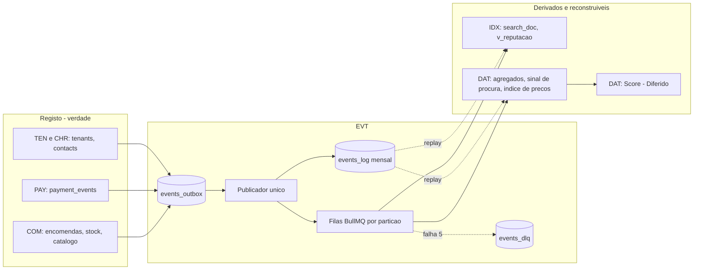
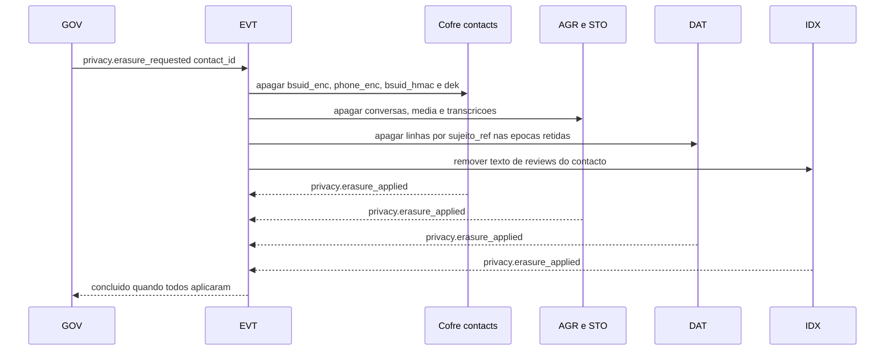

# Dados, Eventos e Analytics — KAMBÁ

| Campo | Valor |
|---|---|
| Produto | KAMBÁ (nome de trabalho) — plataforma WhatsApp-native de comércio conversacional para Angola |
| Documento | Técnica — Dados, Eventos e Analytics (EVT e DAT) |
| Versão | 1.0 |
| Data | Outubro de 2026 |
| Classificação | Documento de Referência — Interno |
| Documento-fonte | `../exploracao/11-arquitetura-detalhada-engenharia.md` §2, §3, §8; `../exploracao/13-big-picture-ecossistema.md` §9.5; `../exploracao/06-expansao-plataforma.md` §3, §5 |
| Evidência | `evidencia/E1_Meta_WhatsApp.md`, `evidencia/E3_Regulatorio_Dados.md`, `evidencia/E4_Stack_Licencas.md` |
| Documentos relacionados | `00_Arquitectura_Solucao.md`, `03_Core_Comercio_Medusa.md`, `04_Pagamentos_Liquidacao_AntiFraude.md`, `05_Indice_Pesquisa_Motor_Atencao.md`, `08_Seguranca_Conformidade.md`, `09_Topologia_Operacao_Escala.md` |

> **Estado das afirmações.** Convenção do `00_Arquitectura_Solucao.md`: **CONFIRMADO** (fonte primária), **INDÍCIO** (fonte secundária ou conhecimento não relido nesta sessão), **NÃO VERIFICADO**. O SQL é PostgreSQL 18 e foi **verificado por leitura, não executado** (sem instância na sessão de redacção). Nada aqui é aconselhamento jurídico: retenções, bases de legitimidade, informação de crédito e transferências levam «(a confirmar por parecer)».

---

## 1. Introdução
### 1.1 Propósito
Este documento especifica o **EVT** (event bus com *outbox* transaccional, ADR-009) e o **DAT** (dados e analytics): o contrato de eventos que liga o Registo às restantes camadas, a semântica de entrega, a privacidade *nos* eventos, a camada analítica (Postgres + *jobs* no Piloto; ClickHouse só em Escala), os produtos de dados (sinal de procura, índice de preços, Kambá Score) e a qualidade, linhagem e reconciliação dos dados. A tese: **o Registo (COM, PAY) é a única verdade; Descoberta (IDX) e Analytics são reconstruíveis a partir do Registo e do arquivo de eventos** — logo qualquer dado derivado pode ser reposto, corrigido ou apagado sem perda de verdade.

### 1.2 Âmbito
Cobre: envelope e catálogo de eventos, *outbox*, publicador, consumidores idempotentes, DLQ, ordenação; identidade pseudonimizada, consentimento e finalidade, retenção, apagamento vs *ledger*; `assistant_queries`; agregados, métricas e SLIs; sinal de procura, índice de preços e Score (Diferido); linhagem e reconciliação; Langfuse vs métricas próprias; contratos de dados para parceiros (Diferido). Fora de âmbito: o grafo conversacional (`02`), a máquina de estados de pagamento e a assinatura de callbacks (`04`), o isolamento e a gestão de segredos (`08`), a topologia (`09`).

### 1.3 Audiência
Engenheiros de dados, de pagamentos e de runtime; responsáveis de produto e de privacidade; SRE.

### 1.4 Definições e termos
- **Facto:** algo que aconteceu, imutável; um **evento** é a sua representação publicada. **Agregado:** entidade cujo histórico de eventos é ordenado (`order`, `tenant`, `contact`).
- **Outbox:** linha de evento escrita na **mesma transacção** que a mudança de dados; um publicador entrega-a depois ao bus.
- **`contact_id`:** identificador **substituto aleatório** (UUID) de um contacto final, sem relação algorítmica com BSUID ou telefone; a ponte para o identificador real vive só no cofre de identidade (`contacts`, definido com CHR/`08`).
- **`sujeito_ref`:** pseudónimo analítico `HMAC(K_época, contact_id)`; K roda mensalmente.
- **Classe PII:** P0 (nenhuma), P1 (pseudónimo: `contact_id`), P2 (pessoal directo — **proibida em eventos**).
- **Fase:** **P** Piloto, **C** Clusters, **D** Diferido.

## 2. Princípios e decisões aplicáveis (ADRs)
| ADR | Decisão (doc 00 §8) | Aplicação |
|---|---|---|
| ADR-009 | BullMQ/Redis com *outbox* transaccional; envelope versionado; consumidores idempotentes | §4–§6 |
| ADR-006 | Postgres 18 único até aos gargalos | §9: Analytics em Postgres no Piloto; limiares de migração |
| ADR-010 | BSUID/HMAC; telefone nunca é chave; logs sem conteúdo; HMAC com segredo rodado | §7: `contact_id` + `sujeito_ref` por época; correcção a `msisdn_hash` e `cliente_msisdn` |
| ADR-008 | Nenhum dado pessoal de produção sai de Angola sem procedimento APD | §7.5, §14 (Langfuse Cloud é transferência), §15 (parceiros) |
| ADR-013 | Pagamento só por evento autenticado | §5: `payment.confirmed` ≠ `payment.manual_confirmed`; Score e patrocínio só contam o primeiro |
| ADR-007 | Preço e stock fora de embeddings e prompts | §5: `catalog.price_changed` vai para DAT, não para o IDX |
| ADR-004 | A plataforma nunca detém fundos | §10: dados de pagamento servem reconciliação e Score, não custódia |
| ADR-005 | LiteLLM desde o dia 1 | §14: o custo por tenant vem do metering do LiteLLM |
| ADR-011 | Só o Fluxo A em produção no Piloto | Eventos `placement.*`, `query` de canal `plataforma` e produtos transversais marcados **D** |
| ADR-014 | MinIO excluído | Arquivo de eventos e *backups* em Postgres/STO, nunca MinIO |

**Divergências deliberadas face ao doc 11** (justificadas no ponto indicado): *outbox* sem `tenant_id`, ordem nem bloqueio de concorrência (§6.1); «versões desconhecidas são ignoradas» (§6.6); «todo o DELETE é soft» (§7.6); `cliente_msisdn` e `msisdn_hash` (§7.2, §8); `lat/lng` exactos em `assistant_queries` (§8); Langfuse no Piloto (§14).

## 3. Arquitectura de dados


| Capacidade | Fase | Notas |
|---|---|---|
| Envelope, *outbox*, publicador, consumidores idempotentes, DLQ | **P** | Esqueleto andante (doc 00 §13.2, fase 0) |
| `events_log` (arquivo), agregados diários, métricas e SLIs, reconciliação | **P** | Postgres + *jobs* BullMQ repetíveis |
| Sinal de procura **por tenant** (k-anonimato) | **P** | Cada PME vê só o seu |
| Sinal de procura entre tenants, índice de preços | **D** | Parecer APD + resposta Meta (D1, D2); densidade |
| Kambá Score e contratos de dados com parceiros | **D** | Parecer sobre informação de crédito; D8 |
| ClickHouse, Langfuse v4 self-host | **D** / **C** | Limiares em §9.4 e §14 |
| `placement.*` e `query` de canal `plataforma` | **D** | Fluxo B (ADR-011) |

> **Nota de fase.** O doc 00 §4 marca o DAT inteiro como **D**; este documento separa o que é **P** (eventos, `assistant_queries`, agregados, SLIs, reconciliação — o Piloto não vive sem eles) do que é **D** (Score, índice de preços, ClickHouse). Proposta: o doc 00 §4 passar a marcar DAT como **P** (eventos, agregados, SLIs) e **D** (Score, índice de preços, ClickHouse).

## 4. Envelope de evento (contrato v1)
```json
{
  "id": "0192f1c4-7b1e-7d2a-9c3e-5a1f0b6e2d44",
  "tipo": "payment.confirmed",
  "versao": 1,
  "tenant_id": "3f1c2a9e-0d4b-4e55-9a7c-1b2c3d4e5f60",
  "ocorrido_em": "2026-11-02T14:03:11.482Z",
  "registado_em": "2026-11-02T14:03:11.610Z",
  "produtor": "pay-core@1.4.2",
  "agregado": { "tipo": "order", "id": "9b2f6c1a-7e3d-4c80-b5a1-2d9e8f7a6b50", "seq": 3 },
  "correlacao_id": "5a6b7c8d-1e2f-4a3b-8c9d-0e1f2a3b4c5d",
  "causa_id": "0192f1c4-6a10-7a11-8b22-3c33d44e5f66",
  "trace_id": "4bf92f3577b34da6a3ce929d0e0e4736",
  "classe_pii": "P0",
  "finalidades": ["transacao"],
  "payload": {
    "order_id": "9b2f6c1a-7e3d-4c80-b5a1-2d9e8f7a6b50",
    "provider": "facilitador_x",
    "referencia": "102345678",
    "valor_minor": 24500000,
    "currency": "AOA",
    "autenticacao": { "authn_method": "hmac", "authn_ok": true, "provider_event_id": "pe_8841" }
  }
}
```

| Campo | Regra |
|---|---|
| `id` | UUIDv7 (ordenável no tempo; `uuidv7()` nativo no PG 18 — **INDÍCIO**, confirmar na versão fixada). Chave de idempotência global |
| `tipo`, `versao` | `família.verbo` em minúsculas; `versao` inteira por tipo (§6.6). Mantêm-se os nomes do doc 11 (`tipo`, `versao`, `ocorrido_em`) |
| `ocorrido_em` / `registado_em` | Quando o facto ocorreu (relógio do produtor) / quando a transacção o gravou. Atrasos de rede ou de *callback* não alteram `ocorrido_em` |
| `agregado.{tipo,id,seq}` | `seq` **sem lacunas** por agregado, atribuído na transacção do produtor (§6.1); é a ordem causal |
| `correlacao_id` / `causa_id` | Conversa ou pedido; evento que causou este (grafo causal para auditoria) |
| `trace_id` | W3C trace id; liga eventos a logs e a `llm_call_log` (§14) |
| `classe_pii`, `finalidades` | Classe de dado e finalidades de uso permitidas (§7.3). **Roteamento por finalidade** no publicador |
| `payload` | JSON Schema próprio por `tipo`/`versao`, `additionalProperties: false`. Valores monetários em **unidade menor inteira** (`valor_minor` + `currency`), nunca *float*. **Sem telefone, nome, morada, texto de mensagem ou de review** — só referências (`order_id`, `review_id`) |

Contratos em Git: `contratos/eventos/<tipo>/v<versao>.schema.json`; o CI valida produtores e consumidores contra eles (falha o *build*) e corre o *lint* de PII (§7.3).

## 5. Catálogo de eventos
Chave de ordem = `agregado`. Consumidores marcados «†» exigem ordem por agregado. «A» = arquivo (`events_log`), recebe todos os eventos.

| Evento (v1) | Produtor | Consumidores | Agregado | PII | Fase |
|---|---|---|---|---|---|
| `order.created` | COM (tool `criar_pedido`, idempotente) | PAY (emitir referência), COM/stock (reservar), DAT | order | P1 | P |
| `order.paid` | COM, ao consumir `payment.confirmed` ou `payment.manual_confirmed` | AGR (avisa cliente e dono), REP (agenda review), DAT, GEO† (C) | order | P1 | P |
| `order.expired` / `order.cancelled` | COM (scheduler de TTL 24–72 h / acção) | COM/stock (libertar), AGR, DAT | order | P1 | P |
| `order.delivered` | COM (levantamento) / GEO (código de entrega, C) | REP, DAT, `ads` (D) | order | P1 | P |
| `payment.reference_issued` | PAY | AGR (envia referência), COM† (→ `aguarda_pagamento`), DAT | order | P0 | P |
| `payment.confirmed` | PAY, **só** por callback autenticado (ADR-013) | COM†, AGR, REP, DAT, Score (D) | order | P0 | P |
| `payment.manual_confirmed` | PAY (`ManualProvider`; confirmação humana auditada, limite de valor) | COM†, **AGR**, DAT (contado à parte) | order | P0 | P |
| `payment.failed` / `payment.expired` | PAY (valor ou referência divergente / TTL) | HND (humano), COM†, DAT | order | P0 | P |
| `review.requested` | REP (`order.delivered` + 2 h) | AGR (envia o pedido) | order | P1 | P |
| `review.created` | AGR/REP (resposta do cliente) | REP, IDX, DAT | order | P1 | P |
| `review.removed` | GOV/T&S (com motivo) | REP, IDX | order | P0 | C |
| `query.resolved` / `query.unresolved` / `query.handoff` | AGR | DAT (`assistant_queries`, sinal de procura), IDX (dicionário), Ops | conversa | P1 | P |
| `tenant.approved` | TEN | Provisioning (gatilho da saga; `10` §5.1) | tenant | P0 | P |
| `tenant.activated` / `.suspended` / `.reactivated` / `.closed` | TEN | IDX (`visivel`), CHR (cache de estado), DAT | tenant | P0 | P |
| `catalog.product_changed` | COM (subscritor Medusa — **D3**) | IDX (reindexa) | product | P0 | P |
| `catalog.price_changed` | COM | DAT (`preco_obs`, D) | product | P0 | P |
| `stock.reserved` / `.released` / `.adjusted` / `.low` | COM | DAT; `.low` → AGR (avisa dono) | sku | P0 | P |
| `consent.recorded` / `consent.withdrawn` | CHR | DAT, `ads` (D), IDX | contact | P1 | P |
| `privacy.erasure_requested` / `.applied` | GOV / cada consumidor | todos (§7.6) | contact | P1 | P |
| `placement.impression` / `.conversion_proven` | `ads` | DAT, anunciantes (agregado) | placement | P0 | D |
| `score.computed` | DAT | API a parceiros | tenant | P0 | D |

`catalog.product_changed` e `catalog.price_changed` são **extensões** ao catálogo do doc 11 §3: o IDX não precisa de preço (ADR-007) e não deve reindexar a cada alteração de preço. `payment.manual_confirmed` existe porque o Piloto arranca com `ManualProvider` (doc 00 §6.1): misturar os dois sob `payment.confirmed` esconderia a diferença de autenticação.

## 6. Entrega: at-least-once, idempotência, ordem, DLQ
**Semântica.** *At-least-once* de ponta a ponta; **efeito exactamente-uma-vez** obtido por idempotência no consumidor. As garantias de entrega do BullMQ **não foram verificadas** (docs não lidas, `evidencia/E4`): assume-se pior caso (duplicados, *jobs* perdidos se o Redis perder a cauda do AOF) e a verdade é o *outbox*.

### 6.1 Outbox transaccional
```sql
CREATE TABLE events_outbox (
  id bigint GENERATED ALWAYS AS IDENTITY PRIMARY KEY,
  event_id uuid NOT NULL UNIQUE, tipo text NOT NULL, versao smallint NOT NULL, tenant_id uuid NOT NULL,
  agregado_tipo text NOT NULL, agregado_id text NOT NULL, agregado_seq bigint NOT NULL,
  particao smallint NOT NULL, envelope jsonb NOT NULL,
  criado_at timestamptz NOT NULL DEFAULT now(), publicado_at timestamptz,
  tentativas int NOT NULL DEFAULT 0, proxima_tentativa_at timestamptz NOT NULL DEFAULT now(),
  UNIQUE (agregado_tipo, agregado_id, agregado_seq));
CREATE INDEX events_outbox_pendentes ON events_outbox (proxima_tentativa_at, id) WHERE publicado_at IS NULL;
CREATE TABLE evt_agregado_seq (agregado_tipo text NOT NULL, agregado_id text NOT NULL, seq bigint NOT NULL,
  PRIMARY KEY (agregado_tipo, agregado_id));
CREATE TABLE evt_subscricoes (consumer text NOT NULL, tipo text NOT NULL, versao_max smallint NOT NULL DEFAULT 1,
  finalidade text NOT NULL, exige_ordem boolean NOT NULL DEFAULT false, activo boolean NOT NULL DEFAULT true,
  PRIMARY KEY (consumer, tipo));
CREATE OR REPLACE FUNCTION evt_emitir(
  p_tipo text, p_versao smallint, p_tenant uuid, p_agg_tipo text, p_agg_id text, p_payload jsonb,
  p_classe_pii text DEFAULT 'P0', p_finalidades text[] DEFAULT '{transacao}',
  p_correlacao uuid DEFAULT NULL, p_causa uuid DEFAULT NULL, p_trace text DEFAULT NULL,
  p_produtor text DEFAULT current_setting('application_name'), p_ocorrido_em timestamptz DEFAULT now())
RETURNS uuid LANGUAGE plpgsql AS $$
DECLARE v_id uuid := uuidv7(); v_seq bigint; v_part smallint;
BEGIN
  IF p_payload::text ~ '\+?244 ?9[0-9]{8}' OR p_payload::text ~ '"\+[0-9]{9,15}"' THEN
    RAISE EXCEPTION 'evento % contém padrão de telefone (PII P2)', p_tipo USING ERRCODE = 'check_violation';
  END IF;
  INSERT INTO evt_agregado_seq (agregado_tipo, agregado_id, seq) VALUES (p_agg_tipo, p_agg_id, 1)
  ON CONFLICT (agregado_tipo, agregado_id) DO UPDATE SET seq = evt_agregado_seq.seq + 1
  RETURNING seq INTO v_seq;                       -- bloqueia a linha até ao COMMIT: serializa o agregado
  v_part := (hashtextextended(p_tenant::text || p_agg_id, 0) & 15)::smallint;
  INSERT INTO events_outbox (event_id, tipo, versao, tenant_id, agregado_tipo, agregado_id, agregado_seq, particao, envelope)
  VALUES (v_id, p_tipo, p_versao, p_tenant, p_agg_tipo, p_agg_id, v_seq, v_part, jsonb_build_object(
    'id', v_id, 'tipo', p_tipo, 'versao', p_versao, 'tenant_id', p_tenant, 'ocorrido_em', p_ocorrido_em,
    'registado_em', now(), 'produtor', p_produtor,
    'agregado', jsonb_build_object('tipo', p_agg_tipo, 'id', p_agg_id, 'seq', v_seq),
    'correlacao_id', p_correlacao, 'causa_id', p_causa, 'trace_id', p_trace,
    'classe_pii', p_classe_pii, 'finalidades', to_jsonb(p_finalidades), 'payload', p_payload));
  RETURN v_id;
END $$;
```
Uso: `SELECT evt_emitir('order.created', 1::smallint, :tenant, 'order', :order_id, jsonb_build_object('order_id', :order_id, 'total_minor', :total_minor))` **na mesma transacção** que o `INSERT` da encomenda. Por que o *outbox* do doc 11 (`id, tipo, payload, publicado_at, criado_at`) não chega: sem `tenant_id` não há isolamento nem roteamento; sem `agregado_seq` não há ordem causal; sem `tentativas/proxima_tentativa_at` o publicador não recua; sem `event_id` único não há deduplicação no bus. O *seq* sai de um `UPDATE` na mesma transacção: se esta reverte, o `seq` reverte — **sem lacunas** — e duas transacções do mesmo agregado serializam-se (a 2.ª espera pelo `COMMIT` da 1.ª), pelo que a ordem de `seq` coincide com a ordem de *commit*. O guarda de PII só apanha telefones explícitos; a defesa principal é o *schema* fechado e o *lint* do §7.3.

### 6.2 Publicador (instância única por *advisory lock*)
```
publicador():                                    # 1 líder: pg_try_advisory_lock(7101); réplicas em espera
  loop (200 ms, acordado por LISTEN evt_novo):
    BEGIN
    linhas = SELECT id, event_id, particao, tipo, versao, envelope FROM events_outbox
              WHERE publicado_at IS NULL AND proxima_tentativa_at <= now()
              ORDER BY id LIMIT 200 FOR UPDATE SKIP LOCKED
    para cada linha, para cada subscrição activa (tipo) com finalidade ∈ envelope.finalidades:
        env = linha.envelope se linha.versao <= versao_max senão conversor(tipo, linha.versao -> versao_max)
        se não há conversor: marcar evento 'bloqueado', alerta Sev2; NÃO descartar
        fila[consumer][particao].add(tipo, env, { jobId: event_id, attempts: 6, backoff: exponencial 1 s })
    INSERT INTO events_log SELECT ... FROM events_outbox WHERE id = ANY(ids) ON CONFLICT DO NOTHING
    UPDATE events_outbox SET publicado_at = now() WHERE id = ANY(ids)
    COMMIT
    se Redis falha: UPDATE tentativas = tentativas+1, proxima_tentativa_at = now() + backoff(tentativas)
```
Falha entre `add` e `COMMIT` ⇒ republicação; `jobId = event_id` absorve duplicados no BullMQ e a idempotência do consumidor absorve o resto. Redis com AOF `everysec` (`evidencia/E4`): perde ≤ 1 s; o §6.5 repõe-no.

### 6.3 Consumidor idempotente
```sql
CREATE TABLE events_consumed (
  consumer text NOT NULL, event_id uuid NOT NULL,
  agregado_tipo text, agregado_id text, agregado_seq bigint,
  processado_at timestamptz NOT NULL DEFAULT now(), PRIMARY KEY (consumer, event_id));
CREATE INDEX events_consumed_agg ON events_consumed (consumer, agregado_tipo, agregado_id, agregado_seq DESC);
```
```
handler(consumer, env):
  BEGIN
  n = INSERT INTO events_consumed(consumer, event_id, ...) VALUES (...) ON CONFLICT DO NOTHING   # 0 linhas = duplicado
  se n == 0: COMMIT; return
  se subscrição.exige_ordem:
      ultima = SELECT max(agregado_seq) FROM events_consumed WHERE consumer, agregado = env.agregado AND event_id <> env.id
      se env.agregado.seq < ultima e a transição não é válida na máquina de estados: ROLLBACK; DLQ('fora_de_ordem')
      se a pré-condição de estado não se verifica (ex.: payment.confirmed antes de aguarda_pagamento): ROLLBACK; throw Adiar(5 s)
  aplicar efeitos na BD (mesma transacção)
  COMMIT
  efeitos externos (WhatsApp, HTTP): tabela de acções com Idempotency-Key = consumer:event_id:acção
```
A janela de deduplicação (`events_consumed`) retém 90 dias, **mais** que a re-entrega da Meta (até 7 dias) e que qualquer *replay* operacional. O `seq` é contíguo **por agregado** mas não por consumidor (um consumidor subscreve só alguns tipos do agregado): serve para detectar atrasos e para auditar lacunas contra `events_log`, não para esperar «o anterior». Uma pré-condição que nunca se verifica esgota as tentativas e vai para DLQ — nunca se aplica uma transição inválida. Os consumidores de `payment.*` são **sempre** com ordem.

### 6.4 DLQ
```sql
CREATE TABLE events_dlq (
  id bigint GENERATED ALWAYS AS IDENTITY PRIMARY KEY,
  consumer text NOT NULL, event_id uuid NOT NULL, tipo text NOT NULL, versao smallint NOT NULL, tenant_id uuid NOT NULL,
  envelope jsonb NOT NULL, erro text NOT NULL, tentativas int NOT NULL,
  estado text NOT NULL DEFAULT 'aberta' CHECK (estado IN ('aberta','reprocessada','descartada')),
  criado_at timestamptz NOT NULL DEFAULT now(), resolvido_at timestamptz, resolvido_por text,
  UNIQUE (consumer, event_id));
```
Política: 6 tentativas com *backoff* (1 s, 5 s, 30 s, 2 min, 10 min) — o doc 11 diz «5 retries»; aqui 1 + 5. Qualquer entrada de `payment.*` ou `order.paid` na DLQ é **Sev1** (cliente que pagou sem confirmação); as restantes alertam se `aberta` > 1 h. Reprocessar é idempotente por construção; **descartar** um evento `payment.*` exige duas pessoas. A DLQ guarda o envelope (P0/P1 apenas); retenção de 30 dias após resolução.

### 6.5 Partições, ordem e reposição
- **Filas:** 16 filas por grupo de consumidores, `evt.<consumer>.p<0..15>`, concorrência 1 por fila; a partição é `hash(tenant_id ‖ agregado.id) & 15`. A ordem só vale **dentro da partição** e é verificada pelo `seq` (§6.3). Escala-se aumentando *workers* por fila, não a concorrência por fila.
- **Reposição após perda no Redis:** o reconciliador (job a cada 5 min) re-enfileira eventos publicados há > 10 min sem registo de consumo nem DLQ:
```sql
SELECT l.event_id, s.consumer
FROM events_log l
JOIN evt_subscricoes s ON s.tipo = l.tipo AND s.activo
LEFT JOIN events_consumed c ON c.consumer = s.consumer AND c.event_id = l.event_id
LEFT JOIN events_dlq d ON d.consumer = s.consumer AND d.event_id = l.event_id
WHERE l.ocorrido_em > now() - interval '24 hours' AND l.registado_em < now() - interval '10 minutes'
  AND l.envelope->'finalidades' ? s.finalidade       -- só quem devia receber (roteamento por finalidade)
  AND c.event_id IS NULL AND d.event_id IS NULL;
```
- **Arquivo `events_log`:** mensal, imutável, base da reconstrução (§11–§12):
```sql
CREATE TABLE events_log (
  event_id uuid NOT NULL, tipo text NOT NULL, versao smallint NOT NULL, tenant_id uuid NOT NULL,
  agregado_tipo text NOT NULL, agregado_id text NOT NULL, agregado_seq bigint NOT NULL,
  ocorrido_em timestamptz NOT NULL, registado_em timestamptz NOT NULL, classe_pii text NOT NULL, envelope jsonb NOT NULL,
  PRIMARY KEY (event_id, ocorrido_em)) PARTITION BY RANGE (ocorrido_em);
```

### 6.6 Evolução de contratos
Campo novo **opcional** ⇒ mesma `versao`; qualquer mudança de significado, remoção ou tipo ⇒ `versao + 1`. O produtor emite a nova versão; o publicador entrega a cada consumidor a versão que ele declara (`versao_max`), via **conversor registado** que preserva `id` e `agregado.seq`; sem conversor, o evento fica **bloqueado com alerta**. O doc 11 diz que os consumidores «ignoram versões desconhecidas»: isso perde dados em silêncio quando o produtor é actualizado primeiro. Ordem de *deploy*: consumidores antes de produtores; *deprecation* de uma versão ≥ 90 dias após o último consumidor migrar.

## 7. Privacidade nos eventos e nos dados
### 7.1 Princípios
(1) **Sem PII crua em eventos** (P2 proibida): `contact_id` (P1) sim; telefone, BSUID, nome, morada, texto de mensagem ou de review, não — vai-se buscar por referência com ACL de tenant. (2) **Finalidade declarada** em cada evento e cada subscrição. (3) **Minimização** e retenção por tabela (§7.4). (4) **Fronteira de pseudonimização** à entrada do DAT: o `contact_id` não entra em tabelas analíticas, só o `sujeito_ref` (§7.2).

### 7.2 Identidade em duas camadas (corrige `cliente_msisdn` e `msisdn_hash`)
- **Cofre `contacts` + `contact_endpoints`** (CHR/`08`; dicionário §3.1): `contacts(contact_id, tenant_id, criado_at, …)` e `contact_endpoints(contact_id, tipo, bsuid_hmac, bsuid_enc, dek_id, phone_enc, …)`, com `bsuid_hmac = HMAC-SHA256(K_lookup[kid], bsuid)` e `phone_enc` só se existir e for necessário. É a **única** ponte para o identificador real. O telefone **nunca** é chave nem sai deste cofre (ADR-010).
- **Pseudónimo analítico** `sujeito_ref = trunc16(HMAC-SHA256(K_época, contact_id::text))`, com `K_época` **mensal** guardada em OpenBao/Doppler e destruída ao fim da retenção (12 meses, *proposta*; §7.4). Dentro do mês conta-se «clientes distintos»; entre meses não há ligação — a rotação é *limitação de finalidade*, não só higiene.
- **Porque não `HMAC(msisdn)`:** o espaço de números móveis angolanos é de ordem 10⁸–10⁹; com a chave conhecida, a enumeração inverte o HMAC em minutos (`evidencia/E3`, ADR-010). Usar um `contact_id` aleatório como entrada torna a inversão impossível sem acesso ao cofre, mesmo com a chave comprometida. O `bsuid_hmac` do BSUID continua pseudonimização, não anonimização; a rotação de `K_lookup` recalcula-se a partir de `bsuid_enc` sem perder identidades.
- Correcção a registar em `03`/`08`: `orders_mirror.cliente_msisdn` → `contact_id uuid`; `assistant_queries.msisdn_hash` → `sujeito_ref` (§8).

### 7.3 Consentimento, finalidade e *lint*
```sql
-- `consent_event`: o DDL de referencia vive em `10` §7.2 (KAM-140). O que aqui
-- estava era uma de **cinco** formas da mesma tabela no conjunto, e divergia da
-- do dicionario §3.1 em quatro campos: `finalidade` por `purpose`, `estado`
-- tri-estado por `accepted` booleano, `texto_versao` por `text_version`,
-- `prova_hash` por `evidence_hash`, e `registado_at` por `ocorrido_em`.
--
-- As finalidades sao **dez** desde o KAM-159, e sao a uniao das duas listas
-- que existiam: as cinco do dicionario e as oito dos 38 contratos, que se
-- cruzavam numa so. O dominio canonico esta no §3.1 (emenda 1.16), e o
-- `contract_diff dominios` (gate 7) confronta-o com o `enum` dos contratos
-- nos dois sentidos.
CREATE INDEX consent_event_contacto
  ON platform.consent_event (tenant_id, contact_id, purpose, id DESC);
CREATE VIEW consent_actual AS
  SELECT DISTINCT ON (tenant_id, contact_id, purpose)
         tenant_id, contact_id, purpose, accepted, ocorrido_em
  FROM platform.consent_event
  ORDER BY tenant_id, contact_id, purpose, id DESC;
```
As finalidades são as **dez** do dicionário §3.1 (emenda 1.16, KAM-159): as oito daqui mais `partilha_estafeta` e `notificacao_dono`, que o canon declarava e que até à `v2` dos contratos eram **impossíveis de emitir**. **A base legal de cada uma não está fixada** — das dez, só `marketing` tem fonte directa e CONFIRMADA no `evidencia/E3`, e cinco não têm nada; a tabela está em [`10`](10_Onboarding_Governanca.md) §7.2, e o parecer é o KAM-104. `transacao` e `atendimento` registam que o **aviso de privacidade foi apresentado**; se a base é contrato ou consentimento é matéria de parecer (`evidencia/E3` req. 1–2). `marketing`, `analytics_agregado`, `sugestoes_patrocinadas`, `partilha_*` exigem `accepted = true`, específico por finalidade e registado no 1.º contacto ou no momento do uso. **Roteamento por finalidade:** o publicador só entrega a um consumidor se a sua `finalidade` (em `evt_subscricoes`) estiver em `envelope.finalidades`; consumidores de finalidades com consentimento verificam `consent_actual` por `contact_id` no processamento. **Lint de PII (CI):** os *schemas* de evento são fechados; um teste rejeita nomes de campo `telefone|msisdn|bsuid|nome|morada|texto|email` fora de uma lista aprovada, e corre os *fixtures* contra padrões `\+?244\d{9}`.

### 7.4 Retenção por tabela (propostas — a confirmar por parecer; `evidencia/E3` req. 14)
| Dataset | Classe | Retenção proposta | Mecanismo |
|---|---|---|---|
| `events_outbox` (publicado) | P0/P1 | 7 dias | *job* diário |
| `events_log` | P0/P1 | 24 meses; depois só agregados | `DROP` de partição |
| `events_consumed` | — | 90 dias | *job* |
| `events_dlq` | P0/P1 | 30 dias após resolução | *job* |
| `assistant_queries` (sem texto) | P1 | 12 meses (*proposta*; alinha com `08` §11) | `DROP` de partição |
| `assistant_query_texto` | P1+ | 90 dias | `DROP` de partição |
| `dat.agg_*`, `sinal_procura`, `indice_preco` | sem sujeito | 36 meses | *job* |
| `payment_events`, `orders_mirror` | P1 | **Prazo fiscal do CGT — NÃO VERIFICADO** (`evidencia/E3` §6); parâmetro `retencao_fiscal_anos` por tenant | arquivo separado |
| `consent_event` | P1 | Duração da relação + prescrição (a confirmar) | — |
| `reviews.texto` | P1 | Até retirada ou 24 meses | apagamento selectivo |
| `contacts` (cofre) | **P2** | Relação activa + 30 dias; apagado a pedido (§7.6) | `DELETE` + *shredding* |
| `dat.score_snapshot` | P0 | Contrato com o parceiro + auditoria (a confirmar) | — |
| `dat.llm_call_log` | P0 | 13 meses | `DROP` de partição |

### 7.5 Transferências (ADR-008)
Eventos P0/P1 circulam dentro da fronteira. Nada com `contact_id` é enviado a LLM, Langfuse Cloud ou parceiros fora de Angola sem o procedimento APD (D1); a minimização antes do LLM (req. 6 de `evidencia/E3`) é do AGR. Contratos de dados para parceiros (§15) exigem anonimização/agregação e não exportam `contact_id` nem `sujeito_ref`.

### 7.6 Direito de apagamento vs *ledger* imutável
Conflito: a Lei 22/11 reconhece eliminação (Art. 28.º) e minimização (Art. 11.º); o `payment_events`/`orders_mirror` é *append-only* (ADR-013) e sujeito a retenção fiscal e a prevenção de fraude. Doc 11 diz «todo o DELETE é soft»: **isso é incorrecto para dados pessoais** e passa a valer só para dados operacionais não pessoais. Resolução:
1. **O ledger não contém dado pessoal directo** — só `contact_id` aleatório. Apagar a linha do cofre `contacts` torna o `contact_id` um órfão **irreversível**; o ledger permanece, sob obrigação legal/interesse legítimo (a confirmar por parecer).
2. **Crypto-shredding aplica-se onde há conteúdo pessoal cifrado**: mensagens e *checkpoints* do AGR, áudio/transcrições e media (STO), `bsuid_enc`/`phone_enc`, texto de reviews. Cada contacto tem uma chave de dados `dek_id`, cifrada por uma chave-mestra fora das cópias de segurança; apagar a `dek` torna ilegíveis os dados, **incluindo nos *backups* e arquivos WAL**.
3. **Não se aplica** ao `events_log`/ledger: não há PII a destruir; a pseudonimização quebra-se no cofre. O HMAC determinístico **não** é anonimização.
4. `sujeito_ref` em `assistant_queries`: apagam-se as linhas dos meses ainda dentro da retenção recalculando `sujeito_ref` com cada `K_época` (a destruição de `K_época` anonimiza o resto).


Prazo interno de **30 dias** (a lei dá até 60 dias úteis para rectificar/eliminar — INDÍCIO, `evidencia/E3` req. 13). O pedido e o registo de conclusão ficam no *ledger* de GOV sem dado pessoal. Fornecedores de LLM: retenção zero configurada por contrato (`evidencia/E3` req. 8).

## 8. `assistant_queries` (partições mensais, HMAC por época)
```sql
CREATE TABLE assistant_queries (
  id bigint GENERATED ALWAYS AS IDENTITY, criado_at timestamptz NOT NULL DEFAULT now(),
  tenant_id uuid NOT NULL,
  canal text NOT NULL CHECK (canal IN ('pme','plataforma')),            -- 'plataforma' só com Fluxo B (D)
  sujeito_ref bytea NOT NULL, hmac_epoca char(6) NOT NULL,              -- HMAC(K_época, contact_id); 'YYYYMM'
  origem text NOT NULL CHECK (origem IN ('texto','voz')),
  categoria text, zona text, geo_celula text,                           -- bairro; célula ~1 km, nunca lat/lng exactos
  termo_chave text,                                                     -- só se sem_resultado; passa o classificador de dados sensíveis
  resultado text NOT NULL CHECK (resultado IN ('resolvida','sem_resultado','handoff','fora_de_dominio','erro')),
  modo text CHECK (modo IN ('hibrido','lexical')), n_candidatos smallint, ms_total int,
  uso_agregado boolean NOT NULL DEFAULT false,                          -- consent analytics_agregado no momento da escrita
  PRIMARY KEY (id, criado_at)) PARTITION BY RANGE (criado_at);
CREATE INDEX assistant_queries_tenant ON assistant_queries (tenant_id, criado_at);
CREATE TABLE assistant_queries_2026_11 PARTITION OF assistant_queries FOR VALUES FROM ('2026-11-01') TO ('2026-12-01');
CREATE TABLE assistant_query_texto (                                   -- texto separado: retenção curta por DROP, sem UPDATE
  query_id bigint NOT NULL, criado_at timestamptz NOT NULL, texto_norm text NOT NULL,
  PRIMARY KEY (query_id, criado_at)) PARTITION BY RANGE (criado_at);
```
Mudanças face ao doc 11 §2: (a) `msisdn_hash` → `sujeito_ref` por época (§7.2); (b) `lat/lng` exactos → `geo_celula` (localização precisa é dado de alto risco e desnecessária para agregados); (c) `resolveu/handoff` booleanos → `resultado` fechado (inclui `fora_de_dominio`, a prova de escopo exigida pela Meta, `05` §10); (d) texto em tabela própria, normalizado e com números longos/e-mails redigidos, **90 dias**, apagado por `DROP` de partição (um `UPDATE` em massa gera *bloat*); (e) `canal = 'plataforma'` reservado ao Fluxo B. **Gestão de partições:** *job* BullMQ repetível cria a partição M+2 no dia 1 e arquiva/remove segundo §7.4; falha de criação é alerta Sev2 (um `INSERT` sem partição falha e, com ele, o ramo de registo — o AGR escreve de forma assíncrona e nunca bloqueia a resposta, princípio 12). Acesso ao texto: papel `suporte_t2` com registo de auditoria.

## 9. Camada analítica
### 9.1 Piloto: Postgres + *jobs* (ADR-006)
Agregados derivados **só** de `events_log` (reconstruíveis), calculados por *jobs* idempotentes que fazem `UPSERT` por chave natural e registam a execução:
```sql
CREATE SCHEMA IF NOT EXISTS dat;
CREATE TABLE dat.job_run (
  id bigint GENERATED ALWAYS AS IDENTITY PRIMARY KEY, job text NOT NULL, versao_codigo text NOT NULL,
  janela_de timestamptz, janela_ate timestamptz, watermark_evento uuid, entradas jsonb NOT NULL DEFAULT '{}',
  linhas_saida bigint, estado text NOT NULL CHECK (estado IN ('a_correr','ok','falhou')),
  iniciado_at timestamptz NOT NULL DEFAULT now(), terminado_at timestamptz);
CREATE TABLE dat.agg_tenant_dia (
  tenant_id uuid NOT NULL, dia date NOT NULL,                              -- dia em Africa/Luanda
  conversas int NOT NULL DEFAULT 0, consultas int NOT NULL DEFAULT 0, sem_resultado int NOT NULL DEFAULT 0,
  handoffs int NOT NULL DEFAULT 0, pedidos_criados int NOT NULL DEFAULT 0, pedidos_pagos int NOT NULL DEFAULT 0,
  pedidos_pagos_manual int NOT NULL DEFAULT 0, pedidos_expirados int NOT NULL DEFAULT 0,
  gmv_pago_minor bigint NOT NULL DEFAULT 0, clientes_distintos int NOT NULL DEFAULT 0,
  job_run_id bigint NOT NULL REFERENCES dat.job_run(id), PRIMARY KEY (tenant_id, dia));
```
Os dias fecham no fuso `Africa/Luanda` (UTC+1): `(ocorrido_em AT TIME ZONE 'Africa/Luanda')::date`. *Jobs* BullMQ repetíveis (já no stack); sem `pg_cron`/ferramentas novas.

### 9.2 Escala: ClickHouse (**D**)
Entra por um consumidor adicional do mesmo bus (sem tocar nos produtores), com `MergeTree`, `LowCardinality` para tipo/zona/categoria e **só** `sujeito_ref`/agregados — nunca `contact_id`. Esboço: `events(tipo LowCardinality(String), tenant_id UUID, zona LowCardinality(String), categoria LowCardinality(String), resultado LowCardinality(String), valor_minor UInt64, sujeito_ref FixedString(16), ts DateTime64(3)) ENGINE = MergeTree ORDER BY (tenant_id, ts)`. ClickHouse v26.9 é Apache-2.0 (`evidencia/E4`); a mesma stack só se justifica se for partilhada com o Langfuse v4 (§14).

### 9.3 Gatilhos de migração (propostas, a calibrar)
| Sinal | Limiar inicial | Resposta |
|---|---|---|
| `events_log` | > 150 M linhas **ou** > 150 GB | ClickHouse para consultas históricas |
| *Job* diário de agregados | > 30 min **ou** consultas analíticas com p95 > 5 s | Réplica de leitura; depois ClickHouse |
| Necessidade de *joins* entre eventos e catálogo em tempo quase real | — | ClickHouse + consumidor dedicado |
| Backlog de *outbox* > 60 s sustentado | — | Mais partições de fila (não é problema do analytics) |

## 10. Produtos de dados
### 10.1 Sinal de procura
**Piloto, por tenant:** cada PME vê as procuras *sem resultado* na sua loja («14 pessoas procuraram "airfryer" e não tem»). Armazenamento com k-anonimato imposto por `CHECK`:
```sql
CREATE TABLE dat.sinal_procura_semana (
  tenant_id uuid NOT NULL, semana date NOT NULL, termo_chave text NOT NULL, categoria text,
  n_consultas int NOT NULL, n_sujeitos int NOT NULL CHECK (n_sujeitos >= 5),
  job_run_id bigint NOT NULL REFERENCES dat.job_run(id), PRIMARY KEY (tenant_id, semana, termo_chave));
INSERT INTO dat.sinal_procura_semana (tenant_id, semana, termo_chave, categoria, n_consultas, n_sujeitos, job_run_id)
SELECT tenant_id, date_trunc('week', criado_at)::date, termo_chave, max(categoria), count(*), count(DISTINCT sujeito_ref), $1
FROM assistant_queries
WHERE resultado = 'sem_resultado' AND termo_chave IS NOT NULL AND uso_agregado AND criado_at >= $2 AND criado_at < $3
GROUP BY tenant_id, date_trunc('week', criado_at)::date, termo_chave
HAVING count(DISTINCT sujeito_ref) >= 5
ON CONFLICT (tenant_id, semana, termo_chave) DO UPDATE
  SET n_consultas = EXCLUDED.n_consultas, n_sujeitos = EXCLUDED.n_sujeitos, job_run_id = EXCLUDED.job_run_id;
```
Janelas semanais cortam-se nas fronteiras de mês (as épocas de `sujeito_ref` mudam): uma semana a cavalo conta-se em duas parcelas, o que **subestima** sujeitos e mantém o k-anonimato conservador. **Entre tenants** (sinal de bairro): **D** — exige parecer sobre finalidade (Lei 22/11), compatibilidade com a política Meta (dados de uma pessoa só para suportar a mensagem com essa pessoa, `evidencia/E1` §4; agregado anónimo é INDÍCIO de compatível, NÃO VERIFICADO) e densidade.

### 10.2 Índice de preços (**D**)
Observações de preço da PME (dado comercial, não pessoal) a partir de `catalog.price_changed` e de `order.paid`:
```sql
CREATE TABLE dat.preco_obs (
  obs_id bigint GENERATED ALWAYS AS IDENTITY PRIMARY KEY, event_id uuid NOT NULL UNIQUE,
  tenant_id uuid NOT NULL, product_ref text NOT NULL, categoria_canon text NOT NULL, zona text,
  preco_minor bigint NOT NULL CHECK (preco_minor > 0), preco_tipo text NOT NULL CHECK (preco_tipo = 'fixo'),   -- 'a_partir_de' excluído
  origem text NOT NULL CHECK (origem IN ('catalogo','pedido_pago')), observado_at timestamptz NOT NULL);
CREATE MATERIALIZED VIEW dat.indice_preco_semana AS
SELECT categoria_canon, zona, date_trunc('week', observado_at)::date AS semana,
       percentile_cont(0.5) WITHIN GROUP (ORDER BY preco_minor) AS mediana_minor,
       count(*) AS n_obs, count(DISTINCT tenant_id) AS n_lojas
FROM dat.preco_obs GROUP BY 1, 2, 3 HAVING count(DISTINCT tenant_id) >= 3 AND count(*) >= 10;
```
Limites: «categoria» é grosseira — comparar preços exige **produto canónico** (marca + modelo) vindo do Catálogo AI (`03`); preços opacos (H2) reduzem a amostra; *outliers* tratam-se por mediana e aparamento; mínimo de 3 lojas e 10 observações por célula. Sem dado pessoal; ainda assim o produto vende-se por contrato (§15).

### 10.3 Kambá Score (**D** — sujeito a parecer)
**Estado:** não existe Score no Piloto (doc 00 §12). Sujeito a: (1) **parecer sobre informação de crédito** (se a actividade de produzir e ceder pontuações sobre empresários em nome individual é regulada, dados pessoais de pessoa singular, papel do BNA — **NÃO VERIFICADO**, ligar a D8 e propor decisão nova D11); (2) decisões automatizadas e direito de revisão humana (projecto de lei 2025, INDÍCIO); (3) consentimento da PME para cada partilha com um banco (`partilha_parceiros`). Sem estes, nada é exportado.

**O que o Score é, honestamente:** sem resultados de crédito do banco parceiro não há rótulo de incumprimento; um modelo treinado seria inventado. A versão 1 é uma **tabela de pontuação de regras** (monótona, explicável) de *actividade comercial verificada* — um indicador, não uma probabilidade de incumprimento — até existir histórico de desempenho do parceiro para validar.

| Feature (janela 90 d salvo indicação) | Definição | Fonte | Defesa |
|---|---|---|---|
| `receita_paga_minor` | Σ `valor_minor` de `payment.confirmed` | `events_log` | só facilitador autenticado; `manual_confirmed` **excluído** (ADR-013) |
| `taxa_pagamento_24h` | `order.paid` ≤ 24 h / `order.created` | idem | — |
| `taxa_expiracao`, `taxa_cancelamento` | expirados ou cancelados / criados | idem | — |
| `clientes_distintos` | `count(DISTINCT contact_id)` pagantes (no domínio do Registo) | `orders_mirror` | exclui `tenant_staff_contact` |
| `recompra` | % de clientes com ≥ 2 pedidos pagos | idem | — |
| `concentracao_top1` | quota de receita do maior cliente | idem | tecto: > 50% reduz pontos |
| `regularidade` | semanas com ≥ 1 pedido pago / 13 | idem | — |
| `idade_conta_meses` | desde `tenant.activated` | `events_log` | mínimo de 3 |
| `nota_bayes` | `rep.v_reputacao` (`05` §9.3) | IDX | já filtra auto-compra |
| `disputas` | `payment.failed` + reembolsos / pagos | idem | — |

**Dados insuficientes ⇒ sem Score:** `insuficiente = true` se < 90 dias de histórico, < 30 pedidos pagos por facilitador, < 10 clientes distintos ou < 60% do volume confirmado por facilitador. **Auto-compra:** a receita de contactos de `tenant_staff_contact`, de circularidade A↔B e de instrumentos de pagamento repetidos é excluída; picos súbitos sem recompra baixam a `confianca`. **Os *features* vêm só do Registo e de eventos de transacção; nunca de conteúdo de mensagens** (a Meta proíbe usar dados da plataforma para treinar/melhorar sistemas de ML, `evidencia/E1` §4 — a verificar no texto EN).
```sql
CREATE TABLE dat.score_snapshot (
  snapshot_id uuid PRIMARY KEY DEFAULT uuidv7(), tenant_id uuid NOT NULL, calculado_at timestamptz NOT NULL DEFAULT now(),
  modelo_versao text NOT NULL, janela_de date NOT NULL, janela_ate date NOT NULL,
  dados_ate_event_id uuid NOT NULL,                       -- watermark: último evento incluído
  features jsonb NOT NULL, features_hash bytea NOT NULL,
  score smallint CHECK (score BETWEEN 0 AND 1000), confianca text CHECK (confianca IN ('baixa','media','alta')),
  motivos jsonb NOT NULL, insuficiente boolean NOT NULL DEFAULT false, motivo_insuficiente text,
  job_run_id bigint NOT NULL REFERENCES dat.job_run(id),
  CHECK ((insuficiente AND score IS NULL) OR (NOT insuficiente AND score IS NOT NULL)));
CREATE FUNCTION dat.proibir_alteracao() RETURNS trigger LANGUAGE plpgsql AS $$
BEGIN RAISE EXCEPTION 'tabela append-only: % proibido', TG_OP; END $$;
CREATE TRIGGER score_snapshot_imutavel BEFORE UPDATE OR DELETE ON dat.score_snapshot
  FOR EACH ROW EXECUTE FUNCTION dat.proibir_alteracao();
```
**Auditabilidade:** cada saída guarda versão do modelo, janela, *watermark*, *features* e o seu *hash*; re-executar o modelo sobre o mesmo *watermark* tem de reproduzir o `score` (teste de CI). Cada resultado inclui **códigos de motivo** (ex.: `{"codigo":"CONC_TOP1","efeito":-40}`). A PME pode ver o seu Score e contestá-lo (revisão humana). Cada exportação a parceiro regista-se (`quem, quando, snapshot_id, base de consentimento`). Mudança de regras = nova `modelo_versao` + passagem no *gate* de avaliação (ADR-012).

## 11. Linhagem de dados
| Dataset | Origem | Transformação | Consumidores | Classe | Reconstruível |
|---|---|---|---|---|---|
| `events_log` | `events_outbox` | cópia no publicador | todos os derivados | P0/P1 | Não (fonte); reconstitui-se do Registo só em parte — **é um activo a proteger com backup** |
| `idx.search_doc` | COM via `catalog.product_changed` | normalização + embedding | AGR/TLS | P0 | **Sim** (do COM) |
| `rep.v_reputacao` | `reviews` + `orders_mirror` | regras R1–R8 | IDX | P1 | **Sim** |
| `dat.agg_tenant_dia` | `events_log` | *job* idempotente | painel, SLIs | sem sujeito | **Sim** |
| `dat.sinal_procura_semana` | `assistant_queries` | k ≥ 5 | PME | sem sujeito | Parcial (depende de `K_época` e retenção) |
| `dat.indice_preco_semana` (D) | `preco_obs` | mediana, k-lojas | parceiros B2B/B2G | P0 | Sim |
| `dat.score_snapshot` (D) | `events_log` + Registo | tabela de regras v1 | banco | P0 | Sim (determinístico) |

Linhagem operacional: cada tabela derivada tem `job_run_id` → `dat.job_run` (versão do código, janela, *watermark*, entradas). Um catálogo `dados/catalogo.yaml` em Git declara dono, classe PII, retenção e finalidade de cada tabela; o CI falha se uma tabela nova não constar. Linhagem ao nível da coluna não se persegue no Piloto.

## 12. Qualidade de dados e reconciliação
Princípio: **o Registo é a verdade**; qualquer divergência corrige-se a favor do Registo e regista-se.

| # | Verificação | Frequência | Tolerância | Acção |
|---|---|---|---|---|
| Q1 | Encomenda `paga` sem evento de pagamento (consulta abaixo) | 5 min | **0** | Sev1; congelar entrega |
| Q2 | `events_outbox` pendente com `criado_at` > 60 s | 1 min | 0 | alerta Sev2 |
| Q3 | Eventos sem consumo nem DLQ (§6.5) | 5 min | 0 | re-enfileirar |
| Q4 | IDX vs COM: nº de produtos publicados por tenant ≠ nº de `search_doc.visivel` | 15 min | 0 | reindexar o tenant |
| Q5 | `agg_tenant_dia.gmv_pago_minor` vs soma no `orders_mirror` por dia | diária | **0** | recalcular janela; Sev2 se persistir |
| Q6 | Contratos de evento: mensagens fora do *schema* | contínua | 0 | bloquear e alertar o produtor |
| Q7 | Partições do mês seguinte e de `assistant_queries` existem | diária | — | criar; Sev2 |
| Q8 | Linhas sem `tenant_id` ou com `tenant_id` inexistente em tabelas de eventos/agregados | diária | 0 | Sev1 (isolamento) |
```sql
-- Q1 (ajustar às colunas finais de PAY em 04)
SELECT o.id, o.tenant_id FROM orders_mirror o
WHERE o.pagamento_estado = 'paga'
  AND NOT EXISTS (SELECT 1 FROM events_log e WHERE e.agregado_tipo = 'order' AND e.agregado_id = o.id::text
                    AND e.tipo IN ('payment.confirmed', 'payment.manual_confirmed'));
-- Q5
SELECT a.tenant_id, a.dia, a.gmv_pago_minor, COALESCE(r.gmv, 0) AS gmv_registo
FROM dat.agg_tenant_dia a
LEFT JOIN (SELECT tenant_id, (pago_at AT TIME ZONE 'Africa/Luanda')::date AS dia, sum(total_minor) AS gmv
             FROM orders_mirror WHERE pago_at IS NOT NULL GROUP BY 1, 2) r USING (tenant_id, dia)
WHERE a.gmv_pago_minor <> COALESCE(r.gmv, 0);
```
**Reconstrução.** Descoberta: `idx rebuild --tenant X` relê o COM (idempotente, ~minutos por tenant). Analytics: `dat rebuild --de D1 --ate D2` reprocessa `events_log` por janelas e faz `UPSERT`. O Registo só se reconstrói das suas cópias de segurança (RPO ≤ 5 min, RTO ≤ 2 h, doc 00 §9). **Teste de reconstrução trimestral:** apagar `search_doc` e `agg_*` num ambiente de teste e reconstruir; os totais de Q4/Q5 têm de fechar a zero.

## 13. Métricas norte e SLIs
**Norte (doc 13 §9.5): transacções confirmadas por semana** = encomendas que atingem `paga` por `payment.confirmed` (facilitador), semana ISO em `Africa/Luanda`; as confirmadas por `payment.manual_confirmed` reportam-se à parte, nunca somadas às anteriores para efeitos de Score ou de patrocínio. Complementos: GMV pago (Kz), PME activa (≥ 1 pedido criado **ou** ≥ 20 conversas respondidas por semana — *proposta*).

| SLI | Definição | Fonte | Alvo (Piloto) |
|---|---|---|---|
| Latência de publicação | `publicado_at − criado_at` | outbox | p95 ≤ 2 s |
| *Lag* de consumo | `processado_at − registado_em` por consumidor | `events_consumed` | p95 ≤ 5 s; `payment.*` p99 ≤ 10 s |
| Idade da DLQ | `now() − criado_at` das `aberta` | `events_dlq` | 0 > 24 h; `payment.*` = 0 |
| Eventos perdidos | saída de Q3 | reconciliador | 0 |
| Custo IA por conversa / mensalidade | `custo_usd` por conversa × câmbio / assinatura | `llm_call_log` | ≤ 15% (H6) |
| Resolução sem *handoff* errado | conversas resolvidas sem `query.handoff` indevido | `assistant_queries` + golden | ≥ 85% (H7) |
| Conversão conversa→pedido pago | `order.paid` / conversas | `agg_tenant_dia` | acompanhar (sem alvo) |
| Retenção (H9) | PME activa no dia 60 | `agg_tenant_dia` | ≥ 70% |
| Frescura dos agregados | `now() − janela_ate` do último `job_run` ok | `dat.job_run` | ≤ 1 h (intradiário), ≤ 26 h (diário) |

## 14. Observabilidade de IA: Langfuse v4 vs métricas próprias
Langfuse v4 self-host exige **Postgres + ClickHouse + Redis/Valkey + S3** (CONFIRMADO, `evidencia/E4` §2.8); core MIT, `ee/` proprietário, copyright da ClickHouse Inc. Os *traces* contêm conversas (dado pessoal).

| Critério | Langfuse v4 self-host | Métricas próprias (Piloto) |
|---|---|---|
| Serviços de estado novos | 4 (ClickHouse e S3 são novos) | 0 (Postgres + Prometheus/Grafana já no desenho) |
| Residência (ADR-008) | Self-host em Luanda ou JNB/CPT só após D1 | Tudo na mesma BD |
| **Langfuse Cloud** | **Transferência** de conversas para o estrangeiro: **não** no Piloto sem procedimento APD (diverge da sugestão «considerar Cloud» de `evidencia/E4`, que não pesou ADR-008) | n/a |
| Conteúdo de mensagens | Traces tendem a incluí-lo | Só metadados (doc 00 §10.4: logs sem conteúdo) |
| Evals/UI | Sim | *Evals* golden offline em CI; resultados numa tabela |
| Custo operacional | Alto para a equipa pequena | Baixo |
**Decisão proposta (PROP-DAT-4):** no Piloto, **OBS = métricas próprias**: `dat.llm_call_log` alimentada por *callback* do LiteLLM (chave virtual por tenant, ADR-005) com `trace_id`, tenant, modelo, nó do grafo, tokens (entrada, saída, cache), custo USD, latência, resultado — **sem conteúdo** —, mais métricas Prometheus. Entrada do Langfuse (Clusters) quando: (a) D1 resolvido com alojamento local ou parecer favorável; (b) volume de *traces* ou nº de *evals* justificar a UI; (c) houver capacidade para operar ClickHouse (partilhável com o DAT, §9.2). Divergência a tratar com `09`: o doc 00 §4 lista Langfuse como **P** em OBS.
```sql
CREATE TABLE dat.llm_call_log (
  id bigint GENERATED ALWAYS AS IDENTITY, ts timestamptz NOT NULL DEFAULT now(), tenant_id uuid NOT NULL,
  trace_id text NOT NULL, vertical text, no_grafo text, modelo text NOT NULL, fornecedor text NOT NULL,
  tokens_in int, tokens_out int, tokens_cache int, custo_usd numeric(12, 6), latencia_ms int, resultado text,
  PRIMARY KEY (id, ts)) PARTITION BY RANGE (ts);
```

## 15. Contratos de dados para parceiros (**D**)
Bancos (Score) e B2G/marcas (índice de preços, sinal de procura, ROAS) recebem **produtos de dados contratuais**, nunca eventos nem tabelas. Modelo de contrato (versionado em Git, SemVer):
```yaml
contrato: indice-preco-semana
versao: 1.0.0
produto: dat.indice_preco_semana
granularidade: [categoria_canon, zona, semana]
campos: [mediana_minor, n_obs, n_lojas]
minimos: { n_lojas: 3, n_obs: 10 }          # k-anonimato por célula
exclusoes: [contact_id, sujeito_ref, tenant_id]
entrega: api-pull-autenticada               # chave por parceiro; sem push de ficheiros
frescura: semanal
sla: { disponibilidade: "99.0%", correccao_erros: "10 dias úteis" }
base_legal: "(a confirmar por parecer)"
consentimento_pme: "cláusula expressa de cedência de dados agregados"
restricoes_uso: [proibida_reidentificacao, proibida_revenda, retencao_max_24m]
transferencia_internacional: "proibida sem ADR-008"
auditoria: { log_de_acessos: true, direito_de_auditoria: true }
deprecacao: "90 dias de pré-aviso"
linhagem: dat.job_run
```
O Score tem contrato próprio com consentimento da PME por exportação, versão do modelo, códigos de motivo, direito de contestação e *log* de acessos (§10.3). Preços, exclusividade e comissão de originação são matéria comercial (D8 se houver comissão).

## 16. Alvos não-funcionais
| Dimensão | Alvo | Medição |
|---|---|---|
| Perda de eventos | **0** (reconciliador Q3) | Q3 |
| Efeitos duplicados | 0 por reentrega | testes de idempotência (injecção de duplicados) no CI |
| Latência `payment.confirmed` ou `payment.manual_confirmed` → notificação ao cliente | p95 ≤ 10 s | traces |
| Publicação / consumo | p95 ≤ 2 s / ≤ 5 s | §13 |
| PII em eventos | 0 violações de *lint* e de fixtures | CI + guarda `evt_emitir` |
| Isolamento | 0 linhas de eventos/agregados sem `tenant_id` válido (Q8); testes cruzados de consumidores | CI |
| Frescura dos agregados | ≤ 1 h (intradiário) | `job_run` |
| Reconstrução | Descoberta de um tenant ≤ 10 min; 12 meses de agregados ≤ 4 h (volume Piloto) | exercício trimestral |
| Apagamento | ≤ 30 dias (alvo interno), medido de ponta a ponta | `privacy.erasure_*` |
| Retenção | 100% dos *jobs* de purga com sucesso; tabela fora de prazo = alerta | catálogo de dados |
| Reprodutibilidade do Score (D) | 100% dos *snapshots* reproduzíveis | CI |

## 17. Riscos e mitigações
| Risco | Impacto | Mitigação |
|---|---|---|
| Garantias do BullMQ não verificadas / perda no Redis | Evento perdido; encomenda parada | *Outbox* como verdade; reconciliador Q3; AOF; testes de caos |
| Consumidor aplica evento fora de ordem | Estado de encomenda errado | `agregado.seq` sem lacunas; consumidores de `payment.*` com ordem; adiar e DLQ |
| PII em eventos ou *logs* | Multa APD, perda de confiança | Schemas fechados; *lint*; guarda no emissor; revisão de PR |
| HMAC de telefone invertido por enumeração | Re-identificação em massa | `contact_id` aleatório como entrada; cofre isolado; rotação de chaves por época |
| Apagamento incompleto (backups, LLM, caches) | Incumprimento Lei 22/11 | Crypto-shredding nos dados cifrados; retenção zero nos fornecedores; saga com *acks* |
| Score mal interpretado ou injusto | Dano à PME; risco regulatório | Diferido; parecer; explicabilidade; contestação; dados insuficientes ⇒ sem Score |
| Auto-compra a inflacionar *features* | Score/reputação falsos | Exclusões (R1–R8, `05`), concentração, circularidade |
| Agregados divergem do Registo | Decisões erradas, disputa com PME | Q5 a 0 Kz; reconstrução; Registo prevalece |
| Fuga entre tenants via analytics | Quebra de confiança | `tenant_id` obrigatório e testado; k-anonimato; sem agregados entre tenants no Piloto |
| Crescimento do `events_log` em Postgres | Custo e latência | Partições mensais; gatilhos §9.3; ClickHouse em Escala |
| Dependência de dados do facilitador (D4) | Sem eventos autenticados para Score/ads | Manter `manual_confirmed` separado; Score só com facilitador |

## 18. Limites, premissas e itens NÃO VERIFICADO
| Item | Estado | Ligação |
|---|---|---|
| Garantias de entrega e *stalled jobs* do BullMQ | **NÃO VERIFICADO** (`evidencia/E4` §2.10) | §6; testes de caos |
| `uuidv7()` nativo, `hashtextextended`, `websearch_to_tsquery` no PG 18.6 | **INDÍCIO** (conhecimento do manual; não relido) | verificar na imagem fixada |
| Prazo de retenção fiscal (CGT) de facturas e encomendas | **NÃO VERIFICADO** | D7; `retencao_fiscal_anos` |
| Notificação de violações, Circular 02 da APD, prazos de apagamento | **INDÍCIO** / contraditório (`evidencia/E3`) | alvo 72 h; 30 dias interno |
| Base legal de analytics por tenant (consentimento vs interesse legítimo) | (a confirmar por parecer) | D1 |
| Agregados anónimos entre tenants compatíveis com a política Meta | **NÃO VERIFICADO** | D2 |
| Enquadramento do Score como informação de crédito; papel do BNA | **NÃO VERIFICADO** | D8 e **decisão nova D11** (proposta) |
| Dados do pagador/instrumento no callback do facilitador (anti-circularidade) | **NÃO VERIFICADO** | D4 |
| Subscritores do Medusa para `catalog.*` e `stock.*` | depende do spike | D3 |
| Langfuse (Cloud ou self-host) e residência dos *traces* | depende de D1 | §14 |
| Volume do Piloto (nº de eventos/dia) para dimensionar partições e filas | desconhecido | medir nas primeiras 4 semanas |
| Meta Termos §4.7 e uso de dados para Score/ML | CONFIRMADO com ressalva de leitura automática | verificar texto EN |

## 19. Propostas de ADR
| Proposta | Decisão proposta | Racional |
|---|---|---|
| **PROP-DAT-1** | **Identidade em duas camadas:** `contact_id` aleatório + cofre; `sujeito_ref = HMAC(K_época mensal, contact_id)` nas tabelas analíticas; nunca HMAC do telefone | Enumeração do msisdn (E3/ADR-010); limitação de finalidade por época |
| **PROP-DAT-2** | **`agregado.seq` sem lacunas + consumidores com ordem para `payment.*`; versões desconhecidas bloqueiam, não se ignoram** | Corrige o doc 11 §3; evita perda silenciosa |
| **PROP-DAT-3** | **`payment.confirmed` e `payment.manual_confirmed` como eventos distintos;** Score e patrocínio só contam o primeiro | ADR-013 |
| **PROP-DAT-4** | **OBS no Piloto = métricas próprias; Langfuse só após D1** (e nunca Cloud sem procedimento APD) | ADR-008; custo de 4 serviços de estado |
| **PROP-DAT-5** | **Apagamento por desligação do cofre + crypto-shredding nos conteúdos;** ledger mantém-se sem PII; «DELETE soft» só para dados não pessoais | Lei 22/11 vs ADR-013 |
| **PROP-DAT-6** | **Kambá Score v1 = tabela de regras de actividade verificada, sem modelo treinado,** Diferido; nova decisão aberta **D11** (informação de crédito) | Sem rótulos de crédito; parecer |

## 20. Tabela de aprovação
| Papel | Nome | Assinatura | Data |
|---|---|---|---|
| Arquitecto de Plataforma |  |  |  |
| Responsável de Segurança |  |  |  |
| Responsável de Produto |  |  |  |

## 21. Controlo de versões
| Versão | Data | Descrição | Autor |
|---|---|---|---|
| 1.0 | Outubro 2026 | Emissão inicial: contrato de eventos, *outbox*, privacidade e apagamento, `assistant_queries`, camada analítica, produtos de dados (Diferido), linhagem, reconciliação, SLIs. | Equipa KAMBÁ |
| 1.1 | Outubro 2026 | **Emenda KAM-111** (dicionário canónico): §4, D-03 (`valor_minor` + `currency`) e D-04 (`authn_ok`, `authn_method`); §5, D-07; §7.2 e §7.6, D-01; §7.2 e §7.4, D-09 (12 meses, *proposta*); §7.3–§7.4, D-02; §9.2 e §10.3, D-03. | Equipa KAMBÁ |
| 1.2 | Outubro 2026 | KAM-128: As **18** referências aos documentos irmãos de `docs/tecnica/` passam a resolver: eram relativas à antiga raiz do conjunto e, depois de a árvore passar para `docs/`, não resolviam de posição nenhuma. Linha acrescentada pelo **KAM-146**, que paga as onze que o KAM-128 não escreveu. | Equipa KAMBÁ |
| 1.3 | Outubro 2026 | **Emenda KAM-139** (variantes vivas do dicionário): as seis variantes vivas do §6.1, do §10.2 e do §12 passam às formas canónicas do §3.3 — `preco_minor` (3), `total_minor` (2) e `preco_tipo = 'fixo'` (1). Como o §2 fixa dinheiro em unidade menor inteira, `preco_minor` passa de `int` a `bigint`; os três nomes derivados das mesmas colunas (`gmv_pago_*`, `receita_paga_*` e `mediana_*`), que o *gate* não apanha por não serem variantes registadas, seguem a mesma regra e terminam em `_minor`, para não ficarem em Kz ao lado de colunas em cêntimos na mesma secção. As cinco citações históricas do §7.2 e do §8 mantêm-se, e o §4 e a tabela do §5 não foram tocados. | Equipa KAMBÁ |
| 1.4 | Outubro 2026 | KAM-140: §7.3 — o DDL de `consent_event` sai daqui e remete para `10` §7.2. Eram **cinco** formas da mesma tabela no conjunto, e esta divergia da do dicionário §3.1 em cinco nomes de campo. O índice e a vista ficam, com os nomes da forma de referência. As oito finalidades mantêm-se como desenho; se são estas ou as cinco do dicionário é o **KAM-159**, e não se decide de passagem. | Equipa KAMBÁ |
| 1.5 | Outubro 2026 | KAM-159: §7.3 — as finalidades passam a ser as dez do dicionário §3.1, e o texto deixa de dizer que a escolha está por fazer. Fica dito que a **base legal** não está fixada, com o apontador para a tabela do `10` §7.2 e para o KAM-104. | Equipa KAMBÁ |
