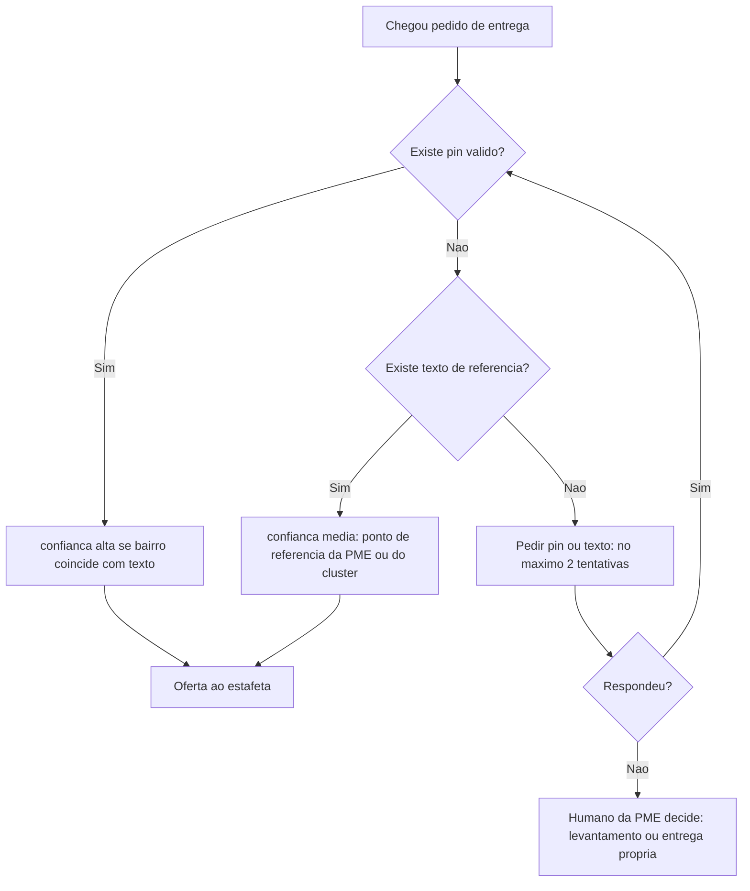
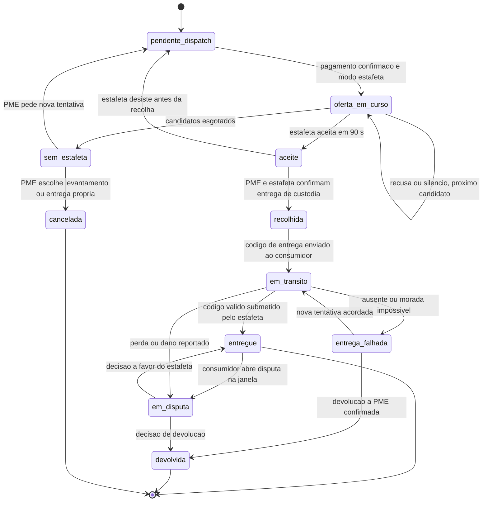
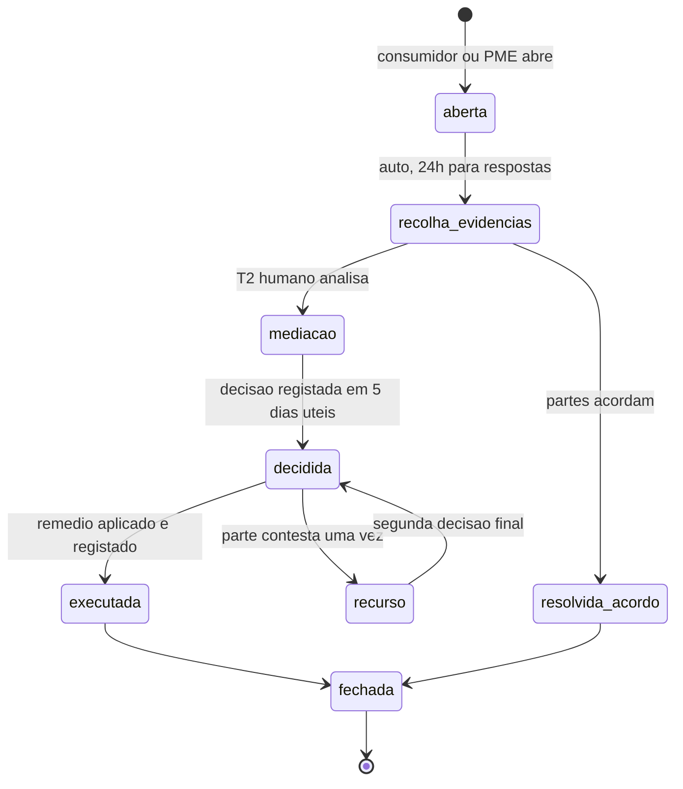

# Geo e Logística Federada — KAMBÁ

| Campo | Valor |
|---|---|
| Produto | KAMBÁ (nome de trabalho) — plataforma WhatsApp-native de comércio conversacional para Angola |
| Documento | Técnica — Geo e Logística Federada (GEO) |
| Versão | 1.0 |
| Data | Outubro de 2026 |
| Classificação | Documento de Referência — Interno |
| Documento-fonte | `../exploracao/06-expansao-plataforma.md` (§2.2), `../exploracao/07-pontos-cegos-2.md` (§9), `../exploracao/11-arquitetura-detalhada-engenharia.md` (§5.2), `../exploracao/13-big-picture-ecossistema.md` |
| Evidência | `evidencia/E1_Meta_WhatsApp.md`, `evidencia/E2_Pagamentos_Angola.md`, `evidencia/E3_Regulatorio_Dados.md`, `evidencia/E4_Stack_Licencas.md` |
| Documentos relacionados | `00_Arquitectura_Solucao.md`, `01_Canais_WhatsApp_Fluxo_Dual.md`, `02_Agent_Runtime_Verticais.md`, `03_Core_Comercio_Medusa.md`, `04_Pagamentos_Liquidacao_AntiFraude.md`, `06_Dados_Eventos_Analytics.md`, `08_Seguranca_Conformidade.md`, `09_Topologia_Operacao_Escala.md`, `10_Onboarding_Governanca.md` |

> **Estado das afirmações.** Este documento segue a escala do conjunto: **CONFIRMADO (fonte primária)**, **INDÍCIO (fonte secundária ou inferência)** e **NÃO VERIFICADO**, remetendo para `evidencia/E1`–`E5` (os quatro primeiros datados de 8 de Outubro de 2026). Valores marcados *«proposta»* são decisões de desenho a calibrar no piloto de logística, não factos. Tudo o que toca Lei 22/11, BNA, Lei 15/03, contratos de transporte e direito laboral é **(a confirmar por parecer)**; este documento não é aconselhamento jurídico.

---

## 1. Introdução

### 1.1 Propósito

Este documento especifica a capacidade **GEO — Geo e Logística** da KAMBÁ: como a plataforma obtém e valida o local de entrega (pin de localização do WhatsApp, texto de referência, Plus Code), como o geocodifica sem enviar coordenadas de clientes para fora de Angola (Nominatim em *self-host*), como calcula zonas e preço de entrega, como regista **estafetas** como tenants do tipo `courier`, como os despacha (oferta sequencial de 90 s, código de entrega de 4 dígitos com prova dos dois lados), como trata o pagamento na entrega (COD) e como desenha desde o piloto o fluxo de **disputas** consumidor ↔ PME ↔ estafeta.

A tese deste documento é a do ponto cego 9 da biblioteca exploratória (`../exploracao/07-pontos-cegos-2.md`): **logística federada é responsabilidade federada**. Se o estafeta rouba, danifica ou sofre um acidente, o consumidor culpa a plataforma. Por isso a federação de entregas só se liga depois de existirem verificação, limites de valor, prova de entrega e um fluxo de disputa que já correu em casos reais.

### 1.2 Âmbito

Cobre: endereçamento (pin, texto, Plus Code); geocodificação e *routing* (Nominatim, Valhalla); zonas e preço de entrega; o tenant `courier` (KYC, caução/seguro, limites, zona, preço); dispatch e máquina de estados da entrega; COD; disputas; responsabilidade federada; *payouts* a estafetas (como restrição regulatória, não como funcionalidade); privacidade da localização; parcerias de entrega (Kubinga/Tupuca); custo e escala.

Fora de âmbito: o registo de comércio e a máquina de estados da encomenda (`03`), o `PaymentProvider` e o *ledger* (`04`), os contratos de eventos (`06`), a segurança transversal (`08`), o KYC de estafetas como processo de onboarding (`10`; aqui só se fixam os campos e limites que o dispatch consome) e a topologia de alojamento (`09`).

**Fases (canónicas, `00` §4 e §13.2):** GEO é **Clusters (C)**. No **Piloto (P)** não há dispatch: o cliente **levanta na loja** ou a **PME entrega por meios próprios**; a KAMBÁ limita-se a transportar o pin ao dono e a registar a entrega manualmente. Valhalla, relay de mensagens estafeta ↔ consumidor e seguro de carga são **Diferidos (D)** dentro de GEO.

### 1.3 Audiência

Arquitectos de plataforma, engenheiros de runtime e de comércio (integração com TLS, COM e PAY), engenheiros de pagamentos (restrições a COD e *payouts*), responsáveis de segurança e privacidade (localização), operações de logística e mediação (T2), e revisão de conformidade (APD, BNA, Meta).

### 1.4 Definições e termos

- **Pin:** mensagem de localização do WhatsApp com `latitude`, `longitude`, `name`, `address` (campos do webhook de mensagem de localização recebida; CONFIRMADO em documentação Meta, 2026-10-08) e, para negócios, `url`.
- **Texto de referência (*landmark*):** descrição livre do cliente («atrás do mercado do Kikolo, portão azul»).
- **Plus Code (Open Location Code):** código de localização (Apache-2.0; conversão coordenadas ↔ código **totalmente offline**; 10 dígitos ≈ 14 m × 14 m) (CONFIRMADO, repositório `google/open-location-code`).
- **Endereço não-endereçável:** local sem rua/número utilizáveis; a maioria dos bairros informais.
- **Entrega (`delivery`):** entidade logística ligada a uma encomenda, com máquina de estados própria (§9.2), distinta da máquina de estados da encomenda (`00` §6.1).
- **Código de entrega:** segredo de 4 dígitos gerado pelo servidor, entregue **só** ao consumidor, apresentado pelo estafeta para fechar a entrega.
- **COD:** *cash on delivery*, pagamento na entrega.
- **Prova dos dois lados:** a entrega só fecha com a acção do estafeta (submeter o código) **e** um sinal do consumidor (posse do código; confirmação «Recebi» ou silêncio durante a janela).

---

## 2. Princípios e decisões aplicáveis (ADRs)

| ADR | Decisão (`00` §8) | Como GEO a concretiza |
|---|---|---|
| **ADR-001** | Cloud API oficial + coexistência; Tech Provider | Toda a comunicação com o consumidor corre no número da PME (Fluxo A). O número usado para falar com estafetas é um problema em aberto (§9.6, PA-GEO-4). |
| **ADR-002** | LangGraph como biblioteca; n8n e Typebot vedados a tenants | O estafeta é **tenant**. Ofertas, aceitação e confirmação de entrega **não** podem correr em Typebot (E4: «Competing Use» da FSL) nem em n8n. Fluxos determinísticos implementam-se em código próprio/LangGraph (§9.6). Corrige a `../exploracao/11` §5.2, que usa Typebot nas ofertas. |
| **ADR-004** | Plataforma nunca detém fundos; *payouts* só via PSP e fora do Piloto | Estafetas **não** são pagos pela plataforma a partir de fundos de terceiros (§13). Caução em dinheiro retida pela plataforma é tratada como risco regulatório (§8.3). |
| **ADR-007** | Preço e stock nunca em prompts; validador de citação | **Taxa de entrega e ETA** são números de tool, nunca do LLM. O validador de citação passa a cobrir `delivery_fee` e `eta_minutes` (§6). |
| **ADR-008** | Nenhum dado pessoal de produção sai de Angola sem APD | Pin, morada e posição do estafeta são dados pessoais. Nominatim *self-host* no mesmo alojamento do núcleo (D1); **proibido** usar o Nominatim público da OSMF ou APIs de mapas de terceiros com coordenadas de clientes (§5.4). |
| **ADR-009** | BullMQ/Redis com outbox; consumidores idempotentes | Eventos `delivery.*` (§9.5) saem por outbox; dispatch é consumidor idempotente de `payment.confirmed`, `payment.manual_confirmed` e `order.paid`. |
| **ADR-010** | Identidade por BSUID/HMAC; consentimento; minimização | A morada guarda-se por `contact_id` (BSUID/HMAC), nunca por telefone. O estafeta **não** recebe o telefone do consumidor. |
| **ADR-011** | Fluxo dual como costura; só Fluxo A em produção | O assistente de consumo («perto de mim») e a PME light ficam Diferidos; GEO serve só o Fluxo A. |
| **ADR-012** | Verticais como configuração; regra de dois | Logística é um módulo fino (`courier` como tenant, eventos, tools) sobre as primitivas; reaproveitamento ≥ 70% a verificar. |
| **ADR-013** | Pagamento só por evento autenticado | **COD em numerário não produz evento autenticado** e, portanto, nunca marca `paga` (§10). |
| **ADR-014** | Object storage atrás de `StorageProvider` | Fotos de prova de entrega e documentos de KYC do estafeta ficam no STO, com URL assinada e retenção curta. |

---

## 3. Visão geral e fases

| Capacidade | Piloto (P) | Clusters (C) | Diferido (D) |
|---|---|---|---|
| Recolha do pin / pedido de localização (mensagem interactiva) | P: transporta o pin ao dono | C: validação e confiança | — |
| Plus Code (offline) | P: opcional, calculado e anexado à nota | C: obrigatório no registo | — |
| Nominatim *self-host* (reverse → bairro) | — | C | — |
| Zonas e preço de entrega | P: lista de zonas da PME (≤ 10 linhas) e taxa manual | C: tabela por zona/estafeta | Preço por distância de rota (Valhalla) |
| Estafeta (tenant `courier`) | — | C | — |
| Dispatch (oferta sequencial 90 s) | — | C | — |
| Código de entrega com prova dos dois lados | P: opcional, entrega própria da PME | C: obrigatório com estafeta | — |
| COD | — (a PME cobra fora da plataforma) | C: só variante digital (§10) | COD em numerário via estafeta |
| Disputas (fluxo e dados) | P: consumidor ↔ PME, mediação manual | C: três partes | Arbitragem automatizada |
| *Payouts* a estafetas pela plataforma | — | — (via PSP, D8) | via PSP licenciado |
| Parcerias Kubinga/Tupuca | — | C (avaliação) | — |

---

## 4. Localização e endereçamento

### 4.1 O pin como fonte da verdade

Em Angola a maioria das moradas não é resolvível por geocodificação textual (ruas sem nome, sem numeração). A decisão de desenho é: **o pin é a fonte da verdade; o texto e o Plus Code são redundância e contexto**. O pin é recolhido por duas vias, ambas mensagens não-template dentro da janela de 24 h (cobradas como *service*; E1):

1. o cliente envia o pin pelo anexo do WhatsApp;
2. o runtime envia a mensagem interactiva de **pedido de localização** (botão «enviar localização»), cujo resultado chega por webhook (CONFIRMADO, `DOC/messages/location-request-messages`).

O ChannelAdapter normaliza o pin num evento `address.pin_received` (versão 1) com `tenant_id`, `contact_id` (BSUID/HMAC; o telefone não faz parte dele, ADR-010), `latitude`, `longitude`, `name`, `address` e `origem` (`pin_manual` ou `pedido_localizacao`).

**Validação à entrada** (determinística, em código, não em LLM):

| Verificação | Regra | Se falhar |
|---|---|---|
| Caixa delimitadora | coordenadas dentro do território de Angola (caixa aproximada + polígono nacional quando o extracto estiver carregado) | pedir de novo; não gravar |
| Plausibilidade com a zona da PME | distância ao centro de serviço da PME ≤ raio configurado (*proposta*: 60 km por omissão) | marcar `confianca = baixa`; perguntar «é para entrega em [zona]?» |
| Pin parado em local sem sentido | reverse geocode sem bairro e sem estrada a < 500 m | `confianca = baixa`; pedir texto de referência |
| Falsificação do pin | o WhatsApp permite escolher qualquer ponto no mapa; **não há prova de presença** | o pin prova intenção, não presença: o código de entrega e o texto de referência é que protegem a entrega (§9.4) |

O LLM **nunca** recebe coordenadas nem a morada (pipeline de minimização, E3 requisito 6): as tools devolvem um `delivery_address_ref` opaco e o texto da resposta usa o bairro devolvido pela tool.

### 4.2 Texto de referência

O texto livre («atrás do mercado», «ao lado da bomba da Sonangol, portão azul») é recolhido sempre que `confianca != alta`, e **sempre** para zonas informais. Guarda-se tal como foi escrito, mais uma versão normalizada (minúsculas, sinónimos PT-AO partilhados com o IDX). É o único elemento que o estafeta local sabe interpretar: `../exploracao/06-expansao-plataforma.md` §2.2 aponta o estafeta como resolução do ponto cego «atrás do mercado».

### 4.3 Plus Code

O Plus Code é calculado **offline** pela biblioteca Open Location Code (Apache-2.0), sem tabelas nem serviço externo (CONFIRMADO). Regras:

- guarda-se o **código completo** de 10 dígitos (≈ 14 m); o código curto só se usa em mensagens ao estafeta, com a localidade de referência explícita («Luanda»), porque a recuperação de um código curto exige uma localização de referência (CONFIRMADO);
- 11 dígitos (≈ 3,5 × 2,8 m) só em entregas de valor elevado ou portões difíceis (*proposta*);
- serve três funções: redundância se o pin se perder, comunicação por voz/SMS com o estafeta, e *fallback* quando o cliente só consegue ditar o código.

### 4.4 Endereços não-endereçáveis

Hierarquia de resolução, da mais forte à mais fraca:

Instrumentos para os casos sem pin fiável:

1. **Gazetteer de pontos de referência por *cluster***: lista curada de pontos (mercados, bombas, igrejas, paragens) com nome, sinónimos e coordenadas, alimentada por PMEs, agentes de activação e estafetas. É um **activo de dados**. Mantém-se **separado da base OSM** (não é fundido na base de dados do Nominatim) para não criar uma base derivada sujeita a *share-alike* da ODbL (§5.3; a confirmar por parecer).
2. **Pergunta guiada**: o runtime usa uma lista (≤ 10 linhas; E1) com os pontos de referência do cluster mais próximos da zona declarada.
3. **Conhecimento do estafeta**: o estafeta pode pedir esclarecimento (§9.7); o resultado melhora o gazetteer.
4. **Recusa graciosa**: se `confianca = baixa` após duas tentativas, o pedido não vai a dispatch (evita entrega falhada com custo e disputa) e passa a humano.

### 4.5 Modelo de dados (schema `geo`)

Tabela `geo.delivery_address`: `tenant_id`, `contact_id` (BSUID/HMAC), `lat/lng`, `plus_code`, `texto_ref` (+ versão normalizada), `bairro`, `municipio`, `zona_id`, `confianca` (`alta|media|baixa`), `origem`, `criado_at` e `reduzido_at` (quando `lat/lng` exactos foram removidos, §14.3). RLS por `tenant_id`; consultas cruzadas só via `delivery_job_view` (§9.3).

---

## 5. Geocodificação: Nominatim em *self-host*

### 5.1 Papel e limites

O Nominatim faz **reverse geocoding** do pin para `bairro/município` (alimenta zona, preço e matching de estafetas) e, residualmente, *forward geocoding* de texto. **Não** é fonte da verdade da morada. A qualidade da geocodificação de moradas angolanas é uma questão dos dados OSM, não do software (E4 §2.12); por isso o pin continua a ser a fonte da verdade.

### 5.2 Dados e requisitos

| Item | Valor | Estado |
|---|---|---|
| Extracto Geofabrik `angola-latest.osm.pbf` | **≈ 81 MB**, dados OSM até 2026-10-07, actualização diária | CONFIRMADO (E4 §2.12) |
| Nominatim | v5.3.2, **GPL-3.0**; usado como serviço isolado, sem distribuição | CONFIRMADO (E4) |
| Requisitos oficiais | mínimo 2 GB RAM; PostgreSQL ≥ 12 (13+ preferível); PostGIS ≥ 3.0; Python ≥ 3.9; osm2pgsql ≥ 1.8 | CONFIRMADO (E4) |
| Requisitos reais para Angola (RAM, disco, tempo de import, latência) | **NÃO VERIFICADO** | a medir no spike S-GEO-1 |

**Spike S-GEO-1 (≤ 2 dias; critérios de aceitação):**

| Medida | Critério |
|---|---|
| Import completo do PBF de Angola | tempo, pico de RAM e disco registados |
| Latência de reverse geocoding (p50/p95), 50 pedidos concorrentes | p95 ≤ 150 ms *(proposta)* |
| Qualidade: 200 pins reais em Luanda (cluster-piloto) auditados por humano | ≥ 80% com bairro correcto *(proposta)*; se falhar, o gazetteer do cluster (§4.4) passa a ser a fonte primária de zona |

### 5.3 Licença ODbL

Os dados OSM estão sob **ODbL** (CONFIRMADO, `openstreetmap.org/copyright`): é obrigatório **creditar o OpenStreetMap e os seus contribuidores** e indicar que os dados estão sob a ODbL; quem **altera ou constrói sobre** a base só a pode distribuir sob a mesma licença.

- **Uso interno** do geocoder: permitido, sem distribuição da base.
- **Atribuição** «© OpenStreetMap contributors (ODbL)» onde se mostrar mapa ou resultado ao utilizador (no Piloto/Clusters não se mostram mapas ao consumidor).
- **Gazetteer** de pontos de referência: colecção separada, nunca fundida na base OSM.
- **API pública do índice** (Escala): reavaliar *share-alike* se expuser dados derivados (a confirmar por parecer).
- **Contribuir para o OSM**: opcional e valioso; nunca carregar pins de clientes nem dados pessoais.

### 5.4 Soberania: onde NÃO se geocodifica

Coordenadas e moradas de clientes são dados pessoais (E3, Lei 22/11; localização não consta da lista de dados sensíveis do Art. 5.º c), INDÍCIO). Enviá-las para fora de Angola é transferência (Arts. 33.º–34.º; ADR-008). Portanto:

- **proibido** o servidor público `nominatim.openstreetmap.org` e qualquer API de mapas de terceiros chamada pelos nossos servidores com coordenadas de clientes;
- o Nominatim corre no **mesmo alojamento do núcleo** (D1). Se D1 resultar em JNB/CPT com procedimento APD concluído, o Nominatim acompanha; senão, Luanda;
- o **link de navegação** para o estafeta (por exemplo `maps.google.com/?q=lat,lng`, `../exploracao/11` §5.2) abre no telemóvel do estafeta, mas as coordenadas seguem numa mensagem nossa e o pedido ao fornecedor de mapas parte do dispositivo do estafeta. Se isso é transferência da KAMBÁ é questão aberta **(a confirmar por parecer)**; alternativa de menor risco: enviar **Plus Code + texto de referência + link `geo:` genérico** e deixar o estafeta escolher a aplicação.

---

## 6. Roteamento e ETA: Valhalla (Diferido)

| Aspecto | Decisão |
|---|---|
| Ferramenta | Valhalla 3.9.1, **MIT** (CONFIRMADO, E4); constrói *tiles* do mesmo PBF |
| Requisitos reais de RAM/disco para Angola | **NÃO VERIFICADO**; medir antes de adoptar |
| Substituto em Clusters | distância em linha recta (*haversine*) × factor de sinuosidade (*proposta*: 1,35) e velocidade média por zona/hora estimada a partir das entregas reais |
| Gatilho de adopção | ≥ 3 clusters com dispatch activo **e** erro mediano de ETA > 30% medido em ≥ 300 entregas **e** spike S-GEO-2 concluído |
| Risco | a qualidade das estradas OSM em Angola determina a utilidade do ETA; um ETA mau é pior do que nenhum |

**Regra ADR-007 estendida:** qualquer ETA ou taxa dita ao cliente vem de uma tool com o valor e a sua proveniência (`haversine_estimado` vs `rota`); o LLM só o reproduz. Sem ETA fiável, a resposta usa intervalos largos («hoje, entre 14h e 18h»).

---

## 7. Zonas de entrega e preço

### 7.1 Modelo

Uma **zona** é um conjunto de bairros/polígonos com preço e regras. Existem dois níveis:

- **zona da PME** (`delivery_zone.tenant_id = PME`): onde a PME aceita entregar e a taxa que cobra;
- **zona do estafeta** (`courier_zone`): onde o estafeta aceita trabalhar e o seu preço (§8.4).

Tabela `geo.delivery_zone`: `tenant_id` (PME ou courier), `nome`, `bairros[]`, `poligono` (opcional), `modo_preco` (`fixo|por_km`), `preco_fixo_kz`, `base_kz`, `kz_por_km`, `minimo_kz`, `valor_max_kz`, `activo`.

### 7.2 Regras de preço

| Modo | Fórmula | Quando |
|---|---|---|
| Fixo por zona | `taxa = preco_fixo_kz` | Piloto e Clusters-entrada; previsível e fácil de explicar por voz |
| Por km | `taxa = max(minimo_kz, base_kz + kz_por_km × km_est)`, arredondada a 50 Kz | Clusters; `km_est = haversine × 1,35` até haver Valhalla |
| Composição | `taxa_cliente = taxa_estafeta + taxa_plataforma_visivel (se houver)` | a taxa da plataforma, se existir, é cobrada à PME pelo billing do TEN, **não** retida do fluxo (§13) |

A taxa entra no total da encomenda como linha de envio no COM; o consumidor paga tudo na mesma referência/pagamento Express, liquidado **directamente à PME** (ADR-004). A PME paga o estafeta pelos seus meios (§13).

### 7.3 Fluxo de cotação

O runtime chama `quote_delivery` com o `delivery_address_ref`; o GEO resolve zona, taxa, ETA e proveniência com o `tenant_id` do estado; a TLS acrescenta a linha de envio ao carrinho no COM; o validador de citação confere taxa e ETA antes da resposta.

### 7.4 Limites de valor por zona

A `valor_max_kz` da zona e o nível do estafeta (§8.3) limitam o valor da encomenda confiado a entrega por terceiros. Encomendas acima do limite vão para **levantamento na loja** ou **entrega própria da PME**; o runtime explica o motivo («para valores acima de X Kz, só levantamento ou entrega pela loja»).

### 7.5 Piloto

Sem tenants `courier`, a PME define até 10 zonas numa lista (E1) com taxa fixa e confirma a entrega manualmente; valida H2/H8 e o fluxo de disputa sem infra de GEO.

---

## 8. O estafeta como tenant `courier`

### 8.1 Perfil, KYC e activação

O estafeta é um tenant (`tipo = 'courier'`), com onboarding próprio (`10` §4.2). Os campos que o dispatch consome:

| Dado | Fonte | Uso | Retenção (*proposta*) |
|---|---|---|---|
| Nome, fotografia, telemóvel | registo presencial pelo agente de activação | identificação perante PME e consumidor (nome + foto; **não** telefone do estafeta ao consumidor) | duração da relação + janela de disputas |
| Documento de identificação (BI) e NIF | KYC presencial | verificação de identidade e unicidade | duração da relação; cópias apagadas 90 dias após encerramento (parecer) |
| Veículo/matrícula e documentos | KYC presencial | tipo de veículo e capacidade | idem |
| Referências / registo criminal | **(a confirmar por parecer)** se é exigível ou lícito | elegibilidade | — |
| Zona(s), horário, preço | declarado pelo estafeta | matching (§9.1) | duração da relação |
| Nível de confiança (T0–T3) | calculado | limites de valor (§8.3) | duração da relação |

Estados do tenant seguem `00` §6.2: `onboarding`, `ativo`, `restrito`, `suspenso`, `encerrado` — **cinco, e não uma cadeia**. O `restrito` é limitação imposta pela Meta (*quality rating*) e volta a `ativo` com o rating recuperado; de `suspenso` regressa-se a `ativo` por regularização. O KYC pendente é um passo dentro de `onboarding`, e a verificação presencial é o gate para `ativo`.

Tabelas `geo.courier_profile` (`nivel` 0–3, `veiculo`, `kyc_id`, `seguro_ref`, `caucao_ref` — referência no PSP/parceiro, nunca saldo nosso —, `disponivel`, taxas de aceitação/pontualidade, disputas em 90 dias) e `geo.courier_zone` (N:N com `delivery_zone`).

### 8.2 Níveis de confiança e limites de valor por entrega

Os valores são **proposta** a calibrar no piloto de logística (ticket exemplar da biblioteca: 25.000 Kz; bens de ticket alto chegam a ≥ 250.000 Kz):

| Nível | Critério de acesso | Valor máx. por entrega | COD (§10) |
|---|---|---|---|
| T0 | KYC presencial concluído; 0 entregas | 50.000 Kz | não |
| T1 | ≥ 20 entregas com código confirmado, 0 disputas procedentes em 60 dias | 150.000 Kz | não |
| T2 | ≥ 100 entregas, taxa pontual ≥ 90%, seguro activo | 500.000 Kz | variante digital |
| T3 | ≥ 300 entregas, caução/seguro de nível superior | > 500.000 Kz, caso a caso | variante digital |

Promoção e despromoção são automáticas por métricas (§17) e revistas por T2 em casos-limite; uma disputa procedente por perda/roubo suspende o estafeta até decisão.

### 8.3 Caução e seguro

| Instrumento | Estado/risco | Decisão de desenho |
|---|---|---|
| **Seguro de mercadoria transportada e acidentes pessoais** (seguradora parceira) | Produto e preço em Angola **NÃO VERIFICADO** | alvo preferido de Clusters; custo repartido (estafeta/PME/plataforma) a decidir |
| **Caução em dinheiro retida pela plataforma** | Reter fundos de terceiros aproxima a plataforma de «deter fundos» e de depósito (E2: Lei 40/20 art. 9; Aviso 2/22 art. 6 — aplicáveis a PSP; o enquadramento de uma caução contratual **(a confirmar por parecer)**) | **não fazer** sem parecer; **não** é meio de arranque |
| **Caução via PSP/parceiro licenciado** (conta ou garantia em nome do estafeta, fundos nunca no balanço KAMBÁ) | Depende de parceiro (D8; PayPay e outros **NÃO VERIFICADO**) | trajectória compatível com ADR-004 |
| **Retenção de taxa pela PME** (a PME retém parte do que deve ao estafeta após decisão de disputa) | Fluxo entre PME e estafeta, sem fundos na plataforma | mecanismo de arranque, previsto no contrato (§12.3) |
| **Limites de valor** (§8.2) | Controlo imediato e barato | principal controlo no arranque |

Conclusão: no arranque de Clusters, a protecção assenta em **limites de valor + KYC presencial + código de entrega + retenção contratual da PME**; seguro e caução via parceiro entram quando existirem (**Q-GEO-2**).

### 8.4 Preço, zona e disponibilidade

O estafeta declara zonas, preço (fixo ou por km, §7.2) e janelas de disponibilidade, e activa/desactiva a disponibilidade enviando uma mensagem (`online`/`offline`) ao canal operacional. Disponibilidade sem confirmação durante 12 h passa a `offline` automaticamente (evita ofertas a estafetas ausentes e custo de templates).

---

## 9. Dispatch

### 9.1 Algoritmo de matching (Clusters, sem Valhalla)

1. Gatilho: a encomenda está `paga` — por `payment.confirmed` **ou** por `payment.manual_confirmed` (dicionário §3.4: são dois eventos distintos, e quem não distingue o caminho consome os dois) — **e** modo de entrega = `estafeta`. Uma encomenda paga pelo `ManualProvider` entra em *dispatch* como qualquer outra; a distinção entre os dois eventos é de autenticação e vale a jusante (comissão, Kambá Score), não aqui.
2. Reverse geocode do pin → `bairro/zona`.
3. Candidatos: estafetas `disponivel`, `activo`, com `zona` abrangente, `nivel` com limite ≥ valor da encomenda e carga actual < capacidade.
4. Ordenação determinística (*proposta*): distância estimada ao ponto de recolha (haversine), depois taxa de aceitação, depois taxa pontual, depois carga actual; desempate estável por `courier_id`.
5. **Oferta sequencial**: um estafeta de cada vez, **90 s** para aceitar; silêncio ou recusa → o seguinte; máximo de 5 ofertas (*proposta*).
6. Sem aceitação: `sem_estafeta` → oferecer à PME entrega própria ou levantamento; nunca prometer ao consumidor uma entrega por estafeta sem aceitação.

### 9.2 Máquina de estados da entrega

A entrega tem máquina de estados própria; os estados da encomenda (`00` §6.1) continuam a ser os canónicos. Mapeamento na tabela a seguir ao diagrama.

| Estado da entrega | Estado da encomenda (`00` §6.1) |
|---|---|
| `pendente_dispatch`, `oferta_em_curso`, `sem_estafeta`, `aceite`, `recolhida`, `em_transito`, `entrega_falhada` | `paga` até à recolha; `em_entrega` a partir de `recolhida` |
| `entregue` | `entregue` |
| `em_disputa`, `devolvida` | `reembolso_pendente` (processo manual, ADR-004) — ver lacuna L-GEO-1 em §20 |
| `cancelada` | `paga` com modo de entrega alterado (levantamento/entrega própria) |

### 9.3 Isolamento entre tenants na entrega

A entrega pertence ao tenant da PME. O estafeta (outro tenant) **não** lê tabelas da PME: recebe uma **projecção mínima** (`delivery_job_view`) com `delivery_id`, bairro/zona, distância aproximada, valor declarado para efeitos de limite, e — só **após aceitação** — pin, Plus Code e texto de referência. É a única excepção à regra «tool só lê o seu tenant» (`00` §4, TLS) e tem de constar nos testes de isolamento do CI (um estafeta nunca lê entregas que não lhe foram atribuídas).

### 9.4 Código de entrega e prova dos dois lados

| Propriedade | Desenho |
|---|---|
| Geração | CSPRNG no servidor, 4 dígitos, por tentativa de entrega; nova a cada reentrega |
| Armazenamento | `HMAC(segredo_rodado, delivery_id ‖ codigo)`; o código em claro nunca persiste |
| Destinatário | **só o consumidor**, pela conversa com a PME (Fluxo A), no momento `recolhida → em_transito`; o estafeta nunca o recebe do servidor |
| Submissão | o estafeta envia o código ao canal operacional; o servidor compara em tempo constante |
| Anti-força-bruta | máx. 3 tentativas por entrega, bloqueio de 10 min e alerta a T2; 10⁴ combinações × 3 tentativas ⇒ ≤ 0,03% de adivinhação cega |
| Prova do consumidor | posse do código (apresentado em pessoa) e mensagem de fecho com botão «Recebi» / «Problema» (até 3 *reply buttons*, E1); sem resposta em 24 h ⇒ confirmação tácita e arranque da janela de disputa |
| Prova do estafeta | submissão do código; distância entre o pin de confirmação e o destino registada (alerta se > 300 m, *proposta*) |
| Educação anti-fraude | mensagem fixa ao consumidor: «só diga o código quando tiver a encomenda na mão»; nunca ditar por telefone a quem não está presente |
| Limite | o código prova que o consumidor *entregou o segredo*, não que o conteúdo estava correcto: estado do conteúdo resolve-se em disputa (§11) |

**Recolha (custódia):** a transferência de custódia PME → estafeta é um evento de prova. A PME confirma por *reply button* («Entreguei ao João») e o estafeta confirma a recepção; só então a entrega passa a `recolhida`, o limite de valor do estafeta é validado e a responsabilidade pelo bem muda de mãos. Fotografia do pacote selado é opcional (MED/STO) e obrigatória a partir de T3 (*proposta*).

### 9.5 Contrato da oferta e eventos

A oferta (`delivery.offered`, versão 1) leva `delivery_id`, `order_id`, `courier_id`, `tentativa`, `expira_em`, `zona`, `distancia_aprox_km`, `valor_declarado_kz` e `taxa_estafeta_kz` — sem pin.

| Evento (nome provisório; alinhar com `06`) | Produtor | Consumidores |
|---|---|---|
| `delivery.requested` | COM/GEO | dispatch, analytics |
| `delivery.offered` / `delivery.declined` / `delivery.expired` | dispatch | métricas de aceitação |
| `delivery.accepted` | dispatch | notificação à PME, ao consumidor (nome do estafeta) |
| `delivery.picked_up` | GEO | encomenda → `em_entrega`; arranque do código |
| `delivery.delivered` | GEO | **`order.delivered`** (canónico em `../exploracao/11` §3) → Reputação, Revendedores |
| `delivery.failed` / `delivery.returned` | GEO | PME, T2 |
| `delivery.disputed` | GEO/GOV | mediação, métricas |

Todos os consumidores são idempotentes por `evento.id` (ADR-009). A oferta é idempotente por `(delivery_id, tentativa)`; um duplo toque «Aceito» não cria duas atribuições.

### 9.6 Canal com o estafeta

Os estafetas precisam de receber ofertas e submeter códigos por WhatsApp (o estafeta não instala app; `../exploracao/06` §2.2). Isto levanta uma lacuna do canon:

- o Fluxo A usa o número **da PME**; um estafeta serve várias PMEs e não pode ser contactado «como PME»;
- `00` §5 impede qualquer tenant `platform` em produção até D2, mas essa restrição visa o **assistente de consumo** sobre vários negócios (E1: risco de personificação e partilha entre clientes). Um **número operacional da KAMBÁ**, usado só para comunicar com os seus prestadores (estafetas, agentes, suporte a PMEs), é a própria plataforma a falar em nome próprio. Não se encontrou regra que o proíba, mas a Meta não o confirmou por escrito (**NÃO VERIFICADO**);
- custo: as ofertas são mensagens iniciadas pelo negócio, logo **templates *utility*** (0,004 USD cada, tarifa «Rest of Africa», E1 CONFIRMADO); a resposta do estafeta abre a janela de 24 h, dentro da qual as mensagens são *service* (grátis nas primeiras 1.000/mês **por número**, depois 0,004 USD);
- alternativas se a Meta recusar: (a) cada estafeta como tenant com WABA próprio por coexistência (difícil: muitos só têm WhatsApp pessoal); (b) canal secundário por SMS/voz com o código; (c) parceria de entrega (§15).

**Proposta PA-GEO-4** (canal operacional da KAMBÁ para prestadores) e **Q-GEO-1** (pergunta escrita à Meta) tratam esta lacuna. Entretanto, as ofertas e fluxos determinísticos implementam-se em código nosso (ADR-002), não em Typebot.

### 9.7 Relay estafeta ↔ consumidor (Diferido)

Quando o estafeta «não encontra a morada», o runtime da PME pergunta ao consumidor por pin/texto/Plus Code e devolve a resposta ao estafeta, sem expor telefones (ADR-010). Custa mais mensagens (§16); no arranque de Clusters o estafeta liga à PME.

---

## 10. COD — pagamento na entrega

### 10.1 Conflito com o canon

O COD em numerário **não gera evento autenticado** do facilitador, logo viola ADR-013 («comprovativo nunca é prova»). O estado `paga` nunca pode ser atingido por «o estafeta disse que recebeu».

### 10.2 Vectores de fraude

| Vector | Descrição | Controlo |
|---|---|---|
| Subtracção pelo estafeta | recebe numerário e declara «cliente não pagou» ou entrega menos | não há evento de pagamento ⇒ não há como provar; limite de valor, só T2+, caução/seguro |
| Notas falsas / troco | consumidor paga com notas falsas ou exige troco impossível | sem controlo digital; limite baixo; recusa permitida |
| Recusa na porta | consumidor recusa e a mercadoria volta | custo de retorno; histórico de recusas por `contact_id` |
| Pedido falso / abuso | pedidos sem intenção de pagar | só clientes com ≥ 1 pedido pago anteriormente (*proposta*) |
| Conluio estafeta ↔ consumidor | desvio de mercadoria declarada «recusada» | código de entrega + recolha com custódia + fotografia |
| Remessa do numerário à PME | atraso ou apropriação | liquidação PME ↔ estafeta fora da plataforma; retenção contratual (§8.3) |

### 10.3 Decisão

1. **Piloto:** a PME entrega e cobra por si; se cobrar em numerário, regista a confirmação no `ManualProvider` com o limite de valor por pedido de `00` §6.1. Nada de novo na plataforma.
2. **Clusters — variante digital:** o consumidor paga na porta com Multicaixa Express (push, 90 s para validar; E2) ou referência; o evento autenticado do facilitador (ADR-013) marca `paga`; o código de entrega só fecha depois do evento. Elimina o numerário do estafeta.
3. **COD em numerário via estafeta:** **Diferido** e fora de Clusters-entrada. Só se reavaliar com seguro/caução via parceiro, limites muito baixos (*proposta*: ≤ 30.000 Kz) e dados que provem a taxa de fraude baixa.
4. **Referências sem devolução:** referências Multicaixa não admitem devolução (E2); o reembolso após entrega é sempre manual fora da plataforma.

---

## 11. Disputas consumidor ↔ PME ↔ estafeta

A biblioteca exige: «desenhar o fluxo desde o piloto» (`../exploracao/07-pontos-cegos-2.md` §9) e validar «1 caso real mediado pela equipa» antes de federar logística (validação 8). Este capítulo desenha o fluxo completo e marca o que existe em cada fase.

### 11.1 Tipologia

| Tipo | Exemplo | Prova decisiva |
|---|---|---|
| Não recebido | «paguei e nada chegou» | evento de pagamento, estado da entrega, código/recolha, pin de confirmação |
| Danificado | produto partido | fotografia na recolha vs fotografia do consumidor; embalagem |
| Errado/incompleto | falta artigo | linhas da encomenda (snapshot COM), lista de recolha confirmada pela PME |
| Atraso | passou do prazo prometido | `eta` registado, cronologia de eventos |
| Cobrança indevida | taxa/total diferente | snapshot do total, evento de pagamento |
| Desistência (Lei 15/03) | devolução em 7 dias úteis | **não é disputa**: fluxo próprio da PME, com data de recepção registada; prazo e âmbito **(a confirmar por parecer)** (E3 INDÍCIO) |

### 11.2 Fluxo e prazos (*proposta*)

| Etapa | Prazo | Responsável |
|---|---|---|
| Abertura | até 72 h após `entregue` (ou após o prazo prometido, se nunca entregue); um botão/palavra «PROBLEMA» na conversa | consumidor |
| Resposta de PME e estafeta | 24 h | PME, estafeta |
| Mediação | decisão em 5 dias úteis | T2 (humano da KAMBÁ) |
| Recurso | 1 vez, 48 h | parte contestante |
| Execução do remédio | 3 dias úteis | PME (dinheiro), KAMBÁ (registo) |

### 11.3 Evidências e retenção

O pacote de evidências é montado automaticamente a partir de fontes imutáveis (COM, PAY, `delivery_event`, mensagens relevantes à formação do contrato; E3 requisito 18) e anexa a prova manual.

Tabelas `geo.dispute` (`order_id`, `delivery_id`, `aberta_por`, `tipo`, `estado`, `valor_em_causa_kz`, `decisao`, `remedio`, `decidida_por`) e `geo.dispute_evidence` (`origem`, `tipo`, `ref_sto`, `hash_sha256`).

Um caso aberto **suspende** a purga de dados que o alimentam (retenção por disputa) até ao fecho + período contratual.

### 11.4 Remédios

| Remédio | Quem executa | Notas |
|---|---|---|
| Re-entrega | PME/estafeta | novo código; nova tentativa |
| Reembolso total/parcial | **PME**, a partir da sua conta | a KAMBÁ regista `refund_manual_recorded`; sem PSP não há reembolso executado pela plataforma (ADR-004); referências não têm devolução automática, Express só dentro da janela do TPA virtual (E2) |
| Crédito/desconto | PME | acordo registado |
| Retenção de taxa de entrega ao estafeta | PME | prevista no contrato do estafeta (§12.3) |
| Despromoção/suspensão do estafeta | KAMBÁ (T&S) | automática por limiar; humana nos restantes |
| Accionamento de seguro/caução | KAMBÁ coordena | só quando existirem (§8.3) |

### 11.5 O que existe em cada fase

| Fase | Capacidade |
|---|---|
| **P** | Disputa consumidor ↔ PME: botão «PROBLEMA», pacote de evidências (pedido, pagamento, notas do dono), mediação manual pela equipa em casos reais; registo em `geo.dispute` |
| **C** | Três partes; entrega com `delivery_event`; métricas por estafeta; recurso |
| **D** | Triagem automática assistida, arbitragem com seguro integrado |

---

## 12. Responsabilidade federada

### 12.1 Matriz

| Parte | Assume | Não assume |
|---|---|---|
| **PME (vendedor)** | exactidão do catálogo e do preço; qualidade da mercadoria; embalagem; reembolsos; cumprir a Lei 15/03 como fornecedor | actos do estafeta depois da recolha, quando a custódia tiver sido confirmada e a entrega feita pelo estafeta verificado (*a definir contratualmente*) |
| **Estafeta (prestador independente)** | custódia entre recolha e entrega; actos próprios; cumprimento do código de entrega; descargas de responsabilidade previstas no contrato | decisões de preço e catálogo |
| **KAMBÁ** | operar o dispatch como software; verificar identidade (KYC); impor limites; guardar provas; mediar | ser transportadora; deter fundos; garantir a mercadoria (excepto o que vier a ser decidido em §12.2) |
| **Consumidor** | morada/pin verdadeiros; estar presente; não revelar o código a terceiros | — |

### 12.2 O que a plataforma assume (opções)

O consumidor vê «a KAMBÁ» e a Lei 15/03 prevê solidariedade de intervenientes na cadeia que violem o dever de informação (art. 9.º n.º 3, citado; E3 INDÍCIO). Não há «porto seguro» claro para intermediários (Lei 23/11 não o trata; E3 INDÍCIO). Opções:

| Opção | Descrição | Custo/risco | Recomendação |
|---|---|---|---|
| **A. Intermediário tecnológico + mediação** | responsabilidade contratual limitada; dever de mediar e de aplicar sanções | risco reputacional quando a PME não indemniza | **Clusters-entrada** |
| **B. Garantia limitada** | a KAMBÁ compensa até X Kz por caso, com apólice de carga | prémio de seguro; fraude de sinistros; **(a confirmar por parecer)** se constitui serviço financeiro | quando existir seguro (Q-GEO-2) |
| **C. Transportador** | a KAMBÁ responde como transportadora | licenças e responsabilidade totais (**NÃO VERIFICADO**) | rejeitada |

A decisão final cabe ao Responsável de Produto com parecer; é uma decisão aberta **Q-GEO-3** (não estava prevista entre D1–D8).

### 12.3 Contratos necessários **(a confirmar por parecer)**

1. **Termos da PME**: papel de intermediário, regras de entrega, direito de retenção, limites de valor, mediação vinculativa em prazos.
2. **Contrato do estafeta**: prestação de serviços independente (não vínculo laboral; risco de requalificação **(a confirmar por parecer)**), obrigações de custódia, cláusula de retenção de taxa, tratamento de dados, uso do canal operacional, causas de suspensão.
3. **Termos do consumidor / aviso de privacidade**: partilha de dados com o estafeta para entregar; direito de reclamação (Livro de Reclamações / INADEC, E3 NÃO VERIFICADO para venda online).
4. **Cláusulas de limitação**: cláusulas que excluam responsabilidade por informação errada podem ser nulas (Lei 15/03 art. 16.º; E3 INDÍCIO).

---

## 13. *Payouts* a estafetas: actividade regulada

| Opção | Fluxo | Estado |
|---|---|---|
| **(i) PME paga o estafeta** | a taxa de entrega faz parte do total pago pelo consumidor e liquidado **directamente à PME**; a PME paga o estafeta da sua conta; a KAMBÁ gera apenas **extracto/lista de acerto** | **Opção de arranque**; compatível com ADR-004 e E2 §3.3 C(i) |
| **(ii) Parceiro PSP/banco executa o payout** | a partir da conta do comerciante, via API do parceiro, instruído pela KAMBÁ | depende de D8, de resposta do BNA (E2 Q21) e de parceiro (**NÃO VERIFICADO**); atenção ao art. 21.º do Aviso 2/22 (proibição de subcontratar serviços operacionais de pagamento) |
| **(iii) Plataforma paga com licença** | execução de operações de pagamento/remessa | **fora do Piloto e de Clusters**; exige autorização BNA |
| **Nunca** | receber a taxa de entrega e repassar ao estafeta; escrow de entrega; caução retida | ADR-004 |

Fluxo de fundos: consumidor → facilitador → **liquidação directa à PME** → acerto PME ↔ estafeta fora da plataforma; PME → KAMBÁ apenas assinatura/taxa de serviço facturada pelo billing.

A comissão de dispatch da KAMBÁ (se existir) é facturada à PME pelo billing (TEN), **não** deduzida do fluxo de fundos; a emissão de factura usa software certificado AGT (E2/E3). O que a KAMBÁ paga a agentes e revendedores com fundos próprios é tratado em `10` §4.3 e §10 e em `04`.

---

## 14. Privacidade da localização (Lei 22/11)

### 14.1 Classificação

São dados pessoais: pin e morada do consumidor e texto de referência (base: execução de contrato, Art. 12.º, e consentimento registado para a partilha com terceiro), posição do estafeta (contrato + consentimento específico) e fotografias de prova. O código de entrega é um segredo, não um dado pessoal. Tudo **(a confirmar por parecer)**.

### 14.2 Princípios de desenho

1. **Minimização por camadas:** a oferta ao estafeta revela **zona e distância aproximada**, não o pin; o pin exacto só segue **após aceitação**.
2. **Sem rastreio contínuo do estafeta:** a posição recolhe-se apenas em eventos-ponto (aceitação, recolha, entrega) por pin pontual. Localização em tempo real está desactivada em números em coexistência (E1) e não é necessária para o desenho.
3. **Estafeta não recebe o telefone do consumidor** (ADR-010); contacto via PME ou relay (§9.7).
4. **LLM sem coordenadas** (§4.1).
5. **Geocoder local** (§5.4); registos sem conteúdo de mensagens (ADR-010, OBS).
6. **Mensagens com pin ficam no telemóvel do estafeta**: o WhatsApp não permite recolher uma mensagem entregue. Preferir **ligação assinada de curta duração** (válida até `entregue` + 2 h) a mensagem de localização nativa; se o canal de ligação web não existir ainda, assumir o resíduo como risco aceite e documentado (**PA-GEO-3**).
7. **Partilha com o estafeta e a política da Meta:** os termos proíbem usar dados de uma pessoa, além do conteúdo da conversa, para finalidade diferente de suportar a mensagem com essa pessoa, e partilhar dados WhatsApp com terceiros excepto Solution Providers (E1, CONFIRMADO). Enviar a localização do consumidor a um terceiro (estafeta) para entregar o pedido do próprio consumidor é, em leitura razoável, a finalidade da conversa, mas **não está confirmado** pela Meta (**Q-GEO-1**). Mitigação: aviso e consentimento na confirmação do pedido («vamos partilhar a localização com o estafeta para entregar») e partilha apenas por canal nosso.

### 14.3 Retenção (*proposta*; prazos a confirmar por parecer)

| Dado | Retenção | Acção no fim |
|---|---|---|
| Pin exacto (`lat/lng`) | até `entregue` + janela de disputa (72 h) + 30 dias | reduzir: apagar `lat/lng`, manter `bairro`, `zona` e Plus Code de 6 dígitos (≈ 275 m) |
| Texto de referência | idem | apagar ou manter no gazetteer só depois de anonimizado |
| Eventos de entrega (`delivery_event`) | enquanto durar a retenção fiscal da encomenda (prazo do CGT **NÃO VERIFICADO**, parametrizar por tenant) | pseudonimizar o `contact_id` |
| Código de entrega (HMAC) | 30 dias | apagar |
| Documentos de KYC do estafeta | duração da relação | apagar 90 dias após encerramento (salvo obrigação legal) |

O apagamento é automático (*jobs* de purga com registo), com excepção de casos sob retenção por disputa. O mapa de tratamentos entregue à APD (E3 requisito 9) tem de incluir estes dados e os destinatários (estafeta, parceiros de entrega).

---

## 15. Parcerias de entrega: Kubinga e Tupuca

A biblioteca apresenta a logística federada como «alternativa/complemento» a Kubinga/Tupuca (`../exploracao/06` §2.2).

| Parceiro | Estado das fontes |
|---|---|
| **Tupuca** | Plataforma angolana de entrega e marketplace, com retalhistas (KFC, Kero, Mega Cash & Carry entre cerca de 20 parceiros) e expansão para Benguela (2021) e RDC (2022): **INDÍCIO** (imprensa, Ver Angola). Existência de API para terceiros, condições e preços: **NÃO VERIFICADO** |
| **Kubinga** | Não encontrada fonte verificável nesta ronda: **NÃO VERIFICADO** (estado actual do serviço incluído) |

**Costura proposta (PA-GEO-1):** `DeliveryProvider`, com adaptadores `PmeSelfDelivery`, `OwnCouriers`, `PartnerKubinga`, `PartnerTupuca`. O dispatch pede cotação e entrega ao provider; o código de entrega, a prova dos dois lados e a máquina de estados da entrega mantêm-se na KAMBÁ, para que a prova e as disputas funcionem igual.

| Critério | Estafetas próprios (federados) | Parceiro (Kubinga/Tupuca) |
|---|---|---|
| Cobertura/densidade | só onde existir cluster com estafetas | potencialmente mais ampla |
| Controlo da prova e do KYC | total | depende do contrato; o código de entrega pode não ser aceite pelo parceiro |
| Custo | taxa do estafeta + mensagens | tarifa do parceiro (**NÃO VERIFICADO**) |
| Dados do consumidor | partilhados com o estafeta | partilhados com uma empresa angolana: nova relação de subcontratado/destinatário; sem transferência internacional (INDÍCIO) mas a incluir no mapa APD |

**Critério de decisão:** a parceria é a via preferida para entregas de maior valor e de maior distância (com seguro do parceiro), e para clusters sem estafetas suficientes; a federação própria justifica-se onde a densidade e o conhecimento de «atrás do mercado» fizerem diferença. As duas vias coexistem atrás da mesma interface.

---

## 16. Custo e escala

### 16.1 Custo de mensagens por entrega (ordem de grandeza)

Tarifa «Rest of Africa», efectiva 2026-10-01: *utility* e *service* a **0,004 USD** por mensagem entregue acima do *free tier* de 1.000 *service* por número/mês (E1, CONFIRMADO). Câmbio de referência ~913 Kz/USD (E2, INDÍCIO): 0,004 USD ≈ 3,65 Kz.

| Componente | Mensagens | Custo (por entrega) | Quem paga |
|---|---|---|---|
| Ofertas ao estafeta (templates *utility*, média 1,8 tentativas) | 1,8 | ≈ 6,6 Kz | KAMBÁ (número operacional) |
| Mensagens em janela com o estafeta (aceitação, recolha, entrega, ack), após *free tier* | ~6 | ≈ 22 Kz | KAMBÁ |
| Estado ao consumidor com janela fechada (código, em trânsito, entregue) | até 3 templates | ≈ 11 Kz | PME (conta Meta da PME) |
| **Total** | | **≈ 30–40 Kz por entrega** (INDÍCIO, a medir) | repartido |

O *free tier* de 1.000 *service*/mês do número operacional esgota-se com ~170 entregas/mês ao ritmo acima; relay e reentregas aumentam o consumo.

### 16.2 Infraestrutura

Nominatim (4–8 GB RAM provisório; disco a medir, NÃO VERIFICADO, S-GEO-1); Valhalla (a medir, S-GEO-2, Diferido); tabelas `geo.*` pequenas, com `delivery_event` particionado por mês; fila de ofertas em BullMQ com *job* atrasado de 90 s por oferta.

### 16.3 Escala

| Sinal | Resposta |
|---|---|
| Aceitação à primeira oferta < 40% numa zona | recrutar estafetas ou subir a taxa; abrir parceria (§15) |

A densidade de estafetas por zona é a restrição real: a oferta sequencial de 90 s só funciona com vários candidatos disponíveis por zona/hora (*proposta*: ≥ 3 por zona activa).

---

## 17. Alvos mensuráveis

| Alvo (*proposta*) | Valor | Medição |
|---|---|---|
| Entregas fechadas com código válido | ≥ 95% | `delivery.delivered` / entregas por estafeta |
| Tentativas bem-sucedidas de adivinhar código | 0 | alertas de bloqueio |
| Aceitação à 1.ª oferta | ≥ 60% | `delivery.offered`/`accepted` |
| Disputas por 100 entregas | ≤ 3 | `geo.dispute` |
| Perda/roubo de mercadoria | ≤ 0,5% das entregas | disputas procedentes |
| Reverse geocode correcto ao bairro | ≥ 80% (spike), ≥ 90% (produção) | amostragem humana |

---

## 18. Riscos operacionais e mitigações

| Risco | Impacto | Mitigação |
|---|---|---|
| Roubo ou dano pelo estafeta | perda de mercadoria; culpa na plataforma | KYC presencial, limites por nível, custódia confirmada, seguro quando existir, retenção contratual |
| Fraude do código (consumidor divulga a terceiro ou estafeta pede cedo) | entrega falsa | recolha do código só na porta; educação; limites de tentativas |
| COD em numerário | fraude sem prova | não suportado; só variante digital |
| Ausência de canal Meta para estafetas | dispatch inviável por WhatsApp | PA-GEO-4; SMS/voz; parceria |

---

## 19. Limites, premissas e itens NÃO VERIFICADOS

| Item | Estado | Ligação |
|---|---|---|
| Requisitos reais de RAM/disco/latência do Nominatim para Angola | NÃO VERIFICADO | S-GEO-1; D1 (alojamento) |
| Requisitos do Valhalla para Angola; utilidade do ETA com dados OSM | NÃO VERIFICADO | S-GEO-2 |
| Qualidade do OSM nos bairros do cluster-piloto | NÃO VERIFICADO | S-GEO-1 |
| Número operacional da KAMBÁ para prestadores permitido pela Meta | NÃO VERIFICADO | Q-GEO-1; D2 (distinção entre persona assistente e canal operacional) |
| Partilha da localização do consumidor com o estafeta face aos termos da Meta | NÃO VERIFICADO | Q-GEO-1 |
| Seguro de carga e acidentes disponível em Angola; preço | NÃO VERIFICADO | Q-GEO-2 |
| Caução em dinheiro como actividade regulada; payouts executados por parceiro | INDÍCIO / NÃO VERIFICADO (E2) | D8; E2 Q21–Q22 |
| Kubinga: estado do serviço; Tupuca: API e preços | NÃO VERIFICADO | §15 |
| Responsabilidade solidária da plataforma (Lei 15/03 art. 9.º n.º 3) | INDÍCIO | Q-GEO-3; parecer |
| Prazo de conservação fiscal (CGT) | NÃO VERIFICADO | E3 §6 |

**Perguntas em aberto locais** (não são D1–D8): **Q-GEO-1** pergunta escrita à Meta (número operacional; partilha de localização); **Q-GEO-2** seguro de carga; **Q-GEO-3** o que a plataforma assume perante o consumidor.

---

## 20. Propostas de ADR e lacunas no canon

### 20.1 Propostas de ADR

| Código local | Proposta | Racional |
|---|---|---|
| **PA-GEO-1** | `DeliveryProvider` como costura definitiva (adaptadores `PmeSelfDelivery`, `OwnCouriers`, `PartnerKubinga`, `PartnerTupuca`); prova e máquina de estados da entrega ficam na KAMBÁ | permite parceria sem perder código de entrega nem disputas; coerente com ADR-012 |
| **PA-GEO-2** | **COD em numerário via estafeta não suportado**; só pagamento na porta com evento autenticado | fecha o conflito com ADR-013 |
| **PA-GEO-3** | Oferta de dispatch sem pin exacto; pin exacto só após aceitação, por ligação assinada de curta duração; retenção do pin reduzida após a janela de disputa | minimização e Lei 22/11; limites do WhatsApp para recolher mensagens |
| **PA-GEO-4** | Canal operacional da KAMBÁ (número próprio) para prestadores (estafetas, agentes, suporte a PMEs), distinto do tenant `platform` do Fluxo B | lacuna do canon (§9.6); depende de resposta da Meta |
| **PA-GEO-5** | Estafeta nunca recebe fundos de terceiros da plataforma; acerto PME ↔ estafeta, com extracto gerado pela KAMBÁ | reforça ADR-004 |

### 20.2 Lacunas e inconsistências detectadas

| Id | Lacuna | Onde |
|---|---|---|
| **L-GEO-1** | `00` §6.1 só admite `reembolso_pendente` a partir de `paga`; as disputas pós-entrega exigem `entregue → reembolso_pendente` (e retorno de `em_entrega` por entrega falhada/devolvida) | `00` §6.1 |
| **L-GEO-2** | `../exploracao/11` §5.2 usa Typebot para ofertas de estafetas; viola ADR-002 (o estafeta é tenant) | biblioteca |
| **L-GEO-3** | `INDICE.md` descreve ADR-008 como «JNB/CPT no MVP»; o canon tem o ADR-008 revisto. **A metade da contagem fica fechada pelo KAM-130**: o `INDICE.md` passa a dizer **20 ADRs**, que é o que o doc 00 §8 tem, contado. O que resta desta linha é a descrição desactualizada do ADR-008. | `INDICE.md` §5 |

---

## 21. Tabela de aprovação

| Papel | Nome | Assinatura | Data |
|---|---|---|---|
| Arquitecto de Plataforma |  |  |  |
| Responsável de Segurança |  |  |  |
| Responsável de Produto |  |  |  |

---

## 22. Controlo de versões

| Versão | Data | Descrição | Autor |
|---|---|---|---|
| 1.0 | Outubro 2026 | Emissão inicial: endereçamento (pin, texto, Plus Code), Nominatim, zonas e preço, estafeta como tenant, dispatch, COD, disputas, responsabilidade, payouts, privacidade, parcerias, custo e riscos. | Equipa KAMBÁ |
| 1.1 | Outubro 2026 | KAM-128: As **29** referências aos documentos irmãos de `docs/tecnica/` passam a resolver: eram relativas à antiga raiz do conjunto e, depois de a árvore passar para `docs/`, não resolviam de posição nenhuma. Linha acrescentada pelo **KAM-146**, que paga as onze que o KAM-128 não escreveu. | Equipa KAMBÁ |
| 1.2 | Outubro 2026 | KAM-140: §8.1 — os estados do tenant eram quatro e em cadeia linear, e são **cinco** com o `restrito` e com volta atrás (linha 7 do KAM-140; a cadeia linear não estava no ticket e estava igualmente errada). §9.1 e §2 (ADR-009) — o *dispatch* dispara com a encomenda **paga**, pelos dois eventos de pagamento: com `payment.confirmed` só, uma encomenda paga pelo `ManualProvider` nunca entrava em *dispatch*. | Equipa KAMBÁ |
| 1.3 | Outubro 2026 | KAM-130: a **L-GEO-3** deixa de acusar a contagem de ADRs do `INDICE.md`, que passa a dizer 20. A metade do ADR-008 mantém-se aberta. | Equipa KAMBÁ |
