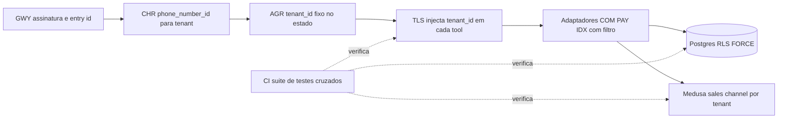
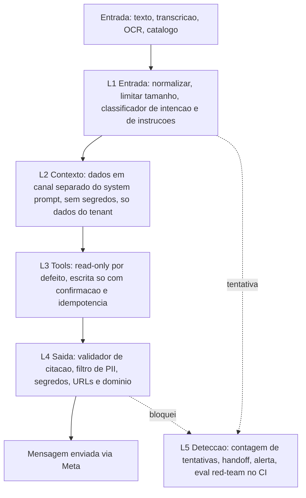
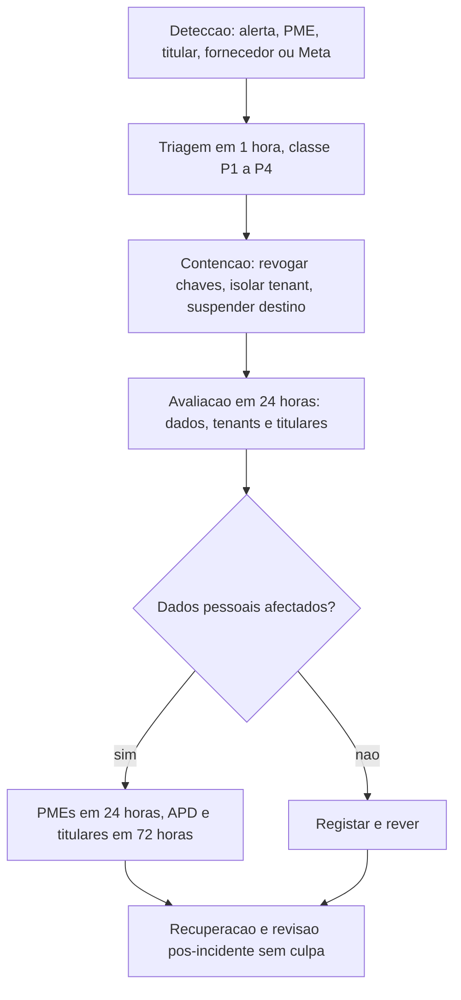

# Segurança e Conformidade — KAMBÁ

| Campo | Valor |
|---|---|
| Produto | KAMBÁ (nome de trabalho) — plataforma WhatsApp-native de comércio conversacional para Angola |
| Documento | Técnica — Segurança e Conformidade |
| Versão | 1.0 |
| Data | Outubro de 2026 |
| Classificação | Documento de Referência — Interno |
| Documento-fonte | `00_Arquitectura_Solucao.md`, `../exploracao/11-arquitetura-detalhada-engenharia.md` §9 |
| Evidência | `evidencia/E1_Meta_WhatsApp.md`, `evidencia/E2_Pagamentos_Angola.md`, `evidencia/E3_Regulatorio_Dados.md`, `evidencia/E4_Stack_Licencas.md` |
| Documentos relacionados | `01_Canais_WhatsApp_Fluxo_Dual.md`, `02_Agent_Runtime_Verticais.md`, `03_Core_Comercio_Medusa.md`, `04_Pagamentos_Liquidacao_AntiFraude.md`, `09_Topologia_Operacao_Escala.md`, `10_Onboarding_Governanca.md` |

> **Estado das afirmações e aviso.** CONFIRMADO / INDÍCIO / NÃO VERIFICADO têm o sentido de `evidencia/` (datada de 8-10-2026).
> **Este documento não é aconselhamento jurídico.** Tudo o que toca Lei 22/11, APD, BNA, AGT, defesa do consumidor e política da Meta
> leva a marca *(a confirmar por parecer)* e alimenta a lista de perguntas da §13. Os textos de lei citados vêm de repositórios não
> oficiais (lex.ao, angolex) e têm de ser verificados no Diário da República antes de uso contratual (`evidencia/E3` §0).

---

## 1. Introdução

### 1.1 Propósito

Especifica **como a KAMBÁ torna as falhas de segurança e de conformidade difíceis de ocorrer**: isolamento entre tenants com defesa em
profundidade, modelo de ameaças por componente, gestão de segredos, auditoria, tratamento de dados pessoais e o mapeamento dos requisitos
regulatórios (Lei 22/11, política Meta, AGT, BNA, defesa do consumidor) para controlos técnicos testáveis. Aplica a tese do documento 00
(§1.1): *«arquitecturalmente impossível»* é um objectivo de desenho, não uma garantia; o risco residual é medido (§14) e gerido (§15).

### 1.2 Âmbito

Cobre o **Piloto** (Fluxo A apenas, ADR-011) com marcação explícita do que é **Clusters** e **Diferido**. Fora de âmbito: topologia e custos
(`09`), desenho do ledger e anti-fraude de pagamentos (`04`), screening de categorias e Trust & Safety operacionais
(`10`), e qualquer aconselhamento jurídico.

### 1.3 Audiência

Responsável de Segurança, arquitectos, engenheiros de canais/runtime/pagamentos, SRE, responsável interno de privacidade e advogado externo (§13).

### 1.4 Definições e termos

- **Tenant:** 1 PME (ou estafeta, revendedor, agente, plataforma); unidade de isolamento (doc 00 §1.4).
- **RLS:** *row-level security* do Postgres; defesa em profundidade por baixo da ToolLayer.
- **Pseudonimização:** substituição reversível por quem detém a chave (HMAC com segredo); continua a ser dado pessoal. **Anonimização:** irreversível por qualquer meio razoável.
- **Responsável / subcontratado:** papéis da Lei 22/11 Art. 5.º; qual a KAMBÁ ocupa está por decidir (§8.2).
- **Subprocessador:** terceiro a quem a KAMBÁ envia dados pessoais (LLM, STT, alojamento, CDN, Meta, facilitador).
- **Estado (do grafo):** estrutura LangGraph com `tenant_id`, `contact_id`, persona; escrita só pelo CHR/AGR. **Denial of wallet:** abuso que consome orçamento (LLM, Meta) em vez de derrubar o serviço.
- **Prompt injection:** instrução hostil embutida em texto do cliente, catálogo, OCR de imagem ou resultado de tool que tenta desviar o agente.

---

## 2. Princípios e decisões aplicáveis (ADRs)

| ADR | Decisão (doc 00 §8) | Consequência neste documento |
|---|---|---|
| ADR-001 | Cloud API oficial + coexistência; Embedded Signup v4 | Webhook Meta com `X-Hub-Signature-256` sobre corpo bruto (§4.5); tokens de cliente por tenant cifrados (§5); gateway não-oficial proibido (supply chain e banimento). |
| ADR-002 | LangGraph biblioteca MIT; Dify/n8n/Typebot vedados a tenants | n8n/Typebot internos, sem rota de tenant (§4.1); nenhuma superfície de edição de fluxos exposta. |
| ADR-003 | Medusa v2, sujeito a spike com testes de isolamento | Testes cross-seller obrigatórios; RBAC/SSO Enterprise do Medusa desactivados (§3.5). |
| ADR-004 | Plataforma nunca detém fundos | Lista do que a plataforma não pode fazer (§8.10); `payout` desligado por desenho. |
| ADR-005 | LiteLLM ≥ 1.83.0 por digest | Controlos de supply chain (§4.8); chaves virtuais por tenant (§3.8). |
| ADR-006 | Postgres 18 único, `iterative_scan` | RLS + pgvector sem resultados vazios por tenant (§3.4). |
| ADR-007 | Preço/stock nunca em embeddings/prompts; validador de citação | Camada de saída anti-injecção (§4.3). |
| ADR-008 | Nenhum dado pessoal de produção sai de Angola sem notificação/autorização APD | Gate de transferência fail-closed (§8.3); inventário de subprocessadores (§8.3.2). |
| ADR-010 | BSUID/HMAC; logs sem conteúdo; consentimento no 1.º contacto | §7 inteiro. |
| ADR-013 | Pagamento só por evento autenticado | §4.5–4.6. |

---

## 3. Isolamento de tenant

### 3.1 Defesa em camadas

Nenhuma camada isolada é suficiente. O objectivo é que **um defeito numa camada não produza leitura cruzada** porque a seguinte a recusa.



| Camada | Controlo | Falha que cobre | Fase |
|---|---|---|---|
| CHR | Único ponto que mapeia `phone_number_id → tenant`; tenant `suspenso`/`onboarding` rejeitado antes do AGR | Mensagem encaminhada ao tenant errado | P |
| Estado | `tenant_id` é campo do estado, tipo opaco, nunca preenchido por output do modelo | Prompt injection que «escolhe» outro tenant | P |
| TLS | Assinatura das tools **não tem** parâmetro `tenant_id`; é injectado do estado | Argumento forjado pelo modelo | P |
| Adaptadores | Toda a query leva `WHERE tenant_id = :t` por construção (repositório base) | Esquecimento num endpoint | P |
| RLS | `FORCE ROW LEVEL SECURITY`; role da aplicação sem `BYPASSRLS` | Bug na camada acima, SQL directo, ORM mal configurado | P |
| Storage | Prefixo `t/{tenant_id}/` + URLs assinadas curtas | Listagem/acesso a objectos de outro tenant | P |
| CI | Suite cruzada (§3.7) | Regressão futura | P |

### 3.2 Contrato de `tenant_id` do estado

```python
# Pseudocódigo: a assinatura da tool não expõe tenant_id.
@tool(name="buscar_produtos", access="read")
def buscar_produtos(ctx: ToolContext, termo: str, limite: int = 5) -> list[Produto]:
    t = ctx.state.tenant_id            # NewType TenantId; imutável; vem do CHR
    with db.tx(tenant=t) as cx:        # executa SET LOCAL app.tenant_id = t
        return repo.produtos.search(cx, termo, limite)   # repo acrescenta WHERE tenant_id = t

# Lint (CI): parâmetro de tool chamado tenant/merchant/seller/account, ou import do repositório de escrita fora da TLS, falha o build.
```

### 3.3 Row-level security no Postgres 18

```sql
-- Roles: migrator (dono das tabelas, só em migrações), app (sem BYPASSRLS), batch (BYPASSRLS, jobs nomeados, auditado)
CREATE ROLE kamba_app    LOGIN NOBYPASSRLS;
CREATE ROLE kamba_batch  LOGIN BYPASSRLS;           -- billing, retenção, DAT; sessão registada em audit_log

ALTER TABLE orders_mirror ENABLE ROW LEVEL SECURITY;
ALTER TABLE orders_mirror FORCE  ROW LEVEL SECURITY; -- vincula também o dono
CREATE POLICY tenant_iso ON orders_mirror
  USING      (tenant_id = NULLIF(current_setting('app.tenant_id', true), '')::uuid)
  WITH CHECK (tenant_id = NULLIF(current_setting('app.tenant_id', true), '')::uuid);
-- Sem SET LOCAL => NULL => predicado falso => zero linhas (fail-closed).
```

Regras: (1) `SET LOCAL app.tenant_id` dentro de cada transacção, compatível com *pooling* em modo transacção (nunca `SET` de sessão); (2) vistas com
`security_invoker = true` e funções `SECURITY DEFINER` proibidas excepto lista aprovada; (3) tabelas com `tenant_id` sem política RLS falham um teste
de catálogo no CI (`pg_class` × `pg_policy`); (4) o schema do Medusa não é coberto por RLS (§3.5); (5) o acesso humano a produção é *break-glass* com
registo (§6) e não usa `kamba_batch`.

### 3.4 pgvector e filtro por tenant

`evidencia/E4` §2.9: com índices aproximados o filtro é aplicado **depois** do índice, podendo devolver poucos ou zero resultados. A RLS agrava o efeito
(filtra depois). Controlo (ADR-006): `hnsw.iterative_scan = relaxed_order` com `hnsw.max_scan_tuples` calibrado, ou partição por tenant/índice parcial acima
de um limiar de vectores por tenant; teste de regressão «tenant pequeno devolve k resultados mesmo com tenant grande a dominar o índice». Preço e stock não vão
para embeddings (ADR-007): o índice só contém texto de catálogo, e isso reduz o valor de uma fuga do índice.

### 3.5 Medusa e Mercur (D3)

| Risco | Evidência | Controlo |
|---|---|---|
| Falhas de autorização entre vendedores | Mercur v2.3.7 corrigiu *cross-seller authorization gaps* a 2026-10-08 (`E4` §2.1, CONFIRMADO) | Spike D3 com testes cross-seller automáticos; sem Mercur em produção se falhar; fallback Medusa puro + `merchant_id` |
| Multi-tenancy nativa do Medusa | NÃO VERIFICADO (`E4` §6) | Tratar como inexistente: 1 *sales channel* por tenant, mapeado em `tenants.medusa_channel_id`, acedido **só** pelo adaptador COM |
| RBAC/SSO Enterprise (licença desde 2026-08-11) | CONFIRMADO | Feature flag `rbac` e `auth-oidc` desligadas; teste de CI que falha se activadas |
| Admin do Medusa exposto | — | Admin só na VPN, só equipa; nenhum agente nem tenant tem credenciais Store/Admin; COM usa conta de serviço |
| RLS no schema Medusa | Não coberto (ORM do Medusa) | Só se o spike mostrar que não parte migrações; senão isolamento = adaptador + testes |

### 3.6 Chatwoot

Uma **conta Chatwoot por PME**. Pontos de atenção confirmados no código (`E4` §2.2): um *Agent Bot* com `account_id` nulo é **global e acessível a todas as contas**
→ proibir bots globais: um bot por conta, com `access_token` próprio guardado cifrado por tenant. O token da Platform API (poderoso) só existe no serviço de
provisioning, nunca no AGR. Webhooks de saída do Chatwoot assinados e verificados pelo GWY. Funções Enterprise (SAML, custom roles, audit logs) não são usadas sem
subscrição. Teste: agente da conta A não lê conversas da conta B (cobre o issue #13426, fechado como INDÍCIO).

### 3.7 Suite de testes cruzados no CI (falha o build)

Fluxo: *seed* de dois tenants (A e B) com **canários** únicos em todas as tabelas e objectos → enumeração automática de rotas, tools do REG, jobs e consumidores EVT → ataque autenticado como A contra B → oráculo: o canário de B não aparece em respostas, erros, logs nem traces; qualquer fuga falha o build.

| Teste | O que faz | Camada |
|---|---|---|
| X-01 Rotas | Para cada rota/handler enumerado, A usa IDs de B (IDOR) | Gateway/REST |
| X-02 Tools | Cada tool do REG invocada com estado de A e argumentos que referem entidades de B | TLS |
| X-03 SQL directo | Sessão `kamba_app` com `app.tenant_id=A` faz `SELECT *` em todas as tabelas com `tenant_id` | RLS |
| X-04 Sem contexto | Sessão sem `SET LOCAL` devolve 0 linhas em todas as tabelas | RLS fail-closed |
| X-05 Catálogo RLS | Toda a tabela com `tenant_id` tem política `FORCE` | Migrações |
| X-06 Vectores | Pesquisa semântica de A com termos de B; tenant pequeno obtém `k` resultados | IDX |
| X-08 Storage | A pede URL assinada de objecto de B e lista prefixos | STO |
| X-09 Injecção cruzada | 30+ prompts PT-AO a pedir «mostra os pedidos da loja X»; saída sem canário de B | AGR + TLS |
| X-10 Medusa/Chatwoot | Cross-seller e cross-account (§3.5–3.6) | COM, HND |

### 3.8 Isolamento de recursos partilhados

LiteLLM: **uma chave virtual por tenant** com *budget* e *rate limit* (parte MIT, `E4` §2.7); o `tenant_id` vai em metadados do pedido para custo, nunca no prompt.
Storage: cifra em repouso, prefixo por tenant, URLs assinadas com TTL ≤ 5 min, nunca URL da Meta persistida (expiram). Eventos EVT: envelope com `tenant_id` e sem PII
(só `contact_id`). Backups contêm todos os tenants: tratados como activo de classe máxima (§11).

---

## 4. Modelo de ameaças

### 4.1 Fronteiras de confiança

Quatro zonas: **não confiável** (cliente final, PME enquanto autora de catálogo, Meta, facilitador, provedores LLM/STT) → **borda** (CDN/WAF, GWY) → **núcleo** (CHR, AGR, TLS, PAY, COM, HND, MED, LLM, Postgres) → **interno de equipa** (admin Medusa, Grafana, n8n, Typebot, só por VPN). Tudo o que cruza da zona «não confiável» é dado, nunca instrução. **Catálogo escrito pela PME e OCR de fotos são não confiáveis** (injecção indirecta).

### 4.2 STRIDE resumido por componente

S spoofing · T tampering · R repudiation · I information disclosure · D denial of service · E elevation of privilege.

| Comp. | S | T | R | I | D | E |
|---|---|---|---|---|---|---|
| **GWY** | Webhook forjado → HMAC sobre corpo bruto, `verify_token`, allowlist para callbacks | Corpo alterado/parse antes de verificar → verificar bytes brutos | Negação de recepção → dedup table + hash do corpo | Erros verbosos → respostas 4xx genéricas | Flood → CDN, rate limit, 200 rápido, fila | SSRF em download de media → só hosts Meta, sem redireccionamentos |
| **CHR** | `phone_number_id` falso → só após assinatura válida | Mapeamento adulterado → tabela `tenants` sob RLS e audit | Mudança de mapeamento sem rasto → `audit_log` | Enumeração de tenants → resposta idêntica para número desconhecido | Tenant em loop → limite por tenant | Tenant suspenso a processar → estado verificado antes do AGR |
| **AGR** | Contacto finge ser o dono → identidade do dono por BSUID registado e *step-up* | Estado/checkpoint adulterado → checkpoints só escritos pelo AGR, integridade por versão | Acção sem prova → tool calls auditadas com `turn_id` | Fuga do system prompt/contexto → filtro de saída, sem segredos no prompt | Conversas longas/ciclos → limite de passos e de tokens por turno | Injecção que muda de persona/tenant → `tenant_id` no estado (§3.2) |
| **TLS** | Chamada fora do AGR → só aceita sessão interna autenticada | Argumentos forjados → schema + regra de negócio (preço do Registo) | Operação duplicada/negada → `idempotency_key` + `audit_log` | Resultados de mais → *projection* mínima por tool | Tool lenta → timeouts e *circuit breaker* | Escrita sem confirmação → classe `write` exige confirmação (§4.3) |
| **PAY** | Callback falso → HMAC, valor e referência a bater (§4.5) | Alterar estado para `paga` → só consumer de `payment.confirmed` | Disputa «paguei» → `payment_events` append-only | Fuga de referências → mascaradas em logs | Tempestade de callbacks → dedup `(provider, referencia)` | Confirmação manual abusada → limite de valor e dupla identidade (§4.6) |
| **HND** | Agente humano falso → SSO/MFA, contas por PME | Mensagem editada → histórico imutável no AGR | Quem respondeu → atribuição por agente | Acesso cruzado entre contas (§3.6) | Fila de handoff inundada → *flood detection* | Bot global (`account_id` nulo) → proibido |
| **COM** | API Store/Admin chamada por terceiros → não exposta | Preço/stock alterados → `audit_log` + confirmação | Alteração sem autor → ator obrigatório | Cross-seller (§3.5) | Reservas esgotadas por abuso → TTL 24–72 h e limite por contacto | RBAC EE activado sem licença → teste de CI |
| **MED** | URL de media Meta forjada → só via media_id + token | Ficheiro malicioso → tipo/tamanho/antivírus, nunca executar | — | Áudio/foto retidos → TTL (§7.5) | Upload gigante → limites | Parsers (imagem/PDF) → processo sem privilégios, sem rede |
| **LLM** | Chave roubada → cofre, egress restrito, rotação | Resposta adulterada → TLS ao provedor, digest da imagem | Quem gastou → chave virtual por tenant | Envio de PII a terceiros → minimização + gate de destino (§8.3) | Denial of wallet → *budget* por tenant e por contacto | Supply chain no proxy (§4.8) |

### 4.3 Prompt injection

Vector número um (`evidencia/E1` risco 1 acrescenta uma consequência: um assistente «que responde a tudo» pode ser classificado como *AI Provider*). Defesa em cinco camadas, nenhuma assente em «o modelo ignora instruções».



| Camada | Controlo | Notas |
|---|---|---|
| L1 | Limite de comprimento; remoção de caracteres de controlo e *zero-width*; classificador barato (modelo nano) para «instrução ao sistema» e «fora de domínio»; fora de domínio → recusa neutra e oferta de handoff | Também cumpre a política Meta de IA não-geral (`E1` §4) |
| L2 | System prompt fixo por vertical (REG), sem chaves nem URLs internas; texto do cliente/catálogo/OCR entra rotulado como dados; histórico truncado; nada de outros tenants no contexto (RLS) | O rótulo in-band não é fronteira; a fronteira é L3 |
| L3 | Classes de tool: `read` (livre), `write` (confirmação), `money` (confirmação + limite + idempotência). Escrita só após **botão interactivo** emitido pelo runtime e resposta do mesmo BSUID; argumentos validados por schema; preço = Registo, nunca argumento; `interrupt()` re-executa o nó → efeitos antes dele idempotentes (`E4` §2.6) | Alteração de preço/stock via WhatsApp só do número/BSUID do dono, com *step-up* |
| L4 | Validador de citação (ADR-007) + `sku`; filtro de saída: regex de segredos/tokens, telefones e NIF de terceiros, URLs fora da allowlist (domínios da loja, facilitador), sem imagens/markdown remotos, deteção de eco do system prompt | Resposta bloqueada → mensagem determinística |
| L5 | Métrica `injection_attempt`; 3 tentativas/h por contacto → handoff e *cool-down*; casos de injecção PT-AO no *golden set* como gate de deploy | Alimenta OBS e T&S |

Meta-regra: **o modelo propõe, o código dispõe.** Uma injecção bem-sucedida pode alterar o texto da resposta mas não o tenant, o preço, o estado de pagamento nem escrever sem confirmação.

### 4.4 Exfiltração entre tenants e para fora

| Caminho | Controlo |
|---|---|
| Modelo «revela» pedidos de outra loja | `tenant_id` do estado + RLS + X-09; contexto só com dados do tenant |
| Catálogo de uma PME contém instrução para exfiltrar | Catálogo é dado não confiável (L2); sem tool que envie dados a URL arbitrário |
| Link/imagem remota na resposta (exfiltração por pedido HTTP do cliente) | Allowlist de URLs, sem markdown de imagem remota (L4) |
| Traces/logs com conteúdo | Logs sem conteúdo (§7.3); traces em retenção curta e acesso restrito |
| Egress de contentores | Rede *default-deny*: AGR só fala com LiteLLM e serviços internos; LiteLLM só com FQDNs de provedores; GWY só com `graph.facebook.com` e hosts do facilitador (proxy de saída com allowlist) |

### 4.5 Falsificação de callbacks, replay e dedup

| Origem | Autenticação | Replay/dedup | Estado |
|---|---|---|---|
| Meta (mensagens, status) | `X-Hub-Signature-256` HMAC-SHA256 do corpo bruto com App Secret, comparação em tempo constante | `message.id`/status id em tabela com TTL ≥ 7 dias (a Meta re-entrega até 7 dias) | CONFIRMADO (`E1` §5) |
| ProxyPay RPS | `X-Signature` = HMAC-SHA256(API_KEY, corpo bruto) | Dedup por id do pagamento; reconciliação por `GET /payments` | CONFIRMADO (`E2` §1.2) |
| ProxyPay OPG | Assinatura NÃO VERIFICADO | Tratar o callback como *dica* e confirmar por consulta da transacção | NÃO VERIFICADO |
| AppyPay | Assinatura/retries NÃO VERIFICADO | Idem; `merchantTransactionId` ≤ 15 caracteres | INDÍCIO |
| EMIS directo | Sem assinatura nem consulta (INDÍCIO) | Validar POSID, moeda, valor; allowlist de IP; reconciliar com extracto | INDÍCIO |

```python
def accept_payment_callback(req) -> Result:
    body = req.raw_body                                   # bytes, antes de qualquer parse
    if not req.src_ip in ALLOWLIST[provider]:             return reject(403)
    if not hmac_ok(secret_ring(provider), body, req.sig): return reject(401)   # ring: [actual, anterior]
    if abs(now() - req.ts) > 300:                         return reject(409)   # replay ±5 min quando há timestamp
    ev = parse(body)
    if db.seen(provider, ev.account_id, ev.reference):    return ok_idempotent()
    ord = db.order_by_reference(provider, ev.reference)
    if ord is None or ev.amount != ord.amount or ev.currency != "AOA":
        return quarantine(ev, reason="mismatch")          # valor/referência a bater; senão 'falhada' + humano
    if provider.requires_status_query:  ev = provider.confirm_by_query(ev)   # OPG/AppyPay/EMIS
    tx(insert_payment_event(ev, authn_ok=True, authn_method="hmac"), emit_outbox("payment.confirmed"))
    return ok(200)
```

A chave HMAC do ProxyPay **é** a API key (`E2`): rotação sem janela dupla perde eventos → o reconciliador por *polling* recupera-os (§5).

### 4.6 Comprovativos falsos e confirmação manual

Imagem/PDF de comprovativo **nunca** muda estado (ADR-013; fraude documentada, `E2` §4). No Piloto com `ManualProvider`: confirmação só pelo **dono** (BSUID registado), com registo de quem/quando/valor,
**limite de valor por pedido** por tenant, aviso fixo de risco, contagem de confirmações manuais por semana e alerta de desvio, e reconciliação com extracto bancário carregado pelo dono.
Comprovativo recebido é arquivado como anexo da conversa, rotulado «não verificado». O bot nunca pede PIN, códigos nem dados de cartão (alerta EMIS e Meta Commerce Policy).

### 4.7 Flood, DoS e *denial of wallet*

| Vector | Controlo | Fase |
|---|---|---|
| Volume no webhook | CDN/WAF, rate limit por IP, 200 imediato + fila; fila com *load shedding* de menor prioridade | P |
| Um contacto inunda um tenant | Rate limit por `contact_id` e por par (contacto, número) alinhado com o *pair rate limit* Meta (valor NÃO VERIFICADO); lista de bloqueio; handoff | P |
| Esgotar LLM/Meta | *Budget* LiteLLM por tenant e por contacto/dia; tecto de mensagens de saída por turno (uma por turno quando possível) | P |
| Esgotar o *free tier* de 1.000 service messages | Alerta a 80% e a 100% (`E1`); modo conciso | P |
| Banimento de número por denúncias | Frequência baixa, opt-out «PARAR», monitorização de *quality rating* | P |

### 4.8 Cadeia de abastecimento

Incidente-referência: **LiteLLM 1.82.7 e 1.82.8 maliciosas no PyPI a 2026-03-24** (CONFIRMADO, `E4` §2.7). O proxy guarda as chaves de todos os provedores LLM.

| Controlo | Aplicação |
|---|---|
| Imagens por **digest**, nunca por tag; verificação **cosign** onde publicada (LiteLLM ≥ 1.83.0) | LiteLLM, Chatwoot, Medusa, Postgres, Redis/Valkey, SeaweedFS |
| Sem instalação em runtime (`pip install`, `npm i` no arranque) | Imagens construídas no CI; contentores com filesystem read-only |
| Dependências fixadas com *hash*: `pip --require-hashes`, `package-lock`/`pnpm-lock` e `npm ci --ignore-scripts` | Python (AGR), Node (GWY, Medusa) |
| Janela de quarentena para versões novas (p. ex. ≥ 7 dias) via Renovate; excepção para correcções de segurança com revisão | npm e PyPI |
| SBOM (CycloneDX) por imagem, guardado por release; varrimento de vulnerabilidades no CI | Todas |
| Egress restrito (§4.4) para que um pacote comprometido não consiga exfiltrar | Rede |
| Segredos de curta vida e por ambiente; CI com OIDC, sem chaves estáticas | CI/CD |

---

## 5. Segredos e chaves

| Decisão | Piloto | Clusters |
|---|---|---|
| Cofre | **Doppler** (Developer: grátis até 3 utilizadores; $8/utilizador acima — `E4`) | **OpenBao** (MPL-2.0) self-host, *transit* para envelope; HashiCorp Vault excluído (BUSL-1.1, IBM) |
| Racional | Equipa pequena: operar OpenBao (selagem, HA, backup do próprio cofre) é custo que o Piloto não suporta; os segredos não são dados pessoais, logo o SaaS não agrava ADR-008 | Sai a dependência de SaaS; chaves por tenant com KMS próprio |
| Chaves por ambiente | `dev`/`staging`/`prod` projectos separados; **chaves Meta e do facilitador distintas por ambiente** (número de teste e sandbox em `staging`) | Idem |

| Segredo | Rotação | Nota |
|---|---|---|
| Meta App Secret | Semestral e em incidente | O GWY mantém *ring* `[actual, anterior]`; assinatura falhada devolve 4xx e a Meta re-entrega até 7 dias (`E1`), pelo que uma rotação mal sincronizada recupera |
| Token de cliente (Embedded Signup) | No *offboard*/expiração | Cifrado por tenant (AES-256-GCM, DEK por tenant, KEK no cofre, `kid` versionado) |
| `verify_token` do webhook | Anual | — |
| PIN 2FA do número | Até ser descontinuado pela Meta (`E1`) | No cofre, acesso mínimo |
| API key ProxyPay (= chave HMAC) | Trimestral | Sem janela dupla confirmada (`E2` Q10) → rotação com reconciliador a correr |
| Chaves AppyPay/OAuth | Trimestral | Rever tempo de vida do *token* |
| Chaves dos provedores LLM/STT e LiteLLM master/virtuais | Trimestral; imediata se imagem LiteLLM comprometida | Chaves virtuais por tenant |
| Credenciais de BD | 90 dias | Roles distintas (§3.3) |
| Pepper do HMAC de contactos | Anual com `kid` | §7.2 |
| Tokens Chatwoot (Platform, bot por conta) | Semestral | — |
| Acesso humano | MFA obrigatório; VPN WireGuard para admin Medusa, Grafana, n8n, Typebot | Sem SSH por palavra-passe |

Regras: nenhum segredo em imagem, repositório, log ou *trace*; *scanner* de segredos no CI e *pre-commit*; processo de rotação ensaiado em `staging` (runbook em `09`).

---

## 6. Auditoria

`audit_log` cobre **dinheiro, stock, preço, acessos privilegiados e alterações de configuração de tenant** (doc 11 §9). O conteúdo das conversas não vai para o `audit_log`.

```sql
CREATE TABLE audit_log (
  id bigint GENERATED ALWAYS AS IDENTITY PRIMARY KEY, criado_at timestamptz NOT NULL DEFAULT now(),
  tenant_id uuid, actor_type text NOT NULL,        -- contact|owner|staff|agent|system
  actor_id text NOT NULL, action text NOT NULL,    -- price.update|stock.adjust|payment.manual_confirm|access.conversation|...
  entity text NOT NULL, entity_id text NOT NULL, turn_id text,
  payload_hash bytea NOT NULL,                     -- hash do before/after, não o conteúdo
  prev_hash bytea NOT NULL, row_hash bytea NOT NULL  -- encadeamento por tenant
);
REVOKE UPDATE, DELETE, TRUNCATE ON audit_log FROM PUBLIC;  -- + trigger BEFORE UPDATE OR DELETE que levanta excepção
```

**O que foi entregue difere deste esboço em quatro pontos, e a revisão `0006` é que manda** (KAM-012; o porquê de cada um está em [`docs/auditoria.md`](../auditoria.md)): a coluna de tempo chama-se `criado_at`, que é o nome canónico; o encadeamento vive num *trigger* `BEFORE INSERT` `SECURITY DEFINER` e não na função de escrita, porque quem tem o privilégio em bruto para encadear também o tem para forjar; o `INSERT` do papel da aplicação é **por coluna**, sem `criado_at` nem os dois hashes; e o `criado_at` **entra** no `row_hash`, senão a cadeia prende a sequência e não prende a cronologia.

**Proporcional ao Piloto:** tabela *append-only* (privilégios + trigger), hash-chain por tenant (`row_hash = H(prev_hash || campos)`), verificação nocturna da cadeia, e **âncora diária** do último `row_hash` exportada para o *repo* de backup fora do host. WORM real (retenção bloqueada no objecto) só em Clusters, se o `StorageProvider` o suportar (NÃO VERIFICADO para SeaweedFS). `payment_events` é igualmente *append-only*, com a unicidade de `04` §6.2 (`UNIQUE (provider, account_id, referencia, tipo_evento, sequencia)`).

| Evento obrigatório | Mínimo registado |
|---|---|
| Criação/alteração de preço ou stock | ator, antes/depois (hash), origem (painel, WhatsApp do dono, agente com confirmação) |
| Confirmação manual de pagamento | quem, valor, referência, limite aplicado |
| Acesso de staff a conversa (crime de acesso indevido, Arts. 55–59.º, `E3`) | quem, tenant, motivo, duração |
| Uso de `kamba_batch` e *break-glass* | job/pessoa, âmbito |

---

## 7. Dados pessoais (PII)

### 7.1 Inventário e classes

| Classe | Exemplos | Onde | Cifra | Retenção (proposta, §11) |
|---|---|---|---|---|
| Identificadores de contacto | BSUID, telefone (quando existe), `contact_hmac` | Postgres | Colunas sensíveis cifradas; HMAC | Duração da relação + prazo de prova |
| Telemetria e dados de PME (NIF, alvará) | Logs, métricas, traces; contacto fiscal | Loki/Prometheus, Postgres | Repouso | Logs e traces 30 d; PME: relação + fiscal |
| Conteúdo de conversa | Texto, transcrições, localização | Postgres, Chatwoot | Repouso | 90 dias após fecho (PME pode alargar com justificação) |
| Áudio e fotos | Notas de voz, fotos de produto | STO | Repouso | Áudio ≤ 24 h após transcrição; fotos de produto: vida do catálogo |
| Encomendas e pagamentos | Itens, valor, referência | Postgres, `payment_events` | Repouso | Prazo fiscal (parâmetro; valor NÃO VERIFICADO) |
| Consentimentos | Finalidade, versão, hora | Postgres | Repouso | Prova pelo prazo da relação + prescrição |

### 7.2 BSUID e HMAC do telefone (ADR-010)

O BSUID é a chave do cliente (formato `PT.…`, único por par portfólio-utilizador, `E1` §3); o telefone é opcional. Armazenamento do telefone, quando existe e é necessário (reenvio por template, factura), em
coluna cifrada; para correlação, `contact_hmac = HMAC-SHA256(pepper_kid, E.164)`.

> **Limite honesto.** O espaço de números móveis angolanos é pequeno (da ordem de 10^8): **um HMAC de telefone sem segredo, ou com o segredo comprometido, é reversível por enumeração** (`E3`/ADR-010). Logo: o pepper vive no cofre,
> nunca na base de dados; tem `kid` e rotação anual com *job* de re-chaveamento; o acesso à função HMAC é auditado; e o resultado é **pseudonimização, não anonimização** — continua dado pessoal.

| Propriedade | Pseudonimização (HMAC, tokenização) | Anonimização |
|---|---|---|
| Reversível por quem tem a chave/tabela | Sim | Não |
| Continua dado pessoal (Lei 22/11) | Sim *(a confirmar por parecer)* | Não, se irreversível por meios razoáveis |
| Permite exercer direitos do titular | Sim (re-calcula o HMAC) | Não (nem é necessário) |
| Uso no KAMBÁ | `assistant_queries`, correlação, logs | Agregados do DAT (Diferido) com limiar mínimo de contagem |

### 7.3 Logs sem conteúdo

Formato JSON com *allowlist* de campos: `ts, level, svc, tenant_id, contact_hmac_prefix, turn_id, msg_id, wa_type, latency_ms, tool, outcome, error_code`. Proibidos: texto de mensagem, transcrição, telefone, morada, nome. Controlo: *logger* tipado que rejeita campos fora da allowlist; teste X-11 varre logs por padrões `+244`, `9\d{8}`, NIF; amostragem semanal em `prod`.
Excepção controlada: traces de LLM contêm conteúdo (necessário para depuração); ver `09` §9 (no Piloto não há Langfuse em `prod`; em `staging` só dados sintéticos).

### 7.4 Minimização antes do LLM e gate de destino

Pipeline: detector (telefone, NIF, e-mail, morada, nomes) → tokenização (`PESSOA_1`, `MORADA_1`, guardados no estado) → **gate** «destino permitido para este tenant?» (não → falha fechada com fallback determinístico ou handoff) → LiteLLM → re-identificação **só dentro da região aprovada**.

Limites: nomes próprios dentro de texto livre e referências a locais escapam a regex; a minimização **reduz** exposição mas não prova que deixou de haver transferência *(a confirmar por parecer; `E3` req. 6)*. O gate lê `tenant_destinations(tenant_id, provider, country, apd_ref, status)`; sem linha `autorizado`, a chamada falha (§8.3).

### 7.5 Localização, áudio e dados sensíveis

- **Localização:** o pin WhatsApp é dado pessoal; guardar coordenadas com precisão reduzida (≈ 3 casas decimais) salvo entrega confirmada; na encomenda entregue, manter bairro/município e apagar coordenadas exactas após o prazo de disputa. GEO é Clusters.
- **Áudio:** transcrever o mais cedo possível, **apagar o blob** após sucesso (alvo ≤ 24 h; limite de erro 72 h), não enviar áudio bruto a STT no estrangeiro sem gate de destino; configurar retenção zero no provedor STT (evidência arquivada, `E3` req. 8). Transcrição de baixa confiança (línguas nacionais) → humano.
- **Dados sensíveis (Art. 5.º c), 13.º):** classificador/regras de saúde, religião, política, vida sexual; ao detectar, **não persistir nem enviar ao LLM** e responder neutro com handoff, até haver autorização APD (`E3` req. 10). Medicamentos/dispositivos médicos excluídos do Piloto também pela Meta (`E1` §4).

---

## 8. Conformidade

### 8.1 Lei 22/11 em detalhe técnico

| Tema | Fonte | Estado | Controlo técnico |
|---|---|---|---|
| Consentimento livre, específico, explícito, informado (Art. 5.º a)) | `E3` §1 | CONFIRMADO | Registo `consent_event(contact, purpose, text_version, ts, channel)`; separado por finalidade; «continuar a conversar» não conta |
| Outras bases (Art. 12.º): contrato, obrigação legal, interesses legítimos | `E3` §1 | CONFIRMADO (resumo) | Encomenda assenta em contrato; marketing, perfis e melhoria com IA não |
| Dados sensíveis (Arts. 5.º c), 13.º) | `E3` §1 | CONFIRMADO | Bloqueio §7.5 |
| Direitos: informação 25.º, acesso 26.º, oposição 27.º, rectificação/eliminação 28.º; prazo 60 dias úteis | `E3` §1 | Artigos CONFIRMADOS; prazo INDÍCIO | Fluxo §8.6 com prazo interno 30 dias |
| Responsável vs subcontratado (Art. 5.º; subcontratado Art. 23.º) | `E3` §1 | CONFIRMADO / INDÍCIO | Decisão §8.2 |
| Transferência: adequado → notificação (33.º); não adequado → autorização (34.º) | `E3` §2 | CONFIRMADO | Gate §8.3 |
| Notificação/autorização prévia do tratamento (35.º–37.º); taxas DP 60/21: 4.315 a 350.450 Kz | `E3` §1 | Obrigação CONFIRMADA; prazos INDÍCIO | Gate de go-live §8.7 |
| DPO não obrigatório | `E3` §1 | CONFIRMADO | Nomear responsável interno de privacidade por boa prática |
| Conservação limitada à finalidade (11.º) | `E3` §1 | CONFIRMADO (resumo) | §11 |
| Segurança (30.º) e cifra em rede para sensíveis (31.º) | `E3` §1 | CONFIRMADO (resumo) | §3–§7; motivo de multas APD |
| Violação de dados | `E3` §1 | INDÍCIO contraditório (Circular 02 da APD) | Alvo 72 h (§10) |
| Coimas (Art. 51.º): USD 75–150 mil / 65–130 mil, ×3 para pessoas colectivas | `E3` §1 | CONFIRMADO (duas leituras) | Risco §15 |
| Crimes: acesso indevido, quebra de sigilo (55.º–59.º) | `E3` §1 | CONFIRMADO | Segregação e auditoria de acesso (§6) |
| Marketing electrónico (19.º) | `E3` §1 | CONFIRMADO | Opt-in separado, «PARAR», lista de supressão |

### 8.2 Papel da KAMBÁ: responsável ou subcontratado

Por defeito cada PME é responsável e a KAMBÁ é subcontratada (Art. 5.º, 23.º), com **contrato de subcontratação (DPA)** como pré-condição do onboarding (req. 4). A KAMBÁ torna-se co-responsável nos tratamentos em que decide finalidades e meios
(p. ex. `assistant_queries`/sinal de procura, Score). Como a APD qualifica plataformas SaaS é NÃO VERIFICADO. **Lacuna do doc 00:** não existe decisão aberta para este ponto (proposta de D9, §17). Até parecer: tratar finalidades próprias da KAMBÁ como desligadas por defeito no Piloto.

### 8.3 Transferência internacional (Arts. 33.º–34.º) — E3

**Precedente:** a APD multou a Crescer Tech em **USD 505.000** (24-06-2026) por enviar e armazenar dados numa cloud fora do país sem notificação nem autorização (CONFIRMADO). País de destino não indicado (NÃO VERIFICADO).

#### 8.3.1 Gate de transferência

- Configuração por tenant e destino: `tenant_destinations(tenant_id, provider, country, purpose, apd_ref, status)`; por defeito **negado** (fail closed).
- Aplica-se a: provedores LLM/STT, alojamento fora de Angola, backups fora de Angola, CDN, ferramentas de observabilidade, e-mail/SMS.
- Evidência arquivada por destino: contrato, retenção zero, não-treino (`E1` §4: a Meta proíbe dados da plataforma para treinar ML; `E3` req. 8), referência APD.
- País «adequado» não tem lista pública (NÃO VERIFICADO): UE e África do Sul são **hipóteses** (INDÍCIO), EUA provavelmente exige autorização (INDÍCIO). Cláusulas-tipo oficiais da APD: não encontradas (NÃO VERIFICADO); não assumir as da UE.
- Alojar em Joanesburgo/Cidade do Cabo **também** é transferência (INDÍCIO). **Alojar em Luanda não dispensa o procedimento APD**, porque LLM, STT e a própria Meta já são transferências (`E3` §7).

#### 8.3.2 Inventário de subprocessadores (Piloto; países a confirmar contratualmente)

| Subprocessador | Função | Dados pessoais | Destino (hipótese) | Estado do procedimento |
|---|---|---|---|---|
| Meta (WhatsApp Cloud API) | Canal | Conteúdo, telefone/BSUID | EUA/UE (NÃO VERIFICADO) | Perguntar se exige notificação separada (`E3` Q20) |
| OpenAI | LLM / STT | Texto minimizado, áudio | EUA | A tratar; retenção zero a confirmar |
| Google (Gemini) | LLM | Texto minimizado | EUA/UE | Idem |
| Anthropic | LLM | Texto minimizado | EUA (`inference_geo` 1,1×) | Idem |
| Groq | STT | Áudio | EUA | Idem; preferir transcrever em destino já autorizado |
| Alojamento (Luanda ou JNB/CPT) | Compute, BD, backups | Todos | Angola ou África do Sul | D1/ADR-008 |
| CDN/WAF (Cloudflare) | Termina TLS, vê tráfego em claro | Conteúdo em trânsito | Global | **Lacuna do doc 11**; ver abaixo |
| Facilitador (ProxyPay/AppyPay) | Pagamentos | Valor, referência, telefone Express | Angola | Contrato D4 |
| Software de facturação AGT (Vero/Cacimbo) | Facturas | Dados do cliente na factura | Angola (a confirmar) | D7 |
| Doppler | Segredos | Nenhum (por regra) | EUA | Sem dados pessoais |
| E-mail/SMS transaccional | Notificações | Contacto | A decidir | A decidir |

O doc 11 põe a Cloudflare «à frente (TLS, WAF)»: o proxy termina TLS e vê o corpo dos webhooks → é **subprocessador com acesso a conteúdo**. Opções: (a) assumir como subprocessador e incluir na notificação; (b) não colocar o *path* de webhooks atrás do proxy (a assinatura Meta já autentica) e proteger com rate limit na origem. Decidir com o advogado (§13 N1).

### 8.4 Consentimento, aviso e direitos do titular

**Primeiro contacto (Fluxo A):** a primeira resposta com dados contém identificação da loja (responsável), declaração de assistente automático, resumo de finalidades, destinatários incluindo LLM e países, direitos e link para aviso completo versionado; regista `consent_event`. Marketing: opt-in **separado**, «PARAR» em cada mensagem promocional, lista de supressão global, bloqueio sem opt-in nem relação prévia (excepção do Art. 19.º a confirmar). Cada tenant tem prova de opt-in por categoria (política Meta, `E1` §4).

**Direitos do titular (fluxo):** pedido pelo mesmo canal → identificação por BSUID/HMAC → pedido com prazo interno de 30 dias → PRIV e PME executam exportação, rectificação, apagamento ou oposição → resposta pelo canal → registo em `audit_log`. Apagamento: Postgres, Chatwoot, STO, traces, caches e fornecedores (pedido de eliminação); **backups**: não se reescrevem, expiram pelo ciclo (§11) e um *erasure ledger* é reaplicado após qualquer restauro. Excepção: dados fiscais retidos (§8.8).

### 8.5 Os 25 requisitos técnicos do E3 mapeados a controlos

Dono: SEG = Resp. de Segurança; AP = Arquitecto de Plataforma; RP = Responsável de Produto; PRIV = responsável interno de privacidade; OPS = SRE; T&S = Trust & Safety; ADV = advogado externo.

| # | Requisito (`E3`) | Controlo KAMBÁ | Comp. | Fase | Teste | Dono |
|---|---|---|---|---|---|---|
| 1 | Consentimento registado por finalidade | `consent_event` + bloqueio sem registo | AGR, TEN | P | Nenhum evento de marketing sem consentimento válido | PRIV |
| 2 | Aviso de privacidade no 1.º contacto | Mensagem versionada + registo antes da 1.ª resposta com dados | AGR | P | Texto/versão registados em E2E | PRIV |
| 3 | Opt-in de marketing separado, «PARAR», supressão | Lista de supressão global; gate no envio de templates marketing | GWY, AGR | P (envio) | Promoção bloqueada sem opt-in | RP |
| 4 | DPA com cada PME; lista de subprocessadores | DPA aceite como *gate* de activação; página pública de subprocessadores | TEN, GOV | P | Tenant sem DPA não activa | ADV |
| 5 | Gate de transferência por tenant/destino | `tenant_destinations`, fail closed (§8.3) | LLM, AGR | P | Chamada a destino não autorizado falha | SEG |
| 6 | Minimização antes do LLM | Pipeline §7.4 | AGR | P | Dados fictícios: nenhum identificador directo sai | SEG |
| 7 | Áudio: transcrever e apagar | Job de purga + TTL | MED, STO | P | Nenhum blob de áudio após o prazo | OPS |
| 8 | Fornecedor LLM: retenção zero, sem treino | Checklist e evidência por fornecedor | LLM | P | Checklist assinado por fornecedor | SEG |
| 9 | Mapa de tratamentos e notificação APD | Documento versionado + gate de go-live | GOV | P | Nenhum tenant em produção sem referência APD ou decisão formal | PRIV/ADV |
| 10 | Bloqueio de dados sensíveis | Classificador/regras §7.5 | AGR | P | Conjunto de frases com taxa de detecção acordada | SEG |
| 11 | Segurança: TLS, repouso, segregação, MFA, auditoria | §3–§6; pentest antes do go-live | todos | P | Pentest/checklist; falhas aqui motivaram multas | SEG |
| 12 | Resposta a incidentes | §10 | GOV | P | Simulação anual | SEG |
| 13 | Direitos do titular | Fluxo §8.4, prazo interno 30 d | AGR, DAT | P | Pedido E2E em staging | PRIV |
| 14 | Retenção por classe e purga | §11; log de eliminação | todos | P | Job de purga verificado | OPS |
| 15 | Divulgação de IA e supervisão humana | Declaração de assistente; «falar com humano» sempre; decisão com efeito financeiro não só do LLM | AGR, HND | P | Handoff acessível em todos os estados | RP |
| 16 | Fidelidade de preço e informação | ADR-007 + confirmação final com preço total, garantia, devolução, vendedor | AGR, TLS | P | Avaliação de alucinação de preço = 0 | RP |
| 17 | Desistência e reclamação | Fluxo de devolução/reclamação; data de recepção registada | AGR, COM | P (básico) | Pedido de devolução E2E | RP |
| 18 | Registo imutável de contrato | Mensagens de formação do contrato com hash e hora (`contract_evidence`) | AGR | P | Hash verificável | AP |
| 19 | Facturação só por software validado AGT | Adaptador a software certificado; plataforma não emite facturas | PAY/TEN | P (arquivo) / C | Campos mínimos presentes | RP |
| 20 | Screening de categorias | Lista de bloqueio + NIF/licença no onboarding (§8.9) | GOV | P | Amostra de anúncios bloqueados | T&S |
| 21 | Verificação 18+ (álcool, tabaco) | Categorias vedadas no Piloto; declaração de idade se vierem a abrir | GOV | C | — | T&S |
| 22 | Controlo de automação e envios em massa | Limites de envio; só interacção/opt-in; identificação de conta automatizada | GWY, AGR | P | Envio fora de regra bloqueado | SEG |
| 23 | Avaliações só de compradores verificados | `reviews.order_id` único, sem edição pela PME | COM | C | Review sem pedido pago rejeitada | RP |
| 24 | Residência de dados configurável por região | `StorageProvider` e BD sem acoplamento a região; migração testada | STO, TEN | P (desenho) | Migração de tenant entre regiões em teste | AP |
| 25 | Pasta de provas e resposta à APD em 5 dias úteis | Repositório de evidências (autorizações, DPAs, testes) | GOV | P | Simulação de pedido | PRIV |

### 8.6 Registo e notificação à APD (gate de go-live)

Pré-requisito de dados reais (D1): (1) mapa de tratamentos (categorias, finalidades, destinatários, transferências, prazos, segurança); (2) decisão sobre papéis (§8.2); (3) notificação/autorização de transferência por destino (§8.3); (4) taxas
(DP 60/21, `E3`); (5) DPA e aviso publicados. Prazos de resposta da APD e silêncio positivo são NÃO VERIFICADOS. O mapa de tratamentos é gerado a partir do inventário (§7.1) e do `tenant_destinations`, para não divergir do sistema real.

### 8.7 Política Meta (E1)

| Regra (`E1`) | Estado | Controlo |
|---|---|---|
| Termos de 15-01-2026: *AI Provider* proibido se IA é a funcionalidade principal | CONFIRMADO; critério «exclusivo da Meta» | Persona restrita a comércio/atendimento; recusa fora de domínio (L1); documentar o produto como comércio |
| Automação na janela de 24 h exige escalonamento humano imediato | CONFIRMADO | «Falar com humano» em todas as conversas + canal alternativo por loja |
| Opt-in obrigatório; templates aprovados para iniciar conversa | CONFIRMADO | `consent_event` por categoria; registo de templates e estados |
| Nunca pedir cartão, conta ou IDs pessoais; *quality rating* e denúncias podem limitar o acesso; Embedded Signup v2/v3 morrem a 2026-10-15 | CONFIRMADO | Filtro de saída L4; frequência baixa e «PARAR»; alerta de rating (`09` RB-K04); só Embedded Signup v4 |
| Proibição de personificar outro negócio e de partilhar informação entre clientes | CONFIRMADO | Fluxo A; isolamento (§3); Fluxo B diferido (ADR-011) |
| Dados da plataforma não treinam ML/IA (§4.7, leitura automática) | CONFIRMADO com ressalva | Só inferência; ler texto EN integral |
| Categorias proibidas: armas, álcool, tabaco, medicamentos e saúde, jogos, crédito, MLM, etc. | CONFIRMADO | Screening no onboarding e no catálogo (§8.9) |
| *Quality rating* e feedback negativo podem limitar/remover acesso | CONFIRMADO | Frequência baixa, «PARAR», alerta de rating (runbook em `09`) |

### 8.8 AGT e fiscal

- A KAMBÁ **não emite facturas fiscais próprias**: o DP 71/25 exige software validado pela AGT (`E3` §6, CONFIRMADO). Integra-se com software certificado (Vero, Cacimbo ou outro, D7) ou arquiva facturas emitidas por ele; emissão **assíncrona** (a validação AGT pode demorar).
- E-factura: grandes contribuintes desde 2026-01-01 (CONFIRMADO); restantes do IVA a **2027-01-01** (INDÍCIO forte; conflito de fontes com 2026-09-21 — confirmar por escrito, `E2` §6).
- **Retenção fiscal:** prazo do CGT NÃO VERIFICADO → parâmetro `fiscal_retention_years` por tenant sem valor por defeito que apague; até confirmação, não eliminar registos fiscais.
- **Tensão com minimização (Lei 22/11):** dados fiscais ficam em tabelas separadas (`fiscal_docs`), apenas com o que a lei fiscal exige, fora do histórico de chat, por isso apagar uma conversa não apaga o registo fiscal.
- Facturação da própria assinatura SaaS da KAMBÁ com software AGT quando aplicável.

### 8.9 Screening de categorias (Trust & Safety)

| Categoria | Posição no Piloto | Base |
|---|---|---|
| Armas e munições; crédito, MLM, cripto; animais vivos, combustíveis | Bloqueio absoluto | Meta (`E1`); venda ambulante proibida (INDÍCIO); diploma das armas NÃO VERIFICADO |
| Jogos de azar | Bloqueio; só com licença ISJ (Lei 17/24) e permissão Meta | `E3` §5 |
| Medicamentos e dispositivos médicos, saúde | Excluídos | Meta; Decreto Presidencial 41/24 silencioso sobre venda online; dados sensíveis |
| Tabaco | Excluído (sem promoção) | Meta; Lei 9/17 |
| Álcool | Excluído no Piloto (Meta proíbe); 18+ e Lei 12/25 (INDÍCIO) se vier a abrir | Meta; `E3` |

Onboarding: NIF e licença comercial/sectorial; classificação automática do catálogo (palavras, categorias, imagem) + revisão humana de amostra. A Meta aplica as suas listas independentemente de licenças locais.

### 8.10 BNA (E2): o que a plataforma NÃO pode fazer (ADR-004)

Leitura do Aviso 2/22 e da Lei 40/20 (`E2` §3; CONFIRMADO o texto, conclusões *a confirmar por parecer*, D8). Exclusão técnica do Art. 4.º j): prestadores técnicos que **nunca entram na posse dos fundos**, com a ressalva de iniciação de pagamento.

| Não fazer | Razão | Barreira técnica |
|---|---|---|
| Receber o dinheiro das vendas e repassá-lo à PME | Aproxima-se de sub-adquirente (Art. 3.º aa)) | Credenciais EMIS/entidade **do comerciante**; liquidação directa; sem conta da plataforma no fluxo |
| Escrow / retenção até entrega | Deter fundos de utilizadores | Não existe estado «retido»; disputa tratada fora do gateway |
| Payouts a estafetas/revendedores | Execução de operações de pagamento | `PaymentProvider.payout` sem implementação nem rota no Piloto; *feature flag* fail-closed; CI falha se houver implementação |
| Accionar pagamento a partir da conta do cliente | Pode ser «iniciação de pagamento» regulada | O cliente paga na sua app (referência, Express push); o bot nunca recebe credenciais |
| Manter saldos/carteira | Moeda electrónica exige PSP | Sem tabela de saldos; vocabulário «carteira/saldo/escrow» proibido na UI e no código |
| Reembolsar de dinheiro da plataforma | Referências não têm devolução automática | Reembolsos manuais fora da plataforma |

A cobrança da assinatura da própria KAMBÁ (a KAMBÁ como comerciante) não está em causa.

### 8.11 Defesa do consumidor (Lei 15/03)

| Tema | Estado | Controlo |
|---|---|---|
| Informação sobre quantidade, características e preço (Art. 9.º) e solidariedade da cadeia | CONFIRMADO (dois resumos) | Preço só do Registo; confirmação final completa (req. 16) |
| **Desistência de 7 dias úteis** (Art. 15.º, numeração varia) | Direito CONFIRMADO; prazo e âmbito a WhatsApp **INDÍCIO** | Fluxo de devolução; registar data de recepção; excepções (perecíveis, personalizados) *(a confirmar por parecer)* |
| Publicidade enganosa (Art. 21.º) | INDÍCIO | Descrições geradas por LLM validadas pela PME ou limitadas a dados do catálogo |
| Contrato por chat (Lei 23/11 Art. 28.º) | CONFIRMADO | `contract_evidence` com hash |

---

## 9. Matriz de conformidade (requisito → controlo → teste → dono)

Complementa §8.5 (25 requisitos Lei 22/11) para as restantes fontes.

| ID | Requisito | Origem | Controlo | Teste | Dono |
|---|---|---|---|---|---|
| C-01 | Assinatura do webhook sobre corpo bruto | Meta | §4.5 | Pedido com 1 byte alterado → 401 | SEG |
| C-02 | Pagamento só por evento autenticado | ADR-013 | §4.5–4.6 | Imagem de comprovativo não muda estado | AP |
| C-03 | Plataforma não detém fundos | ADR-004, Aviso 2/22 | §8.10 | CI falha se existir `payout` ou saldos | AP |
| C-04 | Sem facturas próprias | DP 71/25 | §8.8 | Nenhuma rota emite documento fiscal | RP |
| C-09 | Sem treino com dados WhatsApp | Meta Termos | Fornecedores LLM sem treino; sem *fine-tuning* com conversas | Checklist de fornecedor | SEG |

---

## 10. Resposta a incidentes



| Classe | Exemplo | Resposta |
|---|---|---|
| P1 | Fuga cruzada entre tenants; chave de provedor comprometida; confirmação de pagamento forjada | Equipa completa; contenção imediata; notificações |
| P2 | Webhook secret exposto; falha de RLS sem exploração | Rotação e correcção em 24 h |
| P3/P4 | Tentativa de injecção sem efeito; anomalia sem impacto | Ajuste de filtros e registo |

Notas: o alvo de **72 h** à APD vem do projecto de revisão (INDÍCIO) e de boa prática; a Lei 22/11 pode não obrigar o responsável geral, mas a Circular 02 da APD e as multas «por não notificação» (Expansão 2026) apontam o contrário → assumir obrigação (`E3` Q7). Como subcontratada, a KAMBÁ notifica as PMEs **sem demora e em ≤ 24 h** (cláusula do DPA). Modelo de notificação, lista de contactos (APD, Meta, facilitador, advogado) e exercício anual no repositório de provas. Evidência preservada: *snapshots*, `audit_log` e logs imutáveis.

---

## 11. Retenção e apagamento

Os prazos são **propostas** de engenharia; os legais estão por confirmar (Art. 11.º: «período necessário às finalidades»; CGT NÃO VERIFICADO).

| Classe | Prazo proposto | Mecanismo | Excepção |
|---|---|---|---|
| Conteúdo de conversa (Postgres, Chatwoot) | 90 dias após fecho; PME pode alargar até 12 meses com justificação | Job `kamba_batch` com log de eliminação | Litígio/pedido legal |
| Áudio | ≤ 24 h após transcrição (máx. 72 h) | TTL no STO + job | — |
| Transcrições/`assistant_queries` | Pseudonimizadas; 12 meses | Partição mensal; `DROP PARTITION` | Agregados anonimizados (Diferido) |
| Consentimentos e `contract_evidence` | Relação + prazo de prova (a confirmar) | Job | — |
| Encomendas e `payment_events` | `fiscal_retention_years` (sem valor até confirmação) | Separados do chat | Obrigação fiscal |
| `audit_log` | ≥ prazo fiscal para dinheiro; 12 meses para acessos | Append-only; arquivo | — |
| Logs técnicos / traces LLM | 30 dias | Rotação | Incidente |
| Backups | WAL 7 dias (PITR) + diários 35 dias | Expiração pelo repositório | Sem reescrita; *erasure ledger* reaplicado no restauro |

Cada tenant encerrado: exportação ao responsável, depois eliminação (excepto fiscal) em 30 dias.

---

## 12. DPIA simplificada

| Operação | Risco para os titulares | Prob. | Impacto | Mitigação | Residual |
|---|---|---|---|---|---|
| Conservação do histórico de chat | Acesso indevido por staff/PME | Média | Médio | RLS, auditoria de acesso, retenção 90 d | Baixo |
| Compras com possível dado de saúde | Dado sensível inferido | Média | Alto | Categorias vedadas, bloqueio §7.5 | Baixo-médio |

---

## 13. Perguntas para o advogado

Dos 20 pontos de `evidencia/E3` ordenados por criticidade (E3-4: país da cloud na multa Crescer Tech; E3-20: a Meta como destinatário, com notificação separada?). **P0** bloqueia dados reais; **P1** bloqueia Clusters; **P2** refina.

| Prio | Ref. E3 | Pergunta (resumo) |
|---|---|---|
| P0 | 1 | Subcontratada ou co-responsável? Quem notifica a APD (plataforma, PME ou ambas)? Procedimento simplificado multi-tenant? |
| P0 | 2 | Enviar texto/áudio a LLM nos EUA/UE é «transferência»? A pseudonimização/tokenização muda o enquadramento? |
| P0 | 3, 4 | Que países a APD reconhece como adequados (UE, África do Sul, EUA)? Garantias aceites no Art. 34.º? Cláusulas-tipo? |
| P0 | 5, 20 | Prazo realista de notificação/autorização, silêncio positivo, taxas, formulários? |
| P0 | 18 | Há exigência sectorial ou prática APD de armazenar em Angola? A África do Sul conta como adequada? |
| P0 | 6 | Compras de farmácia/histórico de chat → regime de dados sensíveis (Art. 13.º)? Autorização necessária? |
| P1 | 7 | A quem se aplica a Circular 02 e qual o prazo de notificação de violações? |
| P1 | 9 | Art. 19.º e Instrutivo INACOM 4/20 aplicam-se ao WhatsApp? Basta opt-in electrónico? |
| P1 | 11 | Desistência de 7 dias úteis em compras por WhatsApp; excepções; informação pré-contratual; Livro de Reclamações online |
| P1 | 12 | Responsabilidade da plataforma por informação errada da IA, produtos ilícitos e avaliações falsas; validade das cláusulas de exclusão |
| P1 | 15 | Prazo de conservação do CGT; calendário e-factura das PMEs pequenas; obrigação de validação AGT |
| P1 | 16 | Lei contra a desinformação: bot comercial é «conta inautêntica»/«disseminador artificial»? |
| P2 | 8, 10, 13–14, 17 | Medicamentos online (ARMED/MINSA); álcool, tabaco, armas, jogos; prova de licença ISJ |
| P2 | 19 | Valor probatório do contrato por chat; assinatura electrónica; que registos guardar |
| Novas | N1 | Cloudflare (ou CDN) que termina TLS é subprocessador com acesso a conteúdo? Notificação? |
| Novas | N2 | Backups cifrados fora de Angola, com a chave em Angola, são transferência? |
| Novas | N3 | A pseudonimização por HMAC com pepper retido pela KAMBÁ deixa de ser «dado pessoal» para a PME? |
| Novas | N5 | Estrutura de pagamento do desenho A está fora do âmbito do Aviso 2/22 Art. 4.º j)? (com BNA, `E2` Q19–Q22) |

---

## 14. Alvos mensuráveis

| Alvo | Valor | Medição |
|---|---|---|
| Leituras cruzadas entre tenants | 0 | Suite X-01..X-11 em cada PR; falha o build |
| Tabelas com `tenant_id` sem RLS | 0 | X-05 |
| Callbacks de pagamento aceites sem HMAC válido | 0 | `payment_events.authn_ok` |
| Escritas por agente sem confirmação (classe write/money) | 0 | Teste de contrato das tools |
| Identificadores directos em logs | 0 | X-11 + amostragem |
| Destinos de transferência usados sem `apd_ref` | 0 | Gate + auditoria mensal |

---

## 15. Riscos e mitigações

| Risco | Impacto | Mitigação |
|---|---|---|
| Procedimento APD não concluído antes de dados reais | Multa (ordem de centenas de milhares de USD); paragem | Gate de go-live (§8.6); dados sintéticos até lá; D1 |
| Fuga cruzada por defeito em Mercur/Medusa/Chatwoot; equipa pequena sem segregação de funções | Perda de confiança, violação | Spike D3, RLS, X-10, fallback Medusa puro |
| Prompt injection que induz escrita | Dinheiro/stock errados | Classes de tool, confirmação, idempotência (§4.3) |
| Comprometimento do LiteLLM ou de dependência | Roubo de chaves LLM | Digest, cosign, egress, rotação (§4.8) |
| HMAC de telefone revertido | Reidentificação em massa | Pepper no cofre, rotação, auditoria (§7.2) |
| Classificação Meta como *AI Provider* ou banimento | Perda de canal | Persona restrita, opt-in, rating; pergunta escrita à Meta (D2) |
| CDN com acesso a conteúdo não declarado; backups fora da jurisdição | Incumprimento Arts. 33.º–34.º | N1, N2; excluir o *path* de webhooks; repositórios em Angola |

---

## 16. Limites, premissas e itens NÃO VERIFICADOS

| Item | Estado | Liga a |
|---|---|---|
| Texto oficial dos artigos da Lei 22/11 e valores de coimas (Art. 51.º) | Lido em portais não oficiais | Verificar no DR; §13 P2-8 |
| Lista de países adequados; cláusulas-tipo APD | NÃO VERIFICADO | D1, ADR-008 |
| Papel da KAMBÁ (responsável/subcontratado) e quem notifica a APD; revisão da Lei 22/11 e Lei da IA | NÃO VERIFICADO | Proposta D9 |
| Assinatura de callbacks OPG/AppyPay; rotação da chave ProxyPay; preços | NÃO VERIFICADO | D4 |
| Isolamento nativo do Medusa; versão de Embedded Signup do Chatwoot | NÃO VERIFICADO | D3 |
| WORM no SeaweedFS / S3 gerido; localização dos backups | NÃO VERIFICADO | D6, D1 |
| Prazo de conservação fiscal (CGT) | NÃO VERIFICADO | §8.8 |
| Coexistência para +244; classificação *AI Provider*; Fluxo B | NÃO VERIFICADO | D2, D5 |
| Parceiro de factura AGT e data da fase 2 | INDÍCIO / NÃO VERIFICADO | D7 |
| Enquadramento BNA do modelo facilitador (§8.10) | Aguarda parecer | D8 |

Premissa: Piloto com 5–10 PMEs, equipa pequena, só Fluxo A; tudo o que exige estrutura (WORM, OpenBao, SOC, pentest recorrente) é Clusters.

---

## 17. Propostas de ADR

Não fazem parte do cânone até aprovação.

| Proposta | Decisão | Razão |
|---|---|---|
| **ADR-P01** | RLS `FORCE` em todas as tabelas com `tenant_id`; role de aplicação sem `BYPASSRLS`; `SET LOCAL app.tenant_id` por transacção | Defesa em profundidade sob a ToolLayer (`E4` risco de isolamento) |
| **ADR-P02** | Doppler no Piloto, OpenBao em Clusters; Vault excluído | `E4` §2.14; custo de operar um cofre |
| **ADR-P03** | Classes de tool `read/write/money`; escrita só com confirmação interactiva do runtime e idempotência | Prompt injection (§4.3) |
| **ADR-P04** | Gate de transferência por tenant e destino, fail closed, com `apd_ref` | Arts. 33.º–34.º; Crescer Tech |
| **ADR-P05** | Retenção por classe; áudio apagado após transcrição; fiscais separados | Lei 22/11 Art. 11.º |
| **D9 (decisão aberta)** | Papel da KAMBÁ perante a Lei 22/11 e quem notifica a APD | Lacuna do doc 00 |

---

## 18. Adenda — Módulos de entrada: privacidade, conteúdo e canal do dono (ADR-020)

> **Estado.** Adenda de 2026-10-09. Direitos de autor e conteúdo gerado por IA: apenas INDÍCIO (`evidencia/E5`); tudo o que é jurídico fica (a confirmar por parecer).

| Ameaça / tema | Controlo |
|---|---|
| Fornecedor de imagem como subprocessador no estrangeiro | Inventário e `apd_ref` antes de produção (KAM-069); contrato sem retenção nem treino com as imagens enviadas (a verificar, E5) |
| Fotos com pessoas, rostos ou matrículas | Detecção e exclusão antes do envio; EXIF removido; informação ao dono no aviso de privacidade |
| Troca de SIM do dono (canal do dono) | OTP reforçado na mudança de telefone; confirmação por botão em acções sensíveis; aviso por canal alternativo (KAM-115) |
| Conteúdo gerado com alegações falsas, preços inventados ou categorias bloqueadas | Preços só como *facts*; screening de categoria (KAM-088) aplicado ao conteúdo; aprovação do dono; marcação como gerado por IA |
| Direitos de autor (imagens de terceiros, conteúdo gerado) | Sem uso de imagens de terceiros; termos ao dono com limitação de responsabilidade; parecer (INDÍCIO em E5) |
| Mensagens proactivas ao dono | Opt-in do dono para push; o dono pode iniciar; limites de frequência (KAM-115) |
| Publicação automática em redes | **Diferida (D13)**: no Piloto o dono publica manualmente; elimina-se a superfície de tokens de redes sociais |

## 19. Tabela de aprovação

| Papel | Nome | Assinatura | Data |
|---|---|---|---|
| Arquitecto de Plataforma |  |  |  |
| Responsável de Segurança |  |  |  |
| Responsável de Produto |  |  |  |

---

## 20. Controlo de versões

| Versão | Data | Descrição | Autor |
|---|---|---|---|
| 1.0 | Outubro 2026 | Emissão inicial: isolamento, ameaças, segredos, auditoria, PII, conformidade (Lei 22/11, Meta, AGT, BNA, consumidor), incidentes, retenção, DPIA. | Equipa KAMBÁ |
| 1.1 | Outubro 2026 | **Emenda KAM-111** (dicionário canónico): §4.5 e §6, D-06 (idempotência por `(provider, account_id, referencia)`; unicidade de `04` §6.2); §4.5 e §14, D-04; §8.1, §8.4, §8.5 e §8.7, D-02 (`consent_event`). | Equipa KAMBÁ |
| 1.2 | Outubro 2026 | KAM-128: As **13** referências aos documentos irmãos de `docs/tecnica/` passam a resolver: eram relativas à antiga raiz do conjunto e, depois de a árvore passar para `docs/`, não resolviam de posição nenhuma. Linha acrescentada pelo **KAM-146**, que paga as onze que o KAM-128 não escreveu. | Equipa KAMBÁ |
| 1.3 | Outubro 2026 | KAM-012: o esboço de DDL do §6 passa a `criado_at` e a `IDENTITY`, e ganha a nota dos quatro pontos em que a revisão `0006` entregue difere dele. | Equipa KAMBÁ |
