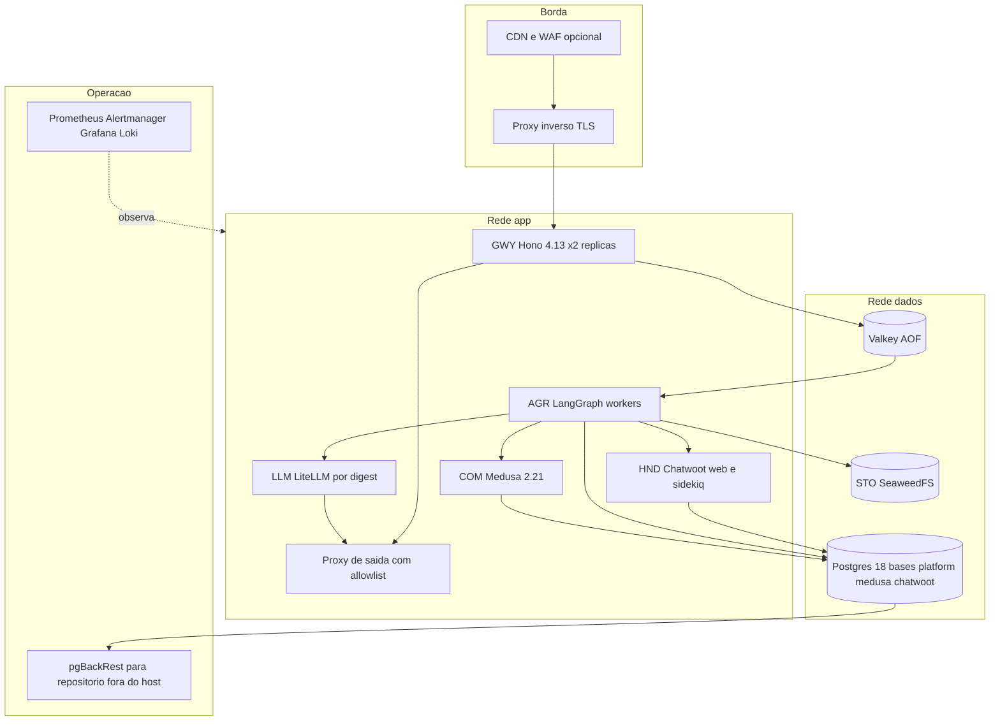

# Topologia, Operação e Escala — KAMBÁ

| Campo | Valor |
|---|---|
| Produto | KAMBÁ (nome de trabalho) — plataforma WhatsApp-native de comércio conversacional para Angola |
| Documento | Técnica — Topologia, Operação e Escala |
| Versão | 1.0 |
| Data | Outubro de 2026 |
| Classificação | Documento de Referência — Interno |
| Documento-fonte | `00_Arquitectura_Solucao.md`, `../exploracao/11-arquitetura-detalhada-engenharia.md` §1, §10, §11, `../exploracao/08-arquitetura-tecnica-v2.md` §7–§8 |
| Evidência | `evidencia/E1_Meta_WhatsApp.md`, `evidencia/E2_Pagamentos_Angola.md`, `evidencia/E3_Regulatorio_Dados.md`, `evidencia/E4_Stack_Licencas.md` |
| Documentos relacionados | `01_Canais_WhatsApp_Fluxo_Dual.md`, `02_Agent_Runtime_Verticais.md`, `03_Core_Comercio_Medusa.md`, `04_Pagamentos_Liquidacao_AntiFraude.md`, `08_Seguranca_Conformidade.md`, `10_Onboarding_Governanca.md` |

> **Estado das afirmações.** CONFIRMADO / INDÍCIO / NÃO VERIFICADO como em `evidencia/` (8-10-2026). Acrescenta-se **ESTIMATIVA**: número calculado neste documento a partir
> de pressupostos declarados; não é facto de mercado. Preços de IaaS e de alojamento em Luanda **não foram obtidos nesta ronda** (NÃO VERIFICADO) e têm de ser substituídos por
> cotações antes de D1. Pareceres jurídicos: *(a confirmar por parecer)*.

---

## 1. Introdução

### 1.1 Propósito

Fixa a **topologia de serviços do Piloto** (revisão do doc 11 §1 à luz da evidência de Outubro de 2026), o **dimensionamento verificado** contra requisitos oficiais, as opções de **alojamento** (ADR-008, D1), os
ambientes, o CI/CD, backups e DR, observabilidade, SLOs, gargalos, degradação, runbooks, **custos por estágio** em USD e Kz, a *watch list* e o modelo de equipa e *on-call*.

### 1.2 Âmbito

Piloto (Fluxo A apenas, ADR-011) com marcação P/C/D. Segurança e conformidade em `08`; pagamentos em `04`; geo (Clusters) em `07`. Fora de âmbito: preços de venda aos clientes finais.

### 1.3 Audiência

Arquitectos de plataforma, SRE/DevOps, engenheiros de runtime, responsável de produto e finanças (custos), responsável de segurança.

### 1.4 Definições e termos

- **SLO / orçamento de erro:** objectivo de nível de serviço e fracção de indisponibilidade tolerada num período (§10).
- **RPO / RTO:** perda máxima de dados e tempo máximo de recuperação (doc 00 §9: ≤ 5 min / ≤ 2 h).
- **Working set:** memória residente típica em carga, distinta da reservada.
- **Digest:** hash imutável de imagem; implantação por digest, nunca por tag.
- **Expand/contract:** migração em duas fases que mantém compatibilidade com a versão anterior da aplicação.
- **WAT:** hora de Angola (UTC+1).

---

## 2. Princípios e decisões aplicáveis (ADRs)

| ADR | Decisão (doc 00 §8) | Consequência operacional |
|---|---|---|
| ADR-001 | Cloud API + coexistência; Embedded Signup v4 | v2/v3 morrem a 2026-10-15; alerta `PARTNER_REMOVED`; 20 mps em coexistência (§11) |
| ADR-002 | LangGraph biblioteca MIT; n8n/Typebot/Dify vedados a tenants | n8n/Typebot **fora de produção** no Piloto (§3) |
| ADR-003 | Medusa v2 sujeito a spike (D3) | Medusa em v2.21.x, ≥ 2 GB RAM, Mercur condicionado |
| ADR-005 | LiteLLM ≥ 1.83.0 por digest | Implantação por digest + cosign; egress restrito |
| ADR-006 | Postgres 18 único | 18.6, suporte até 2030-11-14 (CONFIRMADO, `E4`) |
| ADR-008 | Alojamento e transferências sujeitos a APD | §5 inteiro; backups também (§8) |
| ADR-009 | BullMQ + outbox | Redis perdido = reconstruível a partir do outbox (§8) |
| ADR-010 | BSUID/HMAC; logs sem conteúdo | Observabilidade sem conteúdo (§9) |
| ADR-014 | `StorageProvider`; MinIO excluído | SeaweedFS ou S3 gerido (D6) |

Princípios do doc 00: 11 (custo medido por tenant), 12 (degradar, nunca calar), e a regra «equipa pequena: tudo o que não é caminho crítico é Diferido».

---

## 3. Topologia de serviços do Piloto (revisão do doc 11 §1)

### 3.1 Revisão serviço a serviço

| Serviço (doc 11) | Decisão para o Piloto | Fase | Razão e evidência |
|---|---|---|---|
| `gateway` Node 20 + Hono | **Hono 4.13.x** (não 5.0.0-rc.0, de 2026-10-08); **Node 24 LTS** em vez de Node 20 (Node 20 chegou ao fim de vida em Abril de 2026, conhecimento geral, INDÍCIO); intervalo de Node aceite pelo Medusa a confirmar no `engines` | P | `E4` §2.13 |
| `agent-runtime` Python 3.12 + LangGraph | LangGraph **biblioteca** 1.2.x + `langgraph-checkpoint-postgres`; **sem** LangGraph Server (Elastic-2.0, exige chave e *beacon*) | P | `E4` §2.6 |
| `chatwoot` v4.18 | Mantém (MIT fora de `enterprise/`); 1 conta por PME; ≥ 4 GB e 4 núcleos | P | `E4` §2.2; requisitos oficiais (§4) |
| `medusa` v2 + Mercur | Medusa **v2.21.x**; Mercur só se D3 passar; RBAC/OIDC Enterprise desligados | P | `E4` §2.1 |
| `storefront` Next.js 15 | **Vitrine fora do Piloto** (Clusters). Em seu lugar entra o **`onboarding-web`**: aplicação web mínima para o onboarding self-service (registo, OTP, documentos, aceite, ES v4, fotografia de produtos) e, depois, o painel light da PME | P (onboarding-web) / C (vitrine) | ADR-019; `10` §4.1 |
| `postgres` 16 | **PostgreSQL 18.6** + pgvector 0.8.7 + pg_trgm; bases separadas para plataforma, Medusa e Chatwoot; RLS (`08` §3) | P | `E4` §2.9 |
| `redis` 7 | Redis-compatível persistente (AOF). Redis ≥ 7.4 mudou de licença (RSAL/SSPL; Redis 8 volta a oferecer AGPL — conhecimento geral, NÃO VERIFICADO); **propõe-se Valkey** (BSD-3) a validar em *staging* com BullMQ, Chatwoot e Medusa (§20) | P | `E4` §2.8 refere Redis/Valkey |
| `n8n` | **Fora de produção**; automações internas correm no *host* de operações/*staging* | — | SUL; ADR-002 |
| `langfuse` v3 | **Langfuse v4 exige Postgres + ClickHouse + Redis + S3** e a doc recomenda 4 núcleos/16 GiB/100 GiB → **não entra em produção no Piloto**; métricas leves (§9.3); Langfuse v4 só em *staging* com dados sintéticos | C | `E4` §2.8; docs Langfuse (CONFIRMADO) |
| `litellm` proxy | **Imagem por digest**, ≥ 1.83.0 (actual 1.104.2), cosign, rede isolada, sem `pip install` | P | `E4` §2.7 |
| `minio` | **Excluído** (arquivado 2026-04-24). `StorageProvider` → **SeaweedFS 4.48** (Apache-2.0) *single node* ou **S3 gerido** conforme D1/D6 | P | `E4` §2.11 |
| `nominatim` | **Fora do Piloto** (GEO é Clusters); mínimo oficial 2 GB, planear 4–8 GB | C | `E4` §2.12 |
| `typebot` | **Fora de produção**; uso interno apenas (FSL «Competing Use»); fluxos determinísticos dos tenants em LangGraph | — | `E4` §2.3 |
| — (novo) | Proxy inverso com TLS (Caddy ou Traefik), **proxy de saída com allowlist de FQDN**, Prometheus, Alertmanager, Grafana, Loki + Alloy/Vector, *exporters*, **pgBackRest** (§8), **sonda sintética externa** | P | `08` §4.4 |

### 3.2 Regras de topologia

1. Todo o tráfego externo entra pelo GWY; Meta, facilitador e Chatwoot nunca falam com outros serviços (doc 11).
2. Redes Docker separadas (`edge`, `app`, `data`, `ops`); `data` sem rota de saída; `app` só sai pelo proxy de saída com allowlist (`graph.facebook.com`, FQDN do facilitador, FQDN dos provedores LLM/STT/factura).
3. Contentores com sistema de ficheiros só de leitura, utilizador não-root, limites de CPU/memória por serviço (para que um serviço não derrube os outros).
4. Orquestração do Piloto: **Docker Compose** + `systemd` + Caddy/Traefik; **k3s/Nomad só em Clusters** (proposta). *Rolling* = 2 réplicas de GWY e de *workers* com *health checks* (§7).
5. Admin (Medusa, Grafana, n8n, Typebot) só por VPN WireGuard; sem portas públicas além de 443.

---

## 4. Dimensionamento realista

### 4.1 Requisitos verificados

| Componente | Requisito | Estado | Fonte |
|---|---|---|---|
| Chatwoot | **≥ 4 GB RAM** e **4 núcleos** suportam até 10.000 conversas/dia; 8 GB/8 núcleos ≈ 20.000/dia; PG ≥ 5–10 GB; Redis ≥ 100 MB; Sidekiq pode exceder 1 GB em carga (INDÍCIO) | CONFIRMADO (docs oficiais) | developers.chatwoot.com/self-hosted/deployment/requirements |
| Langfuse v4 | VM de **4 núcleos e 16 GiB**, **100 GiB** de disco; serviços: web, worker, Postgres, ClickHouse, Redis/Valkey, S3 | CONFIRMADO (docs de *docker compose*) | langfuse.com/self-hosting |
| Medusa v2 | **≥ 2 GB RAM** no alojamento; Postgres e Redis; CPU e Node não especificados | CONFIRMADO (docs) / NÃO VERIFICADO (CPU) | docs.medusajs.com/learn/deployment |
| Nominatim (Clusters) | ≥ 2 GB (instalação); Angola 81 MB PBF: medir | CONFIRMADO / NÃO VERIFICADO | `E4` §2.12 |
| Postgres, LiteLLM, LangGraph, Hono, SeaweedFS, Valkey | Sem requisito oficial lido | ESTIMATIVA (valores §4.2) | — |

### 4.2 Memória residente estimada por serviço

| Serviço | Doc 11 (conj. completo) | Piloto (conj. reduzido) | Base |
|---|---|---|---|
| GWY (2 réplicas) | 0,3 GB | 0,4 GB | ESTIMATIVA |
| AGR (workers Python) | 2 GB | 2 GB | ESTIMATIVA |
| Chatwoot (web + Sidekiq) | 4 GB | 4 GB | Docs (mínimo) |
| Medusa (servidor + admin) | 2 GB | 2 GB | Docs (mínimo) |
| Storefront Next.js / `onboarding-web` | 1 GB | 0,5 GB (só `onboarding-web`) | ESTIMATIVA; vitrine Diferida |
| Postgres 18 | 4 GB | 4 GB | ESTIMATIVA |
| Redis/Valkey | 0,5 GB | 0,5 GB | ESTIMATIVA |
| n8n | 1 GB | — | Fora de prod |
| Langfuse v4 (conjunto) | **16 GB** | — | Docs |
| LiteLLM | 1,5 GB | 1,5 GB | ESTIMATIVA (proxy Python) |
| Object storage | 0,5 GB | 0,7 GB | ESTIMATIVA |
| Nominatim | 4 GB | — | Diferido |
| Typebot | 1,5 GB | — | Fora de prod |
| Monitorização (Prometheus, Grafana, Loki, Alertmanager) | 2 GB | 1,5 GB | ESTIMATIVA |
| SO, proxy, *exporters* | 1,5 GB | 1,5 GB | ESTIMATIVA |
| **Total working set** | **≈ 41,8 GB** | **≈ 18,6 GB** (inclui `onboarding-web`; ADR-019) | — |

### 4.3 Veredicto sobre o orçamento da biblioteca (`../exploracao/08` §8)

A biblioteca orçava **$30–60/mês** para infra («VPS 8 vCPU/32 GB», ~13 serviços) e **~$50–80/mês** de custo técnico total para 10 PMEs (**~$6/PME**). Verificação:

| Afirmação do doc 08/11 | Resultado | Correcção |
|---|---|---|
| 13 serviços cabem num VPS 8 vCPU/32 GB | **Falso com Langfuse v4**: ≈ 42 GB de *working set* > 32 GB. Sem Langfuse ≈ 26 GB (81% de uma máquina de 32 GB, sem folga para picos de Sidekiq/Medusa) | Conjunto reduzido de §3 (≈ 18 GB, 56% de 32 GB) |
| 8 vCPU chegam | Chatwoot (4 núcleos recomendados) + Medusa + AGR + Postgres competem; 8 vCPU é o piso, com limites por contentor | Manter 8 vCPU/32 GB para o **conjunto reduzido** |
| $30–60/mês | Só plausível em VPS barato **fora** da jurisdição e antes da reprecificação de Junho de 2026 (CPX42 8 vCPU/16 GB a €69,49, INDÍCIO). Em África do Sul ou Luanda a ordem de grandeza é de **centenas** de USD/mês (ESTIMATIVA §14; cotações em falta) | §14: infra do Piloto $450–680 |
| Um só VPS é o ambiente | SPOF + backup no mesmo *host* (§8) + sem *staging* realista | Produção + *staging* + repositório de backup fora do *host* |
| Meta «~$0–5» | Ignora a cobrança de service messages desde 2026-10-01 (≈ $7,5/PME com 300 conversas/mês, §14.3), embora paga pela PME se Tech Provider | §14.3 |
| Total ~$6/PME no MVP | Custo fixo dividido por 10 PMEs dá **$49–80/PME** no Piloto; só desce a ~$17–32 aos 100 PMEs | §14.5 |

### 4.4 Perfis de dimensionamento

| Perfil | Hosts | Capacidade | Quando |
|---|---|---|---|
| **P0 — Piloto** (5–10 PMEs) | 1× produção 8 vCPU/32 GB (NVMe ≥ 200 GB), 1× *staging* 4 vCPU/16 GB (pode ser a pedido), repositório de backup noutro domínio de falha | Chatwoot ≪ 10k conv/dia; ~25–30k mensagens/mês | Fase 0–1 |
| **P1 — Clusters inicial** (≈ 100 PMEs) | 2× app 8/32 + 1× BD 8/32 + réplica de leitura/espera 8/32 + observabilidade 4/8 + *staging* | Chatwoot e AGR escalam por réplica; BD separada | Fase 2 |
| **P2 — Escala** (≈ 1.000 PMEs) | N× app, BD 16 vCPU/64 GB + 2 réplicas, Chatwoot *sharded* por cluster de PMEs, ClickHouse para DAT/Langfuse, Nominatim/Valhalla | Ver §11 | Fase 3 |

Folga alvo: ≤ 65% de memória e ≤ 60% de CPU em hora de ponta; alarme a 80%.

---

## 5. Alojamento (ADR-008, D1)

### 5.1 O que a decisão realmente decide

`evidencia/E3` §7: não há exigência geral de residência em Angola (INDÍCIO), mas **o que sai de Angola exige notificação ou autorização da APD**; o precedente é a multa de USD 505 mil (2026-06-24). Consequências:
(1) **Luanda não dispensa o procedimento APD**: LLM, STT e a Meta já são transferências (`08` §8.3). (2) JNB/CPT acrescenta mais um destino ao mesmo procedimento. (3) Backups, CDN e observabilidade contam.

### 5.2 Comparação

| Critério | **Luanda** (Raxio, Paratus, Angola Cables, Cloud Nacional) | **JNB / CPT** (Azure Joanesburgo, AWS af-south-1) | **UE de baixo custo** |
|---|---|---|---|
| Existência | Raxio Tier III inaugurado 2025-10-02 (CONFIRMADO); Cloud Nacional (Camama) 2026-04-28, dados do Estado, serviços a privados (CONFIRMADO/INDÍCIO); Paratus e Angola Cables Luanda-02 (INDÍCIO) | Maduro | Maduro |
| Modelo | Colocation e IaaS; Postgres/objectos geridos **NÃO VERIFICADO**; cotação sob pedido; facturação em Kz (INDÍCIO) | IaaS e serviços geridos; USD; spread cambial ~7% sobre taxa de referência (`E2`) | USD/EUR |
| Latência a utilizadores/Meta | Mínima para utilizadores; webhooks Meta dominados pela infra da Meta (INDÍCIO, biblioteca) | ~52 ms medido para Luanda (INDÍCIO, biblioteca `../exploracao/08`) | NÃO VERIFICADO; medir |
| Custo | Sem preços; hipótese de planeamento ×1–2 de JNB (**NÃO VERIFICADO**) | VM 8 vCPU/32 GB na ordem de $300–400/mês (ESTIMATIVA); *egress* af-south-1 ≈ $0,154/GB (INDÍCIO, biblioteca) | Mais barato; preços Hetzner subiram em 2026-06-15 (INDÍCIO) |
| Procedimento APD | Para LLM/Meta/STT; alojamento isento de transferência | + transferência para a África do Sul; «adequação» é hipótese (INDÍCIO) | + transferência; adequação UE é hipótese |
| Soberania/sinal político | Alinhado com o discurso de soberania (`E3` §7) | Neutro | Fraco |
| Requisitos | Contrato, VPN/IPsec, IaC portátil, equipa que opere *bare metal*/VMs, 2.º local para backups | Conta, *landing zone* mínima | Conta |
| Risco | Maturidade dos serviços geridos; energia/conectividade; fornecedores únicos | FX/USD; dependência de hiperescalador | Jurisdição e latência |

### 5.3 Recomendação de trabalho (sujeita a D1)

1. **Arquitectura portável desde o dia 1:** IaC, imagens por digest, `StorageProvider`, BD sem acoplamento a região (req. 24 do E3). Mudar de região não pode exigir reescrita.
2. **`dev` e `staging` com dados sintéticos** em qualquer região (sem dados pessoais, fora do âmbito Arts. 33.º–34.º).
3. **Produção com dados reais só após D1 e procedimento APD** (gate de go-live, `08` §8.6).
4. **Preferência:** Luanda em colocation/IaaS **se** a cotação for ≤ 2× a de JNB e houver VMs com SLA e um **segundo local angolano** para backups; caso contrário JNB/CPT com notificação/autorização concluída. Com 5–10 PMEs a diferença de custo é pequena face ao risco regulatório.
5. Pedir cotações a Raxio, Paratus, Angola Cables e Cloud Nacional (colocation vs IaaS, SLA, Kz, ligação a IXP, 2.º site) e a um hiperescalador em JNB/CPT; registar no repositório de provas.

---

## 6. Ambientes

| Aspecto | `dev` | `staging` | `prod` |
|---|---|---|---|
| Dados | Sintéticos | **Sintéticos** (nunca cópia de prod) | Reais, após D1 e APD |
| Compute | Compose local | 4 vCPU/16 GB (a pedido) | 8 vCPU/32 GB |
| Meta | Mocks do webhook (corpo assinado com segredo de teste) | **Número de teste** da app Meta de *staging* (WABA de teste) e, na semana 1–3, 1–3 números +244 reais para o spike de coexistência (H3) | Números dos clientes via Embedded Signup v4 |
| Facilitador | Mock | **Sandbox ProxyPay** (`api.sandbox.proxypay.co.ao`; OPG: `900000000` aceita, `900002004` timeout, `900003000` recusa — CONFIRMADO) e sandbox AppyPay (INDÍCIO) | Produção por PME |
| LLM | Chave de teste com *budget* mínimo | Chave própria, *budget* baixo; Langfuse v4 **só aqui**, dados sintéticos | Chaves virtuais por tenant |
| Segredos | Local, não reutilizáveis | Projecto Doppler `staging` | Projecto `prod`; chaves Meta e do facilitador distintas por ambiente |
| Acesso | Equipa | Equipa | Break-glass auditado |
| Factura AGT | Mock | Sandbox do parceiro (Vero: sandbox que não submete à AGT, INDÍCIO) | Produção |

O número de teste da Meta não prova coexistência nem Embedded Signup em condições reais: o E2E de *staging* cobre mensagens, estados, templates e pagamentos; coexistência exige número +244 real (INDÍCIO de que está disponível; confirmação escrita pendente, D5).

---

## 7. CI/CD

```mermaid
flowchart LR
    PR["PR"] --> LINT["Lint e tipos"]
    LINT --> UNIT["Testes unitarios"]
    UNIT --> ISO["Suite de isolamento de tenants e RLS"]
    ISO --> EVAL["Eval golden PT-AO com injeccao"]
    EVAL --> SEC["SBOM, scan, secrets, licencas EE"]
    SEC --> BLD["Build por digest e cosign"]
    BLD --> STG["Deploy staging"]
    STG --> E2E["Smoke E2E com numero de teste e sandbox"]
    E2E --> TAG["Tag e release.lock"]
    TAG --> PRD["Deploy prod rolling"]
    PRD --> VER["Verificacao pos-deploy e rollback automatico"]
```

| Gate | Critério de falha | Dono |
|---|---|---|
| Isolamento (X-01..X-11, `08` §3.7) | Qualquer fuga | Segurança |
| Eval golden PT-AO | Pontuação < *baseline*; preço citado ≠ tool; qualquer escrita sem confirmação; recusa fora de domínio abaixo do alvo | Produto/IA |
| Licenças e flags | `rbac`/`auth-oidc` Medusa, `enterprise/` Chatwoot, `ee/` Langfuse activos | Segurança |
| Supply chain | Imagem sem digest/SBOM; vulnerabilidade crítica sem excepção | Segurança |
| Migrações | Sem *down* nem classificação *expand-only* | Plataforma |
| Smoke E2E | Mensagem no número de teste → resposta; pedido → referência no sandbox → callback mock → `paga` | Plataforma |

**Migrações reversíveis:** Alembic (schema `platform`) + migrações do Medusa; padrão *expand/contract* (acrescentar, migrar dados, remover só numa versão posterior); cada migração tem `down` ou é marcada *expand-only*; teste de subir/descer no CI. **Implantação:** `release.lock` lista os digests do conjunto; *rollback* = reimplantar o `release.lock` anterior; migração incompatível com a versão anterior é proibida (obriga a *expand/contract*). **Rolling:** GWY e *workers* em 2 réplicas, esvaziar uma, actualizar, verificar `/healthz` e métricas, passar à outra; AGR com `interrupt()` re-executa nós, por isso as acções são idempotentes (`02`). **Dependências:** Renovate com janela de quarentena; CI com OIDC.

---

## 8. Backups e DR

### 8.1 O defeito do doc 11 e a correcção

O doc 11 §1 prevê «WAL archiving → MinIO (PITR 7 dias) + snapshot diário» com o MinIO **no mesmo VPS**. Defeitos: (1) perder o *host* perde BD, WAL e snapshots locais ⇒ **RPO efectivo = total**; (2) MinIO está arquivado desde 2026-04; (3) não há teste de restauro; (4) o repositório de backup também é «alojamento» para o ADR-008.

| Elemento | Desenho corrigido |
|---|---|
| Ferramenta | **pgBackRest** (MIT, conhecimento geral, confirmar na ficha de licença) com cifra do repositório (AES-256) |
| Repositório | **`repo1` noutro domínio de falha** (outro fornecedor/DC, idealmente um 2.º local angolano — N2 em `08` §13); `repo2` opcional offline mensal |
| WAL | Arquivo contínuo com `archive_timeout = 60 s`; alerta se o último WAL enviado > 5 min |
| Ciclo | Completo semanal, diferencial diário, WAL contínuo; **PITR 7 dias**; retenção 35 dias |
| Chaves | Cifra do repositório e credenciais no cofre, **cópia offline** da chave de cifra (sem ela o backup é inútil) |
| Cobertura | Bases `platform`, `medusa`, `chatwoot`; objectos do STO (replicação do bucket para o repositório); configuração em git; exportação cifrada semanal do cofre de segredos; âncora diária da hash-chain (`08` §6) |
| Redis/Valkey | Não é fonte de verdade: o **outbox** em Postgres permite republicar eventos; jobs BullMQ reconstruídos; AOF só reduz o atraso |
| Apagamento | Backups não se reescrevem; *erasure ledger* reaplicado após restauro (`08` §11) |

### 8.2 RPO, RTO e teste de restauro

| Alvo | Valor | Como se cumpre/prova |
|---|---|---|
| **RPO ≤ 5 min** | Típico ≤ 2 min (`archive_timeout` 60 s + envio) | Métrica «idade do último WAL arquivado»; alerta > 5 min |
| **RTO ≤ 2 h** | Orçamento: detecção 10 + decisão 10 + novo *host* por IaC 30 + restauro base (BD ≤ 20 GB ≈ 30 min em 100 Mbps; 50 GB ≈ 70 min) + *replay* de WAL 10 + verificação (hash-chain, E2E) e DNS 15 ≈ **105 min** | Com BD > 40 GB o RTO de 2 h deixa de ser seguro → réplica de espera (P1) |
| Teste de restauro | **Mensal automático** para *host* descartável (contagens, verificação da hash-chain, *smoke*); **trimestral** exercício de DR cronometrado | Resultado arquivado; falha = incidente P2 |

### 8.3 Cenários de desastre

| Cenário | Resposta | RPO/RTO |
|---|---|---|
| Falha de disco/VM de produção | Novo *host* por IaC + restauro PITR | ≤ 5 min / ≤ 2 h |
| Corrupção lógica (migração, bug) | PITR para antes do erro; *replay* de eventos do outbox | ≤ 5 min / ≤ 2 h |
| Perda do DC/região | Idem noutro local; DNS | Igual; ensaiado trimestralmente |
| Credenciais comprometidas / *ransomware* | Rotação (RB-K07), restauro a partir de `repo1` com credenciais distintas e **sem acesso de escrita** a partir de produção | Pode exceder 2 h |
| Perda da conta/fornecedor | `repo2` offline + IaC portátil | Horas a dias (aceite no Piloto) |
| Perda do número ou token Meta | RB-K04, RB-K06; a Meta re-entrega webhooks até 7 dias | n/a |

---

## 9. Observabilidade

### 9.1 Logs, métricas e sonda

- **Logs JSON sem conteúdo** (campos permitidos em `08` §7.3) → Alloy/Vector → Loki (instância única, 30 dias).
- **Métricas** Prometheus/Grafana: mensagens recebidas/enviadas por tenant, latência de ingress e de resposta (p50/p95/p99), fila (profundidade, idade), *handoff*, callbacks (ok/falhados/reconciliados), custo LLM por tenant, erros 130429 e `131049` da Meta, `quality_rating`, idade do WAL, replicação, memória/CPU por serviço.
- **Sonda sintética externa** (fora do *host* e do fornecedor): mensagem de teste a cada 5 min no número de teste de produção e verificação do `/healthz`; é a única forma de detectar que a ingestão parou sem alertas internos.
- **Webhooks de status** persistem `pricing` (`billable`, `category`, `type`) por mensagem: base do custo real por tenant (`E1` §1).

### 9.2 Alertas

| Alerta | Condição | Severidade | Runbook |
|---|---|---|---|
| Ingress parado | Sonda falha 2× ou 0 mensagens > 10 min em horário comercial | P1 | RB-K01/K08 |
| Fila a crescer | Idade do mais antigo > 2 min | P2 | RB-K03 |
| Latência | p95 de resposta > 8 s por 10 min | P2 | RB-K03 |
| Callbacks | Falhas HMAC > 3/h ou reconciliação encontra pagamento por reconhecer | P1 | RB-K02 |
| WAL | Último arquivo > 5 min | P1 | RB-K08 |
| Restauro mensal falhou | — | P2 | RB-K08 |
| Quality rating | Amarelo (P3), vermelho (P1) | P1/P3 | RB-K04 |
| Free tier | 80% e 100% de 1.000/número | P3/P2 | RB-K05 |
| `account_update` | `PARTNER_REMOVED` etc. | P2 | RB-K06 |
| Orçamento LLM | > 80% do *budget* diário do tenant | P3 | RB-K03/K09 |
| Segredo a expirar | < 14 dias | P3 | RB-K07 |
| Memória | > 80% sustentada | P3 | Escalar |

Regra: **alerta sem runbook é removido**.

### 9.3 Langfuse: avaliação para o Piloto

Langfuse v4 é MIT fora de `ee/` e pertence à ClickHouse desde 2026-01 (CONFIRMADO/INDÍCIO), mas exige 4 serviços de estado e 16 GiB; os *traces* **contêm conteúdo de conversas** (dados pessoais e transferência, ADR-008).
**Decisão proposta:** produção sem Langfuse; em vez disso (1) tabela `llm_call_log(tenant_id, turn_id, model, tokens_in, tokens_out, cached, cost_usd, latency_ms, outcome)` **sem conteúdo**, alimentada pelo LiteLLM e pelo AGR; (2) *spend logs* do LiteLLM; (3) avaliações golden offline no CI; (4) Langfuse v4 em *staging* com dados sintéticos para depurar prompts. Reavaliar em P1 com orçamento, residência e retenção de 30 dias (`../exploracao/11` §11). **Divergência com o doc 00** (§4 lista Langfuse em OBS, fase P): ver §20.

---

## 10. SLOs e orçamento de erro

| SLI | SLO (Piloto) | Orçamento (30 dias) | Fonte |
|---|---|---|---|
| Disponibilidade do caminho de venda (receber → processar → responder) | **99,5%** (doc 00 §9) | 216 min (3,6 h); com 99,9% em Escala: 43 min | Doc 00 |
| Ack do webhook < 500 ms | 99,9% dos pedidos | 0,1% | `E1`, doc 00 |
| Perda de mensagens | 0 (reconciliação de ids) | 0 | — |
| Latência de resposta p95 | texto ≤ 8 s; voz ≤ 12 s | 5% acima do alvo | Doc 00 §9 |
| Callback de pagamento → cliente notificado | p95 ≤ 30 s; p99 ≤ 2 min | 1% | `04` |
| Reconciliação de pagamentos por reconhecer | ≤ 15 min | — | `E2` (polling) |
| Frescura do backup | WAL ≤ 5 min; restauro mensal OK | 0 falhas | §8 |
| Número em estado vermelho | 0 horas > 24 h | — | `E1` |

**Política de orçamento:** > 50% consumido em 14 dias → congelar mudanças não urgentes e rever causas; 100% → só trabalho de fiabilidade até recuperar. Janela de manutenção anunciada fora de horário comercial (07:00–23:00 WAT) conta como indisponibilidade só se afectar mensagens.

---

## 11. Gargalos e respostas (revisão da tabela do doc 11 §11)

| Gargalo | Limite (doc 11) | Limite revisto e evidência | Resposta |
|---|---|---|---|
| Postgres (registo + vectores) | ~1–2M produtos, ~5k msgs/dia | Filtro pgvector **depois** do índice (`E4`): resultados vazios por tenant antes de limite de capacidade; índice HNSW limitado pela RAM (NÃO VERIFICADO) | `iterative_scan`, partição por tenant, `halfvec`; réplica; Meilisearch/Qdrant só se confirmado |
| Chatwoot | «~100k conversas/40 agentes (8 vCPU/32 GB)» | Oficial: 4 GB/4 núcleos ⇒ **10k conversas/dia**; 8 GB/8 núcleos ⇒ 20k/dia; acima, escalar horizontalmente (CONFIRMADO); a afirmação do doc 11 não tem fonte | Dimensionar por conversas/dia; *shard* por cluster de PMEs |
| Limites de mensagens Meta | 250→2k→10k «conv/dia» | **Contactos únicos fora da janela** em 24 h móveis, por portfólio: 250 → 2.000 → 10.000 → 100.000 → ilimitado; resposta na janela não conta (CONFIRMADO). O escalão 1.000 já não existe | Verificação de negócio antecipada; marketing escalonado |
| Throughput Meta | — | 80 mps por número (até 1.000); **20 mps em coexistência**; erro 130429; *pair rate limit* (valor NÃO VERIFICADO) | *Rate limiter* por número e par; difusões escalonadas |
| Onboarding de clientes | — | 10 novos clientes/7 dias até Business Verification + App Review + Access Verification (então 200/7 dias) (CONFIRMADO) | Rampa planeada; verificação cedo |
| Service messages | grátis | **1.000 grátis/número/mês; 0,004 USD depois** (desde 2026-10-01); sem pagamento a Meta deixa de entregar | Alertas 80/100% (RB-K05) |
| BullMQ/Redis | ~10k jobs/min | NÃO VERIFICADO (docs não lidas) | NATS/Kafka só na escala (ADR-009); métricas de fila |
| AGR | ~50 conversas simultâneas/processo | ESTIMATIVA; medir p95 sob carga | Workers horizontais |
| LiteLLM | — | Componente crítico; limites de TPM/RPM dos provedores | Chaves de infra em *pool*, fallbacks, *budgets* |
| Langfuse | I/O de traces | N/A no Piloto (§9.3) | Amostragem, retenção 30 dias em C |
| Facilitador | — | Rate limit existe (429), valor NÃO VERIFICADO; OPG expira a 30 min, cliente tem 90 s | *Backoff*; polling de reconciliação |

---

## 12. Degradação graciosa

| Nível | Condição | Comportamento | Retoma |
|---|---|---|---|
| N0 | Normal | Fluxo completo | — |
| N1 | LLM lento ou 5xx | LiteLLM → modelo de *fallback* **dentro dos destinos autorizados** (gate APD); respostas mais curtas | Automática |
| N2 | LLM indisponível | Fluxo determinístico: menus (listas ≤ 10 linhas, botões ≤ 3), estado de pedido, FAQ fixa, **handoff** a humano | Ao restabelecer |
| N3 | Meta com falha de envio | Fila com *backoff*; sem *retry* agressivo; PME informada por canal alternativo | Esvaziar fila |
| N4 | Facilitador em baixo | Referência «segue em breve» (pedido na fila) ou `ManualProvider` com limite; reservas de stock estendidas; **nunca** marcar paga sem evento | Reconciliar |
| N5 | BD só de leitura/lenta | Ingress devolve 200 e enfileira em disco local; escritas diferidas; sem confirmações de dinheiro | Replay |
| N6 | Ingress inoperante | 5xx deixa a Meta re-entregar até 7 dias com *backoff* (CONFIRMADO); comportamento de desactivação do webhook após falhas prolongadas NÃO VERIFICADO | RB-K01 |

Regra: o utilizador nunca fica sem resposta; quando não há resposta útil, há mensagem determinística e caminho para humano (princípio 12; política Meta de escalonamento).

---

## 13. Runbooks essenciais

| ID | Cenário | Sinal | Diagnóstico | Mitigação |
|---|---|---|---|---|
| **RB-K01** | **Meta em baixo** | Erros 5xx no envio, sonda a falhar, `graph.facebook.com` indisponível | Estado da Meta, erros por código; separar de problema nosso (egress, DNS) | Fila com *backoff*, sem martelar; PMEs informadas (e-mail/SMS); após recuperar, esvaziar fila e conciliar `status`; webhooks de entrada voltam a chegar até 7 dias |
| **RB-K02** | **Facilitador em baixo** | Criação de referência falha; callbacks parados; reconciliador encontra pagamentos por reconhecer | `GET /payments` (ProxyPay), consulta de estado; estado do banco/EMIS | N4 (§12); alargar TTL de reservas; reconciliar por *polling*; contactar facilitador; nunca confirmar por imagem |
| **RB-K03** | **LLM em baixo/lento** ou *budget* | p95 > 8 s, 429/5xx dos provedores, *budget* esgotado | LiteLLM: erros por provedor, saturação de TPM; separar «indisponível» de «sem *budget*» | N1/N2; *fallback* só em destinos autorizados; subir limite do tenant por decisão humana; congelar prompts |
| **RB-K04** | **Quality rating vermelho** | `phone_number_quality_update`, `message_template_quality_update` | Taxa de bloqueios/denúncias, templates, frequência de marketing | Pausar marketing, rever templates e texto, reduzir frequência, opt-out claro; contactar Direct Support; tenant → `suspenso` se persistir; qualidade baixa já não reduz o limite (CONFIRMADO) mas pode pausar templates |
| **RB-K05** | **Free tier de service messages esgotado** | 800 (80%) e 1.000 por número/mês | Painel por tenant e mensagens por turno | Modo conciso (1 mensagem/turno), evitar templates desnecessários; exigir método de pagamento no Billing Hub (sem ele a Meta **deixa de entregar** após o free tier); avisar PME do custo (0,004 USD) |
| **RB-K06** | **Expiração/invalidação de token ou desligação** | `account_update` (`PARTNER_REMOVED`, `PRIMARY_INACTIVITY` ≈ 14 dias, `ACCOUNT_DISCONNECTED`), erro de token | Cliente desligou, inactividade, mudança de número | Alerta ao dono **por canal alternativo** (o WhatsApp falhou); fluxo de reconexão; tenant → `suspenso` até repor; reexecutar sincronização de histórico em 24 h (passo único) |
| **RB-K07** | **Rotação de segredos** (planeada ou em incidente) | Calendário; suspeita de fuga | Inventário no cofre; dependências por segredo | Ensaiar em *staging*; GWY aceita `[actual, anterior]`; ProxyPay (chave = HMAC) com reconciliador activo; LiteLLM/provedores primeiro em incidente; registar em `audit_log` |
| **RB-K08** | **BD indisponível ou corrompida; restauro PITR** | WAL parado, *host* perdido, erro de integridade | `pgbackrest check`, estado do disco | §8; N5; restaurar para ponto antes do erro; verificar hash-chain e E2E; reaplicar *erasure ledger* |
| **RB-K09** | **Flood / *denial of wallet*** | Pico de mensagens de um contacto/IP, custo LLM anómalo | Por `contact_hmac`, IP, tenant | Bloqueio e handoff; *budget* por contacto; limitar a nível de CDN; avisar T&S |
| **RB-K10** | **Incidente de segurança P1** | Ver `08` §10 | — | Contenção, notificações (APD 72 h) |

Cada runbook é um documento versionado com ligação ao alerta; **game day** semestral injecta K01, K03, K08. 

---

## 14. Custos por estágio

### 14.1 Pressupostos

Câmbio **913 AOA/USD** (INDÍCIO, 2026-09-30; BNI 2026-10-08: compra 913, venda 981,475 — CONFIRMADO). Mensalidade de referência **30–60 mil Kz** (≈ $33–66, biblioteca). PME típica: **300 conversas/mês × 8 turnos = 2.400 mensagens do cliente** e **≈ 2.880 mensagens de serviço do bot** (1,2/turno); 25% das mensagens são notas de voz de 30 s. Equipa **não** incluída em 14.4 (ver §16). Preços de LLM de `E4` (INDÍCIO-forte; **reconferir no painel antes de fixar tarifas**).

### 14.2 Preços unitários

| Item | Preço | Kz (913) | Estado/fonte |
|---|---|---|---|
| Meta service message (> 1.000/número/mês), utility, authentication | 0,004 USD | 3,65 | CONFIRMADO (`E1`) |
| Meta marketing | 0,0225 USD | 20,5 | CONFIRMADO |
| Meta Business Agent (concorrente) | 2 USD/1M tokens (≈ 4–5 cêntimos/msg) | — | CONFIRMADO |
| Claude Haiku 5.5 | 0,10 in / 0,01 cache / 0,50 out por 1M | — | CONFIRMADO (`E4`); tokenizador ≈ +30% tokens |
| gpt-6-luna | 0,10 / 0,01 / 0,50 | — | CONFIRMADO |
| Claude Sonnet 5.5 | 2,00 / 0,10 / 10,00 | — | CONFIRMADO |
| Gemini 3.7/3.8 Flash | 0,75 / 0,075 / 3,75 **até 2026-12-31; depois 1,50 / 0,15 / 7,50** | — | INDÍCIO-forte |
| STT: gpt-4o-mini-transcribe / Groq whisper-large-v3-turbo | 0,003 USD/min / 0,04 USD/hora | — | CONFIRMADO / INDÍCIO-forte |

### 14.3 Custo variável por PME (300 conversas/mês)

Cálculo ESTIMATIVA: 2.400 turnos × (1 chamada de roteamento nano + 1,8 chamadas de conversa; ~3.500 tokens de entrada com 70% em cache, 250 de saída).

| Rubrica | Cenário baixo (Haiku 5.5/luna) | Misto (85% baixo + 15% Sonnet 5.5) | Tudo Sonnet 5.5 |
|---|---|---|---|
| LLM por turno | ≈ $0,0007 | ≈ $0,0023 | ≈ $0,0114 |
| **LLM por PME/mês** | **$1,7** | **$5,5** | **$27** (≈ 25k Kz: inviável) |
| STT (300 min/mês de voz) | $0,2 (Groq) | $0,9 (OpenAI) | $0,9 |
| **Total LLM + STT** | **$1,9** | **$6,4** | **$28** |

**Meta (paga pela PME se Tech Provider, `E1`):** 2.880 mensagens − 1.000 grátis = 1.880 × $0,004 = **$7,5/PME/mês (≈ 6.870 Kz)**; com 100 conversas/mês ≈ 960 mensagens ⇒ **$0**; com 600 conversas ⇒ $19. Uma campanha de marketing a 200 contactos = $4,5 (≈ 4.100 Kz) e o limite inicial é 250 contactos únicos/24 h por portfólio. Se a KAMBÁ for Solution Partner/MPS com *credit line* (D5), este custo passa a ser da KAMBÁ e tem de ir para o preço. Mensagens enviadas pela app (coexistência) não são cobradas pela API.

### 14.4 Custos totais por estágio (ESTIMATIVA)

| Rubrica (USD/mês) | Piloto (≈ 10 PMEs) | Clusters (≈ 100) | Escala (≈ 1.000) |
|---|---|---|---|
| Infra: produção, *staging*, backups fora do *host*, *egress* (JNB/CPT; Luanda sem cotação: $450–900 como hipótese) | 450 – 680 | 1.400 – 2.200 | 5.000 – 9.000 |
| LLM + STT (cenário baixo → misto) | 20 – 65 | 200 – 650 | 2.000 – 6.500 |
| Ferramentas (Doppler, domínio, sonda, e-mail/SMS; Langfuse/OpenBao em C) | 20 – 50 | 100 – 300 | 500 – 1.500 |
| **Total tecnologia** | **490 – 795** | **1.700 – 3.150** | **7.500 – 17.000** |
| **Total em Kz (913)** | **0,45 – 0,73 M** | **1,55 – 2,88 M** | **6,85 – 15,5 M** |
| **Por PME (USD)** | **49 – 80** | **17 – 31,5** | **7,5 – 17** |
| **Por PME (Kz)** | **44,7 – 72,6 mil** | **15,5 – 28,8 mil** | **6,8 – 15,5 mil** |
| Receita com 30–60 mil Kz ($33–66) | $330 – 660 | $3.300 – 6.600 | $33.000 – 66.000 |
| **Margem técnica** | **negativa a ≈ +25%** | **≈ 4% a ≈ 74%** | **≈ 48% a ≈ 89%** |

### 14.5 Leitura

1. A biblioteca (`../exploracao/08` §8) fixava $50–80/mês e margem > 85% logo no MVP: **só é atingível na ponta alta da Escala**. O Piloto é dominado por custo fixo; o ponto de equilíbrio técnico situa-se em **≈ 8 a 28 PMEs** (fixos $470–730; margem de contribuição $26–64/PME).
2. **O motor de custo variável é o LLM mal escolhido** (tudo Sonnet = 25 mil Kz/PME) e, do lado da PME, a Meta (≈ 6,9 mil Kz com 300 conversas). O roteamento por modelo e a cache são decisões de margem, não de latência.
3. **Câmbio:** custos em USD, receita em Kz. A 981 Kz/USD (venda BNI) os custos sobem ≈ 7,4%; num choque de +35% (≈ 1.232 Kz/USD; a desvalorização de 2023 foi ~40%, INDÍCIO) o custo por PME de Clusters ($17–31,5) passa a 21–39 mil Kz, acima de uma mensalidade de 30 mil Kz no extremo alto → **cláusula de revisão semestral indexada à taxa de referência BNA** e piso de preço ≈ 45 mil Kz em cenário de choque.
4. Os custos de equipa e de ativação (agentes) são superiores aos de tecnologia (§16).

---

## 15. *Watch list* trimestral

Revisão no 1.º mês de cada trimestre (datas de *pricing calendar* da Meta: 1 Jan, 1 Abr, 1 Jul, 1 Out).

| Área | O que vigiar | Gatilho de acção |
|---|---|---|
| Meta | Tarifas «Rest of Africa» (service/utility 0,004; marketing 0,0225), free tier, política *AI Provider*, lista de coexistência (Angola), modelo de contas (fase 2 H1 2027; fase 3 H1 2028), ES v4, BSUID, limites de portfólio | Alteração de tarifa ou de política; resposta às perguntas escritas (D2, D5) |
| Pagamentos | Preços ProxyPay (NÃO VERIFICADO), assinatura de callbacks OPG/AppyPay, API de KWiK, certificação BitPay.ao, limites do Instrutivo 02/2025 | Contratos D4; mudança de rail |
| Licenças | Medusa EE, Chatwoot `enterprise/`, Langfuse `ee/`, Meilisearch EE, Typebot FSL, n8n SUL, LiteLLM `enterprise/`, Redis/Valkey, MinIO (arquivado) | Qualquer migração de funcionalidade para EE; fixar última versão MIT |
| Segurança de dependências | Avisos de LiteLLM, Medusa, Mercur (cross-seller), Chatwoot, Postgres/pgvector | CVE crítica → patch em 72 h |
| LLM/STT | Preços (**Gemini Flash 3.7/3.8 duplica em 2027-01-01**; Sonnet 5 manteve 2/10), retirada de modelos (GPT-4.1, Gemini 2.5), tokenizador (+30%), qualidade PT-AO no *golden set* | Variação > 20% no custo por conversa |
| Câmbio | USD/AOA (913; spread ~7%), reservas, decisões do BNA | Variação > 5% → rever preços |
| Regulação de dados | Lei 22/11 e revisão (consulta 2025), Lei da IA, cibersegurança (suspensa), lei contra desinformação (em vigor 2026-08-06), multas APD | Aprovação de diploma |
| Fiscal | AGT: data da fase 2 de e-factura (1 Jan 2027 vs 2026-09-21), lista de softwares certificados | Confirmação escrita |
| BNA | Avisos de pagamentos, parecer D8 | Novo aviso |
| Infra | Cotações Luanda, preços JNB/CPT, política de IaaS, End-of-life (Postgres, Node, Python) | Fecho de D1 |

---

## 16. Equipa e *on-call* (realista)

| Papel | Pessoas | Responsabilidade | Custo (Kz/mês, biblioteca, INDÍCIO) |
|---|---|---|---|
| Engenharia de agentes/produto | 1–2 | AGR, TLS, golden set, prompts | 400–900 mil por dev |
| Plataforma/SRE | 1 | Infra, CI/CD, backups, observabilidade, segredos | 400–900 mil |
| Segurança/privacidade | 0,3 (acumulado com o arquitecto) | Acessos, incidentes, APD, DPA | — |
| Ops/Trust & Safety | 0,5–1 | Onboarding de PMEs, screening, suporte N1 | — |

Total ≈ **3–4 pessoas ≈ 1,6–3,6 M Kz/mês (≈ $1,75–3,9 mil)**: acima da infra em todos os estágios até ~300 PMEs.

**On-call:** rotação semanal entre ≥ 3 pessoas; cobertura **07:00–23:00 WAT** (horário de comércio), fora disso alertas P1 chamam apenas o primário e a degradação automática (§12) protege os dados; o orçamento de 3,6 h/mês de 99,5% **não** cobre noites inteiras sem resposta, pelo que a ligação do ingress à sonda externa é obrigatória. Compensação de *on-call* e dia de folga após P1 nocturno. Escalamento: primário → secundário (15 min) → arquitecto. Passagem de turno escrita; *post-mortem* sem culpa em ≤ 5 dias; revisão trimestral de acessos.

---

## 17. Alvos mensuráveis

| Alvo | Valor |
|---|---|
| Disponibilidade do caminho de venda | 99,5% (P); 99,9% (Escala) |
| RPO / RTO | ≤ 5 min / ≤ 2 h, provados em restauro mensal e DR trimestral |
| Ack de webhook | < 500 ms, 99,9% |
| Resposta p95 | texto ≤ 8 s; voz ≤ 12 s |
| Imagens por digest com SBOM | 100% |
| Memória em hora de ponta | ≤ 65% |
| Custo LLM + STT por PME | ≤ 15% da mensalidade (≤ $5–10) |
| Tempo para fechar um alerta P1 | ≤ 2 h |
| Alertas sem runbook | 0 |

---

## 18. Riscos e mitigações

| Risco | Impacto | Mitigação |
|---|---|---|
| Subdimensionar (Chatwoot, Langfuse, Medusa) | Paragens por memória | Conjunto reduzido (§4); limites por contentor; alarme a 80% |
| Backup no mesmo *host* | Perda total | `repo1` fora do *host*; teste mensal (§8) |
| Preços de Luanda sem cotação | Custo ×2 | Cotações antes de D1; hipótese explícita |
| Custo Meta/LLM acima da mensalidade | Margem negativa | Roteamento, cache, limites por plano, pass-through (§14) |
| Câmbio | Margem comprimida | Cláusula de revisão; piso de preço |
| Equipa pequena em *on-call* | Esgotamento | Rotação ≥ 3, degradação automática, SLO realista |
| Dependência de Meta/facilitador | Paragem | Runbooks K01/K02; `ManualProvider` |
| Mudança de licença (open-core) | Custo ou migração | Fixar versão MIT; interfaces por porta; *watch list* |
| Valkey incompatível com algum componente | Retrabalho | Teste em *staging* antes de P |
| Segredos num SaaS | Indisponibilidade | Cópia local cifrada; plano para OpenBao |

---

## 19. Limites, premissas e itens NÃO VERIFICADOS

| Item | Estado | Liga a |
|---|---|---|
| Cotações de Raxio, Paratus, Angola Cables, Cloud Nacional; IaaS/serviços geridos em Luanda | NÃO VERIFICADO | D1, D6 |
| Preços de VM em JNB/CPT e de armazenamento/*egress* usados em §14 | ESTIMATIVA / INDÍCIO; sem tabela consultada | D1 |
| Latência real Luanda ↔ JNB / UE / Meta | INDÍCIO (biblioteca) / NÃO VERIFICADO | D1 |
| SeaweedFS: *multipart*, URLs assinadas, *object lock* | NÃO VERIFICADO (testar) | D6 |
| Valkey com BullMQ, Chatwoot e Medusa; licenciamento do Redis actual | NÃO VERIFICADO | §3 |
| Requisitos de CPU do Medusa; versões de Node suportadas | NÃO VERIFICADO | D3 |
| Garantias de entrega do BullMQ; limite de ~10k jobs/min | NÃO VERIFICADO | ADR-009 |
| Timeout/retry exactos do webhook Meta; desactivação após falhas | NÃO VERIFICADO | D5 |
| Coexistência com +244; classificação *AI Provider* | NÃO VERIFICADO | D2, D5 |
| Preços ProxyPay; assinatura OPG/AppyPay; prazo de onboarding bancário | NÃO VERIFICADO | D4 |
| Parceiro de factura AGT e data da fase 2 | INDÍCIO / NÃO VERIFICADO | D7 |
| Enquadramento BNA do modelo facilitador (payouts, escrow ficam fora) | Aguarda parecer | D8 |
| Quem paga Meta/cloud/LLM em USD (entidade angolana ou estrangeira) | Não decidido (`E2` §8.6) | Proposta D9 |
| Preços de LLM e tokenizador | Reconferir antes de fixar | ADR-005 |
| Pressupostos de volume (300 conversas/PME/mês) | ESTIMATIVA; medir no Piloto (H6) | — |

---

## 20. Divergências, lacunas e propostas de ADR

**Divergências com o doc 00 / outros documentos (não corrigidas aqui):** (1) doc 00 §4 inclui «Langfuse» em OBS na fase P, mas o v4 exige 4 serviços de estado — §9.3 propõe métricas leves; (2) `INDICE.md` §5 ainda mostra o ADR-008 antigo («JNB/CPT no MVP») — a contagem de ADRs que esta linha também acusava ficou corrigida pelo KAM-130, e são **20**; (3) doc 11 usa Node 20, Postgres 16, MinIO, Langfuse v3, Typebot/n8n como serviços; (4) doc 00 §9 fixa RPO/RTO mas não diz **onde** ficam os backups face ao ADR-008; (5) o DDL do doc 11 (`orders_mirror.cliente_msisdn NOT NULL`) contradiz o ADR-010 (telefone não é chave); (6) o doc 00 não tem decisão aberta para papel perante a Lei 22/11, para o CDN como subprocessador, para quem paga os custos em USD (`E2` §8.6) nem para a licença do Redis.

**Propostas de ADR** (fora do cânone até aprovação):

| Proposta | Decisão | Razão |
|---|---|---|
| **ADR-P06** | Piloto = 1 *host* de produção 8 vCPU/32 GB com conjunto reduzido + *staging* + repositório de backup fora do *host*; Compose; k3s só em Clusters | §4 |
| **ADR-P07** | Backups por pgBackRest para repositório noutro domínio de falha e dentro da jurisdição autorizada; restauro mensal automático | §8; defeito do doc 11 |
| **ADR-P08** | Sem Langfuse em produção no Piloto; tabela `llm_call_log` sem conteúdo; Langfuse v4 em *staging* sintético | §9.3 |
| **ADR-P09** | Valkey no lugar de Redis, condicionado a teste em *staging* | Licença; `E4` refere Redis/Valkey |
| **ADR-P10** | Node 24 LTS e Postgres 18.6 como linha de base; Hono 4.x | §3 |
| **D9 (decisão aberta)** | Entidade que paga os custos em USD (Meta, cloud, LLM) e papel perante a Lei 22/11 | Lacunas acima |

---

## 21. Adenda — Módulos de entrada: capacidade e custo (ADR-020)

> **Estado.** Adenda de 2026-10-09 (ADR-020). Os preços unitários vêm de `evidencia/E5` (fornecedores: a verificar antes de contratar); **os volumes por PME são hipóteses minhas, não medições**. Tudo o que aqui é número é ESTIMATIVA até KAM-084 (carga) e KAM-127 (experimento).

### 21.1 Impacto na topologia
| Item | Decisão |
|---|---|
| Processamento de imagem | Trabalhos assíncronos em BullMQ no AGR/MED; **sem GPU** (os fornecedores de imagem são APIs externas); worker de imagem ~0,5 GB (ESTIMATIVA) |
| Memória do conjunto reduzido | De ~18,6 GB para ~19,1 GB (ESTIMATIVA); continua a caber no host de 8 vCPU/32 GB |
| onboarding-web | Passa também a servir o painel do dono (upload de fotos, aprovação de conteúdo); continua mínimo, sem vitrine |
| Storage | Originais + versões de imagem; crescimento ~150 MB/PME/mês com 3 MB por imagem e ~50 imagens (ESTIMATIVA); lifecycle de versões antigas em KAM-071 |
| Alojamento | Os fornecedores de imagem são subprocessadores no estrangeiro: dependem de D1/D9 e do inventário KAM-069 |

### 21.2 Custo por PME e por mês (hipótese de volume)
Preços unitários de E5: Bria recorte ~0,018 USD; Photoroom Basic ~0,02 USD e Plus ~0,10 USD; Gemini para artes ~0,034 USD; mensagem de marketing da Meta ~0,0225 USD (E1, E5).

| Parcela | Volume (hipótese) | Custo (USD) |
|---|---|---|
| Recortes de produto | 40 imagens/mês | 0,72 (Bria) a 0,80 (Photoroom Basic); até 4,00 (Photoroom Plus) |
| Artes sociais | 12 imagens/mês | ~0,40 |
| Proposta semanal por push (se activada) | 4 mensagens/mês | ~0,09 |
| LLM de texto (catálogo, legendas, orçamentos) | ver `02` §13 | ordem de cêntimos (ESTIMATIVA) |
| **Total estimado de módulos de entrada** | | **~1,3 a ~4,5 USD/PME/mês** |

Isto soma-se ao custo técnico do doc 09 §9; com 10 PMEs são ~13 a ~45 USD/mês, pequeno face à infra. O critério H12 (custo ≤ 15% do preço do módulo) é a verificação que importa, e depende dos preços de teste (KAM-124), que são hipóteses.

### 21.3 SLOs e operação
- Trabalho de imagem: p95 ≤ 60 s do pedido ao resultado (*proposta*); falha do fornecedor → segundo fornecedor ou fila com aviso ao dono.
- Runbook novo (KAM-083): fornecedor de imagem indisponível, quota esgotada, filtro de rostos a rejeitar em excesso.
- Alerta de custo por módulo e por tenant (KAM-081, KAM-124); orçamento mensal por módulo no LiteLLM e no `ImageProvider`.
- Watch list trimestral: preços e termos dos fornecedores de imagem (Photoroom, Bria, remoção de remove.bg em 2026-12-01), política de rotulagem de IA da Meta, permissões de publicação (D13).

## 22. Tabela de aprovação

| Papel | Nome | Assinatura | Data |
|---|---|---|---|
| Arquitecto de Plataforma |  |  |  |
| Responsável de Segurança |  |  |  |
| Responsável de Produto |  |  |  |

---

## 23. Controlo de versões

| Versão | Data | Descrição | Autor |
|---|---|---|---|
| 1.0 | Outubro 2026 | Emissão inicial: topologia revista, dimensionamento verificado, alojamento, CI/CD, backups, SLOs, runbooks, custos por estágio. | Equipa KAMBÁ |
| 1.1 | Outubro 2026 | **Emenda KAM-111** (dicionário canónico): §9.3 e §20, D-10 (`llm_call_log`). | Equipa KAMBÁ |
| 1.2 | Outubro 2026 | KAM-128: As **23** referências aos documentos irmãos de `docs/tecnica/` passam a resolver: eram relativas à antiga raiz do conjunto e, depois de a árvore passar para `docs/`, não resolviam de posição nenhuma. Linha acrescentada pelo **KAM-146**, que paga as onze que o KAM-128 não escreveu. | Equipa KAMBÁ |
| 1.3 | Outubro 2026 | KAM-130: a divergência (2) deixa de acusar a contagem de ADRs do `INDICE.md`. A metade do ADR-008 mantém-se aberta. | Equipa KAMBÁ |
