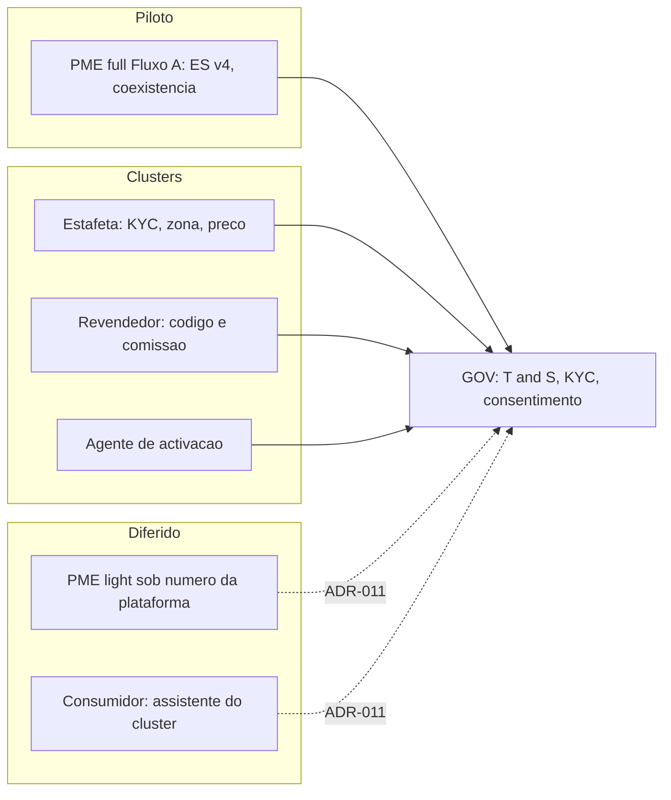
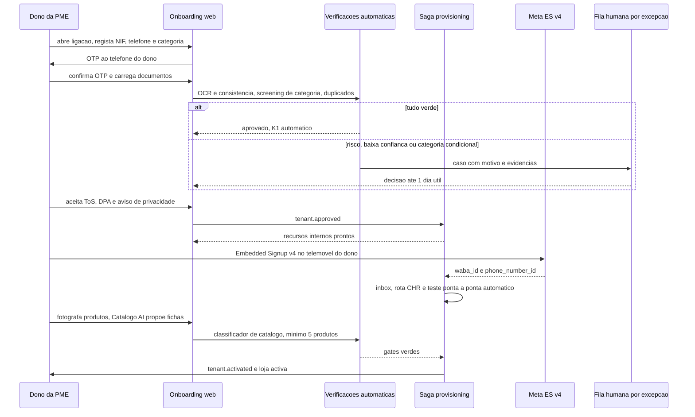
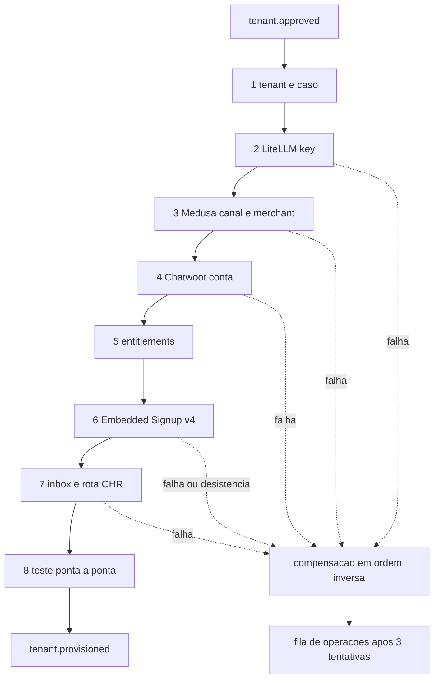
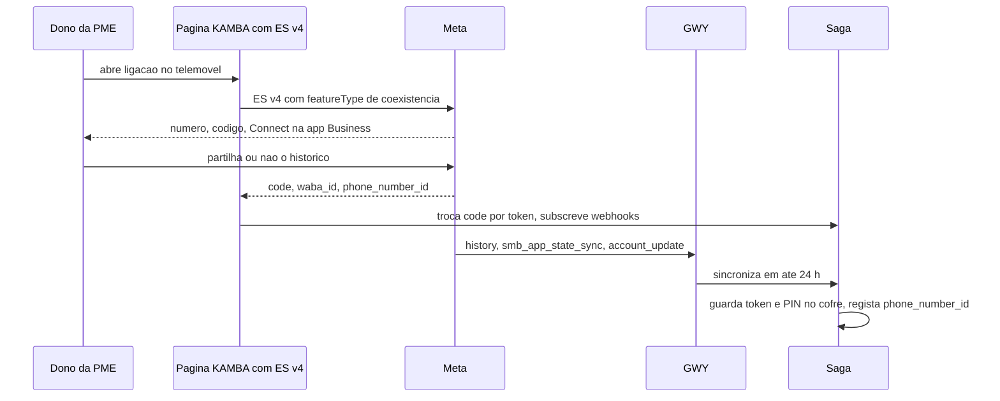
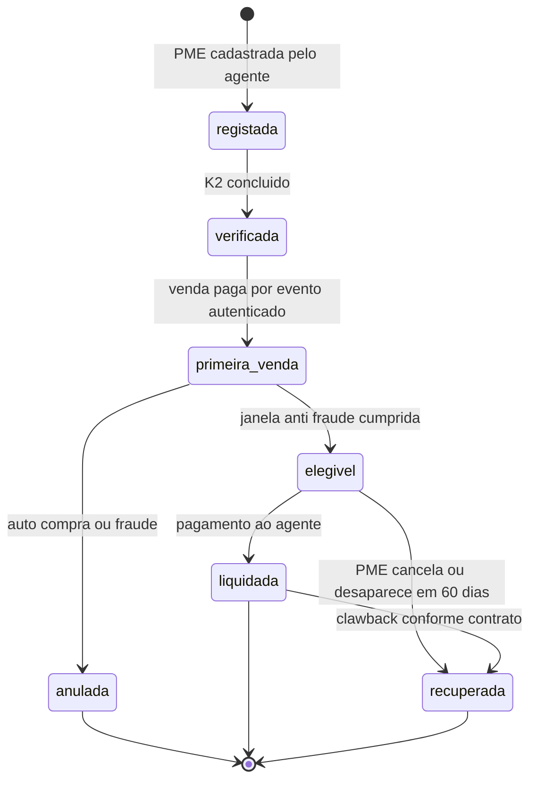
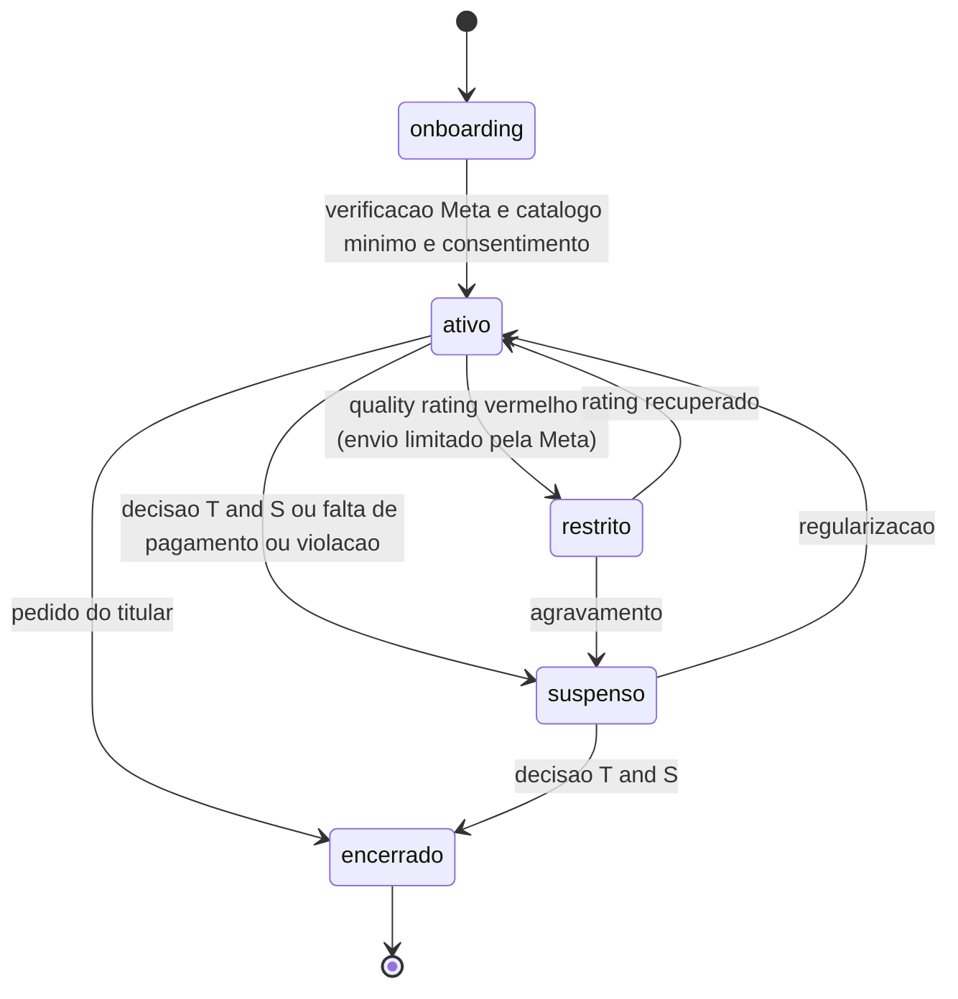

# Onboarding e Governação — KAMBÁ

| Campo | Valor |
|---|---|
| Produto | KAMBÁ (nome de trabalho) — plataforma WhatsApp-native de comércio conversacional para Angola |
| Documento | Técnica — Onboarding e Governação (GOV e TEN/onboarding) |
| Versão | 1.7 |
| Data | Outubro de 2026 |
| Classificação | Documento de Referência — Interno |
| Documento-fonte | `../exploracao/13-big-picture-ecossistema.md` (§5, §9.3), `../exploracao/11-arquitetura-detalhada-engenharia.md` (§5.3), `../exploracao/05-estrategia-loja-no-whatsapp.md`, `../exploracao/06-expansao-plataforma.md`, `../exploracao/07-pontos-cegos-2.md` (§2, §8, §9, §11), `../exploracao/14-tese-minima-e-plano-de-validacao.md` |
| Evidência | `evidencia/E1_Meta_WhatsApp.md`, `evidencia/E2_Pagamentos_Angola.md`, `evidencia/E3_Regulatorio_Dados.md`, `evidencia/E4_Stack_Licencas.md` |
| Documentos relacionados | `00_Arquitectura_Solucao.md`, `01_Canais_WhatsApp_Fluxo_Dual.md`, `02_Agent_Runtime_Verticais.md`, `03_Core_Comercio_Medusa.md`, `04_Pagamentos_Liquidacao_AntiFraude.md`, `06_Dados_Eventos_Analytics.md`, `07_Geo_Logistica_Federada.md`, `08_Seguranca_Conformidade.md`, `09_Topologia_Operacao_Escala.md` |

> **Estado das afirmações.** Escala do conjunto: **CONFIRMADO (fonte primária)**, **INDÍCIO (fonte secundária ou inferência)**, **NÃO VERIFICADO**, segundo `evidencia/E1`–`E5` (os quatro primeiros de 8 de Outubro de 2026). Valores marcados *«proposta»* são decisões de desenho a calibrar, não factos. Tudo o que toca Lei 22/11, Lei 15/03, BNA, AGT, contratos e política da Meta é **(a confirmar por parecer)**; este documento não é aconselhamento jurídico. Nota de nomenclatura: as referências a «doc 07 §8» do pedido de origem (M-Pesa/Jumia) apontam para `../exploracao/07-pontos-cegos-2.md` §8, não para `07`.

---

## 1. Introdução

### 1.1 Propósito

Este documento especifica como entram, são verificados, aprovados, operados e saem os actores da KAMBÁ (**GOV** e a parte de onboarding do **TEN**): PME, estafeta, revendedor, agente de activação e consumidor. Cobre o provisioning automático de recursos por tenant, a ligação do número WhatsApp da PME por *Embedded Signup* v4, o consentimento, o screening de categorias, a Trust & Safety, o KYC e o selo, a gestão da rede de agentes (que a biblioteca classifica como «produto + pessoas + auditoria», `../exploracao/07-pontos-cegos-2.md` §8), o suporte em tiers, o ciclo de vida do tenant e o off-boarding.

A tese: a governação é o que decide **quem pode entrar** antes de qualquer código. Uma PME de categoria proibida degrada o *quality rating* de um número e pode custar o estatuto de Tech Provider (E1); um agente que cadastra PMEs-fantasma envenena a base e o Score futuro; um onboarding que não deixa prova de consentimento é uma multa da APD à espera (E3: USD 505 mil, 2026-06-24).

### 1.2 Âmbito

Inclui: percursos (§4); provisioning (§5); Embedded Signup v4 (§6); consentimento (§7); screening e Trust & Safety (§8); KYC e selo (§9); rede de agentes (§10); suporte e dataset golden (§11); segmentos A/B (§12); churn (§13); contratos (§14); ciclo de vida e off-boarding (§15); métricas e RACI (§16–§17).

Fora de âmbito: o canal e o Fluxo A em si (`01`), a segurança transversal (`08`), o registo de comércio (`03`), os pagamentos (`04`), o dispatch (`07`) e a topologia (`09`).

### 1.3 Audiência

Responsáveis de produto e operações, engenheiros de plataforma (provisioning, TEN), responsáveis de segurança e privacidade, equipa de Trust & Safety e suporte, gestores da rede de agentes, revisão jurídica e de conformidade (APD, Meta).

### 1.4 Definições e termos

- **Tenant:** unidade de isolamento e facturação; tipos `pme`, `courier`, `reseller`, `agent`, `platform` (`../exploracao/11` §2; `00` §1.4).
- **Percurso:** sequência de passos de entrada de um tipo de actor, com gates de verificação.
- **Saga de provisioning:** sequência de passos idempotentes, cada um com compensação, que cria os recursos de um tenant.
- **Embedded Signup (ES) v4:** fluxo da Meta que liga a conta WhatsApp Business do cliente à plataforma Tech Provider (v2/v3 deixam de funcionar a **2026-10-15**; E1).
- **Coexistência:** o mesmo número na app WhatsApp Business do dono e na Cloud API (E1).
- **KYC K0/K1/K2:** níveis de verificação declarado / documental / presencial (§9).
- **Selo de verificado:** marca visível atribuída a negócios K2 em categoria aprovada.
- **T1/T2:** suporte de 1.º nível (IA) e 2.º nível (humano).
- **Golden set:** conjunto de casos PT-AO usado como *gate* de avaliação (`00` §9).
- **Segmento A/B:** PMEs formais ou em formalização / informais que querem invisibilidade (`../exploracao/07-pontos-cegos-2.md` §2).

---

## 2. Princípios e decisões aplicáveis (ADRs)

| ADR | Decisão (`00` §8) | Como este documento a concretiza |
|---|---|---|
| **ADR-001** | Cloud API + coexistência; Tech Provider; Embedded Signup v4 | Onboarding da PME por ES v4 com coexistência (§6); limites de onboarding da Meta tratados como restrição de capacidade. |
| **ADR-002** | LangGraph; n8n e Typebot vedados a tenants | Formulários e fluxos de onboarding de **todos** os tipos de tenant (inclui `agent`, `courier`, `reseller`) correm em código próprio/LangGraph, não em Typebot (E4: «Competing Use»). Corrige `../exploracao/11` §5.3. |
| **ADR-003** | Medusa v2 (spike); fallback Medusa puro + `merchant_id` | O passo «sales channel/merchant» da saga depende de D3 e tem implementação alternativa (§5). |
| **ADR-004** | Plataforma nunca detém fundos; *payouts* só via PSP e fora do Piloto | Comissões de agentes e revendedores (§10) não saem de fundos de terceiros; revendedores só entram com PSP/parceiro. |
| **ADR-005** | LLM via LiteLLM; versão ≥ 1.83.0, imagem por digest | Passo da saga cria *virtual key* por tenant com *budget* do plano. |
| **ADR-008** | Nenhum dado pessoal de produção sai de Angola sem APD | Lista de subprocessadores e gate de transferências no DPA (§14); KYC e documentos ficam no alojamento aprovado (D1). |
| **ADR-009** | Outbox + consumidores idempotentes | A saga é dirigida por eventos com idempotência por `evento.id` (§5). |
| **ADR-010** | BSUID/HMAC; consentimento no 1.º contacto; minimização | Registo de consentimento por `contact_id` (§7); logs sem conteúdo. |
| **ADR-011** | Fluxo dual como costura; só Fluxo A no Piloto | PME light e consumidor-assistente Diferidos (§4.4, §4.6); screening de categorias protege o número. |
| **ADR-012** | Verticais como configuração | Entitlements por plano e tipo de tenant (§5). |
| **ADR-013** | Pagamento só por evento autenticado | A comissão de agentes e o selo dependem de vendas **pagas por evento autenticado** (§10); auto-compra detectada (§8.3). |

---

## 3. Visão geral dos percursos



| Percurso | Tenant | Fase | Canal | Gate de entrada | Estado da PME/actor no fim |
|---|---|---|---|---|---|
| **PME full (Fluxo A)** | `pme` | **P** | onboarding web self-service + ES v4 no número da PME | K1 **automático** (NIF + alvará) mínimo; K2 opcional para selo; categoria aprovada; DPA aceite; método de pagamento Meta | `ativo` |
| **Estafeta** | `courier` | **C** | canal operacional (PA-GEO-4) | K2 presencial; contrato; nível T0 | `ativo` com limites (`07` §8) |
| **Revendedor** | `reseller` | **C** | canal operacional | K1; termos; **PSP/parceiro para comissões (D8)** | `ativo` só com liquidação disponível |
| **Agente de activação** | `agent` | **Piloto: não existe** (onboarding self-service, §4.1) / **C** (rede opcional para K2, selo e assistência) | canal operacional | K2 do agente, contrato, formação | `ativo` com tecto de PMEs/dia |
| **PME light** | `pme` sem WABA | **D** (ADR-011, D2) | número da plataforma | — | não entra em produção |
| **Consumidor** | sem tenant | consentimento **P** (§7); assistente **D** | número da PME (P) / plataforma (D) | aviso e opt-in | — |

---

## 4. Percursos

### 4.1 PME full — Fluxo A (Piloto): onboarding self-service automático (ADR-019)

**Decisão do fundador:** no Piloto o onboarding da PME é **automático e self-service**. Não há agente de campo nem trabalho manual da equipa no caminho normal; a equipa só intervém **por excepção**, numa fila de revisão com SLA. Isto substitui o desenho inicial («visita do agente, caso aberto pela equipa numa consola mínima»), que fica reservado a Clusters como assistência opcional e para o selo K2 (§9, §10).

O dono entra por uma ligação única (`/entrar`) que lhe chega por convite, por contabilista parceiro ou por anúncio. A ligação abre o **onboarding-web**, uma aplicação web mínima própria (não o storefront da vitrine, que é Clusters; ver `09` §3.1), com um assistente passo-a-passo em português. O dono pode pedir ajuda humana a qualquer momento, mas o caminho feliz não a exige.



| # | Passo | Como é automatizado | Intervenção humana (só por excepção) | Tempo-alvo (*proposta*) |
|---|---|---|---|---|
| 1 | Entrada e registo | Formulário com NIF, telefone, categoria; validação de formato; detecção de duplicados por NIF, telefone, dispositivo e IP; limites de taxa e desafio anti-bot | Duplicado ambíguo | 5 min |
| 2 | Prova de posse do telefone | OTP por SMS (agregador local) ou por WhatsApp; o número ligado depois pelo ES tem de coincidir com o telefone do dono | Falha repetida de OTP | 2 min |
| 3 | KYC K1 automático | Carregamento de NIF, alvará e BI; OCR/visão extrai campos e compara com os declarados; consistência entre nome, NIF e alvará; *score* de risco | Confiança de OCR baixa; incoerência; risco alto | 10 min + ≤ 1 dia útil se for à fila |
| 4 | Screening de categoria | Classificador (LLM barato + regras Meta ∪ lei; §8) sobre categoria declarada e títulos de produtos: **permitida** aprova, **bloqueada** rejeita com motivo, **condicional** vai à fila | Só categorias condicionais e recursos | imediato |
| 5 | Aceite contratual | ToS, DPA e aviso de privacidade; assinatura electrónica simples (OTP), versão e *hash* guardados | Pedido de alteração de cláusulas | 5 min |
| 6 | Provisioning | Saga (§5), disparada por `tenant.approved` | Passo falhado 3 vezes (§5.2) | ≤ 2 min |
| 7 | Ligar o número (ES v4) | Página guiada com pré-voo automático onde possível (§6.3); o **dono tem de fazer a autenticação na Meta e a confirmação na app**: não é automatizável por nós | ES falhado ou sincronização > 24 h (§6.4) | 20–30 min |
| 8 | Catálogo mínimo | O dono fotografa produtos (web ou, depois da ligação, por WhatsApp); o Catálogo AI propõe ficha e pergunta o que falta; classificador publica ou rejeita; ≥ 5 produtos | Produto marcado como categoria condicional | 20 min |
| 9 | Teste ponta a ponta | O sistema envia uma mensagem de teste ao número da loja e valida a resposta (*smoke test*) | Resposta incorrecta repetida | 2 min |
| 10 | Activação | Todos os gates verdes ⇒ `tenant.provisioned` e `tenant.activated`; estado `ativo` (`00` §6.2) | — | imediato |

**Meta de caminho feliz:** entrada → loja activa em ≤ 60 min de actividade do dono (*proposta*), sem qualquer toque da equipa.

**Intervenção por excepção (fila de revisão).** Cada caso chega com motivo, evidências e recomendação automática, e é decidido por T&S/T2 em ≤ 1 dia útil (p90). Gatilhos: confiança de OCR abaixo do limiar, incoerência documental, risco alto, categoria condicional, duplicado, ES falhado, recurso órfão da saga, pedido do dono. Alvo: **≥ 80% das activações sem intervenção humana** (*proposta*; §16).

**Controlo de risco compensatório.** Sem agente presencial, a confiança no cadastro desce, e o risco de fraude passa do agente para o próprio registo (lojas falsas, documentos adulterados). O desenho compensa com limites e confiança gradual, em vez de presença física:

| Mecanismo | Regra (*proposta*) |
|---|---|
| Tecto inicial de valor por pedido | O **menor** entre o tecto K1 (§9) e o limite do `ManualProvider` (`04`; 50.000 Kz). Os dois valores são propostas a calibrar; o tecto efectivo no arranque é o mais baixo |
| Subida automática de confiança | Após N pedidos pagos e entregues sem disputa (*proposta*: 5 pedidos em 30 dias), o tecto sobe ao nível K1 completo; sem histórico não sobe |
| Selo e K2 | O **selo K2 deixa de ser porta de entrada** e passa a ser um upgrade opcional (verificação presencial ou por vídeo, em Clusters), que dá selo e tecto mais alto |
| Anti-abuso de registo | OTP, duplicados, limites de taxa, desafio anti-bot, correlação de dispositivo e IP |
| Reavaliação contínua | Re-análise do catálogo e sinais de burla (§8.3) continuam após a activação |

**O que não se automatiza (restrições externas).**

| Restrição | Efeito sobre o onboarding automático |
|---|---|
| Autenticação do dono na Meta e confirmação na app no ES (E1) | O passo 7 é self-service mas **exige o dono presente** |
| Limite da Meta: 10 clientes/7 dias até Business Verification + App Review + Access Verification (E1) | O sistema gere uma **lista de espera automática** com posição e notificação, em vez de rejeitar |
| Business Verification e App Review da própria KAMBÁ (E1) | Pré-requisito da empresa, anterior ao primeiro onboarding; não é por PME |
| Método de pagamento da PME na Meta (cartão em moeda internacional; E1) | Gate do passo 7: sem ele não se activa (alternativa em D5) |
| Contrato de pagamento por PME: banco de apoio, contrato EMIS, contrato com o facilitador (E2, D4) | **Fora do caminho de onboarding no Piloto:** o pagamento arranca no `ManualProvider`; a «activação de pagamento integrado» é uma etapa posterior, separada |
| Validação oficial do NIF junto da AGT | Mecanismo **NÃO VERIFICADO**; sem ele o K1 automático é documental (OCR + consistência) e o risco residual de documento falso é coberto pelos tectos e pela subida gradual |

### 4.2 Estafeta (Clusters)

KYC presencial K2 (BI, NIF, veículo, fotografia), contrato de prestação de serviços, zona, preço, nível T0 e limites de valor (`07` §8). Sem estafetas não há dispatch; a densidade por zona é a restrição (`07` §16).

### 4.3 Revendedor (Clusters)

Registo, KYC K1, aceitação de termos, código/ligação de atribuição. A **comissão é um *payout* a terceiro financiado pela venda de uma PME**: ADR-004 e E2 §3.3 C exigem PSP/parceiro licenciado (D8). **Sem PSP o revendedor não entra em produção.** Elegibilidade da comissão: venda **paga por evento autenticado** (ADR-013) e entregue, após janela anti-fraude (*proposta*: 14 dias).

### 4.4 PME light (Diferido)

Vender sob o número da plataforma exige resposta escrita da Meta (D2; E1 §4). O DDL mantém `waba_id` e `phone_number_id` nulos (`../exploracao/11` §2) e o CHR suporta a persona, mas **nenhum tenant sem WABA entra em produção** (`00` §5). O percurso fica documentado só como costura.

### 4.5 Agente de activação

**Piloto: o papel não existe;** o onboarding é self-service automático (§4.1) e a equipa só trata a fila de excepções. Clusters: tenant `agent` opcional com KYC K2, contrato, formação de 30 minutos e tecto de PMEs por dia (§10). O agente opera o onboarding por fluxo próprio (não Typebot; ADR-002); a lacuna do canal operacional está em PA-GEO-4.

### 4.6 Consumidor

Sem conta nem app. No Piloto só existe o **primeiro contacto com consentimento** no número da PME (§7). O funil do consumidor (descoberta → 1.º contacto → «aha» < 30 s → 1.ª transacção; `../exploracao/13` §9.4) pertence ao assistente de cluster, **Diferido** (ADR-011).

---

## 5. Provisioning automático

### 5.1 Eventos e fronteira com o canon

A biblioteca (`../exploracao/11` §3, §5.3) faz de `tenant.activated` o gatilho do provisioning. Mas `00` §6.2 só permite `ativo` depois de «verificação Meta, catálogo mínimo e consentimento», e o catálogo AI e o ES precisam de recursos que a saga cria. Para fechar o ciclo sem alterar o canon, o evento desdobra-se (**PA-GOV-1**, nomes provisórios, alinhar com `06`):

| Evento | Quando | Efeito |
|---|---|---|
| `tenant.approved` | KYC, screening e aceite contratual concluídos | dispara a saga de recursos internos |
| `tenant.provisioned` | saga completa; ES e teste ponta a ponta feitos | pré-requisito de activação |
| `tenant.activated` | gates de `00` §6.2 cumpridos | CHR passa a encaminhar tráfego ao runtime; estado `ativo` |

### 5.2 Passos, idempotência e compensação

Cada passo é um **«ensure»** idempotente identificado por uma chave natural derivada de `tenant_id`, de modo que repetir não duplica.

| # | Passo | Chave de idempotência | Compensação |
|---|---|---|---|
| 1 | Criar `tenant` (estado `onboarding`) e `onboarding_case` | `onboarding_id` | marcar `cancelado`; sem apagar histórico |
| 2 | LiteLLM: *virtual key* com *budget* do plano (MIT; E4 CONFIRMADO) | alias = `tenant_id` | revogar e apagar a chave |
| 3 | Medusa/Mercur: *sales channel* + *merchant* (D3) | `metadata.tenant_id` | arquivar o canal (apagar só se vazio) |
| 4 | Chatwoot: conta + utilizadores via **Platform API** (`accounts`, `users`, `account_users`, `agent_bots`; E4 CONFIRMADO) | `nome = tenant_id` | apagar a conta criada pela mesma chave da Platform API |
| 5 | Entitlements por plano e tipo | `(tenant_id, modulo)` | `ativo = false` |
| 6 | **ES v4** → `waba_id`, `phone_number_id` (acção do dono) | `phone_number_id` | cancelar subscrição de webhooks; **não** se apaga o WABA do cliente (é dele; E1) |
| 7 | Chatwoot *inbox* WhatsApp + `tenant_channels` (CHR) | `phone_number_id` | remover rota; desligar *inbox* |
| 8 | Teste ponta a ponta (mensagem real) | `onboarding_id` | — |



```ts
// Saga: estado em Postgres (provisioning_step), execução por consumidor de outbox.
async function runStep(c: Case, step: Step) {
  const row = await db.upsertStep(c.id, step.name, { status: 'running', attempt: +1 });
  try {
    const ext = await step.ensure(c.tenantId);          // idempotente: procura antes de criar
    await db.markDone(row.id, { externalId: ext.id });
  } catch (e) {
    await db.markFailed(row.id, String(e));
    if (row.attempt >= 3) return escalateToOps(c);       // sem retry infinito
    throw e;                                              // BullMQ repete com backoff
  }
}
async function rollback(c: Case) {                       // ordem inversa, só passos 'done'
  for (const s of reverse(await db.doneSteps(c.id))) await s.compensate(c.tenantId);
}
```

### 5.3 Pontos de atenção (E4, E1)

- **Inbox no Chatwoot.** E4 lista a Platform API como `accounts`, `users`, `account_users`, `agent_bots`; a criação de *inbox* WhatsApp pode exigir a API de aplicação com *token* da conta ou o ES do próprio Chatwoot: **NÃO VERIFICADO** (a `../exploracao/11` §5.3 assume «Platform API cria conta + inbox»).
- **Versão do ES no Chatwoot** (v4 vs v2/v3): NÃO VERIFICADO (E4 §6); decidir se o ES corre na nossa app (Tech Provider) ou no Chatwoot, em `01`.
- **Webhook por WABA**: E4 indica que um PR do Chatwoot permite sobrepor o *webhook* por WABA (INDÍCIO); o GWY multiplexa por `entry.id` (E1) e é o ingress único (`00` §4).
- **Admin do Medusa só para a equipa**; sem *feature flags* `rbac` (EE; E4).
- **Reconciliação nocturna:** compara tenants, contas Chatwoot, chaves LiteLLM e canais Medusa; órfãos geram alerta (alvo: 0).
- **Redelivery:** consumidores idempotentes por `evento.id` (`events_consumed`, `../exploracao/11` §3).

---

## 6. Embedded Signup v4

### 6.1 Requisitos confirmados (E1)

| Tópico | Facto | Estado |
|---|---|---|
| Versões | **v2 e v3 deixam de funcionar a 2026-10-15** (7 dias após a data deste documento); construir directamente em **v4** | CONFIRMADO |
| Estatuto | Tech Provider (ou Solution Partner) obrigatório para ES e coexistência; **Business Verification da nossa empresa** antes do App Review; Advanced access a `whatsapp_business_messaging` e `whatsapp_business_management`; App Review ~24 h segundo a Meta (planear 1–2 semanas) | CONFIRMADO |
| Capacidade de onboarding | **10 clientes / 7 dias** por defeito; **200 / 7 dias** com Business Verification + App Review + «Access Verification» (detalhe **NÃO VERIFICADO**); acima disso, candidatura a Meta Business Partner | CONFIRMADO / NÃO VERIFICADO |
| Propriedade | o cliente é dono do WABA, número, templates e catálogo; custo de saída baixo (risco de churn) | CONFIRMADO |
| Quem paga | **o cliente-PME paga à Meta por cartão** (Billing Hub), em USD/EUR/GBP…; sem método de pagamento a Meta **deixa de entregar *service messages*** após as 1.000 grátis/mês | CONFIRMADO |
| Alternativa de facturação | Multi-Partner Solution com Solution Partner que factura (credit line) | CONFIRMADO (existência); acordo NÃO VERIFICADO (D5) |
| Coexistência | app WhatsApp Business **≥ 2.24.17**; `extras.featureType = whatsapp_business_app_onboarding`; evento final `FINISH_WHATSAPP_BUSINESS_APP_ONBOARDING`; **sem registo do número**; subscrever `account_update`, `history`, `smb_app_state_sync`, `smb_message_echoes` | CONFIRMADO |
| Prazo duro | **24 h** após o onboarding para sincronizar contactos e histórico (6 meses); cada passo uma só vez; senão, refazer | CONFIRMADO |
| Limites | 20 mps fixos; deixam de funcionar grupos, difusões, chamadas, mensagens temporárias, localização em tempo real e as ferramentas de negócio da app (catálogo, respostas rápidas, etiquetas, saudação/ausência) | CONFIRMADO |
| Desligamento | `PARTNER_REMOVED` com `PRIMARY_INACTIVITY` (~**14 dias** sem abrir a app), `COMPANION_INACTIVITY` (~30 dias), `CHANGE_NUMBER`, etc.; o *deregister* por API não funciona neste caso | CONFIRMADO |
| Elegibilidade de Angola | sem exclusão nem inclusão documentada | **NÃO VERIFICADO** (testar com +244, H3) |
| «≥ 7 dias de actividade» do número | **não consta de E1 nem da página da Meta lida em 2026-10-08**; tratar como hipótese, não como regra | **NÃO VERIFICADO** |
| Portfólio novo | 250 contactos novos/dia fora da janela; 2 números; sobe com Business Verification (2.000/dia; 20 números) | CONFIRMADO |
| Novo modelo de contas | WABA divide-se em WAAC + Messaging account (GA 2026-09-23; fase obrigatória H1 2028): abstrair `phone_number_id`/`waac_id` na camada de integração | CONFIRMADO |

### 6.2 Fluxo técnico



### 6.3 Checklist de pré-voo do número +244

| Verificação | Se falhar |
|---|---|
| App WhatsApp Business ≥ 2.24.17 e aberta nos últimos dias | actualizar; instruir o dono a manter a app aberta (inactividade ~14 dias desliga) |
| Número móvel (recomendado); fixo exige verificação por voz | fluxo de voz; SMS internacional Unitel/Africell NÃO VERIFICADO |
| Número em WhatsApp pessoal (não Business) | tem de ser eliminado antes, salvo conversão para Business app (E1) |
| Cartão com moeda internacional no Billing Hub | plano B: MPS com Solution Partner (D5); **não activar** sem método de pagamento |
| Categoria aprovada (§8) e *display name* válido (10 alterações/30 dias) | rejeitar ou corrigir |
| Dono presente (autentica na Meta e confirma na app) | reagendar; o agente não age em nome do dono |
| Histórico: partilhar ou não | tratar «sem histórico» (erro 2593109) como caso normal; **não** indexar o histórico no RAG sem base legal (§7.3) |

### 6.4 Falhas operacionais

| Evento | Resposta |
|---|---|
| Sincronização > 24 h | caso marcado `desligado`; refazer o ES; contacto do agente |
| `account_update` com `PARTNER_REMOVED` | alerta; mensagem ao dono (via canal operacional); fluxo de reconexão |
| `phone_number_quality_update` vermelho | `restrito` (§15); T&S analisa |
| Método de pagamento em falta / erros de entrega pós-1.000 | alerta ao dono e ao suporte; entrada no fluxo de falta de pagamento |
| Dono e bot respondem em simultâneo | protocolo de silenciamento (`00` §12) |

---

## 7. Consentimento e opt-in no 1.º contacto

### 7.1 Papéis

Em princípio cada PME é **responsável pelo tratamento** e a KAMBÁ é **subcontratada** (ou co-responsável, se decidir finalidades/meios): NÃO VERIFICADO como a APD qualifica plataformas SaaS (E3 Q1) e quem notifica/solicita autorização (plataforma, PME ou ambas). Fixa-se por contrato (§14). Sem notificação/autorização aplicável não há produção (E3 §1).

### 7.2 O consumidor no primeiro contacto

1. Primeira mensagem do consumidor ao número da PME → resposta imediata com **aviso curto versionado**: quem é o responsável (a loja), que é um assistente automático (E3 requisito 15), finalidades, destinatários (inclui fornecedor de LLM e país), direitos, e como falar com um humano (a Messaging Policy exige caminho de escalonamento; E1).
2. Botões (até 3; E1): «Continuar», «Falar com a loja», «Saber mais».
3. Registo em `consent_event`: `tenant_id`, `contact_id` (o **`uuid`** de `contacts`, não o HMAC — o BSUID vive em `contact_endpoints`), `purpose`, `text_version`, `accepted`, `canal`, `evidence_hash` e `ocorrido_em` (E3 requisito 1). São os campos do DDL abaixo, e não uma lista própria.
4. **Marketing em consentimento separado**, com «PARAR» em cada mensagem e lista de supressão; mensagens iniciadas pelo negócio só por template aprovado (E1; E3 requisito 3).
5. Teste de aceitação: nenhuma resposta com dados nem evento de marketing sem `consent_event` válido.

```sql
-- Forma de referencia de `consent_event` (KAM-140). O conjunto tinha **cinco**
-- formas desta tabela, em `01` §6.2, `03` §5.3, `06` §7.3, `08` §8.1 e aqui, que
-- discordavam nos campos e nas finalidades. As outras passaram a remeter para
-- esta, que era a mais proxima do dicionario §3.1.
CREATE TABLE platform.consent_event (
  id            bigint GENERATED ALWAYS AS IDENTITY PRIMARY KEY,
  tenant_id     uuid NOT NULL,
  contact_id    uuid NOT NULL,              -- `uuid`, como em toda a plataforma.
                                            -- Esta linha dizia `bytea`, que nao
                                            -- junta com `contacts.contact_id`.
  purpose       text NOT NULL
                CONSTRAINT consent_event_purpose_ck
                CHECK (purpose IN (                 -- dicionario §3.1, emenda 1.16
                  'transacao', 'atendimento', 'marketing', 'analytics_agregado',
                  'melhoria_servico', 'sugestoes_patrocinadas', 'partilha_loja',
                  'partilha_parceiros', 'partilha_estafeta', 'notificacao_dono')),
  text_version  text NOT NULL,
  accepted      boolean NOT NULL,
  canal         text NOT NULL,
  evidence_hash bytea NOT NULL,             -- hash do texto mostrado + aceitacao
  ocorrido_em   timestamptz NOT NULL DEFAULT now()
); -- append-only; revogacao = novo registo
```

> **O domínio de `purpose` são estas dez, e é a união de duas listas.**
> Decisão do fundador, 2026-10-18 (**KAM-159**). O dicionário §3.1 nomeava
> cinco e os 38 contratos de evento nomeavam oito, em `enum` fechado, e
> cruzavam-se **numa só**: `marketing`. Duas do canon — `partilha_estafeta` e
> `notificacao_dono` — eram **impossíveis de emitir**. A união não perde
> nenhuma, e entrou com a `v2` dos 38 contratos.
>
> Três coisas que a decisão fixou e que não são transcrição: a grafia é
> `transacao`, com um `c`, porque é a que corre — está em 38 contratos, na
> revisão `0004` e em onze baterias; o `melhoria` do canon e o
> `melhoria_servico` dos contratos são o mesmo conceito e fica o segundo; e o
> domínio passou a estar escrito na forma `∈ {…}` no §3.1, que é a que o
> exportador lê — em prosa não havia nada que um *gate* pudesse comparar.
>
> **E agora há um gate.** O `contract_diff dominios` (gate 7) confronta o
> domínio canónico com o `enum` dos contratos, **nos dois sentidos**: um valor
> no contrato que o canon não declara, e um valor no canon que a **última**
> versão do contrato não tem. Só a última, porque uma versão publicada está
> congelada pelo §6.6.

#### A base legal de cada finalidade, e as cinco que não têm nenhuma

O domínio fixa **os nomes**. Não fixa que cada finalidade seja legalmente
utilizável, e é preciso dizê-lo em voz alta porque a diferença é fácil de
perder: das dez, **uma** tem fonte directa e CONFIRMADA no `evidencia/E3`.

| Finalidade | O que o `E3` diz | Estado |
|---|---|---|
| `marketing` | Art. 19.º da Lei 22/11 — consentimento explícito e notificação, com excepções e *opt-out*; e o Instrutivo INACOM 4/20 | **CONFIRMADO** para o artigo, **INDÍCIO** para o Instrutivo. O próprio `E3` pergunta ao advogado (n.º 9) se o artigo se aplica ao WhatsApp Business |
| `transacao` | nada por este nome. A categoria cabe no Art. 12.º («execução de contrato») | implicação do autor do `E3` sobre linha CONFIRMADA |
| `melhoria_servico` | idem, e o requisito 8 («sem treino com dados da plataforma») | idem |
| `partilha_parceiros` | nada por este nome; o Art. 23.º é o vizinho («o subcontratado não pode comunicar dados sem autorização») | **INDÍCIO** |
| `atendimento` | **nada** | — |
| `analytics_agregado` | **nada** | — |
| `sugestoes_patrocinadas` | **nada**. O `05` §12.3 liga-a ao Art. 19.º, mas é documento técnico e não evidência | — |
| `partilha_loja` | **nada** | — |
| `partilha_estafeta` | **nada no `E3`**. O `07` §14.1 escreve «execução de contrato, Art. 12.º, e consentimento registado para a partilha com terceiro», com dupla ressalva: «a confirmar por parecer» e a pergunta Q-GEO-1 à Meta | — no `E3` |
| `notificacao_dono` | **nada no `E3`**. O `EPIC-09` descreve-a, e a evidência que aponta é o **E5** §4.2 — política da Meta, não lei angolana | — no `E3` |

**Seis não têm uma linha no `E3`** — conte-se a coluna da direita: `atendimento`,
`analytics_agregado`, `sugestoes_patrocinadas`, `partilha_loja`,
`partilha_estafeta` e `notificacao_dono`. As três de maior risco são
`sugestoes_patrocinadas` (publicidade) e as duas partilhas com terceiros sem
fonte nenhuma, `partilha_loja` e `partilha_estafeta`.

> **Esta contagem esteve errada, e a correcção é do KAM-159 depois da revisão
> adversarial.** Dizia «cinco», e nomeava entre as de maior risco a
> `partilha_parceiros` — que é precisamente a única das partilhas que **tem**
> fonte, o Art. 23.º, classificado na tabela como INDÍCIO. Numa tabela de base
> legal de consentimento, contar mal e pôr na lista de risco a finalidade
> errada não é erro de estilo: é a lista que alguém vai usar para decidir o
> que pode ligar antes do parecer.

A base legal de cada uma é o **KAM-104** (pacote de perguntas ao parecer
jurídico), e está no §4 do dicionário como item por decidir. Nenhuma destas
linhas foi inventada: onde o `E3` não diz, está escrito «nada».

### 7.3 Histórico sincronizado e treino

A coexistência traz até 6 meses de histórico (E1). Esse histórico é dado da PME; **não** é ingerido em índices ou prompts sem base legal e finalidade declarada, e **nunca** é usado para treinar ou melhorar modelos de IA (os Termos da Meta proíbem usar dados da plataforma para criar, desenvolver, treinar ou melhorar sistemas de ML/IA — E1, CONFIRMADO com ressalva de leitura automática; ver §11.3).

### 7.4 Consentimento da PME

O dono aceita ToS, DPA, lista de subprocessadores e aviso à APD aplicável; o aceite é versionado, com carimbo de tempo, assinante e *hash*. Um «sim» no chat tem validade contratual em princípio (Lei 23/11, art. 28.º; E3 INDÍCIO), mas a prova é nossa.

---

## 8. Screening de categorias e Trust & Safety

### 8.1 Regra: a lista de bloqueio é a união Meta ∪ lei angolana

A Messaging Policy da Meta proíbe/restringe categorias **independentemente de licenças locais** (E1 §4): armas, **álcool e tabaco**, drogas, **produtos médicos e de saúde**, espécies ameaçadas, animais vivos (excepto gado), materiais perigosos, moedas reais/virtuais e ICOs, partes do corpo, modelos fraudulentos, **jogos de azar com dinheiro real**, adultos, encontros, MLM, crédito rápido/empréstimos P2P/cobrança de dívidas; Angola não consta das listas de excepção. A lei angolana acrescenta camadas (E3 §5). O resultado é mais restritivo do que o texto de `00` §10.5 («álcool proibido a menores»): **para vender no WhatsApp, o álcool e o tabaco ficam bloqueados pela política da Meta mesmo que a Lei 12/25 os admita a maiores de 18** (lacuna L-GOV-2).

| Categoria | Decisão no Piloto | Fonte | Estado |
|---|---|---|---|
| Armas, munições, componentes | **Bloqueada** | Meta (E1); lei de armas NÃO encontrada (E3) | CONFIRMADO (Meta) / NÃO VERIFICADO (lei) |
| Jogos de azar, apostas, lotarias | **Bloqueada** (só com licença ISJ comprovada e **autorização escrita da Meta**; ambas ausentes) | Lei 17/24 (E3); Meta (E1) | CONFIRMADO (Lei 17/24, uma leitura) |
| Álcool | **Bloqueada** | Meta (E1); Lei 12/25 (18+, 300 m dos locais protegidos; E3) | CONFIRMADO (Meta) / INDÍCIO (Lei 12/25) |
| Tabaco | **Bloqueada**; sem promoção | Meta (E1); Lei 9/17 (publicidade; E3) | CONFIRMADO (Meta) / INDÍCIO (lei) |
| Medicamentos, dispositivos médicos, suplementos com alegações de saúde | **Bloqueada** (farmácia licenciada só após parecer) | Meta (E1); DP 41/24 e venda online NÃO VERIFICADOS (E3) | CONFIRMADO (Meta) / NÃO VERIFICADO |
| Clínicas, telemedicina, informação de saúde | **Bloqueada** no Piloto | Meta (E1); Lei 22/11 Art. 5.º c) e 13.º (dados sensíveis; E3) | CONFIRMADO / CONFIRMADO |
| Crédito, empréstimos, cobrança de dívidas, MLM | **Bloqueada** | Meta (E1) | CONFIRMADO |
| Animais vivos, combustíveis | **Bloqueada** | Meta (E1); Lei do Comércio Ambulante (E3 INDÍCIO) | CONFIRMADO / INDÍCIO |
| Moda, electrónica, serviços (salões, reparações, canalização…), restauração formal, material de construção | **Permitida** | — | — |
| Categorias não listadas | **Condicional**: revisão humana | — | — |

A lista é *policy-as-code* versionada (nome, palavras-chave, regras, fonte, data), e o nível de bloqueio é parâmetro por tenant só **para mais restritivo**.

### 8.2 Processo

| Momento | Mecanismo |
|---|---|
| Declaração | o dono declara a categoria no registo; o classificador valida contra o catálogo; no Piloto não há visita (em Clusters o agente confirma) |
| Análise do catálogo | classificador (LLM barato + regras; recebe só títulos/descrições, sem dados pessoais) sobre cada produto novo ou alterado |
| Revisão humana | T&S decide casos `condicional` e recursos; SLA ≤ 1 dia útil |
| Re-análise | contínua; quando o catálogo muda para zona proibida ⇒ aviso, depois limitação, depois suspensão |
| Registo | decisão, fonte da regra, revisor, data (auditável) |

### 8.3 Trust & Safety: fraude e abuso

| Ameaça | Sinais | Resposta |
|---|---|---|
| **Burlas** (PME que cobra e não entrega) | tenant novo com pedidos de valor alto; queixas; entregas não confirmadas; mudança de conta/NIF | limite de valor (`ManualProvider`, `00` §6.1); suspensão; investigação |
| **Listagens falsas** | fotos reutilizadas de outro tenant (*hash* perceptual); preços absurdos; fotografias de catálogos online | rejeição do produto; revisão do tenant |
| **Auto-compra** (fabricar histórico/reviews) | comprador com o mesmo BSUID/HMAC, dispositivo ou conta de pagamento do dono; pagamento circular; reviews em rajada | review só de **pedido pago e entregue** (`00` §12); sem Score no Piloto; anulação de avaliação e de comissão |
| **Reviews falsas / retaliação** | contas novas; textos duplicados | moderação; sem edição pelo vendedor; etiqueta de origem (E3 requisito 23) |
| **Abuso da IA** (pedidos fora do domínio comercial) | perguntas gerais | recusa e redireccionamento: manter o produto fora da classificação «AI Provider» da Meta (E1 risco existencial) |
| **Spam / mensagens em massa** | volume, bloqueios, denúncias | limites de envio; só com opt-in; risco da lei contra a desinformação (E3: «disseminador artificial») |

Escada de sanção (*proposta*): aviso → limitação (sem novos produtos/listas) → suspensão (`suspenso`, §15) → encerramento por decisão de T&S; cada passo é registado e recorrível uma vez. O **quality rating** do número é o activo mais frágil (`../exploracao/13` §9.3): T&S recebe os alertas `phone_number_quality_update` e as denúncias.

---

## 9. KYC de PME e selo de verificado

| Nível | Prova | Direitos |
|---|---|---|
| **K0** declarado | NIF e nome declarados | só demo; sem produção |
| **K1** documental (**automático** no Piloto, §4.1) | NIF, alvará/licença comercial, titular identificado, conta bancária da PME; OCR/visão e verificação de consistência, com fila humana por excepção | activação; tecto de valor por pedido (*proposta*: 150.000 Kz, com tecto inicial mais baixo e subida por histórico, §4.1) |
| **K2** presencial ou por vídeo (**opcional**, upgrade; Clusters) | visita do agente ou verificação por vídeo: fotografia geolocalizada do estabelecimento, prova de que o dono é o titular (documento + presença), confirmação do número | **selo**; tecto de valor mais alto (*proposta*: 500.000 Kz); elegibilidade a funcionalidades de crédito futuras |

- A validação do NIF por consulta à AGT: mecanismo NÃO VERIFICADO; no Piloto é humana (T&S).
- O selo mostra-se na loja e, em Clusters, no índice (`../exploracao/06` §1.2: «selo verificado como pré-requisito de crédito»). **Revoga-se** por sanção, mudança de titular ou documento caducado.
- Os documentos ficam no STO (ADR-014) com URL assinada, acesso restrito a T&S e retenção até ao encerramento + prazo legal (CGT NÃO VERIFICADO; parametrizar).
- O Piloto aceita **só segmento A** (NIF obrigatório; `../exploracao/14` §1). KYC mais leve para o segmento B não é desenhado (§12).

---

## 10. Rede de agentes de activação

A rede de agentes é um negócio operacional: «M-Pesa e Jumia gastaram fortunas a gerir redes de agentes» (`../exploracao/07-pontos-cegos-2.md` §8). Desenha-se como **produto + pessoas + auditoria**, desde o agente nº 1 (`../exploracao/13` §9.3). **Piloto:** sem rede e sem trabalho manual no caminho normal: o onboarding é self-service automático (§4.1, ADR-019). **Clusters:** rede de agentes à comissão, como assistência opcional e para o selo K2.

### 10.1 Fraude e controlo

| Fraude | Descrição | Controlo |
|---|---|---|
| **PME-fantasma** | cadastro de lojas inexistentes para ganhar comissão | K2 com fotografia geolocalizada; chamada de auditoria aleatória (*proposta*: 20% dos casos nos primeiros 60 dias do agente); comissão só depois da 1.ª venda real |
| **1.ª venda fabricada** | auto-compra, conluio agente–PME | venda **paga por evento autenticado** (ADR-013), de comprador sem relação detectada (§8.3), valor mínimo (*proposta*: 10.000 Kz), e retenção de comissão |
| **Duplicados / roubo de cliente** | mesma PME por dois agentes | unicidade por NIF, número e localização; primeiro registo válido |
| **Promessas falsas** | «não deixa rasto», «a AGT nunca vê» | guião aprovado (§12), gravação/auditoria de chamadas e mensagens de amostra, sanção |
| **Dumping de metas** | quantidade em vez de qualidade | métrica de retenção a 60 dias entra na comissão |

### 10.2 Comissão



| Regra (*proposta*) | Valor |
|---|---|
| Gatilho | 1.ª venda **paga** da PME, de comprador independente, de valor ≥ mínimo |
| Janela anti-fraude | 14 dias após `entregue` ou levantamento |
| *Clawback* | se a PME encerrar ou for sancionada por fraude em ≤ 60 dias |
| Componente variável | retenção a 60 dias (≥ 70% das PMEs do agente activas; H9) |
| Teto | número máximo de PMEs/dia por agente e por zona |
| **Quem paga** | **fundos próprios da KAMBÁ**, não fundos de terceiros: no Piloto, transferência bancária ordinária da empresa. A leitura «pagar uma despesa própria não é prestar serviço de pagamento» é INDÍCIO e **(a confirmar por parecer)** (E2 Q21); fora desta leitura, passa a *payout* via PSP (D8, ADR-004) |

### 10.3 Supervisão, churn e formação

Supervisor por grupo de agentes (*proposta*: 1 por 8–10), reunião semanal de qualidade, scorecard por agente (PMEs verificadas, retenção D30/D60, queixas, auditorias falhadas), despromoção automática (menos PMEs/dia) e desactivação. Churn de agentes é esperado: manter um *playbook* de transferência de PMEs, materiais e formação de 30 minutos por voz (Academia KAMBÁ, `../exploracao/06` §4.3).

---

## 11. Suporte em tiers e dataset golden

### 11.1 Canais e tiers

Há dois suportes distintos: o **da PME ao seu cliente** (a própria PME, com o assistente e o handoff do Fluxo A) e o **da KAMBÁ à PME** (este capítulo). O segundo usa o canal operacional da KAMBÁ (PA-GEO-4; o Piloto pode começar na linha de WhatsApp Business do fundador, assumindo o risco).

| Tier | Quem | Escopo | SLA (*proposta*) |
|---|---|---|---|
| **T1** | Assistente de suporte (IA, PT-AO), com base de conhecimento fechada | «como actualizo preço», estado de pedido, estado do número, ES, facturação | resposta ≤ 1 min; escalona se confiança baixa |
| **T2** | Humano de operações | casos T1 falhados, disputas, T&S, ES falhado, `PARTNER_REMOVED`, pagamentos | 1.ª resposta ≤ 4 h úteis; resolução ≤ 2 dias úteis |
| **T3** | Engenharia / jurídico | defeitos, fugas, pedidos da APD | por gravidade; APD ≤ 5 dias úteis (E3 requisito 25, valor sugerido) |

### 11.2 Dataset golden PT-AO

Cada caso T2 resolvido é candidato ao *golden set* que gateia deploys (`00` §9: handoff correcto ≥ 85%; H7). Pipeline: caso resolvido → **reescrita sintética sem dados pessoais** (nomes, números, moradas, valores trocados) → rótulo (intenção, resposta esperada, handoff sim/não, risco) → revisão por duas pessoas → entrada no repositório versionado. Meta do Piloto: ≥ 100 conversas (H7); crescimento contínuo (*proposta*: +20/semana).

### 11.3 Risco: Termos da Meta sobre dados e ML

Os Termos proíbem usar dados da plataforma para criar, desenvolver, treinar ou melhorar sistemas de ML/IA (E1; leitura automática do texto PT, **verificar a cláusula integral**). Usar conversas reais para *avaliar* pode ser lido como «melhorar». Por isso: (a) o golden set contém **reescritas sintéticas**, não conversas; (b) nenhum modelo é treinado ou afinado com dados WhatsApp; (c) o fornecedor de LLM tem retenção zero/sem treino (E3 requisito 8); (d) pedir parecer sobre o texto exacto (E1 Q7). **PA-GOV-4.**

---

## 12. Segmento A vs B e política de comunicação

A biblioteca separa **segmento A** (PMEs formais/em formalização: querem factura, selo, crédito) de **segmento B** (informais que valorizam a invisibilidade; `../exploracao/07-pontos-cegos-2.md` §2). **Decisão para o Piloto: só segmento A** (`../exploracao/14` §1). Misturar os dois no mesmo pitch é erro.

| Regra | Em prática |
|---|---|
| Não prometer o que assusta o B nem o que a KAMBÁ não pode cumprir | **nunca** dizer que a plataforma «não deixa rasto», «escapa à AGT» ou «não regista vendas» |
| Verdade sobre o registo | a plataforma regista pedidos e pagamentos (ledger, auditoria); a factura emite-se com software certificado AGT (E2/E3); partilha com autoridades **(a confirmar por parecer)** |
| Mensagem ao A | atendimento sem perder clientes, pagamento confirmado sem comprovativos falsos, factura pronta para 2027 (data a confirmar com a AGT; E2), selo e histórico |
| Mensagem ao B | **não há pitch no Piloto**; se um B chegar, é informado de que o produto implica NIF e registo |
| Parceria com o Estado (INAPEM) | não comunicar cedo; não usar como argumento de venda ao A (assusta o B) |
| Controlo | guião aprovado por Produto; auditoria de amostras de mensagens e chamadas dos agentes; frase proibida ⇒ sanção |

---

## 13. Mortalidade de PMEs e churn

A taxa de mortalidade de PMEs em Angola: **NÃO VERIFICADO** (nenhuma fonte nesta ronda); desenha-se assumindo-a alta e variável.

| Sinal de risco | Limiar (*proposta*) | Acção |
|---|---|---|
| Sem mensagens do dono (painel/chat) | 7 dias | contacto do agente/T2 |
| Sem pedidos criados | 14 dias | revisão do catálogo e da oferta |
| `PARTNER_REMOVED` / ES desligado | imediato | reconexão assistida (§6.4) |
| Falta de pagamento (subscrição ou Meta) | 5 dias | aviso; depois `suspenso` |
| Catálogo desactualizado (H8 < 60%) | 4 semanas | lembrete |

| Métrica | Alvo (hipóteses de `../exploracao/14` §2) |
|---|---|
| PMEs pagantes a 30 dias do piloto | ≥ 5 (H1) |
| PMEs activas ao dia 60 | ≥ 70% (H9) |
| Catálogos correctos em auditoria | ≥ 60% (H8) |

**Tenants dormentes** (inactivos > 60 dias, *proposta*): *budget* LiteLLM a zero, automações suspensas e aviso de encerramento; custo marginal ~0 (a base gratuita não pode consumir LLM). A morte de uma PME cai no off-boarding (§15) por pedido do titular ou decisão de T&S.

---

## 14. Contratos e termos (a confirmar por parecer)

| Documento | Conteúdo mínimo | Notas |
|---|---|---|
| **ToS da PME** | serviço, papéis, categorias proibidas, uso aceitável, suspensão, preços, IVA, facturação, cessação, **cláusula de limitação coerente**: o facilitador limita a responsabilidade a um mês de serviço (E2); cláusulas que excluam responsabilidade por informação errada podem ser nulas (Lei 15/03 art. 16.º; E3 INDÍCIO) | versão e *hash* por aceite |
| **DPA** (subcontratado) | finalidades, instruções, medidas de segurança, **subprocessadores com país** (LLM, alojamento, Meta), transferências sujeitas a APD (ADR-008), assistência a direitos do titular, devolução/eliminação | `tenant sem DPA aceite não activa` (E3 requisito 4) |
| **Política de privacidade / aviso ao consumidor** | responsável, finalidades, destinatários, IA, direitos | versionado (§7) |
| **Termos Meta** | o cliente aceita os termos da Meta no ES; é dono do WABA; paga à Meta | transmitir (*flow-down*) |
| **Contrato de agente** | prestação de serviços independente, comissões e *clawback*, guião, confidencialidade, auditoria | risco de requalificação laboral (parecer) |
| **Contrato de estafeta** | ver `07` §12.3 | — |
| **Termos de revendedor** | atribuição, comissão, proibições (spam), PSP | só com D8 |
| **Lista pública de subprocessadores** | actualizada, com aviso prévio de alterações | E3 requisito 4 |

Direitos do titular (acesso, correcção, eliminação, oposição) com prazo interno ≤ 30 dias (a lei dá até 60 dias úteis para rectificar/eliminar, INDÍCIO; E3 requisito 13); responsável de privacidade interno nomeado (a Lei 22/11 não exige DPO; o projecto de 2025 sim, E3).

---

## 15. Ciclo de vida do tenant e off-boarding

### 15.1 Estados (canónicos, `00` §6.2)



| Transição | Gatilho | Quem decide | Efeito técnico |
|---|---|---|---|
| `onboarding → ativo` | gates cumpridos (§5.1) | GOV (automático + T&S) | `tenant.approved`, `tenant.provisioned`, `tenant.activated` — **três**, e não um (`00` §6.2 e `specs/EPIC-09`); CHR encaminha |
| `ativo → restrito` | `phone_number_quality_update` vermelho (limitação imposta pela Meta) | automático | o bot continua a servir dentro do que a Meta permite (`00` §6.2) |
| `restrito → ativo` | *quality rating* recuperado | automático | CHR volta ao encaminhamento normal. **Tinha linha própria no diagrama e não na tabela**: estava dentro da célula de `ativo → restrito`, e por isso não tinha decisor |
| `restrito → suspenso` | agravamento da limitação da Meta | automático / T&S | o mesmo que `ativo → suspenso`: aviso estático, entregas pendentes finalizadas, novas encomendas bloqueadas |
| `ativo → suspenso` | falta de pagamento (subscrição ou método Meta); violação (T&S) | automático / T&S | CHR responde mensagem de aviso estática; entregas pendentes finalizadas; novas encomendas bloqueadas |
| `suspenso → ativo` | regularização comprovada | T2 / T&S | CHR reabre |
| `ativo → encerrado` | pedido do titular (identidade confirmada) | Produto/T2 | off-boarding (§15.2) |
| `suspenso → encerrado` | decisão de T&S (fraude, categoria proibida reiterada) | T&S | off-boarding com *retenção por disputa* se houver |

**Sub-estados (proposta PA-GOV-6, sem alterar os estados canónicos):** em `onboarding`: `kyc_pendente`, `aprovado`, `provisionando`, `aguarda_es`, `aguarda_catalogo`; em `encerrado`: `em_exportacao`, `em_retencao` (apenas dados que a lei fiscal ou uma disputa obrigam a manter) e `purgado`. A lacuna está em `00` §6.2, onde `encerrado → [*]` não distingue retenção (L-GOV-3).

### 15.2 Off-boarding

| Fase | Prazo (*proposta*) | Acção |
|---|---|---|
| Pedido e verificação do titular | D0 | autenticação do dono (ES/WhatsApp + confirmação); bloqueio de novas encomendas |
| Fecho de pendentes | D0–D7 | encomendas em curso entregues/canceladas; reservas de stock libertadas; reembolsos manuais registados |
| Desligar canal | D0–D1 | CHR deixa de encaminhar; subscrição de webhooks cancelada; o WABA e o número **continuam do cliente** (E1); aviso de que a app Business volta a funcionar normalmente |
| Exportação | ≤ D7 | pacote para o titular: catálogo, encomendas, clientes (conforme a PME como responsável), conversas, consentimentos, ficheiros; formato estruturado (CSV/JSON), ligação assinada de curta duração |
| Revogação | D7 | *virtual key* LiteLLM revogada; conta Chatwoot arquivada; canal Medusa arquivado; entitlements off |
| Purga | D30 | apagamento dos dados operacionais (soft-delete → purga com registo); *crypto-shredding* quando existir |
| Retenção | prazo legal | só o que a lei exige: **registos fiscais** (prazo do CGT **NÃO VERIFICADO**, parametrizar por tenant; E3 §6) e **disputas abertas**; o `payment_events` é *append-only*: guardar sem identificadores directos (pseudonimizar) |
| Confirmação | D30 | certificado de eliminação ao titular |

Casos específicos: estafeta (disputas e *clawback* abertos suspendem a purga; `07` §11), agente (comissões por recuperar), revendedor (comissões pendentes no PSP).

---

## 16. Métricas de governação e alvos mensuráveis

| Métrica | Alvo (*proposta* salvo indicação) | Fonte |
|---|---|---|
| Tempo entrada → loja activa (PME full, self-service) | mediana ≤ 60 min de actividade do dono; ≤ 3 dias de calendário | `onboarding_case` |
| Activações sem intervenção humana | ≥ 80% (*proposta*) | `onboarding_case` |
| Fila de revisão por excepção | 1.ª decisão ≤ 1 dia útil (p90) | T&S |
| Saga concluída à 1.ª tentativa | ≥ 95% | `provisioning_step` |
| Recursos órfãos (chaves, contas, canais) | 0 | reconciliação nocturna |
| Tenants `ativo` com DPA aceite | 100% | contrato |
| Primeiros contactos com `consent_event` válido | 100% | auditoria |
| Screening: revisão humana | ≤ 1 dia útil (p90) | T&S |
| Produto de categoria bloqueada publicado | 0 | amostragem + classificador |
| Incidentes de *quality rating* vermelho por trimestre | ≤ 1 por 50 números | webhooks |
| PMEs-fantasma detectadas após comissão paga | 0 | auditoria de agentes |
| Comissões recuperadas (*clawback*) / pagas | ≤ 10% | rede |
| Retenção a 60 dias | ≥ 70% (H9) | coortes |
| PMEs pagantes a 30 dias | ≥ 5 (H1) | billing |
| T1 resolvidos sem T2 | ≥ 60% (a calibrar) | suporte |
| T2: 1.ª resposta | ≤ 4 h úteis | suporte |
| Golden set | ≥ 100 (Piloto), +20/semana | repositório |
| Pedidos de titulares executados | ≤ 30 dias | privacidade |
| Onboardings/semana vs. limite Meta | ≤ 10 (antes de Access Verification) | ES |

---

## 17. Processos e RACI

Legenda: **R** executa, **A** responde, **C** consultado, **I** informado.

| Processo | Dono PME | Agente | T2 / Ops | T&S | Resp. Produto | Resp. Segurança | Arquitecto | Jurídico externo |
|---|---|---|---|---|---|---|---|---|
| Triagem e KYC K1/K2 | C | R | I | A | I | — | — | — |
| Screening de categorias (lista) | I | I | I | R | A | C | — | C |
| Aceite ToS/DPA | R | R | I | I | A | C | — | C |
| Saga de provisioning | — | I | R | — | I | C | A | — |
| Embedded Signup v4 | R | R | C | — | I | C | A | — |
| Consentimento / aviso de privacidade | I | I | I | I | A | R | C | C |
| Moderação, sanções, recursos | I | I | C | R | A | I | — | C |
| Rede de agentes (auditoria, comissões) | — | R | C | C | A | I | — | C |
| Suporte T1/T2 e golden set | I | I | R | C | A | C | C | — |
| Off-boarding e purga | R | I | R | C | I | A | C | C |
| Resposta a pedidos da APD | — | — | C | C | C | A | C | R |
| Revisão trimestral da *watch list* (Meta, lei, preços) | — | — | I | C | A | R | C | C |

---

## 18. Riscos e mitigações

| Risco | Impacto | Mitigação |
|---|---|---|
| ES v2/v3 morre a 2026-10-15 | onboarding bloqueado | construir em v4; testes de contrato |
| Limite de 10 clientes/7 dias | rampa lenta | Business Verification + App Review cedo; Access Verification |
| PME sem cartão em moeda internacional | sem entrega de *service messages* após 1.000 | gate de método de pagamento; MPS (D5) |
| Coexistência indisponível ou perde-se por inactividade | loja parada | spike H3; alertas `account_update`; reconexão |
| Categoria proibida activa | número banido; estatuto de Tech Provider em risco | screening Meta ∪ lei; re-análise contínua |
| Agentes fraudulentos (Clusters) | base envenenada, custo | K2, comissão pós-venda paga, auditoria, *clawback* |
| **Registo falso em self-service** (lojas ou documentos falsos, sem agente presencial) | burlas, quality rating, base envenenada | OTP, duplicados, anti-bot, OCR + consistência, tecto inicial baixo com subida por histórico, reavaliação contínua, fila humana por excepção (§4.1) |
| **Gargalo da Meta** (10 clientes/7 dias) com procura automática | espera longa, abandono | lista de espera automática com posição; Business Verification e App Review cedo; pedido de Access Verification |
| **KYC automático sem validação oficial do NIF** (NÃO VERIFICADO) | documento falso passa | tectos baixos, confiança gradual, auditoria por amostragem, K2 opcional para selo |
| Golden set contamina-se com dados reais | violação dos Termos Meta / Lei 22/11 | reescrita sintética; parecer |
| Prometer invisibilidade ao segmento B | dano reputacional e legal | guião, auditoria, segmento A no Piloto |
| Saga deixa recursos órfãos | custo e fuga de dados | idempotência, compensação, reconciliação |
| Retenção fiscal vs. apagamento | incumprimento de uma das leis | pseudonimização do ledger; prazos parametrizados; parecer |
| Falta de prova de consentimento | multa APD | `consent_event` append-only; testes |
| Responsabilidade da plataforma por PMEs | passivo | ToS coerentes, T&S, parecer |
| Dependência de `Platform API` do Chatwoot (lacunas) | provisioning manual | passo substituível; teste de versão |

---

## 19. Limites, premissas e itens NÃO VERIFICADOS

| Item | Estado | Ligação |
|---|---|---|
| Elegibilidade de Angola para coexistência; «≥ 7 dias de actividade» | NÃO VERIFICADO | H3; E1 Q3 |
| «Access Verification» (10 → 200 clientes/7 dias) | NÃO VERIFICADO | D5; E1 Q9 |
| Aceitação de documentos angolanos na Business Verification da KAMBÁ e das PMEs | NÃO VERIFICADO | D5; E1 Q8 |
| Tech Provider directo vs BSP; facturação em moeda local | em aberto | **D5** |
| Versão do ES usada pelo Chatwoot; criação de *inbox* pela Platform API | NÃO VERIFICADO | E4 §6; `01` |
| Número operacional da KAMBÁ para prestadores/suporte | NÃO VERIFICADO | PA-GEO-4; D2 (distinção do Fluxo B) |
| Papel da KAMBÁ (subcontratada ou co-responsável); quem notifica a APD | NÃO VERIFICADO | E3 Q1; **D1** |
| Alojamento (dados de KYC e consentimentos) | em aberto | **D1** |
| Medusa/Mercur vs Medusa puro (passo 3 da saga) | em aberto | **D3** |
| Facilitador e onboarding bancário por PME | em aberto | **D4**; E2 §1.7 |
| Comissões de agentes/revendedores como *payout* | INDÍCIO / em aberto | **D8**; E2 Q21 |
| Parceiro de factura AGT para o selo/“pronto para factura” | em aberto | **D7** |
| STO para documentos de KYC | em aberto | **D6** |
| Fluxo B / PME light / assistente de consumo | Diferido | **D2** |
| Prazo de retenção fiscal (CGT) | NÃO VERIFICADO | E3 §6 |
| Cláusula exacta dos Termos Meta sobre treino/ML | NÃO VERIFICADO (leitura automática) | E1 Q7 |
| Mortalidade de PMEs em Angola | NÃO VERIFICADO | — |
| Venda online de medicamentos, armas, tabaco | NÃO VERIFICADO | E3 §5 |
| Todos os limiares marcados *proposta* | a calibrar | piloto |

---

## 20. Propostas de ADR e lacunas no canon

### 20.1 Propostas de ADR

| Código local | Proposta | Racional |
|---|---|---|
| **PA-GOV-1** | Desdobrar `tenant.activated` em `tenant.approved` (dispara a saga), `tenant.provisioned` e `tenant.activated` (go-live) | `00` §6.2 exige gates anteriores a `ativo` que dependem dos recursos da saga |
| **PA-GOV-2** | Lista de bloqueio de categorias = **Meta ∪ lei angolana**, como *policy-as-code* versionada; só se pode tornar mais restritiva por tenant | E1: a Meta proíbe independentemente de licenças locais |
| **PA-GOV-3** | Comissões de agentes e revendedores só após 1.ª venda **paga por evento autenticado** de comprador independente, com janela anti-fraude e *clawback* | ADR-013; fraude de rede (`../exploracao/07-pontos-cegos-2.md` §8) |
| **PA-GOV-4** | *Golden set* feito de **reescritas sintéticas**; nenhum treino/afinação com dados WhatsApp | Termos Meta (E1) e Lei 22/11 |
| **PA-GOV-5** | Canal operacional da KAMBÁ para prestadores e PMEs (ver **PA-GEO-4**, `07`) | lacuna comum a GEO e GOV |
| **PA-GOV-6** | Sub-estados de `onboarding` e `encerrado` (§15.1), sem alterar os estados canónicos | retenção fiscal e disputas não cabem em `encerrado → [*]` |
| **PA-GOV-8** | **Onboarding self-service automático no Piloto** (web + ES v4 + KYC K1 automático), com revisão humana só por excepção e confiança gradual por histórico; K2 vira upgrade opcional | decisão do fundador; promovida a **ADR-019** em `00` |
| **PA-GOV-7** | Piloto aceita só segmento A (NIF obrigatório); política de comunicação com frases proibidas | `../exploracao/07-pontos-cegos-2.md` §2 |

### 20.2 Lacunas e inconsistências detectadas

| Id | Lacuna | Onde |
|---|---|---|
| **L-GOV-1** | Os percursos são **seis** (PME full, estafeta, revendedor, PME light, agente, consumidor), mas `INDICE.md` §2 fala em «4+1 percursos», e o ADR-004 e o ADR-008 do índice estão desactualizados. **A contagem de ADRs fica fechada pelo KAM-130**: o `INDICE.md` passa a dizer **20**, que é o que o doc 00 §8 tem, contado, e a tabela-síntese do §5 passa a mostrar os vinte. **O resto desta linha fica aberto, e são três coisas e não uma**: os «4+1 percursos» do §2 (são seis), o ADR-004 e o ADR-008. | `INDICE.md` |
| **L-GOV-2** | `00` §10.5 e §12 indicam «álcool proibido a menores»; a política da Meta bloqueia álcool e tabaco de todo (E1) | `00` |
| **L-GOV-3** | `00` §6.2 não distingue sub-estados de onboarding nem retenção após `encerrado` | `00` §6.2 |
| **L-GOV-4** | `../exploracao/11` §3 faz de `tenant.activated` o gatilho do provisioning; contradiz o gate de §6.2 (PA-GOV-1) | biblioteca |
| **L-GOV-5** | `../exploracao/11` §5.3 usa «app Typebot» para o agente e a Platform API «cria conta + inbox»; viola ADR-002 e não está confirmada (E4) | biblioteca |
| **L-GOV-6** | `00` não tem decisão sobre o canal da KAMBÁ para falar com os seus prestadores | `00` §5 |

---

## 21. Adenda — Módulos de entrada no onboarding (ADR-020)

> **Estado.** Adenda de 2026-10-09 por decisão do fundador.

- **Porta de entrada.** O onboarding passa a oferecer uma escada de valor: (1) **Catálogo AI** e **Foto de produtos AI** logo no registo, antes de o WhatsApp estar ligado, via painel web; (2) **Social AI** (propostas de conteúdo para publicação manual) e **Orçamento expresso**; (3) atendimento automático (Vendedor/Serviços) quando o Embedded Signup estiver concluído.
- **Desacoplamento do canal.** Os módulos de entrada funcionam no painel web mesmo que o Embedded Signup falhe ou esteja em lista de espera (limite de 10 clientes/7 dias da Meta, E1). Isto atenua o gargalo do passo 7 do §4.1.
- **Dono como contacto.** O OTP do registo cria o contacto `papel='dono'` (canal do dono, `02` §21); mudança de telefone exige novo OTP.
- **Entitlements por módulo.** Cada módulo é um entitlement com limites próprios (KAM-124); o plano de entrada pode ser só módulos de entrada, sem o atendimento.
- **Comunicação (segmento A).** O guião não promete publicação automática nem resultados de vendas; descreve os módulos como produtividade com aprovação do dono (§12).
- **Medição.** H10–H12 (`../exploracao/14`) medem a ativação, a conversão e o custo/disposição a pagar; os critérios de abate estão em KAM-127.

## 22. Tabela de aprovação

| Papel | Nome | Assinatura | Data |
|---|---|---|---|
| Arquitecto de Plataforma |  |  |  |
| Responsável de Segurança |  |  |  |
| Responsável de Produto |  |  |  |

---

## 23. Controlo de versões

| Versão | Data | Descrição | Autor |
|---|---|---|---|
| 1.0 | Outubro 2026 | Emissão inicial: percursos, provisioning por saga, Embedded Signup v4, consentimento, screening e Trust & Safety, KYC e selo, rede de agentes, suporte e golden set, segmentos A/B, ciclo de vida e off-boarding, métricas e RACI. | Equipa KAMBÁ |
| 1.1 | Outubro 2026 | **Emenda KAM-111** (dicionário canónico): §6.4 e §15.1, D-08 (estado `restrito`: limitação imposta pela Meta, distinta de `suspenso`). | Equipa KAMBÁ |
| 1.2 | Outubro 2026 | KAM-128: As **50** referências aos documentos irmãos de `docs/tecnica/` passam a resolver: eram relativas à antiga raiz do conjunto e, depois de a árvore passar para `docs/`, não resolviam de posição nenhuma. É o documento com mais referências cruzadas do conjunto. Linha acrescentada pelo **KAM-146**, que paga as onze que o KAM-128 não escreveu. | Equipa KAMBÁ |
| 1.3 | Outubro 2026 | KAM-140: §15.1 — a tabela de transições ganha linha própria para `restrito → ativo` e `restrito → suspenso` (estavam dentro da célula de `ativo → restrito`, e por isso não tinham decisor nem efeito próprios), e passa a ter **oito** linhas, uma por aresta do diagrama; o efeito de `onboarding → ativo` passa a nomear os **três** eventos. O diagrama Mermaid passou por `mermaid.parse` — o primeiro deste documento a passar por um *parser* (`make mermaid`). | Equipa KAMBÁ |
| 1.4 | Outubro 2026 | KAM-140: §7.2 passa a ser **a** forma de referência de `consent_event` — as outras quatro remetem para aqui. O `contact_id` era `bytea`, quando em toda a plataforma é `uuid`, e não juntava com `contacts.contact_id`. O domínio de `purpose` fica **por fixar**: o dicionário e os 38 contratos publicados nomeiam conjuntos que se cruzam numa só finalidade, e escolher entre eles é decidir a taxonomia de consentimento — KAM-159. | Equipa KAMBÁ |
| 1.5 | Outubro 2026 | KAM-159: §7.2 — o domínio de `purpose` deixa de estar «por fixar» e passa a ter `CHECK` com as **dez** finalidades, que são a união das duas listas que existiam (decisão do fundador, 2026-10-18). Acrescenta-se a tabela da **base legal de cada uma**, com o que o `E3` diz e «nada» onde ele não diz — e não diz nada sobre cinco delas, duas das quais as de maior risco. | Equipa KAMBÁ |
| 1.6 | Outubro 2026 | KAM-159: §7.2 — a prosa sob a tabela da base legal dizia «**cinco** não têm uma linha no `E3`» e a tabela tem **seis**; e nomeava entre as de maior risco a `partilha_parceiros`, que é a única das partilhas **com** fonte (Art. 23.º, INDÍCIO). Numa tabela de base legal de consentimento, a contagem errada e a finalidade errada na lista de risco não são erro de estilo: é a lista que alguém vai usar para decidir o que pode ligar antes do parecer. Encontrado pela revisão adversarial. | Equipa KAMBÁ |
| 1.7 | Outubro 2026 | KAM-130: a **L-GOV-1** deixa de acusar a contagem de ADRs do `INDICE.md`. Os percursos e o ADR-004/ADR-008 mantêm-se. | Equipa KAMBÁ |
