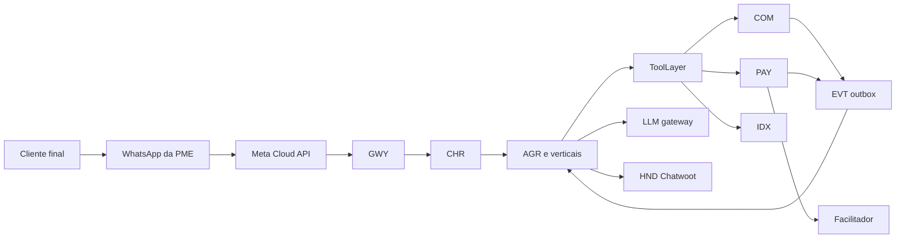

# System Spec — KAMBÁ

| Campo | Valor |
|---|---|
| Produto | KAMBÁ (nome de trabalho) — plataforma WhatsApp-native de comércio conversacional para Angola |
| Documento | Foundation — System Spec |
| Versão | 1.0 |
| Data | Outubro de 2026 |
| Classificação | Documento de Referência — Interno |
| Documento-fonte | `../docs/tecnica/00_Arquitectura_Solucao.md`, `../docs/exploracao/14-tese-minima-e-plano-de-validacao.md` |
| Documentos relacionados | `specs/00_KAMBA_Carta.md`, `specs/02_Dicionario_de_Dados_Canonico.md`, `specs/INDICE.md`, `specs/01_Engineering_Standards_e_Handoff.md`, `specs/EPIC-01_Fundacoes_Dados.md` … `specs/EPIC-10_Spikes_Validacao_Gates.md` |

> **Estado das afirmações.** CONFIRMADO / INDÍCIO / NÃO VERIFICADO segundo `../docs/tecnica/evidencia/` (2026-10-08). Valores marcados *proposta* são hipóteses a calibrar no Piloto. Tudo o que é jurídico leva «(a confirmar por parecer)».

---

## 1. Propósito deste documento

Fixa o **quê** do Piloto da KAMBÁ: visão executiva, modelo de domínio, capacidades, mapeamento capacidade → componente → epic, stack de referência, drivers não-funcionais, riscos, critérios de aceitação sistémicos e KPIs/SLOs. O *como* está em `../docs/tecnica/`; a forma do produto e o *done* estão em `00_KAMBA_Carta.md`; a decomposição em tickets está nos `EPIC-*`.

## 2. Visão executiva

**Problema.** A economia das PMEs angolanas funciona por conversa de WhatsApp («tens?», «quanto é?», «manda a referência»). Perde-se vendas por falta de resposta, o preço e o stock estão na cabeça do dono, a cobrança é por comprovativos que podem ser falsificados, e a PME tem pouca literacia digital.

**Solução.** Um assistente de atendimento e venda **no número de WhatsApp da própria PME** (coexistência com a app do dono), que responde, mostra catálogo, monta pedidos, marca serviços e emite referências de pagamento. O dono continua a usar o seu WhatsApp; a KAMBÁ trabalha nos bastidores e passa a conversa a um humano quando preciso.

**Utilizadores.** (1) o **dono da PME formal**, que paga a assinatura e controla a loja por mensagem ou painel mínimo; (2) o **cliente final**, que fala com a loja que já conhece; (3) a **equipa KAMBÁ** (T&S, suporte), que só intervém por excepção.

**Proposta de valor.** «Nunca mais perca um cliente por não responder ao WhatsApp; receba o pagamento sem andar atrás de comprovativos.»

**Princípios não-negociáveis** (`../docs/tecnica/00` §1.1): canal oficial; mediação total pelo runtime; dinheiro só por evento autenticado com liquidação directa à PME; core próprio com verticais como configuração.

**O que o Piloto não é:** Fluxo B / agregador, marketplace com fundos retidos, logística federada, Score, AdsEngine, rede de agentes (ver `00_KAMBA_Carta.md` §2).

## 3. Modelo de domínio

| Entidade | Descrição | Dono (componente) |
|---|---|---|
| **Tenant** | Unidade de isolamento e facturação; no Piloto, uma PME (`tipo='pme'`) | TEN |
| **Entitlement** | Módulo e limites activos de um tenant (`vendedor`, `servicos`) | TEN |
| **Channel** | Número WhatsApp ligado (`phone_number_id`, `waba_id`) com a vertical que o serve | CHR |
| **Contact** | Cliente final identificado por `contact_id` aleatório; BSUID e telefone cifrado em tabela separada | CHR, DAT |
| **Conversation** | Fio de mensagens com modo (`bot`, `dono`, `humano`, `pausada`) | AGR, HND |
| **Vertical** | Configuração `(grafo, tools, persona, entitlements, subscrições)` | REG |
| **Product / Stock** | Produto com preço (fixo, a partir de, sob consulta) e stock | COM |
| **Cart / Order** | Carrinho proposto e encomenda com máquina de estados | COM |
| **Reservation** | Reserva de stock 24–72 h com expiração | COM |
| **Service / Booking** | Serviço, disponibilidade e marcação com *hold* | COM (`servicos`) |
| **PaymentEvent** | Evento do ledger append-only (emitida, paga, expirada, falhada) | PAY |
| **Event** | Evento de domínio com envelope versionado, via outbox | EVT |
| **ConsentEvent** | Prova de consentimento por contacto e finalidade | CHR, GOV |
| **OnboardingCase** | Caso de onboarding com estado, evidências e decisão | GOV, TEN |

Estados canónicos: encomenda (`../docs/tecnica/00` §6.1), tenant (`../docs/tecnica/00` §6.2).

## 4. Capacidades funcionais

| Cap. | Capacidade | Fase | Descrição |
|---|---|---|---|
| CAP-01 | Atender no WhatsApp da PME | 0–1 | Receber e responder no número da PME (Cloud API + coexistência), com janela de 24 h e templates utility |
| CAP-02 | Catálogo com preço e stock fiáveis | 0–1 | Produtos, variantes, preço opaco, stock, Catálogo AI (foto → ficha), pesquisa por tenant |
| CAP-03 | Vender | 0 | Carrinho proposto, confirmação por botão, pedido idempotente, reserva de stock |
| CAP-04 | Marcar serviços | 0–1 | Disponibilidade, `book_slot`, remarcação, lembretes |
| CAP-05 | Cobrar com evento autenticado | 0–1 | `ManualProvider` limitado → facilitador (ProxyPay); ledger; régua de cobrança |
| CAP-06 | Passar a humano | 0–1 | Handoff idempotente; protocolo bot ↔ dono ↔ humano; Chatwoot |
| CAP-07 | Voz | 1 | Nota de voz com STT, confiança, eco e fallback |
| CAP-08 | Onboarding self-service | 1 | Registo, KYC K1 automático, screening, aceite, saga, Embedded Signup, catálogo, teste e activação |
| CAP-09 | Governação | 0–1 | Consentimento, screening de categorias, Trust & Safety, fila de excepções, off-boarding |
| CAP-10 | Isolamento, privacidade e conformidade | 0–1 | RLS, ToolLayer, identidade em duas camadas, subprocessadores APD, direitos do titular |
| CAP-11 | Operação e custo | 0–1 | Ambientes, backups, métricas, SLOs, custo por tenant, billing da plataforma |
| CAP-12 | Validação do Piloto | 0–1 | Spikes, pedidos a terceiros, entrevistas, gates |
| CAP-13 | Módulos de entrada | 1 | Canal do dono (número da loja e painel web), Catálogo AI conversacional, Foto de produtos AI, Social AI para publicação manual, Orçamento expresso; planos e metering por módulo (ADR-020) |

## 5. Arquitectura de alto nível

Seis camadas (detalhe em `../docs/tecnica/00` §3): L5 canais (WhatsApp da PME, painel web mínimo, consola de operação), L4 borda (GWY, CHR), L3 plano de agentes (AGR, REG, TLS, HND), L2 core (COM, PAY, IDX, TEN, EVT), L1 dados e substrato (Postgres 18, storage S3-compatível, LiteLLM), L0 externo (Meta, facilitadores, provedores de LLM e STT). As camadas transversais são Governação e Observabilidade.

## 6. Stack de referência

Versões fixadas por lockfile com *hash* ou por digest. Estado conforme `../docs/tecnica/evidencia/E4`.

| Camada | Escolha | Nota |
|---|---|---|
| Linguagens | Node 24 LTS (gateway, Hono 4.x), Python 3.12 (runtime) | Node 24 LTS: INDÍCIO |
| Base de dados | PostgreSQL 18.x, pgvector ≥ 0.8.7, pg_trgm | `iterative_scan` ou partição (ADR-006) |
| Orquestração de agentes | LangGraph 1.2.x **biblioteca** + `langgraph-checkpoint-postgres` | Server proibido (Elastic-2.0) |
| LLM gateway | LiteLLM ≥ 1.83.0 por digest | Ataque de supply chain em 2026-03-24 |
| Registo de comércio | Medusa v2.x sujeito a spike | Mercur fora do Piloto |
| Consola humana | Chatwoot (core MIT) | Agent Bot API |
| Fila e bus | BullMQ sobre Redis ou Valkey | D12 |
| Storage | S3-compatível atrás de `StorageProvider` | SeaweedFS ou gerido (D6); MinIO excluído |
| Segredos | Doppler no Piloto; interface OpenBao | — |
| Observabilidade | Prometheus, Grafana, Loki; custo por tenant via LiteLLM | Langfuse só em Clusters (ADR-018) |
| Edge | TLS e WAF no alojamento escolhido | CDN como subprocessador (D12) |
| Pagamentos | `ManualProvider` → ProxyPay | Facilitador: D4 |

## 7. Drivers não-funcionais

| Driver | Alvo | Mecanismo |
|---|---|---|
| Webhook | 200 em < 500 ms; zero perda | Fila e deduplicação por `message.id` |
| Latência de resposta | p95 texto 4–8 s; voz 6–12 s (orçamento de desenho) | Roteamento por papel de modelo |
| Correcção de números | 0 divergentes em produção (objectivo; risco residual medido) | Renderer por referência e validador |
| Pagamento | 100% por evento autenticado | ADR-013 |
| Isolamento | 0 leituras cruzadas | `tenant_id` do estado, RLS `FORCE`, testes cruzados |
| Disponibilidade do caminho de venda | 99,5% (Piloto) | Workers stateless, fila, modo determinístico |
| Custo de IA por conversa | ≤ 15% da mensalidade (H6) | Budgets LiteLLM |
| RPO / RTO | ≤ 5 min / ≤ 2 h | pgBackRest fora do host, restauro testado |
| Conformidade | 100% dos destinos de dados com `apd_ref` | ADR-008 |

## 8. Mapeamento Capacidade → Componente → Epic

| Capacidade | Componentes | Epics |
|---|---|---|
| CAP-01 Atender | GWY, CHR, ChannelAdapter, MED | EPIC-02 |
| CAP-02 Catálogo | COM, IDX, MED, LLM | EPIC-04, EPIC-06 |
| CAP-03 Vender | AGR, TLS, COM, PAY | EPIC-03, EPIC-04 |
| CAP-04 Serviços | AGR, TLS, COM (`servicos`) | EPIC-03, EPIC-04 |
| CAP-05 Cobrar | PAY, EVT, TEN | EPIC-05 |
| CAP-06 Humano | HND, AGR | EPIC-02, EPIC-03 |
| CAP-07 Voz | AGR, MED, LLM | EPIC-03, EPIC-10 (spike) |
| CAP-08 Onboarding | GOV, TEN, CHR, COM | EPIC-09, EPIC-02 |
| CAP-09 Governação | GOV, CHR | EPIC-09, EPIC-07 |
| CAP-10 Segurança e conformidade | TLS, TEN, DAT, STO | EPIC-01, EPIC-07 |
| CAP-11 Operação e custo | OBS, TEN, PAY | EPIC-08, EPIC-05 |
| CAP-12 Validação | — | EPIC-10 |
| CAP-13 Módulos de entrada | ENT, CHR, AGR, MED, LLM, TEN | EPIC-11 (com EPIC-04, EPIC-03) |

## 9. Modelo de maturidade e fases

| Fase | Duração-alvo | Entrega | Gate |
|---|---|---|---|
| **Fase 0 — Fundação** | ≤ 6 semanas | Esqueleto andante com duas verticais, pedido, evento de pagamento, handoff, isolamento testado | KAM-108 |
| **Fase 1 — Piloto** | semanas 7–12 | Onboarding self-service, módulos de entrada (ADR-020), voz, Catálogo AI, facilitador (se contrato), observabilidade, golden como gate, ≥ 10 PMEs | KAM-110 |
| Fase 2 — Clusters | meses 3–12 | Geo, estafetas, billing avançado, vitrine, índice federado (condicionado) | Fora deste backlog |
| Fase 3 — Escala | meses 12–24 | Analytics, Score, API pública (condicionados) | Fora deste backlog |

Maturidade técnica (`../docs/tecnica/00` §13.1): K0 demo → K1 esqueleto andante → K2 operável (pagamento autenticado, isolamento testado) → K3 escalável → K4 plataforma. O Piloto termina em **K2**.

## 10. Os onze epics

| Epic | Foco | Tickets |
|---|---|---|
| EPIC-01 | Fundações e Dados | KAM-001–012, 111 |
| EPIC-02 | Canais WhatsApp e Handoff | KAM-013–024, 115 |
| EPIC-03 | Agent Runtime e Verticais | KAM-025–040, 114 |
| EPIC-04 | Core de Comércio | KAM-041–051 |
| EPIC-05 | Pagamentos e Billing | KAM-052–060 |
| EPIC-06 | Índice e Pesquisa | KAM-061–064 |
| EPIC-07 | Segurança e Conformidade | KAM-065–074, 112–113 |
| EPIC-08 | Topologia e Operação | KAM-075–085 |
| EPIC-09 | Onboarding e Governação | KAM-086–099, 116–117 |
| EPIC-10 | Spikes, Validação e Gates | KAM-100–110 |
| EPIC-11 | Módulos de Entrada | KAM-118–127 |

## 11. ADRs em vigor

Os 20 ADRs canónicos (ADR-001 a ADR-020) estão em `../docs/tecnica/00_Arquitectura_Solucao.md` §8; o seu estado (FIXA, CONDICIONAL) está em `00_KAMBA_Carta.md` §4.1. As decisões abertas D1–D13 estão em `../docs/tecnica/00` §13.3 e `00_KAMBA_Carta.md` §4.2.

## 12. Riscos top-level

| Risco | Impacto | Mitigação |
|---|---|---|
| Política da Meta (IA de uso geral, agregador, termos de ML) | Perda do canal | Domínio comercial fechado; só Fluxo A; perguntas escritas (KAM-101) |
| Coexistência indisponível em +244 | Fluxo A inviável com o número existente | Spike (KAM-100); alternativa de número dedicado |
| Sem contrato de pagamento por PME | Sem pagamento integrado | `ManualProvider` com limites; contratos desde a semana 1 (KAM-103) |
| Transferência de dados sem registo APD | Multa e paragem | ADR-008; inventário de subprocessadores (KAM-069) |
| Fraude de registo em self-service | Base envenenada, quality rating | Confiança gradual, KYC K1 automático, T&S (EPIC-09) |
| Custo de IA e de mensagens acima da assinatura | Margem negativa | Budgets, roteamento, monitorização (KAM-081) |
| Qualidade em português de Angola | Handoff excessivo | Golden como gate; spike de voz (KAM-107) |
| Falha de autorização entre vendedores (Medusa/Mercur) | Fuga entre PMEs | Spike com testes cruzados (KAM-041) |
| Ataque a dependência (LiteLLM, PyPI/npm) | Roubo de chaves | Digests, cosign, SBOM, egress (KAM-067) |
| Paralisia analítica | Piloto nunca arranca | Gates com data; Carta §6 |
| Módulos de entrada diluem o foco | Fase 0 derrapa | ADR-020: máx. 4, finos, fora do gate da Fase 0, cortáveis |

## 13. Critérios de aceitação sistémicos

- [ ] Uma conversa real num número de teste cria um pedido e o evento de pagamento é consumido pela outra vertical (KAM-108).
- [ ] 0 leituras cruzadas entre tenants e contactos na suite completa.
- [ ] 0 divergências de número/`sku` no conjunto adversarial; H7 ≥ 85%.
- [ ] 100% das transições para `paga` por evento autenticado.
- [ ] Reenviar um webhook 2× ou tocar 2× no botão de confirmação produz um só efeito.
- [ ] Onboarding self-service completo, sem toque da equipa, num caso de teste feliz.
- [ ] Restauro completo noutro host em ≤ 2 h com perda de dados ≤ 5 min.
- [ ] Nenhum dado pessoal em logs ou eventos em claro; nenhum destino fora de Angola sem `apd_ref`.

## 14. KPIs e SLOs

| KPI / SLO | Alvo | Fonte |
|---|---|---|
| PMEs pagantes aos 30 dias (H1) | ≥ 5 | billing |
| PMEs activas ao dia 60 (H9) | ≥ 70% | coortes |
| Activações sem intervenção humana | ≥ 80% (*proposta*) | `onboarding_case` |
| PMEs que usam ≥ 1 módulo de entrada nas 2 primeiras semanas (H10) | ≥ 60% (*proposta*) | uso por módulo |
| Conversão módulo de entrada → atendimento aos 30 dias (H11) | ≥ 30% (*proposta*) | coortes |
| Mediana entrada → loja activa | ≤ 60 min de actividade do dono (*proposta*) | `onboarding_case` |
| Custo de IA por conversa (H6) | ≤ 15% da mensalidade | LiteLLM + Meta |
| Handoff correcto (H7) | ≥ 85% | golden e produção |
| Catálogos correctos (H8) | ≥ 60% | auditoria |
| Retoma de handoff | < 15 min em ≥ 80% (*a validar*) | HND |
| Latência p95 | texto 4–8 s; voz 6–12 s | OBS |
| Disponibilidade do caminho de venda | 99,5% | OBS |

## 15. Glossário transversal

**Fluxo A:** cliente fala com o WhatsApp da PME. **Coexistência:** o mesmo número na app do dono e na Cloud API. **BSUID:** identificador de utilizador da Meta. **Fact:** valor devolvido por uma tool, única origem de números em respostas. **Outbox:** evento escrito na mesma transacção que o dado. **Esqueleto andante:** fio de ponta a ponta através de todas as camadas. **Regra de dois:** uma abstracção só está validada com duas verticais. **KYC K1/K2:** verificação documental automática / presencial opcional. **ManualProvider:** confirmação humana auditada e limitada de pagamento. **PSP:** prestador de serviços de pagamento licenciado pelo BNA. **APD:** Agência de Protecção de Dados. **D#:** decisão aberta. **H#:** hipótese de negócio.

## 16. Tabela de aprovação

| Papel | Nome | Assinatura | Data |
|---|---|---|---|
| Arquitecto de Plataforma |  |  |  |
| Responsável de Segurança |  |  |  |
| Responsável de Produto |  |  |  |

| Versão | Data | Descrição | Autor |
|---|---|---|---|
| 1.0 | Outubro 2026 | Emissão inicial | Equipa KAMBÁ |
| 1.1 | Outubro 2026 | KAM-130: **20** ADRs canónicos (ADR-001 a ADR-020) e decisões abertas `D1–D13`. A mesma linha afirmava dezanove e doze; os dois números foram contados na fonte (`../docs/tecnica/00` §8 e §13.3) e não copiados de outro índice, que é como o defeito se propagou. | Equipa KAMBÁ |
